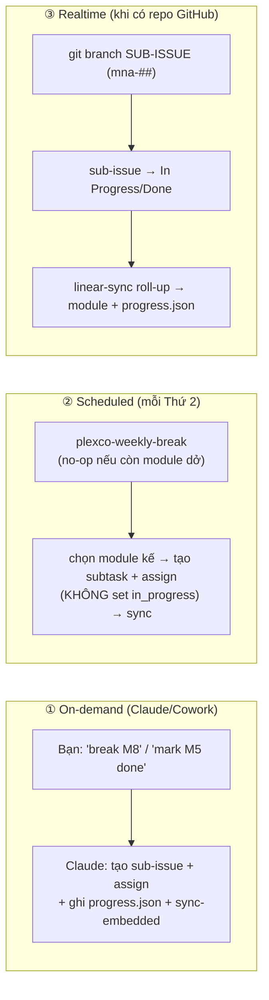

# 🧭 ONBOARDING — Hệ thống theo dõi & automation của Plexco

> Đọc file này đầu tiên khi join dự án. Nó cho bạn **toàn bộ context** về cách Plexco quản lý tiến độ và **cách automation hoạt động**. Context sản phẩm (nghiệp vụ/kỹ thuật) nằm ở `docs/core/` (BRD · PRD · TDD · ROADMAP); cách thi công ở `EXECUTION-PLAYBOOK.md`; index tổng ở `README.md`.

---

## 1. TL;DR (3 câu)

Plexco theo dõi tiến độ bằng **hai nguồn song song**: `progress.json` (file versioned trong repo, hiển thị qua `plexco-dashboard.html`) và **Linear** (project "Plexco MVP"). Hai nguồn nối với nhau bằng **khoá `[M#]`** (mỗi module 1 issue) và đồng bộ bằng script + GitHub Action — trạng thái "đang làm/xong" được suy từ **hoạt động git thật**, không phải bấm tay. Một AI co-pilot (Claude trong Cowork) lo việc **break module → sub-task → đẩy Linear + progress.json → assign**.

---

## 2. Mental model — 2 nguồn sự thật song song

```
        ┌────────────────────────┐         [M#] = khoá đối chiếu        ┌──────────────────────┐
        │  progress.json (repo)  │◀──────── compare-linear / linear-sync ────────▶│  Linear "Plexco MVP" │
        │  + plexco-dashboard.html│        (script đồng bộ 2 chiều có kiểm soát)   │  team maingocanh1     │
        └────────────────────────┘                                                └──────────────────────┘
            coarse: phase/module/gate                                          fine: issue [M#] + sub-issue DoD
            mở offline, versioned cùng code                                    kéo-thả, assignee, cycle, automation
```

- **Khoá đối chiếu:** mỗi module = 1 Linear issue có title prefix `[M#]` (vd `[M5] ...`) + label `plexco-mvp`. Trong `progress.json`, `module.linearId` trỏ tới issue đó (vd `MNA-9`). **Không bao giờ đổi prefix `[M#]`.**

### Ownership theo field (ai là chủ của cái gì)

Không phải "hai nguồn độc lập hoàn toàn" — mà **mỗi field có 1 chủ rõ ràng** để không nhập nhằng:

| Dữ liệu | Chủ (nguồn ghi) | Bên kia |
|---|---|---|
| `module.status`, `subtasks[].status` | **Linear** (sau khi bật realtime) — suy từ git/branch/PR | progress.json là **bản sao**, do `linear-sync.mjs` ghi |
| `doc`, `gates`, `invariants`, `phases`, `milestones`, points, `subtasks[].title`, `linearId`, `assignee map` | **progress.json** (versioned trong repo) | Linear không đụng |
| khối `EMBEDDED` trong dashboard | **dẫn xuất** từ progress.json (qua `sync-embedded.mjs`) | chỉ là projection để mở offline |

> Tóm: **Linear sở hữu "đang ở đâu" (status)**; **progress.json sở hữu "bản đồ + cấu trúc"** (gate/invariant/roadmap/điểm/khoá). Dashboard chỉ vẽ lại. Trước khi bật realtime, có thể click trên dashboard để thử local, nhưng khi realtime đã bật thì **đừng sửa `status` tay** — `linear-sync` sẽ ghi đè.

> 4 bất biến lõi của sản phẩm (cô lập tenant · không lộ tiền/PII public · ledger không mất tiền · Postgres = nguồn sự thật) được track riêng ở mục **Invariants** + **Quality Gates** trên dashboard. Xem `EXECUTION-PLAYBOOK.md §6`.

---

## 3. Bản đồ file

| File | Vai trò | Khi nào đụng |
|---|---|---|
| `progress.json` | **Nguồn sự thật cấu trúc tiến độ** (phase/module/gate/milestone/subtasks/assignee); status là bản mirror từ Linear khi realtime bật. | Script ghi; hiếm khi sửa tay |
| `plexco-dashboard.html` | Dashboard self-contained (mở bằng browser). Có cột so sánh Linear. | Mở để xem; không sửa tay phần `EMBEDDED` |
| `sync-embedded.mjs` | Ghi `progress.json` → khối `EMBEDDED` trong dashboard (chống lệch). | Chạy sau mỗi lần đổi `progress.json` |
| `compare-linear.mjs` | **Đọc** Linear + progress.json → in bảng drift; `--write` xuất snapshot. | Khi muốn so 2 nguồn |
| `linear-sync.mjs` | **Ghi** status từ Linear → progress.json (Linear leader). Engine của realtime. | Action gọi; hoặc chạy tay |
| `linear-snapshot.json` | Ảnh chụp trạng thái Linear cho dashboard so sánh. | Do script sinh |
| `gen-linear-csv.mjs` / `linear-import.csv` | Đường seed Linear bằng CSV (không cần OAuth). | Khi seed lại / nơi khác |
| `.github/workflows/linear-sync.yml` | GitHub Action chạy `linear-sync` khi push/webhook/cron. | Kích hoạt khi có repo GitHub |
| `EXECUTION-PLAYBOOK.md` | Phương pháp thi công (nguyên tắc, cadence, gate, 2 tuần đầu). | Đọc khi bắt đầu code |
| `BACKLOG-P0-P3.md` | Checklist DoD chi tiết cho M1–M6. | Khi làm Foundation/Tenant Engine |
| `AUTOMATION.md` | Chi tiết kỹ thuật 3 chế độ automation. | Tra cứu khi vận hành automation |

---

## 4. progress.json — schema rút gọn

```jsonc
{
  "linear": { "project": "Plexco MVP", "team": "maingocanh1", "label": "plexco-mvp", "projectUrl": "..." },
  "invariants": [ { "id": "INV-1", "status": "not_started" } ],   // 4 bất biến lõi
  "gates":      [ { "id": "ISO", "intro": "P0", "status": "..." } ], // 5 quality gate CI
  "phases":     [ { "id": "P0-P1", "modules": ["M1","M2","M3"], "kpi": "...", "status": "..." } ],
  "modules": [
    {
      "id": "M5", "name": "...", "phase": "P2-P3", "points": 13,
      "status": "not_started",        // enum: not_started|in_progress|in_review|done|blocked
      "assignee": "Ngoc-Anh Mai",
      "linearId": "MNA-9",            // ← khoá nối tới Linear
      "subtasks": [ { "title": "...", "identifier": "MNA-47", "status": "not_started", "assignee": null } ]
    }
  ],
  "milestones": [ { "id": "MS1", "phase": "P0-P1", "status": "..." } ]
}
```

**% tiến độ** tính theo điểm có trọng số: `done=1, in_review=.85, in_progress=.5, blocked=.25, not_started=0`. Module post-MVP (Messenger M17) loại khỏi % MVP.

---

## 5. Cấu trúc Linear

- **Project:** Plexco MVP · **Team:** maingocanh1 (key `MNA`) · **Label:** `plexco-mvp`.
- **19 module** = 19 issue `[M1]`→`[M19]` (MNA-5 → MNA-23), có estimate = points, assignee = chủ dự án.
- **Sub-task DoD** = sub-issue (parentId = issue `[M#]`) và cũng gắn label `plexco-mvp` để `linear-sync` đọc được. M1–M6 và M7 đã có; M8–M19 sẽ được break dần.
- **Mapping module → Linear ID:** xem `module.linearId` trong `progress.json` (M1=MNA-5 … M7=MNA-11 … M19=MNA-23).

---

## 6. Ba chế độ automation



| Chế độ | Trigger | Làm gì | Trạng thái |
|---|---|---|---|
| **① On-demand** | Bạn nói với Claude (Cowork, đã nối Linear) | break module → sub-task, assign, ghi cả Linear lẫn progress.json | ✅ Dùng được ngay |
| **② Scheduled** | Cron Thứ 2 8:35 (`plexco-weekly-break`) | **WIP guard:** no-op nếu còn module dở; nếu rảnh → break **1 module kế** (tạo subtask, không bật in_progress) | ✅ Đã tạo (cần "Run now" 1 lần để pre-approve) |
| **③ Realtime** | git push / Linear webhook / cron 10' | branch/PR flip Linear → Action mirror sang progress.json | ⏳ Kích hoạt khi repo GitHub tồn tại (M1) |

**Câu lệnh on-demand hay dùng (nói với Claude):** `break M8` · `break P4` · `mark M5 done` · `refresh compare`.

---

## 7. Cookbook cho người mới

**"Tôi muốn xem dự án đang ở đâu"** → mở `plexco-dashboard.html` bằng browser. Bấm **🔗 Load Linear snapshot** (`linear-snapshot.json`) để thấy cột so sánh Linear ↔ progress.json.

**"Tôi bắt đầu làm 1 sub-task"** → (khi có repo) `git checkout -b` đúng **branch name của SUB-ISSUE** (Linear cấp cho mỗi issue, vd `maingocanh/mna-63-...`) → sub-issue → In Progress → `linear-sync` **roll-up** lên module cha (≥1 subtask started ⇒ module `in_progress`). Không cần bấm tay, không cần đụng issue cha `[M#]`.

**"Tôi xong 1 module"** → merge PR các sub-task (sub-issue → Done). Khi **tất cả** subtask done → roll-up đẩy module → `done`. Hoặc nói Claude `mark M5 done` để cập nhật Linear rồi sync. Đừng sửa `progress.json.status` tay.

**"Module sắp tới chưa có sub-task"** → nói Claude `break M8`, hoặc đợi scheduled Thứ 2. **Break chỉ tạo subtask, KHÔNG bật module in_progress** — module chỉ "đang làm" khi bạn thật sự bắt đầu một subtask. WIP=1: scheduled tự **no-op** nếu còn module dở.

**"Hai nguồn có lệch không?"** → `node compare-linear.mjs` (cần `LINEAR_API_KEY`). Khớp = im lặng/xanh; lệch = bảng đỏ + exit code 2.

**"Tôi sửa progress.json tay (hiếm)"** → luôn chạy `node sync-embedded.mjs` sau đó để dashboard offline khớp.

---

## 8. Scripts — bảng tra nhanh

```bash
node sync-embedded.mjs                                   # progress.json → EMBEDDED trong dashboard
LINEAR_API_KEY=lin_api_xxx node compare-linear.mjs       # so 2 nguồn, in drift (exit 2 nếu lệch)
LINEAR_API_KEY=lin_api_xxx node compare-linear.mjs --write   # + xuất linear-snapshot.json
LINEAR_API_KEY=lin_api_xxx node linear-sync.mjs          # pull Linear → GHI progress.json (Linear leader)
LINEAR_API_KEY=lin_api_xxx node linear-sync.mjs --check  # dry-run (không ghi)
node gen-linear-csv.mjs                                   # sinh linear-import.csv (seed không cần OAuth)
```

`LINEAR_API_KEY`: Linear → Settings → Security & access → Personal API keys.

---

## 9. Checklist kích hoạt realtime (làm 1 lần khi repo GitHub có ở M1)

- [ ] Push monorepo Plexco lên GitHub; copy sẵn `linear-sync.mjs` + `.github/workflows/linear-sync.yml` vào repo (đã có trong folder này).
- [ ] Linear → Settings → Integrations → **GitHub**: link repo + bật auto-move (branch→In Progress, PR→In Review, merge→Done).
- [ ] GitHub repo → Settings → Secrets → Actions: thêm `LINEAR_API_KEY`.
- [ ] (Tùy chọn realtime đúng nghĩa) Linear webhook **Issue** → relay nhỏ (Cloudflare Worker/Vercel) gọi GitHub `repository_dispatch {event_type:"linear-changed"}`. Bỏ qua thì Action vẫn chạy theo push + cron 10'.
- [ ] Dùng đúng **branch name Linear cấp** cho mỗi issue khi `git checkout -b`.

---

## 10. Nguyên tắc bất di bất dịch

1. **Không đổi prefix `[M#]`** trong title Linear — đó là khoá nối 2 nguồn.
2. **Linear sở hữu `status`** (suy từ git); progress.json sở hữu cấu trúc (gate/invariant/roadmap/subtask/khoá). Khi realtime đã bật, **đừng sửa `status` tay**.
3. **Module status = roll-up từ subtasks** (all done→done · any blocked→blocked · any in_progress→in_progress · any in_review→in_review · any done→in_progress · else not_started; module chưa có subtask thì lấy issue cha). **Break không bật in_progress** — module "đang làm" chỉ khi một subtask thật sự bắt đầu.
4. **WIP = 1**: mỗi lúc chỉ 1 module thực sự đang làm; scheduled tự no-op nếu còn module dở (xem playbook).
5. **Gate đỏ = không merge**, không sang phase sau (4 bất biến + 5 quality gate).
6. Sau mọi thay đổi `progress.json` → chạy `sync-embedded.mjs`.
7. Trạng thái chỉ có **1 trường**: `status`. (Field `code` cũ đã bỏ để khỏi nhập nhằng; `doc` = mức độ sẵn sàng tài liệu, khác `status`.)

---

## 11. Liên kết

| Cần gì | Đọc |
|---|---|
| Index tổng / điểm vào | `README.md` |
| Context nghiệp vụ / scope | `docs/core/BRD.md` |
| Hành vi / user flow / edge case | `docs/core/PRD.md` |
| Hợp đồng kỹ thuật / schema / RLS | `docs/core/TDD.md` |
| Thứ tự thi công / tiến độ | `docs/core/ROADMAP.md` |
| Tiếp quản cho dev/AI mới | `docs/standards/HANDOFF.md` |
| Phương pháp thi công (cadence, gate) | `EXECUTION-PLAYBOOK.md` |
| Checklist DoD P0–P3 | `BACKLOG-P0-P3.md` |
| Chi tiết automation | `AUTOMATION.md` |
| Linear project | https://linear.app/maingocanh1/project/plexco-mvp-5a5336c896c5 |
