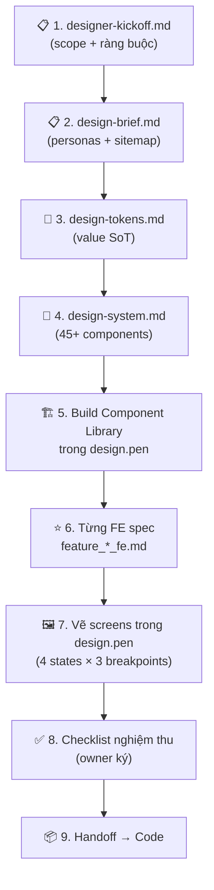

# Hướng dẫn: Docs nào dùng để đưa Designer thiết kế UI cho Plexco App

> 🔴 **CHƯA GỬI CHO DESIGNER — FE PENDING theo lệnh owner 2026-08-13.**
> DD-81 / M0.3 / M4 và **mọi việc FE** đang treo: không track `.pen`, không mở page/component, không chạy
> lane FE. Nguồn: `../../autopilot-templates/next-lanes-2026-08-13-RUN.md`.
>
> File này tự mô tả là **gói bàn giao** cho designer (§"Kết luận"), nên nó là file dễ bị forward ra ngoài
> nhất trong cả bộ — và trước 13/08 nó **không chứa một chữ nào** về ranh giới gate. Ai nhận file này mà
> không đọc dòng trên sẽ bắt đầu vẽ. Giữ lại làm bản đồ tài liệu; **không dùng làm lệnh khởi công.**
>
> **Ngày:** 2026-08-10 · **Cập nhật ranh giới:** 2026-08-13 · **Nguồn:** scan toàn bộ `docs/` repo

---

## TL;DR — Pipeline đã chốt

```
Designer KHÔNG vẽ thẳng từ BRD/feature docs.
Pipeline: Product docs → FE Design Specs → Design Tokens → Component Library → Screens (.pen)
```

Plexco đã build sẵn **pipeline hoàn chỉnh** cho designer ở `docs/channels/web/`. Dưới đây là bản đồ tất cả docs, **xếp theo thứ tự designer đọc**.

---

## Gói tài liệu cho Designer (đọc theo thứ tự)

### 📋 Tầng 1 — Context & Kickoff (đọc 1 lần, nắm bối cảnh)

| # | File | Dùng để | Status |
|---|------|---------|--------|
| 1 | [designer-kickoff.md](file:///Users/maingocanh/Projects/Plexco%20app/docs/channels/web/designer-kickoff.md) | **🔑 Điểm khởi đầu chính** — chốt scope, thứ tự vẽ màn, checklist nghiệm thu, ràng buộc DD-57 | ✅ Active v0.9 |
| 2 | [design-brief.md](file:///Users/maingocanh/Projects/Plexco%20app/docs/channels/web/design-brief.md) | Bối cảnh sản phẩm, personas, user journeys, sitemap, deliverables, a11y | ✅ Active v2.4 |
| 3 | [theme-direction-2026-07.md](file:///Users/maingocanh/Projects/Plexco%20app/docs/channels/web/theme-direction-2026-07.md) | Target theme: Candidate C Energetic Orange `#FF5A1F` + Sora/Inter | ✅ DD-81 |

### 🎨 Tầng 2 — Design System & Tokens (làm TRƯỚC khi vẽ màn)

| # | File | Dùng để | Status |
|---|------|---------|--------|
| 4 | [design-tokens.md](file:///Users/maingocanh/Projects/Plexco%20app/docs/standards/design-tokens.md) | **Value SoT** — Color, typography, spacing, radius, shadow, motion. `.pen` variables PHẢI match file này | ✅ Canonical |
| 5 | [design-system.md](file:///Users/maingocanh/Projects/Plexco%20app/docs/standards/design-system.md) | **Component catalog** — 45+ component với states, layout pattern, 4-state, motion, a11y, responsive grid | ✅ Active |
| 6 | [design-tokens-benchmark.md](file:///Users/maingocanh/Projects/Plexco%20app/docs/standards/design-tokens-benchmark.md) | Advisory evidence khi cần đề xuất token mới | Advisory |
| 7 | [token-needs-matrix.md](file:///Users/maingocanh/Projects/Plexco%20app/docs/standards/token-needs-matrix.md) | Matrix token gaps — khi thiếu token, tham khảo đây trước khi đề xuất | Advisory |

### ⭐ Tầng 3 — FE Design Specs (chi tiết nhất cho TỪNG MÀN — 12 file)

> **Đây là tầng quan trọng nhất.** Mỗi FE spec có: ASCII wireframe desktop+mobile, 4 states, error mapping, data table với `t(vi, en)`, edge cases UX, responsive 3 breakpoints. **Khi FE spec và Product spec lệch → FE spec thắng.**

| # | FE Spec | Màn tương ứng | Priority |
|---|---------|---------------|----------|
| 1 | [feature_auth_fe.md](file:///Users/maingocanh/Projects/Plexco%20app/docs/channels/web/FE/feature_auth_fe.md) | Landing + Login (Google + email) | 🔴 1st |
| 2 | [feature_onboarding_fe.md](file:///Users/maingocanh/Projects/Plexco%20app/docs/channels/web/FE/feature_onboarding_fe.md) | Onboarding wizard 4 bước | 🔴 2nd |
| 3 | [feature_dashboard_fe.md](file:///Users/maingocanh/Projects/Plexco%20app/docs/channels/web/FE/feature_dashboard_fe.md) | Dashboard overview | 🔴 3rd |
| 4 | [feature_sessions_fe.md](file:///Users/maingocanh/Projects/Plexco%20app/docs/channels/web/FE/feature_sessions_fe.md) | Sessions list + create + detail | 🔴 4th |
| 5 | [feature_payments_fe.md](file:///Users/maingocanh/Projects/Plexco%20app/docs/channels/web/FE/feature_payments_fe.md) | Payment ledger + allocation | 🟠 5th |
| 6 | [feature_members_fe.md](file:///Users/maingocanh/Projects/Plexco%20app/docs/channels/web/FE/feature_members_fe.md) | Members list + merge tool | 🟠 6th |
| 7 | [feature_settings_fe.md](file:///Users/maingocanh/Projects/Plexco%20app/docs/channels/web/FE/feature_settings_fe.md) | Settings config + bank + bot links | 🟠 7th |
| 8 | [feature_marketplace_fe.md](file:///Users/maingocanh/Projects/Plexco%20app/docs/channels/web/FE/feature_marketplace_fe.md) | Discover + session detail (public) | 🟡 8th |
| 9 | [feature_player_view_fe.md](file:///Users/maingocanh/Projects/Plexco%20app/docs/channels/web/FE/feature_player_view_fe.md) | Player view /me | 🟡 9th |
| 10 | [feature_chat_fe.md](file:///Users/maingocanh/Projects/Plexco%20app/docs/channels/web/FE/feature_chat_fe.md) | In-app chat (club + DM) | 🟡 10th |
| 11 | [feature_notifications_fe.md](file:///Users/maingocanh/Projects/Plexco%20app/docs/channels/web/FE/feature_notifications_fe.md) | Notification center + inbox | 🟢 11th |
| 12 | [feature_home_fe.md](file:///Users/maingocanh/Projects/Plexco%20app/docs/channels/web/FE/feature_home_fe.md) | Home hub (personal dashboard PWA) | 🟢 12th* |

> [!IMPORTANT]
> \* **Home được khuyên vẽ ĐẦU TIÊN** (theo `designer-kickoff.md` #13) để confirm/tune target theme C + Sora/Inter và kiểm light/dark/WCAG. Tuy priority output ở cuối, designer nên dùng Home để lock visual direction trước.

### 📖 Tầng 4 — Reference (đọc khi cần hiểu "vì sao")

| # | File | Dùng để |
|---|------|---------|
| A | [README.md (web channel)](file:///Users/maingocanh/Projects/Plexco%20app/docs/channels/web/README.md) | **Route canonical + Permission Matrix** — route lệch với brief thì README thắng |
| B | [frontend-pipeline.md](file:///Users/maingocanh/Projects/Plexco%20app/docs/channels/web/frontend-pipeline.md) | Handoff pipeline: `design.pen → handoff → token-mapping → code → screenshot verify` |
| C | [frontend-architecture.md](file:///Users/maingocanh/Projects/Plexco%20app/docs/standards/frontend-architecture.md) | DD-57 governance: server-first, feature-first, FE-INV-1..6 |
| D | [brd-to-pen-playbook.md](file:///Users/maingocanh/Projects/Plexco%20app/docs/templates/brd-to-pen-playbook.md) | Playbook tổng: BRD → Design Tokens → `.pen` (10 bước) |
| E | [design-system-playbook.md](file:///Users/maingocanh/Projects/Plexco%20app/docs/templates/design-system-playbook.md) | Hướng dẫn build design system |
| F | Product specs `docs/features/FE/feature_*.md` | Nguồn nghiệp vụ — đọc khi cần hiểu **vì sao**, nhưng **vẽ gì** thì theo FE spec |

---

## Trình tự làm việc đã chốt



---

## ⚠️ Cảnh báo quan trọng cho Designer

> [!CAUTION]
> **Không vẽ** các phần sau (chưa có owner contract):
> - Payment widget (QR/STK/pay_code) ở bất kỳ màn nào
> - Running total cộng client-side ở allocation panel
> - `impact_policy` selector khi đổi giá
> - System message trong chat
> - Chip "Chưa thu" trên Home (DD-96 Part B — NOT_PLAN_READY)
> 
> Mỗi FE spec có **fixture fence** ở đầu §3 — nói rõ phần nào chỉ để kiểm hierarchy chứ không authorize implement.

> [!WARNING]
> **Field đánh `UNPINNED — omit active UI`** trong FE spec thì **không vẽ**, kể cả Product spec có mô tả.

---

## Ràng buộc DD-57 (bắt buộc mọi màn)

| Ràng buộc | Chi tiết |
|-----------|----------|
| 4-state | Mọi màn data-driven: `loading · ready · empty · error` |
| Tokens-only | Chỉ dùng token từ `design-tokens.md`; thiếu → đề xuất, không hardcode |
| Song ngữ | Mọi chuỗi có bản `vi` + `en` |
| Dark mode | Mỗi component/màn có biến thể light + dark |
| Responsive | 3 breakpoint: 375 / 768 / 1440 |
| A11y | Touch ≥ 44×44, focus ring, WCAG AA contrast, `prefers-reduced-motion` |

---

## Feature mới chưa có FE spec (cần tạo thêm)

| Feature | Product spec | BE tech | FE spec | Cần làm |
|---------|-------------|---------|---------|---------|
| Club Management | [feature_club.md](file:///Users/maingocanh/Projects/Plexco%20app/docs/features/FE/feature_club.md) v1.0 | [feature_club_tech.md](file:///Users/maingocanh/Projects/Plexco%20app/docs/features/BE/feature_club_tech.md) v1.0 | ❌ Chưa có | Tạo `feature_club_fe.md` |
| Club AI Assistant | [feature_club_assistant.md](file:///Users/maingocanh/Projects/Plexco%20app/docs/features/FE/feature_club_assistant.md) v0.18 | [feature_club_assistant_tech.md](file:///Users/maingocanh/Projects/Plexco%20app/docs/features/BE/feature_club_assistant_tech.md) v0.18 | ❌ Chưa có | Tạo `feature_club_assistant_fe.md` |
| Channel Booking Funnel | [feature_channel_booking_funnel.md](file:///Users/maingocanh/Projects/Plexco%20app/docs/features/FE/feature_channel_booking_funnel.md) v1.0 | [feature_channel_booking_funnel_tech.md](file:///Users/maingocanh/Projects/Plexco%20app/docs/features/BE/feature_channel_booking_funnel_tech.md) v1.0 | ❌ Chưa có | Tạo `feature_booking_funnel_fe.md` |
| Session Organize | [feature_session_organize.md](file:///Users/maingocanh/Projects/Plexco%20app/docs/features/FE/feature_session_organize.md) v0.5a | [feature_session_organize_tech.md](file:///Users/maingocanh/Projects/Plexco%20app/docs/features/BE/feature_session_organize_tech.md) v0.6b | ❌ Chưa có | Tạo `feature_session_organize_fe.md` |
| Tournament | [feature_tournament.md](file:///Users/maingocanh/Projects/Plexco%20app/docs/features/FE/feature_tournament.md) v0.1 | [feature_tournament_tech.md](file:///Users/maingocanh/Projects/Plexco%20app/docs/features/BE/feature_tournament_tech.md) v0.2a | ❌ Chưa có | Draft — chưa cần FE spec |

> [!NOTE]
> ⚠️ **Đoạn dưới đã sai từ ngày ra đời — giữ lại kèm đính chính.** Bảng "Feature mới chưa có FE spec" ở
> trên liệt kê `club` · `club_assistant` · `booking_funnel` · `session_organize` · `tournament` là
> "❌ Chưa có → cần tạo". **Cả 5 file đã được tạo trong CHÍNH commit tạo ra bảng này** (`8af9601`,
> 2026-08-11) — xem `FE/feature_club_fe.md` v.v. Doc anh em cùng commit (`fe-spec-to-design-playbook.md`)
> đếm 17 FE spec; bảng này đếm 12. Cùng một commit, hai con số mâu thuẫn.
>
> Đính chính thêm: 5 file đó **thiếu cả 4 section DD-99** (Analytics · State Machine · AC · Testing) nên
> **không đủ điều kiện lên Reviewed** — nguyên nhân gốc là `../../templates/feature-dev/fe-spec-template.md`
> v0.4 không có bốn section (đã sửa ở v0.5, 13/08). Cần backfill trước khi promote.
>
> *(Link `fe-design-spec skill` cũ trỏ tới đường dẫn máy cá nhân ngoài repo — đã gỡ; dùng
> `../../templates/feature-dev/fe-spec-template.md`.)*

---

## Tóm tắt: Giao cho Designer những gì?

### Gói tối thiểu (bắt buộc)
1. **`designer-kickoff.md`** — điểm khởi đầu, thứ tự, checklist
2. **`design-brief.md`** — bối cảnh sản phẩm
3. **`design-tokens.md`** — token values canonical
4. **`design-system.md`** — component catalog
5. **12 file `FE/feature_*_fe.md`** — chi tiết từng màn

### Gói bổ sung (nên đọc)
6. `README.md` (web channel) — route + permission matrix
7. `theme-direction-2026-07.md` — visual direction
8. `frontend-pipeline.md` — handoff pipeline
9. `brd-to-pen-playbook.md` — playbook tổng thể

### KHÔNG giao cho Designer
- ❌ Product specs (`docs/features/FE/feature_*.md`) — quá nhiều engineering noise
- ❌ BE tech specs (`docs/features/BE/`) — toàn backend
- ❌ `decisions.md` — 450KB+ decision log
- ❌ `HANDOFF.md` — dành cho dev/AI tiếp quản
- ❌ `BRD.md` / `PRD.md` / `TDD.md` — dành cho product/engineering
