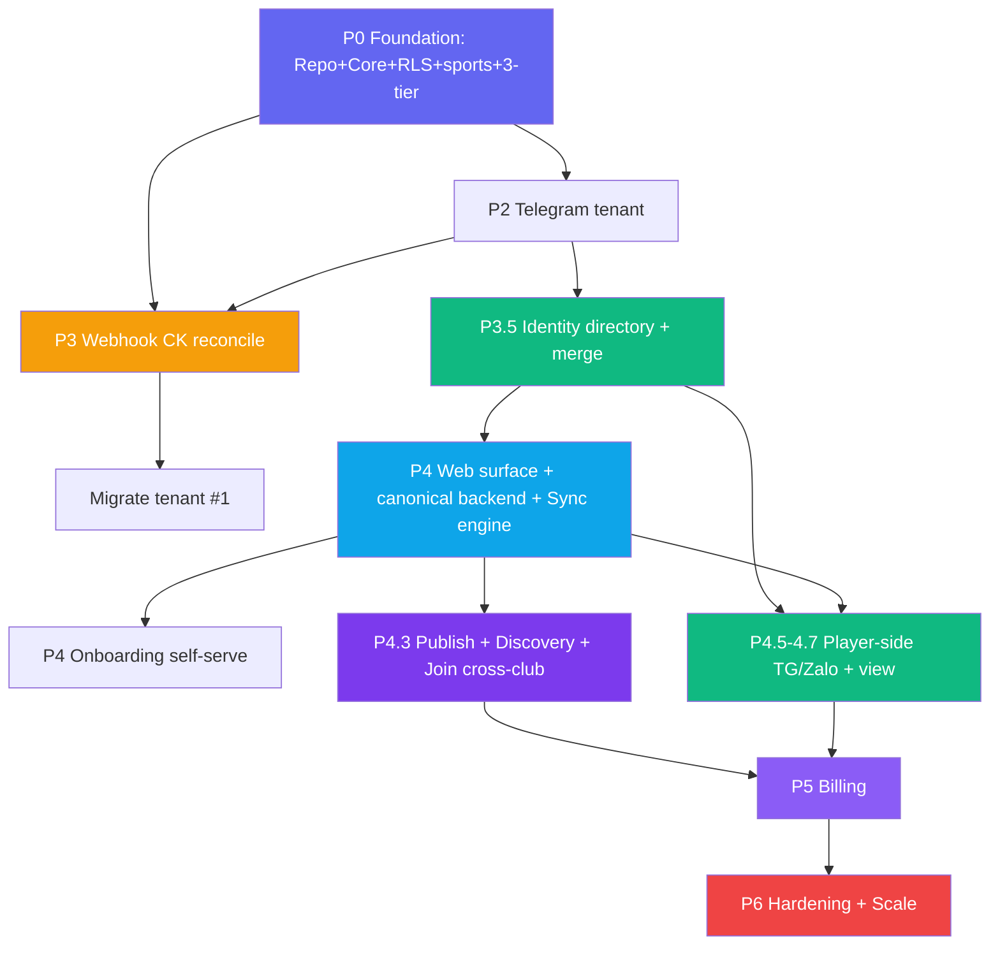

# 🗺️ ROADMAP — Plexco

**Phiên bản:** v2.1
**Ngày tạo:** 16/06/2026 · **Cập nhật:** 19/06/2026
**Căn cứ:** `BRD.md` v3.1 · `PRD.md` v2.1 · `TDD.md` v2.1 · `../appendices/saas-implementation-plan.md` · `../appendices/player-side-saas-reconciliation.md` · `../appendices/player-side-saas-AUDIT.md` · `../appendices/messenger-channel-design.md`

> ROADMAP là nguồn sự thật cho **delivery order + dev progress**. Product scope thuộc BRD; behavior thuộc PRD; implementation contract thuộc TDD.

> **Đánh số phase:** toàn bộ tài liệu dùng duy nhất **canonical P-number**. Các tên Foundation/Tenant Engine/... chỉ là delivery-group label, không tạo một hệ số thứ hai.

## Canonical Delivery Groups

| Delivery group | Canonical | Nội dung |
|---|---|---|
| **Foundation** | **P0–P1** | Repo + core + Postgres/RLS + schema đa môn + 3 tầng hiển thị + test cô lập |
| **Tenant Engine** | **P2–P3** | Telegram tenant + durable webhook + payment ledger/allocation + dogfood tenant #1 |
| **Identity** | **P3.5** | Person/ChannelIdentity/Reachability/Membership + merge an toàn |
| **Web + Sync + Marketplace** | **P4–P4.3** | Web surface + canonical backend + sync engine + onboarding + discovery/join |
| **Player-side channels** | **P4.5–P4.7** | Join TG/Zalo + nhắc/xác nhận + player view |
| **Messenger** | **P4.8** | Post-MVP, phụ thuộc Meta App Review |
| **Billing** | **P5** | Subscription host + vòng đời tenant |
| **Harden & Scale** | **P6** | Pen-test, load test, observability, ToS/Privacy |

---

## Positioning

> **Plexco — platform quản lý & khám phá hoạt động thể thao đa môn, cho cả host lẫn player. MVP gặp người dùng trong Telegram/Zalo và web; Messenger là post-MVP.**

Ba giá trị cốt lõi: **Quản lý kèo & tiền (host)** + **Khám phá & join kèo (player, đa môn, cross-club)** + **Đồng bộ liền mạch đa kênh ⇄ web**. Bổ sung cho nhóm chat sẵn có — **không thay thế**, **không bắt cài app cho player**.

---

## Context & Chiến lược

### GTM: tích hợp platform có sẵn user (0-install) + web hub

| Nhóm chat (giữ nguyên) | Plexco (bổ sung) |
|---|---|
| Chat, hẹn giờ, bàn kèo | Tạo/quản kèo (đa môn), roster, track ai trả/chưa |
| Kênh thông báo tự nhiên | Đối soát CK tự động, nhắc/xác nhận tự động |
| Group TG / Zalo / Messenger sẵn có | Bot ngay trong group (TG) / DM (Zalo/Msgr) |
| (không có) | **Web app**: dashboard host, **marketplace tìm kèo**, player view — sync 2 chiều với mọi kênh |

→ Host không phải kéo người chơi sang app mới; player join từ kênh quen, đồng thời **khám phá kèo mới** trên web.

### Vòng tăng trưởng 2 phía (network effect)

```text
Host publish kèo  ──▶  Marketplace nhiều kèo/đa môn  ──▶  Player tìm & join
      ▲                                                          │
      └──────── player mới kéo theo nhu cầu  ◀───────────────────┘
1 host mới = ~20–40 player tự vào hệ thống; player discovery = kênh acquisition phía cầu.
```

### Bootstrap (Day-1)

| Metric | Giá trị |
|---|---|
| Tenant #1 | CLB của founder (migrate từ bot single-club đang chạy) |
| Môn khởi điểm | Cầu lông (beachhead) → mở pickleball/tennis khi có cầu |
| Buổi/tuần · Day-1 players | ~2 buổi · ~50 unique |

### Target Personas

| Persona | Mô tả | Pain point |
|---|---|---|
| **P1 Host** (Nam, 30t) | Tổ chức cầu lông hàng tuần, 15–30 người | Soi sao kê CK thủ công, đòi nợ lắt nhắt, dữ liệu phân mảnh |
| **P3 Player member** (Huy, 25t) | Chơi 2–3 buổi/tuần, nhiều CLB | Không rõ nợ buổi nào, CK rồi mà chưa được xác nhận |
| **P4 Player discovery** (Lan, 28t) | Muốn chơi thêm môn/CLB mới | Không biết quanh mình có kèo nào mở, môn mình thích, còn slot |

### Team

| Role | Focus |
|---|---|
| **Solo Dev** | Full-stack (TypeScript: grammY + Express + Drizzle/Postgres + web/SSE) |
| **AI Assistant** | Co-pilot: code, design docs, review |
| **Founder** | PM + QA + dogfood (tenant #1) + acquire host & seed marketplace |

### Khác biệt nền tảng (vs app-based)
Plexco xây **repo riêng**; lift logic thuần (matching, payments-logic, dates, format, sports) từ bot single-club sang `packages/core`; viết lại tầng data trên **Postgres + RLS**, thêm **public read model** + **sync engine**. Bot cũ **đóng băng, vẫn chạy** làm reference + thành tenant #1 khi cutover.

---

## 7 Feature Tracks

| # | Track | Mô tả ngắn | Phase |
|---|---|---|---|
| 🏢 | **Multi-tenant Core + 3-tier** | repo choke-point + Postgres RLS + public read model + routing tenant theo kênh + **đa môn** | P0–P1 |
| 💰 | **Payment Reconciliation** | durable webhook → transaction → allocation → charge/debt → /unmatched | P3 |
| 🆔 | **Identity & Merge** | Person/ChannelIdentity/Membership, claim an toàn, merge xuyên kênh | P3.5 |
| 🌐 | **Web app + Sync engine** | web surface + canonical backend + command/outbox/projection + realtime | P4 |
| 🔎 | **Marketplace Discovery** | publish kèo → public projection → tìm kèo → join cross-club | P4.3 |
| 🎯 | **Player-side channels** | join TG/Zalo, nhắc, xác nhận | P4.5–P4.7 |
| 🔒 | **Security & Ops** | KMS, audit, token-drift, **bất biến public**, load/pen-test, sync-lag | xuyên suốt → P6 |

---

## Canonical Delivery Timeline

```text
 P0–P1          P2–P3              P3.5        P4–P4.3                P4.5–P4.7       P5       P6
 ─────────      ───────────         ─────       ─────────────          ──────────      ─────    ─────
 Foundation  →  Tenant Engine   →   Identity →  Web+Sync+Marketplace → Player channels → Billing → Harden
 RLS+sports     TG tenant + ledger  merge       canonical backend      TG/Zalo          sub      pen/load
 3-tier         + migrate #1                    + discover/join         + player view              +public

 Dogfood #1 ─────▶ seed marketplace ─────▶ external clubs ─────▶ thu phí ─────▶ scale
```

---

## 📊 Dev Progress Overview

```text
Core Planning & Docs       ████████████████████ 100%  ✅ BRD, PRD, TDD, ROADMAP + appendices
Feature Specs              ████████████████████ 100%  🟡 15/15 written; 3 reviewed, 12 drafted
P0–P1: Foundation         ░░░░░░░░░░░░░░░░░░░░   0%  ⬜ Not Started
P2–P3: Tenant Engine      ░░░░░░░░░░░░░░░░░░░░   0%  ⬜ Not Started
P3.5: Identity            ░░░░░░░░░░░░░░░░░░░░   0%  ⬜ Not Started
P4–P4.3: Web+Sync+Market  ░░░░░░░░░░░░░░░░░░░░   0%  ⬜ Not Started
P4.5–P4.7: Player channels░░░░░░░░░░░░░░░░░░░░   0%  ⬜ Not Started
P5: Billing               ░░░░░░░░░░░░░░░░░░░░   0%  ⬜ Not Started
P6: Harden                ░░░░░░░░░░░░░░░░░░░░   0%  ⬜ Not Started
────────────────────────────────────────────────────────────
TỔNG (code)                ░░░░░░░░░░░░░░░░░░░░   0%  🚧 Docs v2.1 reviewed, build chưa bắt đầu
```

> **Trạng thái:** Core docs đã review; MVP feature specs 15/15 đã viết (3 reviewed, 12 drafted chờ phase review). **Code chưa bắt đầu**.

### Module Progress

| # | Module | Track | Phase | Docs | Code | Status |
|---|---|---|---|---|---|---|
| 1 | Monorepo + lift `core` (+ `sports`) | 🏢 | P0 | ✅ | ⬜ | ⬜ |
| 2 | Postgres + Drizzle + RLS + **public read model skeleton** | 🏢 | P0 | ✅ | ⬜ | ⬜ |
| 3 | Tenant schema (đa môn, session.visibility/slot/join_policy) + repo choke-point | 🏢 | P0–P1 | ✅ | ⬜ | ⬜ |
| 4 | Telegram tenant middleware | 🏢 | P2 | ✅ | ⬜ | ⬜ |
| 5 | Durable webhook + ledger/allocation + /unmatched | 💰 | P3 | ✅ | ⬜ | ⬜ |
| 6 | Migrate bot cũ → tenant #1 | 🏢 | P3 | ✅ covered | ⬜ | ⬜ |
| 7 | Identity directory + merge | 🆔 | P3.5 | ✅ | ⬜ | ⬜ |
| 8 | **Web app surface + canonical backend** | 🌐 | P4 | ✅ drafted | ⬜ | ⬜ |
| 9 | **Sync engine** (command/outbox/projection + realtime) | 🌐 | P4 | ✅ drafted | ⬜ | ⬜ |
| 10 | Onboarding self-serve (SePay, link TG, dán Zalo token) | 🌐 | P4 | ✅ drafted | ⬜ | ⬜ |
| 11 | **Publish kèo → public_sessions projection** | 🔎 | P4.3 | ✅ drafted | ⬜ | ⬜ |
| 12 | **Discovery / tìm kèo** | 🔎 | P4.3 | ✅ drafted | ⬜ | ⬜ |
| 13 | **Join cross-club** | 🔎 | P4.3 | ✅ drafted | ⬜ | ⬜ |
| 14 | Player join Telegram (tap) | 🎯 | P4.5 | ✅ drafted | ⬜ | ⬜ |
| 15 | Player join Zalo (number) | 🎯 | P4.7 | ✅ drafted | ⬜ | ⬜ |
| 16 | Reminder + notifyPlayersPaid (+ sync) | 🎯 | P4.5–P4.7 | ✅ drafted | ⬜ | ⬜ |
| 17 | Kênh Messenger (join + xác nhận) | 🎯 | post-MVP (P4.8) | 🟡 appendix | ⬜ | ⬜ |
| 18 | Billing + lifecycle | 💰 | P5 | ✅ drafted | ⬜ | ⬜ |
| 19 | Hardening (pen/load/obs + **public pen-test**) | 🔒 | P6 | ✅ drafted | ⬜ | ⬜ |

> Module 17 (Messenger) **post-MVP**, chặn bởi App Review Meta — bắt đầu sớm nếu quyết làm (BRD OD-9 / `../appendices/messenger-channel-design.md`).

---

## P0–P1: FOUNDATION — Repo, Core, RLS, đa môn, 3 tầng

> **Mục tiêu:** nền multi-tenant an toàn + chiều đa môn + khung 3 tầng hiển thị, trước khi có feature.
> **Status:** ⬜ Not Started

| Item | Mô tả | Prio |
|---|---|---|
| Monorepo pnpm | `packages/core` + `apps/bot` + `apps/web` | P0 |
| Lift `core` | matching, payments-logic, dates, format, i18n, **sports** + test xanh | P0 |
| Postgres + Drizzle | thay `node:sqlite` | P0 |
| Schema tenant đa môn | mọi bảng `tenant_id`; `sports`; `sessions.{sport_id,visibility,slots_max,area,venue,skill_level,join_policy}` | P0 |
| **RLS** | ENABLE+FORCE, role `app NOBYPASSRLS`, fail-closed | P0 |
| **Public read model skeleton** | bảng `public_sessions` + field whitelist (chưa cần projector đầy đủ) | P0 |
| Repo choke-point | `tenantRepo(tenantId)` + `withTenant` (`SET LOCAL`) | P0 |
| **Test bất biến** | cô lập tenant A/B + **public chỉ field whitelist** | P0 |

**DoD:** `drizzle push` lên Postgres sạch, RLS bật, test cô lập + test bất biến public xanh trong CI.

---

## P2–P3: TENANT ENGINE — Owner-side đa tenant + đối soát CK

> **Mục tiêu:** 1 bot Telegram phục vụ nhiều CLB; CK tự đối soát đúng tenant. Dogfood tenant #1.
> **Status:** ⬜ Not Started

### R1 — Telegram biết tenant
Long-poll→webhook · tenant middleware (`chat_id→tenant`, `ctx.repo`) · authz 2 lớp (`TenantAdmin` theo `from.id`) · lệnh host đa-tenant (`/newsession` đa môn, `/announce`, `/config`, `/cash`) · cron đa-tenant + throttler.

### R2 — Webhook CK biết tenant + payment ledger
`/webhook/sepay/:token` (route token + verify TK + timing-safe) · transaction lưu `bank_transactions` + enqueue trước ACK · matching đa-tenant · `charges` + `payment_allocations` hỗ trợ partial/multi-person/overpay/reversal · FIFO + BL-2 · `/unmatched` + retry cron.

### R3 — Migrate tenant #1
Script SQLite→Postgres (tenant "Bestminton" + TelegramLink + BankAccount + copy data, gắn **sport=cầu lông**) · cutover (đối chiếu số dòng → đổi webhook → tắt bot cũ).

**🎯 Milestone:** ≥2 CLB trên 1 bot, lệnh + đối soát + nhắc không lẫn nhau; tenant #1 dogfood thật.

### KPI P2–P3
% CK auto-match (name-based) ≥ 70% · sự cố cross-tenant = 0.

---

## P3.5: IDENTITY — Gộp đúng 1 người xuyên kênh

> **Mục tiêu:** Person toàn cục + merge an toàn (nền cho player-side & player view & discovery join).
> **Status:** ⬜ Not Started

Person/ChannelIdentity/Reachability (C1) · Membership (refactor members, UNIQUE per tenant) · claim-có-tiền cần khoá mạnh (C2) · merge mã link OTP (C3) + SĐT verified · reconcile membership trùng (C4/C5).

**🎯 Milestone:** 1 người qua TG+Zalo cùng CLB = 1 nợ; merge có audit, không vỡ UNIQUE.

---

## P4–P4.3: WEB + SYNC + MARKETPLACE — Canonical backend & 2 phía

> **Mục tiêu:** PostgreSQL/domain model làm canonical store; web và chat là surfaces đồng bộ; host onboard self-serve; player **khám phá & join kèo cross-club**.
> **Prerequisite:** P2–P3.5 stable.
> **Status:** ⬜ Not Started

### R4 — Web app + Sync engine
| Feature | Mô tả | Prio |
|---|---|---|
| Web surface + canonical backend | host dashboard/player view; mọi ghi qua domain services vào PostgreSQL | P0 |
| Command bus + outbox | mọi action (mọi surface) → command → ghi + outbox event (cùng tx) | P0 |
| Projectors | edit msg TG · DM Zalo · realtime web · upsert public_sessions; Msgr ở P4.8 | P0 |
| Idempotent + re-project | `commandId`/`event.id`; dựng lại surface khi lệch | P0 |

### R5 — Onboarding self-serve
Web signup (TG Login) → tạo tenant + chọn môn · wizard SePay · link Telegram · dán Zalo token · cấu hình publish/join policy.

### R6 — Marketplace discovery (2 phía)
| Feature | Mô tả | Prio |
|---|---|---|
| Publish kèo | `visibility=public` → projector đẩy field-whitelist vào `public_sessions` | P0 |
| Discovery API/UI | lọc môn/khu vực/ngày/giờ/trình độ/giá/slot; cross-tenant, no-RLS, no tiền/PII | P0 |
| Join cross-club | open → join ngay; approval → `join_requests` host duyệt; check slot | P0 |
| Bất biến public | test CI: field whitelist; private không lộ; join không trả tiền/PII | P0 |

**🎯 Milestone (DoD):** host tạo kèo trên web → hiện ở group TG **và** marketplace ≤ vài giây; player lạ tìm kèo theo môn/khu vực và **join được**; không lộ tiền/PII ra public.

### KPI P4–P4.3
% player join qua discovery (CLB chưa từng tham gia) ≥ ngưỡng · số kèo publish/tuần tăng · sync-lag p95 ≤ 3 giây, p99 ≤ 10 giây · lộ tiền/PII ra public = 0.

---

## P4.5–P4.7: PLAYER-SIDE CHANNELS — Join & nhắc/xác nhận đa kênh

> **Mục tiêu:** player join mượt từ chính kênh chat + được nhắc/xác nhận tự động.
> **Status:** ⬜ Not Started

TG tap-join (validate group/tenant/session) · Zalo join bot-per-club number-reply · `ChannelReachability` tenant-scoped · reminder auto · `notifyPlayersPaid` (+ sync) · player view person-authorized. Messenger được tách riêng ở P4.8 post-MVP.

**🎯 Milestone:** player join TG/Zalo, CK → tự xác nhận, chưa trả → tự nhắc; mọi thứ sync lên web.

### KPI P4.5–P4.7
% player tự join ≥ 60% · nhắc → thanh toán ≥ 40% · merge sai ~0.

---

## P5: BILLING

> **Mục tiêu:** thu phí thuê bao host bền vững.
> **Status:** ⬜ Not Started

`subscription_invoices` (tách khỏi ledger player) · thu qua CK match `invoiceCode` → gia hạn · vòng đời trial→active→past_due→suspended · suspended: chặn lệnh quản trị, **vẫn lưu CK player; kèo public hiện có chỉ sống tới khi đóng/hết giờ** · fair-use LLM/STT.

**🎯 Milestone:** hết trial bị chặn lệnh nhưng CK player vẫn lưu & kèo public vẫn hiện; CK đúng mã tự kích hoạt lại.

### KPI P5
Trial → trả phí ≥ ngưỡng · MRR tăng, churn thấp.

---

## P6: HARDENING & SCALE

> **Status:** ⬜ Not Started

Pen-test cô lập **+ pen-test public layer** (thử rò tiền/PII qua discovery) · load test >1k tenant + burst webhook + discovery + sync-lag (≤ vài giây p95) · observability (log `tenant_id`, metrics sync-lag, error tracking) · token-drift detection · secret KMS + scrub log · ToS/Privacy (tài chính + vị trí) · backup/restore drill.

### KPI P6
Đường rò rỉ cross-tenant = 0 · đường lộ tiền/PII ra public = 0 · load p95 đạt mục tiêu.

---

## Dependency Map



**Legend:** 🟣 Foundation | 🟠 Tenant Engine | 🟢 Identity/Player | 🔵 Web+Sync | 🟪 Marketplace/Billing | 🔴 Harden

---

## Monetization Alignment

Host trả thuê bao cho bộ tool quản lý + đối soát + đa kênh + chỗ trên marketplace (khởi điểm từ mốc cũ **99k/tháng**, có thể mở tier sau — BRD OD-3).

| | Trial | Active | Suspended |
|---|---|---|---|
| Tạo/quản kèo, đối soát, nhắc, xác nhận, player view | ✅ | ✅ | ❌ lệnh quản trị |
| Nhận & lưu CK player | ✅ | ✅ | ✅ (vẫn lưu) |
| **Kèo public trên marketplace** | ✅ | ✅ | 🟡 read-only: hiện có sống tới khi đóng/hết giờ; KHÔNG tạo mới/gia hạn |
| Nối SePay/ApiPay (BYO) · Zalo bot (BYO) | ✅ | ✅ | ✅ / — |
| LLM/STT (platform trả, trần fair-use) | ✅ | ✅ | — |

> Dòng tương lai (ngoài MVP): player-side premium (lọc/nhắc kèo nâng cao), promote kèo trên marketplace, managed Zalo/Messenger bot, nhiều tier host.

---

## Risk Analysis

| # | Risk | Impact | Likelihood | Mitigation |
|---|---|---|---|---|
| 1 | **Rò rỉ cross-tenant** (tiền) | 🔴 Critical | Thấp | Repo choke-point + RLS fail-closed + test bất biến CI |
| 2 | **Lộ tiền/PII ra public marketplace** | 🔴 Critical | Medium | Public projection field-whitelist; tiền/PII không vào read model; test bất biến public; rate-limit |
| 3 | **Sync lệch trạng thái kênh ↔ web** | 🔴 Critical | Medium | Canonical store + event re-projection; idempotent command/event; metrics sync-lag |
| 4 | Gán nhầm nợ / chiếm định danh | 🔴 Critical | Medium | Claim-có-tiền cần khoá mạnh; merge chỉ verified (AUDIT C2/C5) |
| 5 | Webhook race / double-count | 🟠 High | Medium | Idempotent UNIQUE + lưu raw trước ack |
| 6 | **Marketplace cold-start** (ít kèo/player) | 🟠 High | Medium | Beachhead community host hiện có; seed tenant #1; khuyến khích publish; 1 môn trước |
| 7 | Lạm dụng marketplace (spam join/scrape) | 🟡 Medium | Medium | Rate-limit + approval mode + area-level geo + abuse controls |
| 8 | Token Zalo/Page lộ | 🟠 High | Thấp | KMS + scrub log + getWebhookInfo-drift + rotation (AUDIT §B2) |
| 9 | Zalo GROUP Beta / Messenger policy đổi | 🟡 Medium | Medium | MVP bám DM; Messenger post-MVP; hỏi cap/giá trước scale |
| 10 | Solo dev ship chậm | 🟡 Medium | Medium | 7 phase nhỏ, mỗi phase ship được; AI co-pilot |
| 11 | Host không trả phí | 🟡 Medium | Medium | Soft-launch free validate (sau P3); giá thấp; trích quỹ nhóm |

---

## Critical Path

```text
Foundation(RLS+sports+3-tier) → TG-tenant → CK-reconcile → migrate #1 → Identity
   → Web+Sync → Onboarding+Marketplace(discover/join) → Player-side → Billing → Harden
   ⬜            ⬜             ⬜            ⬜           ⬜
   → ⬜          ⬜                          ⬜            ⬜         ⬜
```

**Bottleneck hiện tại:** code chưa bắt đầu — node đầu tiên là **Foundation (Postgres + RLS + sports + public skeleton + repo choke-point + test bất biến)**.

---

## Next Actions (Priority Order)

1. ✅ ~~BRD / PRD / TDD core review~~ — docs v2.1 đã đồng bộ scope/ledger/RLS/phase
2. 🔴 Chốt OD: pay_code (OD-2), pricing/lifecycle (OD-3), Postgres host (OD-4), join policy (OD-5), vị trí public (OD-6), realtime (OD-7), taxonomy môn (OD-8), web stack (OD-10)
3. 🔴 Review/sign-off feature specs của phase sắp build; chuyển acceptance criteria thành issue checklist
4. 🔴 **Setup monorepo** (pnpm: core/bot/web) + Postgres docker
5. 🔴 **Lift `core` + `sports`** + test xanh (reference)
6. 🔴 **Schema tenant đa môn + ledger + RLS/worker contract + public_sessions skeleton** + repo choke-point + **test bất biến**
7. 🔴 Telegram tenant middleware + lệnh host + webhook reconcile + migrate tenant #1
8. 🟡 Identity → Web/Sync/Onboarding → Marketplace/Join → Player channels → Billing → Harden

---

## North Star Metric

> **Số kèo "hoàn tất vòng" mỗi tuần** = kèo được tạo → có player join (gồm **join qua discovery**) → đối soát/xác nhận. Đo cả 2 phía: host vận hành thật + player (kể cả mới) join thật, đa môn, đa kênh.

---

## Changelog

| Date | Version | Thay đổi |
|---|---|---|
| 18/06/2026 | v2.1 | Dùng duy nhất canonical phase; thêm durable webhook + payment ledger/allocation; canonical store = PostgreSQL/domain model; Messenger tách post-MVP. |
| 18/06/2026 | v2.0 | **Reposition** → platform thể thao đa môn 2 phía. Re-sequence 7 phase (thêm **Phase 3 Web+Sync+Marketplace** = P4+P4.3, tách Identity thành Phase 2, Player-side thành Phase 4). Thêm track 🌐 Web+Sync & 🔎 Marketplace; module 8–13 mới; KPI/risk/North Star theo marketplace + sync + public layer. |
| 18/06/2026 | v1.1 | Đổi tên → **Plexco**; bảng Phase Mapping; link Messenger doc. |
| 16/06/2026 | v1.0 | Bản đầu — 6 phases, 6 feature tracks, dependency map, risk từ AUDIT. |

---

*ROADMAP v2.1 — canonical phase duy nhất; durable payment ledger; PostgreSQL/domain model là nguồn sự thật. Scope theo BRD, behavior theo PRD, implementation theo TDD; security áp dụng quy tắc nghiêm ngặt hơn giữa BRD và AUDIT.*
