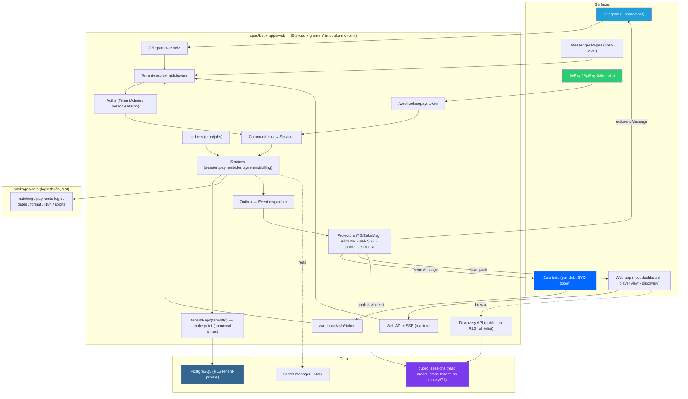

# Technical Design Document (TDD) — Plexco
## Platform thể thao đa môn (host + player) — multi-tenant, marketplace discovery, sync đa surface, Telegram + Zalo + Web app *(Messenger post-MVP)*

**Phiên bản:** 2.1 — chuẩn hoá canonical store, ledger tiền (`charges`/`bank_transactions`/`payment_allocations`), worker cross-tenant với RLS, durable webhook ingest và schema thời gian/discovery.
**Ngày tạo:** 16/06/2026 · **Cập nhật:** 19/06/2026
**Tài liệu tham chiếu:**
- `BRD.md` v3.1 — yêu cầu nghiệp vụ
- `PRD.md` — user flows + edge cases
- `../appendices/saas-implementation-plan.md` — kiến trúc multi-tenant
- `../appendices/player-side-saas-reconciliation.md` — identity/kênh/matching
- `../appendices/player-side-saas-AUDIT.md` — threat model & must-fix (C1–C7, B1–B6, §B2, + threat model public discovery)
- `../appendices/messenger-channel-design.md` — kênh Messenger (P4.8, post-MVP): delta data model, routing theo `page_id`

> [!IMPORTANT]
> **Scope:** TDD cover tới **P6** ở mức thiết kế. BRD là nguồn sự thật cho product scope; PRD cho behavior; TDD là implementation contract; ROADMAP cho thứ tự/progress. Security constraints nghiêm ngặt hơn giữa BRD và AUDIT luôn thắng.
> **Khác bot single-club hiện tại:** Plexco là **repo riêng**, lift logic thuần (matching, payments-logic, dates, format) sang `packages/core`; viết lại tầng data trên Postgres + RLS.
> **Bốn bất biến lõi:** (1) tiền/roster không rò cross-tenant; (2) tiền/PII không lọt public discovery; (3) allocation không làm mất/đếm quá tiền; (4) PostgreSQL/domain model là nguồn sự thật, surface chỉ là projection.

---

## 1. Overview

### 1.1 Mục đích
Platform **2 phía, đa môn**: **host** tạo & quản lý kèo, thu & đối soát tiền sân, quản club — qua Telegram/Zalo và web; **player** khám phá kèo xuyên CLB/môn & join, theo dõi kèo/nợ của mình. **PostgreSQL + domain model = canonical store**; web và kênh chat là surface, đồng bộ qua **sync engine**. Messenger là post-MVP. Mỗi CLB là 1 **tenant** cô lập tuyệt đối ở tầng tiền/roster; **public discovery** là lớp đọc cross-tenant field-whitelist.

### 1.2 Phạm vi theo phase

| Scope | Pha | Ghi chú |
|---|---|---|
| **Nền tenant + Postgres/RLS + schema đa môn + 3 tầng hiển thị** | P0–P1 | repo choke-point + RLS fail-closed + `sports` + public read model skeleton |
| **Telegram biết tenant** | P2 | shared bot, middleware resolve tenant, cron đa-tenant |
| **Webhook CK biết tenant** (module tiền) | P3 | `/webhook/sepay/:token`, dedupe, FIFO settle |
| **Identity directory** | P3.5 | Person/ChannelIdentity/Reachability/Membership + merge |
| **Web app + canonical backend + Sync engine** | P4 | command/event + outbox + projection ra surfaces + web realtime; onboarding |
| **Marketplace discovery** | P4.3 | publish kèo → public projection; tìm kèo (lọc môn/khu vực/giờ); join cross-club + approval |
| **Player-side TG/Zalo + view** | P4.5–4.7 | tap-join, number-reply, my-clubs |
| **Messenger** | P4.8 | post-MVP |
| **Billing** | P5 | subscription_invoices, vòng đời tenant |
| **Hardening** | P6 | pen-test isolation **+ public layer**, load test, observability sync-lag |

### 1.3 Ngoài phạm vi
Matchmaking xếp cặp tự động · venue/booking nhà thi đấu · scoring/trận đấu · gamification/ELO · app native · nền tảng chat khác. (Multi-sport có nhưng **không** kèm luật chơi từng môn — chỉ là chiều phân loại + lọc.)

---

## 2. Requirements

### 2.1 Functional (theo module — chi tiết PRD)

| # | FR | Persona | Mô tả | Pha | Prio |
|---|---|---|---|---|---|
| FR-0 | Multi-sport | System | `sports` + `sessions.sport_id`; lọc/hiển thị theo môn | P1 | P0 |
| FR-1 | Onboarding tenant | P1 | TG Login → tạo tenant → nối SePay → link TG → dán Zalo token → config (môn mặc định, publish/join policy) | P4 | P0 |
| FR-2 | Session CRUD (chat + web) | P1 | tạo/đóng kèo: môn/giá/giờ/khu vực/slot/trình độ/visibility/join_policy; auto/`/announce`; sửa trên web | P2/P4 | P0 |
| FR-3 | Join Telegram | P3 | tap nút group (callback) + validate group/tenant/session | P4.5 | P0 |
| FR-4 | Join Zalo | P3 | `/join` + number-reply (bot-per-club DM) | P4.7 | P0 |
| FR-5 | Identity resolve | System | (platform,uid)→ChannelIdentity→Person→Membership(∩tenant) | P3.5 | P0 |
| FR-6 | Claim/merge | System | claim-có-tiền cần khoá mạnh; merge OTP/SĐT-verified; reconcile trùng | P3.5 | P0 |
| FR-7 | Webhook reconcile | System | durable ingest → match (pay_code→tên/amount/ngày) → allocate transaction vào charges | P3 | P0 |
| FR-8 | Payment ledger / BL-2 | System | charge + bank transaction + allocation; hỗ trợ partial/multi-person; không phân bổ quá số tiền CK | P3 | P0 |
| FR-9 | /unmatched | P1 | gán tay + retry cron | P3 | P0 |
| FR-10 | Reminder | System | manual (P2) → auto cron group-mention/DM theo Reachability (P3) | P2/P3 | P0 |
| FR-11 | notifyPlayersPaid | System | xác nhận đa-kênh sau mọi markPaid + sync web | P4.5 | P0 |
| FR-12 | Player view (person-self) | P3/P4 | clubs/kèo/nợ của tôi, person-authorized; web + bot | P4.6 | P1 |
| FR-13 | Billing | System | subscription_invoices, trial→active→past_due→suspended | P5 | P0 |
| **FR-14** | **Sync engine** | System | canonical store + command/event + **outbox** → projection ra TG/Zalo/web/public; Messenger adapter ở P4.8; idempotent; re-project khi lệch | P4 | P0 |
| **FR-15** | **Web app (surface)** | P1/P3/P4 | host dashboard (kèo/roster/doanh thu), player view, discovery UI; mọi ghi đi qua canonical backend | P4 | P0 |
| **FR-16** | **Publish kèo → public projection** | P1 | host set `visibility=public` → đẩy field-whitelist vào `public_sessions` (read model) | P4.3 | P0 |
| **FR-17** | **Discovery / tìm kèo** | P3/P4 | API/UI lọc môn/khu vực/ngày/giờ/trình độ/giá/slot; cross-tenant read model, KHÔNG RLS, KHÔNG tiền/PII | P4.3 | P0 |
| **FR-18** | **Join cross-club** | P3/P4 | join kèo của CLB chưa là member → tạo membership guest; `join_policy=approval` → `join_requests` host duyệt | P4.3 | P0 |

### 2.2 Non-Functional (đo được)

| # | NFR | Yêu cầu | Metric |
|---|---|---|---|
| NFR-1 | **Cô lập tenant** | Repo scoped + RLS fail-closed + FORCE + role `NOBYPASSRLS` | 0 rò rỉ cross-tenant; test bất biến xanh |
| NFR-1b | **Public layer an toàn** | `public_sessions` read model chỉ field whitelist; tiền/PII/roster KHÔNG vào | 0 lộ tiền/PII ra public; test bất biến public xanh |
| NFR-1c | **Sync nhất quán** | canonical store + outbox + projection idempotent | sync-lag p95 ≤ 3s, p99 ≤ 10s; re-project hết lệch; 0 multi-master conflict |
| NFR-2 | **Latency reconcile** | webhook → markPaid → notify | ≤ 5s P99 |
| NFR-3 | **Concurrency** | webhook + cron + lệnh đồng thời | ≥1k tenant; slot/payment allocation không race |
| NFR-4 | **Idempotency** | webhook trùng | `UNIQUE(tenant,provider,external_id)` skip |
| NFR-5 | **Data safety** | không mất CK | transaction lưu raw + enqueue trước ack; audit allocation; retry tới terminal |
| NFR-6 | **Secret** | token/secret | KMS at-rest, không log, timing-safe verify, reset path |
| NFR-7 | **Rate-limit** | TG/Zalo outbound | throttler + jitter cron |
| NFR-8 | **API error** | luôn JSON `{error,message,code,statusCode}` | — |
| NFR-9 | **Privacy** | PII (SĐT/email) | consent, AES at-rest, soft-delete, không vào URL/log |
| NFR-10 | **Availability** | API uptime | ≥ 99.5% |

---

## 3. Technical Design

### 3.1 System Architecture



**Pattern:** Modular monolith. **PostgreSQL + domain model = canonical store**. Mọi surface (chat/web/webhook) gửi **command** → `CMD` bus → `Services` → ghi qua `tenantRepo` (choke-point, RLS). Mỗi thay đổi ghi kèm **outbox** event trong cùng transaction; dispatcher đẩy projectors ra surfaces + cập nhật `public_sessions`. **Đọc** chia 3 đường: tenant-private (RLS), person-self (person-authorized), public discovery (`DISC` → `public_sessions`, không RLS, field whitelist). API stateless để scale ngang; pg-boss dùng cùng Postgres nhưng chạy bằng worker role tách biệt (§3.4).

### 3.2 Data Model

**Ba vùng (= 3 tầng hiển thị):**
1. **GLOBAL protected directory**: `persons`, `channel_identities`, `player_chat_context`, `sports`. Các bảng identity có PII, không cấp quyền trực tiếp cho API role; chỉ identity service được truy cập và mọi cross-person access phải audit.
2. **TENANT-scoped** (RLS fail-closed): `sessions`, `players`, `memberships`, `channel_reachability`, `charges`, `bank_transactions`, `payment_allocations`, `join_requests`, `outbox_events`, billing… — tiền/roster/nội bộ.
3. **PUBLIC read model** (cross-tenant, **không** RLS, field whitelist): `public_sessions` — projection của kèo đã publish, phục vụ marketplace. **Không** chứa tiền/PII/roster.

```mermaid
erDiagram
    PERSON ||--o{ CHANNEL_IDENTITY : has
    PERSON ||--o{ MEMBERSHIP : "is, per tenant"
    PERSON ||--o{ CHANNEL_REACHABILITY : reachable

    TENANT ||--o{ MEMBERSHIP : contains
    TENANT ||--o{ CHANNEL_REACHABILITY : scopes
    TENANT ||--o{ SESSION : has
    SPORT ||--o{ SESSION : categorizes
    SESSION ||--o| PUBLIC_SESSION : "projected if public"
    SESSION ||--o{ JOIN_REQUEST : "approval-mode"
    TENANT ||--o{ OUTBOX_EVENT : emits
    TENANT ||--o{ PROCESSED_COMMAND : deduplicates
    TENANT ||--o{ CHARGE : bills
    TENANT ||--o{ BANK_TRANSACTION : receives
    TENANT ||--o{ TELEGRAM_LINK : routes
    TENANT ||--o{ TENANT_ADMIN : authorizes
    TENANT ||--o{ ZALO_BOT : "channel (BYO)"
    TENANT ||--o{ BANK_ACCOUNT : receives
    TENANT ||--o| SUBSCRIPTION : billed
    TENANT ||--o{ SUBSCRIPTION_INVOICE : invoices

    MEMBERSHIP ||--o{ PLAYER : "joins session"
    SESSION ||--o{ PLAYER : roster
    PLAYER ||--o{ CHARGE : owes
    BANK_TRANSACTION ||--o{ PAYMENT_ALLOCATION : funds
    CHARGE ||--o{ PAYMENT_ALLOCATION : receives
    OUTBOX_EVENT ||--o{ PROJECTOR_DELIVERY : tracks

    PERSON {
        uuid id PK
        varchar display_name
        varchar phone "nullable, verified"
    }
    CHANNEL_IDENTITY {
        uuid id PK
        uuid person_id FK
        enum platform "telegram|zalo"
        varchar platform_user_id "UNIQUE(platform,uid)"
        varchar username
    }
    CHANNEL_REACHABILITY {
        uuid person_id FK
        uuid tenant_id FK
        enum platform
        bool can_dm
        timestamptz last_inbound_at "UNIQUE(person,tenant,platform)"
    }
    TENANT {
        uuid id PK
        varchar name
        varchar slug UK
        enum status "trialing|active|past_due|suspended|cancelled"
        varchar locale
        varchar timezone
    }
    MEMBERSHIP {
        uuid id PK "= member_id cũ"
        uuid tenant_id FK
        uuid person_id FK
        varchar display_name
        varchar pay_code "UNIQUE(tenant,pay_code)"
    }
    SESSION {
        uuid id PK
        uuid tenant_id FK
        uuid sport_id FK
        timestamptz starts_at
        timestamptz ends_at
        varchar timezone "IANA"
        int price
        int slots_max "nullable"
        varchar area "khu vực (public)"
        varchar venue "địa điểm chi tiết (private tới khi join)"
        varchar skill_level "nullable"
        enum visibility "private|public"
        enum join_policy "open|approval"
        enum status "open|closed|cancelled"
        varchar tg_announce_chat_id
        bigint tg_announce_message_id
    }
    SPORT {
        uuid id PK
        varchar key "badminton|pickleball|tennis|..."
        varchar name
        bool active
    }
    PUBLIC_SESSION {
        uuid session_id PK "= sessions.id"
        uuid tenant_id "chỉ để join-routing, KHÔNG lộ tiền"
        varchar sport_key
        timestamptz starts_at
        timestamptz ends_at
        varchar area
        varchar skill_level
        int price
        int slots_open
        varchar host_display_name
        varchar club_display_name
        enum join_policy
    }
    JOIN_REQUEST {
        uuid id PK
        uuid tenant_id FK
        uuid session_id FK
        uuid person_id
        enum status "pending|approved|rejected|expired"
        timestamptz expires_at
    }
    OUTBOX_EVENT {
        uuid id PK
        uuid tenant_id FK
        varchar type "session.created|player.joined|payment.allocated|payment.settled|..."
        jsonb payload
        timestamptz dispatched_at "nullable"
    }
    PROCESSED_COMMAND {
        uuid tenant_id FK
        uuid command_id
        varchar command_type
        varchar result_hash
        timestamptz created_at "UNIQUE(tenant,command_id)"
    }
    PROJECTOR_DELIVERY {
        uuid event_id FK
        varchar projector
        enum status "pending|delivered|failed"
        int attempts
        timestamptz delivered_at "UNIQUE(event,projector)"
    }
    PLAYER {
        uuid id PK
        uuid tenant_id FK
        uuid session_id FK
        uuid membership_id FK
        timestamptz last_reminded_at
    }
    CHARGE {
        uuid id PK
        uuid tenant_id FK
        uuid session_id FK
        uuid player_id FK
        uuid membership_id FK
        int amount_due
        int amount_allocated
        enum status "open|partial|paid|void"
    }
    BANK_TRANSACTION {
        uuid id PK
        uuid tenant_id FK
        enum provider "sepay|apipay"
        varchar external_id "UNIQUE(tenant,provider,external_id)"
        int amount
        int unallocated_amount
        varchar account_number
        timestamptz occurred_at
        text content
        jsonb raw_payload
        enum reconcile_status "pending|matched|partial|unmatched|ignored"
        timestamptz received_at
    }
    PAYMENT_ALLOCATION {
        uuid id PK
        uuid tenant_id FK
        uuid bank_transaction_id FK "nullable for cash/waiver"
        uuid charge_id FK
        int amount "signed; reversal âm"
        varchar source "auto|manual|cash|waiver|reversal"
        uuid reverses_allocation_id "nullable"
        uuid created_by "nullable for system"
        timestamptz created_at
    }
    TELEGRAM_LINK {
        uuid tenant_id FK
        varchar chat_id
        enum kind "group|admin"
    }
    TENANT_ADMIN {
        uuid tenant_id FK
        varchar telegram_user_id
        enum role "owner|admin"
    }
    ZALO_BOT {
        uuid id PK
        uuid tenant_id FK
        varchar bot_token_enc
        varchar webhook_token UK
    }
    BANK_ACCOUNT {
        uuid id PK
        uuid tenant_id FK
        varchar account_number
        varchar webhook_token UK
        varchar webhook_secret_enc
    }
    SUBSCRIPTION_INVOICE {
        uuid id PK
        uuid tenant_id FK
        varchar invoice_code UK
        int amount_due
        int amount_paid
        enum status
    }
    SUBSCRIPTION {
        uuid id PK
        uuid tenant_id FK "UNIQUE"
        enum status "trialing|active|past_due|suspended|cancelled"
        timestamptz trial_ends_at
        timestamptz current_period_end
    }
```



#### Bảng tổng hợp

| # | Table | Vùng | RLS | Pha |
|---|---|---|---|---|
| 0 | `sports` | GLOBAL | ❌ (lookup) | P1 |
| 1 | `persons` | GLOBAL | ❌ (directory) | P3.5 |
| 2 | `channel_identities` | GLOBAL | ❌ | P3.5 |
| 3 | `channel_reachability` | TENANT | ✅ | P3.5 |
| 4 | `player_chat_context` | GLOBAL | ❌ | P4.5 |
| 5 | `tenants` | — | n/a | P1 |
| 6 | `accounts` / `memberships(admin)` | — | scoped | P4 |
| 7 | `memberships` | TENANT | ✅ | P3.5 |
| 8 | `sessions` | TENANT | ✅ | P1 |
| 9 | `players` | TENANT | ✅ | P1 |
| 10 | `charges` | TENANT | ✅ | P1/P3 |
| 11 | `aliases` | TENANT | ✅ | P1 |
| 12 | `telegram_links` | TENANT | ✅ | P2 |
| 13 | `tenant_admins` | TENANT | ✅ | P2 |
| 14 | `zalo_bots` | TENANT | ✅ | P4.7 |
| 15 | `bank_accounts` | TENANT | ✅ | P3 |
| 16 | `bank_transactions` + `payment_allocations` | TENANT | ✅ | P3 |
| 17 | `settings` | TENANT `(tenant_id,key)` | ✅ | P1 |
| 18 | `subscriptions` | TENANT | ✅ | P5 |
| 19 | `subscription_invoices` | TENANT | ✅ | P5 |
| 20 | `messenger_pages` | TENANT | ✅ | P4.8 (post-MVP — `../appendices/messenger-channel-design.md` §4) |
| 21 | `join_requests` | TENANT | ✅ | P4.3 (approval-mode join cross-club) |
| 22 | `outbox_events` | TENANT | ✅ | P4 (sync engine — outbox pattern) |
| 23 | **`public_sessions`** | **PUBLIC** | ❌ **(cross-tenant read model, field whitelist)** | P4.3 |
| 24 | `processed_commands` | TENANT | ✅ | P4 (command dedupe) |
| 25 | `projector_deliveries` | WORKER | narrow privileged access | P4 (projector inbox/delivery ledger) |

> **Kênh thứ 3 (Messenger, post-MVP):** enum `platform` mở rộng `'telegram' \| 'zalo' \| 'messenger'` (cho `channel_identities`, `channel_reachability`); thêm bảng `messenger_pages` (song song `zalo_bots`, route theo `page_id`) + cột `window_expires_at`/`otn_token_enc` ở `channel_reachability`. Chi tiết delta: `../appendices/messenger-channel-design.md` §4.

**UNIQUE quan trọng:** `channel_identities (platform, platform_user_id)` GLOBAL · `memberships (tenant_id, person_id)` · `(tenant_id, pay_code)` · `channel_reachability (person_id, tenant_id, platform)` · `players (tenant_id, session_id, membership_id)` · `charges (tenant_id, session_id, player_id)` · `bank_transactions (tenant_id, provider, external_id)` · `processed_commands (tenant_id, command_id)` · `projector_deliveries (event_id, projector)` · `(tenant_id, norm)`, `(tenant_id, alias_norm)`.

**Ledger invariants (DB constraint/transaction test):** `amount_due ≥ 0`; auto/manual bank allocation dương và bắt buộc có `bank_transaction_id`; cash/waiver không có bank transaction nhưng bắt buộc actor; reversal âm và tham chiếu allocation gốc. Tổng allocation hiệu lực của một bank transaction nằm trong `[0, bank_transactions.amount]`; tổng vào charge nằm trong `[0, amount_due]`; `unallocated_amount = amount - bank allocations`; charge chỉ `paid` khi được phủ đủ. `amount_allocated` được cập nhật dưới row lock hoặc tính từ ledger, không cho client tự ghi. Không sửa/xoá giao dịch gốc hoặc allocation đã audit—điều chỉnh bằng reversal entry.

### 3.3 Routing & Tenant Resolution (lõi multi-tenant)

```
INBOUND → resolve Tenant theo KÊNH (không từ nội dung):
  • Telegram group    : chat_id → telegram_links(group) → tenant
  • Telegram admin DM : chat_id → telegram_links(admin) → tenant
  • Telegram player DM: /start club_<slug> | player_chat_context(sticky) | picker
  • Zalo              : webhook_token (bot-per-club) → zalo_bots → tenant
  • Messenger (P4.8)  : entry[].id (page_id) → messenger_pages → tenant
  • Web (host/admin)  : session người dùng + tenant đang chọn → AUTHZ(TenantAdmin) → tenant
  • SePay/ApiPay      : webhook_token + verify account_number → bank_accounts → tenant

THEN identity (nếu là tin nhắn người chơi):
  (platform, platform_user_id) → channel_identities → person
  → membership = (person ∩ tenant) qua tenantRepo  [RLS]

ĐƯỜNG ĐỌC KHÔNG GẮN 1 TENANT:
  • Discovery (public)  : KHÔNG resolve tenant — đọc public_sessions cross-tenant,
                          field whitelist, KHÔNG RLS, KHÔNG tiền/PII. Rate-limit + phân trang.
  • Person-self (my…)   : person_id từ phiên verify → memberships WHERE person_id=…,
                          ngoài RLS per-tenant, field whitelist (AUDIT C6).
  • Join cross-club     : từ public_session → session_id → tenant (route join) →
                          join_policy=open ⇒ tạo membership guest; =approval ⇒ join_requests.
```

Middleware Telegram (rút gọn):

```ts
bot.use(async (ctx, next) => {
  const text = ctx.message?.text ?? "";
  if (text.startsWith("/start link_"))  return bindAdminChat(ctx, ...);   // TenantAdmin + TelegramLink
  if (text.startsWith("/start club_"))  return bindPlayerContext(ctx, ...); // PlayerChatContext (KHÔNG join)
  let tenant = await resolveByChatLink(String(ctx.chat?.id));             // group/admin
  if (!tenant) tenant = await resolvePlayerTenant(ctx);                   // sticky / picker (fail-closed)
  if (!tenant) return ctx.reply("Chưa nối club...");
  ctx.tenant = tenant; ctx.repo = tenantRepo(tenant.id); await next();
});
// lớp 2: ADMIN_CMD → isTenantAdmin(tenant.id, ctx.from.id) (AUDIT B-authz)
```

### 3.4 Repository choke-point + RLS

```ts
// 1 nơi DUY NHẤT chèn tenant_id; handler nhận ctx.repo, không tự viết WHERE.
export function tenantRepo(tenantId: string) {
  return {
    getOpenSessions: () => withTenant(tenantId, tx =>
      tx.select().from(sessions).where(eq(sessions.status, "open"))),
    createCharge: (p) => withTenant(tenantId, tx => tx.insert(charges).values({ ...p, tenantId })),
    allocateTransaction: (a) => withTenant(tenantId, tx => allocateWithLedgerInvariants(tx, { ...a, tenantId })),
    // ... port toàn bộ API db.ts cũ, đều khép kín tenantId
  };
}
async function withTenant(tenantId, fn) {
  return dbq.transaction(async (tx) => {
    await tx.execute(sql`SET LOCAL app.tenant_id = ${tenantId}`); // RLS context, hết tx tự xoá
    return fn(tx);
  });
}
```

```sql
CREATE ROLE app LOGIN NOSUPERUSER NOBYPASSRLS;            -- app KHÔNG bypass RLS
ALTER TABLE sessions ENABLE ROW LEVEL SECURITY;
ALTER TABLE sessions FORCE  ROW LEVEL SECURITY;           -- chặn cả owner bảng
CREATE POLICY tenant_isolation ON sessions
  USING (tenant_id = current_setting('app.tenant_id', true)::uuid);  -- missing → NULL → 0 dòng (fail-closed)
-- lặp cho MỌI bảng tenant-scoped
```

**Worker/RLS contract (bắt buộc):** API role `app` không bao giờ quét cross-tenant. Scheduler/dispatcher dùng role riêng `app_worker` chỉ được gọi các stored function hẹp (`claim_outbox_batch`, `list_due_tenant_jobs`) hoặc đọc bảng queue cần thiết; role này không được trả dữ liệu nghiệp vụ ra HTTP. Mỗi job nhận `tenant_id`, mở transaction, `SET LOCAL app.tenant_id`, rồi gọi cùng service/repository như request thường. Claim job dùng `FOR UPDATE SKIP LOCKED`; mọi privileged cross-tenant call ghi audit (`job_id`, `tenant_id`, actor=`system`, reason). Không cấp `BYPASSRLS` chung cho application process.

**Identity/person-self contract:** `persons`, `channel_identities` là global nhưng protected. API role không có `SELECT` trực tiếp; identity service expose query hẹp theo `person_id` đã xác thực. `channel_reachability` là tenant-scoped + RLS. SSE topic `tenant:<id>` yêu cầu TenantAdmin; `person:<id>` phải trùng person trong session/magic-link. Subscription trái phép trả 403 và được audit.

### 3.5 API / Interface

**Convention:** `Response { data, meta? }` · `Error { error, message, code, statusCode }` (JSON, không HTML — NFR-8). Auth web: TG Login → session.

**Webhook (system):**

| Method | Endpoint | Auth | Mô tả |
|---|---|---|---|
| POST | `/webhook/sepay/:token` | `Apikey` secret (timing-safe) + verify account | nhận CK → lưu raw → reconcile |
| POST | `/webhook/zalo/:token` | `X-Bot-Api-Secret-Token` (timing-safe) | update Zalo → resolve tenant |
| POST | `/telegram/<secret>` | secret path | update Telegram (1 bot) |

**Web onboarding (P1/owner):** `POST /tenants` · `POST /tenants/:id/bank` · `POST /tenants/:id/zalo-bot` · `GET /tenants/:id/telegram-link` · `PATCH /tenants/:id/config` · billing: `GET /billing`.

**Host quản lý kèo (tenant-scoped, RLS):** `POST /tenants/:id/sessions` (môn/giá/khu vực/slot/visibility/join_policy) · `PATCH /sessions/:id` · `GET /tenants/:id/sessions` · `GET /tenants/:id/join-requests` + `POST /join-requests/:id/approve|reject`.

**Discovery (PUBLIC — không RLS, field whitelist):** `GET /discover?sport=&area=&date=&skill=&price_max=` → `public_sessions` · `GET /discover/sessions/:id` (public detail) · `POST /sessions/:id/join` (open → join; approval → `join_requests`).

**Person-self:** `GET /me/clubs` · `GET /me/sessions` · `GET /me/debts` (person-authorized, field whitelist).

**Realtime:** `GET /sse?topics=tenant:<id>,person:<id>` (SSE; OD-7).

**Bot commands** = interface người chơi/owner (xem PRD §2 command map).

### 3.6 Logic Flows

**Reconcile CK (P3 — killer flow):**

```mermaid
sequenceDiagram
    participant SePay
    participant API
    participant Repo as tenantRepo
    participant Queue as pg-boss/outbox
    participant Worker
    participant Match as matching(core)
    SePay->>API: POST /webhook/sepay/:token {external_id, amount, content, account}
    API->>API: findBankAccountByToken + timingSafe(secret) + verify account
    API->>Repo: BEGIN; INSERT bank_transaction (idempotent)
    API->>Queue: enqueue reconcile trong cùng DB transaction
    Repo-->>API: COMMIT
    API-->>SePay: 200 {success:true}
    Queue->>Worker: reconcile(tenant_id, bank_transaction_id)
    Worker->>Match: pay_code? → else tên+amount+ngày (tenant-scoped)
    alt match
        Match->>Repo: INSERT payment_allocations (FIFO, không vượt transaction/charge)
        Repo->>Queue: INSERT outbox payment.allocated/payment.settled
    else no match
        Match->>Repo: set reconcile_status=unmatched (retry cron 1h)
    end
```

ACK chỉ xảy ra sau khi raw transaction và durable job đã commit. Duplicate external ID trả 200 với transaction hiện có và không enqueue trùng. Nếu worker chết sau ACK, pg-boss retry idempotently; trạng thái `pending/unmatched` còn tồn tại để sweeper phục hồi.

**Identity merge (P3.5):** `/link` OTP round-trip → gắn ChannelIdentity vào Person → nếu trùng membership cùng tenant → reconcile gộp (1 id, cộng nợ) → audit. (AUDIT C3/C4/C5)

**Reminder cron (P3):** pg-boss `EVERY_MINUTE` → group theo tenant → mỗi tenant: query unpaid quá ngưỡng → gửi qua đúng bot/group + `ChannelReachability` → throttler + jitter → set `last_reminded_at`.

### 3.7 Background Jobs (pg-boss)

| Queue | Job | Lịch | Mô tả |
|---|---|---|---|
| `reconcile` | `match` | on webhook | match bank transaction → payment allocations |
| `reconcile` | `retry-unmatched` | EVERY_HOUR | thử khớp lại unmatched |
| `remind` | `send` | due/cron | nhắc unpaid theo tenant |
| `billing` | `lifecycle` | DAILY | trial→past_due→suspended + nhắc gia hạn |
| `security` | `webhook-drift` | HOURLY | `getWebhookInfo` Zalo, lệch URL → alert/auto-reset (AUDIT §B2) |
| `session` | `transition` | EVERY_MIN | auto-close buổi quá giờ + hạ kèo khỏi public khi đóng/quá giờ |
| `sync` | `dispatch-outbox` | on insert / EVERY_SEC | đẩy `outbox_events` chưa `dispatched_at` → projectors (idempotent) |
| `sync` | `reproject` | on demand / retry | dựng lại message/UI/`public_sessions` khi phát hiện lệch |

### 3.8 Sync Engine (canonical store ⇄ surfaces) — *(P4)*

**Nguyên tắc:** **một nguồn sự thật** = canonical store (Postgres). TG/Zalo/web là surface MVP; Messenger trở thành surface khi bật P4.8. Không multi-master → không cần conflict-resolution phức tạp.

```
1) WRITE (mọi surface):  surface action  → normalize → Command(commandId)
                         → CMD bus → Service → tenantRepo (RLS) ghi
                         → cùng transaction: INSERT outbox_events  ← outbox pattern
2) DISPATCH:             dispatch-outbox job đọc event chưa gửi → Projectors (fan-out)
3) PROJECT (ra surfaces):
     • Telegram : editMessageText roster của tg_announce_message_id (hoặc gửi mới)
     • Zalo/Msgr: sendMessage DM theo ChannelReachability đúng tenant
     • Web      : push SSE theo kênh (tenant:<id> / person:<id>)
     • Public   : upsert/delete public_sessions (nếu kèo public)
```

- **Idempotency:** `commandId` có UNIQUE/dedup record (chống double-apply lệnh) + projector inbox/delivery record UNIQUE `(projector,event_id)`. `dispatched_at` chỉ biểu thị dispatcher đã claim/gửi, **không đủ một mình** để chống double-project. Telegram projector dùng `editMessage` (không spam message mới).
- **Ordering:** xử lý outbox theo thứ tự per-tenant (hoặc per-session) để roster không "nhảy lùi".
- **Re-projection (chữa lệch):** state surface là *derived*; khi nghi lệch (msg cũ, SSE rớt) → `reproject` dựng lại từ canonical. Surface **không bao giờ** là nơi giữ sự thật.
- **Web realtime:** transport theo OD-7; baseline SSE theo topic `tenant:<id>` và `person:<id>`, bắt buộc authz như §3.4; fallback polling.
- **Phân biệt với module tiền:** webhook CK durable-ingest → worker tạo allocations → phát `payment.allocated`/`payment.settled` → projector chạy `notifyPlayersPaid` + realtime web.

### 3.9 Discovery / Public layer (marketplace) — *(P4.3)*

**Tách hẳn khỏi RLS** — đây là đường đọc cross-tenant **có chủ đích**, nên rủi ro nằm ở *rò rỉ field*, không ở isolation.

- **Publish:** host set `sessions.visibility='public'` → projector upsert `public_sessions` **chỉ field whitelist**: `sport_key, starts_at, area, skill_level, price, slots_open, host_display_name, club_display_name, join_policy`. **KHÔNG** roster, **KHÔNG** STK/PII, **KHÔNG** danh sách người trả/chưa trả. Đóng/huỷ/quá giờ → xoá khỏi `public_sessions`.
- **Đọc (Discovery API):** `GET /discover?sport=&area=&date=&skill=&price_max=` → query **`public_sessions`** (read model), **không** `SET LOCAL app.tenant_id`, **không** đụng bảng tiền. Rate-limit + phân trang chống enumeration/scrape (NFR-S2).
- **Vị trí (privacy, OD-6):** public chỉ hiện **`area`** (quận/khu vực); **`venue`** chi tiết chỉ lộ sau khi join/được duyệt.
- **Join từ marketplace:** `POST /sessions/:id/join` → route `session_id → tenant` → nếu `join_policy=open`: resolve/tạo `Person` + **membership guest** + `addMemberToSession`; nếu `approval`: tạo `join_requests(pending)` → host duyệt (event → projector thông báo player). Slot hết → từ chối.
- **Bất biến public (test CI):** mọi field trong `public_sessions` ∈ whitelist; thử join/đọc không bao giờ trả tiền/PII/roster người khác.

---

## 4. Security

- **Cô lập (NFR-1):** repo choke-point + RLS (ENABLE+FORCE, role `NOBYPASSRLS`, fail-closed). Path **privileged cross-tenant** (merge Person, player-view, discovery) chạy ngoài RLS qua service có audit (AUDIT C4/C6).
- **Worker cross-tenant:** scheduler/dispatcher chỉ dùng narrow DB functions; business job luôn quay lại tenant context (`SET LOCAL`) trước khi đọc/ghi. Không dùng một API role `BYPASSRLS` toàn năng.
- **Public layer (NFR-1b):** `public_sessions` chỉ chứa field whitelist; **tiền/PII/roster không bao giờ ghi vào**. Discovery API read-only, rate-limit, phân trang, không lộ `venue`/SĐT tới khi join/duyệt; chống scrape/enumeration. Bất biến public test trong CI.
- **Sync (NFR-1c):** command/outbox idempotent (`commandId`/`event.id`); canonical store là nơi duy nhất giữ sự thật; surface re-project được — không có ghi 2 chiều multi-master để lệch tiền.
- **Tenant từ kênh, không từ nội dung** (chống spoof) — §3.3.
- **Webhook:** timing-safe verify ×3 (SePay/Zalo/Telegram); lưu raw trước ack; không log secret.
- **Secret:** `bot_token_enc`, `webhook_secret_enc` → KMS/envelope AES-GCM; che UI; reset path. Token Zalo lộ → blast-radius messaging 1 club (không chạm tiền/DB/club khác) + `getWebhookInfo`-drift detection (AUDIT §B2).
- **Authz:** routing (TelegramLink/ZaloBot) tách phân quyền (`TenantAdmin` theo `from.id`); player không gated.
- **Identity:** claim-có-tiền cần khoá mạnh; merge chỉ verified; mã link = OTP (AUDIT C1/C2/C3).
- **PII:** SĐT/email consent + AES at-rest + soft-delete + không vào URL/log.
- **Realtime/auth:** mọi SSE subscription authorize theo tenant admin hoặc chính person; chống topic guessing, CSRF/session fixation và reconnect token reuse.

---

## 5. Error Handling

`{ error:true, message, code, statusCode }`.

| Module | Code | HTTP | Mô tả |
|---|---|---|---|
| Tenant | `TENANT_NOT_LINKED` | 404 | chat chưa nối tenant |
| Tenant | `TENANT_SUSPENDED` | 403 | quá hạn billing (vẫn lưu CK player) |
| Authz | `NOT_TENANT_ADMIN` | 403 | non-admin chạy lệnh admin |
| Webhook | `INVALID_WEBHOOK_SECRET` | 401 | timing-safe fail |
| Webhook | `ACCOUNT_MISMATCH` | 409 | số TK không khớp |
| Payment | `DUPLICATE_TXN` | 200 | trùng external_id → skip (idempotent) |
| Payment | `UNMATCHED` | — | bank transaction còn tiền chưa allocation, vào `/unmatched` |
| Payment | `ALLOCATION_EXCEEDS_FUNDS` | 409 | tổng allocation vượt số tiền CK hoặc số tiền charge còn thiếu |
| Identity | `CLAIM_REQUIRES_STRONG_KEY` | 409 | claim membership-có-tiền theo tên bị chặn |
| Identity | `MERGE_CONFLICT_SAME_TENANT` | 409 | 2 membership cùng tenant → cần reconcile |
| Identity | `LINK_CODE_INVALID` | 400 | OTP sai/hết hạn |
| Discovery | `SESSION_NOT_PUBLIC` | 404 | kèo không publish / đã hạ khỏi marketplace |
| Discovery | `SESSION_FULL` | 409 | hết slot khi join |
| Join | `JOIN_REQUIRES_APPROVAL` | 202 | đã tạo `join_requests` chờ host duyệt |
| Sync | `STALE_COMMAND` | 409 | command trùng/đã áp (idempotent) → bỏ qua |

---

## 6. Testing Plan

### 6.1 Unit (core thuần — lift + test xanh trước)
matching (pay_code/tên/amount/ngày, FIFO 2-buổi-identical), ledger allocation (partial/overpay/multi-person/reversal, BL-2), identity-resolve, parse callback `pjoin:<id>`, inline-mention build, dedupe external_id, link-code OTP.

### 6.2 Integration (Postgres)
- **Bất biến cô lập (CI bắt buộc):** tenant A/B — repo B không thấy session A; raw query quên `SET LOCAL` → 0 dòng (fail-closed).
- **Bất biến public (CI bắt buộc):** mọi field `public_sessions` ∈ whitelist; discovery/join không bao giờ trả tiền/PII/roster người khác; kèo private không xuất hiện trong discovery.
- **Sync (CI):** tạo kèo trên web → outbox phát event → projector edit message TG + upsert public_sessions + SSE; áp lại cùng command/event → **không** double; re-project dựng đúng từ canonical.
- **Worker/RLS (CI):** API role không scan được cross-tenant; worker claim đúng batch nhưng từng job chỉ thấy tenant được `SET LOCAL`; privileged call có audit.
- **Ledger (CI):** một CK phân bổ nhiều charge/người; partial không mark paid; over-allocation bị chặn; cash/waiver yêu cầu actor và không tạo bank transaction giả; duplicate/retry/reversal giữ đúng tổng.
- E2E đa surface: host tạo kèo (web) → hiện group TG + marketplace; player tap join (Zalo) → roster web + TG cập nhật; join cross-club open/approval đúng.
- E2E tiền: join → CK (curl SePay) → markPaid → notify + SSE; webhook trùng → idempotent 1 lần.
- Merge: 2 Person có membership cùng tenant → reconcile gộp nợ.
- Suspended tenant: chặn lệnh quản trị nhưng vẫn durable-ingest CK; kèo public hiện có tự hạ khi đóng/hết giờ và không tạo/gia hạn mới.
- Routing: 2 token khác nhau → 2 club; sai token/secret/account → từ chối.

### 6.3 Load
webhook burst (≤5s P99), cron 1k tenant (throttler), join đồng thời (race).

---

## 7. Deployment & Infra

| Env | DB | Queue | Monitoring | Payment |
|---|---|---|---|---|
| dev | Postgres local (docker) | pg-boss local | verbose | mock |
| staging | Postgres managed | pg-boss | Sentry | sandbox |
| prod | Postgres managed (HA, PITR) | pg-boss | Sentry + metrics (log gắn `tenant_id`) | live |

Monorepo pnpm: `packages/core` (logic thuần + test, gồm `sports`) · `apps/bot` (Express + grammY webhook + cron + projectors) · `apps/web` (host dashboard, player view, discovery UI, API + realtime). **PostgreSQL/domain services là canonical**, không phải UI app. Bỏ volume SQLite. **OD-4:** chọn Neon/Supabase/Railway theo region VN + giá.

---

## 8. Migration Plan

```
# P0–P1
drizzle: 01_tenants_rls → 02_sessions_players_charges(tenant_id) → 03_settings
# P3.5
04_identity_directory (persons, channel_identities, reachability, player_chat_context)
05_memberships (refactor members → membership(person_id))
# P3 / P4.7 / P5
06_bank_accounts_transactions_allocations · 07_zalo_bots · 08_subscription_invoices
# P4
09_processed_commands_outbox_projector_deliveries · 10_public_sessions_projection
```

**Migrate club hiện tại → tenant #1:** script đọc `data/bot.db` (SQLite) → tạo tenant "Bestminton" + Account owner + TelegramLink + BankAccount → copy sessions/players/members/aliases gắn `tenant_id` → mỗi player-session tạo `charge`; payment lịch sử có giao dịch gốc thì import thành `bank_transaction` + `payment_allocation`, record thiếu bằng chứng gốc dùng synthetic `legacy:<source-id>` và `source=manual` để giữ provenance. Đối chiếu tổng charge/allocated/unallocated và số roster trước cutover; sau đó đổi webhook rồi tắt bot cũ.

---

## 9. Dependencies

| Package/Service | Mục đích |
|---|---|
| `grammy` | Telegram bot (webhook) + adapter Zalo Bot API (cùng kiểu) |
| `drizzle-orm` + `pg` | ORM + Postgres |
| `pg-boss` | queue/cron trên Postgres |
| `express` | HTTP + webhook endpoints |
| `@grammyjs/transformer-throttler` | rate-limit outbound |
| VietQR lib (`img.vietqr.io`) | QR P4 |
| Next.js / Express SSR | web (OD-10) |
| KMS / secret manager | mã hoá token/secret |
| SePay / ApiPay | đối soát CK |
| Telegram Bot API · Zalo Bot Platform | kênh |
| Meta Messenger Platform | kênh Messenger (P4.8, post-MVP) — Graph API gửi tin, webhook `page_id`, App Review |

---

## 10. Risk Registry (kỹ thuật)

> Chi tiết threat model: `../appendices/player-side-saas-AUDIT.md`. Đây là các rủi ro phá vỡ hệ thống tài chính/đa-tenant.

### 10.1 Cô lập cross-tenant (nghiêm trọng nhất)
RLS sai/quên scope → CLB thấy tiền CLB khác. **Mitigation:** repo choke-point (hàm global không tồn tại → quên scope = không compile) + RLS ENABLE+FORCE+`NOBYPASSRLS`+fail-closed + **test bất biến CI**.

### 10.2 Identity — gán nhầm tiền / merge conflict (AUDIT C1/C2/C4/C5)
- `canDm` sai tầng (global) → confirm Zalo gửi nhầm/fail → **`ChannelReachability` per (person,tenant,platform)**.
- Claim membership-có-tiền theo tên → chiếm nợ → **cấm auto, cần khoá mạnh**.
- Merge 2 Person có membership cùng tenant → vỡ `UNIQUE` → **reconcile gộp 1 membership**.
- Membership trùng do race → **cờ nghi-trùng + tool owner merge**.

### 10.3 Webhook concurrency & idempotency (AUDIT)
2 webhook cùng `external_id` → double-count → `UNIQUE(tenant,provider,external_id)` + `ON CONFLICT DO NOTHING` + check `matched=false`. Thiếu id → synthetic sha256. Lưu raw **trước** ack; return 200 cả khi trùng.

### 10.4 Token Zalo lộ (AUDIT §B2)
Mạo danh bot (QR giả) / cướp webhook (MITM+DoS). **Mitigation:** KMS + không log + **`getWebhookInfo`-drift detection** + rotation/re-paste. Blast-radius gói trong messaging 1 club.

### 10.5 Scope drift theo pha
P3 phát hành memo **name-based**; matcher có thể chuẩn bị nhánh `pay_code` nullable nhưng chưa phụ thuộc vào nó. `pay_code`/VietQR chỉ được phát cho player từ P4; không dùng memo chỉ-có-code trước khi rollout + migration + test nhánh này hoàn tất.

---

## 11. Open Questions

| # | Question | Status |
|---|---|---|
| 1 | Web stack: Next.js vs Express SSR | ⬜ (BRD OD-10) |
| 2 | Postgres host: Neon / Supabase / Railway | ⬜ (OD-4) |
| 3 | `pay_code` prefix hiển thị (`BMC-`) vs code trần | đề xuất: trần trong DB, hiển thị prefix (OD-2) |
| 4 | Con số trial/past_due/suspended | đề xuất 14/7 ngày; bổ sung vào quyết định pricing/lifecycle (BRD OD-3) |
| 5 | Zalo Premium (khi owner >3 CLB/tài khoản) + add-on managed | hỏi Zalo |
| 6 | Thu SĐT verified làm khoá merge | ✅ chốt |
| 7 | Web realtime: SSE vs WebSocket vs polling | đề xuất SSE (BRD OD-7) |
| 8 | Join cross-club mặc định: open vs approval | đề xuất per-kèo, mặc định open (BRD OD-5) |
| 9 | Độ chi tiết vị trí public: area vs venue | đề xuất area cho tới khi join/duyệt (BRD OD-6) |
| 10 | Public read model: bảng projection vs materialized view | đề xuất bảng `public_sessions` cập nhật qua projector |
| 11 | Danh sách môn khởi điểm + taxonomy trình độ | BRD OD-8 |

---

## Tham chiếu

| # | Tài liệu | Vai trò |
|---|---|---|
| 1 | `BRD.md` | Yêu cầu nghiệp vụ |
| 2 | `PRD.md` | User flows + edge cases |
| 3 | `../appendices/saas-implementation-plan.md` | Kiến trúc multi-tenant |
| 4 | `../appendices/player-side-saas-reconciliation.md` | Identity/kênh/matching |
| 5 | `../appendices/player-side-saas-AUDIT.md` | Threat model & must-fix (+ public discovery) |
| 6 | `../appendices/messenger-channel-design.md` | Kênh Messenger (P4.8, post-MVP) |

---

*TDD v2.1 — implementation contract cho platform đa môn + marketplace + sync engine. Bốn bất biến: cô lập tenant · không lộ tiền/PII ra public · ledger không mất/đếm quá tiền · PostgreSQL/domain model là nguồn sự thật.*

---

## Changelog

| Ngày | Version | Thay đổi |
|------|---------|----------|
| 16/06/2026 | v2.0 | Initial TDD — canonical store, multi-tenant, RLS, sync engine |
| 18/06/2026 | v2.1 | Chuẩn hoá ledger, durable webhook, discovery schema |
| 19/06/2026 | v2.1 | Thêm Changelog table |
