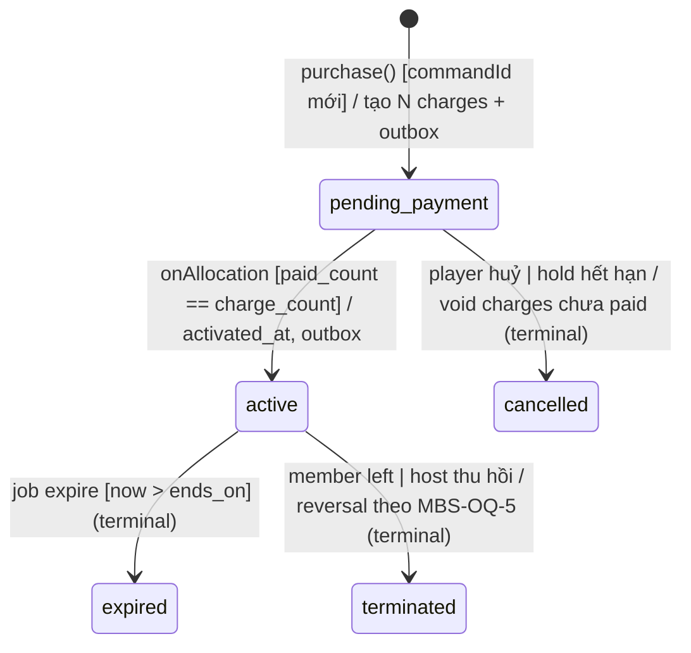

# Feature: Membership (Gói hội viên theo chu kỳ 30 ngày) — Backend Tech Spec

> **Canonical phase:** P4+ — sau Session core + Payment reconcile. **NGOÀI phase-1** (DD-114 D7).
> **Version:** 0.3 · 2026-08-25
> **Status:** Draft *(chưa qua readiness gate — KHÔNG phải Reviewed contract; DDL dưới đây là contract cần build, chưa migrate)*
> **Decision authority:** DD-115 **D1–D5 ✅ chốt** (owner 2026-08-25) → §2 schema shape, §4 pricing logic và money invariants đã có decision đứng sau. **D6–D8 ⬜** → `sessions.court_count` (§2), quyền vượt slot (§4), settlement binding (§4) và `tournament_discount_bp` **chưa được authorize**; slice chạm chúng phải `AWAIT`.
> **Implementation:** Not started
> **Product spec:** `../FE/feature_membership.md` v0.3
> **References:** `../../standards/decisions.md` DD-115 (D1–D5 ✅ / D6–D8 ⬜) · DD-02 · DD-29 · DD-32 · DD-39 · DD-40 · DD-43 · DD-45 · DD-68 · DD-82 · `../../standards/business-rules.md` **BL-MBS-1..5** · BL-PAY-2/5/8/11 · BL-SES-2/3/9 · BL-CBF-3/5 · BL-TEN-1 · BL-SEC-3 · `../../standards/api-reference-convention.md` (DD-60 envelope)

> **Gate 3 chiều (trước khi Reviewed):** mọi claim phải khớp (a) bảng/claim trong spec ↔ (b) snippet DDL/code trong spec ↔ (c) live code/schema trên `main`. Hiện (c) = "chưa tồn tại" cho 2 bảng mới; khi build phải re-verify với `packages/db/schema.ts` + `packages/db/migrations/`.

---

## 1. Tổng quan triển khai

```text
Player /membership (bot | web)
  → MembershipQuoteService.quote(planKey, startDate)
      ├─ đọc membership_plans (version hiện hành, tenant-scoped)
      ├─ đọc sessions trong [start, start+29d] khớp weekday mask   ← nguồn số buổi
      ├─ kiểm horizon recurrence phủ hết cửa sổ                     ← fail-closed nếu không
      └─ tính per-buổi rồi cộng (KHÔNG giá × N)
  → Player xác nhận (command_id)
  → MembershipPurchaseService.purchase()  [MỘT transaction]
      ├─ lock memberships row
      ├─ INSERT membership_cycles (status='pending_payment', snapshot plan_version + total)
      ├─ với mỗi buổi: ensure players row → INSERT charges (amount_due đã chiết khấu)
      ├─ INSERT membership_cycle_charges (bind charge ↔ cycle)
      └─ outbox: membership.cycle_created
  → QR/pay_code (DD-02) → CK về → bank_transactions (BL-PAY-1 durable trước ACK)
  → MembershipSettlementService  [tái dùng finalizer sẵn có, KHÔNG luồng thứ hai]
      ├─ allocate vào ĐÚNG các charge của cycle (không FIFO toàn cục — MBS-OQ-4)
      └─ khi Σ allocation phủ đủ N charge → cycle.status='active' + outbox membership.cycle_activated
```

**Module structure (theo cấu trúc thật của repo — repo này KHÔNG có `apps/api`):**

```text
packages/core/src/
├── membership-pricing.ts        ← thuần hàm: đếm buổi, chiết khấu, làm tròn (unit-testable, không I/O)
└── membership-pricing.test.ts

packages/db/src/
├── membership-service.ts        ← quote/purchase/settle qua tenantRepo (choke-point RLS)
├── membership-service.test.ts
└── membership-invariants.test.ts ← RLS + money invariants (mẫu: waitlist-invariants.test.ts)

apps/bot/  ← surface hội thoại
apps/web/  ← màn /membership + /settings/membership
```

**Design decisions quan trọng:**

- **Không bảng tiền mới, không cột tiền mới trên bảng có sẵn.** Membership dùng nguyên `charges` + `payment_allocations`. Lý do ở §2.
- **`memberships` read-only với feature này.** Không thêm cột. Chu kỳ là bảng con.
- **Logic tính tiền là hàm thuần trong `packages/core`.** Đếm buổi/chiết khấu/làm tròn không được sống trong service DB — để test được decision table đầy đủ mà không cần Postgres (yêu cầu review gate cho feature tiền).
- **Một finalizer.** Settlement đi qua đúng đường allocation sẵn có (BL-CBF-5); cấm dựng luồng thanh toán thứ hai.

### Entry points

| Entry | Caller | Mô tả |
|-------|--------|-------|
| `GET /api/membership/plans` | Player (web/bot adapter) | Danh sách gói đang bật của tenant |
| `POST /api/membership/quote` | Player | Báo giá cho `(planKey, startDate)` — **read-only, không ghi** |
| `POST /api/membership/cycles` | Player | Mua chu kỳ — idempotent theo `commandId` |
| `GET /api/membership/cycles/me` | Player | Chu kỳ hiện tại + lịch sử của chính mình |
| `POST /api/membership/cycles/:id/mark-paid` | Host (owner/admin) | DD-40 mark-paid thủ công cho cả chu kỳ |
| `GET/PUT /api/membership/plans/:key` | Host | Đọc/ghi config gói (ghi = tạo version mới) |
| `membership.cycle.expire` (pg-boss) | System | Quét chu kỳ `active` quá `ends_on` → `expired` |
| Allocation hook | Reconcile worker | Sau mỗi allocation, re-đánh giá cycle → `active` |
| Projector `membership.cycle_*` | Outbox consumer | Bắn thông báo tạo/kích hoạt/sắp hết hạn |

---

## 2. Database Schema + Edge Cases (BE)

### Vì sao KHÔNG có "một charge cho cả gói"

Live schema (`packages/db/schema.ts:1053`, migration `0003_payments_ledger.sql`):

```
charges.session_id  uuid NOT NULL REFERENCES sessions(id)
charges.player_id   uuid NOT NULL REFERENCES players(id)
UNIQUE charges_tenant_session_player_uq (tenant_id, session_id, player_id)
+ composite FKs charges_tenant_session_fk / charges_tenant_player_fk (DD-68, migration 0019)
```

Một charge tổng cho 17 buổi cần `session_id` NULL ⇒ phải drop NOT NULL, drop/đổi UNIQUE, và nới hai composite FK tenant-integrity vừa được thêm ở `0019`. Đó là sửa **bất biến đường tiền** cho một tính năng bán hàng — đúng thứ HARD RULE cấm. **Phương án chọn: N charge đã chiết khấu + một `bank_transaction` allocate sang N charge.** `payment_allocations` vốn đã là quan hệ nhiều-allocation-trên-một-giao-dịch (`idx_alloc_bank_txn`), nên mô hình này **không cần một dòng thay đổi nào** trên bảng tiền. Đánh đổi: allocation phải bind đúng chu kỳ thay vì FIFO (MBS-OQ-4) — đó là chi phí duy nhất, và nó là chi phí về *chính sách*, không phải về *schema*.

### Schema (2 bảng mới — contract, chưa migrate)

> ⚠️ **Đối chiếu live schema 2026-08-24:** `membership_plans`, `membership_cycles`, `membership_cycle_charges` **chưa tồn tại** trong `packages/db/schema.ts` hay `packages/db/migrations/`. Chuỗi `court`/`sân` **không xuất hiện** ở đâu trong `packages/db` — cột `court_count` dưới đây là **đề xuất mới**, không phải backfill (xem MBS-OQ-2).

```sql
-- ---- Config gói, có version, immutable per version (tenant-private, RLS) ----
CREATE TABLE membership_plans (
  id              uuid PRIMARY KEY DEFAULT gen_random_uuid(),
  tenant_id       uuid NOT NULL REFERENCES tenants(id),
  plan_key        text NOT NULL,                 -- weekdays | weekends | full  (mở rộng được)
  version         integer NOT NULL DEFAULT 1,
  label           text NOT NULL,
  weekday_mask    smallint NOT NULL,             -- bitmask CN..T7 (bit0=CN … bit6=T7)
  discount_bp     integer NOT NULL,              -- basis points: 1500 = 15%, 2000 = 20%
  cycle_days      integer NOT NULL DEFAULT 30,
  rounding_unit   integer NOT NULL DEFAULT 1000, -- MBS-OQ-9
  max_per_court   integer NOT NULL DEFAULT 8,    -- quyền vượt slot
  tournament_discount_bp integer NOT NULL DEFAULT 0, -- ⛔ chưa có nơi tiêu thụ (DD-82)
  enabled         boolean NOT NULL DEFAULT false,
  created_by      uuid NOT NULL REFERENCES persons(id),   -- BL-SEC-3 provenance
  created_at      timestamptz NOT NULL DEFAULT now(),
  CONSTRAINT mp_key_chk       CHECK (plan_key ~ '^[a-z][a-z0-9_]{1,30}$'),
  CONSTRAINT mp_discount_chk  CHECK (discount_bp BETWEEN 0 AND 10000),
  CONSTRAINT mp_tdiscount_chk CHECK (tournament_discount_bp BETWEEN 0 AND 10000),
  CONSTRAINT mp_mask_chk      CHECK (weekday_mask BETWEEN 1 AND 127),
  CONSTRAINT mp_cycle_chk     CHECK (cycle_days BETWEEN 1 AND 366),
  CONSTRAINT mp_round_chk     CHECK (rounding_unit IN (1, 100, 1000)),
  CONSTRAINT mp_court_chk     CHECK (max_per_court BETWEEN 1 AND 50),
  CONSTRAINT mp_version_chk   CHECK (version > 0),
  UNIQUE (tenant_id, plan_key, version),
  -- candidate key cho composite FK cùng-tenant từ membership_cycles (pattern DD-68)
  CONSTRAINT membership_plans_tenant_id_candidate_key UNIQUE (tenant_id, id)
);
-- Sửa config = INSERT version mới. KHÔNG UPDATE dòng đã có chu kỳ tham chiếu.

-- ---- Chu kỳ đã mua (tenant-private, RLS) ----
CREATE TABLE membership_cycles (
  id              uuid PRIMARY KEY DEFAULT gen_random_uuid(),
  tenant_id       uuid NOT NULL REFERENCES tenants(id),
  membership_id   uuid NOT NULL REFERENCES memberships(id),
  plan_id         uuid NOT NULL REFERENCES membership_plans(id),
  plan_key        text NOT NULL,                 -- snapshot: gói có thể bị đổi tên/tắt sau
  plan_version    integer NOT NULL,              -- snapshot: chống edge #17
  starts_on       date NOT NULL,
  ends_on         date NOT NULL,                 -- = starts_on + cycle_days - 1
  session_count   integer NOT NULL,
  gross_amount    integer NOT NULL,              -- Σ đơn giá trước chiết khấu
  total_amount    integer NOT NULL,              -- Σ charges.amount_due (bất biến, xem §4)
  status          text NOT NULL DEFAULT 'pending_payment',
  command_id      text,                          -- idempotency (mẫu join_requests.command_id)
  activated_at    timestamptz,
  terminated_at   timestamptz,
  terminated_reason text,
  created_at      timestamptz NOT NULL DEFAULT now(),
  CONSTRAINT mc_status_chk CHECK (status IN ('pending_payment','active','cancelled','expired','terminated')),
  CONSTRAINT mc_range_chk  CHECK (ends_on >= starts_on),
  CONSTRAINT mc_count_chk  CHECK (session_count > 0),          -- edge #8: cấm chu kỳ rỗng
  CONSTRAINT mc_gross_chk  CHECK (gross_amount >= 0),
  CONSTRAINT mc_total_chk  CHECK (total_amount >= 0 AND total_amount <= gross_amount),
  CONSTRAINT mc_activated_chk CHECK ((status = 'active') <= (activated_at IS NOT NULL)),
  -- same-tenant composite FKs (pattern DD-68/0019)
  CONSTRAINT membership_cycles_tenant_membership_fk
    FOREIGN KEY (tenant_id, membership_id) REFERENCES memberships(tenant_id, id),
  CONSTRAINT membership_cycles_tenant_plan_fk
    FOREIGN KEY (tenant_id, plan_id) REFERENCES membership_plans(tenant_id, id),
  CONSTRAINT membership_cycles_tenant_id_candidate_key UNIQUE (tenant_id, id)
);
-- Idempotency: một command_id một chu kỳ.
CREATE UNIQUE INDEX membership_cycles_command_uq
  ON membership_cycles (tenant_id, command_id) WHERE command_id IS NOT NULL;
-- MBS-OQ-6: nếu owner chọn "cấm chồng lấn", constraint dưới đây mới được bật.
-- CREATE EXTENSION btree_gist;  -- rồi:
-- ALTER TABLE membership_cycles ADD CONSTRAINT membership_cycles_no_overlap
--   EXCLUDE USING gist (membership_id WITH =, daterange(starts_on, ends_on, '[]') WITH &&)
--   WHERE (status IN ('pending_payment','active'));

-- ---- Bind charge ↔ chu kỳ (đây là thứ giữ allocation không rơi vào FIFO) ----
CREATE TABLE membership_cycle_charges (
  tenant_id  uuid NOT NULL REFERENCES tenants(id),
  cycle_id   uuid NOT NULL REFERENCES membership_cycles(id),
  charge_id  uuid NOT NULL REFERENCES charges(id),
  session_id uuid NOT NULL REFERENCES sessions(id),
  unit_price integer NOT NULL,   -- đơn giá buổi TẠI THỜI ĐIỂM MUA (đóng băng, BL-SES-3)
  PRIMARY KEY (tenant_id, cycle_id, charge_id),
  CONSTRAINT mcc_price_chk CHECK (unit_price >= 0),
  -- một charge chỉ thuộc tối đa một chu kỳ
  CONSTRAINT membership_cycle_charges_charge_uq UNIQUE (tenant_id, charge_id),
  CONSTRAINT membership_cycle_charges_tenant_cycle_fk
    FOREIGN KEY (tenant_id, cycle_id) REFERENCES membership_cycles(tenant_id, id),
  CONSTRAINT membership_cycle_charges_tenant_charge_fk
    FOREIGN KEY (tenant_id, charge_id) REFERENCES charges(tenant_id, id),
  CONSTRAINT membership_cycle_charges_tenant_session_fk
    FOREIGN KEY (tenant_id, session_id) REFERENCES sessions(tenant_id, id)
);

-- ---- RLS (BL-TEN-1: ENABLE + FORCE, role app NOBYPASSRLS) ----
ALTER TABLE membership_plans          ENABLE ROW LEVEL SECURITY;
ALTER TABLE membership_plans          FORCE  ROW LEVEL SECURITY;
ALTER TABLE membership_cycles         ENABLE ROW LEVEL SECURITY;
ALTER TABLE membership_cycles         FORCE  ROW LEVEL SECURITY;
ALTER TABLE membership_cycle_charges  ENABLE ROW LEVEL SECURITY;
ALTER TABLE membership_cycle_charges  FORCE  ROW LEVEL SECURITY;
-- policy theo mẫu 0009_rls_policies_grants.sql: USING/WITH CHECK tenant_id = current_setting('app.tenant_id')::uuid
```

**Cột đề xuất trên bảng có sẵn (MBS-OQ-2, chỉ khi owner chốt phương án (a)):**

```sql
ALTER TABLE sessions ADD COLUMN court_count integer;
ALTER TABLE sessions ADD CONSTRAINT sessions_court_count_chk
  CHECK (court_count IS NULL OR court_count > 0);
-- NULL = chưa khai ⇒ edge #20 fail-closed, KHÔNG cho vượt slots_max.
```

### Indexes

```sql
CREATE INDEX idx_membership_cycles_membership ON membership_cycles (tenant_id, membership_id, starts_on DESC);
-- màn /membership của player: chu kỳ hiện tại + lịch sử, một index phục vụ cả hai

CREATE INDEX idx_membership_cycles_active_window ON membership_cycles (tenant_id, ends_on)
  WHERE status = 'active';
-- job expire + kiểm quyền lợi tại join time

CREATE INDEX idx_membership_cycle_charges_cycle ON membership_cycle_charges (tenant_id, cycle_id);
-- settlement: lấy đủ N charge của chu kỳ trong một lần

CREATE INDEX idx_membership_plans_enabled ON membership_plans (tenant_id, plan_key, version DESC)
  WHERE enabled = true;
-- resolve version hiện hành của mỗi gói
```

### Query Patterns

| Query | Table(s) | Filters | Usage |
|-------|----------|---------|-------|
| `countEligibleSessions` | `sessions` | tenant + cửa sổ + weekday mask + `status='open'` | Đếm buổi cho báo giá |
| `resolveActivePlan` | `membership_plans` | tenant + `plan_key` + `enabled` + max version | Lấy config hiện hành |
| `cycleSettlementState` | `membership_cycle_charges` ⋈ `charges` | tenant + `cycle_id` | Quyết định chu kỳ đã đủ tiền chưa |
| `activeCycleForMember` | `membership_cycles` | tenant + membership + `status='active'` + ngày | Kiểm quyền lợi tại join |

```sql
-- countEligibleSessions — nguồn số buổi. EXTRACT(DOW) : 0=CN … 6=T7, khớp weekday_mask bit0=CN.
SELECT s.id, s.starts_at, s.price_amount
FROM sessions s
WHERE s.tenant_id = $1
  AND s.status = 'open'
  AND (s.starts_at AT TIME ZONE s.timezone)::date BETWEEN $2 AND $3
  AND (($4::smallint >> EXTRACT(DOW FROM (s.starts_at AT TIME ZONE s.timezone))::int) & 1) = 1
ORDER BY s.starts_at;
```

```sql
-- cycleSettlementState — chu kỳ chỉ active khi MỌI charge của nó đã paid.
SELECT
  count(*)                                            AS charge_count,
  count(*) FILTER (WHERE c.status = 'paid')           AS paid_count,
  coalesce(sum(c.amount_due), 0)                      AS due_total,
  coalesce(sum(c.amount_allocated), 0)                AS allocated_total
FROM membership_cycle_charges mcc
JOIN charges c ON c.tenant_id = mcc.tenant_id AND c.id = mcc.charge_id
WHERE mcc.tenant_id = $1 AND mcc.cycle_id = $2;
```

> ⚠️ **KHÔNG** `FOR UPDATE` với `GROUP BY`/aggregate. Pattern đúng ở đây: lock `membership_cycles` row trước (`SELECT … FOR UPDATE`), rồi chạy aggregate trên charges.

### Migration & Rollback

- **Migration:** `packages/db/migrations/{NNNN}_membership_cycles_core.sql` — **monotonic, file mới**. Đo 2026-08-24 live tail = `0032_chat_dm_safety_config_single_read.sql`; **verify lại `packages/db/migrations/` trước khi tạo, không hardcode số** (repo đã có tiền lệ số chép tay bị stale). Migration phải mang ENABLE + FORCE RLS, policies và grants theo grant matrix của `0009`.
- Nếu owner chốt MBS-OQ-2 phương án (a): `sessions.court_count` đi **migration riêng**, không trộn với bảng mới.

| Bước | Hành động | An toàn? |
|------|-----------|----------|
| 1 | Tắt route `/api/membership/*` + job expire | ✅ |
| 2 | `DROP TABLE membership_cycle_charges` | ✅ pre-GA · ⚠️ post-GA mất liên kết charge↔chu kỳ (charge vẫn còn, thành charge lẻ) |
| 3 | `DROP TABLE membership_cycles, membership_plans` | ⚠️ mất lịch sử bán gói + provenance config |
| 4 | `ALTER TABLE sessions DROP COLUMN court_count` | ✅ additive-only, không consumer khác |

> Charge và allocation đã tạo **không** rollback được (BL-PAY-8). Rollback sau GA để lại charge lẻ đã paid — chấp nhận được về mặt sổ sách nhưng mất ngữ cảnh gói; đây là lý do gate GA cần chốt xong MBS-OQ-5 trước.

### Edge Cases (Backend)

| # | Category | Case | Xử lý |
|---|----------|------|-------|
| 1 | Security | Player gửi `cycle_id` của người khác | RLS `tenant_id` + service check `membership_id` = membership của actor; generic-deny |
| 2 | Security | Client gửi `amount`/`discount_bp` trong body | Bỏ qua tuyệt đối; giá derive server-side từ `membership_plans` version hiện hành |
| 3 | Security | Host tenant A sửa plan của tenant B | RLS FORCE + composite FK cùng-tenant; `app` role `NOBYPASSRLS` |
| 4 | Concurrency | Double-submit mua gói | `membership_cycles_command_uq` — lần hai trả chu kỳ cũ, không tạo bộ charge thứ hai |
| 5 | Concurrency | Host đổi config đúng lúc player xác nhận | Quote mang `plan_version`; purchase re-check, lệch → `409 MEMBERSHIP_PLAN_VERSION_STALE` |
| 6 | Concurrency | Hai member cùng vượt slot ở chỗ cuối theo trần/sân | Lock `sessions` row trước rồi count (mẫu BL-SES-2/edge #1 của Session spec); không quyết từ cache |
| 7 | Concurrency | Allocation chạy song song trên nhiều charge cùng chu kỳ | Lock `membership_cycles` row trước khi đánh giá `cycleSettlementState`; chuyển `active` đúng một lần |
| 8 | Data Integrity | Σ `charges.amount_due` ≠ `membership_cycles.total_amount` | Invariant test bắt buộc (§5 IT-2); purchase ghi cả hai trong **một** transaction |
| 9 | Data Integrity | Buổi trong cửa sổ chưa được sinh (`last_generated_at` < `ends_on`) | Fail-closed `422 MEMBERSHIP_SCHEDULE_NOT_READY`; không tạo chu kỳ, không tạo charge |
| 10 | Data Integrity | Buổi đã có charge lẻ của chính người đó | `charges_tenant_session_player_uq` chặn charge thứ hai ⇒ purchase phải phát hiện trước và xử lý (tái dùng charge cũ + điều chỉnh, hay loại buổi khỏi gói) — ⬜ chưa chốt, kèm MBS-OQ-3 |
| 11 | Data Integrity | Buổi bị `cancelled` sau khi gói đã paid | Charge → `void` + reversal allocation (`source='reversal'`, `amount<0`, `reverses_allocation_id`); chu kỳ giữ nguyên, chênh lệch xử lý theo MBS-OQ-5 |
| 12 | Data Integrity | Identity merge hai membership đều có chu kỳ | Re-parent `membership_cycles.membership_id` về survivor trong cùng transaction merge (BL-ID-4); không sửa ledger row |
| 13 | Cross-Feature | Host đổi `sessions.price_amount` sau khi bán | `membership_cycle_charges.unit_price` đã đóng băng; charge không đổi (BL-SES-3) |
| 14 | Cross-Feature | Host đổi rrule giữa chu kỳ | Tập buổi đã chốt trong `membership_cycle_charges`; buổi mới sinh không tự vào gói |
| 15 | Cross-Feature | DD-39 land, decrypt gender lỗi ở 1 buổi | Fail-closed **toàn giao dịch mua** — rollback, không bán gói thiếu buổi (DD-39 pin decrypt-fail ≠ gender thiếu) |
| 16 | Cross-Feature | Tenant `suspended` (BL-BIL-2) | Chặn mua gói mới; vẫn durable-ingest CK cho chu kỳ đã bán |
| 17 | Performance | Purchase tạo 17 player + 17 charge + 17 bind | Batch INSERT `… VALUES (...), (...)` một câu/bảng; không loop N round-trip |
| 18 | Performance | Kiểm quyền lợi ở mỗi lần join | Một index-only lookup `idx_membership_cycles_active_window`; **không** cache (money/authorization) |
| 19 | Infra | Reconcile worker crash giữa chừng | Allocation đã commit là durable; re-đánh giá cycle là idempotent (derive từ aggregate, không đếm tiến trình) |
| 20 | Infra | Job expire không chạy | Kiểm quyền lợi đọc `ends_on` trực tiếp ⇒ quyền tắt đúng hạn kể cả khi `status` chưa kịp đổi. Job chỉ dọn trạng thái |

---

## 3. API Contract

### Endpoints

| Method | Path | Auth | Mô tả |
|--------|------|------|-------|
| GET | `/api/membership/plans` | Player (tenant-scoped) | Gói đang bật |
| POST | `/api/membership/quote` | Player | Báo giá, read-only |
| POST | `/api/membership/cycles` | Player | Mua chu kỳ |
| GET | `/api/membership/cycles/me` | Player | Chu kỳ của chính mình |
| POST | `/api/membership/cycles/:id/mark-paid` | Host owner/admin | DD-40 |
| PUT | `/api/membership/plans/:key` | Host owner/admin | Ghi config → version mới |

> Envelope chuẩn DD-60 (`{data, error, meta.requestId}`).

### Request/Response Examples

**POST `/api/membership/quote`** — `200`:

```json
{
  "data": {
    "planKey": "full",
    "planVersion": 3,
    "startsOn": "2026-08-23",
    "endsOn": "2026-09-21",
    "sessionCount": 17,
    "grossAmount": 1870000,
    "discountBp": 2000,
    "totalAmount": 1496000,
    "sessions": [
      { "sessionId": "…", "startsAt": "2026-08-23T12:00:00Z", "unitPrice": 110000, "chargeAmount": 88000 }
    ]
  },
  "error": null,
  "meta": { "requestId": "req_..." }
}
```

**POST `/api/membership/quote`** — `422` (lịch chưa phủ hết cửa sổ):

```json
{
  "data": null,
  "error": {
    "code": "MEMBERSHIP_SCHEDULE_NOT_READY",
    "message": "CLB chưa mở lịch tới ngày 21/09. Chọn ngày bắt đầu sớm hơn hoặc liên hệ CLB.",
    "statusCode": 422
  },
  "meta": { "requestId": "req_..." }
}
```

**GET `/api/membership/cycles/me`** — `200` (degradation khi không chứng minh được trạng thái tiền — BL-PAY-12):

```json
{
  "data": {
    "cycle": { "id": "…", "planKey": "full", "startsOn": "2026-08-23", "endsOn": "2026-09-21" },
    "payment": null,
    "paymentReason": "UNKNOWN",
    "benefitsActive": false
  },
  "error": null,
  "meta": { "requestId": "req_..." }
}
```

### Idempotency

| Endpoint | Idempotent? | Key |
|----------|-------------|-----|
| `POST /api/membership/quote` | ✅ (read-only) | — |
| `POST /api/membership/cycles` | ✅ | `commandId` (actor-scoped UUID) → `membership_cycles_command_uq` |
| `POST /api/membership/cycles/:id/mark-paid` | ✅ | `commandId`; replay trả state hiện tại, không tạo allocation thứ hai |
| `PUT /api/membership/plans/:key` | ❌ | Mỗi lần ghi = version mới (có chủ đích, để audit) |

### Rate Limits

| Endpoint | Limit | Scope |
|----------|-------|-------|
| `POST /api/membership/quote` | 30/min | account |
| `POST /api/membership/cycles` | 10/min | account |
| `POST /api/membership/cycles/:id/mark-paid` | 30/min | account (host) |
| `PUT /api/membership/plans/:key` | 20/min | account (host) |
| `GET /api/membership/*` | 120/min | account (Default read) |

> Bổ sung vào Appendix BL-SEC-5 Rate Limit Registry khi spec lên Reviewed.

### Error Codes

| Code | Error Code | Message | Trigger |
|------|-----------|---------|---------|
| 400 | `MEMBERSHIP_START_DATE_IN_PAST` | Không thể chọn ngày đã qua | `startDate < today` (tz tenant) |
| 400 | `MEMBERSHIP_START_DATE_OUT_OF_RANGE` | Ngày bắt đầu ngoài phạm vi cho phép | Vi phạm MBS-OQ-1 khi chốt |
| 404 | `MEMBERSHIP_PLAN_NOT_FOUND` | Gói không tồn tại hoặc đã tắt | `plan_key` không có version `enabled` |
| 409 | `MEMBERSHIP_PLAN_VERSION_STALE` | Giá gói vừa thay đổi, vui lòng xem lại báo giá | Edge #5 |
| 409 | `MEMBERSHIP_CYCLE_OVERLAP` | Bạn đang có gói chạy tới ngày {date} | MBS-OQ-6 khi chốt cấm chồng lấn |
| 409 | `MEMBERSHIP_SESSION_ALREADY_CHARGED` | Có buổi bạn đã đăng ký lẻ trong khoảng này | Edge #10 |
| 422 | `MEMBERSHIP_NO_ELIGIBLE_SESSION` | Không có buổi nào khớp gói trong 30 ngày tới | Edge #8 |
| 422 | `MEMBERSHIP_SCHEDULE_NOT_READY` | CLB chưa mở lịch tới hết chu kỳ | Edge #9 |
| 422 | `MEMBERSHIP_COURT_COUNT_MISSING` | Buổi chưa khai số sân | Edge #20 (quyền vượt slot) |
| 422 | `MEMBERSHIP_PRICE_UNRESOLVED` | Chưa xác định được giá, vui lòng thử lại | Edge #15 (DD-39 decrypt-fail) |
| 403 | `MEMBERSHIP_BENEFIT_NOT_ACTIVE` | Gói chưa được kích hoạt | Dùng quyền khi chu kỳ chưa `active` |
| 401 | `AUTH_REQUIRED` | Cần đăng nhập | No valid session |
| 429 | `RATE_LIMITED` | Quá nhiều yêu cầu | Vượt limit |

### Form Field Specs — `PUT /api/membership/plans/:key`

| Field | Type | Required? | Default | Validation / Khi NULL |
|-------|------|-----------|---------|----------------------|
| `label` | string | ✅ | — | 1–60 ký tự |
| `weekdayMask` | int | ✅ | — | 1–127; 0 bị từ chối (gói không có ngày nào) |
| `discountBp` | int | ✅ | — | 0–10000 |
| `cycleDays` | int | Optional | 30 | 1–366 |
| `roundingUnit` | int | Optional | 1000 | ∈ {1,100,1000} |
| `maxPerCourt` | int | Optional | 8 | 1–50 |
| `tournamentDiscountBp` | int | Optional | 0 | 0–10000; ⛔ chưa có consumer |
| `enabled` | bool | Optional | false | Tắt không ảnh hưởng chu kỳ đang chạy |

---

## 4. Chi tiết triển khai

### Composition / Business Logic

```text
quote(planKey, startDate):
  1. resolveActivePlan(tenant, planKey)            # max version WHERE enabled
  2. validate startDate                            # không quá khứ (tz tenant); phạm vi = MBS-OQ-1
  3. window = [startDate, startDate + cycle_days - 1]
  4. assert recurrence horizon phủ hết window      # edge #9 fail-closed
  5. sessions = countEligibleSessions(window, weekday_mask)
  6. assert sessions.length > 0                    # edge #8
  7. per buổi: unit = priceOf(session, actor)      # DD-39 khi land; decrypt-fail → throw (edge #15)
                charge = roundTo(unit * (10000 - discount_bp) / 10000, rounding_unit)
  8. total = Σ charge      gross = Σ unit
  9. trả kèm plan_version  # edge #5
```

**Key logic details:**

**`membership-pricing.ts` — hàm thuần, không I/O:**

1. `sessionsInWindow(sessions, window, weekdayMask)` — lọc theo **ngày địa phương** của từng buổi (`starts_at AT TIME ZONE sessions.timezone`), không theo UTC. DST: dùng ngày lịch địa phương, không cộng 24h × N.
2. `discountedUnit(unitPrice, discountBp, roundingUnit)` — làm tròn **per-buổi**, half-up. Trả integer VND.
3. `cycleTotal(units)` — `Σ discountedUnit`. **Bất biến:** `cycleTotal` phải bằng `Σ charges.amount_due` của chu kỳ. Đây là lý do không được làm tròn ở mức tổng: làm tròn tổng rồi chia ngược sẽ tạo chênh lệch 1–N đồng mà reversal không khớp được.

> 🔴 **Không nhân số tuần.** Cửa sổ 30 ngày = 4 tuần + 2 ngày, nên số buổi mỗi thứ trong tuần **không đều**: với `start = 2026-08-23` (CN), T3+T5 = 8 buổi nhưng T7+CN = 9 buổi ⇒ gói "cả tháng" = 17, không phải 16. Test bắt buộc phủ ca này (§5 UT-4).

**`membership-service.purchase(actor, quoteRef, commandId)`:**
1. `BEGIN` — lock `memberships` row của actor (`FOR UPDATE`)
2. Re-resolve plan; so `plan_version` với quote → lệch thì `409` (edge #5)
3. Re-chạy bước 3–8 của `quote` trên dữ liệu **live** (giá có thể đổi giữa quote và confirm)
4. `INSERT membership_cycles` (`pending_payment`, snapshot)
5. Batch `INSERT players` (status `active`) — reuse `SessionService` join path, không viết đường join thứ hai
6. Batch `INSERT charges` + batch `INSERT membership_cycle_charges`
7. `INSERT outbox_events` (`membership.cycle_created`) — cùng transaction (BL-SYN-2)
8. `COMMIT` → mới phát QR

**`membership-service.onAllocation(chargeId)`** (hook sau mỗi allocation):
1. Tra `membership_cycle_charges` theo `charge_id`; không có → không phải charge của gói, dừng
2. Lock `membership_cycles` row
3. `cycleSettlementState` → `paid_count == charge_count` ⇒ `status='active'`, `activated_at=now()`, outbox `membership.cycle_activated`
4. Chưa đủ ⇒ không đổi gì (edge #1 của FE: không kích hoạt một phần)

**N+1 / Performance notes:**

```
Purchase tạo N buổi (N ~ 8–17, trần cấu hình).
- Giải pháp: 3 batch INSERT (players, charges, cycle_charges), mỗi bảng một câu.
- countEligibleSessions: một query có index trên (tenant_id, starts_at) — không loop theo ngày.
- Khi nào optimize thêm: N > 40 (gói dài ngày) hoặc p95 purchase > 500ms.
```

### State Machine



> Khớp `mc_status_chk`. `active → pending_payment` **không tồn tại**: reversal đưa chu kỳ sang `terminated` + audit, không đảo trạng thái (BL-PAY-8).

### Scenarios by Status

| # | Scenario | Actor | Trigger | Kết quả |
|---|----------|-------|---------|---------|
| PP-1 | Mua gói, chờ CK | Player | `POST /cycles` | `pending_payment`, N charge `open`, QR phát |
| PP-2 | CK về thiếu | System | Webhook | Allocate một phần, vẫn `pending_payment`, không quyền lợi |
| PP-3 | Player bỏ ngang | Player | Huỷ | `cancelled`; charge chưa có allocation → `void` |
| AC-1 | CK về đủ | System | Webhook | `active`, thông báo xác nhận |
| AC-2 | Host thu tiền mặt | Host | mark-paid | Allocation `source='cash'` + `created_by`; `active` |
| AC-3 | Dùng quyền vượt slot | Player | Join buổi full | Nhận vào tới `court_count × max_per_court`, không charge mới |
| AC-4 | Buổi bị huỷ | Host | Cancel session | Charge `void` + reversal; chu kỳ vẫn `active` |
| EX-1 | Hết hạn | System | Job | `expired`; quyền tắt |
| EX-2 | Job chậm | System | — | Quyền vẫn tắt đúng hạn do đọc `ends_on` trực tiếp (edge #20) |
| TM-1 | Member rời CLB | Host | `memberships.status='left'` | `terminated` + `terminated_reason`; tiền theo MBS-OQ-5 |
| TM-2 | Merge identity | System | Merge | Chu kỳ re-parent về survivor, giữ nguyên trạng thái |

### Timeout/Expiry Spec

| Variant | Giá trị | Behavior khi timeout | Configurable? |
|---------|---------|---------------------|---------------|
| Giữ chu kỳ `pending_payment` | ⬜ chưa chốt (đề xuất 24h) | `cancelled` + void charge chưa allocate | min 1h / max 72h / default 24h |
| Chu kỳ `active` | `cycle_days` (default 30) | `expired` | 1–366 ngày qua `membership_plans` |

### Caching Strategy

| Data | Cache? | TTL | Invalidation | Lý do |
|------|--------|-----|-------------|-------|
| `membership_plans` version hiện hành | ✅ | 60s | Ghi version mới | Config đọc nhiều, ghi hiếm; purchase vẫn re-check version dưới lock |
| Trạng thái thanh toán chu kỳ | ❌ | — | — | **Money — query DB trực tiếp mỗi lần** |
| Quyền lợi (vượt slot / chiết khấu) | ❌ | — | — | Authorization — không cache |
| Danh sách buổi cho báo giá | ❌ | — | — | Giá và lịch đổi được; báo giá sai là sai tiền |

### Security Checklist

| Mục | Trả lời trong spec |
|-----|---------------------|
| Authorization/ownership per-resource | RLS ENABLE+FORCE trên 3 bảng mới + composite FK cùng-tenant (DD-68 pattern); service check `membership_id` thuộc actor; host endpoint qua AuthZ `tenant admin` |
| Injection/validation | CHECK constraint cho mọi enum/khoảng; `plan_key` regex; tenant/actor lấy từ trusted context, **không** từ payload; giá **không bao giờ** nhận từ client (edge #2) |
| Secret & log redaction | Feature không chạm secret. Log **cấm** số tiền + `pay_code`; outbox chỉ mang identifier |
| Webhook signature + replay | N/A — không ingest webhook riêng; dùng đường SePay sẵn có (BL-SEC-2) |
| Idempotency | §3 Idempotency — `commandId` + partial UNIQUE |
| Data retention/xoá | Chu kỳ + bind là **financial audit** ⇒ giữ 3 năm (BL-SEC-6), không xoá; `membership_plans` version cũ giữ vĩnh viễn để giải thích giá đã bán |

---

## 5. Testing Plan

> **Decision-table coverage + abuse cases (bắt buộc với feature money/auth/PII).** Bảng canonical nằm ở
> Product spec `../FE/feature_membership.md` §2 — quyền lợi `MBS-D1..D6` · tiền `MBS-M1..M5` · abuse
> `MBS-AB-1..7` — mỗi hàng đã trỏ đích danh test bên dưới. **Không** dựng bản sao ở đây: hai bảng cùng
> nội dung ở hai file là cách chúng lệch nhau. Thêm/sửa một nhánh ⇒ sửa bảng ở FE §2 **trước**, rồi mới
> thêm test tương ứng ở đây.

### Unit Tests (`packages/core/src/membership-pricing.test.ts`)

| # | Test | Input | Expected |
|---|------|-------|----------|
| UT-1 | Đếm buổi weekdays | start CN 23/08/2026, mask T3+T5 | 8 buổi |
| UT-2 | Đếm buổi weekends | start CN 23/08/2026, mask T7+CN | **9** buổi |
| UT-3 | Đếm buổi cả tháng | start CN 23/08/2026, mask T3,T5,T7,CN | **17** buổi |
| UT-4 | Hai gói nửa ≠ gói full | UT-1 + UT-2 vs UT-3 | 8 + 9 == 17 (regression chống giả định "16") |
| UT-5 | Đổi ngày bắt đầu đổi số buổi | start 24/08 vs 23/08, cùng mask | Số buổi khác nhau |
| UT-6 | Chiết khấu 15% | 8 × 110.000, bp=1500 | 748.000 |
| UT-7 | Chiết khấu 20% | 17 × 110.000, bp=2000 | 1.496.000 |
| UT-8 | Làm tròn per-buổi | đơn giá 33.000, bp=1500, unit=1000 | mỗi buổi 28.000; tổng = 28.000 × N |
| UT-9 | Σ charge == total | mọi ca UT-6..8 | Bất biến giữ |
| UT-10 | Giá khác nhau giữa các buổi | [110k, 120k, 110k], bp=1500 | Tính từng buổi rồi cộng, ≠ trung bình × 3 |
| UT-11 | Discount 0% | bp=0 | total == gross |
| UT-12 | Discount 100% | bp=10000 | total == 0, charge `amount_due=0` hợp lệ |
| UT-13 | DST — buổi rơi vào ngày đổi giờ | tz có DST | Lọc theo ngày địa phương, không lệch buổi |
| UT-14 | Buổi ngay ranh giới cửa sổ | buổi lúc 23:59 ngày `ends_on` | Được tính; buổi 00:00 ngày `ends_on+1` không |
| UT-15 | mask = 0 | — | Từ chối (constraint + validation) |
| UT-16 | Cửa sổ không có buổi nào | mask T2 nhưng CLB không đá T2 | `MEMBERSHIP_NO_ELIGIBLE_SESSION` |

### Unit Tests (`packages/db/src/membership-service.test.ts`)

| # | Test | Input | Expected |
|---|------|-------|----------|
| UT-17 | Happy path purchase | quote hợp lệ | 1 cycle + N player + N charge + N bind + 1 outbox, **một** transaction |
| UT-18 | Không đăng nhập | — | 401 |
| UT-19 | Ngày quá khứ | start = hôm qua | `MEMBERSHIP_START_DATE_IN_PAST` |
| UT-20 | Version lệch | plan bump giữa quote và purchase | `MEMBERSHIP_PLAN_VERSION_STALE`, zero mutation |
| UT-21 | Double-submit | cùng `commandId` ×2 | Một cycle; lần hai trả cùng id |
| UT-22 | Client gửi `totalAmount` giả | body có `totalAmount: 1` | Bỏ qua; total server-side |
| UT-23 | Horizon chưa phủ | `last_generated_at` < `ends_on` | `MEMBERSHIP_SCHEDULE_NOT_READY`, zero row |
| UT-24 | Buổi đã có charge lẻ | trùng `(session, player)` | `MEMBERSHIP_SESSION_ALREADY_CHARGED`, rollback toàn bộ |
| UT-25 | Allocate đủ → active | N allocation | `active` đúng một lần, `activated_at` set |
| UT-26 | Allocate thiếu → không active | N−1 allocation | `pending_payment`, `benefitsActive=false` |
| UT-27 | Allocate dư | CK > total | Allocate đúng total; phần dư `unallocated_amount` > 0 |
| UT-28 | Quyền vượt slot khi chưa active | join buổi full | `MEMBERSHIP_BENEFIT_NOT_ACTIVE` |
| UT-29 | Quyền vượt slot khi `court_count` NULL | join buổi full | `MEMBERSHIP_COURT_COUNT_MISSING` (fail-closed) |
| UT-30 | Vượt trần `court_count × 8` | người thứ (8×sân)+1 | Từ chối, vào waitlist |
| UT-31 | Chu kỳ hết hạn | `now > ends_on`, job chưa chạy | Quyền đã tắt |
| UT-32 | Mark-paid tiền mặt | host | Allocation `source='cash'`, `created_by` NOT NULL, `bank_transaction_id` NULL |
| UT-33 | Huỷ buổi trong gói | cancel session | Charge `void` + reversal `amount<0` + `reverses_allocation_id` |
| UT-34 | Tenant `suspended` | mua gói | Từ chối mua; CK cho chu kỳ cũ vẫn ingest |

### Integration Tests (`packages/db/src/membership-invariants.test.ts`)

| # | Test | Setup | Expected |
|---|------|-------|----------|
| IT-1 | E2E mua → CK → active → join buổi full | Tenant có rrule T3/T5/T7/CN, 1 member | Chu kỳ `active`, member vào được buổi đã đủ `slots_max` |
| IT-2 | Bất biến Σ charge == total | 50 chu kỳ ngẫu nhiên (property test) | Luôn bằng |
| IT-3 | Không over-allocation | CK lớn hơn total | Σ allocation ≤ `bank_transaction.amount`, mỗi charge ≤ `amount_due` (BL-PAY-2) |
| IT-4 | Tenant isolation | Seed chéo A/B | A không đọc/ghi được cycle, plan, bind của B (RLS FORCE) |
| IT-5 | Concurrency vượt slot | 2 member `active` cùng join chỗ cuối theo trần/sân | Đúng một người vào, người kia waitlist |
| IT-6 | FIFO không cướp tiền gói | Member có nợ buổi cũ + CK đúng số tiền gói | Allocation vào **charge của chu kỳ**, nợ cũ giữ nguyên (điều kiện: MBS-OQ-4 đã chốt) |
| IT-7 | Merge identity giữ chu kỳ | Merge 2 membership đều có cycle | Cả hai re-parent về survivor, ledger không bị UPDATE |

---

## 6. Rollout Plan + Changelog

### Rollout

1. **Prerequisite (chặn cứng):** DD-115 nhánh **D6** (⇒ MBS-OQ-2 + MBS-OQ-7 — ngoại lệ BL-SES-2/BL-CBF-3 ⇒ **Tier C** theo DD-107, không được quyết ở tầng spec) và nhánh **D7** (⇒ MBS-OQ-4 — ngoại lệ BL-PAY-5 FIFO) phải có quyết định owner; nhánh **D8** chờ DD-82. MBS-OQ-1/OQ-5/OQ-9 đóng được ở tầng spec nhưng vẫn phải đóng trước migration. **D1–D5 đã ✅** nên §2 schema shape và §4 pricing/money invariants không mở lại.
2. Migration bảng mới (staging) + invariant test IT-2/IT-3/IT-4 xanh trước khi mở route.
3. Feature flag per-tenant; bật cho đúng tenant dogfood trước.
4. Chạy song song với thu tiền lẻ ít nhất một chu kỳ đầy đủ (30 ngày) trước khi mở rộng.
5. GA — chỉ sau khi có ít nhất một chu kỳ đi hết vòng mua → CK → active → expire trên dữ liệu thật.

### Metrics

- Tỉ lệ quote → purchase (bỏ giữa chừng ở bước nào)
- Tỉ lệ chu kỳ `pending_payment` quá hạn không chuyển `active`
- Số lần allocation của chu kỳ bị rơi sang charge ngoài chu kỳ (**phải = 0**)
- Số lần từ chối `MEMBERSHIP_SCHEDULE_NOT_READY` (đo horizon recurrence có đủ dài không)
- p95 latency `POST /cycles`

### Phase 2+ Enhancement Path

| Enhancement | Mô tả | Khi nào |
|-------------|-------|---------|
| Chiết khấu phí giải đấu | Consumer cho `tournament_discount_bp` | Sau khi DD-82 mở slice tiền của tournament |
| Gia hạn tự động | Chu kỳ kế tiếp tự tạo `pending_payment` trước khi hết hạn | Sau khi MBS-OQ-6 chốt |
| Lazy charge cho buổi sinh sau | Bỏ ràng buộc horizon bằng cách tạo charge khi buổi được sinh | ⚠️ Tạo đường tạo-charge thứ hai — cần DD riêng, không làm trước |
| Gói chuyển nhượng / tạm dừng | Pause/transfer chu kỳ | Sau khi có dữ liệu thật về nhu cầu |

### Changelog

| Date | Version | Thay đổi |
|---|---|---|
| 2026-08-25 | v0.3 | **DD-115 D1–D5 ✅ chốt (owner), D6–D8 ⬜ + mirror chain đã land.** Header thêm **Decision authority** chỉ đích danh phần nào của spec đã có decision đứng sau (§2 schema shape · §4 pricing + money invariants) và phần nào **chưa được authorize** (`sessions.court_count` · quyền vượt slot · settlement binding · `tournament_discount_bp`) — slice chạm chúng phải `AWAIT`. §6 Rollout prerequisite viết lại theo **nhánh D6/D7/D8** thay vì liệt kê OQ rời, và nói rõ D6 là **Tier C** (DD-107) nên không được quyết ở tầng spec. Trỏ BL-MBS-1..5. Không đổi DDL, index, query pattern, edge case hay test plan. |
| 2026-08-24 | v0.2 | §5 thêm blockquote trỏ decision table + abuse cases sang Product spec §2 (`MBS-D*` · `MBS-M*` · `MBS-AB-*`), đóng dòng gate "High-risk (money/auth/PII): decision-table coverage + abuse/concurrency cases bắt buộc" của `../../templates/be-tech-spec-template.md` §5 mà không dựng bảng thứ hai. Không đổi DDL/API/test nào. |
| 2026-08-24 | v0.1 | Khởi tạo từ requirement owner 2026-08-24. 3 bảng mới (contract, chưa migrate) · 4 index · 4 query pattern · 20 edge case · 34 unit test · 7 integration test. Pin: N-charge model (không sửa `charges.session_id`), `memberships` không đổi cột, làm tròn per-buổi, quyền lợi fail-closed. Draft — chưa qua readiness gate, **không authorize** code/migration/slice. |
