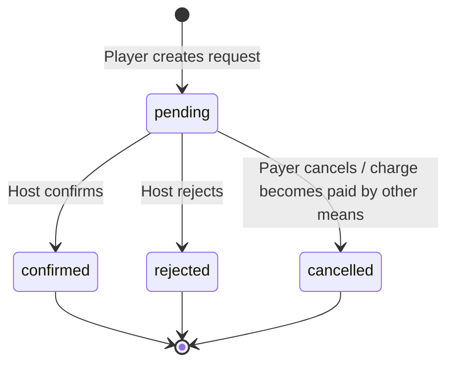

# Feature: Payment Reconciliation — Backend Tech Spec

> **Canonical phase:** P3 (auto-reconcile) · P2 (manual mark-paid)
> **Version:** 1.15 · 2026-08-12
> **Status:** Reviewed contract; mirror DD-32/DD-91 `DECISION_FINAL` + regional availability boundary. Primary plan v1.8 đã `PLAN_READY` tại `90d292d`; B1/runtime slices vẫn cần strict `CODE_READY`
> **Implementation:** In progress — core matching/payments-logic + tenant-integrity migrations `0019`/`0020` đã có; wiring webhook→settle→notify, `remainingAmount`, `getSelfPaymentStatus` và chat `/pay` chưa · authority: `../../standards/BUILD-STATUS.md` (Doc status ≠ Implementation status)
> **Product spec:** `../FE/feature_payment_reconcile.md`
> **References:** `../../product/TDD.md` §3.2/3.6–3.8 · `../../standards/business-rules.md` · `../../standards/decisions.md` DD-25/DD-32/DD-40/DD-49/DD-51/DD-91 · `feature_channel_booking_funnel_tech.md` · `../../research/auto-debt-reconciliation-regional-availability-2026-07-27.md`

> **Cập nhật v1.8:** mọi ledger edge dùng composite FK để chứng minh cùng tenant; charge còn bind đúng session/player/membership và reversal bind đúng charge gốc. Migration upgrade phải backfill có kiểm chứng rồi fail-closed trên bất kỳ row lịch sử lệch scope nào.

> **DD-91 + regional boundary (target, chưa runtime):** `payment_reconcile_auto` là commercial entitlement, không phải availability proof. Current provider/schema authority chỉ có `sepay|apipay` cho rail Việt Nam; webhook→settle→notify chưa build. Auto path phải require entitlement **và** proven provider/bank/market/currency/consent; missing/unknown fail-closed, trong khi `payment_mark_manual` vẫn dùng toàn cầu. Player-facing `/pay` là requester-only adapter của canonical `getSelfPaymentStatus`, không phải ledger writer/matcher mới.

---

## 1. Components

**Module structure:**

```text
apps/api/src/payment/
├── payment.module.ts       ← NestJS module
├── payment.controller.ts   ← REST endpoints + webhook handlers
├── payment.service.ts      ← Ledger business logic
├── reconcile.service.ts    ← Matching/allocation engine
└── webhook-handler.ts      ← SePay/ApiPay signature verification
```

> Registered in `AppModule.imports`.

```text
webhook adapter
  → authenticate + normalize provider payload
  → durable ingest transaction
  → pg-boss/outbox reconcile job
  → tenant-scoped reconcile worker
  → matching(core) proposes allocation plan
  → ledger service validates/locks/applies
  → outbox payment.allocated/payment.settled
  → notification/projectors (P4+)
```

Provider adapters never mark a player paid directly. Matching is pure proposal logic; ledger service is the only writer of allocations/charge status.

Current adapters/contracts are only `sepay|apipay`. Do not treat the provider enum or Host Pro entitlement as a global provider abstraction: a future market/provider needs its own decision, currency/minor-unit contract and availability evidence before enablement.

An exact channel-booking payment reference is a separate dispatch class. The generic name/date/amount reconciler must not claim it; after durable ingest, a dedicated job calls the channel-booking finalizer with the bank transaction ID.

### Entry points

| Entry | Caller | Mô tả |
|-------|--------|-------|
| `POST /api/webhooks/sepay` | SePay provider | Authenticate + normalize → durable ingest |
| `POST /api/webhooks/apipay` | ApiPay provider | Authenticate + normalize → durable ingest |
| Reconcile worker (pg-boss) | System | Tenant-scoped matching → allocation plan → ledger apply |
| Channel-booking finalizer job | System | Exact booking reference → settle intent |
| `POST /api/sessions/:id/players/:id/mark-paid` | Host (web) | Manual mark-paid (`payment_mark_manual`, all tiers) |
| `GET /api/me/payment-status` | Player | Canonical `getSelfPaymentStatus` → `remainingAmount` |
| `/pay` slash command | Player (chat) | Requester-only adapter — no ledger write, no LLM |
| Ledger outbox (payment.settled) | System | Outbox event → notification/projector consumers |

---

## 2. Schema

Các parent key này phải land trong cùng migration (hoặc reuse constraint tương đương đã có trên base). Scalar UUID FK không chứng minh hai row cùng tenant/session:

```sql
ALTER TABLE sessions
  ADD CONSTRAINT sessions_id_tenant_uq UNIQUE (id, tenant_id);
ALTER TABLE memberships
  ADD CONSTRAINT memberships_id_tenant_uq UNIQUE (id, tenant_id);
ALTER TABLE players
  ADD CONSTRAINT players_id_tenant_session_membership_uq
    UNIQUE (id, tenant_id, session_id, membership_id),
  ADD CONSTRAINT players_session_tenant_fk
    FOREIGN KEY (session_id, tenant_id) REFERENCES sessions(id, tenant_id),
  ADD CONSTRAINT players_membership_tenant_fk
    FOREIGN KEY (membership_id, tenant_id) REFERENCES memberships(id, tenant_id);

CREATE TABLE bank_accounts (
  id uuid PRIMARY KEY DEFAULT gen_random_uuid(),
  tenant_id uuid NOT NULL REFERENCES tenants(id),
  provider text NOT NULL,
  account_number_enc bytea NOT NULL,
  account_fingerprint text NOT NULL,
  webhook_token text NOT NULL UNIQUE,
  webhook_secret_enc bytea NOT NULL,
  active boolean NOT NULL DEFAULT true,
  -- G1: STK change confirmation delay (AUDIT G1, BL-PAY-10)
  pending_account_number_enc bytea,
  pending_account_holder text,
  pending_change_at timestamptz,
  pending_expires_at timestamptz,     -- pending_change_at + 24h
  pending_change_by uuid,
  stk_change_count_30d integer NOT NULL DEFAULT 0,
  UNIQUE (id, tenant_id),
  UNIQUE (tenant_id, provider, account_fingerprint)
);

CREATE TABLE charges (
  id uuid PRIMARY KEY DEFAULT gen_random_uuid(),
  tenant_id uuid NOT NULL REFERENCES tenants(id),
  session_id uuid NOT NULL,
  player_id uuid NOT NULL,
  membership_id uuid NOT NULL,
  amount_due integer NOT NULL CHECK (amount_due >= 0),
  amount_allocated integer NOT NULL DEFAULT 0 CHECK (amount_allocated >= 0),
  status text NOT NULL CHECK (status IN ('open','partial','paid','void')),
  UNIQUE (id, tenant_id),
  UNIQUE (tenant_id, session_id, player_id),
  FOREIGN KEY (session_id, tenant_id)
    REFERENCES sessions(id, tenant_id),
  FOREIGN KEY (membership_id, tenant_id)
    REFERENCES memberships(id, tenant_id),
  FOREIGN KEY (player_id, tenant_id, session_id, membership_id)
    REFERENCES players(id, tenant_id, session_id, membership_id),
  CHECK (amount_allocated <= amount_due)
);

CREATE TABLE bank_transactions (
  id uuid PRIMARY KEY DEFAULT gen_random_uuid(),
  tenant_id uuid NOT NULL REFERENCES tenants(id),
  bank_account_id uuid NOT NULL,
  provider text NOT NULL,
  external_id text NOT NULL,
  amount integer NOT NULL CHECK (amount > 0),
  unallocated_amount integer NOT NULL CHECK (unallocated_amount >= 0),
  occurred_at timestamptz NOT NULL,
  content_enc bytea,
  provider_code_enc bytea,          -- (DD-02) code provider bóc sẵn, normalized (SePay optional; ApiPay không có) — EVIDENCE, không canonical
  raw_payload_enc bytea NOT NULL,
  reconcile_status text NOT NULL CHECK (reconcile_status IN ('pending','matched','partial','unmatched','ignored')),
  received_at timestamptz NOT NULL DEFAULT now(),
  UNIQUE (id, tenant_id),
  UNIQUE (tenant_id, provider, external_id),
  FOREIGN KEY (bank_account_id, tenant_id)
    REFERENCES bank_accounts(id, tenant_id),
  CHECK (unallocated_amount <= amount)
);

CREATE TABLE payment_allocations (
  id uuid PRIMARY KEY DEFAULT gen_random_uuid(),
  tenant_id uuid NOT NULL REFERENCES tenants(id),
  bank_transaction_id uuid,
  charge_id uuid NOT NULL,
  amount integer NOT NULL CHECK (amount <> 0),
  -- Canonical enum authoritative in packages/db/schema.ts + migrations:
  --   auto/manual = có bank_transactions row (auto = webhook match; manual = host gán / đối soát CK).
  --   cash = tiền mặt host xác nhận (bank_transaction_id NULL, created_by set); waiver = miễn.
  --   DD-40 mark-paid thủ công: tiền mặt → 'cash'; CK đã ingest → 'manual' (khớp bank txn).
  --   Host-attested "đã CK" chưa có bank_transaction = dedicated source migration (B1), never synthetic bank txn
  --   HOẶC mở enum qua migration — KHÔNG dùng 'cash' cho CK, KHÔNG thêm 'bank_transfer'.
  -- ⛔ 'buddy' ĐÃ BỊ BÁC — DD-106 Q1 (owner-delegated 2026-08-14). KHÔNG mở enum này.
  --    Lý do: created_by đã tồn tại (0003:87) và CHECK đã cho phép ('cash'|'waiver') + created_by
  --    NOT NULL (0003:92), nên "A trả hộ charge của B" = ('cash', created_by=A) — không cần giá trị
  --    mới. Mỗi enum trên đường tiền là một nhánh vĩnh viễn trong mọi đối soát/report/reversal.
  --    Muốn mở lại: DD riêng, trả lời được 'buddy' mang thông tin gì mà ('cash'|'manual', created_by)
  --    không mang. Dòng dưới giữ nguyên làm dấu vết đề xuất, KHÔNG phải contract.
  source text NOT NULL CHECK (source IN ('auto','manual','cash','waiver','reversal','buddy')),
  reverses_allocation_id uuid,
  created_by uuid,
  reason_code text,
  created_at timestamptz NOT NULL DEFAULT now(),
  UNIQUE (id, tenant_id, charge_id),
  FOREIGN KEY (bank_transaction_id, tenant_id)
    REFERENCES bank_transactions(id, tenant_id),
  FOREIGN KEY (charge_id, tenant_id)
    REFERENCES charges(id, tenant_id),
  FOREIGN KEY (reverses_allocation_id, tenant_id, charge_id)
    REFERENCES payment_allocations(id, tenant_id, charge_id),
  CHECK (reverses_allocation_id IS NULL OR reverses_allocation_id <> id),
  CHECK (
    (source IN ('auto','manual') AND amount > 0 AND bank_transaction_id IS NOT NULL)
    -- cash/waiver: host-initiated, no bank_transaction row, requires actor
    OR (source IN ('cash','waiver') AND amount > 0 AND bank_transaction_id IS NULL AND created_by IS NOT NULL)
    -- buddy: player-to-player, no bank_transaction, requires payer actor
    OR (source = 'buddy' AND amount > 0 AND bank_transaction_id IS NULL AND created_by IS NOT NULL)
    OR (source = 'reversal' AND amount < 0 AND reverses_allocation_id IS NOT NULL)
  )
);
```

All four ledger tables are tenant-scoped with ENABLE + FORCE RLS using `app.tenant_id`. Composite FKs are the database fence; RLS remains defense-in-depth and must not be treated as referential integrity. Aggregate invariants cannot rely on CHECK constraints alone; ledger service locks rows and validates sums transactionally.

### Buddy Payment Requests

```sql
CREATE TABLE buddy_payment_requests (
  id uuid PRIMARY KEY DEFAULT gen_random_uuid(),
  tenant_id uuid NOT NULL REFERENCES tenants(id),
  session_id uuid NOT NULL,
  charge_id uuid NOT NULL,
  payer_person_id uuid NOT NULL REFERENCES persons(id),
  payer_player_id uuid NOT NULL,
  recipient_person_id uuid NOT NULL REFERENCES persons(id),
  recipient_player_id uuid NOT NULL,
  amount integer NOT NULL CHECK (amount > 0),
  status text NOT NULL CHECK (status IN ('pending','confirmed','rejected','cancelled')),
  confirmed_by uuid,             -- host/admin person_id who confirmed
  confirmed_at timestamptz,
  rejected_reason text,
  allocation_id uuid,            -- links to the resulting payment_allocation
  created_at timestamptz NOT NULL DEFAULT now(),
  updated_at timestamptz NOT NULL DEFAULT now(),
  UNIQUE (id, tenant_id),
  FOREIGN KEY (session_id, tenant_id) REFERENCES sessions(id, tenant_id),
  FOREIGN KEY (charge_id, tenant_id) REFERENCES charges(id, tenant_id),
  FOREIGN KEY (payer_player_id, tenant_id, session_id)
    REFERENCES players(id, tenant_id, session_id),
  FOREIGN KEY (recipient_player_id, tenant_id, session_id)
    REFERENCES players(id, tenant_id, session_id),
  FOREIGN KEY (allocation_id, tenant_id, charge_id)
    REFERENCES payment_allocations(id, tenant_id, charge_id),
  -- Prevent duplicate pending requests for same payer→charge
  CHECK (payer_person_id <> recipient_person_id),
  CHECK (
    (status = 'pending'   AND confirmed_by IS NULL AND confirmed_at IS NULL AND allocation_id IS NULL)
    OR
    (status = 'confirmed' AND confirmed_by IS NOT NULL AND confirmed_at IS NOT NULL AND allocation_id IS NOT NULL)
    OR
    (status = 'rejected'  AND confirmed_by IS NOT NULL AND confirmed_at IS NOT NULL AND allocation_id IS NULL)
    OR
    (status = 'cancelled' AND allocation_id IS NULL)
  )
);
CREATE UNIQUE INDEX idx_buddy_request_pending_unique
  ON buddy_payment_requests(charge_id, payer_person_id)
  WHERE status = 'pending';
CREATE INDEX idx_buddy_request_tenant_session
  ON buddy_payment_requests(tenant_id, session_id, status);
```

Table is tenant-scoped with ENABLE + FORCE RLS using `app.tenant_id`. Partial unique index ensures one pending request per (charge, payer). Status CHECK constraint enforces state consistency (confirmed must have actor + allocation; pending must have none).

Recommended indexes: pending requests by tenant/session (host confirm queue), requests by charge (duplicate check).

Recommended indexes: pending/unmatched transaction by tenant/received time, open charges by tenant/membership/session, allocations by transaction and charge, partial/paid status.

### 2.1 Additive migration/upgrade contract

Live migration tail is `0024_public_visibility_capacity_check.sql` (`0000`–`0024`, 25 migrations). Same-tenant candidate keys/FKs across sessions/memberships/players/charges landed in `0019_tenant_integrity_fks.sql`; ledger-edge keys/FKs for bank accounts/transactions/allocations landed in `0020_ledger_tenant_integrity_fks.sql`. Reuse those exact live constraints. The stronger exact player/session/membership binding, B1 attested-transfer source and any remaining delta below require a **new monotonic migration after `0024`**; do not recreate equivalent keys or rewrite `0002`/`0003`/`0019`/`0020`.

Before authoring that migration, diff §2.1 against `pg_constraint`/`packages/db/schema.ts`; omit any exact equivalent already landed. The remaining upgrade runs as the schema migration owner with visibility over every tenant and is atomic:

1. Lock the seven affected tables against concurrent writes.
2. Backfill only `charges.membership_id IS NULL` from the exact `players` row. Abort if the player is absent or its tenant/session does not equal the charge.
3. Before adding constraints, abort on any historical mismatch: player↔session/membership; charge↔session/player/membership; bank transaction↔bank account; allocation↔transaction/charge; reversal↔original tenant/charge.
4. Add/reuse the candidate keys shown above, add composite FKs as `NOT VALID`, validate every FK, then set `charges.membership_id NOT NULL`. Only after successful validation may the old scalar FKs be dropped.
5. Update `packages/db/schema.ts`, DBML/ERD, RLS invariant inventory and migration tests in the same build slice. A docs-only update does not claim the **remaining exact-binding/B1 delta** exists; constraints already landed in `0019`/`0020` remain runtime authority.

Executable upgrade shape (constraint names are canonical; omit an `ADD` only when the exact candidate key already exists on the implementation base):

```sql
BEGIN;
LOCK TABLE sessions, memberships, players, bank_accounts, charges,
  bank_transactions, payment_allocations IN SHARE ROW EXCLUSIVE MODE;

UPDATE charges c
SET membership_id = p.membership_id
FROM players p
WHERE c.membership_id IS NULL
  AND p.id = c.player_id
  AND p.tenant_id = c.tenant_id
  AND p.session_id = c.session_id;

DO $$
BEGIN
  IF EXISTS (
    SELECT 1
    FROM players p
    LEFT JOIN sessions s
      ON (s.id, s.tenant_id) = (p.session_id, p.tenant_id)
    LEFT JOIN memberships m
      ON (m.id, m.tenant_id) = (p.membership_id, p.tenant_id)
    WHERE s.id IS NULL OR m.id IS NULL
  ) THEN
    RAISE EXCEPTION 'payment ledger upgrade: player scope mismatch';
  END IF;

  IF EXISTS (
    SELECT 1
    FROM charges c
    LEFT JOIN sessions s
      ON (s.id, s.tenant_id) = (c.session_id, c.tenant_id)
    LEFT JOIN memberships m
      ON (m.id, m.tenant_id) = (c.membership_id, c.tenant_id)
    LEFT JOIN players p
      ON (p.id, p.tenant_id, p.session_id, p.membership_id) =
         (c.player_id, c.tenant_id, c.session_id, c.membership_id)
    WHERE s.id IS NULL OR m.id IS NULL OR p.id IS NULL
  ) THEN
    RAISE EXCEPTION 'payment ledger upgrade: charge scope mismatch';
  END IF;

  IF EXISTS (
    SELECT 1
    FROM bank_transactions bt
    LEFT JOIN bank_accounts ba
      ON (ba.id, ba.tenant_id) = (bt.bank_account_id, bt.tenant_id)
    WHERE ba.id IS NULL
  ) THEN
    RAISE EXCEPTION 'payment ledger upgrade: bank-account scope mismatch';
  END IF;

  IF EXISTS (
    SELECT 1
    FROM payment_allocations pa
    LEFT JOIN bank_transactions bt
      ON (bt.id, bt.tenant_id) = (pa.bank_transaction_id, pa.tenant_id)
    LEFT JOIN charges c
      ON (c.id, c.tenant_id) = (pa.charge_id, pa.tenant_id)
    LEFT JOIN payment_allocations original
      ON (original.id, original.tenant_id, original.charge_id) =
         (pa.reverses_allocation_id, pa.tenant_id, pa.charge_id)
    WHERE c.id IS NULL
       OR (pa.bank_transaction_id IS NOT NULL AND bt.id IS NULL)
       OR (pa.reverses_allocation_id IS NOT NULL AND original.id IS NULL)
  ) THEN
    RAISE EXCEPTION 'payment ledger upgrade: allocation scope mismatch';
  END IF;
END
$$;

ALTER TABLE sessions
  ADD CONSTRAINT sessions_id_tenant_uq UNIQUE (id, tenant_id);
ALTER TABLE memberships
  ADD CONSTRAINT memberships_id_tenant_uq UNIQUE (id, tenant_id);
ALTER TABLE players
  ADD CONSTRAINT players_id_tenant_session_membership_uq
    UNIQUE (id, tenant_id, session_id, membership_id);
ALTER TABLE bank_accounts
  ADD CONSTRAINT bank_accounts_id_tenant_uq UNIQUE (id, tenant_id);
ALTER TABLE bank_transactions
  ADD CONSTRAINT bank_transactions_id_tenant_uq UNIQUE (id, tenant_id);
ALTER TABLE charges
  ADD CONSTRAINT charges_id_tenant_uq UNIQUE (id, tenant_id);
ALTER TABLE payment_allocations
  ADD CONSTRAINT payment_allocations_id_tenant_charge_uq
    UNIQUE (id, tenant_id, charge_id);

ALTER TABLE players
  ADD CONSTRAINT players_session_tenant_fk
    FOREIGN KEY (session_id, tenant_id) REFERENCES sessions(id, tenant_id) NOT VALID,
  ADD CONSTRAINT players_membership_tenant_fk
    FOREIGN KEY (membership_id, tenant_id) REFERENCES memberships(id, tenant_id) NOT VALID;
ALTER TABLE charges
  ADD CONSTRAINT charges_session_tenant_fk
    FOREIGN KEY (session_id, tenant_id) REFERENCES sessions(id, tenant_id) NOT VALID,
  ADD CONSTRAINT charges_membership_tenant_fk
    FOREIGN KEY (membership_id, tenant_id) REFERENCES memberships(id, tenant_id) NOT VALID,
  ADD CONSTRAINT charges_player_scope_fk
    FOREIGN KEY (player_id, tenant_id, session_id, membership_id)
    REFERENCES players(id, tenant_id, session_id, membership_id) NOT VALID;
ALTER TABLE bank_transactions
  ADD CONSTRAINT bank_transactions_account_tenant_fk
    FOREIGN KEY (bank_account_id, tenant_id) REFERENCES bank_accounts(id, tenant_id) NOT VALID;
ALTER TABLE payment_allocations
  ADD CONSTRAINT payment_allocations_transaction_tenant_fk
    FOREIGN KEY (bank_transaction_id, tenant_id)
    REFERENCES bank_transactions(id, tenant_id) NOT VALID,
  ADD CONSTRAINT payment_allocations_charge_tenant_fk
    FOREIGN KEY (charge_id, tenant_id) REFERENCES charges(id, tenant_id) NOT VALID,
  ADD CONSTRAINT payment_allocations_reversal_scope_fk
    FOREIGN KEY (reverses_allocation_id, tenant_id, charge_id)
    REFERENCES payment_allocations(id, tenant_id, charge_id) NOT VALID,
  ADD CONSTRAINT payment_allocations_no_self_reversal_chk
    CHECK (reverses_allocation_id IS NULL OR reverses_allocation_id <> id) NOT VALID;

ALTER TABLE players VALIDATE CONSTRAINT players_session_tenant_fk;
ALTER TABLE players VALIDATE CONSTRAINT players_membership_tenant_fk;
ALTER TABLE charges VALIDATE CONSTRAINT charges_session_tenant_fk;
ALTER TABLE charges VALIDATE CONSTRAINT charges_membership_tenant_fk;
ALTER TABLE charges VALIDATE CONSTRAINT charges_player_scope_fk;
ALTER TABLE bank_transactions VALIDATE CONSTRAINT bank_transactions_account_tenant_fk;
ALTER TABLE payment_allocations VALIDATE CONSTRAINT payment_allocations_transaction_tenant_fk;
ALTER TABLE payment_allocations VALIDATE CONSTRAINT payment_allocations_charge_tenant_fk;
ALTER TABLE payment_allocations VALIDATE CONSTRAINT payment_allocations_reversal_scope_fk;
ALTER TABLE payment_allocations VALIDATE CONSTRAINT payment_allocations_no_self_reversal_chk;
ALTER TABLE charges ALTER COLUMN membership_id SET NOT NULL;

ALTER TABLE players
  DROP CONSTRAINT IF EXISTS players_session_id_fkey,
  DROP CONSTRAINT IF EXISTS players_membership_id_fkey;
ALTER TABLE charges
  DROP CONSTRAINT IF EXISTS charges_session_id_fkey,
  DROP CONSTRAINT IF EXISTS charges_player_id_fkey,
  DROP CONSTRAINT IF EXISTS charges_membership_id_fkey;
ALTER TABLE bank_transactions
  DROP CONSTRAINT IF EXISTS bank_transactions_bank_account_id_fkey;
ALTER TABLE payment_allocations
  DROP CONSTRAINT IF EXISTS payment_allocations_bank_transaction_id_fkey,
  DROP CONSTRAINT IF EXISTS payment_allocations_charge_id_fkey,
  DROP CONSTRAINT IF EXISTS payment_allocations_reverses_allocation_id_fkey;
COMMIT;
```

### 2.2 Rollback

- **Trong lúc apply:** upgrade là **một transaction atomic** (§2.1) — mọi preflight mismatch RAISE EXCEPTION ⇒ toàn bộ abort, không để lại partial constraint set (đã có schema-upgrade fixture ở §8 assert điều này).
- **Sau khi apply (revert migration mới):**

| Bước | Hành động | An toàn? |
|------|-----------|----------|
| 1 | Disable reconcile worker + mark-paid/allocation routes | ✅ |
| 2 | Migration revert mới: DROP **chỉ** exact-binding/B1 objects do future migration này thêm, restore scalar FK tương ứng và DROP `charges.membership_id NOT NULL`. Không drop/recreate constraint đã land trong `0019`/`0020` | ✅ Constraint-only; dữ liệu backfill `membership_id` giữ nguyên (đúng theo player, vô hại) |
| 3 | Drop các bảng ledger baseline (`charges`/`bank_transactions`/`payment_allocations`/`bank_accounts`) | ❌ NEVER — bảng thuộc `0002`/`0003` đã apply, có thể chứa ledger thật |

---

## 3. Durable webhook ingest

Endpoint examples: `POST /webhook/sepay/:token`, `POST /webhook/apipay/:token`.

1. Resolve bank account from opaque token.
2. Call the canonical provider verifier from Connector Onboarding **before JSON parse/persist**, using the exact raw request bytes:
   - SePay `hmac_sha256`: require `X-SePay-Timestamp` within ±300s and `X-SePay-Signature: sha256=<hex>` equal (constant-time) to HMAC-SHA256(`{timestamp}.{raw_body}`); missing/malformed/stale/bad signature = 401 and **never** tries an alternate mode.
   - SePay explicit `api_key` fallback: accept only exact `Authorization: Apikey <key>` with constant-time comparison; this mode is configured on the endpoint and is never selected because HMAC failed.
   - ApiPay: independently verify `ApiPay-Signature = HMAC-SHA256(raw_body, per-webhook secret)`; never reuse SePay timestamp/header rules.
   Then verify opaque route token and provider account fingerprint agree. No local "generic HMAC" implementation is allowed.
3. Normalize provider payload and external ID; synthesize stable ID if absent.
4. Begin DB transaction with tenant context.
5. Insert `bank_transactions`; on duplicate return existing ID.
6. Enqueue pg-boss job using same DB transaction or insert reconcile outbox row atomically.
7. Commit, then return 200.

Never ACK a newly accepted transaction if step 5–6 has not committed. Duplicate returns 200 without a second job. Payload/secret errors use stable JSON errors and do not log sensitive fields.


### Endpoints

| Method | Path | Auth | Mô tả |
|--------|------|------|-------|
| POST | `/webhook/sepay` | Signed (HMAC) | SePay transaction callback |
| POST | `/webhook/apipay` | Signed (API key) | ApiPay transaction callback |
| GET | `/api/payments/tenant/:tid/ledger` | TenantAdmin | Tenant payment ledger |
| GET | `/api/payments/tenant/:tid/unmatched` | TenantAdmin | Unmatched transactions |
| POST | `/api/payments/tenant/:tid/manual-match` | TenantAdmin | Manual match unmatched transaction |
| GET | `/api/payments/person-self/charges` | Authenticated | Player own charges |
| GET | `/api/payments/person-self/status/:sessionId` | Authenticated | Payment status for session |

> Envelope DD-60.

### Error Codes

| Code | Error Code | Message | Trigger |
|------|-----------|---------|---------|
| 400 | `PAYMENT_ALREADY_MATCHED` | Giao dịch đã được khớp | Double match attempt |
| 400 | `PAYMENT_AMOUNT_MISMATCH` | Số tiền không khớp | Underpay / wrong amount |
| 400 | `PAYMENT_EXPIRED` | Giao dịch đã hết hạn | Payment after hold expiry |
| 400 | `PAYMENT_INVALID_REFERENCE` | Mã tham chiếu không hợp lệ | Reference code invalid |
| 400 | `MANUAL_MATCH_INVALID` | Không thể khớp thủ công | Invalid manual match |
| 401 | `AUTH_REQUIRED` | Cần đăng nhập | No valid session |
| 403 | `TENANT_ACCESS_DENIED` | Không có quyền truy cập | Cross-tenant |
| 429 | `WEBHOOK_RATE_LIMITED` | Quá nhiều yêu cầu | Webhook burst |
---

## 4. Reconcile worker

Input: `{tenantId, bankTransactionId}`.

```text
withTenant(tenantId)
  lock bank_transaction FOR UPDATE
  if terminal and unallocated=0 → no-op

  # --- Pay-code recognition pipeline (DD-02, P4) ---
  normalize(memo)                       # uppercase + bỏ dấu; giữ '-'/space
  cands = discoverPayCodeCandidates(memo)   # mọi split prefix{3,4}×'-?'×suffix{4}; KHÔNG loại skipCodes
  classes = batchResolve(cands)         # narrow SECURITY DEFINER → own|foreign|none (full-issued = registry.locked_at NOT NULL + pay_code match)
  memo-level precedence:                # hard-token THẮNG name-fallback
    any hard (foreign / own-prefix+unissued / dash-unresolved / >1 full-issued interpretation / error) → UNMATCHED
    ≥2 distinct own                                                                    → UNMATCHED
    exactly 1 own → membership := resolve(own); follow merged_into_membership_id (guards)
    only none / no candidate → fall through to name+amount+date (P3)

  # --- Provider-code evidence cross-check (invariant; reconcile is async) ---
  # bank_transactions.provider_code_enc = normalized code provider bóc sẵn (SePay optional; ApiPay không có).
  if bank_transaction.provider_code IS NOT NULL:
    if provider_code KHÔNG khớp candidate đã resolve (suffix/prefix/tenant) HOẶC không nằm trong content
        → UNMATCHED (fail-closed; không tự chọn bên nào)   # provider code chỉ là EVIDENCE, không canonical

  # --- Allocation plan (ledger canonical) ---
  plan = planIncomingAllocations(openDebts(membership), amount)   # FIFO priced debts; keep proven part
    exact/over/under(partial)/unknown-fee-trailing → applyAllocations(plan) (over → hold overpay)
    unknown-fee-first / already-paid               → mark unmatched with reason
```

P3 matching uses name + amount + date only. **DD-02 pay-code path (above) là P4** — parser/resolver/`planIncomingAllocations` sống sau feature flag tới khi P4 rollout; memo only-có-code chưa phát trước P4. **Contract này là canonical; §8 Testing chỉ tham chiếu lại.**

No automatic `fee × N` split without identified people/charges. Confidence threshold must come from calibration fixtures; it is configuration/versioned policy, not an unexplained hard-coded 88%.

---

## 5. Ledger service

`applyAllocations` locks the bank transaction (when present), target charges and reversed allocation in stable ID order.

Validation:

- Effective bank allocations after change remain within `[0, transaction.amount]`.
- Effective charge allocations remain within `[0, charge.amount_due]`.
- Manual/auto source requires bank transaction; cash/waiver requires authorized actor.
- Reversal points to a positive allocation on the **same tenant and charge** and cannot exceed its remaining effective amount.
- Tenant IDs match across every parent edge; a charge's player must also match its exact session and membership.

After inserts, recompute/update `amount_allocated`, `unallocated_amount`, charge status and transaction reconcile status under the same transaction. Insert outbox events before commit.

These writer aggregates are canonical inputs for person-self reads. No chat/Home/notification adapter may query allocation rows and re-derive a competing balance formula.

Idempotency keys:

- Webhook: `(tenant, provider, external_id)`.
- Worker attempt: job unique key per transaction/version.
- Manual action: `commandId` in `processed_commands`.
- Reversal: unique command + target allocation checks.


### Testing Plan

#### Unit Tests

| # | Test | Input | Expected |
|---|------|-------|----------|
| 1 | Webhook valid signature → process | Valid HMAC body | 200, transaction created |
| 2 | Webhook invalid signature → reject | Bad HMAC | 400, no mutation |
| 3 | Webhook replay same txn_id → idempotent | Duplicate txn_id | 200, no new record |
| 4 | Exact match: amount + reference | 120000 + PXC-XXXX | charge.status=paid |
| 5 | Underpay: amount < charge | 100000 vs 120000 | unmatched, manual_review |
| 6 | Overpay: amount > charge | 150000 vs 120000 | allocate due, remainder unmatched |
| 7 | Wrong reference code | Invalid PXC code | unmatched |
| 8 | Payment after hold expiry | Expired hold | no auto-book, manual_review |
| 9 | Manual match: valid unmatched → charge | Admin match | charge.status=paid |
| 10 | Manual match: already matched → error | Matched txn | PAYMENT_ALREADY_MATCHED |
| 11 | Concurrent webhook + manual match | Race condition | One wins, other idempotent |
| 12 | Ledger query: tenant isolation | Tenant A query | Only tenant A data |
| 13 | Person-self: own charges only | Person query | Only own charges |
| 14 | Person-self: cross-person reject | Other person_id | 403 |
| 15 | Multiple charges for same session | Session with 2 players | Independent settlement |
| 16 | Currency mismatch | USD vs VND | unmatched |
| 17 | Zero amount payment | amount=0 | Rejected |
| 18 | Webhook body malformed | Invalid JSON | 400 |
| 19 | Webhook timeout → retry | Slow processing | Idempotent on retry |
| 20 | Ledger totals after match | After successful match | Ledger balanced |

#### Integration Tests

| # | Test | Setup | Expected |
|---|------|-------|----------|
| 1 | Full payment flow | Create charge → webhook → match | charge paid, player active |
| 2 | Cross-tenant isolation | 2 tenants, same reference | Separate matching |
| 3 | Concurrent payments | 2 webhooks for same charge | Exactly one match |
| 4 | Manual review flow | Unmatched → admin match | Charge settled |
---

## 5b. Manual mark-paid (DD-40 ✅ — every tier)

Host đánh dấu player **đã trả** thủ công — có ở **mọi tier** và mọi market (capability `payment_mark_manual`), độc lập với auto-reconcile (`payment_reconcile_auto` là Host Pro entitlement nhưng vẫn cần availability gate riêng).

- **Multi-select / tap:** host chọn **1 hoặc nhiều** player trong một kèo, chọn method **tiền mặt** (`cash`) hoặc **CK** — CK đã ingest thành một `bank_transactions` row (free tier không có webhook thì CK phải được ingest trước, hoặc dùng đường impl-mở bên dưới).
- **Ledger write:** với mỗi charge được chọn, `ledger.applyAllocations` INSERT một `payment_allocations` **host-initiated** + cập nhật `charges.amount_allocated`/`status`:
  - **tiền mặt →** `source='cash'`, `bank_transaction_id = NULL`, `created_by = host actor`, `amount = remaining amount_due` hoặc số nhập.
  - **CK →** `source='manual'`, `bank_transaction_id` = row `bank_transactions` khớp (không tạo bank txn giả).
  - **CK chưa có `bank_transaction`** (host tự xác nhận) = B1 dedicated allocation source migration; `bank_transaction_id=NULL`, `created_by` + opaque evidence bắt buộc. Trước migration reject `ATTESTED_TRANSFER_UNSUPPORTED`; **không synthetic bank transaction**, không dùng `cash|manual`.
  - Cùng invariants sum như §5 (không mark quá `amount_due`).
- **DD-25 preview + 2-pha confirm:** mark-paid là **human-initiated money mutation** → phải **preview** (danh sách player + method + tổng tiền) → **confirm** (single-slot fail-closed, DD-24) trước khi persist. Áp cho cả tap đơn lẫn multi-select.
- **Idempotent:** một `commandId` cho cả batch (ghi `processed_commands`); retry trả kết quả cũ, không double-allocate. Mỗi (charge, commandId) chỉ tạo một allocation.
- **Audit + confirm player:** ghi actor/method/reason; sau markPaid → outbox `payment.settled` → **xác nhận tự động tới player** (FR-6.2, `feature_notifications_reminders_tech.md`), best-effort, không chặn.
- **Không** cần bank webhook; **không** đụng auto-matcher. Auto-reconcile CK (webhook match tên+tiền+ngày) vẫn là đường riêng (§3–§5), gated bởi `payment_reconcile_auto` **và** proven provider/bank/market/currency/consent. Entitlement true nhưng availability unknown/false → auto absent, không degrade sang heuristic feed.

---

## 5c. Canonical person-self payment read (DD-91 target)

```ts
remainingAmount(amountDue, amountAllocated) =
  Math.max(0, amountDue - amountAllocated)
```

- `remainingAmount` là primitive domain-neutral duy nhất. Existing `effectiveFee(OpenDebt)` giữ nhánh `fee == null → null`, sau đó delegate primitive với `paid_amount ?? 0`.
- `getSelfPaymentStatus(authenticatedPerson, resolvedOwnClub)` thuộc Player View owner. Service validate authz, charge/allocation integrity và dependency trước khi trả `known_amount|known_zero|unknown`; chỉ proven full query mới trả `known_zero`.
- `/api/me/charges`, Home composition, exact chat `/pay` và authenticated notification detail gọi cùng service/projection. Không consumer có formula/serializer money riêng.
- Exact `/pay` được chat command registry intercept trước normal message/Assistant. Command response synchronous authenticated `Cache-Control: private, no-store`; zero result row/ref/SSE/outbox/push/history. Human DM resolve own eligible clubs one/many/none bằng opaque requester-bound ref, không raw tenant/person ID.
- Đây là contract docs theo DD-91 `DECISION_FINAL`; primary plan v1.8 đã `PLAN_READY` tại `90d292d`, nhưng các primitive/service/route trên chưa tồn tại trong runtime và từng slice vẫn phải strict `CODE_READY`.

---

## 5d. Channel booking pay-now settlement port (DD-32 target)

Payment Reconciliation remains the owner of bank evidence and allocations; `feature_channel_booking_funnel_tech.md` owns the pre-player intent/hold, capacity and atomic admission finalizer.

1. Provider adapter verifies and durable-ingests `bank_transactions` plus its job, then commits before ACK.
2. Dispatcher detects an exact, tenant/connector/currency-scoped booking reference. It marks that transaction for the booking-finalization class; the generic name/date/amount matcher cannot consume or allocate it.
3. The ingest/dispatch transaction ends and releases every bank-row lock.
4. A separate idempotent job calls `finalizeChannelBookingIntent(intentId, { bankTransactionId })`, which enters the Session-first lock order defined by the funnel spec.
5. The finalizer rechecks hold cutoff against durable `received_at`, amount, account, currency, session quote/capacity and current identity before creating/reusing player, charge and allocation.

Exact or overpayment may cover the full quote; allocate only `amount_due` and leave any remainder in canonical `unallocated_amount`. Underpayment does not create a temporary/partial charge because no canonical player exists yet. Late, wrong-reference, wrong-account/currency, revoked approval or restricted identity is retained as bank evidence and routed to manual review; it never revives a booking.

Screenshot, QR display, “Tôi đã thanh toán” and host manual mark-paid are not proof for this first-time unlinked branch. If entitlement or provider/bank/market/currency/consent availability is unknown/false, no payment hold/reference is created and the adapter returns link/web alternatives.

---

## 5e. Buddy payment (Player request → Host confirm)

Player A (active in session) requests to pay for Player B (active in same session, charge `open|partial`). Host confirms → allocation created.

### Lifecycle



### Validation (request creation)

1. `payer_person_id ≠ recipient_person_id` — DDL CHECK.
2. Both payer and recipient are active players in the same session.
3. Recipient’s charge status is `open` or `partial` — reject if `paid|void`.
4. No existing pending request for same `(charge_id, payer_person_id)` — partial unique index.
5. Amount = `charge.amount_due - charge.amount_allocated` (full remaining, phase-1). Partial buddy pay deferred.

### Confirm flow (Host)

1. Lock request row (`SELECT ... FOR UPDATE`).
2. Re-validate request `status = 'pending'`.
3. Lock charge row. Re-validate `charge.status IN ('open','partial')` and `remaining > 0`.
4. Compute `amount = min(request.amount, charge.amount_due - charge.amount_allocated)`. If 0 → reject.
5. `INSERT payment_allocations` with `source='buddy'`, `created_by=request.payer_person_id`, `amount`.
6. Update `charges.amount_allocated` += amount, derive new `status` (paid/partial).
7. Update request: `status='confirmed'`, `confirmed_by`, `confirmed_at`, `allocation_id`.
8. Emit outbox events:
   - `buddy_payment.confirmed` → notify payer: "Thanh toán thành công session [session_name]"
   - `buddy_payment.confirmed` → notify recipient: "Thanh toán thành công session [session_name], [payer_name] đã thanh toán cho bạn"
   - `buddy_payment.confirmed` → notify host (informational)
   - If charge fully paid: also emit `payment.settled` as normal.

### Reject flow (Host)

1. Lock request row.
2. Validate `status = 'pending'`.
3. Update: `status='rejected'`, `confirmed_by=host`, `confirmed_at=now()`, `rejected_reason`.
4. Notify payer: "Yêu cầu trả hộ bị từ chối: [reason]".

### Auto-cancel

When charge becomes `paid` or `void` by other means (mark-paid, auto-reconcile, reversal) while a buddy request is still `pending`, the system auto-cancels the request (`status='cancelled'`). No notification needed (charge is already settled).

### Timing

Buddy payment is allowed **trước, trong và sau khi session kết thúc**. No session-status gate — the only gate is charge status (`open|partial`).

---

## 6. API/command contract

| Interface | Auth | Result |
|---|---|---|
| `/unmatched` | TenantAdmin | Transactions with remainder + safe redacted candidates |
| `POST /transactions/:id/allocations` | TenantAdmin + CSRF/session | One or more manual allocations (matched to a bank txn) |
| `POST /sessions/:id/mark-paid` | TenantAdmin + CSRF/session | Multi-select preview→confirm. `cash`→`source='cash'`; ingested bank transfer→`source='manual'` + `bankTransactionId`; attested/un-ingested→B1 dedicated source or reject `ATTESTED_TRANSFER_UNSUPPORTED` until migration |
| `POST /allocations/:id/reverse` | TenantAdmin + reason | Immutable reversal |
| `/cash` / cash endpoint | TenantAdmin | Cash allocation against charge (single) |
| Worker reconcile | System job | Auto allocations or unmatched reason (`host_pro`) |
| `POST /sessions/:id/buddy-pay` | Authenticated Player (active in session) | Create buddy payment request — validate payer/recipient same session, charge open/partial, no duplicate pending |
| `POST /buddy-payment-requests/:id/confirm` | TenantAdmin + CSRF/session | Lock request + charge → INSERT allocation `source='buddy'` → update charge → notify payer+recipient+host |
| `POST /buddy-payment-requests/:id/reject` | TenantAdmin + CSRF/session | Set request rejected + reason → notify payer |
| `DELETE /buddy-payment-requests/:id` | Payer (own request) | Cancel own pending request |
| `GET /sessions/:id/buddy-payment-requests` | TenantAdmin | List pending buddy requests for session (host confirm queue) |

Manual request includes command ID and allocation array `{chargeId, amount}` (hoặc `playerIds` cho mark-paid multi-select). Server ignores tenant/actor supplied in body and derives both from auth context.

> **Boundary:** `POST /api/chat/commands/execute` và `GET /api/me/charges` thuộc In-app Chat/Player View owners, không phải endpoint ledger mutation trong bảng này. Chúng chỉ đọc qua §5c; `/pay` không gọi matcher, không ghi allocation và không dùng Assistant entitlement.

### Request/Response Examples

> Minh hoạ theo contract đã pin; envelope chuẩn DD-60 (`../../standards/api-reference-convention.md` §1.1). Field name DTO + HTTP mapping cho code chưa pin sẽ chốt ở build slice.

**POST `/sessions/:id/mark-paid`** (DD-40, DD-25 preview→confirm 2 pha):

- Request (preview):

```json
{ "commandId": "cmd_…", "method": "cash", "playerIds": ["…", "…"] }
```

- `200` — preview (chưa mutate; confirm single-slot fail-closed DD-24):

```json
{ "data": { "preview": { "players": 2, "method": "cash", "total": 240000 } }, "error": null, "meta": { "requestId": "req_…" } }
```

- Attested transfer trước B1 migration (HTTP mapping minh hoạ):

```json
{ "data": null, "error": { "code": "ATTESTED_TRANSFER_UNSUPPORTED", "message": "…", "statusCode": 409 }, "meta": { "requestId": "req_…" } }
```

**POST `/webhook/sepay/:token`** (HTTP status đã pin ở §3):

- `401` — signature/timestamp fail (trước durable row/job): `error.code = "INVALID_WEBHOOK_SECRET"`.
- `200` — duplicate `(tenant, provider, external_id)`: trả existing transaction ID, `DUPLICATE_TXN`, **không** enqueue job thứ hai.

### Idempotency

> Tổng hợp per-endpoint từ keys đã pin ở §5 (canonical — bảng này chỉ tham chiếu).

| Interface | Idempotent? | Key |
|-----------|-------------|-----|
| Webhook ingest | ✅ | `(tenant, provider, external_id)` — duplicate trả 200 + existing ID |
| Worker reconcile | ✅ | Job unique key per transaction/version; at-least-once + idempotent |
| Mark-paid / manual allocation | ✅ | `commandId` trong `processed_commands` — retry trả kết quả cũ; mỗi (charge, commandId) đúng 1 allocation |
| Reversal | ✅ | Unique command + target allocation checks |
| Buddy payment request | ✅ | Partial unique `(charge_id, payer_person_id) WHERE status='pending'` — duplicate returns existing request |
| Buddy confirm | ✅ | Request row lock + status check; second confirm returns allocation_id |
| Buddy reject | ✅ | Request row lock + status check; second reject no-op |

### STK change endpoints (G1)

| Interface | Auth | Result |
|---|---|---|
| `PATCH /bank-accounts/:id/primary` | TenantOwner | Set pending change; delay 24h; notify all channels |
| `DELETE /bank-accounts/:id/pending-change` | TenantOwner | Cancel pending; keep current STK |
| `GET /bank-accounts/:id/pending-change` | TenantAdmin | View pending change status |

### Rate limits (G3 — BL-SEC-5)

| Endpoint | Limit |
|----------|-------|
| `POST /webhook/sepay/:token` | Không áp app-level user limit; edge per-token/IP burst cap + body-size cap theo deployment-infra §6 |
| `POST /webhook/apipay/:token` | Không áp app-level user limit; edge per-token/IP burst cap + body-size cap theo deployment-infra §6 |
| `POST /transactions/:id/allocations` | 60/min per account |
| `POST /sessions/:id/mark-paid` | 30/min per account (multi-select batch, DD-40) |
| `POST /allocations/:id/reverse` | 30/min per account |
| `POST /cash` | 30/min per account |
| `GET /unmatched` | 60/min per account |
| `PATCH /bank-accounts/:id/primary` | **5/min per account; max 2 changes / 30 days** |
| `POST /sessions/:id/buddy-pay` | 10/min per person (prevent spam requests) |
| `POST /buddy-payment-requests/:id/confirm` | 30/min per account |
| `POST /buddy-payment-requests/:id/reject` | 30/min per account |

Error codes: `INVALID_WEBHOOK_SECRET`, `ACCOUNT_MISMATCH`, `DUPLICATE_TXN` (200), `UNMATCHED`, `ALLOCATION_EXCEEDS_FUNDS`, `CHARGE_ALREADY_SETTLED`, `REVERSAL_EXCEEDS_EFFECTIVE`, `TENANT_SUSPENDED` for admin actions only, `STK_CHANGE_PENDING` (existing pending not yet applied/cancelled), `STK_CHANGE_RATE_LIMITED` (exceeded 2/30d), `RATE_LIMITED` (429), `BUDDY_SELF_PAY` (payer = recipient), `BUDDY_CHARGE_ALREADY_PAID` (charge paid/void), `BUDDY_REQUEST_DUPLICATE` (pending exists), `BUDDY_REQUEST_NOT_FOUND`, `BUDDY_REQUEST_NOT_PENDING` (already confirmed/rejected/cancelled), `BUDDY_PLAYER_NOT_IN_SESSION` (payer or recipient not active player).

### DD-49 correction/refund core (storage design-probe required)

1. Lock player/session canonical charge aggregate and load immutable obligation + allocation entries.
2. Compute preview from one `effectiveAmountDue/effectiveBalance` helper; no call site re-derives totals.
3. Price change: append signed obligation adjustment or grandfather. Allocation reversal is only for reversing received money.
4. Refund: record requested/approved/executed state + opaque external reference; append linked allocation reversal only after the real refund disposition being represented. Never mutate/delete original entries.
5. Rejoin reuses the shared DD-49 disposition from session service: outcome active→carry-over if not refunded or append one idempotent refunded lifecycle; full→waitlisted keeps non-refunded history or defers refunded lifecycle until activation. Never duplicate the `charges` row.
6. Schema/API names, idempotency keys and participation-lifecycle shape must come from design-probe before migration; current UNIQUE `(tenant,session,player)` is an explicit gate.

---

## 7. Concurrency and failure handling

- Lock order: bank transaction → charges sorted by UUID → allocation being reversed.
- Exact channel-booking transactions are excluded from the generic ledger path above. Their dedicated job releases ingest locks before entering the funnel's Session-first finalizer order; no code may hold a bank-row lock and call Session/Join.
- Use short transactions; external notification never runs inside ledger transaction.
- Worker retry is at-least-once and idempotent.
- Sweeper finds old `pending` transactions with no live job and re-enqueues.
- Suspended tenants always ingest; auto-settle/auto-notify are OFF fail-closed under DD-51/PAY-OQ-2. Enabling later requires a new decision + telemetry evidence.
- Entitlement and availability are separate: `hasCapability('payment_reconcile_auto')` is necessary but insufficient. Current `sepay|apipay` contracts cover the Vietnam rail only; missing provider/bank/market/currency/consent blocks auto processing without blocking manual mark-paid.
- Projector failure does not roll back settlement; outbox retries notification.

### Caching Strategy

| Data | Cache? | TTL | Invalidation |
|------|--------|-----|-------------|
| Ledger state (charges/allocations/bank_transactions) | ❌ | — | Mọi quyết định tiền đọc under lock trong transaction (§5, §7) — fail-closed, không đọc cache |
| `/unmatched` list | ❌ | — | Live read + redacted candidates |
| Metrics/monitoring (§9) | Aggregate async | — | Không được dùng làm input cho allocation |

### Security Checklist (template v2.33 — map về section đã pin)

| Mục | Trả lời trong spec |
|-----|---------------------|
| Authorization/ownership | §6: TenantAdmin/TenantOwner + CSRF/session per interface; server derive tenant/actor từ auth context, ignore body |
| Injection/validation | §3: normalize payload trước persist; stable JSON errors; §6: không tin tenant/actor từ body |
| Secret & log redaction | §3: payload/secret errors không log sensitive; §9: logs chỉ IDs/reason codes, never raw bank content/account/secret |
| Webhook signature + replay | §3: SePay HMAC raw-body ±300s timing-safe + no-downgrade; ApiPay HMAC riêng, không dùng chéo header |
| Idempotency | §5 keys + bảng Idempotency §6 |
| Data retention/xoá | Bank content/payload/STK lưu encrypted (`*_enc`); retention/erasure policy per-table chưa pin ở doc này — theo `feature_security_operations_tech.md` |

---

## 8. Testing

### Unit

- Provider normalization/synthetic ID.
- Name/date/amount candidate generation including Vietnamese normalization.
- FIFO ordering and partial plans.
- Ambiguous multi-person returns manual, never auto split.
- Ledger sum/reversal/state derivation.
- **Pay-code resolver + allocation (DD-02 — assert the §4 worker contract; full spec `../../decisions/analysis/dd-02-paycode-analysis.md`):** `discoverPayCodeCandidates` → `batchResolve` (full-issued ⟺ `registry.locked_at NOT NULL` + `pay_code` match) → memo-level precedence → `planIncomingAllocations`. Fixtures:
  - `THANH TOAN`; `PAYMENT` (own vs non-own `PAY`); `BMT7Q2B` unissued → hard; foreign full-issued → hard; `ABC-7Q2A` foreign dash → hard; `BMTRANS` noise → `none`; `BMT-RANS` → hard; full-issued token in `skipCodes` → resolve (issued wins); `BMT7Q2A`/`BMT-7Q2A` both accepted; prefix-change-before-first-issuance (`BMT9K2P` none / `BMT-9K2P` hard); unknown-fee 100k→unknown pay 150k → allocate 100k keep 50k; unknown-fee-first → unmatched; concurrent prefix claim → 1 tx wins; lowercase/all-digit CHECK reject; `merged` → follow tombstone.

### Integration

- SePay exact-auth fixtures: valid timestamp/raw-body signature passes; reserialized body, missing/malformed `sha256=`, stale/future timestamp or bad HMAC returns 401 before durable row/job. HMAC-configured endpoint never downgrades even when a valid API key is also supplied; explicit fallback accepts only `Authorization: Apikey <key>`.
- ApiPay exact-auth fixtures use its own raw-body `ApiPay-Signature`; SePay headers do not authenticate ApiPay and vice versa.
- Raw + job commit before ACK; injected crash before commit yields no ACK.
- Injected crash after ACK is recovered by durable job/sweeper.
- Concurrent duplicate webhooks create one transaction.
- Concurrent auto/manual/cash cannot over-allocate.
- **(DD-02) SePay `provider_code` ↔ content mismatch** (provider bóc code khác với code trong `content`/prefix/tenant) → **hard-unmatched** (fail-closed, không tự chọn bên nào); ApiPay (không có provider code) → chỉ dựa content resolver.
- **Mark-paid (DD-40):** tiền mặt → allocation `source='cash'`+`created_by`, không tạo bank txn giả; CK → allocation `source='manual'` khớp một `bank_transactions` row; enum không có `bank_transfer`; multi-select batch idempotent theo `commandId` (retry không double); DD-25 preview→confirm bắt buộc; markPaid → 1 confirm intent tới player.
- **Entitlement × availability:** Host Pro entitlement true nhưng provider/bank/market/currency/consent unavailable/unknown → zero auto allocation/notify, stable unavailable result; manual mark-paid vẫn hoạt động. Free/VN/non-VN cases không được suy từ `plan_key` hoặc provider enum đơn lẻ.
- **DD-91 parity/privacy:** cùng own-club snapshot qua `/api/me/charges`, Home, exact `/pay`, notification detail → same `SelfPaymentStatus`; dependency/integrity fault → `unknown`, never zero. Human-DM peer/shared history receives zero command/picker/result artifact; command path creates no allocation/chat row.
- **DD-32 pay-now dispatch:** exact booking reference is reserved from generic matcher; ingest commits/releases first, then dedicated job invokes finalizer. Exact settlement creates one player/charge/allocation; overpay leaves remainder unmatched; underpay/late/wrong-account-or-currency/revoked/restricted creates no active booking. Duplicate and link-vs-payment races remain single-terminal/idempotent.
- **B1 attested transfer:** before migration → `ATTESTED_TRANSFER_UNSUPPORTED`; after migration → dedicated source, NULL bank txn, actor+opaque evidence; never synthetic bank transaction or `cash|manual` fallback.
- **DD-49 correction:** price up/down append obligation adjustment; refund reversal links original allocation; carry-over rejoin creates no financial row. Refunded rejoin creates one idempotent lifecycle **only with active outcome**; full→waitlisted creates none until activation. Unknown state fails closed. Every assertion reads the canonical balance helper.
- Partial, overpay, multi-charge and multi-person manual allocation totals.
- Reversal restores bank remainder/charge status exactly.
- Cash/waiver requires actor and no fake bank transaction.
- **Schema-upgrade fixture:** a clean legacy database upgrades atomically; a NULL charge membership is backfilled only from its exact player. Any legacy player/charge/bank/allocation scope mismatch aborts and leaves no partial constraint set.
- **Constraint-parity fixture:** query `pg_constraint` after migration and require every candidate key/composite FK from §2.1; Drizzle schema + DBML expose the same keys. A scalar-only FK is a failure.
- **Cross-tenant direct-DML fixtures:** tenant A cannot create a player against tenant B session/membership, a charge against tenant B parents, a bank transaction against tenant B account, or an allocation against tenant B transaction/charge — even when each scalar UUID exists.
- **Same-tenant cross-session fixture:** a charge cannot combine a player from session X with session Y or a membership other than that player's membership.
- **Reversal scope fixtures:** cross-tenant original and same-tenant/different-charge original both fail at the composite FK; self-reversal fails its CHECK. Valid same-charge reversal still passes service sum/remaining validation.
- Suspended tenant ingestion remains available.
- Outbox event emitted exactly once per command and projector can retry.
- **Buddy payment — happy path:** Player A creates request for Player B same session → `pending`. Host confirms → allocation `source='buddy'` created, charge updated, request `confirmed` with `allocation_id`. Both payer and recipient receive notification.
- **Buddy payment — self-pay reject:** `payer_person_id = recipient_person_id` → DDL CHECK violation + API 422 `BUDDY_SELF_PAY`.
- **Buddy payment — charge already paid:** Request for charge `paid|void` → 422 `BUDDY_CHARGE_ALREADY_PAID`.
- **Buddy payment — duplicate pending:** Second pending request for same `(charge, payer)` → 409 `BUDDY_REQUEST_DUPLICATE`.
- **Buddy payment — concurrent confirm:** Two admins confirm same request → lock serializes; second gets `BUDDY_REQUEST_NOT_PENDING`.
- **Buddy payment — charge paid between request and confirm:** Charge becomes `paid` (by mark-paid) while request pending → auto-cancel request; host confirm gets `BUDDY_REQUEST_NOT_PENDING`.
- **Buddy payment — confirm no over-allocate:** Confirm re-computes `min(request.amount, remaining)`. If remaining = 0 → reject + auto-cancel.
- **Buddy payment — reject + re-request:** After reject, payer can create a new request for same charge (no pending constraint blocks).
- **Buddy payment — payer cancel:** Payer cancels own pending request → `cancelled`; no allocation.
- **Buddy payment — cross-tenant isolation:** Player in tenant A cannot create buddy request for charge in tenant B → RLS reject.
- **Buddy payment — reversal:** Host reverses buddy allocation → same reversal flow as any allocation; charge status regresses. Request stays `confirmed` (historical).
- **Buddy payment — status CHECK constraint:** INSERT with `status='confirmed'` but `allocation_id=NULL` → DDL CHECK violation.

### Load

Webhook → durable ACK and reconcile → settled p99 targets from TDD; burst testing must include duplicate and same-charge contention.

---

## 9. Rollout and monitoring

1. Reuse baseline ledger tables plus landed `0019`/`0020` tenant-integrity constraints; author only the verified remaining B1/exact-binding delta after live tail `0024`.
2. Backfill/import tenant #1 with explicit legacy provenance.
3. Shadow ingest provider payload without auto-allocation; compare matcher proposals.
4. Enable auto-match for calibrated safe cases only after entitlement **and** exact provider/bank/market/currency/consent availability gates pass; current Vietnam provider path is not runtime proof.
5. Enable manual/cash/reversal commands.
6. Cut webhook and monitor unmatched/duplicate/error rates.

Metrics: durable ACK latency, reconcile lag, auto-match rate by policy version, unmatched age, unallocated value, reversal rate, allocation conflicts and queue retries. Logs contain IDs/reason codes, never raw bank content/account/secret.

---

## 10. Definition of Done

- [ ] Schema/RLS/ledger invariants implemented.
- [ ] Durable ingest crash tests pass.
- [ ] Partial/overpay/multi-person/cash/reversal tests pass.
- [ ] No auto split on ambiguous amount-only input.
- [ ] Composite parent keys/FKs match §2.1; upgrade and cross-tenant/cross-session negative tests pass.
- [ ] Tenant isolation and authorization tests pass.
- [ ] Product acceptance criteria in `../FE/feature_payment_reconcile.md` pass.
- [ ] DD-32 exact-reference dispatch and funnel-finalizer integration tests pass without lock inversion or generic matcher claim.
- [ ] **Buddy payment:** request lifecycle (pending→confirmed/rejected/cancelled) + allocation `source='buddy'` + auto-cancel + notification triple (payer/recipient/host) + all buddy tests pass.

---

## Changelog

| Date | Version | Change |
|---|---|---|
| 2026-08-12 | v1.15 | **Pay-for-Buddy:** Thêm `buddy_payment_requests` table (tenant-scoped, partial unique index pending, status CHECK constraint). Thêm `source='buddy'` vào `payment_allocations` CHECK. §5e: lifecycle state machine (pending→confirmed/rejected/cancelled), validation rules, confirm/reject/auto-cancel flows. 5 API endpoints (create, confirm, reject, cancel, list), rate limits, 6 error codes mới. 13 integration tests mới (happy path, self-pay, duplicate, concurrent confirm, cross-tenant, reversal). Notification triple: payer + recipient + host. Phase-1: full charge only (không partial buddy). |
| 2026-08-10 | v1.14 | **A-grade upgrade:** thêm Entry points table (8 entries); bump version. Không đổi contract/ledger model. |
| 2026-07-28 | v1.13 | Reconcile immutable authority `90d292d` and primary plan v1.8 `PLAN_READY`; retain B1/per-slice `CODE_READY`, regional availability and no-runtime boundaries. |
| 2026-07-28 | v1.12 | Mirror DD-32 pay-now boundary: exact booking references bypass generic matcher; durable ingest releases bank locks before a dedicated job enters the funnel Session-first finalizer. Pin exact/over/under/late evidence, single player/charge/allocation and no screenshot/manual-attest bypass. No runtime claim. |
| 2026-07-27 | v1.11 | Sync local DD-91 `DECISION_FINAL` while primary-surface plan remains `NOT_PLAN_READY`: add canonical `remainingAmount`/`getSelfPaymentStatus` read boundary, exact requester-only `/pay` no-LLM/no-persistence contract and parity/privacy tests; no new ledger writer. Separate `payment_reconcile_auto` entitlement from provider/bank/market/currency/consent availability; current authority only `sepay|apipay` Vietnam rail and auto runtime remains absent, manual global. Reconcile live tail `0024` plus landed tenant-integrity migrations `0019`/`0020`; remaining B1/exact-binding delta must reuse live constraints in a later monotonic migration. |
| 2026-07-19 | v1.10 | **Template v2.30/v2.33 uplift (pilot #2):** thêm §2.2 Rollback (atomic abort + revert constraint-only + NEVER drop baseline), §6 Request/Response Examples (DD-60 envelope) + bảng Idempotency (tham chiếu §5), §7 Caching Strategy + Security Checklist (map về §3/§5/§6/§9; retention → security_operations). Derivative/editorial — không đổi contract. |
| 2026-07-19 | v1.9a | Metadata sweep (index v2.35): thêm trường **Implementation** đồng bộ BUILD-STATUS (In progress). Không đổi contract. |
| 2026-07-19 | v1.9 | **DD-49 timing mirror:** refunded rejoin appends an idempotent lifecycle only when active; full→waitlisted defers until activation. No duplicate `charges` row or runtime change. |
| 2026-07-17 | v1.8 | **Ledger referential-integrity closure:** adds executable candidate keys and composite same-tenant FKs across players, charges, bank accounts/transactions and allocations; charge is bound to its exact session/player/membership and reversal to its original charge. Pins atomic legacy backfill/preflight/validation plus cross-tenant, cross-session and upgrade-parity tests. |
| 2026-07-17 | v1.7 | **Webhook-auth closure:** durable ingest delegates to exact provider verifiers; SePay timestamp/raw-body `sha256=` HMAC, ±300s and no-downgrade are mandatory, with explicit exact API-key fallback; ApiPay remains separate raw-body HMAC. |
| 2026-07-16 | v1.6 | **Full DD-49/B1 propagation:** append-only obligation correction + refund/rejoin core, canonical balance helper, live uniqueness design gate; dedicated attested-transfer source and hard ban on synthetic bank transactions; suspended ingest ON / automation OFF. |
| 2026-07-10 | v1.5 | **Review fixes → canonical ledger.** Bỏ `source='bank_transfer'` khỏi enum/CHECK — khớp `packages/db/schema.ts` `('auto','manual','cash','waiver','reversal')`. Mark-paid thủ công: tiền mặt → `source='cash'`; CK đã ingest → `source='manual'` (khớp một `bank_transactions`). CK host tự xác nhận chưa có bank txn = impl còn mở (synthetic manual bank_txn / enum migration), không dùng `cash`. Cập nhật header, §2 schema, §5b, API mapping, tests. |
| 2026-07-10 | v1.4 | **DD-40 ✅:** thêm §5b **manual mark-paid mọi tier** (multi-select, idempotent theo `commandId`, DD-25 preview+confirm); endpoint `POST /sessions/:id/mark-paid` + rate limit + tests. Auto-reconcile CK gated `payment_reconcile_auto`=`host_pro`. Pointer DD-39 gender-pricing cho charge. |
| 2026-06-20 | v1.3 | Clarify provider webhooks are exempt from app-level user mutation limits but still require edge per-token/IP burst cap and body-size cap |
| 2026-06-19 | v1.2 | Fold AUDIT G1 (STK change delay: schema + API + rate limit) and G3 (standardized rate limits) |
| 2026-06-18 | v1.0 | Initial legacy backend spec |
