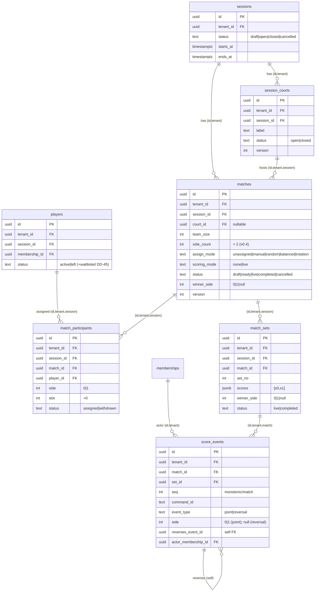

# Feature: Session Organize (Match & Court Orchestration) — Backend Tech Spec

> **Delivery target:** Sau Session CRUD + Sync; sớm nhất sau P4. Canonical phase **TBD**; DD-61..64 đã owner accept-in-principle.
> **Version:** 0.5 · 2026-07-18
> **Status:** Accepted-in-principle design — implementation inactive; schema/migration/service chưa tồn tại
> **Product spec:** `../feature_session_organize.md`
> **References:** `feature_session_management_tech.md` · `feature_sync_engine_tech.md` · `../../standards/decisions.md` DD-07/DD-41/DD-42/DD-45/DD-56/DD-60/DD-61..64 · `../../standards/api-reference-convention.md` · `../../standards/business-rules.md` · `../../standards/core-db-architecture-principles.md`

> **⚠️ Live-repo reality:** Migration hiện dừng ở `0013`; `packages/db/schema.ts` mới có `sessions`/`players`, còn `packages/db/src/tenant.ts` chỉ có session list/get/create tối thiểu. Chưa có OrganizeService, assign/scoring core, relation-based board read, SSE organize topic hoặc session-scoped scorer grant. Các hook SessionService được nêu dưới đây là contract phải build cùng prerequisite, không phải symbol đang có.

---

## 1. Kiến trúc và boundary

```text
Web/chat adapter
  → organize command handler (commandId + actor context)
  → relation authz + lifecycle gate
  → OrganizeService
      → tenantRepo transaction
      → processed_commands dedupe
      → lock session → court → match (thứ tự cố định)
      → canonical organize rows + outbox trong cùng transaction
  → SSE projector on topic session:<sessionId>:organize
```

- Chat và web chỉ là adapter; không tự tính assignment, score, capability hoặc lifecycle.
- Assign engine thuần ở `packages/core/src/organize/assign.ts`; preview không ghi DB. Apply re-read session/roster/history và check `basisVersion` dưới lock.
- `score_events` là source of truth; `match_sets.scores` là read model rebuild được.
- `processed_commands` hiện có là durable idempotency ledger cho **mọi mutation**. `score_events.command_id` giữ correlation/fence bổ sung ở aggregate nóng.
- Organize không có projector tới `public_sessions`. Outbox chỉ mang aggregate IDs, sequence và field tối thiểu.
- V0.4 chỉ hỗ trợ contest hai phía. `side_count` tồn tại nhưng phải bằng `2`.

### Lock order và transaction rule

Mọi write giữ lock theo cùng thứ tự để tránh deadlock:

1. Authenticate actor, resolve tenant/action/resource, canonicalize request, rồi claim/dedupe `(tenant_id, command_id)` trong `processed_commands`.
2. `SELECT sessions ... FOR UPDATE`.
3. Khi cần, lock `session_courts` theo UUID tăng dần.
4. Lock `matches` theo UUID tăng dần.
5. Validate/apply participants, sets, score events; insert outbox; update command result; commit.

Không gọi provider hoặc SSE khi giữ lock. `request_hash = SHA-256(UTF-8(JCS({ action, resourceId, payload })))`, với JCS theo RFC 8785: canonical JSON sort key đệ quy, giữ thứ tự array, bỏ field absent, giữ `null`, và payload gồm cả optimistic-version token nhưng không gồm `commandId`. Duplicate command cùng action/resource/hash chỉ trả `result_ref` sau khi re-authorize actor hiện tại trên resource; cùng key nhưng action/resource/hash khác trả `IDEMPOTENCY_CONFLICT`. `result_ref` luôn là DTO whitelist, không phải raw row/PII.

### Lifecycle gate

| Command class | Predicate |
|---|---|
| Court/match setup, assignment preview/apply | `session.status='open' AND now < ends_at` |
| Start, point, reversal | `session.status='open' AND starts_at <= now AND now < ends_at` |
| Any mutation after end or closed/cancelled | Deny; v0.4 không có privileged correction |

`past` tuyệt đối không được so với `sessions.status`; nó là `now >= ends_at`.

---

## 2. Database contract

### ERD (cụm 5 bảng organize + anchor)

> Bảng nền `sessions`/`players`/`memberships` đã có trong canonical; 5 bảng organize là accepted target chưa implement. Quan hệ `..||` dùng same-tenant/session **composite FK** (không phải scalar UUID) để chứng minh cùng tenant/session. `score_events` self-reference (`reverses_event_id`) cho undo/correction.



### Migration strategy

Tạo migration mới với **số monotonic kế tiếp còn trống tại lúc implement**; `0014_session_organize.sql` chỉ là tên minh hoạ và **không giữ chỗ**. Không sửa/append `0009_rls_policies_grants.sql`: DB đã apply `0009` sẽ không chạy lại, khiến bảng mới không có policy/grant. Migration mới phải atomically gồm:

1. Composite parent keys cần cho same-tenant/session FKs và nullable `processed_commands.request_hash` cho payload-conflict detection.
2. Năm bảng organize, constraints và indexes.
3. `ENABLE ROW LEVEL SECURITY`, `FORCE ROW LEVEL SECURITY`, policy và grants cho từng bảng.
4. Immutable trigger cho `score_events`.
5. Schema code/DBML/RLS invariant list cập nhật trong cùng slice.

### Parent keys

```sql
ALTER TABLE sessions
  ADD CONSTRAINT sessions_id_tenant_uq UNIQUE (id, tenant_id);
ALTER TABLE memberships
  ADD CONSTRAINT memberships_id_tenant_uq UNIQUE (id, tenant_id);
ALTER TABLE players
  ADD CONSTRAINT players_id_tenant_session_uq UNIQUE (id, tenant_id, session_id);

ALTER TABLE processed_commands
  ADD COLUMN request_hash text;
```

Nếu key/cột tương đương đã tồn tại ở base lúc implement thì reuse; không tạo duplicate index/column. `request_hash` nullable để không phá command lịch sử, nhưng bắt buộc ở application contract cho mọi organize mutation. Composite FKs bên dưới là bắt buộc vì scalar UUID FK không chứng minh cùng tenant/session.

### Target DDL (accepted-in-principle, not implemented)

```sql
CREATE TABLE session_courts (
  id          uuid PRIMARY KEY DEFAULT gen_random_uuid(),
  tenant_id   uuid NOT NULL REFERENCES tenants(id),
  session_id  uuid NOT NULL,
  label       text NOT NULL,
  sort_order  integer NOT NULL DEFAULT 0,
  status      text NOT NULL DEFAULT 'open',
  version     integer NOT NULL DEFAULT 1,
  created_at  timestamptz NOT NULL DEFAULT now(),
  updated_at  timestamptz NOT NULL DEFAULT now(),
  UNIQUE (id, tenant_id, session_id),
  UNIQUE (tenant_id, session_id, label),
  FOREIGN KEY (session_id, tenant_id)
    REFERENCES sessions(id, tenant_id),
  CONSTRAINT sc_label_chk CHECK (length(btrim(label)) BETWEEN 1 AND 80),
  CONSTRAINT sc_sort_chk CHECK (sort_order >= 0),
  CONSTRAINT sc_status_chk CHECK (status IN ('open','closed')),
  CONSTRAINT sc_version_chk CHECK (version > 0)
);

CREATE TABLE matches (
  id            uuid PRIMARY KEY DEFAULT gen_random_uuid(),
  tenant_id     uuid NOT NULL REFERENCES tenants(id),
  session_id    uuid NOT NULL,
  court_id      uuid,
  round_no      integer NOT NULL DEFAULT 1,
  team_size     integer NOT NULL DEFAULT 2,
  side_count    integer NOT NULL DEFAULT 2,
  assign_mode   text NOT NULL DEFAULT 'manual',
  scoring_mode  text NOT NULL DEFAULT 'none',
  target_points integer,
  best_of       integer,
  win_by        integer,
  status        text NOT NULL DEFAULT 'draft',
  winner_side   integer,
  started_at    timestamptz,
  ended_at      timestamptz,
  version       integer NOT NULL DEFAULT 1,
  created_at    timestamptz NOT NULL DEFAULT now(),
  updated_at    timestamptz NOT NULL DEFAULT now(),
  UNIQUE (id, tenant_id, session_id),
  FOREIGN KEY (session_id, tenant_id)
    REFERENCES sessions(id, tenant_id),
  FOREIGN KEY (court_id, tenant_id, session_id)
    REFERENCES session_courts(id, tenant_id, session_id),
  CONSTRAINT matches_round_chk CHECK (round_no > 0),
  CONSTRAINT matches_team_chk CHECK (team_size > 0),
  CONSTRAINT matches_two_side_chk CHECK (side_count = 2),
  CONSTRAINT matches_assign_chk
    CHECK (assign_mode IN ('unassigned','manual','random','balanced','rotation')),
  CONSTRAINT matches_scoring_chk CHECK (scoring_mode IN ('none','live')),
  CONSTRAINT matches_scoring_config_chk CHECK (
    (scoring_mode = 'none' AND target_points IS NULL AND best_of IS NULL AND win_by IS NULL)
    OR
    (scoring_mode = 'live'
      AND target_points IS NOT NULL AND best_of IS NOT NULL AND win_by IS NOT NULL
      AND target_points > 0 AND best_of > 0 AND best_of % 2 = 1 AND win_by > 0)
  ),
  CONSTRAINT matches_status_chk
    CHECK (status IN ('draft','ready','live','completed','cancelled')),
  CONSTRAINT matches_winner_chk CHECK (winner_side IS NULL OR winner_side IN (0,1)),
  CONSTRAINT matches_time_chk CHECK (ended_at IS NULL OR started_at IS NOT NULL),
  CONSTRAINT matches_version_chk CHECK (version > 0)
);

CREATE TABLE match_participants (
  id           uuid PRIMARY KEY DEFAULT gen_random_uuid(),
  tenant_id    uuid NOT NULL REFERENCES tenants(id),
  session_id   uuid NOT NULL,
  match_id     uuid NOT NULL,
  player_id    uuid NOT NULL,
  side         integer NOT NULL,
  slot         integer NOT NULL,
  status       text NOT NULL DEFAULT 'assigned',
  withdrawn_at timestamptz,
  created_at   timestamptz NOT NULL DEFAULT now(),
  updated_at   timestamptz NOT NULL DEFAULT now(),
  FOREIGN KEY (match_id, tenant_id, session_id)
    REFERENCES matches(id, tenant_id, session_id),
  FOREIGN KEY (player_id, tenant_id, session_id)
    REFERENCES players(id, tenant_id, session_id),
  CONSTRAINT mp_side_chk CHECK (side IN (0,1)),
  CONSTRAINT mp_slot_chk CHECK (slot > 0),
  CONSTRAINT mp_status_chk CHECK (status IN ('assigned','withdrawn')),
  CONSTRAINT mp_withdrawn_chk CHECK (
    (status = 'assigned' AND withdrawn_at IS NULL)
    OR (status = 'withdrawn' AND withdrawn_at IS NOT NULL)
  )
);

CREATE TABLE match_sets (
  id          uuid PRIMARY KEY DEFAULT gen_random_uuid(),
  tenant_id   uuid NOT NULL REFERENCES tenants(id),
  session_id  uuid NOT NULL,
  match_id    uuid NOT NULL,
  set_no      integer NOT NULL,
  scores      jsonb NOT NULL DEFAULT '[0,0]'::jsonb,
  winner_side integer,
  status      text NOT NULL DEFAULT 'live',
  started_at  timestamptz NOT NULL DEFAULT now(),
  ended_at    timestamptz,
  UNIQUE (id, tenant_id, match_id),
  UNIQUE (tenant_id, match_id, set_no),
  FOREIGN KEY (match_id, tenant_id, session_id)
    REFERENCES matches(id, tenant_id, session_id),
  CONSTRAINT ms_setno_chk CHECK (set_no > 0),
  CONSTRAINT ms_scores_chk CHECK (
    jsonb_typeof(scores) = 'array'
    AND jsonb_array_length(scores) = 2
    AND jsonb_typeof(scores->0) = 'number'
    AND jsonb_typeof(scores->1) = 'number'
    AND (scores->>0)::integer >= 0
    AND (scores->>1)::integer >= 0
  ),
  CONSTRAINT ms_winner_chk CHECK (winner_side IS NULL OR winner_side IN (0,1)),
  CONSTRAINT ms_status_chk CHECK (status IN ('live','completed')),
  CONSTRAINT ms_state_chk CHECK (
    (status = 'live' AND winner_side IS NULL AND ended_at IS NULL)
    OR (status = 'completed' AND winner_side IS NOT NULL AND ended_at IS NOT NULL)
  )
);

CREATE TABLE score_events (
  id                  uuid PRIMARY KEY DEFAULT gen_random_uuid(),
  tenant_id           uuid NOT NULL REFERENCES tenants(id),
  match_id            uuid NOT NULL,
  set_id              uuid NOT NULL,
  seq                 integer NOT NULL,
  command_id          text NOT NULL,
  event_type          text NOT NULL,
  side                integer,
  reverses_event_id   uuid,
  actor_membership_id uuid NOT NULL,
  created_at          timestamptz NOT NULL DEFAULT now(),
  UNIQUE (id, tenant_id, match_id, set_id),
  UNIQUE (tenant_id, match_id, seq),
  UNIQUE (tenant_id, match_id, command_id),
  FOREIGN KEY (set_id, tenant_id, match_id)
    REFERENCES match_sets(id, tenant_id, match_id),
  FOREIGN KEY (reverses_event_id, tenant_id, match_id, set_id)
    REFERENCES score_events(id, tenant_id, match_id, set_id),
  FOREIGN KEY (actor_membership_id, tenant_id)
    REFERENCES memberships(id, tenant_id),
  CONSTRAINT se_seq_chk CHECK (seq > 0),
  CONSTRAINT se_shape_chk CHECK (
    (event_type = 'point' AND side IS NOT NULL AND side IN (0,1)
      AND reverses_event_id IS NULL)
    OR
    (event_type = 'reversal' AND side IS NULL AND reverses_event_id IS NOT NULL)
  )
);
```

Correction không phải event type thứ ba: service append một reversal và một replacement point trong cùng command/transaction. Vì một command có thể tạo hai events khi correction, `command_id` của replacement dùng suffix nội bộ ổn định (ví dụ `commandId || ':replacement'`) trong khi `processed_commands.command_id` vẫn là external key duy nhất.

### Indexes và database fences

```sql
CREATE INDEX idx_sc_tenant_session_sort
  ON session_courts (tenant_id, session_id, sort_order);

CREATE INDEX idx_matches_tenant_session_status
  ON matches (tenant_id, session_id, status);

CREATE UNIQUE INDEX matches_one_live_per_court_uq
  ON matches (tenant_id, court_id)
  WHERE status = 'live' AND court_id IS NOT NULL;

CREATE INDEX idx_mp_tenant_match_status
  ON match_participants (tenant_id, match_id, status);

CREATE UNIQUE INDEX match_participants_one_assigned_player_uq
  ON match_participants (tenant_id, match_id, player_id)
  WHERE status = 'assigned';

CREATE UNIQUE INDEX match_participants_one_assigned_slot_uq
  ON match_participants (tenant_id, match_id, side, slot)
  WHERE status = 'assigned';

CREATE INDEX idx_mp_tenant_player_assigned
  ON match_participants (tenant_id, player_id)
  WHERE status = 'assigned';

CREATE INDEX idx_match_sets_tenant_match_set
  ON match_sets (tenant_id, match_id, set_no);

CREATE UNIQUE INDEX match_sets_one_live_uq
  ON match_sets (tenant_id, match_id)
  WHERE status = 'live';

CREATE INDEX idx_score_events_tenant_match_seq
  ON score_events (tenant_id, match_id, seq);

CREATE UNIQUE INDEX score_events_one_reversal_uq
  ON score_events (tenant_id, match_id, reverses_event_id)
  WHERE event_type = 'reversal';
```

Mỗi row `match_participants` là một **participant stint**. Substitute/leave phải UPDATE stint hiện tại thành `withdrawn` với `withdrawn_at`, rồi INSERT replacement/re-entry thành row mới; không đổi `player_id` trên row cũ và không xoá lịch sử. Với substitute, service derive `side`/`slot` từ `replacesParticipantId` đang assigned trong cùng match; client không được chọn lại slot trong request. Hai partial unique indexes chỉ khóa player/slot đang `assigned`, nên slot cũ tái sử dụng được và một player có thể tái nhập cùng match bằng stint mới sau khi stint trước đã withdrawn.

Postgres không thể diễn đạt “player chỉ ở một match có parent status live” bằng partial index đơn giản. Fence bắt buộc là session row lock trước mọi assign/start/substitute, rồi query active participant joins; integration race test chứng minh invariant. Unique assigned-player/assigned-slot/court/set/sequence/reversal indexes là lớp cuối tại DB.

### RLS, grants và append-only

Trong migration mới, lặp **explicitly** cho cả năm bảng:

```sql
ALTER TABLE session_courts ENABLE ROW LEVEL SECURITY;
ALTER TABLE session_courts FORCE ROW LEVEL SECURITY;
CREATE POLICY tenant_isolation ON session_courts
  USING (tenant_id = NULLIF(current_setting('app.tenant_id', true), '')::uuid)
  WITH CHECK (tenant_id = NULLIF(current_setting('app.tenant_id', true), '')::uuid);
GRANT SELECT, INSERT, UPDATE, DELETE ON session_courts TO app;
```

Áp cùng ENABLE+FORCE+`tenant_isolation` policy cho `matches`, `match_participants`, `match_sets`, và **cả `score_events`** — mọi bảng organize đều tenant-scoped. `score_events` **cũng** bật RLS y hệt, chỉ khác ở grant: SELECT/INSERT-only thay vì full DML (append-only):

```sql
-- score_events: tenant RLS GIỐNG các bảng khác...
ALTER TABLE score_events ENABLE ROW LEVEL SECURITY;
ALTER TABLE score_events FORCE ROW LEVEL SECURITY;
CREATE POLICY tenant_isolation ON score_events
  USING (tenant_id = NULLIF(current_setting('app.tenant_id', true), '')::uuid)
  WITH CHECK (tenant_id = NULLIF(current_setting('app.tenant_id', true), '')::uuid);

-- ...nhưng grant chỉ SELECT/INSERT (append-only ledger)
GRANT SELECT, INSERT ON score_events TO app;
REVOKE UPDATE, DELETE ON score_events FROM app;
```

Ngoài grant, gắn immutable trigger **theo đúng pattern ledger đã có trong `0010_functions_triggers.sql`** (`trg_payment_allocations_immutable`) để `BEFORE UPDATE OR DELETE` luôn raise, kể cả owner/service path vô tình có privilege:

```sql
CREATE OR REPLACE FUNCTION score_events_immutable() RETURNS trigger AS $$
BEGIN
  RAISE EXCEPTION 'score_events is append-only (% blocked); use a reversal row', TG_OP
    USING ERRCODE = 'restrict_violation';
END;
$$ LANGUAGE plpgsql;

CREATE TRIGGER trg_score_events_immutable
  BEFORE UPDATE OR DELETE ON score_events
  FOR EACH ROW EXECUTE FUNCTION score_events_immutable();
```

Không grant bất kỳ organize table nào cho `readonly`; không có public policy.

RLS chỉ chứng minh tenant. Board read và SSE vẫn phải chạy relation check active player/admin/scorer trước khi query/subscribe.

---

## 3. Authz, API và realtime contracts

### Accepted DD-56 registry extension contract (not implemented)

Các action sau **chưa active** cho tới khi registry/grant storage, rate limits và feature flag được triển khai; DD-64 owner acceptance đã ghi nhận:

| Action | Capability/resource | Actors |
|---|---|---|
| `session.organize.court` | `session.organize`, target session | Owner/Admin hoặc co-admin có grant đúng session |
| `session.organize.match` | `session.organize`, target session | Owner/Admin hoặc co-admin có grant đúng session |
| `session.organize.assign` | `session.organize`, target session | Owner/Admin hoặc co-admin có grant đúng session |
| `session.organize.start` | `session.organize`, target session | Owner/Admin hoặc co-admin có grant đúng session |
| `session.organize.complete` | `session.organize`, target session | Owner/Admin hoặc co-admin có grant đúng session |
| `session.organize.cancel` | `session.organize`, target session | Owner/Admin hoặc co-admin có grant đúng session |
| `session.organize.substitute` | `session.organize`, target session | Owner/Admin hoặc co-admin có grant đúng session |
| `session.score.point` | `session.score`, target session | Owner/Admin hoặc co-admin/scorer có grant `session.score` đúng session |
| `session.score.reversal` | `session.score`, target session | Owner/Admin hoặc co-admin/scorer có grant `session.score` đúng session |
| `session.score.correction` | `session.score`, target session | Cùng actor; reversal + optional replacement point, cùng bounded terminal guard |
| `session.organize.read` | Relation-based, target session | Owner/Admin, actor có grant `session.organize`/`session.score` đúng session, hoặc active player |

Grant shape: `resource_type='session'`, `resource_id=session_id`, `capability='session.organize'|'session.score'`, `expires_at <= session.ends_at`. Không map scorer/co-admin thành tenant-wide role. `session.organize` không bao hàm `session.score`; actor cần cả hai phải có hai grant explicit. Revocation/expiry được re-check ở mỗi command, kể cả duplicate command replay; SSE re-check ở connect/reconnect, trước mỗi event và heartbeat tối đa 30 giây.

### Endpoint contract

Mọi mutation nhận `commandId` và **một concurrency token bắt buộc** phù hợp aggregate (`expectedSessionVersion`, `expectedCourtVersion`, `expectedMatchVersion` hoặc `basisVersion`). Pure preview không phải mutation nên không nhận `commandId`. Route dùng trực tiếp canonical `ok()`/`err()` trong `apps/web/lib/api-envelope.ts`; không tự tạo envelope khác:

- Success: `{ data, error: null, meta: { requestId } }`.
- Error: `{ data: null, error: { code, message, statusCode }, meta: { requestId } }`.
- Advisory/field bổ sung như `warnings` nằm trong DTO `data`, vì live helper hiện chỉ dùng `meta` cho `requestId`.

| Method/path | Auth | Action | Notes |
|---|---|---|---|
| `POST /api/sessions/:id/courts` | 🔑 Exact capability | `session.organize.court` | `commandId` + `expectedSessionVersion` |
| `PATCH /api/sessions/:id/courts/:courtId` | 🔑 Exact capability | `session.organize.court` | `commandId` + `expectedCourtVersion` |
| `POST /api/sessions/:id/matches` | 🔑 Exact capability | `session.organize.match` | `commandId` + `expectedSessionVersion` + two-side config |
| `PATCH /api/matches/:id` | 🔑 Exact capability | `session.organize.match` | `commandId` + `expectedMatchVersion`; config chỉ sửa khi `draft\|ready`, live/terminal fail closed |
| `POST /api/sessions/:id/assignments/preview` | 🔑 Exact capability | `session.organize.assign` | Pure; returns plan + `basisVersion` + warnings |
| `POST /api/sessions/:id/assignments/apply` | 🔑 Exact capability | `session.organize.assign` | `commandId` + plan + `basisVersion`; revalidate under session lock |
| `POST /api/matches/:id/substitutions` | 🔑 Exact capability | `session.organize.substitute` | `commandId` + `expectedMatchVersion` + `replacesParticipantId` + replacement `playerId`; side/slot derive từ row cũ |
| `POST /api/matches/:id/start` | 🔑 Exact capability | `session.organize.start` | `commandId` + `expectedMatchVersion` |
| `POST /api/matches/:id/score/points` | 🔑 Exact capability | `session.score.point` | `commandId` + side + `expectedMatchVersion` |
| `POST /api/matches/:id/score/reversals` | 🔑 Exact capability | `session.score.reversal` | `commandId` + `pointEventId` + `expectedMatchVersion` |
| `POST /api/matches/:id/score/corrections` | 🔑 Exact capability | `session.score.correction` | `commandId` + `pointEventId` + optional `replacementSide` + `expectedMatchVersion`; may reopen/re-complete latest terminal point only under guards |
| `POST /api/matches/:id/complete` | 🔑 Exact capability | `session.organize.complete` | `commandId` + `expectedMatchVersion` |
| `POST /api/matches/:id/cancel` | 🔑 Exact capability | `session.organize.cancel` | `commandId` + `expectedMatchVersion` |
| `GET /api/sessions/:id/organize` | ✅/🔑 Relation or capability | `session.organize.read` | Active player relation, owner/admin, or exact session grant |
| `GET /api/sessions/:id/organize/live` | ✅/🔑 Relation or capability | `session.organize.read` | Same guarded relation; SSE topic fixed by server from authorized session ID |

Preview response example:

```json
{
  "data": {
    "plan": {},
    "basisVersion": 12,
    "warnings": ["BALANCED_LEVEL_UNAVAILABLE"]
  },
  "error": null,
  "meta": { "requestId": "req_..." }
}
```

`BALANCED_LEVEL_UNAVAILABLE` là advisory trong `warnings[]`, không phải HTTP-200 error code.

### Error codes

| HTTP | Code | Trigger |
|---:|---|---|
| 403 | `FORBIDDEN` | Capability/relation/scorer grant không hợp lệ |
| 409 | `SESSION_NOT_ORGANIZABLE` | Session không `open` |
| 409 | `SESSION_NOT_STARTED` | Start/score trước `starts_at` |
| 409 | `SESSION_ENDED` | Mutation tại/sau `ends_at` |
| 409 | `STALE_VERSION` | expectedVersion sai |
| 409 | `STALE_ASSIGNMENT_PLAN` | basisVersion/snapshot đổi |
| 409 | `IDEMPOTENCY_CONFLICT` | commandId đã dùng cho type/payload khác |
| 409 | `SLOT_TAKEN` | Slot unique conflict |
| 409 | `COURT_OCCUPIED` | Unique live-court conflict |
| 409 | `SET_ALREADY_LIVE` | Unique live-set conflict |
| 409 | `MATCH_NOT_LIVE` | Point/reversal khi match không live |
| 409 | `SCORING_LOCKED_WHILE_LIVE` | `PATCH /api/matches/:id` sửa scoring config khi match đang `live` |
| 409 | `MATCH_NOT_EDITABLE` | Sửa config/participant khi match đã `completed\|cancelled` |
| 409 | `COURT_REASSIGNED` | Terminal-point correction would reopen a match whose court is now occupied/reassigned |
| 409 | `CORRECTION_REQUIRES_REVIEW` | Target no longer latest effective point or a dependent match/scoring action exists |
| 422 | `PLAYER_NOT_ACTIVE` | Player không active |
| 422 | `PLAYER_SESSION_MISMATCH` | Player khác session |
| 422 | `INVALID_SIDE` | Side ngoài 0/1 |
| 422 | `INVALID_SCORING_CONFIG` | Config none/live không hợp lệ |
| 422 | `INVALID_REVERSAL` | Target không phải point cùng match/set hoặc đã reversed |
| 422 | `NOT_ENOUGH_PLAYERS` | Auto plan không tạo được match đầy đủ |
| 429 | `RATE_LIMITED` | Rate registry vượt giới hạn |

### Accepted rate-limit contract (not implemented)

Các rate sau là **inactive implementation target** cho tới khi BL-SEC-5 registry/buckets và organize feature flag được land:

| Command | Exact limit | Buckets |
|---|---|---|
| Point/reversal | 5 requests/second burst per match; 120/minute per actor; 600/minute dedicated organize bucket per tenant | Không dùng generic tenant 200/min bucket cho live score; vượt bất kỳ bucket → 429 |
| Assignment preview | 10/minute per session; 30/minute per actor | Generic tenant bucket vẫn áp dụng; vượt → 429 |

### SSE contract

- Topic duy nhất: `session:<sessionId>:organize`; gateway tạo topic từ route param đã authorize, không nhận topic tùy ý từ client.
- Authorize khi connect/reconnect, trước mỗi emitted event và mỗi heartbeat **≤30 giây**: owner/admin/scorer grant hợp lệ hoặc `players.status='active'` đúng session.
- Waitlisted/left/nonparticipant/tenant khác bị 403. Grant/player/session hết hiệu lực đóng stream ở lần check kế tiếp; hard bound 30 giây cả khi không có event. Connection registry/revocation signal chỉ là fast path, không thay heartbeat bound.
- Event payload whitelist: `{ eventId, sessionId, matchId?, setId?, aggregateVersion, seq?, type }`; score state được guarded reload từ read endpoint.
- Không serialize `actor_membership_id`, `person_id`, `membership_id`, tên/contact, payment hoặc venue-private fields.
- Projector fail không rollback command; outbox retry. Client reconnect theo last event/version rồi guarded reload, không tự replay mutation.

---

## 4. Domain service details

### Assign engine — `packages/core/src/organize/assign.ts`

```ts
planAssignment({
  activePlayers,
  courts,
  teamSize,
  sideCount: 2,
  mode,
  seed,
  ratings,
  history,
  basisVersion,
}): AssignmentPlan
```

| Mode | Rule |
|---|---|
| `manual` | Engine validate explicit side/slot only; service validates ownership/current state |
| `random` | Seeded Fisher–Yates, chunk `teamSize * 2`; remainder stays in pool |
| `balanced` | Two-side rating heuristic/local swap; missing/untrusted rating → same seeded random plan + warning |
| `rotation` | Rest-debt descending, then minimize pair-count; deterministic tie-break by stable player key |

Preview reads a snapshot and returns `basisVersion`; apply does not trust preview IDs. Under session lock it re-reads active players, court/match versions and history. Mismatch returns `STALE_ASSIGNMENT_PLAN` without partial writes.

### Point/reversal flow

1. Authenticate actor; authorize `session.score`; compute canonical request hash; claim/dedupe command; lock session then match. Duplicate replay vẫn re-check authorization trước khi trả prior result.
2. Re-check session `open`, `starts_at <= now < ends_at`, scoring `live`, actor grant and `expectedMatchVersion`. Normal point requires match `live`.
3. Lock target/current set. For reversal/correction, load target via same-tenant/match/set FK, assert target type `point`, no reversal exists and target is the latest effective point.
4. If match/set is terminal because of that point, allow only the bounded exception: no later score event or dependent complete/cancel/substitute/start action, match version still expected, court still open/free and not assigned to another live match. Any proof gap returns `CORRECTION_REQUIRES_REVIEW`; reassigned/occupied court returns `COURT_REASSIGNED`; no row changes.
5. Allocate seq and append reversal; correction optionally appends replacement point with the next seq. Never mutate/delete prior score events.
6. Reduce ledger deterministically to `[side0, side1]`. If the winning predicate disappears, set set/match back to `live`, clear winner/ended fields and reoccupy the same court. Then apply optional replacement and either remain live or re-complete atomically.
7. Complete set at `max >= target_points` and lead `>= win_by`; complete match when one side wins `floor(best_of/2)+1` sets. Write minimal outbox + processed command result in the same transaction.

Reducer must reject negative score and invalid reversal chains rather than clamp/fallback. There is no privileged correction after `ends_at` or session close/cancel.

### Cross-feature hooks

- Session leave choke-point (to be implemented with SessionService): under session lock, player becomes `left`, any assigned participant in live/ready match becomes `withdrawn`; score remains.
- Session close/cancel choke-point: under session lock, ready/live matches become `cancelled`, open court occupancy clears by match status, ledger remains read-only.
- Attendance is unchanged. Match participation must not silently mark attendance or reliability in v0.4.

---

## 5. Testing plan

### Unit tests — minimum 28

1. Random deterministic by seed.
2. Random chunks exactly `teamSize * 2`.
3. Random remainder stays in pool.
4. Manual duplicate slot rejected.
5. Manual side outside 0/1 rejected.
6. Balanced minimizes two-side delta.
7. Balanced missing one rating falls back deterministically with warning.
8. Rotation prioritizes rest-debt.
9. Rotation reduces repeated pairs.
10. Stable tie-break independent of input order.
11. `sideCount != 2` rejected.
12. `teamSize <= 0` rejected.
13. `none` config requires null score fields.
14. `live` requires positive target/winBy and odd positive bestOf.
15. Point increments correct side.
16. Point invalid side rejected.
17. Reversal returns point to zero.
18. Double reversal rejected.
19. Cross-set/match reversal rejected.
20. Correction reducer equals reversal + replacement point.
21. Reducer refuses negative score.
22. Win-by boundary 21-20 vs 22-20.
23. Best-of completion threshold correct.
24. Same command replay returns prior result without second event/outbox.
25. Reversing latest winning point reopens set/match and clears terminal fields.
26. Correction replacement can re-complete for either side deterministically.
27. Terminal target that is not latest/has dependent action returns `CORRECTION_REQUIRES_REVIEW` with unchanged ledger/read model.
28. Session ended/closed or court reassigned returns `SESSION_ENDED`/`COURT_REASSIGNED` with no event.

### Integration tests — minimum 22

1. Upgrade existing DB through new migration; five tables receive ENABLE+FORCE RLS and intended grants.
2. Tenant A cannot read/write tenant B organize rows.
3. Cross-tenant/session FK spoof for court/player/set/reversal fails.
4. Two transactions claim same assigned slot: one commit, one `SLOT_TAKEN`.
5. Withdraw then substitute into the same side/slot succeeds; old stint remains withdrawn and two assigned rows still conflict.
6. A withdrawn player can re-enter the same match as a new stint; only one assigned stint for that player is allowed.
7. Two starts on same court: one live, one `COURT_OCCUPIED` at unique fence.
8. Two live-set creates: one wins, one `SET_ALREADY_LIVE`.
9. Concurrent point commands preserve unique monotonic sequence.
10. Duplicate commandId + identical canonical request creates one domain mutation/outbox and returns prior result; changed action/resource/payload/version returns `IDEMPOTENCY_CONFLICT`.
11. Duplicate replay after actor grant expires/revokes returns `FORBIDDEN`, not cached `result_ref`.
12. Reversal must target a point in same match/set and only once.
13. App role UPDATE/DELETE on `score_events` denied; immutable trigger also denies privileged write.
14. SSE allows active player/admin/valid session capability; denies waitlisted/left/nonparticipant/tenant B.
15. SSE reconnect re-authorizes expired/revoked scorer grant.
16. Fake clock covers before start, exact start, before end, exact end, closed/cancelled.
17. Leave and session close/cancel hooks withdraw/cancel without deleting score; no public projection.
18. Match-config PATCH accepts the current version in draft/ready, rejects stale version, returns `SCORING_LOCKED_WHILE_LIVE` for live and `MATCH_NOT_EDITABLE` for terminal status.
19. Latest winning-point reversal before session end reopens completed match/set and reoccupies the same free court; optional replacement can complete again in one transaction.
20. After court reassignment or any dependent match/scoring action, terminal correction fails with stable code and byte-for-byte unchanged score ledger/read model.
21. Active SSE stream loses scorer grant/player relation/session eligibility: before-event or ≤30s heartbeat re-auth closes it; no event emits after failed check.
22. Quiet active SSE stream revocation closes within 30s under fake clock; connection-registry fast path may close earlier but is not required for correctness.

Canonical DB suite must run with repository test database contract; migration/RLS tests are blocked, not passed, if Postgres is unavailable.

---

## 6. Rollout và changelog

1. Acceptance DD-61..64 đã ghi nhận; mở rộng DD-56/BL-SEC-5 registry/grant/rate contracts và lập build slice trước codegen.
2. Implement missing SessionService lifecycle/authz prerequisites.
3. Add the next migration, schema/DBML/RLS invariants and DB tests in one database slice.
4. Build pure assign/scoring core, then storage/service commands.
5. Add guarded read + SSE, then thin web/chat adapters.
6. Verify no public projector and activate feature flag tenant-by-tenant.

| Date | Version | Thay đổi |
|---|---|---|
| 2026-07-18 | v0.5 | DD-61..64 accepted-in-principle: remove stale owner-approval gates, retain explicit no-runtime/prerequisite boundary, make migration number illustrative, and adopt DD-60 auth convention. |
| 2026-07-17 | v0.4 | **DD-62/DD-64 closure:** terminal winning-point reversal/correction guard + reopen/re-complete reducer, court/dependency fail-closed codes, and active SSE before-event/heartbeat re-auth ≤30s. Proposal/runtime status unchanged. |
| 2026-07-17 | v0.3 | Sửa substitution thành participant stint + partial active uniqueness; khóa exact organize/score authz; dùng live API envelope; bắt buộc per-aggregate version token; thêm match-config PATCH, canonical request hash và replay re-authorization tests. |
| 2026-07-17 | v0.2 | Chuyển sang migration mới; thêm same-tenant/session FKs, unique live-court/live-set, durable idempotency, two-side scoring, point/reversal ledger, immutable trigger, exact authz/rate/SSE/lifecycle contracts và test gates. Sửa core path, phase/status và live-repo prerequisites. |
| 2026-07-17 | v0.1 | Draft 5 bảng, 4 assign modes, live scoring và API sơ bộ; DD-61..64 proposal. |
