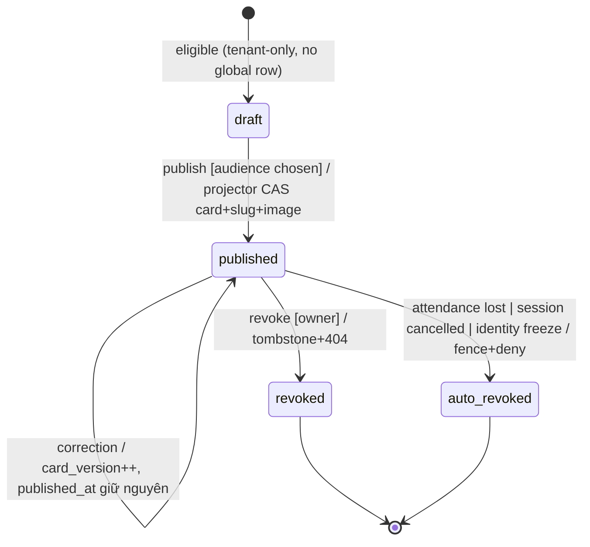

# Feature: Share Activities — Backend Tech Spec

> **Canonical phase:** P4.3 (Share Session · DD-73) · Sau P4 (Activity Card · DD-74/75) · P4+ evidence-gated (Feed/Kudos · DD-76/77)
> **Version:** 0.1 · 2026-08-14
> **Status:** Draft
> **Implementation:** Not started · authority: `../../standards/BUILD-STATUS.md` — **Doc status ≠ Implementation status.** Chưa có bảng/migration/service/route/projector nào; toàn bộ là target contract.
> **Product spec:** `../FE/feature_share_activities.md` v1.0
> **References:** `../../standards/decisions.md` **DD-73 · DD-74 · DD-75 · DD-76 · DD-77 · DD-78** · DD-12 (guarded view/fence owner) · DD-83 (opaque slug) · DD-06 (area-only) · DD-42 (attendance) · DD-41 (projection) · DD-47/48 (follow/visibility) · DD-55 (`chat_blocks`) · DD-50 (Person-self claim) · `../../decisions/analysis/dd-73-78-share-activity-analysis.md` · `../../standards/business-rules.md` BL-DSC-1 · `feature_marketplace_discovery_tech.md` (guarded `public_session_share_v`) · `feature_notifications_reminders_tech.md` (global protected plane precedent) · `../../standards/api-reference-convention.md` (DD-60 envelope) · `packages/db/schema.ts` + `packages/db/migrations/*.sql` (**AUTHORITATIVE** khi triển khai)

> **Gate 3 chiều (trước khi Reviewed):** mọi claim kỹ thuật phải khớp cả ba: (a) bảng/claim trong spec ↔ (b) code snippet ↔ (c) live code/schema trên `main`. Feature này **chưa có** live schema ⇒ mọi DDL dưới đây là target; đối chiếu `packages/db/migrations/` tại thời điểm author slice, không hard-pin số migration.

> ⚠️ **Ranh giới sở hữu hai slice (DD-73 Q5 — đọc trước khi chạm bất kỳ bảng nào):**
> - **DD-12/marketplace sở hữu:** generic `public_projection_fences`, guarded `public_session_share_v`,
>   `public_projection_version` trên `public_sessions`, và migration revoke `readonly` SELECT trên base +
>   grant guarded view. Marketplace cần nó **dù không bao giờ có share** (hiện private/cancel phải chờ
>   projector async mới hết lộ). Spec này **consume**, không tạo lại.
> - **DD-74/75 (feature này) sở hữu:** `player_activity_shares` (tenant intent), `person_activity_cards`
>   (global snapshot), `activity_card_slugs`, `activity_reactions`, guarded `public_activity_cards_v`,
>   narrow raise/CAS-clear function cho `surface='activity_card'`, và render subsystem DD-78.
> - **DD-73 (route slice) sở hữu:** route `/session/<slug>` + OG card + funnel telemetry trên nền DD-12.
>   **Không bảng domain mới.**

---

## 1. Tổng quan triển khai

Hai plane, một projector pattern giống `public_sessions`: **user ghi ý định (tenant plane), projector ghi nội dung (global plane).** User **KHÔNG BAO GIỜ** ghi trực tiếp snapshot công khai (HR3 — multi-master).

```text
[Share Session · DD-73]
Session detail → GET /session/<slug> (page) → guarded public_session_share_v (anti-join fence)
    → OG server-render (không đọc sessions) · Join CTA → canonical Join service (revalidate live)
    → funnel telemetry (opaque share_ref) → POST /api/share/telemetry

[Activity Card · DD-74/75]
Player (verified Person-self) → POST /api/me/activities/:shareId/publish {audience}
    → tenant tx: player_activity_shares.publication_state='published', publication_version++ COMMIT (202/PUBLISHING)
    → Activity projector (pg-boss): lock source → re-read canonical → render snapshot
        → CAS activate person_activity_cards + activity_card_slugs + image → clear observed fence token
    → GET /a/<slug> (page) → guarded public_activity_cards_v (anti-join fence)

[Feed · DD-76]  GET /api/feed → person_activity_cards ⋈ person_follows (global plane) → keyset
[Kudos · DD-77] PUT/DELETE /api/activities/:cardId/kudos → activity_reactions (idempotent)
[Image · DD-78] GET /share-img/<opaque_ref> → guarded delivery gate (auth-before-cache) → PNG
```

**Module map (target — chưa tồn tại):**

| Module | Trách nhiệm | Ghi chú |
|--------|-------------|---------|
| `ShareSessionService` | Resolve `/session/<slug>` qua `public_session_share_v`; OG payload; telemetry ingest | DD-73; **read-only** trên guarded view, không tạo bảng |
| `ActivityShareService` | Publish/audience/revoke intent trên `player_activity_shares` (tenant, RLS) | DD-74/75; ghi **ý định**, không ghi snapshot |
| `ActivityProjector` | Lock source → re-read canonical → render snapshot → CAS `person_activity_cards`/slug/image | DD-75; **chỉ** writer của global card; allowlisted source events DD-41/42/62 |
| `ActivityCardReadService` | `/a/<slug>` + `/api/feed` + kudos qua guarded path + narrow SECURITY DEFINER | DD-75/76/77; không đọc canonical tenant |
| `ShareImageRenderer` | Sandboxed no-egress worker → PNG template từ guarded snapshot | DD-78; tách hẳn media store DD-55 |
| Fence functions (SECURITY DEFINER) | `raise_projection_fence` / `clear_projection_fence` typed narrow | DD-12 tạo cho `session_share`; feature này mở rộng `activity_card` |

**Design decisions:**
- **Không thêm fact table (DD-74).** Activity = read model derive `players ⋈ sessions` (+ DD-42 attendance). `player_activity_shares` là **ý định publish** hang off `players`, không phải nguồn sự thật thứ hai cho buổi chơi.
- **Snapshot do projector sở hữu (DD-75, phương án C).** Không live-render (đụng HR1) và không snapshot bất biến (sai vĩnh viễn sau correction). Correction chỉ wake reconcile; worker lock + re-read current canonical.
- **Fail-closed toàn bộ.** Thiếu source/actor proof/attendance=`present`/eligibility ⇒ **không publish**. `persons.display_name` trống ⇒ không project (không fallback membership/tenant alias).
- **Money/PII bans là cấu trúc, không phải kiểm tra runtime.** Global tables không mang tiền/charge/nợ/roster/venue chính xác/PII; whitelist enforce bằng cột tường minh của guarded view + byte-level test.
- **URL (DD-83):** session dùng opaque slug `/session/<slug>` (thay wording `/s/<id>` cũ của DD-73); activity card dùng `/a/<slug>` (DD-75, CSPRNG ≥128-bit, hash-only at rest).

### Entry points

| Entry | Caller | Mô tả |
|-------|--------|-------|
| `GET /session/:slug` (page) | Anyone (incl. crawler) | Share landing — guarded `public_session_share_v`, OG server-render |
| `POST /api/share/telemetry` | Client (opaque `share_ref`) | Funnel telemetry ingest (DD-73, hard requirement cùng slice) |
| `GET /api/me/activities` | Player (verified Person-self) | Draft/publishable activity list (eligible = ended + `present`) |
| `POST /api/me/activities/:shareId/publish` | Player (owner) | Publish intent `{audience}` → `202/PUBLISHING` |
| `PATCH /api/me/activities/:shareId/audience` | Player (owner) | Đổi audience (public↔followers) |
| `POST /api/me/activities/:shareId/revoke` | Player (owner) | Revoke → tombstone + 404 mọi version |
| `GET /a/:slug` (page) | Anyone / accepted follower | Activity card view — guarded `public_activity_cards_v` |
| `PUT` / `DELETE /api/activities/:cardId/kudos` | Player (auth) | Add/remove kudos (idempotent, DD-77) |
| `GET /api/feed` | Player (auth) | Feed fan-in global plane, keyset `(published_at, card_id)` (DD-76) |
| `GET /share-img/:imageRef` (opaque) | Anyone (guarded origin) | Server-rendered PNG, authorization-before-cache (DD-78) |
| `ActivityProjector` (pg-boss) | System | Render snapshot → CAS activate card/slug/image; clear fence token |
| Reconcile-on-correction job | System (allowlisted DD-41/42/62 events) | Re-project: `card_version++`, giữ `published_at` |
| `raise_projection_fence` / `clear_projection_fence` | Source tx / projector worker (SECURITY DEFINER) | Immediate-deny + exact-token CAS-clear |
| Auto-revoke job | System | Attendance lost / session cancelled → raise fence + tombstone |

---

## 2. Database Schema + Edge Cases (BE)

### Schema

Năm store, hai plane. **Đối chiếu `packages/db/migrations/` trước khi viết** — không hard-pin số migration ở đây.

#### 2.1 `player_activity_shares` — Tenant-scoped, RLS fail-closed

Ý định publish của player. Hang off `players` (same-tenant composite FK, khuôn DD-68 `0019`).

```sql
CREATE TABLE player_activity_shares (
  id                  uuid PRIMARY KEY DEFAULT gen_random_uuid(),
  tenant_id           uuid NOT NULL REFERENCES tenants(id),
  session_id          uuid NOT NULL,
  player_id           uuid NOT NULL,
  person_id           uuid NOT NULL,
  publication_state   text NOT NULL DEFAULT 'draft'
                        CHECK (publication_state IN ('draft','published','revoked')),
  audience            text CHECK (audience IN ('followers','public')),
  publication_version int  NOT NULL DEFAULT 1,          -- monotonic per-share
  published_at        timestamptz,                       -- lần publish đầu; giữ nguyên qua re-project
  revoked_at          timestamptz,
  created_at          timestamptz NOT NULL DEFAULT now(),
  updated_at          timestamptz NOT NULL DEFAULT now(),
  -- same-tenant integrity (exact referenced columns pin ở build theo schema.ts/0019)
  FOREIGN KEY (tenant_id, session_id) REFERENCES sessions (tenant_id, id),
  FOREIGN KEY (tenant_id, player_id)  REFERENCES players  (tenant_id, id),
  -- audience bắt buộc iff published
  CONSTRAINT audience_iff_published
    CHECK ((publication_state = 'published') = (audience IS NOT NULL)),
  UNIQUE (tenant_id, player_id)                          -- 1 share per player-in-session
);

ALTER TABLE player_activity_shares ENABLE ROW LEVEL SECURITY;
ALTER TABLE player_activity_shares FORCE ROW LEVEL SECURITY;
-- Policy: app đọc/ghi chỉ khi tenant_id = current_setting('app.tenant_id') (khuôn 0009); role app NOBYPASSRLS.
```

> `players` là row per-participation (per session), nên `UNIQUE(tenant_id, player_id)` = đúng một share cho một buổi chơi của một player. `person_id` phục vụ re-parent khi merge Person (§P6/DD-01), **không** là key idempotency một mình.

#### 2.2 `person_activity_cards` — Global Protected (KHÔNG tenant_id, KHÔNG RLS, narrow grants)

Snapshot do projector sở hữu. Đặt ở global plane vì DD-76 (feed) cross-tenant — nếu snapshot ở tenant plane thì feed buộc nới grant/bypass RLS (đúng cảnh báo DD-70).

```sql
CREATE TABLE person_activity_cards (
  card_id                    uuid PRIMARY KEY DEFAULT gen_random_uuid(),
  person_id                  uuid NOT NULL,               -- actor (re-parent khi merge)
  card_state                 text NOT NULL CHECK (card_state IN ('published','revoked')),
  audience                   text NOT NULL CHECK (audience IN ('followers','public')),
  source_tenant_id           uuid NOT NULL,               -- internal ref — KHÔNG public, không FK giả trong DTO/URL
  source_session_id          uuid NOT NULL,               -- internal ref
  source_player_id           uuid NOT NULL,               -- internal ref
  source_share_id            uuid NOT NULL,               -- internal ref → player_activity_shares.id
  applied_publication_version int NOT NULL,               -- version tenant intent đã apply
  source_fingerprint         text NOT NULL,               -- HMAC(normalized allowlisted inputs + eligibility + sanitizer/schema versions), KHÔNG raw PII
  projection_schema_version  int  NOT NULL,
  snapshot_hash              text NOT NULL,               -- hash nội dung rendered
  card_version               int  NOT NULL DEFAULT 1,     -- tăng mỗi correction
  snapshot                   jsonb NOT NULL,              -- CHỈ whitelist fields (§Activity snapshot)
  published_at               timestamptz NOT NULL,        -- GIỮ NGUYÊN qua correction (không boost feed)
  updated_at                 timestamptz NOT NULL DEFAULT now(),
  UNIQUE (source_tenant_id, source_player_id),
  UNIQUE (source_tenant_id, source_share_id)
);
-- KHÔNG RLS (global plane). KHÔNG blanket GRANT cho app/readonly (khuôn 0009:11-18).
-- Truy cập CHỈ qua narrow SECURITY DEFINER function + guarded view. Không có row 'draft' — projector chỉ tạo khi publish.
```

#### 2.3 `activity_card_slugs` — Global Protected (registry URL)

```sql
CREATE TABLE activity_card_slugs (
  slug_hash      bytea PRIMARY KEY,                        -- domain-separated HMAC; raw slug KHÔNG lưu at-rest
  card_id        uuid REFERENCES person_activity_cards(card_id),  -- NULL khi tombstoned + detached
  state          text NOT NULL CHECK (state IN ('active','tombstoned')),
  created_at     timestamptz NOT NULL DEFAULT now(),
  tombstoned_at  timestamptz,
  CONSTRAINT active_requires_card CHECK (state <> 'active' OR card_id IS NOT NULL)
);
-- ≤ 1 active slug/card
CREATE UNIQUE INDEX uq_activity_card_slugs_active ON activity_card_slugs (card_id) WHERE state = 'active';
```

> Slug lifecycle (DD-75): CSPRNG entropy ≥128-bit, mint **chỉ** cho `published+public`; public→followers/revoke → tombstone; re-publicize mint slug **mới**, hash cũ vĩnh viễn 404. Terminal retention detach `card_id=NULL` **trước** card deletion để old URL không sống lại.

#### 2.4 `public_projection_fences` — Global Protected, denial-only (DD-12-owned, feature mở rộng `activity_card`)

```sql
-- TẠO bởi DD-12/marketplace slice (cho surface='session_share'). Feature này CHỈ mở rộng usage sang 'activity_card'.
CREATE TABLE public_projection_fences (
  surface      text NOT NULL,                              -- 'session_share' | 'activity_card'
  target_kind  text NOT NULL,                              -- 'session' | 'activity_share' | 'person' | 'tenant'
  target_id    uuid NOT NULL,
  fence_token  uuid NOT NULL,                              -- random; CAS-clear bởi projector; KHÔNG trả/log
  deny_scope   text NOT NULL CHECK (deny_scope IN ('public','all')),
  reason       text NOT NULL,                              -- enum đóng
  created_at   timestamptz NOT NULL DEFAULT now(),
  PRIMARY KEY (surface, target_kind, target_id)
);
```

> ⚠️ **Fence `activity_card × session` chỉ raise khi `cancelled`/session bị xoá — KHÔNG raise theo `closed`/`private`** (DD-73/DD-74). `closed` là kết thúc bình thường và chính là nguồn eligible của DD-74; fence theo `close` sẽ revoke card của **mọi** player ngay khi host đóng kèo.

#### 2.5 `activity_reactions` — Global Protected (kudos, DD-77)

```sql
CREATE TABLE activity_reactions (
  card_id     uuid NOT NULL REFERENCES person_activity_cards(card_id),
  person_id   uuid NOT NULL,                               -- actor
  created_at  timestamptz NOT NULL DEFAULT now(),
  PRIMARY KEY (card_id, person_id)                         -- idempotent add/remove
);
-- KHÔNG blanket grant; add/list qua guarded visibility path. Block (DD-55) gỡ/ẩn hai chiều.
```

### Guarded views (DD-75 — cột tường minh, anti-enumeration)

```sql
-- Consumer đọc view này, KHÔNG đọc base. Cột tường minh = enforce whitelist cấu trúc.
CREATE VIEW public_activity_cards_v AS
SELECT c.card_id,
       c.card_version,
       c.snapshot ->> 'sport_key'                    AS sport_key,
       c.snapshot ->> 'played_on'                    AS played_on,
       c.snapshot ->> 'area'                         AS area,
       (c.snapshot ->> 'scheduled_duration_minutes')::int AS scheduled_duration_minutes,
       c.snapshot ->> 'activity_display_name'        AS activity_display_name
FROM person_activity_cards c
WHERE c.card_state = 'published'
  AND c.audience   = 'public'
  AND NOT EXISTS (
    SELECT 1 FROM public_projection_fences f
    WHERE f.surface = 'activity_card'
      AND f.target_kind = 'activity_share'
      AND f.target_id = c.source_share_id
      AND f.deny_scope IN ('public','all')
  );
-- ⚠️ KHÔNG GRANT SELECT cho readonly: cấp = một "danh bạ activity cross-person duyệt được không cần slug"
-- (phá anti-enumeration, tạo discovery surface chưa ai quyết định). Crawler đi /a/<slug> qua app + narrow function.
```

### Narrow SECURITY DEFINER functions (DD-75 — khuôn `0009:11-18` + DD-47)

| Function | Quyền gọi | Mục đích |
|----------|-----------|----------|
| `raise_projection_fence(surface, target_kind, target_id, deny_scope, reason)` | source tx (identity/session/tenant target derive server-side); person target = identity-service-only | Immediate deny; reason enum đóng; token không trả/log; **không** generic client target |
| `clear_projection_fence(surface, target_kind, target_id, token)` | projector worker only | Exact-token CAS-clear sau projection convergence; token mới thắng stale worker |
| `get_activity_card_by_slug(slug_hash)` | app (narrow, global-only) | Resolve `/a/<slug>`; áp cùng audience + fence anti-join; followers path deny `deny_scope='all'` |
| `resolve_followers_card(slug_hash, viewer_person_id)` | app (narrow) | Followers view chỉ `person_follows.status='accepted'`; block (DD-55) hai chiều |

> **Grant matrix:** `app` = `EXECUTE` trên narrow functions, **không** SELECT/DML trực tiếp trên 4 global table. `readonly` = zero grant (kể cả trên `public_activity_cards_v`). Projector role = write hẹp cần thiết. Khuôn đúng `public_sessions`/`0009:11-18`.

### Activity snapshot fields (v1 — whitelist duy nhất)

| Field | Source | Public | Ghi chú |
|-------|--------|--------|---------|
| `sport_key` | `sessions.sport_key` | ✅ | Sport variant cho template DD-78 |
| `played_on` | `sessions.starts_at` (date only) | ✅ | **KHÔNG** giờ chính xác |
| `area` | `sessions.area` (DD-06 level) | ✅ | **KHÔNG** venue chính xác — kể cả hậu sự kiện |
| `scheduled_duration_minutes` | `ends_at - starts_at` | ✅ | **KHÔNG** phải thời lượng thực chơi |
| `activity_display_name` | `persons.display_name` (sanitized + preview confirmed) | ✅ | Trống ⇒ không project (fail-closed) |

> **v2 (khi DD-61/62 land — cần amend DD-64):** `matches_played`, `sets_won`, `sets_lost`, `win_rate`. Card có `projection_schema_version`; field **chỉ thêm, không đổi nghĩa**; v1 **vắng mặt** field v2 (không fill null giả) và renderer phải chịu được. **Không** version hoá bằng nhân bản bảng.

### Indexes

```sql
CREATE INDEX idx_pas_session          ON player_activity_shares (tenant_id, session_id);
CREATE INDEX idx_pas_person           ON player_activity_shares (person_id);          -- re-parent khi merge
CREATE INDEX idx_pac_person_pub       ON person_activity_cards   (person_id, published_at DESC, card_id)
                                        WHERE card_state = 'published';               -- feed keyset (DD-76)
CREATE INDEX idx_pac_audience         ON person_activity_cards   (audience) WHERE card_state = 'published';
CREATE INDEX idx_reactions_card       ON activity_reactions      (card_id);           -- kudos count
```

### Query Patterns

| Query | Table(s) | Filters | Usage |
|-------|----------|---------|-------|
| `getShareLanding` | `public_session_share_v` | `slug_hash` match + no fence | DD-73 landing/OG (guarded, DD-12-owned view) |
| `resolvePublicCard` | `public_activity_cards_v` / narrow fn | `card_state='published' AND audience='public' AND no fence` | `/a/<slug>` |
| `feedFanIn` | `person_activity_cards ⋈ person_follows` | audience@read + keyset `(published_at, card_id)` + block anti-join | DD-76 feed |
| `kudosUpsert` | `activity_reactions` | `PK(card_id, person_id)` | Idempotent add/remove |

```sql
-- feedFanIn (global plane only — HR1: KHÔNG query tenant tables)
SELECT c.card_id, c.snapshot, c.published_at
FROM person_activity_cards c
JOIN person_follows pf ON pf.followee_person_id = c.person_id AND pf.status = 'accepted'
WHERE pf.follower_person_id = $viewer
  AND c.card_state = 'published'
  AND ( c.audience = 'public' OR c.audience = 'followers' )
  AND NOT EXISTS (SELECT 1 FROM chat_blocks b               -- DD-55 hai chiều
        WHERE (b.blocker_person_id = $viewer AND b.blocked_person_id = c.person_id)
           OR (b.blocker_person_id = c.person_id AND b.blocked_person_id = $viewer))
  AND NOT EXISTS (SELECT 1 FROM public_projection_fences f
        WHERE f.surface='activity_card' AND f.target_kind='activity_share'
          AND f.target_id = c.source_share_id AND f.deny_scope IN ('public','all'))
  AND (c.published_at, c.card_id) < ($cursor_published_at, $cursor_card_id)  -- keyset
ORDER BY c.published_at DESC, c.card_id DESC
LIMIT 20;
```

> ⚠️ **KHÔNG** `FOR UPDATE` với aggregate. Projector lock parent share row trước, rồi re-read canonical + count riêng.

### Migration & Rollback

- **Migration:** `packages/db/migrations/{NNNN}_share_activities_core.sql` — monotonic, file mới (số next-available tại build; **đối chiếu live tail** ở `packages/db/migrations/`). Chứa ENABLE + FORCE RLS cho `player_activity_shares`, 4 global table + narrow grants + guarded `public_activity_cards_v` + SECURITY DEFINER functions. **Phụ thuộc cứng:** DD-12 marketplace slice đã land (`public_projection_fences` + guarded session view + `public_projection_version` + revoke base grant) — nếu chưa, tách slice, KHÔNG tạo lại fence trong migration này.
- **Không sửa lịch sử** (`0009`/`0014`…); expand-only. Nếu expand→contract đúng đắn cần nhiều migration → tách slice + compatibility proof.

| Bước | Hành động | An toàn? |
|------|-----------|----------|
| 1 | Disable routes `/api/me/activities/*`, `/a/*`, `/api/feed`, kudos + projector schedule (flag OFF) | ✅ |
| 2 | Revoke narrow-function EXECUTE khỏi `app` | ✅ pre-GA |
| 3 | `DROP VIEW public_activity_cards_v` + DROP functions | ✅ pre-GA |
| 4 | `DROP TABLE activity_reactions, activity_card_slugs, person_activity_cards, player_activity_shares` | ⚠️ pre-GA only — mất intent/snapshot; **không** đụng `public_projection_fences` (DD-12-owned) |

### Edge Cases (Backend)

| # | Category | Case | Xử lý |
|---|----------|------|-------|
| 1 | Security | Client gửi `person_id`/`player_id` để publish thay người khác | ❌ Actor **chỉ** từ verified Person-self (DD-50); resolve Person→membership→player dưới lock; mismatch → reject |
| 2 | Security | Crawler đọc session đã cancel/private | Guarded `public_session_share_v` + fence → fixed 404 trước projector; crawler nhận generic fallback |
| 3 | Security | Cấp `readonly` SELECT trên `public_activity_cards_v` | ❌ NEVER — anti-enumeration (DD-75); crawler đi `/a/<slug>` qua app + narrow function |
| 4 | Security | Snapshot chứa venue/roster/CLB/tiền/PII | ❌ NEVER — guarded view cột tường minh; byte-level test; `snapshot` jsonb chỉ 5 whitelist field |
| 5 | Security | `fence_token` bị log/trả trong response | ❌ Token không trả/log; clear qua exact-token CAS projector-only |
| 6 | Data Integrity | Host sửa attendance `present→no_show` sau publish | Auto-revoke: `raise_projection_fence(activity_card, activity_share, …, 'all', 'eligibility_lost')` cùng source tx; card/slug/image deny ngay; **không** auto-republish |
| 7 | Data Integrity | Session `cancelled` sau publish | Fence raise (chỉ `cancelled`, **không** `closed`); card auto-revoke |
| 8 | Data Integrity | Source correction (title/area) sau publish | Reconcile: worker lock + re-read canonical, `card_version++`, `published_at` giữ nguyên |
| 9 | Concurrency | Publish + revoke race | `publication_version` monotonic; projector serialize theo source key; version regression = integrity fault (fail-closed) |
| 10 | Concurrency | Hai correction out-of-order | Worker re-read current dưới lock; duplicate `source_fingerprint` = no-op; version regression = fault |
| 11 | Concurrency | Stale projector worker clear token mới | CAS-clear **chỉ** exact observed token; token mới thắng stale worker |
| 12 | Data Integrity | Person merge → duplicate cards/reactions | Re-parent `person_id`; collapse **chỉ** khi deterministic source key trùng; lock + canonicalize + drop-self trước update survivors (cùng tx/audit) |
| 13 | Security | `persons.display_name` trống lúc publish | Fail-closed: **không** project; CTA "Cập nhật tên hiển thị"; không fallback membership/tenant alias |
| 14 | Cross-Feature | `public_sessions` chưa đủ BL-DSC-1 target field (DD-41/DD-32 chưa land) | Card chỉ render tập con field thực có; **tuyệt đối không** bù bằng đọc `sessions` |
| 15 | Infra | Projector render/CAS lỗi | Retry bounded/DLQ; status vẫn `PUBLISHING`, **không** share URL; owner-visible failure/retry path; không fail-open card thiếu current image |
| 16 | Security | Malicious text (XSS/bidi/control) vào renderer | NFC normalize, strip/reject control+bidi, context escape, raster-only PNG; không raw HTML/SVG/CSS/URL |
| 17 | Security | Direct object URL cho image (bypass gate) | Object store private-to-origin; mọi fetch qua guarded origin gate; direct URL ❌ NEVER |
| 18 | Data Integrity | Old image version cached sau revoke | Authorization-before-cache là authority; gate 404 trước cache hit; CDN purge best-effort |
| 19 | Cross-Feature | Kudos trên card đã fence/revoke | Fenced card = card không tồn tại; own-remove vẫn cleanup được; không mở card/actor list |
| 20 | Infra | Reuse chat-media endpoint/bucket cho share image | ❌ NEVER — namespace/credential/endpoint tách hẳn DD-55; grant chung có thể rò DM ra internet |

---

## 3. API Contract

### Endpoints

| Method | Path | Auth | Mô tả |
|--------|------|------|-------|
| GET | `/session/:slug` (page) | Public | Share landing (guarded view) — HTML + OG |
| POST | `/api/share/telemetry` | Public (opaque `share_ref`) | Funnel telemetry ingest |
| GET | `/api/me/activities` | Person-self | Draft/publishable list |
| POST | `/api/me/activities/:shareId/publish` | Person-self (owner) | Publish intent `{audience}` |
| PATCH | `/api/me/activities/:shareId/audience` | Owner | Đổi audience |
| POST | `/api/me/activities/:shareId/revoke` | Owner | Revoke |
| GET | `/a/:slug` (page) | Public / follower | Activity card view (guarded) |
| PUT | `/api/activities/:cardId/kudos` | Auth | Add kudos (idempotent) |
| DELETE | `/api/activities/:cardId/kudos` | Auth | Remove kudos (idempotent) |
| GET | `/api/feed` | Auth | Feed keyset |
| GET | `/share-img/:imageRef` (opaque) | Public (guarded origin) | PNG (auth-before-cache) |

> Envelope chuẩn DD-60 (`{data, error, meta.requestId}`) cho `/api/*`. Page route `/session/<slug>` + `/a/<slug>` server-render HTML (không envelope). `/share-img/*` trả PNG bytes (`private, no-store` cho draft/followers; guarded CDN cho public).

### Request/Response Examples

**POST `/api/me/activities/:shareId/publish`** — `202` (intent accepted, chưa có URL):

```json
{
  "data": { "operationRef": "op_...", "status": "PUBLISHING" },
  "error": null,
  "meta": { "requestId": "req_..." }
}
```

**GET `/api/me/activities/:shareId`** — `200` (published, sau CAS activate):

```json
{
  "data": {
    "shareId": "...", "state": "published", "audience": "public",
    "shareUrl": "https://plexco.app/a/<slug>", "imageRef": "img_...",
    "kudosCount": 3, "card": { "sportKey": "badminton", "playedOn": "2026-08-12", "area": "Q7" }
  },
  "error": null,
  "meta": { "requestId": "req_..." }
}
```

**Error** — `4xx`:

```json
{
  "data": null,
  "error": { "code": "SHARE_ACTIVITY_NOT_ELIGIBLE", "message": "Bạn chưa được xác nhận tham dự buổi này", "statusCode": 409 },
  "meta": { "requestId": "req_..." }
}
```

> ⚠️ DTO minh hoạ theo invariant đã pin; field name chốt ở build slice (theo `../../standards/api-reference-convention.md`). `card` **chỉ** whitelist field; **không** internal `source_*`/tenant id.

### Idempotency

| Endpoint | Idempotent? | Key |
|----------|-------------|-----|
| `POST …/publish` | ✅ | `(source_share_id, applied_publication_version)` — re-publish cùng version = no-op, trả `operationRef` hiện hành |
| `PATCH …/audience` | ✅ | Tăng `publication_version`; no-op khi audience không đổi (không mint slug mới) |
| `POST …/revoke` | ✅ | Terminal; revoke lần 2 = no-op |
| `PUT/DELETE …/kudos` | ✅ | `PK(card_id, person_id)` — PUT no-op nếu tồn tại, DELETE no-op nếu vắng |
| Projector job | ✅ | Job key `(card_id, applied_publication_version, source_fingerprint, card_version, operation)` |

### Rate Limits

| Endpoint | Limit | Scope |
|----------|-------|-------|
| `POST /api/share/telemetry` | 60/min | per IP + opaque `share_ref` (anti-scrape) |
| `GET /a/:slug`, `/session/:slug` | 120/min | per IP (anti-enumeration) |
| `PUT/DELETE …/kudos` | 30/min | per person per card |
| `POST …/publish` | 10/min | per person |

### Error Codes

| HTTP | Code | Message | Trigger |
|------|------|---------|---------|
| 409 | `SHARE_ACTIVITY_NOT_ELIGIBLE` | Bạn chưa được xác nhận tham dự buổi này | Session chưa ended / attendance ≠ `present` / waitlisted |
| 409 | `SHARE_DISPLAY_NAME_REQUIRED` | Cập nhật tên hiển thị trước khi chia sẻ | `persons.display_name` trống |
| 404 | `SHARE_NOT_AVAILABLE` | Không còn khả dụng | Slug không tồn tại/tombstoned/fenced/revoked/followers-only (fixed generic) |
| 409 | `SHARE_VERSION_CONFLICT` | Nội dung vừa thay đổi, thử lại | Optimistic `publication_version` mismatch |
| 403 | `SHARE_NOT_OWNER` | Không có quyền | Publish/revoke/audience bởi non-owner |
| 401 | `AUTH_REQUIRED` | Cần đăng nhập | No valid session |
| 429 | `RATE_LIMITED` | Quá nhiều yêu cầu | Rate limit exceeded |

> Mọi CHECK/service rule → có error code. `SHARE_NOT_AVAILABLE` là **fixed generic** cho mọi lý do (không tiết lộ tồn tại).

---

## 4. Chi tiết triển khai

### Publish algorithm (`ActivityShareService.publish`)

```text
1. Resolve actor = verified Person-self (session/magic-link/linked channel — DD-50). KHÔNG client-supplied id.
2. Under lock: Person → membership → player/source session.
   Reject nếu thiếu/ambiguous/identity freeze.
3. Eligibility (fail-closed): now >= ends_at · session không cancelled · player không waitlisted ·
   attendance DD-42 = 'present' · persons.display_name != ''.  Sai bất kỳ → SHARE_ACTIVITY_NOT_ELIGIBLE / SHARE_DISPLAY_NAME_REQUIRED.
4. Tenant tx: player_activity_shares SET publication_state='published', audience=$aud, publication_version++,
   published_at=COALESCE(published_at, now())  COMMIT.
5. Enqueue projector job (idempotent key). Return 202 { operationRef, status: 'PUBLISHING' }.  KHÔNG trả URL.
```

### Projector algorithm (`ActivityProjector` — chỉ writer global card)

```text
1. Lock source share; re-read current canonical (players ⋈ sessions ⋈ DD-42) + persons.display_name.
2. Re-verify eligibility (bước 3 trên). Mất eligibility → raise fence + tombstone, KHÔNG activate.
3. Compute source_fingerprint = HMAC(normalized allowlisted inputs + eligibility + sanitizer/schema versions).
   Duplicate fingerprint + same version → no-op.
4. Render snapshot (5 whitelist fields) → private staging image (DD-78 sandbox).
5. CAS activate: person_activity_cards (card_state='published', applied_publication_version, card_version),
   activity_card_slugs (mint nếu public), image ref — CHỈ khi current version+fingerprint khớp.
6. clear_projection_fence(exact observed token) sau khi mọi target rows hội tụ.
```

> **Ordering (DD-75):** privacy-reducing mutation (public→followers, revoke, eligibility loss, identity freeze) → raise fence **cùng source transaction**, deny old global delivery **trước**, rồi projector update/purge/render + CAS-clear. New image được phép tạm 404. Benign correction → private staging → verify-current → CAS activate.

### Audience change / revoke

```text
public → followers : tombstone slug + purge public image; card audience='followers'. Confirm mới không cần.
followers → public : cần confirm (liệt kê field/audience public); mint slug mới.
revoke             : card_state='revoked' + tombstone slug + invalidate mọi image version. Terminal, không auto-republish.
                     Confirm nói rõ: screenshot/download/cache bên thứ ba KHÔNG thu hồi được.
```

### State Machine (Activity Card)



> Diagram match CHECK: tenant `publication_state ∈ {draft,published,revoked}`; global `card_state ∈ {published,revoked}` (không có `draft` ở global plane). Terminal: `revoked`, `auto_revoked`.

### Caching Strategy

| Data | Cache? | TTL | Invalidation | Lý do |
|------|--------|-----|-------------|-------|
| Share image PNG (public) | ✅ CDN | short | **Authorization-before-cache** — gate mọi request kể cả cache hit; correction/downgrade/revoke → 404 + purge | Acquisition; purge chỉ optimization |
| Draft/followers image | ❌ | — | `private, no-store` | Không stable unauthenticated URL |
| Eligibility / authorization | ❌ | — | Query DB mỗi lần | Money/authz **không** cache (fail-closed) |
| Feed page | ❌ (keyset) | — | — | Audience/block re-evaluate mỗi read |
| Kudos count | ⚠️ short/derived | short | Re-count on read | Không authority; block hai chiều re-eval |

> Internal render key `(card_id, card_version, locale, template_version)`; public URL **chỉ** opaque `image_ref` (domain-separated HMAC), không raw card/source/person/tenant id.

### Security Checklist

| Mục | Trả lời trong spec |
|-----|---------------------|
| Authorization/ownership per-resource | Publish/audience/revoke = Person-self owner (RLS trên `player_activity_shares`). Public read = guarded view + fence anti-join. Followers = `person_follows.status='accepted'`. Anti-enumeration: `readonly` zero grant, opaque slug/image_ref |
| Injection/validation | Renderer NFC-normalize, strip/reject control+bidi, context-escape, grapheme/byte limits; không raw HTML/SVG/CSS/URL. Slug/image_ref = opaque HMAC |
| Secret & log redaction | `fence_token` không trả/log; `source_tenant_id/session_id/player_id/share_id` internal-only, không vào DTO/URL/OG. Sandbox worker no secret access |
| Webhook signature + replay | N/A (không webhook). Telemetry `share_ref` opaque, TTL bounded, không capability |
| Idempotency | §3 Idempotency — publish/audience/revoke/kudos/projector đều idempotent |
| Data retention/xoá | Revoke → tombstone + scrub snapshot/render artifacts theo USR-OQ-3/legal; card row minimize/xoá sau audit window; slug detach `card_id=NULL` trước card deletion. **Exact SLA = enablement gate** (SHR-OQ-8), không tự đặt ở đây |

---

## 5. Testing Plan

### Unit Tests

| # | Test | Input | Expected |
|---|------|-------|----------|
| 1 | Publish happy path | eligible + display_name set + audience=public | 202 PUBLISHING → projector CAS → card+slug+image |
| 2 | Auth — no session | Unauthenticated publish | 401 |
| 3 | Not eligible — chưa ended | `now < ends_at` | 409 `SHARE_ACTIVITY_NOT_ELIGIBLE` |
| 4 | Not eligible — attendance ≠ present | `no_show`/`waitlisted` | 409, fail-closed |
| 5 | display_name trống | publish | 409 `SHARE_DISPLAY_NAME_REQUIRED`, không project |
| 6 | Client-supplied person_id | publish với id giả | Reject — actor từ verified Person-self only |
| 7 | Audience public→followers | change | Slug tombstone + public image purge |
| 8 | Audience followers→public | change | Confirm required + mint slug mới |
| 9 | Revoke | published card | Tombstone + 404 mọi version; revoke lần 2 = no-op |
| 10 | Auto-revoke — attendance lost | present→no_show | Fence raise (`all`) + deny ngay |
| 11 | Fence — cancelled vs closed | session closed | Fence **KHÔNG** raise (closed = eligible); cancelled → raise |
| 12 | Correction | source title/area đổi | `card_version++`, `published_at` giữ nguyên |
| 13 | Concurrency — publish+revoke race | competing writers | `publication_version` monotonic; version regression = fault |
| 14 | Projector — duplicate fingerprint | same source + version | No-op |
| 15 | Byte-level whitelist | public card render | Không venue/roster/PII/charge/debt/CLB |
| 16 | `readonly` grant on `public_activity_cards_v` | migration invariant | ❌ zero grant asserted |
| 17 | Slug — hash-only at rest | mint | Raw slug không lưu; ≤1 active slug/card |
| 18 | Kudos idempotent | PUT×2, DELETE×2 | Count +1 rồi ổn định; DELETE no-op khi vắng |
| 19 | Kudos trên fenced card | add | Card = không tồn tại; own-remove vẫn cleanup |
| 20 | Malicious text in render | XSS/bidi/control | Strip/escape; raster PNG; no execute |
| 21 | Image direct object URL | bypass gate | Denied (private-to-origin) |
| 22 | Old image after revoke | cached fetch | 404 auth-before-cache dù purge lỗi |
| 23 | Person merge | duplicate cards/reactions | Re-parent; collapse chỉ deterministic dup |
| 24 | Feed — global plane only | query | Không chạm tenant table (HR1) |

> Floor ≥20. High-risk (public exposure / PII / anti-enumeration): decision-table + abuse/concurrency bắt buộc.

### Integration Tests

| # | Test | Setup | Expected |
|---|------|-------|----------|
| 1 | E2E publish → /a/<slug> | eligible player, publish public | Guarded card render đúng 5 whitelist field + kudos |
| 2 | Fence race | raise fence giữa render + CAS | Landing/image deny trước projector; CAS-clear exact token |
| 3 | Feed audience downgrade | public→followers rồi unfollow | Card biến mất lần read kế; không snapshot follower list |
| 4 | Block two-way (DD-55) | A block B | B card khỏi feed A; kudos gỡ hai chiều |
| 5 | Cross-plane isolation | activity card viewer ngoài tenant | Đọc global view only; RLS tenant intact |
| 6 | DD-12 dependency | migration khi fence table chưa land | HALT — không tạo lại fence; slice tách |

> Min 4 integration cho multi-step flows.

---

## 6. Rollout Plan + Changelog

### Rollout

1. **Pre-requisite (hard):** DD-12 marketplace slice land (`public_projection_fences` + guarded session view + `public_projection_version` + revoke base grant). DD-73 route slice consume nó.
2. **DD-74/75 core:** migration activity stores + guarded view + narrow functions (flag OFF). CI invariant test (byte-level whitelist, `readonly` zero grant, fence race, RLS) + canonical-name report/takedown + USR-OQ-3 retention SLA **land trước projector enablement**.
3. **DD-78 render:** sandboxed no-egress worker + private-to-origin object store (tách DD-55) + template system.
4. Internal test fixtures → verify guarded views + fence lifecycle.
5. **DD-73 GA:** share landing + OG + telemetry (P4.3). **DD-74/75 GA:** activity publish (sau P4).
6. **DD-76/77 (feed/kudos):** **chỉ mở sau product-evidence gate** (owner đặt ngưỡng: eligible activities/tuần, publish rate, accepted-follow liquidity, feed non-empty rate). Không đạt ⇒ tối ưu share/discovery trước, không dựng social surface cho graph rỗng.

### Metrics

- Funnel `share_initiated → landing_viewed → join_started → join_succeeded` (server-side outcome, không click client tự khai).
- Projector render success/retry/DLQ rate; card publish/revoke rate.
- Fence raise→clear convergence latency; image gate 404 rate (revoked/fenced).

### Phase 2+ Enhancement Path

| Enhancement | Mô tả | Khi nào |
|-------------|-------|---------|
| Activity card v2 (match stats) | `matches_played`/`sets_*`/`win_rate` — cần amend DD-64 | DD-61/62 land (SHR-OQ-2) |
| Club attribution | Dual-consent additive (person opt-in + tenant `allow_club_attribution`) | Product evidence (SHR-OQ-3) |
| Photo upload | Cần DD-55 media stack + quyết định ảnh công khai riêng | Phase-2 (SHR-OQ-5) |
| Comment | Cần DD-55 + OQ moderation global-plane | Defer (SHR-OQ-6) |
| Tournament/Club/Profile share card | DD-82/83/84 có URL public, share card contract additive | Sau DD-73/75 (SHR-OQ-1) |

### Changelog

| Date | Version | Thay đổi |
|---|---|---|
| 2026-08-14 | v0.1 | **BE companion khởi tạo** cho `../FE/feature_share_activities.md` v1.0 (đóng nợ docs-debt-2026-08-13 §8 — cặp lệch duy nhất). Lift 5 bảng từ FE §4 vào DDL + RLS/grants: `player_activity_shares` (tenant/RLS), `person_activity_cards`/`activity_card_slugs`/`activity_reactions` (global protected, khuôn `0009:11-18`), `public_projection_fences` (DD-12-owned, feature mở rộng `activity_card`). Guarded `public_activity_cards_v` (cột tường minh, `readonly` zero grant) + 4 narrow SECURITY DEFINER function. Pin ranh giới sở hữu hai slice (DD-73 Q5): DD-12 sở hữu fence/guarded session view/grant migration; DD-74/75 sở hữu activity stores; DD-73 sở hữu route/OG/telemetry. 11 endpoint, 7 error code, 20 edge case, 24 unit + 6 integration test, publish/projector algorithm, state machine, security checklist. Mirror DD-73–78 verbatim (không re-derive). **Not started** — chưa schema/migration/service/runtime; số migration không hard-pin. |
