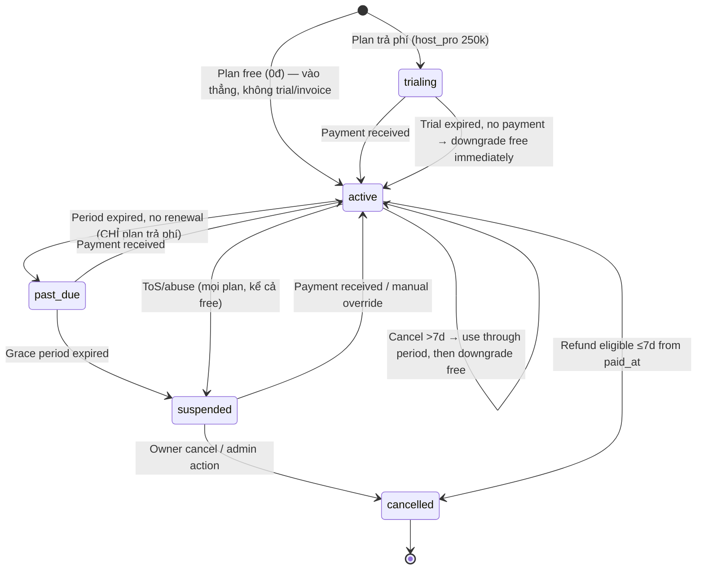

# Feature: Host Billing & Tenant Lifecycle — Product/UX Spec

> **Canonical phase:** P5  
> **Track:** 💳 Host Billing  
> **Version:** 2.9 · 2026-07-27
> **Status:** Reviewed  
> **Implementation:** Not started — bảng `subscriptions`/`billing_*` có sẵn · authority: `../standards/BUILD-STATUS.md` (Doc status ≠ Implementation status)  
> **Prerequisites:** P2 tenant/authz · P3 durable payment ingestion · P3 notifications  
> **Tài liệu liên quan:** `../product/BRD.md` FR-9/BR-11 · `../product/PRD.md` FLOW 11 · `../standards/decisions.md` DD-29/DD-37/DD-40/DD-91 · `../BE/feature_billing_lifecycle_tech.md` · `../research/auto-debt-reconciliation-regional-availability-2026-07-27.md`

> **Cập nhật v3.4 (DD-40 + DD-37, 2026-07-10):** free-tier bots = **Zalo + Facebook Messenger** (bỏ Telegram). Capability flags DD-40: **free** = `payment_mark_manual` (cash/bank), `reminders_manual`; **`host_pro`** += `payment_reconcile_auto`, `reminders_auto`, `assistant_ai_kb`, `crm_dashboard`.

> **Pointer 2026-08-07 (DD-97, owner-delegated):** statement/export sao kê tách hai lớp entitlement theo cùng logic DD-40 — per-session collection statement **view** thuộc **free**; statement theo **kỳ/tháng + export PDF/XLSX** thuộc **`host_pro`** (họ `crm_dashboard`). Exact capability key + registry entry chốt ở build slice (`plans.entitlements` config-driven, §4b BE tech — cơ chế không đổi). Mechanism DD-97 chưa `PLAN_READY`; đây chỉ là decision pointer, không mở surface/spec mới trong file này.

> **Commercial entitlement ≠ runtime availability:** exact Assistant key là `assistant_ai_kb`. `payment_reconcile_auto=true` chỉ nói tenant Host Pro đã mua quyền; auto path còn cần provider/bank/market/currency/consent đủ bằng chứng. Current authority/schema chỉ có `sepay|apipay` cho rail Việt Nam và webhook→settle→notify chưa build, nên capability chưa runtime ở cả Việt Nam. Ngoài Việt Nam, mark-paid thủ công vẫn là đường global; regional expansion còn ở mức research/decision input.

---

## 1. Mô tả

Quản lý **host subscription**: trial, invoice, payment, renewal, past-due, suspension, reactivation — mà KHÔNG mix platform revenue với player payment ledger.

### Bất biến

- Billing transactions/invoices **tách biệt hoàn toàn** khỏi player bank transactions/allocations.
- Period extension dựa trên invoice/plan policy — KHÔNG double-extend on duplicate webhook.
- Grace days/price/tier versioned — KHÔNG retroactive mutation.
- Suspension gating centralized by action class — safety/ingestion/read-only paths remain.
- Entitlement gate theo **capability flags** (config-driven), không hard-code theo tenant/plan_key.
- Commercial entitlement và operational availability là hai gate riêng; unknown availability fail-closed cho capability đắt tiền nhưng không chặn `payment_mark_manual`.
- `suspended` (gate publish/mutation) = fail-closed **union** hai cột `tenants.status` ⊕ `subscriptions.status`, gồm cả `subscriptions.status='cancelled'` và thiếu row `subscriptions` (unprovable → khoá, không allow-by-default) — không suy ra chỉ từ một cột. Chi tiết cột nào/case nào ở `../BE/feature_billing_lifecycle_tech.md` §3 Status Authority. *(✅ Founder-ratified 2026-07-24.)*

### Pricing tiers (DD-29 — thay DD-03)

| Plan key | Giá / tháng / CLB | Gồm |
|---|---:|---|
| `free` | **0đ** | Web app + **kết nối bot Zalo + Facebook Messenger** + quản kèo/roster + **mark-paid thủ công (tiền mặt/CK, tap/multi-select)** + nhắc thủ công |
| `host_pro` | **250.000đ** | Toàn bộ free + commercial entitlement **`payment_reconcile_auto`** (chỉ dùng khi market/provider available) + **nhắc nợ tự động** + **Trợ lý AI + KB (`assistant_ai_kb`)** + CRM dashboard |

> ⚠️ **`plans.plan_key` CHECK → `('free','host_pro')` là migration còn chờ (DD-29):** live `packages/db/schema.ts` vẫn giữ CHECK 4-tier `('free_web','telegram','plus_channel','all_channels')`. **Không** coi việc đổi CHECK là đã xong cho tới khi có migration.

Kênh phase-1 = **Zalo + Facebook Messenger** (Telegram loại — DD-37; Messenger nay phase-1 P2.5, không còn chờ P4.8). Capability flags (DD-40): free = `payment_mark_manual`, `reminders_manual`; host_pro thêm `payment_reconcile_auto`, `reminders_auto`, `assistant_ai_kb`, `crm_dashboard`. Danh sách cờ chi tiết ở **Capability registry** (`../BE/feature_billing_lifecycle_tech.md §4b`) — free/pro **config-driven** (đổi bằng `plans.entitlements`, không sửa code). *(Chat cơ bản + giá theo giới tính nay **✅ phase-1** — xem DD-38/DD-39 (✅ Chốt) + `feature_inapp_chat` / `feature_user_settings`.)*

`payment_reconcile_auto` không tự bật chỉ vì flag true: current launch path chỉ là SePay/ApiPay Việt Nam và vẫn thiếu runtime; ngoài Việt Nam hoặc bank/provider chưa proven, UI phải coi auto unavailable/waitlist thay vì hứa capability đang dùng được. `payment_mark_manual` vẫn có ở mọi tier/market. Exact `/pay` deterministic của player không dùng `assistant_ai_kb` và không phải entitlement Assistant.

---

## 2. Use Cases + Edge Cases

### Use Cases

| ID | Actor | Hành động | Kết quả |
|---|---|---|---|
| BIL-UC-1 | System | Tenant creation (plan trả phí) | Start trial 14 ngày; reminder đúng một lần khi còn 2 ngày |
| BIL-UC-1b | System | Tenant creation (plan `free`) | Vào thẳng `active` vô thời hạn — **không** trial, **không** invoice, **không** past_due/suspended vì non-payment |
| BIL-UC-2 | System | Issue invoice | Invoice code + payment instructions → platform account |
| BIL-UC-3 | System | Platform billing webhook | Match invoice idempotently → extend period exactly once |
| BIL-UC-4 | System | Daily lifecycle job | Transition due tenants + send owner notices |
| BIL-UC-5 | Host | View billing page | Plan, trial/period/grace, invoices, payment status |
| BIL-UC-6 | System | Suspend tenant | Block admin mutations/integration changes |
| BIL-UC-7 | System | Suspended tenant CK ingestion | Still durable-ingest player CK — safety path |
| BIL-UC-8 | Host | Pay overdue invoice | Reactivate + resume paused jobs safely |
| BIL-UC-9 | Platform Admin | Manual override (temporary) | Max 7 ngày, `ticket_ref`+reason+expiry, audited, auto-expire |
| BIL-UC-10 | Host | Cancel/refund subscription | Trong 7 ngày từ invoice `paid_at`: full refund; sau đó không refund, entitlement tới hết kỳ |

### Edge Cases

| # | Category | Case | Hành vi bắt buộc |
|---|----------|------|-------------------|
| 1 | Data Integrity | Billing tx mixed with player allocation | ❌ NEVER — separate ledgers |
| 2 | Concurrency | Duplicate billing webhook | Idempotent — extend period once only |
| 3 | Financial | Partial/overpayment | Billing review queue / manual review (KHÔNG có bảng `billing_credits`) — KHÔNG allocate to player charges |
| 4 | Data Integrity | Retroactive price/tier mutation | ❌ NEVER — versioned, immutable |
| 5 | Data Integrity | Clock/timezone billing date | UTC billing dates — no timezone ambiguity |
| 6 | Security | Suspended tenant push new public sessions | ❌ Block — existing sessions expire naturally only. "Suspended" = billing non-payment (`subscriptions`) **HOẶC** tenant-level abuse/ToS override (`tenants`) — fail-closed union, không phải một cột riêng lẻ; chi tiết case ở BE §3 Status Authority |
| 7 | Security | Suspended tenant player CK arrives | ✅ Still ingest — safety/ingestion paths remain |
| 8 | Cross-Feature | Owner lost access | Support/audit policy required |
| 9 | Financial | Refund request | Dùng invoice `paid_at`; ≤7 ngày → full refund + audit, >7 ngày → no refund + dùng hết kỳ. Missing/unprovable `paid_at` → fail-closed manual review |
| 10 | Data Integrity | Fair-use limit exceeded | Degrade expensive optional services — KHÔNG block payment ingestion/security |
| 11 | Security | Manual override abuse | Privileged, temporary, audited — auto-expire |
| 12 | Data Integrity | Paid plan trial → active transition with no payment | Require payment — no automatic active without billing event |
| 12b | Data Integrity | `free` (0đ) chạy qua trial→past_due→suspended | ❌ NEVER — free vào thẳng `active` vô thời hạn; daily lifecycle job **bỏ qua** plan 0đ ở nhánh past_due; không sinh invoice. Vẫn suspend được vì ToS/abuse (đường khác, không phải non-payment) |
| 12c | Entitlement | Đổi `free` ↔ plan trả phí | Lên paid: tạo subscription period + invoice từ thời điểm đổi (không retroactive). Về free: hạ entitlement cuối kỳ đã trả, set `active` (free), dừng sinh invoice |
| 13 | Entitlement | Host dùng kênh vượt plan | Block channel setup/use; show upgrade CTA; không ảnh hưởng player CK ingest |
| 14 | Entitlement | Đổi capability free↔pro (config `entitlements`) | Áp theo policy versioned; audit; không retroactive invoice mutation |
| 15 | Billing safety | Tenant `suspended` có player CK tới | Ingest ON; auto-settle/auto-notify OFF; không mất dữ liệu, không phát thông báo sai |
| 16 | Availability | Host Pro có `payment_reconcile_auto=true` nhưng bank/provider/market/currency/consent chưa proven | Auto capability unavailable/fail-closed; không auto-match từ dữ liệu không đáng tin, không hạ cả gói Host Pro; mark-paid thủ công vẫn hoạt động |
| 17 | Entitlement | Player dùng exact `/pay` khi `assistant_ai_kb=false` | `/pay` vẫn chạy deterministic qua person-self service; không mở Assistant/LLM |

---

## 3. Screens & States

> Web settings/billing area (host-only). Mobile-first 375px; desktop ≥1024.

### Web — Billing overview

**Purpose:** Host xem plan hiện tại, trạng thái subscription, ngày hết hạn.

**Layout:**

```
┌──────────────────────────────────────────────────────────┐
│ ← Cài đặt CLB          💳 Thanh toán                    │
├──────────────────────────────────────────────────────────┤
│                                                          │
│  ─── Gói hiện tại ───                                    │
│  ┌────────────────────────────────────────────────────┐  │
│  │ 🏆 Host Pro                        ✅ Active       │  │
│  │                                                    │  │
│  │ Bắt đầu: 01/07/2026                               │  │
│  │ Hết hạn:  01/08/2026    (còn 22 ngày)             │  │
│  │ Grace:    3 ngày sau hết hạn                       │  │
│  │                                                    │  │
│  │ [Đổi gói]           [Huỷ gia hạn]                 │  │
│  └────────────────────────────────────────────────────┘  │
│                                                          │
│  ─── Hoá đơn ───                                 Tất cả →│
│  ┌────────────────────────────────────────────────────┐  │
│  │ INV-2026-0012  150,000₫  ✅ Đã thanh toán  01/07  │  │
│  │ INV-2026-0011  150,000₫  ⏳ Chờ thanh toán  01/06  │  │
│  └────────────────────────────────────────────────────┘  │
│                                                          │
└──────────────────────────────────────────────────────────┘
```

**Component: Status badge:**

| Status | Badge | Hành vi |
|--------|-------|---------|
| `active` | ✅ Active (xanh) | Normal operation |
| `trial` | 🆓 Dùng thử (tím) | Trial period, countdown |
| `expiring` | ⚠️ Sắp hết hạn (vàng) | ≤7 ngày, CTA gia hạn |
| `past_due` | 🔴 Quá hạn (đỏ) | Grace period, CTA thanh toán |
| `suspended` | ⛔ Tạm ngưng (đỏ đậm) | Capabilities OFF, reactivation CTA |

**4 States:**

| State | Nội dung |
|-------|----------|
| Loading | Skeleton (plan card + 2 invoice row skeletons) |
| Ready | Plan info + status badge + recent invoices |
| Error | Error banner + retry |
| Empty | N/A (always has plan — free plan at minimum) |

### Web — Invoice list (full)

**Layout:**

```
┌──────────────────────────────────────────────────────────┐
│ ← Thanh toán           📄 Hoá đơn                       │
├──────────────────────────────────────────────────────────┤
│                                                          │
│  ┌──────────────────────────────────────────────────┐    │
│  │ Mã          Số tiền      Trạng thái    Ngày     │    │
│  ├──────────────────────────────────────────────────┤    │
│  │ INV-0012    150,000₫     ✅ Đã TT      01/07   │    │
│  │ INV-0011    150,000₫     ⏳ Chờ TT     01/06   │    │
│  │ INV-0010    150,000₫     ✅ Đã TT      01/05   │    │
│  └──────────────────────────────────────────────────┘    │
│                                                          │
└──────────────────────────────────────────────────────────┘
```

**States:** Loading (skeleton table) | Ready (invoice rows) | Error (banner) | Empty ("Chưa có hoá đơn")

### Web — Payment instructions

**Layout:**

```
┌──────────────────────────────────────────────────────────┐
│ ← Hoá đơn             💳 Thanh toán INV-0011            │
├──────────────────────────────────────────────────────────┤
│                                                          │
│  Số tiền: 150,000₫                                       │
│                                                          │
│  ┌────────────────────────┐                              │
│  │     [QR VietQR]        │                              │
│  │                        │                              │
│  └────────────────────────┘                              │
│                                                          │
│  Ngân hàng: Vietcombank                                  │
│  Số TK: 0123456789                                       │
│  Chủ TK: PLEXCO TECHNOLOGY                               │
│  Nội dung CK: INV-2026-0011                              │
│                                                          │
│  [📋 Sao chép thông tin]                                 │
│                                                          │
└──────────────────────────────────────────────────────────┘
```

### Web — Reactivation (suspended)

**Layout:**

```
┌──────────────────────────────────────────────────────────┐
│                                                          │
│        ⛔ CLB đang bị tạm ngưng                          │
│                                                          │
│  Thanh toán để kích hoạt lại dịch vụ.                    │
│                                                          │
│  [═══ Thanh toán ngay ═══]                               │
│                                                          │
│  Liên hệ hỗ trợ nếu bạn cho rằng                        │
│  đây là nhầm lẫn.                                        │
│  [📧 Liên hệ support]                                   │
│                                                          │
└──────────────────────────────────────────────────────────┘
```

> Luôn hiển thị CẢ HAI CTA — `TENANT_SUSPENDED` cause-agnostic, không rẽ nhánh theo nguyên nhân.

### Bot — Owner notice

**Layout:**

```
⚠️ CLB Cầu lông Bình Thạnh

Gói Host Pro sắp hết hạn ngày 01/08.
Thanh toán trước để tránh gián đoạn.

[Thanh toán →]
```

### Data source mapping

| Component | Data source | Ghi chú |
|-----------|-------------|---------|
| Plan card | `subscriptions` per tenant | `plan_key`, `status`, dates |
| Status badge | `subscriptions.status` | Enum → badge mapping |
| Invoice list | `subscription_invoices` | Sorted by date DESC |
| Payment QR | Platform bank + invoice_code | VietQR standard |
| Reactivation | `subscriptions.status = 'suspended'` | Cause-agnostic CTA |

### State coverage matrix

| Screen | Loading | Ready | Error | Empty |
|--------|---------|-------|-------|-------|
| Billing overview | ✅ Skeleton card + rows | ✅ Plan + badge + invoices | ✅ Banner + retry | ⚪ N/A (always has plan) |
| Invoice list | ✅ Skeleton table | ✅ Invoice rows | ✅ Banner + retry | ✅ "Chưa có hoá đơn" |
| Payment instructions | — | ✅ QR + bank info | — | ⚪ N/A |
| Status badges | — | ✅ Active/Expiring/PastDue/Suspended | — | ⚪ N/A |
| Reactivation | — | ✅ Payment + support CTAs | ✅ "Lỗi — liên hệ support" | ⚪ N/A |
| Bot notice | — | ✅ Warning message | — | ⚪ N/A |

---

## 4. Domain Model

| Entity | Vai trò | Key constraints |
|--------|---------|-----------------|
| `subscriptions` | Plan/tier per tenant | `tenant_id` FK, `plan_key`, `plan_version`, `status`; free có `period_start/end=NULL` |
| `subscription_invoices` | Billing obligations | `UNIQUE(invoice_code)`, `tenant_id`, `amount_due`, `status`, canonical `paid_at` cho refund window |
| `billing_transactions` | Platform payment records | Tách hoàn toàn khỏi player `bank_transactions` |
| `billing_allocations` | Phân bổ `billing_transaction` → `subscription_invoice` | `transaction_id`, `invoice_id`, `amount` |
| `billing_overrides` | Manual override per-tenant | PlatformAdmin, `ticket_ref`, reason, max-7d `expires_at`, auto-expire, audit |

### Lifecycle State Machine



> **`free` (0đ):** vào thẳng `active` và ở đó vô thời hạn. Daily lifecycle job **bỏ qua plan 0đ** ở nhánh `period expired → past_due` và **không sinh invoice**. Free chỉ rời `active` khi (a) owner đổi lên plan trả phí, (b) owner cancel, hoặc (c) suspend do ToS/abuse — **không bao giờ** vì non-payment. Nhánh `trialing/past_due/suspended-vì-non-payment` chỉ áp dụng cho plan trả phí.

> **Host Pro DD-51:** trial đúng 14 ngày, reminder khi còn 2 ngày; trial hết chưa trả → downgrade `free` ngay, không vào invoice grace. Grace 7 ngày chỉ áp invoice của kỳ trả phí đã active. Refund window tính duy nhất từ invoice `paid_at`; override không thay đổi refund window.

> **⚠️ Diagram trên gộp hai trục vào một:** `suspended` thực chất sống trên **hai cột vật lý khác nhau** — `subscriptions.status` (non-payment, diagram này) và `tenants.status` (tenant-root hard override, abuse/ToS — chưa build write path, xem `../BE/feature_billing_lifecycle_tech.md` §3 Status Authority). `suspended --> active: Payment received / manual override` mô tả **chỉ recovery của trục `subscriptions`** — trả nợ hoặc `ApplyOverride` (cả hai đều billing-axis). Nó **KHÔNG** clear một tenant-root hard-suspend (ToS/abuse): trục đó cần một trust-safety un-suspend riêng (chưa xây) sở hữu cả set lẫn clear. Implementer đọc diagram này không được suy ra rằng trả tiền tự động gỡ suspend vì lạm dụng.

---

## 5. Analytics Events

| Event | Khi nào | Payload tối thiểu |
|-------|---------|-------------------|
| `billing_lifecycle_transition` | Status change | `tenant_id`, `from_status`, `to_status` |
| `billing_invoice_issued` | Invoice created | `tenant_id`, `invoice_code`, `amount` |
| `billing_invoice_paid` | Payment matched | `tenant_id`, `invoice_code` |
| `billing_reactivation` | Suspended → active | `tenant_id`, `method` (payment/manual) |
| `billing_manual_override` | Admin override | `tenant_id`, `admin_id` (opaque), `reason` |
| `billing_churn` | Cancellation | `tenant_id`, `tenure_days` |

> Không log bank content, account numbers trong analytics.

---

## 6. Acceptance Criteria

- [ ] Lifecycle transitions and grace dates deterministic/idempotent
- [ ] Billing ledger isolated from player ledger
- [ ] Duplicate payment KHÔNG extend twice
- [ ] Suspended action matrix matches BRD — preserves player CK ingest
- [ ] Publish-suspend gate reads fail-closed union of `tenants.status`/`subscriptions.status` — không quyết định từ một cột đơn lẻ
- [ ] Public sessions expire naturally — KHÔNG newly published while suspended
- [ ] Reactivation resumes operations/jobs without replay duplication
- [ ] Owner notices/corrections best-effort and audited
- [ ] Plan/version/fair-use behavior tests pass
- [ ] Entitlement gate đúng theo capability flags (free vs host_pro) — config-driven
- [ ] `payment_reconcile_auto` entitlement được kiểm tách khỏi availability; thiếu provider/bank/market/currency/consent → auto unavailable, manual vẫn dùng được
- [ ] Exact `assistant_ai_kb` chỉ gate Club Assistant/KB; deterministic `/pay` không phụ thuộc flag này
- [ ] `free` ở `active` vô thời hạn — không sinh invoice, không bao giờ past_due/suspended vì non-payment
- [ ] Paid invoice amount lấy từ immutable plan version, không hard-code
- [ ] Trial 14d/reminder D-2/downgrade-free không-payment và invoice grace 7d có boundary tests
- [ ] Refund window dùng canonical `paid_at`; override bắt buộc PlatformAdmin+ticket+reason+expiry≤7d và auto-expire
- [ ] Suspended: player CK ingest ON, auto-settle/auto-notify OFF

---

## 7. Open Questions / Changelog

### Open Questions

| ID | Quyết định | Trạng thái |
|---|---|---|
| BIL-OQ-1 | Pricing tiers (BRD OD-3 → DD-29) | ✅ DD-29: 2 tier `free`/`host_pro`; trial/grace đã chốt DD-51. `plans` CHECK `('free','host_pro')` + nullable free period = migration còn chờ |
| BIL-OQ-2 | Cancellation/refund/credit policy + manual-override SLA | ✅ **Chốt + full-propagate DD-51:** trial 14d/remind D-2/downgrade free ngay; invoice grace 7d; refund full ≤7d từ `paid_at`, sau đó no refund/use period; PlatformAdmin override max7d + ticket/reason/expiry/audit |

### Changelog

| Date | Version | Thay đổi |
|---|---|---|
| 2026-07-27 | v2.9 | Pin exact `assistant_ai_kb` và DD-91 no-LLM `/pay` boundary. Tách commercial entitlement `payment_reconcile_auto` khỏi operational availability; current authority chỉ `sepay\|apipay` cho rail Việt Nam, webhook→settle→notify chưa build, manual mark-paid vẫn global. Regional research vẫn là decision input, không tự chốt provider/market expansion hay claim runtime. |
| 2026-07-24 | v2.8a | **FOUNDER-RATIFIED + Round-06 fix (`docs-billing-publish-suspension-authority`):** Owner ratified the status-authority fail-closed union as authored — inline "⏳ pending" note removed (this review/merge is the ratification). Reactivation screen copy reverted to cause-agnostic always-show-both (payment CTA **and** contact-support line) — the round-05 conditional had no data source to pick a branch (billing overview API only exposes `subscription.status`; `TENANT_SUSPENDED` is intentionally cause-agnostic). Full rationale at BE `feature_billing_lifecycle_tech.md` v2.8a. Docs-only. |
| 2026-07-24 | v2.8 | **Status-authority cross-ref (`docs-billing-publish-suspension-authority`):** §1 bất biến +1 bullet + edge #6 nói rõ "suspended" cho publish-suspend gate = fail-closed hai trục `tenants.status`/`subscriptions.status` (không suy ra từ một cột); +1 AC bullet. §4 Lifecycle State Machine +1 cảnh báo: diagram gộp 2 trục vào 1, "suspended → active: Payment received / manual override" chỉ là recovery trục `subscriptions` — **không** clear tenant-root hard-suspend (ToS/abuse), trục đó cần cơ chế riêng chưa xây (codex round-03 [P1] flagged nguy cơ đọc nhầm). §3 Reactivation screen copy sửa (round-05 [P2]): không còn tuyên bố tuyệt đối "trả tiền là xong" — suspended vì lý do khác billing thì payment CTA ẩn, hướng dẫn liên hệ hỗ trợ; owner-facing cause-differentiation là UX decision chưa chốt. Chi tiết decision table 6-case + concurrency contract + tests ở BE `feature_billing_lifecycle_tech.md` §3 Status Authority (mirror kỹ thuật — không lặp lại ở đây). **⏳ Founder ratification pending** cho shape cụ thể (STOP_AT_READY). Docs-only, không đổi UC/domain model/state machine (chỉ thêm chú thích diagram + sửa 1 screen copy, không sửa mermaid). Pre-existing dated changelog giữ verbatim. |
| 2026-07-19 | v2.7a | Metadata sweep (index v2.35): thêm trường **Implementation** đồng bộ BUILD-STATUS (Not started). Không đổi contract. |
| 2026-07-16 | v2.7 | **DD-51 full propagation:** use cases, edge table, domain fields, state machine and AC now pin trial/reminder/downgrade, invoice grace, refund `paid_at` window, override and suspended automation behavior. Authority: decisions v1.37. |
| 2026-07-10 | v2.5 | **Review fixes → canonical billing vocab.** Domain model: `invoices`→**`subscription_invoices`**; `billing_credits`/credit concept → **`billing_allocations`** (+ `billing_overrides`); `webhook_transactions`→player `bank_transactions`. Note `plans` CHECK `('free','host_pro')` = migration còn chờ (live schema 4-tier — không claim done). Overpay/partial = billing review queue (không có bảng `billing_credits`). BIL-OQ-1 → DD-29 2 tier. |
| 2026-07-10 | v2.4 | **DD-40 + DD-37:** free-tier bots = **Zalo + Messenger** (bỏ Telegram; Messenger nay phase-1, bỏ chờ P4.8). Capability flags DD-40: free = `payment_mark_manual`,`reminders_manual`; host_pro += `payment_reconcile_auto`,`reminders_auto`,`assistant_ai_kb`,`crm_dashboard`. Free-tier "đối soát CK cơ bản" → **mark-paid thủ công (tiền mặt/CK, tap/multi-select)**. One-line pointer chat/gender → DD-38/DD-39 (proposal). Owner notice screen: Zalo/Messenger. |
| 2026-07-05 | v2.3 | **DD-29 pricing pivot:** bảng tier → `free` (0đ, web+3 bot+reconcile thủ công) / `host_pro` (250k, +auto reconcile/notify +nhắc nợ tự động +AI+CRM). Entitlement gate theo **capability flags config-driven** (registry ở BE §4b). Đổi edge #14, checklist, SM. Rename plan_key cũ `free_web`→`free`. |
| 2026-06-20 | v2.2 | Fix: `free` (0đ) vào thẳng `active` vô thời hạn — không trial/invoice/past_due/suspended vì non-payment (SM + UC-1b + edge 12b/12c); chỉ suspend free vì ToS/abuse |
| 2026-06-20 | v2.1 | Chốt pricing tiers DD-03 (free/79k/159k/199k), thêm entitlement gate và plan_key |
| 2026-06-18 | v1.0 | Initial spec (English format) |
| 2026-06-19 | v2.0 | Chuẩn hoá Vietnamese numbered, thêm 10 use cases, 12 edge cases, lifecycle state machine, billing screens |
| 2026-07-16 | v2.6 | **Propagation (light) DD-51:** OQ pointer added; body was full-propagated in v2.7. |
