# Feature: Cross-club Join & Approval — Product/UX Spec

> **Canonical phase:** P4.3  
> **Track:** 🤝 Cross-club Join  
> **Version:** 2.12 · 2026-08-10
> **Status:** Reviewed  
> **Implementation:** Not started — `join_requests` có sẵn từ `0006` · authority: `../standards/BUILD-STATUS.md` (Doc status ≠ Implementation status)  
> **Prerequisites:** P4.3 discovery · P3.5 identity · P2 session/slot transaction · P4 sync/notifications  
> **Tài liệu liên quan:** `../product/BRD.md` FR-3.2 · `../product/PRD.md` FLOW 13 · `../standards/decisions.md` DD-05/DD-06/**DD-32/DD-45/DD-49** · `../standards/business-rules.md` BL-DSC-3/BL-CBF/BL-SES-9/10 · `../BE/feature_cross_club_join_tech.md`

---

## 1. Mô tả

Cho player chưa phải member có thể **join public session trực tiếp** (open policy) hoặc **request host approval**. Guest membership chỉ được tạo trong final open join/approve thành công; nếu session full thì vào waitlist và chỉ reveal exact venue sau khi active.

### Entry points

| Entry | Route / Surface | Actor | Mô tả |
|-------|----------------|-------|-------|
| Marketplace → Session card → "Tham gia" | `/sessions/:public_id/join` | Player | Main join flow từ marketplace discovery |
| Direct link (shared/QR) | `/join/:public_id` | Player | Deep link join từ URL share/QR code |
| Club page → Upcoming sessions | `/clubs/:slug/sessions` → Join CTA | Player | Join từ club public page |
| Bot channel (Messenger/Zalo) | Channel funnel finalizer | Player | Cross-club join qua bot sau link/pay decision |
| Host dashboard → Pending requests | `/clubs/:id/sessions/:sid/requests` | Host | Approve/reject join requests |
| Notification → "Xem yêu cầu" | Deep link từ push notification | Host | Từ noti navigate đến request review |

### Bất biến

- Public session ID route internally nhưng **KHÔNG grant** tenant data permission.
- Player identity phải verified đủ để own person-self records — không accept arbitrary person ID.
- Capacity checked **under lock** tại final join/approval — browse slot là advisory.
- Open join và approval **first-entry** cùng dùng một capacity outcome: còn slot → active+charge+venue; full → waitlisted, không tạo charge/venue.
- Paid player leave/cancel theo financial/refund policy — KHÔNG silent allocation deletion.
- Player `left` rejoin theo DD-49: re-derive eligibility/ban/capacity + live aggregate. Active: chưa-refund carry-over, refunded append lifecycle idempotent. Full: waitlisted; chưa-refund giữ historical aggregate, refunded không append lifecycle mới tới activation. Unknown→`REJOIN_REQUIRES_REVIEW`.
- Existing `active|waitlisted|pending` resolve trước restriction preflight và trả current outcome idempotently; DD-52 không auto-evict. Chỉ absent/`left` mới được tạo membership/request/player sau DD-41/DD-42/DD-52.
- Trên Messenger, source Page chỉ là endpoint/default/audit. Target session→tenant phải resolve từ opaque actor+Page-bound action/protected public ref; valid cross-club target có thể khác tenant Page nguồn (DD-66/68).
- **DD-32 channel boundary:** CCJ vẫn là booking truth, nhưng Messenger/Zalo không gọi active mutation trước khi channel funnel chứng minh `free`, qualified Account pay-later hoặc verified pay-now. Full/pending paths vẫn vào waitlist/request mà không thu tiền. Generic web/direct join contract không tự bị đổi bởi channel policy.

---

## 2. Use Cases + Edge Cases

### Use Cases

| ID | Actor | Hành động | Kết quả |
|---|---|---|---|
| CCJ-UC-1 | Player | Open join (open policy), first-entry | Auth → recheck public/open/capacity → create guest membership → còn slot: active+exactly-one-charge+venue; full: waitlisted, no charge/venue |
| CCJ-UC-2 | Player | Request approval (approval policy) | First-entry: pending only. Existing `left`: preflight live DD-49 disposition rồi create/keep request; **không persist financial proof**. Unknown: review/no request. Approve phải re-derive under lock |
| CCJ-UC-3 | Host | Approve first-entry request | Recheck capacity → còn slot: active+exactly-one-charge+venue; full: approved+waitlisted, no charge/venue → notify player |
| CCJ-UC-4 | Host | Reject request | Player notified — area only visible |
| CCJ-UC-5 | System | Request expired (TTL) | Auto-reject — notify player |
| CCJ-UC-6 | Player | Cancel pending request | Request cancelled; không đổi capacity. First-entry pending chưa có player; existing-`left` giữ nguyên player/aggregate lịch sử |
| CCJ-UC-7 | Player | Leave after open join (unpaid) | Slot freed per session policy |
| CCJ-UC-8 | Player | Leave after paid join | Financial/refund policy applied — audit trail |
| CCJ-UC-9 | Host | Approve first-entry after capacity full | Request → `approved`; player → `waitlisted` có position, không charge/venue; notify player |
| CCJ-UC-10 | Host | Approve after request expired | Safe conflict — "Yêu cầu đã hết hạn" |
| CCJ-UC-11 | Channel funnel finalizer | Gọi common join sau link/pay decision | Server-owned disposition only; active/waitlist/pending outcome canonical, không adapter-created player/charge |

### Edge Cases

| # | Category | Case | Hành vi bắt buộc |
|---|----------|------|-------------------|
| 1 | Concurrency | 2 first-entry players join last slot đồng thời | Lock — first active+exactly-one-charge; second waitlisted với position dương, không charge/venue |
| 2 | Security | Public session ID grant tenant access | ❌ NEVER — routing only, no data permission |
| 3 | Security | Arbitrary person ID in join request | Reject — verified identity required |
| 4 | Data Integrity | Duplicate join/request (same person/session) | Existing active/waitlisted trả current outcome idempotently; không duplicate player/charge/request |
| 5 | Data Integrity | Host approve after request expired/full | Expired → safe conflict; full → approved+waitlisted dưới lock |
| 6 | Security | Guest membership read tenant operational data | ❌ NEVER — person-self only (own roster, own charges) |
| 7 | Security | Venue visible before active outcome | ❌ NEVER — area/position only cho pending/rejected/approved-waitlisted |
| 8 | Financial | Paid player leave/cancel | Financial/refund policy — no silent allocation deletion |
| 9 | Security | Rate-limit join/request/cancel abuse | Block after threshold — tenant ban auditable |
| 10 | Data Integrity | Suspended tenant new stale offers | Existing public sessions OK per billing rule — no new offer extension |
| 11 | Cross-Feature | Player already member of this club | Use existing membership — no duplicate guest |
| 12 | Cross-Feature | Player currently banned, or ban imposed after request/current outcome | Absent/left request-create/open rejects current ban with no request/host alert/membership/player/charge. Existing active/waitlisted/pending repeat returns current outcome (no auto-evict/no duplicate alert); approval/promotion re-check shared DD-52 and stays pending/skips with zero player/charge/venue mutation |
| 13 | Financial | Player đã `left` tự join/request lại | Request-create chỉ preflight; open/approve re-derive under lock. Active carry-over/append lifecycle; full waitlisted, refunded defer lifecycle mới. Unknown→review/zero mutation |
| 14 | Financial/Resilience | Không suy được giá khi active join/approve hoặc first-activation promotion | Direct join/approve aborts. First promotion failure lazy-creates one root + candidate audit event. SessionService max 3 claimed attempts; each completed sweep uses current order. Siblings share budget/root digest; expired final claim resolves-or-terminalizes without attempt 4; no fallback |
| 15 | Security | Messenger raw/wrong/stale/replayed session action | Reject/re-render; no request/player/charge. Source Page không grant target tenant |

---

## 3. Screens & States

> Web join flow (from marketplace or direct link). Mobile-first 375px.

### Web — Join request flow

**Layout:**

```
┌──────────────────────────────────────┐
│ ← Marketplace    🏸 Tham gia kèo    │
├──────────────────────────────────────┤
│                                      │
│ 🏸 Cầu lông chiều T5                │
│ CLB Rồng Xanh · 19:00 · Q3          │
│ 💰 120,000₫ · 2 chỗ còn trống      │
│                                      │
│ ─── Thông tin tham gia ───           │
│ Tên hiển thị: {displayName}         │
│ Trình độ: Trung bình                │
│                                      │
│ ☑️ Tôi đồng ý nội quy CLB          │
│                                      │
│     [═══ Xác nhận tham gia ═══]     │
│                                      │
└──────────────────────────────────────┘
```

**Post-join states:**

```
┌──────────────────────────────────────┐
│ ✅ Đã xác nhận!                      │
│ 📍 123 Nguyễn Đình Chiểu, Q3        │  ← venue revealed
│ 💰 120,000₫ — thanh toán trước kèo  │
│ [Xem chi tiết] [Quay về Marketplace] │
└──────────────────────────────────────┘
  — HOẶC —
┌──────────────────────────────────────┐
│ ⏳ Danh sách chờ — vị trí #3        │
│ Bạn sẽ được thông báo khi có chỗ    │
│ [Quay về Marketplace]                │
└──────────────────────────────────────┘
  — HOẶC —
┌──────────────────────────────────────┐
│ 📋 Yêu cầu đã gửi                   │
│ Host sẽ duyệt yêu cầu của bạn      │
│ [Quay về Marketplace]                │
└──────────────────────────────────────┘
```

### Data source mapping

| Component | Data source | Ghi chú |
|-----------|-------------|---------|
| Session info | `public_sessions` (whitelist) | Pre-join: no venue |
| Join action | `players` INSERT + occupancy check | Transactional |
| Post-join venue | `sessions.venue` | Only if active |
| Waitlist position | `players` WHERE waitlisted, ordered | |
| Approval status | `players.status = 'pending'` | Host approves |

### State coverage matrix

| Screen | Loading | Ready | Error | Empty |
|--------|---------|-------|-------|-------|
| Join request | ✅ Skeleton | ✅ Session info + confirm | ✅ "Kèo hết chỗ" / "Lỗi" | ⚪ N/A |
| Post-join (active) | — | ✅ Venue + payment info | — | ⚪ N/A |
| Post-join (waitlisted) | — | ✅ Position | — | ⚪ N/A |
| Post-join (approval) | — | ✅ "Đang chờ duyệt" | — | ⚪ N/A |
---

## 4. Domain Model

| Entity | Vai trò | Key constraints |
|--------|---------|-----------------|
| `join_requests` | Pending approval tracking | `UNIQUE(person_id, session_id)` active, `status` enum, `expires_at` |
| `players` | Player in session/waitlist | `UNIQUE(tenant_id, session_id, membership_id)`, `status ∈ active\|left\|waitlisted`; waitlisted có position dương; direct/approved origin thuộc command/audit event, không phải cột `source` |
| `memberships` | Guest membership created on join | `UNIQUE(person_id, tenant_id)`, `role=guest` |
| `charges` | Payment obligation tạo khi player lần đầu active | UNIQUE `(tenant_id,session_id,player_id)`; first-entry waitlisted không tạo charge. Row/ledger giữ lại sau `left`, nên DD-49 rejoin-waitlisted có thể mang aggregate lịch sử đã chứng minh nhưng không tạo charge thứ hai |

### Join Request State Machine

```mermaid
stateDiagram-v2
    [*] --> pending
    pending --> approved: Host approve (active nếu còn slot; waitlisted nếu full)
    pending --> rejected: Host reject
    pending --> expired: TTL hết
    pending --> cancelled: Player cancel
    approved --> [*]
    rejected --> [*]
    expired --> [*]
    cancelled --> [*]
```



---

## 5. Analytics Events

| Event | Khi nào | Payload tối thiểu |
|-------|---------|-------------------|
| `join_attempted` | Player click Join | `session_id` (opaque), `join_policy`, `source` (web/bot) |
| `join_succeeded` | Join/approval thành công | `session_id` (opaque), `join_type` (open/approved) |
| `join_rejected` | Host reject hoặc auto-expire | `session_id` (opaque), `reason` (rejected/expired) |
| `join_waitlisted` | Open join/approval khi full | `session_id` (opaque), `join_type`, `waitlist_position` |
| `approval_latency` | Time from request to decision | `session_id` (opaque), `latency_seconds` |
| `join_leave` | Player leave after join | `session_id` (opaque), `had_payment` |

> Opaque IDs only. Không log tên, profile, PII.

---

## 6. Acceptance Criteria

- [ ] Non-member first-entry open join còn slot tạo guest membership+active player+charge atomically; full tạo waitlisted player, không tạo charge/venue
- [ ] Approval request lifecycle (pending/approved/rejected/expired/cancelled) work
- [ ] Concurrent final-slot joins KHÔNG over-fill (lock test)
- [ ] Duplicate requests/commands idempotent
- [ ] Venue chỉ lộ khi `players.status='active'`; approved-but-waitlisted vẫn ẩn
- [ ] Guest KHÔNG read tenant-private data
- [ ] Leave/cancel with financial history follows ledger policy
- [ ] Host approval requires correct tenant role
- [ ] Abuse/rate-limit/audit tests pass
- [ ] Existing-left approval: create preflight pass không lưu proof; approve re-derive. State drift/unknown giữ request pending + ledger unchanged. Active carry-over/append lifecycle; full waitlisted/no-new-lifecycle/no-venue
- [ ] Request-create preflights DD-41/DD-42/shared DD-52 so current ban creates no request/host alert; open join + approval re-check under lock. Ban imposed after request keeps request pending/blocked and creates no player/charge/venue
- [ ] DD-39 promotion failure: candidate unchanged; first failure lazy-creates root; max 3 claimed attempts, completed sweep uses current order, expired final claim resolves-or-terminalizes without attempt 4. Candidate events share budget and one owner digest/root; no fallback
- [ ] Messenger central/tenant Page dùng opaque actor+Page-bound actions; valid cross-club target đúng, wrong/stale/replay không mutate
- [ ] Messenger/Zalo active mutation chỉ đi từ shared funnel finalizer với server-derived free/Account-linked/settled disposition; adapter/client không tự khai `linked`/`paid`. Full/approval request không bị thu trước

---

## 7. Open Questions / Changelog

### Open Questions

| ID | Quyết định | Trạng thái |
|---|---|---|
| CCJ-OQ-1 | BRD OD-5: default open vs approval policy | ✅ Chốt (DD-05/45/49, v1.67): default `open`; approval first-entry pending only. Existing-left request-create preflight live disposition, no proof storage; approve re-derive under lock, drift keeps pending. Full→waitlisted/no new lifecycle/venue; active→carry-over hoặc append refunded lifecycle. `../standards/decisions.md` |
| CCJ-OQ-2 | Guest → full membership transition + club ban policy | ✅ **Chốt DD-52 + DD-56 (2026-07-16)** — host invite/approve **và** player-request+host-approve coexist (auto-upgrade defer); manual safety ban = **TenantOwner + co-admin** (DD-56 amend), reason+evidence bắt buộc, `expires_at` hoặc permanent, **không auto-evict** (waitlisted giữ queue + skip theo DD-45); storage tách khỏi reliability-ban DD-42; mọi join path qua một `evaluateJoinRestriction()` core. Schema/command propagate lúc build |

### Changelog

| Date | Version | Thay đổi |
|---|---|---|
| 2026-08-10 | v2.12 | **A-grade upgrade:** thêm Entry points table (6 entries); bump version. Không đổi contract/domain model. |
| 2026-07-28 | v2.11 | Mirror DD-32 Option D: preserve CCJ as canonical join while requiring channel finalizer proof before active mutation; full/pending remain no-pay and generic web/direct join is unchanged. No runtime. |
| 2026-07-19 | v2.10a | Metadata sweep (index v2.35): thêm trường **Implementation** đồng bộ BUILD-STATUS (Not started). Không đổi contract. |
| 2026-07-19 | v2.10 | **DD-45 claimed-attempt mirror:** lazy root on first failure, max 3 claims/completed-current-order sweep semantics, expired-final resolve-or-terminal and one owner digest/root. Runtime remains unbuilt. |
| 2026-07-19 | v2.9 | **DD-05/DD-52 idempotency ordering:** current active/waitlisted/pending returns before restriction preflight; absent/left alone can create after DD-41/DD-42/DD-52. Active direct fill resolves stale promotion roots. Runtime remains unbuilt. |
| 2026-07-19 | v2.8 | **DD-45/DD-52 closure:** request-create preflights and open join/approval re-check shared restriction core; current-ban spam and ban-after-request activation are fail-closed. Mirror one root max-3 promotion-sweep job, not per-event budgets. Runtime remains unbuilt. |
| 2026-07-19 | v2.7 | **DD-05/06/45/49 integrity:** approval preflight ≠ persisted proof; approve re-derives live aggregate. Venue active-only. Refunded rejoin full defers lifecycle to activation; retry semantics delegated to bounded SessionService contract. |
| 2026-07-17 | v2.6 | **DD-65..68:** cross-club Messenger action tách source Page khỏi target tenant; opaque bounded approval/join actions và replay-safe acceptance. |
| 2026-07-16 | v2.5 | **DD-49 full propagation:** invariants/edge/UI/AC đổi blanket left-rejoin reject thành normal rejoin với carry-over/refunded disposition; unknown state mới cần review. Không duplicate `charges` row. Authority: decisions v1.37. |
| 2026-07-15 | v2.3 | **DD-39×DD-45 failure contract:** direct active join/approve aborts fail-closed on amount derivation failure; promotion keeps candidate waitlisted/no-charge/no-venue, audits/retries without rolling back opener, then continues queue. |
| 2026-07-15 | v2.2 | **DD-45 propagation:** open/approval full→waitlisted (no charge/venue), concurrent last-slot loser waitlisted, `left` self-rejoin fail-closed `REJOIN_REQUIRES_REVIEW`; sync UX/events/AC. |
| 2026-06-18 | v1.0 | Initial spec (English format) |
| 2026-06-19 | v2.0 | Chuẩn hoá Vietnamese numbered, thêm 10 use cases, 12 edge cases, join request state machine, screen states |
| 2026-07-13 | v2.1 | Reconcile canonical roster/ledger vocabulary: `players` keyed by membership; `charges` linked by `player_id`/`membership_id`; origin direct/approved stays in command/audit contract. |
| 2026-07-16 | v2.4 | **Propagation (light) DD-52/56:** CCJ-OQ-2 ✅ (guest→full invite+request coexist; manual ban TenantOwner+co-admin, không auto-evict, tách DD-42; `evaluateJoinRestriction()` core). Schema/command defer build slice. Authority: decisions v1.36. |
