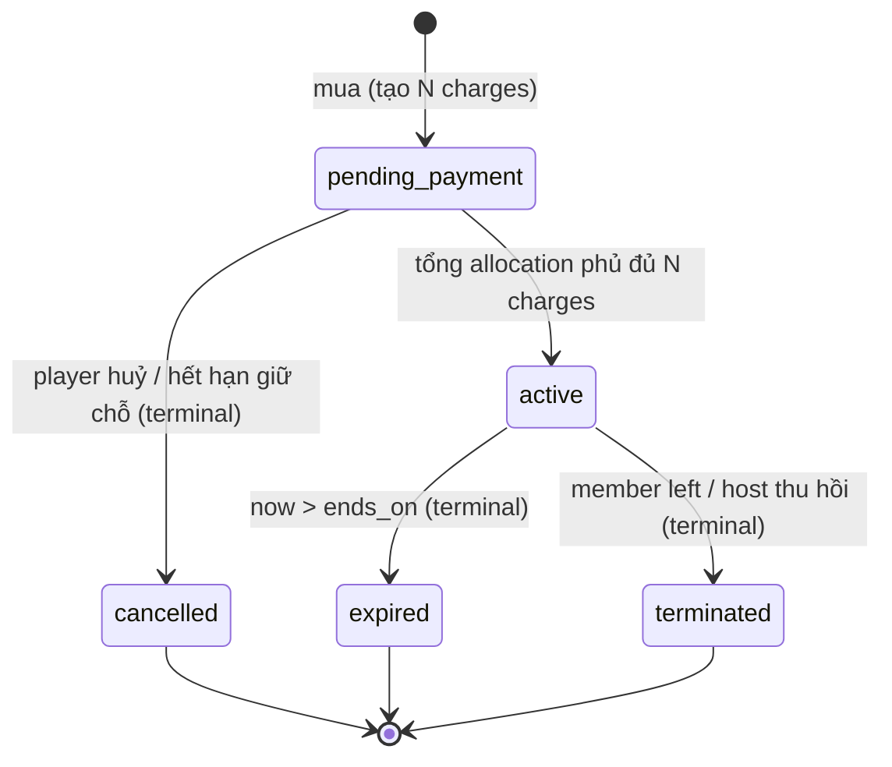

# Feature: Membership (Gói hội viên theo chu kỳ 30 ngày) — Product/UX Spec

> **Canonical phase:** P4+ — sau Session core + Payment reconcile. **NGOÀI phase-1** theo DD-114 D7 (không nằm trong 7 nhóm phase-1, cũng không nằm trong launch subset DD-113).
> **Track:** 💰 Money / Player retention
> **Version:** 0.2 · 2026-08-24
> **Status:** Draft *(chưa qua readiness gate — KHÔNG phải Reviewed contract, KHÔNG authorize code/migration)*
> **Implementation:** Not started
> **Prerequisites:** Session Management (recurrence + capacity) · Payment Reconcile (charge/allocation) · DD-45 waitlist
> **BE tech spec:** `../BE/feature_membership_tech.md` v0.1
> **Tài liệu liên quan:** `../../standards/decisions.md` DD-115 (🟡 đề xuất, mở cùng spec này) · DD-02 `pay_code` · DD-32 Option D · DD-39 giá theo giới tính · DD-40 mark-paid · DD-43 `membership_tags` · DD-82 Tournament · `../../standards/business-rules.md` BL-PAY-2/5/8 · BL-SES-2/3/9 · BL-CBF-3/5

---

## 1. Mô tả

Người chơi ở CLB sinh hoạt theo **lịch cố định** hiện đang trả tiền theo từng buổi: mỗi buổi một `charge`, mỗi buổi một lần chuyển khoản, mỗi buổi một lần đối soát. Membership gộp việc đó lại: người chơi **chọn một ngày bắt đầu**, hệ thống **tự đếm số buổi theo lịch cố định trong 30 ngày kể từ ngày đó**, báo giá đã chiết khấu, và thu **một lần**.

**Membership là một lớp thương mại đặt TRÊN quan hệ `memberships` sẵn có, không thay thế nó:** `memberships` (person ↔ tenant) vẫn là identity anchor duy nhất — Membership **không** thêm cột vào bảng đó, **không** tạo khái niệm người-thuộc-CLB thứ hai, và **không** tạo đường tiền thứ hai. Nó own: định nghĩa gói (config có version), chu kỳ đã mua của một member, và quyền lợi phát sinh. Nó consume: `sessions`/recurrence (nguồn số buổi), `charges`/`payment_allocations` (đường tiền), `players` (chỗ trong buổi).

> ⚠️ **Đọc kỹ trước khi thiết kế tiếp — khái niệm trùng tên.** Repo đã có **ba** thứ chứa chữ "membership"/"subscription" và chúng KHÁC nhau:
> | Tên | Là gì | Không phải gì |
> |---|---|---|
> | `memberships` | quan hệ person ↔ tenant, có `pay_code`, merge-safe (BL-ID-4) | không phải gói trả phí |
> | `subscriptions` + `plans` | billing SaaS của **host** (`free`/`host_pro`, DD-29) | không phải gói của **player** |
> | `membership_tags` (DD-43, chưa migrate) | nhãn per-tenant để lọc audience khi announce | BL-SES-7 pin rõ: tag **không tạo** eligibility, role, **giá**, quyền |
>
> Feature này là thứ **thứ tư**. DD-43 đã đóng đường dùng tag để làm giá — nên gói hội viên phải có model riêng, không được nhét vào tag.

### Entry points

| Entry | Route / Surface | Actor | Mô tả |
|-------|----------------|-------|-------|
| Bot command đăng ký | `/membership` (Zalo bot) | Player | Mở hội thoại chọn gói → chọn ngày bắt đầu → báo giá → QR thanh toán |
| Bot free-text | "đăng ký membership", "gói tháng" (Zalo bot) | Player | Classifier → cùng luồng `/membership` |
| PWA — màn Membership | `/membership` | Player (auth) | Xem chu kỳ đang chạy, số buổi còn lại, lịch sử chu kỳ, mua chu kỳ mới |
| PWA — Session detail | `/sessions/:id` | Player (auth) | Badge "đã bao gồm trong gói tháng"; nút tham gia dùng quyền vượt slot |
| PWA — Host config | `/settings/membership` | Host (owner/admin) | Nhập/sửa gói: tỉ lệ chiết khấu, ngày trong tuần, trần người/sân, chiết khấu giải đấu |
| Notification | Inbox + push | Player | Nhắc chu kỳ sắp hết hạn; xác nhận đã thu tiền chu kỳ |
| Host roster | `/sessions/:id/roster` | Host | Thấy ai vào buổi bằng quyền membership (vượt `slots_max`) |

### Bất biến

- **Không đường tiền thứ hai.** Mọi khoản tiền của membership đi qua đúng `charges` + `payment_allocations` sẵn có (BL-PAY-11, BL-CBF-5 "one atomic finalizer"). Cấm bảng `payments`, cấm `bank_transaction` tổng hợp, cấm cột tiền mới trên `memberships`.
- **Không sửa ledger đã ghi.** Huỷ buổi / huỷ gói / đổi giá xử lý bằng reversal có chữ ký tham chiếu allocation gốc (BL-PAY-8), không UPDATE/DELETE.
- **Giá đóng băng tại thời điểm mua.** Host đổi giá buổi hoặc đổi tỉ lệ chiết khấu sau đó **không** hồi tố lên chu kỳ đã bán (BL-SES-3 "không silent mutation").
- **Quyền lợi chỉ mở sau khi tiền về đủ.** Chưa `paid` thì không có quyền vượt slot, không có chiết khấu giải đấu (cùng nguyên tắc BL-CBF-2: QR và nút "đã trả" không phải bằng chứng).
- **Số buổi là dữ liệu đo được, không phải giả định.** Đếm từ `sessions` thật trong cửa sổ, không suy từ "tháng có 4 tuần" hay "mỗi tuần 2 buổi".
- **Config tenant-scoped, không hardcode CLB nào.** Ngày trong tuần, tỉ lệ chiết khấu, trần người/sân đều là dữ liệu per-tenant (yêu cầu 7).
- **RLS fail-closed + i18n** như mọi feature khác; số tiền hiển thị `t(vi,en)` và format VND.

---

## 2. Use Cases + Edge Cases

### Use Cases

| ID | Actor | Hành động | Để… (benefit) | Kết quả |
|---|---|---|---|---|
| MBS-UC-1 | Player | Gõ `/membership` trên bot | Biết CLB có gói nào và giá bao nhiêu trước khi cam kết tiền | Bot trả 3 gói đang bật của CLB kèm tỉ lệ chiết khấu; chưa tạo gì trong DB |
| MBS-UC-2 | Player | Chọn gói + chọn ngày bắt đầu | Chủ động canh chu kỳ theo lịch cá nhân (đi công tác, lương về) | Bot xác nhận cửa sổ `[start, start+29d]`, liệt kê **từng buổi** sẽ được bao gồm |
| MBS-UC-3 | Player | Xem báo giá | Kiểm được hệ thống đếm đúng số buổi trước khi trả tiền | Bot hiện: số buổi × đơn giá × (1 − chiết khấu) = tổng, kèm danh sách ngày |
| MBS-UC-4 | Player | Xác nhận mua | Chốt gói và nhận thông tin chuyển khoản | Tạo chu kỳ `pending_payment` + N `charges` + QR/`pay_code`; **chưa** có quyền lợi |
| MBS-UC-5 | System | Nhận CK khớp đủ số tiền | Kích hoạt gói mà không cần host thao tác | N allocations vào N charges của đúng chu kỳ; chu kỳ → `active`; gửi xác nhận |
| MBS-UC-6 | Host | Mark-paid thủ công (tiền mặt / CK chưa ingest) | Bán gói cho người trả tiền mặt mà không phải dựng luồng riêng | Cùng đường DD-40: allocation `source='cash'` + `created_by`; chu kỳ → `active` |
| MBS-UC-7 | Player (đã `active`) | Vào buổi đã đủ `slots_max` | Không bị mất buổi mình đã trả tiền chỉ vì vào app muộn | Được nhận vào tới trần `court_count × 8`; không tạo charge mới (buổi đã trả trong gói) |
| MBS-UC-8 | Player (đã `active`) | Đăng ký buổi **ngoài** gói (VD gói weekdays, buổi thứ 7) | Chơi thêm mà vẫn được ưu tiên chỗ | ⬜ MBS-OQ-3 — trả giá lẻ hay giá chiết khấu, và có quyền vượt slot không, **chưa chốt** |
| MBS-UC-9 | Player | Xem màn Membership trên PWA | Biết còn bao nhiêu buổi, hết hạn ngày nào | Hiện chu kỳ hiện tại, buổi đã dùng / còn lại, ngày hết hạn, lịch sử chu kỳ cũ |
| MBS-UC-10 | Player | Đăng ký giải đấu do CLB tổ chức trong chu kỳ | Nhận đúng chiết khấu đã được hứa khi mua gói | ⛔ Chặn bởi DD-82 — `tournaments` chưa tồn tại và v1 tournament **không đụng tiền** (xem MBS-OQ-8) |
| MBS-UC-11 | Host | Cấu hình gói (đơn giá, chiết khấu, ngày trong tuần, trần/sân) | Chỉnh theo thực tế CLB mà không cần dev deploy | Ghi bản config **mới có version**; chu kỳ đang chạy giữ nguyên version cũ |
| MBS-UC-12 | Host | Huỷ một buổi nằm trong chu kỳ đã bán | Xử lý sân hỏng/mưa mà không giữ tiền sai | Reversal cho charge của đúng buổi đó; ⬜ MBS-OQ-5 hoàn tiền hay cấn trừ, **chưa chốt** |
| MBS-UC-13 | Player | Mua chu kỳ mới khi chu kỳ cũ chưa hết | Không bị gián đoạn giữa hai tháng | ⬜ MBS-OQ-6 — cho phép chồng lấn, hay ép `start = ngày sau khi chu kỳ cũ kết thúc`, **chưa chốt** |
| MBS-UC-14 | System | Chu kỳ hết hạn | Không để quyền lợi rò rỉ sau khi hết tiền | Chu kỳ → `expired`; quyền vượt slot và chiết khấu tắt ngay tại thời điểm hết hạn |

### Edge Cases

| # | Category | Case | Hành vi bắt buộc |
|---|----------|------|-------------------|
| 1 | Money | CK về **thiếu** so với tổng gói | ❌ Không kích hoạt một phần. Chu kỳ giữ `pending_payment`; allocate tối đa vào các charge của chu kỳ, phần thiếu hiện rõ; không cấp quyền lợi nào |
| 2 | Money | CK về **dư** | Allocate đúng tổng gói, phần dư vào `/unmatched` review (BL-PAY-7); không tự cấn sang chu kỳ sau |
| 3 | Money | Người mua đang **nợ** buổi lẻ cũ | ⚠️ Xung đột BL-PAY-5 (FIFO oldest-first) — CK trả gói có thể bị hút vào nợ cũ. Matcher phải bind giao dịch vào đúng chu kỳ (MBS-OQ-4), không để FIFO quyết |
| 4 | Money | Đơn giá buổi khác nhau giữa các buổi trong cửa sổ | Tính **từng buổi rồi cộng**, không lấy `giá × N`. Mỗi charge tự nhất quán để reversal chính xác |
| 5 | Money | DD-39 đã land và **decrypt gender lỗi** ở một buổi | ❌ Fail-closed **toàn gói** — không bán gói thiếu buổi, không dùng giá fallback (DD-39 pin: decrypt-fail ≠ gender thiếu) |
| 6 | Money | Chiết khấu ra số lẻ (VD đơn giá 33.000 × 85%) | Làm tròn **per-buổi** theo đơn vị cấu hình; tổng = Σ charge, không làm tròn tổng rồi chia ngược |
| 7 | Data | Cửa sổ 30 ngày chạm buổi **chưa được sinh** ra `sessions` | ❌ Fail-closed: không bán được gói vượt quá horizon recurrence hiện hành; báo lỗi rõ, không tạo charge treo |
| 8 | Data | CLB **không có buổi nào** khớp gói trong cửa sổ | Từ chối bán, hiện "không có buổi nào trong 30 ngày tới"; không tạo chu kỳ 0 đồng |
| 9 | Data | Host **đổi rrule** giữa chu kỳ (thêm/bớt ngày) | Chu kỳ đã bán giữ nguyên tập buổi đã chốt; buổi mới sinh **không** tự vào gói |
| 10 | Security | Client gửi `membership_cycle_id` / `session_id` của người khác | ❌ RLS + ownership check tại service; trả generic-deny, không lộ tồn tại |
| 11 | Security | Client tự gửi `amount`/`discount_rate` trong payload | ❌ Bỏ qua hoàn toàn — giá derive server-side từ config có version, không nhận từ client |
| 12 | Concurrency | Hai người cùng dùng quyền vượt slot ở buổi cuối cùng còn chỗ theo trần/sân | Lock session rồi mới đếm (BL-SES-2 pattern); không quyết từ cache |
| 13 | Concurrency | Mua gói hai lần (double-tap / retry bot) | Idempotent theo `command_id`; lần thứ hai trả đúng chu kỳ đã tạo, không tạo bộ charge thứ hai |
| 14 | Cross-Feature | Buổi trong gói bị `cancelled` | Charge của buổi đó `void` + reversal allocation tương ứng; MBS-OQ-5 quyết hoàn tiền hay credit |
| 15 | Cross-Feature | Member **rời CLB** (`memberships.status='left'`) giữa chu kỳ | Chu kỳ dừng cấp quyền lợi ngay; xử lý tiền theo MBS-OQ-5 |
| 16 | Cross-Feature | Identity **merge** hai membership, cả hai đang có chu kỳ | Chu kỳ re-parent về survivor như charge/history (BL-ID-4); không sửa ledger row |
| 17 | Concurrency | Host sửa config gói đúng lúc player bấm xác nhận | Báo giá mang `config_version`; xác nhận re-check version, lệch → báo giá lại, không âm thầm bán giá cũ |
| 18 | Network | Bot mất kết nối sau khi tạo chu kỳ, trước khi gửi QR | Chu kỳ `pending_payment` vẫn tồn tại; `/membership` lần sau trả lại đúng chu kỳ đó + QR, không tạo mới |
| 19 | Money/Data | Quyền lợi bị hỏi khi trạng thái thanh toán **không xác định** | ❌ Fail-closed về "không có quyền" (BL-PAY-12: chỉ proven mới hiển thị, unknown → unknown) |
| 20 | Data | Trần "8 người/sân" nhưng buổi **không khai số sân** | ❌ Fail-closed: không cho vượt `slots_max` khi chưa có `court_count`; không đoán 1 sân |

### Decision table — nhánh quyền lợi

> **Bắt buộc với feature money/auth/PII** (`../README.md` Document Convention · review gate v2.33).
> Mọi tổ hợp điều kiện phải có đúng một hàng; không hàng nào để "tuỳ implementation".

| # | `cycle.status` | Σ allocation ≥ `total` | `now` ∈ `[starts_on, ends_on]` | `session.court_count` | Quyền lợi | Mã lỗi (BE §3) |
|---|---|---|---|---|---|---|
| MBS-D1 | `pending_payment` | ✗ | ✓ | any | ❌ không | `MEMBERSHIP_BENEFIT_NOT_ACTIVE` |
| MBS-D2 | `active` | ✓ | ✓ | NOT NULL | ✅ nhận tới `court_count × max_per_court` | — |
| MBS-D3 | `active` | ✓ | ✓ | **NULL** | ❌ **fail-closed**, không đoán 1 sân | `MEMBERSHIP_COURT_COUNT_MISSING` |
| MBS-D4 | `active` | ✓ | ✗ (quá `ends_on`) | any | ❌ tắt theo `ends_on` đọc trực tiếp, **không** đợi job | — |
| MBS-D5 | `expired` · `cancelled` · `terminated` | any | any | any | ❌ | `MEMBERSHIP_BENEFIT_NOT_ACTIVE` |
| MBS-D6 | any | **không xác định được** | any | any | ❌ **fail-closed** (BL-PAY-12, edge #19) | — |

### Decision table — nhánh tiền

| # | Σ allocation vs `total` | Nguồn | Chu kỳ | Charge / dư |
|---|---|---|---|---|
| MBS-M1 | `<` | bank | giữ `pending_payment` | allocate một phần; charge còn lại `open` |
| MBS-M2 | `==` | bank | → `active`, `activated_at` set **đúng một lần** | mọi charge settled |
| MBS-M3 | `==` | cash (host mark-paid) | → `active` | allocation `source='cash'` · `created_by` NOT NULL · `bank_transaction_id` NULL |
| MBS-M4 | `>` | bank | → `active` | allocate đúng `total`; phần dư ở `unallocated_amount`, **không** tự tràn sang nợ khác (BL-PAY-2) |
| MBS-M5 | — | — | ❌ chặn tạo chu kỳ | giá chưa resolve (DD-39 decrypt-fail) → `MEMBERSHIP_PRICE_UNRESOLVED`, **zero row** |

### Abuse cases

| # | Kịch bản lạm dụng | Hành vi bắt buộc | Test (BE §5) |
|---|---|---|---|
| MBS-AB-1 | Client nhét `totalAmount`/`unitPrice` vào body | Bỏ qua hoàn toàn; giá tính server-side từ `plan_version` | UT-22 |
| MBS-AB-2 | Double-submit purchase | `commandId` idempotent — đúng một chu kỳ | UT-21 |
| MBS-AB-3 | Dùng quote cũ sau khi host đổi giá | `MEMBERSHIP_PLAN_VERSION_STALE`, zero mutation | UT-20 |
| MBS-AB-4 | Gọi quyền lợi bằng `membership_id` của người khác | Service check ownership + RLS FORCE | IT-4 |
| MBS-AB-5 | Nhồi người vượt trần sân | Chặn tại `court_count × max_per_court`; dư → waitlist | UT-30 · IT-5 |
| MBS-AB-6 | Mua gói khi tenant `suspended` | Từ chối mua; CK cho chu kỳ cũ vẫn ingest | UT-34 |
| MBS-AB-7 | Đăng ký lẻ buổi đã nằm trong gói | `MEMBERSHIP_SESSION_ALREADY_CHARGED`, rollback toàn bộ | UT-24 |

---

## 3. Screens & States

### Bot flow — Đăng ký membership (Zalo)

**Purpose:** Toàn bộ luồng mua nằm trong hội thoại bot; PWA chỉ để xem lại và cấu hình.

```
Player: /membership
─────────────────────────────────────────
Bot:  CLB Xyz có 3 gói (chu kỳ 30 ngày):
      ① Ngày thường (T3, T5)      −15%/buổi
      ② Cuối tuần (T7, CN)        −15%/buổi
      ③ Cả tháng (T3,T5,T7,CN)    −20%/buổi
      Chọn gói: [①] [②] [③]
─────────────────────────────────────────
Player: ③
Bot:  Bạn muốn tính gói từ ngày nào?
      (không được chọn ngày đã qua)
      [Hôm nay 23/08] [24/08] [25/08] ... [Chọn ngày khác]
─────────────────────────────────────────
Player: 23/08
Bot:  Gói CẢ THÁNG · 23/08 → 21/09
      17 buổi:
       T7 CN  23/08, 29/08, 30/08
       T3 T5  25/08, 27/08
       ... (liệt kê đủ 17 ngày)
      17 buổi × 110.000đ = 1.870.000đ
      Chiết khấu 20%           −374.000đ
      ─────────────────────────────────
      Tổng phải trả          1.496.000đ
      [Xác nhận] [Đổi ngày] [Huỷ]
─────────────────────────────────────────
Player: Xác nhận
Bot:  [QR VietQR]
      Nội dung CK: <pay_code chu kỳ>
      Gói kích hoạt sau khi nhận đủ tiền.
```

**Component spec — Bảng chọn ngày bắt đầu:**

| Điều kiện | Hiển thị |
|-----------|----------|
| Ngày < hôm nay | ❌ Không hiện (yêu cầu 1: không cho chọn quá khứ) |
| Ngày ≥ hôm nay, trong phạm vi cho phép | Hiện dạng quick-reply |
| Phạm vi cho phép | ⬜ **MBS-OQ-1 chưa chốt** — chỉ hôm nay, hay mọi ngày còn lại của tháng dương lịch |
| Ngày làm cửa sổ vượt horizon recurrence | ❌ Disable + lý do "CLB chưa mở lịch tới ngày đó" |

**Component spec — Báo giá:**

| Variant | Hiển thị | Data source |
|---------|----------|-------------|
| Đủ buổi | Danh sách ngày + phép tính từng dòng | `sessions` thật trong cửa sổ, join với weekday mask của gói |
| Không có buổi nào | "Không có buổi nào khớp gói trong 30 ngày tới" + không cho xác nhận | — |
| Có buổi giá khác nhau | Nhóm theo đơn giá, mỗi nhóm một dòng | `sessions.price_amount` per buổi |

**4-5 States (màn PWA `/membership`):**

| State | Nội dung |
|-------|----------|
| Loading | Skeleton: 1 card chu kỳ (3 dòng), 1 progress bar buổi, list 3 dòng lịch sử |
| Ready | Card chu kỳ đang chạy: tên gói · `dd/mm → dd/mm` · "đã dùng 6/17 buổi" · trạng thái thanh toán; dưới là lịch sử chu kỳ |
| Error | Banner + retry. Trạng thái tiền **không** hiện số cached — hiện "chưa xác định được" (BL-PAY-12) |
| Empty | "Bạn chưa có gói nào" + CTA "Xem gói của CLB" → mở luồng bot hoặc form web |
| Pending payment | Card vàng: "Chờ thanh toán 1.496.000đ" + QR + `pay_code`; **không** hiện quyền lợi như đã có |

**Error state → mã lỗi.** Catalog canonical ở `../BE/feature_membership_tech.md` §3 Error Codes — lấy
nguyên văn, **không tự đặt mã mới** (`../README.md` Document Convention):

| Mã lỗi (BE §3) | Hiển thị |
|---|---|
| `MEMBERSHIP_START_DATE_IN_PAST` · `_OUT_OF_RANGE` | Inline tại ô chọn ngày |
| `MEMBERSHIP_PLAN_NOT_FOUND` | Danh sách gói refresh; gói vừa tắt biến mất, không giữ trên màn |
| `MEMBERSHIP_PLAN_VERSION_STALE` | Inline ở bước báo giá + CTA xem lại báo giá; **cấm** mua tiếp theo giá cũ |
| `MEMBERSHIP_CYCLE_OVERLAP` | Inline, nêu ngày kết thúc của gói đang chạy |
| `MEMBERSHIP_SESSION_ALREADY_CHARGED` | Inline, liệt kê buổi trùng |
| `MEMBERSHIP_NO_ELIGIBLE_SESSION` · `_SCHEDULE_NOT_READY` | Empty state có lý do + CTA "chọn ngày khác" |
| `MEMBERSHIP_PRICE_UNRESOLVED` | **Fail-closed** — không hiện số tiền nào, kể cả cached; "chưa xác định được giá" + retry |
| `MEMBERSHIP_BENEFIT_NOT_ACTIVE` · `_COURT_COUNT_MISSING` | Từ chối join, giữ nguyên chỗ; **không** hứa suất rồi rút lại |
| `AUTH_REQUIRED` | Điều hướng đăng nhập, giữ context gói đang chọn |
| `RATE_LIMITED` | Toast "thử lại sau" |
| *(unknown / missing / timeout)* | **Fail closed** — banner "chưa xác định được"; **không** hiện số tiền cached (BL-PAY-12, edge #19) |

**Empty state layout:**

```
┌──────────────────────────────────────┐
│ Membership                           │
│                                      │
│        [icon]                        │
│   Bạn chưa có gói nào                │
│   Gói tháng giúp bạn trả 1 lần cho   │
│   tất cả buổi trong 30 ngày.         │
│                                      │
│   [ Xem gói của CLB ]                │
└──────────────────────────────────────┘
```

### Host config `/settings/membership`

| Field | Kiểu | Ghi chú |
|-------|------|---------|
| Gói bật/tắt | toggle ×3 | Tắt gói không ảnh hưởng chu kỳ đang chạy |
| Ngày trong tuần mỗi gói | multi-select T2..CN | Mặc định gợi ý từ rrule hiện hành, host sửa được |
| Tỉ lệ chiết khấu mỗi gói | % | Yêu cầu 7 — không hardcode 15/20 |
| Trần người/sân | số nguyên | Mặc định gợi ý 8; dùng cho quyền vượt slot |
| Số sân mỗi buổi | số nguyên | ⚠️ Trường **chưa tồn tại** trong `sessions` — xem MBS-OQ-2 |
| Chiết khấu phí giải đấu mỗi gói | % | ⛔ Chưa có nơi tiêu thụ (DD-82) |
| Đơn vị làm tròn | 1đ / 1.000đ | Áp cho làm tròn per-buổi |

---

## 4. Domain Model

> Section này là shared ground truth; BE spec §2 mở rộng bằng DDL/index/query.

**Feature có bảng riêng.** `memberships` **không đổi một cột nào** — nó tiếp tục là identity anchor với `pay_code`, `status`, merge chain. Hai bảng mới hang off nó.

| Nguồn / Entity | Dữ liệu trên feature | Contract / Key constraints |
|----------------|----------------------|---------------------------|
| `memberships` (có sẵn) | chủ sở hữu chu kỳ | **read-only** với feature này. `memberships_active_person_unique`, merge chain `merged_into_membership_id` phải re-parent chu kỳ |
| `membership_plans` (mới) | định nghĩa gói + config có version | tenant-scoped, RLS; **immutable per version** — sửa = tạo version mới |
| `membership_cycles` (mới) | một chu kỳ 30 ngày đã mua | tenant-scoped, RLS; snapshot `plan_version`, `starts_on`, `ends_on`, `session_count`, `total_amount` |
| `sessions` (có sẵn) | nguồn đếm buổi + đơn giá | read-only. `price_amount`, `starts_at`, `status` |
| `session_recurrence_rules` (có sẵn) | xác định lịch cố định + horizon | read-only. `rrule`, `last_generated_at` |
| `players` (có sẵn) | chỗ trong từng buổi | ghi qua service sẵn có. `players_tenant_session_member_uq` |
| `charges` (có sẵn) | **N charge, mỗi buổi một cái** | `charges_tenant_session_player_uq` — `session_id`/`player_id` đều NOT NULL ⇒ **không thể** có 1 charge cho cả gói |
| `payment_allocations` (có sẵn) | 1 giao dịch → N allocation | `alloc_shape_chk`; BL-PAY-2 mỗi allocation ∈ `[0, amount_due]` |

> 🔴 **Ràng buộc quyết định kiến trúc:** `charges.session_id` là NOT NULL và có UNIQUE `(tenant_id, session_id, player_id)`. "Thanh toán 1 lần" **không** được model thành một charge tổng. Nó là **N charge đã chiết khấu + một `bank_transaction` được allocate sang N charge đó**. Đây là lý do gói không cần bất kỳ thay đổi nào trên bảng tiền — xem BE §2 và DD-115 D2.

### State machine — `membership_cycles.status`



> Diagram phải khớp CHECK constraint ở BE §2. `active` **không** quay lại `pending_payment` — reversal làm chu kỳ sang `terminated` + audit, không đảo ngược trạng thái.

---

## 5. Analytics Events

| Event | Khi nào | Payload tối thiểu |
|-------|---------|-------------------|
| `membership_offer_viewed` | Player mở danh sách gói | `plan_count`, `surface` (bot/web) |
| `membership_quote_generated` | Bot/web trả báo giá | `plan_key`, `session_count`, `config_version` |
| `membership_quote_rejected` | Player đổi ngày / huỷ ở bước báo giá | `plan_key`, `reason` (change_date/cancel) |
| `membership_cycle_created` | Tạo chu kỳ `pending_payment` | `plan_key`, `session_count`, `surface` |
| `membership_cycle_activated` | Chu kỳ → `active` | `plan_key`, `settle_source` (auto/cash/manual) |
| `membership_overflow_join` | Dùng quyền vượt `slots_max` | `plan_key` |
| `membership_cycle_expired` | Chu kỳ hết hạn | `plan_key`, `sessions_used_ratio` |

> Naming `membership_{action}`. **Opaque IDs only — không PII, không số tiền trong analytics payload.**

---

## 6. Acceptance Criteria

### Functional

- [ ] Ngày bắt đầu quá khứ bị từ chối ở cả bot và web
- [ ] Số buổi đếm từ `sessions` thật trong `[start, start+29d]`, khớp weekday mask của gói — **không** suy từ số tuần
- [ ] Cửa sổ vượt horizon recurrence ⇒ từ chối bán, không tạo charge treo
- [ ] Tổng = Σ (đơn giá từng buổi × (1 − rate)) làm tròn per-buổi; Σ `charges.amount_due` == `membership_cycles.total_amount` (bất biến kiểm được bằng test)
- [ ] Một CK đủ tiền → N allocation vào đúng N charge của chu kỳ; không rò sang charge ngoài chu kỳ
- [ ] CK thiếu → chu kỳ **không** `active`, không có quyền lợi nào
- [ ] Quyền vượt slot chỉ áp khi chu kỳ `active` **và** buổi khai `court_count`, trần = `court_count × trần/sân`
- [ ] Host đổi config → chu kỳ đang chạy giữ nguyên giá và tập buổi

### States

- [ ] Loading: skeleton đúng 1 card + 1 progress + 3 dòng lịch sử
- [ ] Ready: hiện tên gói, khoảng ngày, buổi đã dùng/tổng, trạng thái tiền
- [ ] Error: banner + retry; **không** hiện số tiền cached
- [ ] Empty: CTA mở luồng mua
- [ ] Pending payment: QR + `pay_code`, không hiện quyền lợi như đã có

### UI/UX

- [ ] Mọi string `t(vi,en)`; touch target ≥ 44px
- [ ] Tiền format VND, không hiển thị số thập phân
- [ ] Dark mode theo token
- [ ] Bot message ≤ 8 business choices/page (DD-68)

### Analytics

- [ ] Mọi event §5 fire đúng trigger + payload
- [ ] Opaque IDs only — không PII, **không số tiền**

### NFR compliance

| NFR ref | Áp vào đâu trong feature này | Cách chứng minh |
|---------|------------------------------|-----------------|
| NFR-S1 (RLS fail-closed) | `membership_plans`, `membership_cycles` tenant-private | Invariant test tenant isolation (BE §5 IT-4) |
| NFR-S6 / BL-SEC-3 (audit tiền) | Tạo chu kỳ, activate, reversal, đổi config gói | Audit row có actor + timestamp + method |
| NFR-R3 / BL-PAY-2 (không over-allocation) | N allocation của một CK | Test tổng allocation ≤ `bank_transaction.amount`, mỗi charge ≤ `amount_due` |
| NFR-P1 / BL-SEC-4 (PII) | Không có PII mới; gender chỉ đọc gián tiếp qua DD-39 khi land | Không cột PII trong 2 bảng mới |
| NFR-S2 (public whitelist) | Membership **không** ra public projection | Test `public_sessions` không mang field membership |

---

## 7. Open Questions / Changelog

### Open Questions

| ID | Quyết định | Trạng thái |
|---|---|---|
| MBS-OQ-1 | **Phạm vi ngày bắt đầu.** Requirement viết "chọn 1 ngày bất kỳ trong tháng đó, không được quá khứ" nhưng ví dụ lại nói hỏi ngày 23/08 thì **chỉ** được chọn 23/08. Hai vế mâu thuẫn. Chọn: (a) chỉ hôm nay · (b) hôm nay → hết tháng dương lịch · (c) hôm nay → +N ngày cấu hình | ⬜ Chưa chốt — chặn UC-2 |
| MBS-OQ-2 | **Số sân.** `sessions` hiện **không có** cột số sân; toàn repo không có khái niệm "court" (`slots_max` là tổng chỗ). Quyền "tối đa 8 người/sân" cần: (a) thêm `sessions.court_count` · (b) suy từ `slots_max / người-mỗi-sân` · (c) config tenant-level cố định | ⬜ Chưa chốt — chặn UC-7, edge #20 |
| MBS-OQ-3 | **Buổi ngoài gói.** Gói weekdays muốn chơi thứ 7: trả giá lẻ hay giá chiết khấu? Có quyền vượt slot không? | ⬜ Chưa chốt — chặn UC-8 |
| MBS-OQ-4 | **Bind CK vào chu kỳ.** BL-PAY-5 quy định FIFO oldest-first; một CK 1.5tr của người đang nợ buổi cũ sẽ bị hút vào nợ cũ trước. Cần cơ chế bind (pay_code riêng cho chu kỳ? memo? allocation group?) — đây là **ngoại lệ có chủ đích với BL-PAY-5**, phải viết vào DD | ⬜ Chưa chốt — chặn UC-5, edge #3 |
| MBS-OQ-5 | **Huỷ & hoàn tiền.** Buổi bị huỷ / member rời CLB / player huỷ gói giữa chừng: hoàn tiền, cấn trừ chu kỳ sau, hay không hoàn? BL-PAY-8 buộc dùng reversal, nhưng **chính sách** thì chưa có | ⬜ Chưa chốt — chặn UC-12, UC-14, edge #14/#15 |
| MBS-OQ-6 | **Chồng lấn chu kỳ.** Mua chu kỳ mới khi chu kỳ cũ chưa hết: chặn, cho phép chồng, hay auto-đặt `start` = ngày sau khi chu kỳ cũ kết thúc? | ⬜ Chưa chốt — chặn UC-13 |
| MBS-OQ-7 | **Vượt slot có tạo charge không.** Buổi trong gói: đã trả rồi ⇒ không charge. Nhưng khi vượt `slots_max`, capacity authority (BL-CBF-3) đang là "một nguồn duy nhất" — cho member vượt là **sửa bất biến BL-SES-2**. Chọn: (a) nâng trần hiệu dụng cho member · (b) không nâng trần, chỉ ưu tiên waitlist | ⬜ Chưa chốt — chạm HARD RULE, cần DD riêng |
| MBS-OQ-8 | **Chiết khấu giải đấu.** `tournaments` chưa tồn tại trong schema; `feature_tournament_tech.md` v0.3 ghi rõ **v1 không đụng tiền, entry-fee deferred**. Ngoài ra "giải ngay sau đó" chưa định nghĩa (giải nào đủ điều kiện?) | ⛔ Chặn ngoài — phụ thuộc DD-82 + slice tiền của tournament |
| MBS-OQ-9 | **Làm tròn.** Đơn vị làm tròn (1đ / 1.000đ) và hướng làm tròn (half-up / floor) khi chiết khấu ra số lẻ | ⬜ Chưa chốt — chặn edge #6 |
| MBS-OQ-10 | **Đặt tên bảng.** `membership_cycles`/`membership_plans` đụng ngữ nghĩa với `subscriptions`/`plans` (billing host, DD-29) đang tồn tại. Cần tên không gây nhầm ở cả code lẫn doc | ⬜ Chưa chốt |

> ⚠️ **Sai số trong requirement gốc, đã kiểm bằng lịch thật.** Ví dụ requirement dùng ngày bắt đầu 23/08/2026 (Chủ nhật) và giả định gói cả tháng = 16 buổi. Đếm thật trong `[23/08, 21/09]`: **T3+T5 = 8 buổi** (25/08, 27/08, 01/09, 03/09, 08/09, 10/09, 15/09, 17/09) nhưng **T7+CN = 9 buổi** (23/08, 29/08, 30/08, 05/09, 06/09, 12/09, 13/09, 19/09, 20/09) ⇒ cả tháng = **17**, không phải 16. Cửa sổ 30 ngày không chia đều cho 7, nên hai gói "2 buổi/tuần" **không** bằng nhau và gói cả tháng **không** bằng tổng hai gói kia. Đây là lý do §4 bắt buộc đếm từ `sessions` thật thay vì nhân số tuần.

### Changelog

| Date | Version | Thay đổi |
|---|---|---|
| 2026-08-24 | v0.2 | Đóng 2 gap của review gate cho feature tiền (docs-only, không đổi scope/contract): (1) §2 thêm **decision table** nhánh quyền lợi `MBS-D1..D6` + nhánh tiền `MBS-M1..M5` + **abuse cases** `MBS-AB-1..7`, mỗi hàng trỏ test có sẵn ở BE §5 — không thêm hành vi mới, chỉ pin thành bảng thứ mà edge case + Scenarios by Status đã nói rải rác. (2) §3 thêm bảng **Error state → mã lỗi** map về catalog BE §3, kết bằng hàng unknown/missing/timeout fail-closed. Trước đó §3 chỉ ghi "banner + retry" và **không** nhắc mã nào, trong khi BE đã có catalog 13 mã. |
| 2026-08-24 | v0.1 | Khởi tạo từ requirement owner 2026-08-24. 14 UC · 20 edge case · 10 OQ. Pin: `memberships` không đổi cột; N-charge model do `charges.session_id` NOT NULL; đếm buổi từ `sessions` thật. Draft — chưa qua readiness gate, không authorize code/migration. |
