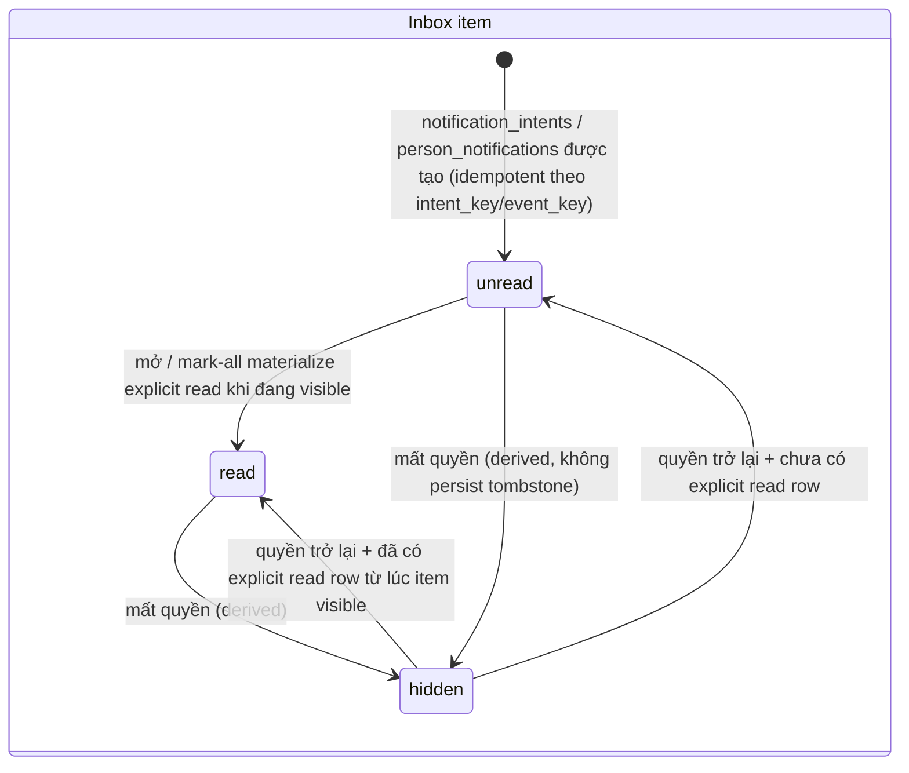
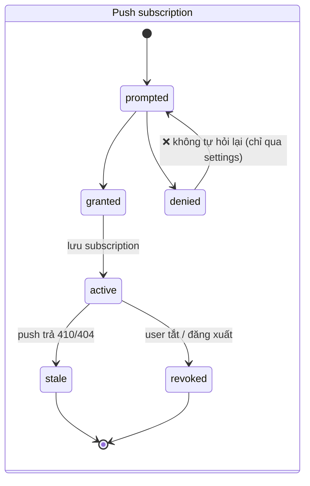

# Feature: Notifications — Reminders · Inbox · Announcements · Web Push — Product/UX Spec

> **Canonical phase:** P3 (nhắc/xác nhận baseline) · P4 (Inbox + Web Push mechanisms 36–47) · P4.5–P4.7 (channel delivery) · P4+ (global plane · announcements) — *cross-cutting cụm 🔔*
> **Track:** 🔔 Notifications
> **Version:** 3.13 · 2026-08-12
> **Status:** ✅ **Reviewed contract** — §A giữ nguyên; §B/C/D theo DD-70/71/72 owner-final; §E offline Chat digest theo DD-94 owner-final. DD-88 chỉ còn proposal cho grouping/`message_request`/scoped-bulk rộng hơn. Target runtime/migrations vẫn pending; `Reviewed` không đồng nghĩa `CODE_READY` hay `Implemented`.
> **Implementation:** Not started · authority: `../../standards/BUILD-STATUS.md` (Doc status ≠ Implementation status)  
> ⚠️ **Historical:** doc hạ Reviewed → Draft ngày 2026-07-18 do gộp tài liệu, KHÔNG phải mở lại luật tiền §A. DD-70/71/72 được owner chốt 2026-07-21 nên v3.5 promote lại Reviewed; runtime/migration vẫn chưa tồn tại. NTF-OQ-14..16 và các OQ chi tiết theo slice vẫn là build/enablement gates. Nhận định v3.8 rằng digest còn phải trì hoãn đã được DD-94 thay thế; session/activity, `message_request` và scoped/bulk vẫn thuộc proposal DD-88.
> **Prerequisites:** P3 ledger stable · P3.5 identity/reachability · P4 sync/projectors · (inbox global plane) DD-47/48 · (announce) DD-43 migration · (push) mechanisms 36→41 + A19/F15
> **Tài liệu liên quan:** `../../product/BRD.md` FR-6 · `../../product/PRD.md` FLOW 7/8 · `../../standards/decisions.md` **DD-37/DD-40/DD-43/DD-45/DD-47/DD-48/DD-49/DD-50/DD-67/DD-69/DD-70..72/DD-91/DD-94 ✅ · DD-88 🟡 proposal** · `../../standards/business-rules.md` BL-MSG-3/5, **BL-NTF-1..6**, BL-SEC-5 · `../../proposals/in-app-chat-primary-player-surface-plan-2026-07-27.md` §7.2 (DD-94) · `../../proposals/notification-grouping.md` (DD-88 chỉ còn session/activity/`message_request`/scoped-bulk rộng hơn) · `../../decisions/analysis/dd-43-membership-tags-analysis.md` · `../../decisions/analysis/dd-45-waitlist-analysis.md` · `../../decisions/analysis/dd-47-follow-graph-analysis.md` · `../../decisions/analysis/dd-69-app-native-analysis.md` · `feature_identity.md` · `feature_user_settings.md` · `feature_session_management.md` (SES-UC-3) · `feature_inapp_chat.md` · `../BE/feature_notifications_reminders_tech.md`
>
> **Current infrastructure boundary (2026-07-27):** shared job lease/ack + preflight/dispatcher/flagged
> scheduler đã merge nhưng đang OFF/placeholder. Chưa có notification producer/projector, Inbox/Web Push
> runtime, payment lifecycle delivery hay connected UI; đây vẫn là Reviewed contract, không phải
> `IMPLEMENTED`/`ENABLE_READY`.

> **Execution ownership theo primary-surface plan v1.8:** DD-67/DD-72 Web Push đi đúng chain 36 `notification-route-integrity-core` → 37 subscription authority → 38 provider-attempt core → 39 installable PWA shell → 40 registration client → 41 display/telemetry client; DD-94 Chat digest là 42 `chat-unread-notification-core`, hard-depend Chat read mechanism 10 + chain Web Push. Payment đi 43 lifecycle intent → 44 reminder producer và 45 settled/correction projector → 46 Inbox/authenticated detail → 47 generic payment-push adapter. HTTP owners là A17 preferences, A18 payment Inbox/detail, A19 subscription/device/telemetry; product UI owners là F11 payment Inbox/detail, F14 Chat preferences và F15 contextual push onboarding/devices sau F0. Mechanism slices không ngầm sở hữu HTTP/UI và adapter không re-derive notification/payment state. Primary initiative `PLAN_READY` tại `90d292d`, runtime = 0 và từng slice vẫn strict `CODE_READY`.

> **Cập nhật DD-40 + DD-37 (2026-07-10):** kênh nhắc chính = **web push + Zalo DM**; **Messenger best-effort trong cửa sổ standard 24h**, ngoài cửa sổ chỉ khi có cơ chế Meta đủ điều kiện/được phê duyệt. **Telegram loại khỏi phạm vi (DD-37).** Sau **mọi** markPaid (thủ công tiền mặt/CK & auto CK) → **xác nhận tự động tới player** (FR-6.2). **Nhắc tự động nâng cao = `host_pro`; free = nhắc thủ công** (DD-40).
>
> **Cập nhật DD-15/DD-67:** reachability của cả Zalo và Messenger gắn exact `channel_identity_id`/provider endpoint. Khi Messenger là route phù hợp, dispatcher chọn **một** route: tenant Page reachable → central Page reachable → fallback web/Zalo; không broadcast cả hai Page. Target-tenant eligibility được kiểm tra riêng, không suy từ reachability row.
>
> **Cập nhật v3.0 (2026-07-18) — gộp cụm 🔔 vào một doc.** Ba mảng mới nhập vào đây thay vì đứng riêng: **inbox/global plane** (đóng impl-gap DD-47), **announcement host-authored** (thực thi DD-43/BL-NTF-4), **web push + telemetry** (thực thi NTF-OQ-5/DD-69 gate #4). Cả ba **tái dùng** `notification_intents`/`notification_deliveries` sẵn có — không pipeline song song (HR3). Chúng **chưa phải contract**: mọi phần đánh dấu 🟡 phải chờ DD-70/71/72 trước khi viết migration.
>
> **Cập nhật v3.2 (reconcile decisions v1.49):** DD-70 proposal yêu cầu security alert dùng email `verified_at < event_at` hoặc device `trusted_at < event_at`; DD-71 proposal dùng preview proof bind actor/content/audience/count và layered quota; DD-72 proposal chỉ freeze **Web Push phase-1** qua direct VAPID, không pre-design native. Outcome `unknown` luôn cấm alternate-route fallback; high-value class được tối đa 2 same-route retry bằng stable topic/tag. Các DD vẫn 🟡 chờ owner; thay đổi này không tạo runtime.
>
> **Cập nhật v3.3 (authority v1.51; reconciled v1.52):** security route viết đúng predicate riêng — email `verified_at < event_at`, device `trusted_at < event_at`; DD-72 surface `trusted_at/trust_source` server-owned + reset-on-rebind; announcement proof bind `count_by_channel + total_count` và chỉ cho vector component-wise decrease, còn roster luôn resolve tại dispatch; direct Web Push chỉ loại **app-level vendor platform/SDK**, không phủ nhận browser-selected push service. DD-70/71/72 vẫn 🟡, runtime/migration chưa có.
>
> **Cập nhật v3.4b (notification closure v1.67; current authority v1.67):** ngoài DD-45 event vocabulary, closure pin immutable context-start cutoff; exact read-all/registration/trust replay; fence-first cross-feature lock order; same-Person historical refs; every-reparent trust reset; secret-prune-safe retention; stable physical targets and telemetry. DD-70/71/72 vẫn 🟡; Draft, không phải runtime.
>
> **Cập nhật v3.5 (historical snapshot: decisions v1.90/v1.91; authority tại thời điểm đó v2.04; current authority v2.10):** DD-70 chọn global protected plane + inbox hợp nhất hai plane + Person preferences; DD-71 chốt manual basic free và proof-bound confirm; DD-72 chốt web-only subscriptions + direct VAPID + generic OS payload. Cặp trở lại Reviewed contract. Không có migration/service/UI; OQ retention/evidence và DD-88 không được đóng suy diễn.

> **Cập nhật v3.6 / DD-91 (2026-07-27):** để in-app chat trở thành primary player surface, reminder · settled confirmation · correction vẫn đi qua durable tenant inbox `notification_intents` + Web Push generic của contract hiện tại; **không** biến thành chat/Assistant message và **không phụ thuộc DD-88**. Mở item mới fetch chi tiết từ canonical person-self self-payment projection dưới session/authz; notification/chat UI không tự tính hoặc cache số nợ.
>
> **Cập nhật v3.8 / DD-88 (2026-07-28, superseded một phần bởi DD-94):** group derive từ closed-set `type`, không cột `group`; một preference authority per-Person/per-type/channel cho hai plane Inbox; money/security schema-nonoptout; chat read tách Inbox read; không durable item mỗi message. Session/activity, `message_request` và scoped/bulk vẫn deferred. Nhận định offline digest còn mở đã được DD-94 thay thế.
>
> **Cập nhật v3.9 / DD-94 (2026-07-28):** offline Chat digest là **generic delivery signal**, không phải Inbox item hay snapshot message. Source truth duy nhất là Chat unread; DM/direct mention/reply mặc định ON; club channel có preference `all|mentions|off`, mặc định `mentions`; coalesce theo `(person,channel,highest_unread_cursor)`. Mark-read làm pending cũ obsolete. Ngay trước provider write phải re-authorize membership/DM block+safety/preference/device/trust epoch và chứng minh cursor vẫn unread; false/unknown đều skip. Delay/coalesce là enablement config, thiếu hoặc chưa test thì route OFF.
>
> **Cập nhật v3.4d (notification closure v1.69):** delivery identity chuyển sang closed `route_class`; physical attempts có planned/due lifecycle, whole-intent vs target-invalid vs quiet-hour defer decision table, possible-write precedence và sticky evidence-bound `unknown`. Core direct DML bị thu hồi; exact-target start authorization mới được resolve secret. Announcement exact preview/quota/retry receipt, tag soft-retire và push device/proof/rebind boundaries được pin. Vẫn Draft/no runtime.
>
> **Cập nhật v3.4e (DD-45 mirror v1.68; current authority v1.69):** candidate failures vẫn là per-entry audit events, nhưng owner-facing alert/digest dedupe per root `promotion_retry_id`, không per candidate. SessionService independently claims lazy root job với max 3 claimed attempts; Notification không drive/settle retry. Vẫn Draft/no runtime.
>
> **Cập nhật v3.4f (notification closure v1.70):** global phase-1 loại `follow_accepted` và mọi tenant-outbox fallback; known producer phải fence-first + same-transaction item hoặc build HALT. Cross-Person push rebind chỉ nhận exact prior-owner reauth/approval hoặc audited manual recovery; canonical Person merge là lifecycle riêng, không phải rebind proof. Vẫn Draft/no runtime.
>
> **Cập nhật v3.4g (notification closure v1.71):** mark-all và announcement fan-out chỉ dùng read-only discovery ngoài mutation transaction; bounded `READ COMMITTED` phải acquire đủ Person fences trước authoritative snapshot đầu tiên, rồi lock/revalidate toàn bộ visibility/audience/tag/membership/preference/route owners tới commit. Vẫn Draft/no runtime.
>
> **Review-fix v3.1:** DD-70 option (a) coi durable security-alert item và trusted out-of-band delivery là hai lớp riêng; DD-71 preview phải proof-bound và free quota phải đo cả actor/fan-out; DD-72 chỉ chốt direct Web Push phase-1 dùng VAPID, không freeze native shape trước DD-69 spike. `unknown` luôn cấm alternate-route fallback nhưng recovery cùng Web Push route phụ thuộc notification class.

---

## 1. Mô tả

Cụm 🔔 trả lời hai câu hỏi: **thông báo có đến được người cần không**, và **người ta có tìm lại được không.**

| Mảng | Trạng thái | Giải quyết |
|---|---|---|
| **A. Reminders & Confirmations** (lõi) | ✅ Contract đã reviewed | Nhắc nợ players chưa trả mà **không spam**; xác nhận thanh toán/correction qua kênh reachable. Kênh chính **web push + Zalo DM**; **Messenger best-effort 24h** |
| **B. Inbox & Global plane** | ✅ DD-70 owner-final; runtime pending | Inbox bền cho follow/link/security; security alert chỉ đi email/device đã verified/trusted trước immutable `trigger_context_started_at` — item bền không tự đủ |
| **C. Announcements** | ✅ DD-71 owner-final; runtime pending | Host broadcast có proof-bound preview/confirm; manual basic free, `host_pro` thêm automation/analytics/quota; quota vẫn tính actor/tenant/fan-out |
| **D. Web Push** | ✅ DD-72 owner-final; runtime pending | Phase-1 direct standards-based Web Push + VAPID; chỉ freeze web shape, native để phase-2 spike quyết |
| **E. Offline Chat digest** | ✅ DD-94 owner-final; runtime pending | Generic coalesced Web Push từ Chat unread; không Inbox item, per-message item hoặc content snapshot; live reauth trước provider write |

Ledger events là authoritative — delivery là best-effort, **KHÔNG BAO GIỜ rollback money state**.

> **Tier (DD-40/DD-71):** **free** = nhắc **thủ công** (host bấm gửi) + xác nhận tự động sau markPaid + manual basic announcement. **`host_pro`** = nhắc nợ tự động nâng cao và announcement automation/analytics/quota. Exact announcement preview/proof/quota semantics do DD-71 sở hữu; không còn tier decision mở.

> **Historical baseline từng tạo ba gap B/C/D; decisions đã chọn hướng, runtime vẫn chưa land:**
> - **DD-47 historical choice:** notify follow-request là **person-directed GLOBAL** nhưng live `notification_intents`/`outbox_events` đều `tenant_id NOT NULL`. DD-70(a) nay đã chốt global protected plane + unified inbox/person-self read; lựa chọn (a)/(b) không còn mở. Gap hiện tại chỉ là schema/service runtime chưa được triển khai.
> - **DD-43/DD-71:** `membership_tags` chỉ phục vụ notification audience; DD-71 nay sở hữu full announcement flow, manual basic free và proof-bound preview/confirm/quota. `membership_tags` migration + announcement service/UI vẫn chưa tồn tại.
> - **DD-72:** phase-1 Web Push đã chốt direct standards-based Web Push + VAPID + generic payload; không còn câu hỏi chọn VAPID. Live app vẫn chưa có subscription tables, manifest/service worker/provider path. Telemetry `delivered/opened/latency` per platform phải land trong mechanisms 39–41 cùng A19/F15 để giữ evidence cho phase-2 native.

### DD-91 — money lifecycle parity trên primary chat surface

- Chat surface chỉ expose badge/inbox/deep-link của pipeline notification canonical. Reminder, `payment.settled` và correction vẫn là durable tenant `notification_intents`; không insert `chat_messages`, không dùng bot/Assistant để project lifecycle tiền.
- Web Push luôn generic; mở app mới authenticated-fetch chi tiết. Item detail gọi canonical self-payment/person-self projection tại read time, không lưu/copy amount hoặc dựng công thức tiền riêng trong notification/chat.
- Delivery proven-fail hoặc `unknown` không xoá inbox item và không đổi ledger. User vẫn tìm lại được lifecycle state trong app.
- DD-88 broader grouping/`message_request`/scoped unread UX **không** là dependency của durable payment inbox, generic payment Web Push hay primary-surface exit gate này.

### DD-94 — offline Chat digest delivery signal

- **Chat unread là source of truth duy nhất.** Notification chỉ nhận person, channel và opaque `highest_unread_cursor`; không copy message body/title/amount/mention text/author/attachment vào Inbox, job payload hoặc Web Push.
- DM mặc định **ON**. Trong club channel, direct mention/reply mặc định ON qua preference per-Person `all|mentions|off` có default `mentions`; `off` tắt cả mention/reply, còn `all` mở rộng tới mọi activity đủ điều kiện. Absent row dùng canonical default, lookup unavailable/unknown fail closed và không gửi.
- Một logical signal coalesce theo `(person_id, channel_id, highest_unread_cursor)`: cursor cùng/thấp hơn là no-op, cursor cao hơn chỉ advance pending signal. Retry hoặc provider outcome `unknown` giữ nguyên logical key, không phát bản sao.
- Mark-read làm mọi pending cursor không còn unread trở thành obsolete. Ngay trước provider write, worker phải chứng minh lại current channel/DM read authority, membership, pair block+safety, preference, active device + current `trust_epoch`, và cursor vẫn unread; false/unknown đều skip với reason code, không gửi.
- Push chỉ dùng copy generic + opaque deep-link. Delay/coalesce duration là named enablement config; thiếu config hoặc chưa pass boundary tests thì Chat digest route **OFF**, trong khi realtime/history/unread/badge vẫn hoạt động độc lập.
- DD-88 không còn sở hữu hay chặn exact digest này. DD-88 chỉ giữ proposal cho taxonomy/grouping rộng hơn, `message_request`, session/activity và scoped/bulk Inbox.

### Entry points

| Entry | Route / Surface | Actor | Mô tả |
|-------|----------------|-------|-------|
| Header bell icon | `🔔` badge → `/notifications` | Any (auth) | Notification inbox (primary) |
| Home tab → bell badge | Top-right header | Player/Host | Badge count → tap opens inbox |
| Push notification tap | OS notification → deep link | Player | Navigate to relevant item |
| Settings → Notifications | `/settings/notifications` | Player/Host | Notification preferences |
| Bot DM | Zalo/Messenger push message | Player | Inline notification with CTA |
| Chat → unread badge | Chat tab badge overflow | Player | Indirect — Chat digest triggers notification |

### Bất biến

**Lõi (A) — đã reviewed**

- Reminder chỉ gửi dựa trên **effective charge state** — không cache cũ.
- Zalo/Messenger reachability/window scoped exact `channel_identity_id`; identity đã bind bot/OA hoặc Page endpoint. Tenant eligibility là authorization riêng.
- Provider failure KHÔNG rollback ledger — delivery retry riêng.
- Quiet hours tính theo **tenant timezone**.
- Deduplicate intent bằng server-derived structural source event + recipient + type; delivery history/key bind `(intent, closed route_class)`, không Page id. Delivery phải structurally bind đúng Person của intent với channel identity, giữ **tối đa một active logical route xuyên platform** (`pending|sent|unknown`) và **một live physical claim per exact target** với sequence do server cấp. Claim fence dùng canonical target binding server-derived, rotation-stable; versioned HMAC chỉ để lookup/audit, không làm uniqueness authority. Ngay trước first send/fallback/retry, dispatcher re-read canonical type-specific state + authorization/preference/reachability; crash-after-write thành sticky `unknown`, không resend/fallback mù.

**Áp cho cả cụm (A–E)**

- **KHÔNG tạo tenant store/pipeline song song.** Tenant notification vẫn chỉ là `notification_intents`; announcement là một `type` của nó; web push là một `platform` của `notification_deliveries` (HR3). Global `person_notifications` là plane riêng vì tenant pipeline không thể chứa event không thuộc CLB.
- **Tiền/PII không rời vùng được phép:**
  - Inbox **không tạo tenant item store thứ hai** — chính `notification_intents` là durable item; `notification_reads` chỉ lưu source ref. Nội dung render tại thời điểm đọc qua `tenantRepo` dưới RLS (HR1).
  - Bảng **global plane không có cột tiền/PII hoặc JSON/template params tuỳ ý** — system copy derive từ enum `type`; plane này không có `tenant_id` để RLS bám vào (HR2).
  - **Payload push không chứa tiền/PII** — payload nằm trên hạ tầng bên thứ ba, **ngoài biên tin cậy**. Business content chỉ có opaque logical ref + server `i18n_key`; protocol metadata allowlist gồm version, stable topic/tag và report capability write-only scope đúng attempt/event-set. Không có tenant/club ref; client đã xác thực derive context từ opaque ref rồi fetch nội dung thật (HR2).
  - **Tag không ra public**; **telemetry không chứa tiền/PII/endpoint** (HR2).
- **Authorization tại thời điểm đọc và ngay trước provider write, không snapshot.** Read path re-check current visibility. Send path dùng predicate theo type: reminder vẫn open/partial + current policy (kể cả explicit final notice); settled/correction đúng unsuperseded ledger/event version + original bound Person; owner alert còn admin; announcement còn eligible/no-opt-out/capability. Predicate fail → pre-send skip, không HTTP. `hidden` là derive; khi quyền trở lại item hiện với explicit read state cũ.
- **Actor từ session đã verify**, không từ URL/body (nguyên tắc DD-47).
- **Security alert cần factor có trước triggering context, không chỉ trước event.** Server/DB derive immutable `trigger_context_started_at <= event_at <= created_at` từ locked session/recovery context; request/outbox không được khai. Chỉ email có `verified_at < trigger_context_started_at` hoặc device có `trusted_at < trigger_context_started_at` là candidate. Vì vậy compromised long-lived session không thể verify email/trust device rồi dùng chính factor đó cho alert nó trigger sau này.
- **Thu hẹp, không mở rộng.** Tag chỉ lọc audience đã hợp lệ, không cấp eligibility/visibility, không cross-tenant (BL-NTF-4, DD-43).
- **Announcement confirm là authorization boundary.** Preview proof bind tenant+actor+`content_hash(body+session_ref+CTA)`+audience criteria+per-channel count+channel-schema/routing-policy version+expiry, consume-once. Canonical content/proof/audience rows immutable sau insert. Candidate discovery chỉ read-only ngoài mutation transaction. Bounded `READ COMMITTED` acquire đủ creator+recipient inbox fences trước authoritative statement snapshot đầu tiên; khi giữ fences, transaction lock/revalidate announcement/audience/tags/memberships/preferences/routes, recompute vector rồi atomically insert canonical intents + pinned routes + initial `planned` target attempts. Contract drift, unfenced recipient hoặc component tăng → terminal `preview_stale`/retry trước mọi intent; chỉ component-wise decrease được phép.
- **Announcement quota reserve fail-closed và idempotency exact.** Confirm atomically check+reserve tenant bucket + actor bucket + fan-out recipient budget. Cùng `command_id` + cùng request fingerprint replay đúng kết quả; cùng command + fingerprint khác trả `IDEMPOTENCY_KEY_REUSED` trước reservation mới. Quota service lỗi thì không queue; audience giảm không refund tự động v1. Retry-failed là actor-scoped idempotent command, lock intent, revalidate recipient/preference/reachability và chỉ claim đúng một terminal failed route khi không có `pending|sent|unknown`; không consume fan-out lần hai.
- **One active logical route per notification** — tenant Page → central Page → web/Zalo (BL-MSG-5, DD-67). Fallback terminalize proven-no-send route rồi activate đúng một route kế dưới intent lock; nhiều thiết bị web push **không** thành nhiều logical send.
- **Delivery fail không mất thông báo** — item vẫn ở inbox.
- **Chat digest không phải durable notification item.** Delivery state tối thiểu có thể bền để retry/dedupe, nhưng không insert `notification_intents`/`person_notifications`, không tạo một row per message và không mang body/title/amount/author/attachment. Chat luôn là owner duy nhất của history/read cursor.
- **Global protected plane:** `person_notifications`, `device_push_subscriptions`, registration receipts và trust events không blanket table grant cho role `app`. Global item chỉ được append atomically từ canonical protected follow/link/merge/auth mutator qua owner-only source-derived helper; push register/rebind/trust chỉ qua narrow `SECURITY DEFINER` (khuôn `person_follows` DD-47 / `channel_identities` DD-67).
- **Global emit không đi qua tenant outbox.** Phase-1 global type chỉ `follow_request|identity_link|identity_merged|security_alert`; `follow_accepted` là analytics-only, private→public bulk auto-accept không fan-out notification. Known producer phải inventory bounded recipients read-only → lock inbox fences → re-lock canonical source/audit → append item cùng transaction. `link_code` consume không emit; merge commit append từ locked `merge_audit`. Path không reorder được là build HALT tới khi có GLOBAL PROTECTED source-event owner/grants/replay/retention riêng — không gán tenant giả hay reuse tenant `outbox_events`.
- **Security alert cần hai lớp:** item global bền để đọc lại **và** dispatch chỉ tới email/device đã verified/trusted trước `trigger_context_started_at`; factor thiết lập trong chính triggering session/context luôn bị loại dù timestamp vẫn trước event.
- **Không mở rộng `ChannelIdentity`/`channel_reachability`** cho device push — DD-69 pin hai authority plane phải tách.
- **Push secret resolver không thuộc web `app` role.** Chỉ dedicated notification worker được consume một send-claim TTL ngắn và derive recipient/subscription; caller không được truyền `person_id`/endpoint để giải mã tuỳ ý.
- **Topic/tag không lộ logical ref và luôn hợp chuẩn.** Dùng 32 ký tự đầu của base64url HMAC-SHA256 domain-separated (bỏ padding), không raw ref/HMAC hex; token + key version được persist trên logical delivery nên mọi retry giữ đúng Web Push Topic/client tag qua rotation. Mọi derived HMAC có key version + dual-read/backfill; report verifier giữ old key ít nhất 24h + clock skew.
- **`unknown` không đồng nghĩa no-send.** Cấm alternate-route fallback. Tenant delivery chỉ cho `settled|correction` tối đa 2 same-Web-Push retry sau reconciliation window, dùng cùng logical ref + stable Web Push Topic/client tag; `security_alert` thuộc global attempt ledger phải được auth-security slice pin trước enablement theo DD-70, không đi qua tenant claim. `reminder|announcement` mặc định manual reconcile để tránh spam trùng.
- **Direct Web Push không có nghĩa không có bên thứ ba:** VAPID xác thực application server; browser-selected push service vẫn ở data flow. Phase-1 không thêm app-level vendor notification platform/SDK và A3 vẫn ghi nhận encrypted payload/traffic metadata.
- **Nội dung announcement là untrusted plain text.** Không render như HTML/Markdown/`parse_mode`, không đưa body vào OS push/global store/log/metric/template; reject control characters/invalid UTF-8 và body vượt hard ceiling 16 KiB hoặc provider limit trong preview — không truncate âm thầm. HR2 là tuyệt đối cho system-derived/global/OS copy; semantic DLP cho body host tự soạn vẫn là NTF-OQ-11, không được claim scanner bắt hết PII.
- **i18n (HR5):** chuỗi hệ thống qua `t(vi, en)`; global item derive key từ fixed `type`, push dùng server-selected `i18n_key`; **nội dung host soạn giữ nguyên văn, không dịch máy**.
- **Inbox order là server-owned.** Mọi tenant/global insert lấy `inbox_sequence` dưới cùng per-Person fence. Mark-all chỉ discovery read-only ngoài mutation transaction; sau đó bounded `READ COMMITTED` lock Person fence **trước** authoritative snapshot/boundary đầu tiên, rồi lock/re-authorize visibility owners và enumerate từng plane while fence stays held to commit. Command receipt + boundary + exact visible reads commit all-or-nothing. Item hidden/late vẫn unread; không có global watermark/pending batch. Cursor opaque signed bind actor+filter+`before_sequence`, không dùng timestamp/id client-chọn.
- **Mọi writer/merge dùng một lock order.** Candidate-discovery chỉ read-only; sau đó lock toàn bộ affected Person inbox fences theo UUID tăng dần, rồi key epoch/advisory keys nếu có, rồi Person/source/operation-owner và cuối cùng child rows. Revalidation đổi actor/recipient/endpoint owner ⇒ rollback/retry; không lock thêm muộn. Fan-out gồm creator + recipients; follow/auth/link, read-all, push register/trust, retry và Person merge đều dùng hierarchy này.

---

## 2. Use Cases + Edge Cases

### Use Cases

| ID | Area | Actor | Hành động | Kết quả |
|---|---|---|---|---|
| NTF-UC-1 | Reminder | Host (mọi tier) | Manual reminder — preview trước khi gửi | Hiện danh sách eligible, excluded (kèm lý do), channel — gửi hoặc cancel |
| NTF-UC-2 | Reminder | System (`host_pro`) | Scheduler auto-remind overdue charges (ngưỡng mặc định 2h → 24h → …) | Select theo tenant policy, quiet hours, cooldown — gửi batch |
| NTF-UC-3 | Reminder | System | `payment.settled` event (sau markPaid thủ công tiền mặt/CK **hoặc** auto CK) | Gửi confirmation **1 lần** per charge/settlement version |
| NTF-UC-4 | Reminder | System | Reversal sau confirmation | Gửi **correction**, KHÔNG gửi lại paid confirmation |
| NTF-UC-5 | Reminder | System | Channel selection | Policy chọn web/Zalo chính; nếu chọn Messenger thì resolve tenant Page reachable → central Page reachable → fallback web/Zalo, đúng một logical route |
| NTF-UC-6 | Reminder | Host | Manual remind override cooldown | Require reason — vẫn rate-limited |
| NTF-UC-7 | Reminder | Player | Nhận reminder qua Zalo DM / web push | Zalo/Messenger DM có thể hiện số tiền + QR theo policy; **OS push chỉ copy generic**. Mở deep-link rồi fetch dưới session/authz mới hiện số tiền + QR |
| NTF-UC-8 | Reminder | Player | Nhận paid confirmation | Zalo/Messenger DM dùng copy **method-aware** (vd "✅ Đã ghi nhận thanh toán [amount]. Cảm ơn!"), không mặc định mọi settlement là CK; **OS push generic**, chi tiết chỉ hiện sau authenticated fetch |
| NTF-UC-9 | Reminder | Host | Xem delivery report | Sent/failed/skipped/**unknown** — unknown = outcome mơ hồ, không fallback; KHÔNG expose provider secrets |
| NTF-UC-10 | Reminder | System | P4.5 Zalo player delivery; Messenger best-effort trong 24h | Zalo tenant route; Messenger exact Page endpoint + one-route dedup (Telegram đã loại — DD-37) |
| NTF-UC-11 | Reminder | System | First-activation waitlist promotion không derive được charge amount (DD-39/DD-45) | First failure lazy-creates one SessionService root `promotion_retry_id` per failing opener, max 3 claimed attempts/backoff. Candidate events are per-entry audit refs only. Notification creates at most one owner-facing alert/digest per root, aggregating count/reason classes without PII/amount/venue; terminal review is a separate root-state alert. Candidate receives nothing |
| NTF-UC-12 🟡 | Inbox | Player | Mở inbox web | List mới→cũ, gộp tenant + global, badge chưa đọc |
| NTF-UC-13 🟡 | Inbox | Player | Nhận nhắc nợ khi push fail (ngoài 24h Messenger / web push bị chặn) | Item **vẫn có** trong inbox — trạng thái phục hồi được |
| NTF-UC-14 🟡 | Inbox | Player | Mở một item | Mark-read idempotent, badge giảm, deep-link tới charge/session/profile |
| NTF-UC-15 🟡 | Inbox | Player | "Đánh dấu tất cả đã đọc" | Một bounded transaction lock per-Person inbox fence tới commit, capture server boundary và tạo explicit read rows cho đúng item đang visible/authorize; receipt+reads commit all-or-nothing. Hidden/late item vẫn unread, client không truyền mốc |
| NTF-UC-16 🟡 | Inbox | Player | Lọc theo CLB / loại | Chỉ CLB người đọc còn membership hợp lệ |
| NTF-UC-17 🟡 | Inbox | Person | Nhận follow request (DD-47) | Item global; **approve/reject inline**, không cần vào settings |
| NTF-UC-18 🟡 | Inbox | Person | Nhận thông báo link/merge identity (DD-50) | Item global; không chứa CLB/tiền của bên kia |
| NTF-UC-19 🟡 | Inbox | Person | Cảnh báo bảo mật (đăng nhập mới/đổi email) | Item global bền kể cả khi không có membership; dispatch chỉ tới email/device đã verified/trusted trước server-derived triggering-context start, nên factor cùng session bị loại |
| NTF-UC-20 🟡 | Inbox | Host | Mở inbox vai host | Thêm owner-alert (vd `waitlist.charge_derivation_failed` — DD-45) trong CLB mình quản |
| NTF-UC-21 🟡 | Inbox | System | Intent tenant được tạo | Chính `notification_intents` là item bền/idempotent theo `intent_key`; signal projector chỉ đẩy SSE/invalidate badge-cache, **không tạo store/item thứ hai** và không phụ thuộc delivery thành công |
| NTF-UC-22 🟡 | Inbox | System | Merge Person (DD-01/§P6) | Item + read state re-parent sang survivor, dedupe, badge không cộng trùng |
| NTF-UC-23 🟡 | Inbox | Player | Inbox đang mở, có thông báo mới | Đẩy realtime qua SSE (tái dùng sync engine) |
| NTF-UC-24 🟡 | Announce | Host | Soạn announcement, audience "tất cả thành viên" | Preview trả opaque proof bind actor/tenant/body+session/CTA/audience/`count_by_channel`+total/route versions/expiry; confirm consume-once rồi queue đúng content/tiêu chí đã duyệt; roster resolve tại dispatch, **không snapshot** |
| NTF-UC-25 🟡 | Announce | Host | Lọc audience theo `membership_tags` (vd `nữ`, `trình B`) | Audience giao/hợp tag theo cấu hình; đếm lại realtime |
| NTF-UC-26 🟡 | Announce | Host | Tạo/sửa/xoá tag · gán tag hàng loạt | Tag per-tenant host-defined, many-to-many, idempotent; **không đụng quyền/join** (DD-43) |
| NTF-UC-27 🟡 | Announce | Host | Confirm gửi announcement | Queue idempotent; read-only discovery ngoài TX. Bounded `READ COMMITTED` locks all Person fences before authoritative post-fence statement snapshots, then re-authorizes/re-hashes/locks audience+routes through commit and atomically creates intents + pinned routes + initial `planned` attempts. Report lấy routed outcomes từ deliveries/attempts, skipped/unreachable từ canonical intent reason + actual vector |
| NTF-UC-28 🟡 | Announce | Host | Gửi lại nhóm failed | Actor-scoped command idempotent lock intent, re-authorize/re-check preference+reachability rồi chọn **một failed route theo current canonical route-policy rank** (tie-break delivery UUID), persist lựa chọn trong receipt và CAS dưới one-active-route fence; chỉ khi **không có pending/sent/unknown**. Người đang gửi, đã nhận hoặc có outcome mơ hồ không nhận lại |
| NTF-UC-29 🟡 | Announce | Host | Huỷ announcement còn queued | Cancel chỉ thắng trước atomic fan-out claim; khi expansion đã commit thì announcement là dispatched và **không thu hồi được** — UI nói rõ trước |
| NTF-UC-30 🟡 | Announce | Member | Nhận announcement / tắt nhận | Preference per-membership/per-tenant được lưu bền và re-check tại dispatch; opt-out **chỉ loại announcement**, schema không cho opt-out nhắc nợ/confirm |
| NTF-UC-31 🟡 | Push | Player | Được mời bật thông báo **sau hành động có ngữ cảnh** (join kèo xong) | Prompt đúng lúc; tránh bị block vĩnh viễn |
| NTF-UC-32 🟡 | Push | Player (iOS) | Được hướng dẫn add-to-home-screen | iOS **chỉ** cho web push khi PWA đã cài — UI phải nói rõ |
| NTF-UC-33 🟡 | Push | System | Gửi nhắc nợ/announcement qua direct Web Push + VAPID | Business content chỉ opaque ref + system key; protocol metadata theo allowlist; client fetch nội dung đã authorize; browser push service vẫn là một bên trong data flow |
| NTF-UC-34 🟡 | Push | Player | Bấm vào push | Deep-link; ghi `opened` + latency |
| NTF-UC-35 🟡 | Push | Player | Nhiều thiết bị · đăng xuất · tắt trong settings | Một logical delivery atomically pin closed generation của mọi active target trong snapshot trước send; subscription đăng ký sau chỉ nhận notification tương lai. Logout/tắt terminalize đúng target chưa gửi, không huỷ whole intent/thiết bị khác |
| NTF-UC-36 🟡 | Push | System | Push trả `410 Gone`/`404` | Mark đúng subscription đó chết và **không** retry target đó. Chỉ fallback khi đủ target count của closed generation đều terminal/proven no-send; một target success ⇒ delivery `sent`, nhưng initial generation rows đã `planned|claimed` còn lại vẫn được finish sau fresh check |
| NTF-UC-37 🟡 | Push | Ops | Xem dashboard độ tin cậy push theo nền tảng | iOS PWA vs Android vs desktop — **input cho DD-69 gate #4** |
| NTF-UC-38 | Inbox/Chat primary | Player | Nhận reminder, settled hoặc correction khi dùng Plexco thay chat ngoài | Durable tenant inbox + badge/deep-link vẫn tồn tại dù delivery fail; OS push generic. Mở item fetch canonical self-payment status dưới auth, không tạo chat/bot message |
| NTF-UC-39 🟡 | Chat digest | Person | Có DM chưa đọc hoặc được direct mention/reply khi app background | Nếu route đã enable và live gates pass, nhận một Web Push generic; source message vẫn chỉ ở Chat |
| NTF-UC-40 🟡 | Chat digest | Club member | Chọn `all`, `mentions` hoặc `off` cho một club channel | `mentions` là default; `all` nhận mọi activity đủ điều kiện, `mentions` chỉ direct mention/reply, `off` không tạo provider send |
| NTF-UC-41 🟡 | Chat digest | System | Nhiều message tới cùng person/channel trong coalesce window | Một pending logical signal giữ opaque cursor cao nhất; không per-message Inbox item/push |
| NTF-UC-42 🟡 | Chat digest | Person/System | Person mark-read, leave club, block DM peer hoặc device trust đổi trước send | Pending signal cũ bị cancel/skip sau live reauth; không provider write, không shared Chat/system message |
| NTF-UC-43 | Buddy payment | System | `buddy_payment.confirmed` event (host xác nhận player trả hộ) | Gửi **2 notification riêng**: (1) Payer: "Thanh toán thành công session [session_name]" (2) Recipient: "Thanh toán thành công session [session_name], [payer_name] đã thanh toán cho bạn". Cùng pipeline `notification_intents` + Web Push generic + authenticated detail. Không tạo chat message |
| NTF-UC-44 | Buddy payment | System | `buddy_payment.rejected` event | Notify payer: "Yêu cầu trả hộ cho [recipient_name] bị từ chối: [reason]". Chỉ payer nhận, recipient không nhận |

### Edge Cases

| # | Area | Category | Case | Hành vi bắt buộc |
|---|---|----------|------|-------------------|
| 1 | Reminder | Data Integrity | Remind charge đã paid/void | ❌ KHÔNG gửi — check effective state trước send |
| 2 | Reminder | Data Integrity | Partial charge → gửi "đã trả đủ" | ❌ KHÔNG — message states remaining amount |
| 3 | Reminder | Security | Expose debt amount/name ra kênh chung | ❌ Không gửi ra kênh công khai. Zalo/Messenger DM chỉ hiện chi tiết theo identity/privacy policy; **OS Web Push luôn generic**, mở app rồi authenticated fetch mới thấy amount/name |
| 4 | Reminder | Data Integrity | Player đã leave club nhưng còn nợ | Tuỳ policy: gửi final notice hoặc skip. KHÔNG gửi reminder nếu policy không cho phép |
| 5 | Reminder | Concurrency | Duplicate send (canonical source event + recipient + type), kể cả caller đổi logical key/platform | Structural intent unique không tin caller; delivery giữ `UNIQUE(intent_id,route_class)` và partial fence tối đa một route `pending\|sent\|unknown` xuyên platform. `delivery_key` = server HMAC(intent+closed route class), chỉ là idempotency bổ sung |
| 6 | Reminder | Resilience | Provider blocked/24h-window/rate-limit; HMAC rotate giữa hai worker; hoặc worker chết sau request write | Durable physical-attempt claim/fence + partial unique trên rotation-stable canonical target binding; server cấp sequence dưới owner lock. Old/new HMAC không mở hai claim; attempt đã `send_started` mà lease hết hạn → `unknown`, không mở send/route thứ hai |
| 7 | Reminder | Data Integrity | Quiet hours overlap với scheduled send | Defer to next valid window — dùng tenant timezone |
| 8 | Reminder | Concurrency | Scheduler jitter — burst gửi 1000 tenants cùng lúc | Jitter prevents provider bursts — stagger sends |
| 9 | Reminder | Security | Manual reminder bypass cooldown | Cooldown/rate-limit vẫn enforce — owner override cần reason |
| 10 | Reminder | Cross-Feature | Reversal xảy ra sau confirmation đã gửi | Gửi **correction** message — preserve audit trail |
| 11 | Reminder | Security | Reachability cross-tenant/cross-endpoint/cross-Person | ❌ NEVER — Page/bot/OA A không cấp window/token cho endpoint B; composite DB binding chứng minh delivery intent Person = channel identity Person; target tenant re-authorize riêng |
| 12 | Reminder | Resilience | Delivery fail — retry exhaust | Move to owner digest fallback — KHÔNG retry vô hạn |
| 13 | Reminder | Financial/Resilience | Duplicate/sibling `waitlist.charge_derivation_failed` events | Candidate audit remains unique by failure/candidate key; user-facing owner alert dedupes by stable `promotion_retry_id`. Sibling/duplicate events or retry command IDs cannot fork alert/job budget; aggregate has no player PII/amount/venue |
| 14 | Reminder | Data Integrity | Central và tenant Page cùng reachable | Chọn đúng một Messenger route theo priority; partial active-route fence xuyên platform suppress route còn lại, fallback chỉ sau proven-no-send dưới intent lock |
| 15 🟡 | Inbox | Security | Item tenant A hiện với người chỉ thuộc B | ❌ NEVER — render qua `tenantRepo`/RLS; không authorize được thì **loại khỏi kết quả**, không render placeholder lộ tên CLB. Ref: HR1 |
| 16 🟡 | Inbox | Security | Bảng global chứa tiền/SĐT/email hoặc JSON params tuỳ ý để "render nhanh" | ❌ CẤM — global plane không RLS, denormalize/arbitrary JSON = rò rỉ vĩnh viễn; system copy derive từ fixed `type`. Ref: HR2 |
| 17 🟡 | Inbox | Security | Đọc item bằng `id` đoán được của người khác | 404 (không 403 — tránh oracle tồn tại) |
| 18 🟡 | Inbox | Security | Follow-request item lộ CLB/nợ của người gửi | ❌ CẤM — chỉ approved social fields DD-48 (`display_name`, `username`, `plexco_since`) |
| 19 🟡 | Inbox | Data Integrity | Cùng intent/global event xuất hiện 2 lần | Tenant item chính là `notification_intents` (`intent_key` UNIQUE); global item theo `event_key` UNIQUE; signal projector retry không tạo item mới |
| 20 🟡 | Inbox | Data Integrity | Push fail vĩnh viễn | Item **vẫn tồn tại** — inbox không phụ thuộc delivery |
| 21 🟡 | Inbox | Concurrency | 2 tab mark-all + insert bắt đầu trước nhưng commit sau; item đang hidden | Discovery không cấp authority. Mutation TX lock Person fence trước authoritative boundary/snapshot, rồi re-authorize visible rows tới commit; insert và mark-all serialize. Late commit/hidden item giữ unread; replay idempotent, crash rollback toàn bộ, badge không âm |
| 22 🟡 | Inbox | Cross-Feature | Charge void nhưng item nhắc nợ còn | Render theo **effective state** — không hiện số nợ cũ |
| 23 🟡 | Inbox | Cross-Feature | Merge Person đang có item chưa đọc ở cả hai | Re-parent + dedupe trong **cùng transaction merge**; badge hợp nhất |
| 24 🟡 | Inbox | Cross-Feature | Owner-alert hiện cho người không còn admin / đang hidden khi mark-all | Re-check quyền **tại thời điểm đọc**, không snapshot; hidden là derive, mark-all không tạo read row cho nó, nên khi quyền trở lại item hiện với đúng explicit read state trước đó |
| 25 🟡 | Inbox | UX/Security | Inbox 10k item; cursor reuse dưới actor/filter khác | Cursor signed bind actor+filter+`before_sequence`; sequence là total order cross-plane; badge có trần "99+", không full scan |
| 26 🟡 | Inbox | UX | Item trỏ tới session/charge đã xoá | "Không còn khả dụng" bằng `t(vi,en)`; không 500, không lộ id nội bộ |
| 27 🟡 | Inbox | Resilience | Signal projector SSE/cache lỗi/chậm | Item tenant vẫn đọc trực tiếp từ `notification_intents`; chỉ realtime/badge cache có thể trễ. Không chặn đường tiền, không rollback ledger; retry/DLQ. Ref: **BL-NTF-2** |
| 28 🟡 | Announce | Security | Dùng tag cho join sớm / thấy session ẩn | ❌ CẤM — tag chỉ audience. Ref: **BL-NTF-4**, DD-43 |
| 29 🟡 | Announce | Security | Tag lộ ra `public_sessions`/marketplace | ❌ CẤM — public không lộ tag. Ref: HR2, DD-43 |
| 30 🟡 | Announce | Security | Announce tới thành viên CLB khác | ❌ NEVER — audience luôn trong `tenantRepo(tenantId)`. Ref: HR1 |
| 31 🟡 | Announce | Security | Host CLB A gán tag cho membership CLB B | ❌ Deny — tag per-tenant, FK cùng tenant |
| 32 🟡 | Announce | Security | Host gõ tay "Anh Tuấn còn nợ 150k" | Cảnh báo DLP-lite trước khi gửi; chặn cứng hay cảnh báo → **NTF-OQ-11**. Không đưa body vào global/OS push/log, nhưng không tuyên bố scanner bảo đảm bắt mọi PII |
| 33 🟡 | Announce | Data Integrity | Audience rỗng ở preview / trở thành rỗng lúc dispatch | Preview không tạo row và trả "Không có ai trong nhóm này"; dispatch ghi canonical row `cancelled/audience_empty`, `recipient_count=0`, không tạo intent hay báo sent |
| 34 🟡 | Announce | Data Integrity | Tag bị xoá giữa lúc soạn/queue | DELETE là irreversible soft-retire; tag bị ẩn khỏi criteria/link mới nhưng historical FK giữ nguyên. Queued dispatch thấy retired/missing thì terminal `audience_tag_retired|audience_tag_missing`, **không** im lặng gửi toàn CLB; hard purge chờ retention gate |
| 35 🟡 | Announce | Concurrency | Double submit / retry mạng / reuse command cho proof khác | Same command+same fingerprint replay cùng result; khác fingerprint → `IDEMPOTENCY_KEY_REUSED` trước quota reserve; không fan-out 2 lần |
| 36 🟡 | Announce | Concurrency | Member/route/host capability đổi sau confirm | Read-only discovery ngoài TX; mutation TX lock đủ Person fences trước authoritative snapshot, rồi lock/re-authorize host+audience+tags+membership+preference+route tới commit. Drift/unfenced recipient/component tăng → `preview_stale`/retry trước mọi intent; không partial send |
| 37 🟡 | Announce | Concurrency | Host cancel race với atomic fan-out | Cùng row lock quyết định: cancel thắng khi còn queued; nếu expansion commit trước thì trả already-dispatched, không tồn tại partial fan-out |
| 38 🟡 | Announce | Resilience | Provider fail toàn bộ | Announcement record vẫn canonical; delivery retry riêng — không rollback bản ghi (HR3) |
| 39 🟡 | Announce | Security/Input | Body blank-only, có HTML/Markdown/forbidden control/invalid UTF-8 hoặc vượt 16 KiB/provider limit | Canonicalize newline, parameterized plain-text path; API + DB reject blank/invalid/oversize; không parse, log hay truncate âm thầm vì sẽ làm nội dung khác proof đã confirm |
| 40 🟡 | Announce | Cross-Feature | Recipient là `guest` (cross-club join) | Theo policy — mặc định **không** nhận; xem NTF-OQ-10 |
| 41 🟡 | Push | Security | Payload chứa số nợ/tên/tên CLB | ❌ CẤM TUYỆT ĐỐI — payload ngoài biên tin cậy. Business content chỉ opaque ref + `i18n_key`; protocol metadata chỉ version + stable topic/tag + scoped report cap. Ref: HR2 |
| 42 🟡 | Push | Security | Lưu `endpoint`/khoá dạng plaintext | ❌ CẤM — mã hoá + GLOBAL PROTECTED + narrow resolver (khuôn DD-67) |
| 43 🟡 | Push | Security | Subscription của A gửi được cho B / caller giả hash-ciphertext hoặc tự khai `person_id`; retry/replay envelope hoặc proof cũ để giữ/hạ/nâng trust sai | ❌ NEVER — raw endpoint/keys chỉ vào trusted crypto boundary; required actor-scoped Idempotency-Key + signed envelope bind command/hash/digests/JTI. New command increments trust epoch + reset; same command/exact JTI replay receipt-only. Cross-Person rebind proof consume-once; trust proof bind exact current epoch; send resolver không nhận endpoint/person tuỳ ý |
| 44 🟡 | Push | Security | Push lộ nội dung trên lock screen | **OS push luôn dùng copy generic** ("Bạn có thông báo mới"); chi tiết chỉ sau authenticated fetch — xem NTF-OQ-12 |
| 45 🟡 | Push | Security | Telemetry chứa tiền/PII/endpoint/UA raw | ❌ CẤM — chỉ opaque + enum + bucket. Ref: HR2, DD-69 |
| 46 🟡 | Push | Data Integrity | Re-subscribe cùng endpoint | UNIQUE theo hash endpoint — upsert, không tạo row thứ hai |
| 47 🟡 | Push | Data Integrity | Một intent → nhiều thiết bị | Dedupe ở tầng **logical delivery**; n thiết bị ≠ n logical send. Ref: BL-MSG-5 |
| 48 🟡 | Push | Resilience | Push service explicit no-send / timeout-after-write / rate-limit | Proven no-send → retry backoff+jitter, honor Retry-After, hết retry mới fallback + inbox. Ambiguous historical attempt là sticky: later same-route no-send không che được; chỉ later sent hoặc canonical evidence receipt resolve. Tenant `settled\|correction` có ≤2 recovery waves; `security_alert` chờ exact global-attempt owner ở auth-security enablement slice, `announcement\|reminder` evidence-manual |
| 49 🟡 | Push | Resilience | "Delivered" nhưng user không bao giờ thấy (iOS silent drop) | Đây **chính là** tín hiệu gate #4 — đo và báo cáo, **không giả định thành công** |
| 50 🟡 | Push | UX | Xin quyền ngay khi vào trang / user đã block | ❌ Không hỏi vô ngữ cảnh; đã block thì không hỏi lặp, chỉ hướng dẫn thủ công |
| 51 🟡 | Push | Cross-Feature | Native app phase-2 (DD-69) | **Chưa freeze shape.** Sau spike chốt provider/protocol, app/bundle identity và environment rồi mới chọn additive row variant, protocol-specific child table hay adapter khác bằng migration monotonic |
| 52 🟡 | Push | Cross-Feature | Rời mọi CLB | Subscription vẫn tồn tại (global plane); chỉ không có intent tenant nào để gửi |
| 53 🟡 | Push | Data Integrity | VAPID/HMAC/signing key xoay vòng | Persist crypto/topic key versions; dual-read/backfill giữ endpoint dedupe + stable topic và old report verifier ≥24h+skew. VAPID incompatibility mới chuyển controlled stale/re-subscribe, **không mất im lặng** |
| 54 🟡 | All | UX | Offline (PWA) | Shell + item không nhạy cảm; **không cache tiền/PII**, không queue mutation (DD-69 offline read-only) |
| 55 🟡 | Inbox | Security | Long-lived session đáng ngờ verify email/trust device rồi mới trigger event; hoặc forge event/context boundary | Server derive immutable `trigger_context_started_at <= event_at <= created_at`; route factor phải có trước context start. Same-session factor và forged/future/post-mutation provenance reject |
| 56 🟡 | Announce | Security/Concurrency | Client/direct DML sửa body/session/CTA/audience hoặc vector đổi sau confirm | Direct mutation bị revoke + immutable trigger reject; dispatch re-hash canonical content/criteria và recompute full vector. Total/component tăng hoặc route contract drift → terminal `preview_stale` trước mọi intent; chỉ component-wise decrease được phép |
| 57 🟡 | Push | Security | Web `app` role gọi resolver với `person_id` bất kỳ để lấy endpoint/keys | ❌ Không có signature/grant đó; chỉ dedicated worker consume send-claim TTL ngắn, derive recipient/subscriptions và audit physical attempts |
| 58 🟡 | Push | Data Integrity | `unknown` sau đó có telemetry; cap hết 24h; OS display fail | Chỉ report trong 24h, delivered ghi sau `showNotification` success; valid evidence reconcile logical delivery, display fail không inflate metric; không mở alternate route |
| 59 🟡 | Announce | Concurrency/Abuse | Hai confirm/retry-failed đồng thời hoặc reuse proof/command cố vượt quota | Atomic actor-scoped command fingerprint + reservation chỉ charge/queue một lần; mismatch reject. Retry command lock intent/CAS đúng một failed route, revalidate fresh và không chạy khi còn pending/sent/unknown |
| 60 | Inbox/Reminder | Financial/Privacy | Primary chat surface tự tính/copy số nợ vào item hoặc chat message; DD-88 chưa land | ❌ CẤM — item detail route tới canonical self-payment projection dưới person-self auth; zero local money formula/chat message. Durable payment inbox + generic Web Push không phụ thuộc DD-88 |
| 61 🟡 | Chat digest | Privacy | Producer/job/push copy body/title/amount/mention text/author/attachment | ❌ CẤM — signal chỉ có person, channel, opaque highest-unread cursor và delivery metadata; no durable item per message |
| 62 🟡 | Chat digest | Data Integrity | Cùng/thấp/cao hơn cursor tới đồng thời | Same/lower no-op; higher atomically advances một pending signal; không duplicate logical delivery |
| 63 🟡 | Chat digest | Data Integrity | Person mark-read trước provider write | Chat proof trả not-unread; pending cursor obsolete và send bị cancel, không HTTP |
| 64 🟡 | Chat digest | Authorization | Member leave/mất quyền; DM peer bị block hoặc safety deny | Live membership hoặc DM block+safety false/unknown → skip generic, không leak channel/peer existence |
| 65 🟡 | Chat digest | Preference | Club preference absent, `all`, `mentions`, `off` hoặc lookup unavailable | Absent row dùng canonical default `mentions`; exact value enforce; unavailable/unknown dependency → route OFF cho attempt |
| 66 🟡 | Chat digest | Concurrency/Resilience | Retry hoặc timeout-after-write trong khi message mới tới | Claimed logical key không đổi; possible-write/`unknown` không resend mù. Cursor mới chỉ coalesce vào một pending successor theo cùng person+channel |
| 67 🟡 | Chat digest | Enablement | Delay/coalesce config thiếu hoặc chưa qua tests | Digest route OFF; realtime/history/reconnect/unread/badge không bị ảnh hưởng |

---

## 3. Screens & States

> Web notification center (bell icon) + Bot push. Mobile-first 375px; desktop ≥1024.

### Web — Notification inbox

**Purpose:** Player/host xem tất cả notifications grouped theo category, filter unread, mark all read.

**Layout (mobile):**

```
┌──────────────────────────────────────┐
│ ← Home          🔔 Thông báo  [✓✓] │  [✓✓] = Mark all read
├──────────────────────────────────────┤
│ Group tabs (scroll-x):                  │
│ [Tất cả (12)] [Hoạt động (5)] [CLB (3)]│
│ [Chat (2)] [Nhắc nhở (1)] [Hệ thống (1)]│
├──────────────────────────────────────┤
│ [○] Chỉ chưa đọc              [✓✓ tab]  │  filter + mark group read
├──────────────────────────────────────┤
│                                      │
│ 🟦 Hôm nay                          │  date section
│ ┌────────────────────────────────┐   │
│ │ 🏸 Kèo T5 đã tạo thành công  │   │  ← group: Hoạt động
│ │ CLB Rồng Xanh · 2p trước   🔵  │   │  unread dot
│ └────────────────────────────────┘   │
│ ┌────────────────────────────────┐   │
│ │ 💬 Anh T nhắn bạn trong CLB  │   │  ← group: Chat
│ │ CLB BT · 5p trước           🔵  │   │
│ └────────────────────────────────┘   │
│ ┌────────────────────────────────┐   │
│ │ 💰 Minh Hoàng đã thanh toán   │   │  ← group: Nhắc nhở
│ │ 75,000₫ · CLB BT · 10p      │   │
│ └────────────────────────────────┘   │
│                                      │
│ 🟦 Hôm qua                          │
│ ┌────────────────────────────────┐   │
│ │ 👥 Nguyễn Văn B join CLB BT  │   │  ← group: CLB
│ │ hôm qua 14:30                │   │
│ └────────────────────────────────┘   │
│ ┌────────────────────────────────┐   │
│ │ 🔐 Đăng nhập mới từ iPhone  │   │  ← group: Hệ thống
│ │ hôm qua 08:15                │   │
│ └────────────────────────────────┘   │
│                                      │
└──────────────────────────────────────┘
```

**Component: Group tabs**

| Group | Icon | Types included | Badge |
|-------|------|---------------|-------|
| Tất cả | 🔔 | All types | Total unread count |
| Hoạt động | 🏃 | `session_created`, `session_joined`, `session_cancelled`, `tournament_registered`, `waitlist_promoted` | Unread in group |
| CLB | 🏢 | `member_joined`, `member_left`, `announcement`, `club_updated`, `role_changed` | Unread in group |
| Chat | 💬 | `chat_message`, `chat_mention`, `chat_reply`, `chat_digest` (DD-94) | Unread in group |
| Nhắc nhở | ⏰ | `payment_reminder`, `payment_settled`, `payment_correction`, `session_reminder`, `buddy_payment_confirmed`, `buddy_payment_rejected` | Unread in group |
| Hệ thống | 🔐 | `security_alert`, `identity_link`, `identity_merged`, `follow_request`, `app_update` | Unread in group |

> Group derive từ `notification_intents.type` — không cần cột `group` trong DB. Mapping có thể update/mở rộng từ client config.

**Component: Mark all read [✓✓]**

| Scope | Button | Behavior |
|-------|--------|----------|
| Global | [✓✓] header | Mark ALL visible unread → read. Confirm dialog: "Đánh dấu tất cả đã đọc?" |
| Per-group | [✓✓ tab] next to filter | Mark unread TRONG GROUP hiện tại → read. No confirm (lighter action) |

> Mark-all sử dụng bounded `READ COMMITTED` transaction với per-Person inbox fence (xem Bất biến). Hidden/late items giữ unread.

**Component: Filter unread toggle**

| State | Behavior |
|-------|----------|
| OFF (default) | Show all notifications (read + unread) |
| ON | Show only unread notifications. Badge: "(N) chưa đọc" |

**Component: Notification card (updated):**

| Field | Data source | Ghi chú |
|-------|-------------|---------|
| Group icon | `type` → group mapping → icon | 🏃/🏢/💬/⏰/🔐 |
| Title | `notification_intents.title` | Localized |
| Subtitle | Club name + relative time | |
| Unread dot | `notification_reads` NOT EXISTS | 🔵 |
| Tap action | Deep link to relevant screen | |
| Swipe left | Mark read / Mark unread | Toggle read state |
| Swipe right | Delete (archive) | Soft-delete with undo toast (5s) |

**Empty state per group:**

```
┌──────────────────────────────────────┐
│ [Tất cả] [Hoạt động ✓] [CLB] ...  │
├──────────────────────────────────────┤
│                                      │
│         🏃                           │
│   Chưa có hoạt động nào              │
│   Tham gia một buổi chơi để          │
│   nhận thông báo đầu tiên!           │
│                                      │
│       [═══ Khám phá kèo ═══]        │
│                                      │
└──────────────────────────────────────┘
```

| Group | Empty icon | Empty text | CTA |
|-------|-----------|------------|-----|
| Tất cả | 🔔 | "Chưa có thông báo nào" | "Khám phá kèo" |
| Hoạt động | 🏃 | "Chưa có hoạt động nào" | "Khám phá kèo" |
| CLB | 🏢 | "Chưa có tin tức CLB" | "Tìm CLB" |
| Chat | 💬 | "Chưa có tin nhắn mới" | "Mở Chat" |
| Nhắc nhở | ⏰ | "Không có nhắc nhở nào" | — |
| Hệ thống | 🔐 | "Không có thông báo hệ thống" | — |

**Filter unread empty state:**

```
┌──────────────────────────────────────┐
│ [●] Chỉ chưa đọc                      │
├──────────────────────────────────────┤
│                                      │
│         ✅                           │
│   Bạn đã đọc hết thông báo!        │
│   Tuyệt vời!                        │
│                                      │
└──────────────────────────────────────┘
```

**4 States:**

| State | Nội dung |
|-------|----------|
| Loading | Skeleton: group tabs shimmer + 5 notification card skeletons |
| Ready | Grouped by date + group tabs + filter toggle + mark-all |
| Error | Error banner: "Lỗi tải thông báo" + retry |
| Empty | Per-group empty state (icon + text + CTA) |

### Bot — Push notifications

**Layout:**

```
🔔 Nhắc nhở — CLB Cầu lông BT

⏰ Kèo cầu lông tối nay 19:00
📍 Quận 3 (link maps sau khi vào app)
👥 Bạn đã xác nhận tham gia

[Xem chi tiết]
```

### Notification settings

**Purpose:** Player cấu hình notification preferences per group + per channel.

**Layout:**

```
┌──────────────────────────────────────┐
│ ← Cài đặt      🔔 Thông báo        │
├──────────────────────────────────────┤
│                                      │
│ Push Notifications  [●○] ON          │  master toggle
│                                      │
│ ─── 🏃 Hoạt động ───                │
│ Kèo mới trong CLB  [●○] ON          │
│ Kết quả đăng ký   [●○] ON          │
│ Nhắc trước kèo    [●○] ON          │
│   Thời gian nhắc  [1 giờ ▼]        │
│                                      │
│ ─── 🏢 CLB ───                       │
│ Thành viên mới    [●○] ON          │
│ Thông báo CLB     [●○] ON          │
│ Thay đổi vai trò   [●○] ON          │
│                                      │
│ ─── 💬 Chat ───                      │
│ Tin nhắn mới      [●○] ON          │
│ Mention/Reply     [●○] ON          │
│ Club chat         [Mentions ▼]      │  all/mentions/off
│                                      │
│ ─── ⏰ Nhắc nhở ───                  │
│ Nhắc nợ           [●○] ON  🔒     │  🔒 = non-opt-out
│ Xác nhận TT       [●○] ON  🔒     │  schema-enforced
│                                      │
│ ─── 🔐 Hệ thống ───                  │
│ Bảo mật          [●○] ON  🔒     │  🔒 = non-opt-out
│ Liên kết TK       [●○] ON          │
│ Cập nhật app     [●○] ON          │
│                                      │
│ ─── Im lặng ───                       │
│ Chế độ im lặng    [●○] OFF         │
│ Từ               [22:00  ]           │
│ Đến               [07:00  ]           │
│                                      │
└──────────────────────────────────────┘
```

**Permission matrix (notification preferences):**

| Type | Opt-out allowed? | Reason |
|------|-----------------|--------|
| 🏃 Hoạt động | ✅ Yes | User preference |
| 🏢 CLB | ✅ Yes | User preference |
| 💬 Chat | ✅ Yes (per channel: all/mentions/off) | DD-94 |
| ⏰ Nhắc nợ / Xác nhận TT | ❌ No (schema-enforced) | Money/financial integrity |
| 🔐 Bảo mật | ❌ No (schema-enforced) | Security alerts mandatory |
| 🔐 Liên kết TK / Cập nhật app | ✅ Yes | User preference |

### Data source mapping

| Component | Data source | Ghi chú |
|-----------|-------------|---------|
| Inbox list | `notification_intents` + `person_notifications` | Tenant + global plane |
| Group tabs | `notification_intents.type` → client group mapping | No DB column, derive client-side |
| Unread count (total) | `WHERE NOT EXISTS notification_reads` | Badge on bell icon |
| Unread count (per group) | Filter by type → group → count unread | Client-side grouping |
| Mark all read | `notification_reads` bulk insert | Per-Person bounded TX |
| Filter unread | Client-side filter OR server `?unread=true` | Prefer server for pagination |
| Settings | `notification_preferences` per person per type | Per-type toggles + DD-94 per-channel |
| Bot push | Outbound via Zalo/Messenger/Web Push API | Channel-specific format |
| Quiet hours | `notification_preferences.quiet_*` | Tenant timezone |

### State coverage matrix

| Screen | Loading | Ready | Error | Empty |
|--------|---------|-------|-------|-------|
| Notification inbox (all) | ✅ Skeleton tabs + cards | ✅ Grouped + tabs + filter | ✅ Banner + retry | ✅ "Chưa có thông báo" |
| Notification inbox (group) | ✅ Skeleton cards | ✅ Filtered by group | ✅ Banner + retry | ✅ Per-group empty (icon+text+CTA) |
| Filter unread ON | ✅ Skeleton cards | ✅ Unread only list | ✅ Banner + retry | ✅ "Đã đọc hết!" |
| Mark all read | ✅ Button spinner | ✅ Confirm dialog | ✅ Toast error | ⚪ N/A |
| Notification settings | — | ✅ Toggles per group/type | ✅ Toast "Lỗi lưu" | ✅ Defaults ON |
| Bot push | — | ✅ Message delivered | — | ⚪ N/A |

---

## 4. Domain Model

| Entity | Vai trò | Key constraints |
|--------|---------|-----------------|
| `notification_policies` | Tenant-level thresholds, quiet hours, cooldown, max count | Per tenant; RLS |
| `notification_intents` | Semantic notification record (type + aggregate + state version); dùng chung cho reminder/settled/correction/owner_alert **và** `type='announcement'` | Structural `UNIQUE(tenant,type,source_event_id,person)` + versioned server key; owner-final target thêm server-owned `inbox_sequence`, chưa có migration; RLS |
| `notification_deliveries` | Một logical route per intent, gồm `platform='web'` | Bind `(intent,tenant,person)` và `(identity,platform,person)`; `UNIQUE(intent_id,route_class)` + partial unique tối đa một `pending\|sent\|unknown` xuyên platform; delivery key derive intent+route class, never Page id. ⚠️ Live mới chỉ caller `UNIQUE(delivery_key)` — chờ migration DD-67/72 |
| `notification_delivery_attempts` 🟡 | Durable physical provider-call target/claim/fence | Một row per canonical physical target+attempt; `planned→claimed→sent/retriable/terminal/cancelled/unknown`, per-target `available_at`/Retry-After, one live planned/claimed. Start returns exact-target authorization; historical unreconciled unknown stays sticky. ⚠️ Table chưa có trên `main` |
| `notification_unknown_reconciliations` 🟡 | Evidence-bound receipt cho ambiguous attempt | Provider delivery/nonacceptance hoặc device-display evidence phải bind exact attempt; server derives outcome, operator không tự chọn; no evidence ⇒ permanently unknown/no alternate route |
| `charges` | Source of eligible reminder recipients | Effective state drives eligibility |
| `channel_reachability` | Exact provider-endpoint DM/window eligibility | Protected `UNIQUE(channel_identity_id)`; identity bind Page/bot/OA; target tenant authorize riêng |
| `person_notifications` 🟡 | GLOBAL plane: follow request, link/merge, security alert | **GLOBAL PROTECTED**: không `tenant_id`, không blanket grant; `UNIQUE(event_key)`; **no money/PII/arbitrary JSON**; `event_at` immutable/server-owned/pre-mutation; fixed `type` derive system i18n copy |
| `notification_inbox_fences` 🟡 | Per-Person ordering/mark-all serialization cho cả hai plane | Global protected; giữ `last_sequence`; insert trigger và mark-all lock cùng row, sequence lấy từ server global sequence |
| `notification_reads` 🟡 | Trạng thái đã đọc từng item per person | `UNIQUE(person_id, source_kind, source_id)`; **không FK cross-plane** |
| `notification_read_all_commands` + plane steps 🟡 | Synchronous idempotency receipt cho mark-all | `UNIQUE(person_id, command_id)`; server boundary + signed complete-plane manifest. Transaction-local `processing` phải qua DEFERRABLE completion gate; chỉ receipt `completed` + exact visible reads được commit, không durable pending/watermark |
| `membership_tags` 🟡 *(DD-43 ✅, chưa migration)* | Nhãn per-tenant, host-defined | tenant-scoped + RLS; NFC/plain text ≤64 graphemes/256 bytes, no control/bidi override; `UNIQUE(tenant_id,name_norm)`; DELETE=soft-retire |
| `membership_tag_links` 🟡 *(DD-43)* | Many-to-many membership↔tag | PK `(membership_id, tag_id)`; **composite FK cùng tenant** |
| `announcements` 🟡 | Canonical broadcast + consumed preview receipt + actual dispatch vector | tenant-scoped + RLS; content/proof/audience immutable-after-insert; lưu đúng `body + session_ref + cta_kind` đã preview; command scope = tenant+actor+command; dispatch re-hash content+criteria; actual vector DB-enforce component-wise `<= preview`; body plain text ≤16 KiB |
| `announcement_quota_reservations` 🟡 | Durable multi-bucket quota receipt cho confirm | Structural tenant+actor+command+preview fence; versioned reservation key, fixed tenant/actor/fan-out units + expiry/status; reservation + announcement commit/rollback cùng transaction |
| `announcement_retry_commands` 🟡 | Synchronous actor-scoped receipt cho retry-failed | `UNIQUE(tenant_id, created_by, command_id)`; versioned fingerprint bind announcement+action+contract; receipt + exact route CAS commit cùng transaction |
| `announcement_retry_command_items` 🟡 | Per-intent result của retry command | Persist selected failed delivery hoặc fixed skip reason; exact replay không chọn lại route theo state mới |
| `announcements.preview_*` 🟡 | Receipt consume-once của authorization proof khi queue | `preview_jti` UNIQUE + content hash gồm body/session/CTA + audience hash + fixed count vector + route versions/expiry; không có proof/roster store song song |
| `announcement_audiences` 🟡 | **Tiêu chí** audience (mode/include_guests) — không snapshot danh sách người | Composite FK cùng tenant tới announcement; deferred validation mode↔tag-count |
| `announcement_audience_tags` 🟡 | Tag set đã normalize cho audience | Composite FK `(announcement_id,tenant_id)` + `(tag_id,tenant_id)`; không dùng `uuid[]` vì array không enforce FK |
| `membership_notification_preferences` 🟡 | Opt-out announcement per membership/tenant | Chỉ `type='announcement'`; composite FK membership cùng tenant; reminder/settled/correction không có opt-out row hợp lệ |
| `device_push_subscriptions` 🟡 *(tên theo DD-69)* | Subscription **Web Push phase-1** theo person/thiết bị | **GLOBAL PROTECTED**; `kind='web'`; endpoint/khoá mã hoá + crypto key version; server-signed actor+command envelope, `UNIQUE(endpoint_lookup_hash)`; accepted new command increments `trust_epoch` + reset trust, receipt replay không reset; cross-Person rebind proof chỉ `verified_prior_owner_reauth|manual_recovery`, delete-old/insert-new UUID + audit/reset; Person merge là lifecycle riêng; **không** đụng `ChannelIdentity`. Native shape chờ DD-69 phase-2 spike |
| `push_subscription_registration_receipts` 🟡 | Durable external-idempotency/JTI receipt cho register/rebind | **GLOBAL PROTECTED**; `UNIQUE(actor_person_id, command_id)`, `UNIQUE(envelope_jti)` và one-time rebind-proof JTI; versioned canonical fingerprint + fixed safe result, no raw endpoint/key/JSON. New command increments `trust_epoch`, reset trust; same command/fingerprint replay receipt, mismatch zero mutation |
| `push_subscription_trust_events` 🟡 | One-time proof consume/audit cho nâng trust | **GLOBAL PROTECTED**; proof/evidence unique, bind actor+target+exact current `trust_epoch`+trust source. Pre-existing-device approval bắt buộc source active/trusted khác target; stale-epoch/replay sau reset không nâng trust lại |
| `push_delivery_telemetry` 🟡 | sent/delivered/opened/failed/**unknown/expired**/latency per physical attempt | GLOBAL PROTECTED raw table; `event_key` UNIQUE; **không tiền/PII/endpoint**. Server ghi `sent\|failed\|unknown\|expired`; client capability chỉ ghi `delivered\|opened`, write-only và hết hạn `send_started_at+24h`; ops chỉ đọc aggregate |
| Chat digest delivery signal 🟡 *(physical owner `chat-unread-notification-core`)* | Notification-owned retry/coalesce state; **không phải Inbox item** | Per person+channel, opaque highest-unread cursor + generic delivery/idempotency metadata only; zero body/title/amount/author/attachment and zero row per source message. Chat owns unread proof; Notification owns provider attempt |

> ⚠️ **Mọi entity đánh dấu 🟡 CHƯA có trong `packages/db/schema.ts`** (kể cả `membership_tags` — DD-43 mới chốt *contract*, chưa có migration). 🟡 ở đây nghĩa là **target chưa implement**, không phải DD-70/71/72 còn mở. Full schema: [../BE/feature_notifications_reminders_tech.md](./../BE/feature_notifications_reminders_tech.md).

### State machines 🟡

```mermaid
stateDiagram-v2
    state "Announcement" as A {
        [*] --> draft : (UI-only, chưa persist)
        draft --> previewed : Preview → opaque short-lived proof
        previewed --> queued : consume proof + re-authorize/revalidate → tạo row
        queued --> cancelled : host huỷ / TTL / auth revoke / audience rỗng / preview stale
        queued --> dispatched : một TX revalidate full vector + atomically tạo intents và pinned routes
        dispatched --> dispatched : retry delivery failed; aggregate report derive động
    }
```





> `draft`/`previewed` chưa tạo row `announcements`, nhưng preview **không chỉ là UI state**: server phát opaque proof ngắn hạn bind actor/tenant/content hash (gồm body+session_ref+CTA)/audience hash/fixed per-channel vector/route versions/expiry. Confirm verify + consume-once bằng canonical row. Worker performs only read-only candidate discovery outside the mutation transaction; bounded `READ COMMITTED` then locks every affected Person fence before the first authoritative statement snapshot and holds announcement/audience/tag/membership/preference/route owners through commit. It re-authorizes creator+tenant, re-hashes content/criteria, resolves roster/routes and either (a) cancels `preview_stale`/auth/audience with **0 intent**, or (b) atomically inserts canonical intents + pinned routes + initial `planned` attempts + actual vector. Crash rollback về queued; không partial `sending`, pre-claimed attempt hay roster snapshot store song song. `dispatched` chỉ nghĩa fan-out hoàn tất; routed sent/failed/unknown derive từ deliveries/attempts, còn skipped/unreachable từ canonical intent reason + actual vector.



---

## 5. Analytics Events

| Event | Area | Khi nào | Payload tối thiểu |
|-------|---|---------|-------------------|
| `reminder_previewed` | Reminder | Host xem preview | `tenant_id`, `eligible_count`, `excluded_count` |
| `reminder_sent` | Reminder | Batch gửi thành công | `tenant_id`, `sent_count`, `channel`, `trigger` (manual/auto) |
| `reminder_deferred` | Reminder | Quiet-hours/cooldown còn hiệu lực | `tenant_id`, `reason_code`, `delay_bucket`; không tính là terminal skip |
| `payment_confirmation_sent` | Reminder | Confirm settlement gửi cho player | `tenant_id`, `charge_id` (opaque) |
| `payment_correction_sent` | Reminder | Correction sau reversal | `tenant_id`, `charge_id` (opaque) |
| `delivery_failed` | Reminder | Provider error | `tenant_id`, `platform`, `route_class` (`messenger_tenant_page\|messenger_central_page\|web\|zalo_bot`), `error_class` — không log Page/PSID raw |
| `delivery_unknown` | Reminder/Push | Timeout-after-write hoặc outcome mơ hồ | `tenant_id`, `platform`, `route_class`, `error_class`, `age_bucket` — không raw endpoint; không kích hoạt fallback |
| `waitlist_charge_derivation_alerted` | Reminder | Owner alert được tạo từ failure event | `tenant_id`, `session_id`, `player_id` (opaque), `reason_code` |
| `inbox_opened` 🟡 | Inbox | Mở inbox | `person_ref` (opaque), `unread_count_bucket` |
| `inbox_item_read` 🟡 | Inbox | Đọc 1 item | `source_kind`, `type`, `age_bucket` |
| `inbox_mark_all_read` 🟡 | Inbox | Mark-all | `count_bucket` |
| `inbox_item_hidden` 🟡 | Inbox | Ẩn do mất quyền | `source_kind`, `reason_code` |
| `inbox_recovered_delivery` 🟡 | Inbox | Item được đọc **sau khi push đã fail** | `type`, `failed_platform`, `latency_bucket` — số đo giá trị lõi |
| `follow_request_actioned` 🟡 | Inbox | Approve/reject inline | `action`, `latency_bucket` |
| `announcement_previewed` 🟡 | Announce | Host preview | `tenant_id`, `audience_size_bucket`, `tag_count` |
| `announcement_dispatched` 🟡 | Announce | Fan-out tạo intent hoàn tất | `tenant_id`, `announcement_id` (opaque), `recipient_count_bucket`, `audience_mode`; không ngụ ý provider đã gửi thành công |
| `announcement_delivery_result` 🟡 | Announce | Mỗi recipient có outcome | `tenant_id`, `route_class`, `outcome`, `reason_code` |
| `announcement_skipped` 🟡 | Announce | Recipient terminal skip | `reason_code` (`UNREACHABLE\|OPTED_OUT\|LEFT\|AUTHORIZATION_REVOKED`); quiet-hours là defer, không terminal skip |
| `announcement_cancelled` 🟡 | Announce | Huỷ trước atomic fan-out | `reason_code` (`HOST_CANCELLED\|TTL_EXPIRED\|AUTHORIZATION_REVOKED\|TENANT_INACTIVE\|AUDIENCE_EMPTY\|AUDIENCE_TAG_MISSING\|AUDIENCE_TAG_RETIRED\|PREVIEW_STALE`) |
| `announcement_dlp_warned` 🟡 | Announce | Cảnh báo tiền/PII | `pattern_class` — **không** log nội dung |
| `membership_tag_changed` 🟡 | Announce | Tạo/sửa/xoá/gán tag | `action`, `tag_count_bucket` — **không** log tên tag |
| `push_permission_prompted` / `_result` 🟡 | Push | Prompt / quyết định | `context`, `platform`, `result` |
| `push_subscription_created` / `_removed` 🟡 | Push | Lưu / thu hồi | `platform`, `kind`, `installed`, `reason_code` |
| `push_sent` / `push_delivered` / `push_opened` 🟡 | Push | Vòng đời gửi | `intent_ref` (opaque), `platform`, `installed`, `latency_bucket` |
| `push_failed` 🟡 | Push | Lỗi | `platform`, `error_class` — **không** endpoint |
| `pwa_install_state` 🟡 | Push | Định kỳ/khi đổi | `platform`, `installed`, `standalone` |
| `chat_digest_coalesced` 🟡 | Chat digest | Pending signal nhận cursor cao hơn | `channel_ref` opaque, `cursor_advance_bucket`; không message/user/content |
| `chat_digest_skipped` 🟡 | Chat digest | Live proof/preference/device gate không pass | `reason_code` (`READ\|AUTH_REVOKED\|BLOCKED\|PREFERENCE_OFF\|DEVICE_UNAVAILABLE\|TRUST_EPOCH_CHANGED\|CONFIG_OFF`) |
| `chat_digest_delivery_result` 🟡 | Chat digest | Generic provider attempt hoàn tất | `platform`, `outcome`, `latency_bucket`; không channel/body/author/amount |

> Chỉ dùng opaque IDs + enum + bucket. Không log tên, số tiền, tên CLB, tên tag, nội dung message, endpoint (HR2). **Bộ `push_*` + `pwa_install_state` chính là số liệu NTF-OQ-5 yêu cầu và DD-69 gate #4 phụ thuộc.**

---

## 6. Acceptance Criteria

**A. Reminders & Confirmations** (contract đã reviewed)

- [ ] Reminders derive từ effective charge state — không gửi cho paid/void
- [ ] Nhắc thủ công = free; nhắc tự động (cron ngưỡng 2h→24h) = `host_pro` (DD-40)
- [ ] Sau markPaid (thủ công tiền mặt/CK & auto CK) → xác nhận tự động tới player (FR-6.2)
- [ ] Kênh chính web push + Zalo DM; Messenger best-effort chỉ khi exact Page endpoint eligible, ngoài cửa sổ fail-closed/fallback theo policy
- [ ] Settled confirmation emit 1 lần; partial KHÔNG emit paid copy
- [ ] Reversal emit correction, preserve audit trail
- [ ] Quiet hours/cooldown/max-N pass tests với tenant timezone
- [ ] Quiet-hours là DB-scheduled defer (`available_at`), không tạo provider attempt/skipped metric; target invalid chỉ terminalize exact target. Whole-intent skip chỉ khi chưa target nào possible/actual write; `sent` hoặc sticky `unknown` luôn thắng late cancellation
- [ ] Zalo/Messenger window/token không cross Page/bot/OA; target tenant re-authorize riêng; both-Page reachable vẫn đúng một logical send
- [ ] Provider failure KHÔNG rollback ledger
- [ ] Manual preview/exclusions và owner digest fallback work
- [ ] Rate-limit burst test pass cho 1k tenants concurrent
- [ ] `waitlist.charge_derivation_failed` mang `failure_event_id`, `promotion_retry_id`, `waitlist_entry_version`, root `origin_command_id`; candidate event dedupes per entry/reason for audit, while owner alert/digest is unique per root `promotion_retry_id` and aggregates server-side candidate count/reason classes. Notification không sở hữu/claim/settle root promotion job/attempt budget; recipient unresolved → skipped/DLQ có reason, không lộ PII/amount/venue
- [ ] Reminder, settled và correction tạo/reuse durable tenant `notification_intents` theo source/version; primary chat surface không insert lifecycle event thành `chat_messages` hay Assistant response

**B. Inbox & Global plane** 🟡

- [ ] Gộp tenant-plane + global-plane một danh sách; item tenant render qua `tenantRepo`/RLS tại read time; không authorize được thì **loại khỏi kết quả**
- [ ] Bảng global không có cột tiền/PII/JSON params tuỳ ý; system copy derive từ fixed `type` — **test bất biến CI** chặn bypass insert
- [ ] Push fail (ngoài 24h / web push blocked) vẫn có item trong inbox — test end-to-end
- [ ] Payment item/deep-link re-authorize actor rồi đọc canonical self-payment projection tại request time; notification/chat không có local remaining/debt formula, amount snapshot hoặc cache nhạy cảm
- [ ] Insert tenant/global + mark-all serialize trên per-Person fence. Mark-all discovery ở ngoài mutation TX; bounded `READ COMMITTED` locks fence before its first authoritative snapshot/boundary, then locks/re-authorizes visibility owners and enumerates planes while held to commit. Signed complete-plane manifest + zero-item plane steps + DEFERRABLE completion trigger làm receipt+server boundary+exact reads all-or-nothing; finish thiếu/sai tx/early-return không commit được. Hidden/late item unread; concurrent tab/replay/crash không âm badge hoặc partial plane
- [ ] Cursor opaque signed bind actor+filter+`before_sequence`, total-order hai plane; reuse dưới actor/filter khác reject. Mark-read missing/unauthorized trả cùng opaque 404, không tạo orphan read row
- [ ] Follow-request approve/reject inline, **không** lộ field ngoài DD-48 approved set
- [ ] Merge Person dedupe only exact explicit reads và re-parent only non-colliding completed read-all receipts. Any same `command_id` collision — kể cả byte-identical — HALT/manual vì chưa có alias ledger; không drop/rekey. Survivor fence giữ `GREATEST(last_sequence)`; boundary không làm read authority
- [ ] Rời CLB → item tenant của CLB đó biến mất (test cô lập A/B); owner-alert re-check admin tại read time
- [ ] SSE đẩy item mới realtime; reconnect không nhân đôi
- [ ] Signal projector fail KHÔNG rollback ledger/không chặn delivery; tenant item vẫn đọc được trực tiếp từ `notification_intents`, chỉ SSE/badge cache trễ
- [ ] Security alert tạo item global bền; server derive immutable triggering context + pre-mutation event boundary. Dispatch chỉ tới email/device có verified/trusted time trước context start; same-session factor, forged/future/post-mutation boundary đều fail closed
- [ ] DD-70(a) đã owner-final; trước migration/runtime enablement, auth-security slice vẫn phải pin exact owner/table cho global security-alert delivery attempts và lifecycle giữ được email/device verified/trusted **trước `trigger_context_started_at`**; không ép event global vào tenant `notification_deliveries`
- [ ] Durable payment inbox, badge/deep-link và generic payment Web Push pass độc lập với DD-88 broader extensions và DD-94 Chat digest. Chat digest bật/tắt không tạo hoặc xoá payment item; session/activity, `message_request` và scoped/bulk có thể chưa enable mà lifecycle money parity vẫn usable
- [ ] Chat read/unread/badge độc lập `notification_reads`; DD-94 delivery signal tạo zero durable notification item per chat message

**C. Announcements** 🟡

- [ ] Audience = memberships của tenant **rồi** thu hẹp theo tag; test chứng minh tag **không** mở eligibility/visibility (BL-NTF-4)
- [ ] Test bất biến: tag **không** xuất hiện trong `public_sessions`/mọi projection public (HR2)
- [ ] Host A không announce/gán tag được cho membership B; audience tag dùng composite FK cùng tenant (test cả app role và bypass-RLS fixture)
- [ ] `session_ref` của announcement (nếu có) dùng composite FK cùng tenant; không tạo deep-link sang session CLB khác
- [ ] Preview proof bind actor/tenant/body+session_ref+CTA/audience/fixed per-channel vector/route versions/expiry. Dispatch discovery is read-only outside TX; bounded `READ COMMITTED` locks every affected Person fence before its first authoritative snapshot, then locks/re-authorizes creator+tenant+audience/tags/memberships/preferences/routes, recomputes vector and rejects increase/drift **trước bất kỳ intent**; pass atomically persists intents+pinned routes+actual vector
- [ ] Canonical announcement/content/proof/audience rows immutable-after-insert; direct DML revoke. Dispatcher re-hash persisted content+criteria, chỉ đọc CTA canonical; `view_session` bắt buộc same-tenant `session_ref`
- [ ] Tag name NFC/plain text, nonblank, ≤64 graphemes/256 bytes, reject control/bidi override; DELETE soft-retires and prevents new criteria/link. Queued retired tag cancels deterministically; hard purge waits retention/legal decision
- [ ] Free basic announcement enforce layered quota: tenant + actor command bucket + fan-out recipient budget được reserve atomically/idempotently/fail-closed tại confirm; retry failed không consume fan-out lần hai; quiet-hours và opt-out; initial 10/ngày · 3/giờ chỉ là configurable shadow default
- [ ] Fan-out dùng `notification_intents`/`notification_deliveries` **đã có**, không bảng song song (HR3)
- [ ] Same command+same request fingerprint replay exact result; mismatch → `IDEMPOTENCY_KEY_REUSED` trước reserve. Retry-failed dùng actor-scoped command, lock intent, deterministic policy-rank đúng một failed route, persist per-intent selection/result rồi CAS dưới active-route fence; re-check fresh và chỉ khi không có `pending|sent|unknown`
- [ ] Idempotency scope là tenant+actor+command: hai actor trong cùng tenant dùng trùng `command_id` không collide hoặc replay kết quả của nhau
- [ ] Opt-out announcement được lưu per-membership/per-tenant và re-check tại dispatch; schema/API **không** cho opt-out reminder/settled/correction
- [ ] Announcement không tự chèn số nợ; cảnh báo DLP khi phát hiện pattern tiền + tên
- [ ] Announcement body là untrusted plain text: parameterized write, không HTML/Markdown/parse mode, không đưa vào global/OS push/log; reject invalid control/UTF-8 và hard/provider size limit, không truncate. DLP warn/block theo NTF-OQ-11, không claim bắt hết PII
- [ ] Provider failure không rollback announcement record; report không lộ provider secret/PSID/Page id
- [ ] Fan-out candidate-discovery is read-only outside mutation TX and holds no announcement/source lock. Bounded `READ COMMITTED` locks fences of `{creator} ∪ recipients` before the first authoritative statement snapshot, then locks/recomputes announcement+audience+tags+memberships+preferences+routes through commit. Set drift/unfenced Person ⇒ rollback/retry. Outcome chỉ `queued→dispatched` hoặc `queued→cancelled` với 0 intent; no deadlock/partial on merge/cancel race

**D. Web Push** 🟡

- [ ] **Payload không chứa tiền/PII/tên CLB** — test bất biến CI trên hàm build payload
- [ ] Raw endpoint/khoá chỉ vào trusted crypto boundary; client gửi actor-scoped UUID `Idempotency-Key`, server mints signed actor+command+fingerprint+JTI envelope. Only a newly accepted external command increments `trust_epoch` + resets trust once; fresh/replayed envelope JTI for an accepted command is receipt-only. Same command/fingerprint or exact consumed JTI returns fixed history; mismatch zero mutation. Absent-row command/JTI/alias races serialize before lookup; rebind proof consumes once
- [ ] Trust proof binds actor+target+exact epoch+source/evidence. Exact consumed replay returns historical event **before** current-epoch check and never restores trust; only a new proof checks current epoch. Target/source live pointers are same-Person DB-bound; event/update share one server timestamp
- [ ] Generic web `app` role không EXECUTE secret resolver; successful start mints short-lived authorization bound exact attempt/target/committed `send_started_at`; dedicated worker resolves exactly one subscription and audit attempt
- [ ] Subscription **không** đụng `channel_identities`/`channel_reachability` (ranh giới DD-69) — test kiến trúc
- [ ] Phase-1 chỉ có `kind='web'`; schema/provider native chưa được accept trước DD-69 phase-2 spike
- [ ] Nhiều thiết bị/person: atomically pin closed target generation + count và tạo initial **planned** rows cho mọi active target trước worker start. Registration sau closure chỉ áp notification tương lai; retry chỉ target đã pin. Sau first success, initial planned rows vẫn có thể claim/finish nhưng không tạo target/retry row mới
- [ ] `410/404` → mark đúng subscription dead, không retry target đó. Chỉ fallback sau khi đủ pinned target count đều terminal/proven no-send và không historical unknown chưa reconcile; bất kỳ target nào success thì logical `sent`. First success không huỷ initial generation `planned|claimed` rows còn lại; chúng finish sau fresh checks
- [ ] Timeout-after-write/attempt lease hết sau `send_started` → `unknown`, không alternate-channel fallback; tenant `settled|correction` tối đa 2 same-route retry. Global `security_alert` chờ exact attempt owner/lifecycle ở auth-security enablement slice; reminder/announcement manual reconcile
- [ ] Prompt quyền có ngữ cảnh, không hỏi lặp khi đã denied; iOS có hướng dẫn add-to-home-screen
- [ ] **Telemetry `delivered/opened/latency` + `installed` land cùng mechanisms 39–41, A19 và F15** — không defer (yêu cầu cứng DD-69)
- [ ] Physical timeout ghi telemetry `unknown`; valid later `delivered/opened` reconcile logical outcome mà không mở route khác
- [ ] Raw telemetry table không grant `app`; `event_key` dedupe; report capability write-only hết hạn `send_started_at+24h` (kể cả ambiguous), event ngoài set/hết hạn reject; `delivered` chỉ ghi sau `showNotification` success. Dashboard **tách được iOS PWA vs Android vs desktop**
- [ ] Cross-Person rebind needs one-time `verified_prior_owner_reauth|manual_recovery` proof; normal conflict is zero mutation. It deletes the old secret row, inserts a new UUID, nulls old live pointers and preserves immutable refs in one guarded transaction; any live attempt/report cap blocks. Canonical Person merge does **not** mint/consume this proof: it invalidates pending challenges, resets every re-parented subscription epoch/trust, and never re-points historical audit refs
- [ ] Rebind challenge→canonical verified prior-owner approval or audited manual-recovery evidence→consume binds both owners, exact old target/aliases/epoch/external command/issuer/evidence/expiry/JTI; no device/self-signature shortcut and no arbitrary live-attempt limit. New owner cap is initial 10 active Web devices (configurable, hard max 20); register/rebind over-limit rejects before command/proof consumption, merge over-limit HALT/manual, never auto-evicts trusted device
- [ ] Lifecycle clocks are DB-owned from one transaction timestamp; stale/revoked reactivation clears stale/revoked/failure state and resets trust. Ordinary secret prune uses the null-safe latest of created/stale/revoked/last-success at least 180d plus no-live-capability; replay/audit rows outlive it. Advisory key mapping is deployment-stable/version-pinned and rotates only with serialized dual-lock old+new until old workers drain

**E. Offline Chat digest** 🟡

- [ ] Producer đọc canonical Chat unread cursor và emit tối đa một generic logical signal per person+channel; không insert `notification_intents`, `person_notifications`, Chat/system message hoặc per-message durable row
- [ ] Persisted/job/provider payload allowlist không có body/title/amount/mention text/author/attachment/tenant name; Web Push chỉ generic copy + opaque deep-link
- [ ] DM/direct mention/reply default ON; club preference exact `all|mentions|off`, default `mentions`. Missing row dùng default; invalid value reject; preference dependency unavailable/unknown skip attempt
- [ ] Coalesce cùng/thấp/higher cursor pass concurrency tests: same/lower no-op, higher atomically advance pending state; claimed retry/`unknown` giữ nguyên logical key và possible-write không gửi trùng
- [ ] Mark-read làm pending cursor cũ obsolete. Ngay trước provider write phải re-check Chat unread proof + current club membership/DM read authority + pair block/safety + preference + active device/current trust epoch; false/unknown nào cũng skip và không HTTP
- [ ] Delay/coalesce/cooldown là named enablement config; thiếu hoặc chưa qua tests thì Chat digest route OFF. Core Chat history/reconnect/unread/badge và payment Inbox/Web Push vẫn hoạt động
- [ ] DD-88 grouping/`message_request`/scoped-bulk có thể hoàn toàn absent; DD-94 signal vẫn pass độc lập và không mở rộng Inbox taxonomy/read state
- [ ] Chat read mechanism 10 và Web Push mechanisms 36→37→38→39→40→41 phải hoàn tất trước khi bật 42; Chat digest không tự dựng subscription/provider/SW/telemetry thứ hai.
- [ ] Payment lifecycle cần đủ 43 + 44/45 → 46 → 47, real payment/reconciliation source producer, exactly-once/correction E2E và authenticated-detail parity; compile của read/adapter không đủ để enable.
- [ ] A17–A19 chỉ sở hữu HTTP boundary; F11/F14/F15 chỉ mở sau F0 và dùng API thật. Preferences tách khỏi push consent, generic lock-screen payload không chứa amount, UI không có local money formula.

**Chung**

- [ ] Mọi chuỗi hệ thống qua `t(vi, en)`; nội dung host giữ nguyên văn
- [ ] Offline/PWA không cache tiền/PII, không queue mutation
- [ ] Delivery DB bind intent↔identity cùng Person; hai FK person-binding deferrable; partial fence một active logical route xuyên platform + một live physical claim trên rotation-stable canonical target binding; concurrent old/new HMAC vẫn một claim. Fallback/retry lock owner và fresh-validate canonical state ngay trước send; kill-after-write regression

---

## 7. Open Questions / Changelog

### Open Questions

> NTF-OQ-1..5 giữ nguyên số từ v2.6 — đang được `../../decisions/briefs/founder-decision-brief-2026-07-15.md` và `../../standards/decisions.md` DD-69 tham chiếu.

| ID | Area | Quyết định | Trạng thái |
|---|---|---|---|
| NTF-OQ-1 | Reminder | Default reminder thresholds/max count/copy text (mặc định 2h → 24h → …) | ⬜ **Enablement-only cho automatic reminder** — settled/correction + durable Inbox có thể land độc lập; auto-reminder route giữ OFF tới khi threshold/copy được owner chốt |
| NTF-OQ-2 | Reminder | Nội dung nhắc DM có bao gồm remaining amount hay chỉ generic reminder? | `DEFERRED_OUT_OF_SCOPE` cho primary-surface initiative — không đổi copy Zalo/Messenger. OS push luôn generic; in-app detail authenticated dùng `SelfPaymentStatus` |
| NTF-OQ-3 | Announce | Audience targeting khi announce theo nhãn thành viên | ✅ **Chốt DD-43 + DD-71** — filter theo `membership_tags` per-tenant chỉ giới hạn ai được mời/thấy announcement (không phải eligibility); build P4+ → `../../decisions/analysis/dd-43-membership-tags-analysis.md`. Luồng announce đặc tả ở mảng C; runtime pending |
| NTF-OQ-4 | Reminder | Notify khi promote waitlist → active / khi derivation fail | ✅ **Chốt DD-45×DD-49** — active mới notify/reveal venue. Candidate events reference one lazy root job and remain audit-only; one owner digest per `promotion_retry_id`, plus separate terminal root-state alert. SessionService independently owns max-3 claimed attempts; sibling events do not fork job/alert budget. Rejoin không phát charge-create failure event → `../../decisions/analysis/dd-45-waitlist-analysis.md` |
| NTF-OQ-5 | Push | **Delivery telemetry theo surface** — đo `delivered/opened/latency` per platform (web push: installed vs không · Zalo · Messenger trong/ngoài 24h) | ✅ **Instrumentation bắt buộc bởi DD-69**, land cùng mechanisms 39–41 + A19/F15 và không chứa tiền/PII. Chỉ ngưỡng go/no-go còn mở ở NTF-OQ-14; Web Push schema/provider đã chốt ở DD-72, runtime pending |
| NTF-OQ-6 | Inbox | **Historical DD-47 choice, reconciled by DD-70:** (a) bảng global mới `person_notifications`, hay (b) chỉ SSE person-self + inbox không lưu bền (DD-38). DD-70 chỉ gate **optional durable notification** của activity/kudos; DD-76 feed core và DD-77 kudos add/remove/list có blocker riêng và được ship không-notify | ✅ **Chốt DD-70(a):** global protected `person_notifications`, giữ tenant plane riêng và merge ở service layer; Person preferences áp cả hai plane. Không serialize DD-76/77 core sau DD-70 |
| NTF-OQ-7 | Inbox | Có snapshot tiêu đề để tránh N+1 khi render 50 item? | ✅ **V1 không snapshot title/amount/arbitrary params.** Fixed `type` derive i18n key + opaque source ref; subject detail batch-resolve dưới current authz. Variant mới cần closed enum/schema migration |
| NTF-OQ-8 🟡 | Inbox | Retention item · mark-unread/archive/xoá | `CLEANUP_ONLY / DEFERRED_OUT_OF_SCOPE` cho v1 — không mark-unread/archive/user-delete/hard purge; correction/read audit được giữ. Cleanup giữ OFF tới khi Legal/Security pin retention; badge vẫn là cache 30s + reconcile |
| NTF-OQ-9 | Announce | **Tier** announcement: manual cơ bản free hay `host_pro`? **Kèm:** proof-bound preview/confirm vì broadcast không thu hồi được (**DD-25 không phủ broadcast**) | ✅ **Chốt DD-71:** manual basic free; `host_pro` thêm scheduling/recurring/template/analytics/quota. Preview→confirm proof-bound consume-once bắt buộc; quota reserve atomic/fail-closed |
| NTF-OQ-10 🟡 | Announce | Guest (`memberships.status='guest'`) có nhận announcement không · nhiều tag là AND hay OR · trần số tag | ⬜ Chưa chốt — đề xuất guest **không** nhận, mặc định OR, có trần chống abuse |
| NTF-OQ-11 🟡 | Announce | DLP tiền/PII: **chặn cứng** hay chỉ **cảnh báo**? | ⬜ Chưa chốt — cảnh báo dễ dùng hơn nhưng yếu hơn HR2; tham chiếu cách `feature_club_assistant` xử lý DLP |
| NTF-OQ-12 | Push | Push hiện **nội dung generic** hay chi tiết ("Bạn còn nợ 150k")? | ✅ **Chốt bởi HR2:** OS push luôn generic, không có opt-in đưa tiền/PII ra payload/lock screen; chi tiết chỉ sau authenticated fetch. DD-72 owner-final bắt buộc giữ invariant này với Web Push; native provider/shape vẫn chờ DD-69 phase-2 spike |
| NTF-OQ-13 | Push | **Web Push phase-1 shape + provider:** protected web subscription columns (gồm server-owned `trusted_at/trust_source/trust_epoch`) + direct standards-based Web Push/VAPID hay app-level vendor platform/SDK | ✅ **Chốt DD-72:** chỉ freeze `kind='web'`; endpoint+keys encrypted, HMAC lookup, server-owned trust epoch và replay fences; direct VAPID, không app-level vendor SDK. Native shape/provider chờ DD-69 phase-2 spike |
| NTF-OQ-14 🟡 | Push | **Ngưỡng cụ thể cho DD-69 gate #4** (delivered rate iOS bao nhiêu là "không đạt") | ⬜ **Chưa chốt — `decisions.md` ghi `TBD` chờ baseline.** Không đặt ngưỡng trước khi có số |
| NTF-OQ-15 🟡 | Push | VAPID key rotation policy · retention telemetry/subscription replay ledgers | ⬜ **Enablement/cleanup-only khi deletion giữ OFF** — secret-row prune floor đã pin; không xoá replay/audit/telemetry trước khi legal/ops chốt exact window |
| NTF-OQ-16 🟡 | Announce | Retention/erasure cho announcement body, audience/tag history, quota/retry receipts | ⬜ Chưa chốt — soft-retired tag và canonical receipts giữ audit/replay; cần legal/owner pin scrub/archive/hard-purge windows trước cleanup |
| NTF-OQ-17 | Inbox | **Group taxonomy** cho inbox (Tất cả·Kèo·Hoạt động·Thanh toán·Tin nhắn·CLB·Xã hội·Bảo mật) | 🟡 **`DEFERRED_OUT_OF_SCOPE` theo DD-88 proposal:** nếu reopen, group chỉ được derive từ closed-set `type`, không thêm cột `group`; exact label/mapping chỉ mở cùng source type tương ứng. Không chặn core Notification hoặc DD-94 → proposal §2 |
| NTF-OQ-18 🟡 | Session | **Notify session lifecycle** (player: kèo huỷ/đổi giờ) + **session activity** (host: join/leave/waitlist) — hiện chỉ là analytics events; type mới vs `owner_alert` subtype | ⏸ **Deferred:** chỉ reopen sau khi Session producers tương ứng đã land; khi đó cần DD/slice riêng cho type/recipient/anti-spam. Tenant plane tái dùng `notification_intents`; DD-88 không authorize type/migration → proposal §3 |
| NTF-OQ-19 | Message | **`message_request`** + offline Chat digest | ✅ **Split/closed:** DD-94 chốt exact digest là generic coalesced delivery signal, zero durable item/body snapshot, với preference/live-reauth/timing-config fail-closed. `message_request` vẫn `DEFERRED_OUT_OF_SCOPE` dưới DD-88/DD-55 phase-2 và không chặn DD-94 |
| NTF-OQ-20 | Inbox | **Preference authority + scoped/bulk read guardrails** | 🟡 **`DEFERRED_OUT_OF_SCOPE` theo DD-88 proposal:** broader preference/scoped-bulk model chưa final và không chặn DD-94. Nếu reopen, money/security vẫn nonoptout theo core authority, chat read độc lập Notification read, và bulk cần canonical fingerprint + server boundary + all-or-nothing + cap 100 → proposal §6–§7 |

### Changelog

| Date | Version | Thay đổi |
|---|---|---|
| 2026-08-12 | v3.13 | **Buddy Payment Notifications:** Thêm 2 use cases (NTF-UC-43/44) cho `buddy_payment.confirmed` và `buddy_payment.rejected`. Payer nhận "Thanh toán thành công session [X]", recipient nhận "[payer_name] đã thanh toán cho bạn". Thêm `buddy_payment_confirmed`, `buddy_payment_rejected` vào group tab "Nhắc nhở". Cùng pipeline `notification_intents` + Web Push generic. Không đổi contract/schema. |
| 2026-08-10 | v3.12 | **Grouped Inbox + Mark All Read + Filter Unread (P4.5):** Rewrite §3 Screens. Thêm: entry points table (6 entries), group tabs (5 groups: Hoạt động/CLB/Chat/Nhắc nhở/Hệ thống — derived từ `type`, không DB column), mark-all-read (✓✓ global + per-group), filter unread toggle, swipe actions (mark read/unread + archive), per-group empty states (6 groups × unique icon+text+CTA), filter-unread empty state ("Đã đọc hết!"), notification settings mở rộng (per-group sections + master toggle + quiet hours + non-opt-out lock 🔒 cho money/security), permission matrix (opt-out rules per type), data source mapping mở rộng (+group tabs, +per-group count, +mark-all, +filter, +quiet hours), state coverage tăng từ 3 → 6 rows. Additive-only — không đổi existing Bất biến, Use Cases, Edge Cases, Domain Model, Analytics, AC, OQs. Groups extensible bằng cách thêm types vào client mapping. |
| 2026-07-28 | v3.11 | Re-pin primary-surface plan v1.8 `PLAN_READY` tại `90d292d`; closure 12/12. Giữ notification/chat/payment runtime = 0, enablement gates và strict per-slice `CODE_READY`; không đổi delivery contract. |
| 2026-07-28 | v3.10 | Replace stale S9/S20 ownership bằng exact mechanism graph 36→41, Chat unread 42 và payment lifecycle 43→44/45→46→47; pin HTTP A17–A19 và FE F11/F14/F15 sau F0. Payment enablement requires real producer + exactly-once/correction E2E + authenticated-detail parity. `NOT_PLAN_READY`/runtime = 0 giữ nguyên tới immutable re-pin. |
| 2026-07-28 | v3.9 | Mirror DD-94 owner-final and close NTF-OQ-19 by split: Chat unread remains source truth; generic signal coalesces by person+channel+highest cursor; DM/direct mention/reply default ON; club `all\|mentions\|off` default `mentions`; mark-read/authorization/block/preference/device/trust epoch rechecked immediately before provider write; timing config absent/untested keeps route OFF. Zero Inbox item/per-message row/content snapshot; DD-88 remains only broader proposal. No runtime/migration authorization. |
| 2026-07-28 | v3.8 | **Historical; offline-digest clause superseded by DD-94/v3.9.** Mirror DD-88 guardrails-only final for derived grouping, preference authority, independent read models and deferred session/activity/`message_request`/scoped-bulk extensions. No migration/runtime authorization. |
| 2026-07-27 | v3.7 | Classify hidden payment/inbox questions: auto-reminder threshold/copy is enablement-only; external DM copy out of primary-surface scope; v1 stores no title/amount/arbitrary snapshot; no mark-unread/archive/user-delete/hard purge, cleanup OFF until retention approval; VAPID/replay deletion remains enablement/cleanup-only. No runtime or DD-88 promotion. |
| 2026-07-27 | v3.6 | Mirror DD-91 primary-surface parity: reminder/settled/correction giữ canonical durable tenant inbox + generic Web Push/authenticated detail; chat chỉ expose badge/deep-link, không tạo money chat/Assistant message. Detail dùng canonical person-self self-payment projection, không local formula/snapshot; delivery failure vẫn giữ item; DD-88 không là dependency. Reviewed contract/runtime-pending truth unchanged. |
| 2026-07-25 | v3.5 | **Owner-decision reconcile:** DD-70(a), DD-71 và DD-72 đã chốt từ 21/07; promote cặp về **Reviewed contract**. Đóng NTF-OQ-6/9/13, đồng bộ overview/AC; giữ Implementation = Not started. OQ theo slice, NTF-OQ-14..16, exact global security-attempt owner và DD-88 proposal vẫn là gate riêng; không migration/runtime/UI. |
| 2026-07-24 | v3.4h (pointer) | **Pointer-only propagation DD-88 (🟡 proposal, chưa owner-ratify)** — neo group taxonomy + session/activity notify types + `message_request` + per-group opt-out + unread bulk/scoped mark-all vào NTF-OQ-17..20 và related-docs, trỏ `../../proposals/notification-grouping.md`. **KHÔNG đổi Reviewed body/schema/§A money rules**; money/security vẫn enforce-schema không opt-out. Không runtime/migration. |
| 2026-07-19 | v3.4h | Metadata sweep (index v2.35): thêm trường **Implementation** đồng bộ BUILD-STATUS (Not started). Không đổi contract. |
| 2026-07-19 | v3.4g (pointer) | Authority pointer → v1.74: final implementability closure (exact planned-attempt receipt set · tag-retirement lock/recheck · push trust exactly-once guard · rebind prune live-pointer-only · DB-derived delivered/opened latency) recorded in decisions v1.74; §body absorption verify ở pass kế. No runtime/migration. |
| 2026-07-19 | v3.4g | **Post-fence snapshot closure v1.71:** mark-all and announcement fan-out use read-only pre-discovery, then bounded READ COMMITTED locks all Person fences before the first authoritative snapshot and holds every visibility/audience owner through commit. No runtime/migration. |
| 2026-07-19 | v3.4f | **DD-70/72 authority correction v1.70:** no `follow_accepted` notification or tenant-outbox global fallback; bounded global producers append same-TX or halt. Rebind proof is verified prior-owner approval/manual recovery with delete-old/new-UUID transfer; Person merge remains separate and invalidates pending challenges. No runtime/migration. |
| 2026-07-19 | v3.4e | **DD-45 root-alert/retry-liveness mirror:** lazy root per failing opener; max 3 claimed attempts; candidate events remain per-entry audit, while owner-facing digest is unique per `promotion_retry_id`. Notification never drives/settles the SessionService job. No runtime/migration. |
| 2026-07-19 | v3.4d | **Notification route/attempt/proof closure v1.69:** closed route-class identity; planned/due physical lifecycle; target-vs-intent-vs-defer decision; sent/sticky-unknown precedence; exact-target start authorization; exact announcement proof/quota/retry binding; bounded soft-retired tags; push device/proof/rebind lifecycle. DD-70..72 remain Draft; no runtime/migration. |
| 2026-07-19 | v3.4c | **DD-45 retry-owner mirror:** waitlist owner alert stays deduped per `failure_event_id`, now carries `promotion_retry_id`; Notification explicitly does not own the single root max-3 sweep job/budget. No runtime/migration. |
| 2026-07-19 | v3.4b | **DD-45 event vocabulary + notification replay/lock closure:** owner alert binds failure event/entry/origin; fence-first hierarchy covers producer/fan-out/push/merge; read-all command collisions halt; external command differs from JTI replay; trust replay is historical-only; composite Person/history refs, every-reparent reset and secret-prune retention are pinned. DD-70..72 remain Draft; notification baseline v1.67/current authority v1.67; no runtime/migration. |
| 2026-07-19 | v3.4a | **Notification implementation closure + DD-45 retry mirror:** stable target/attempt lifecycle, global source/read-state owners, durable quota/retry selections, actor+command/JTI push receipt, trust epoch/proofs, serialized key rotation và context-start cutoff cho security factor. DD-70..72 remain Draft; authority/notification baseline v1.67; no runtime/migration. |
| 2026-07-19 | v3.4 | **Integrity closure theo decisions v1.54:** person-bound delivery + durable physical attempts; sequence/fence inbox ordering, signed cursor và no arbitrary global params; exact announcement request fingerprint, atomic full-vector dispatch + pinned routes/no partial fan-out, safe retry-failed; tenant recovery loại impossible security-alert path; raw telemetry grant fence, cap 24h và display-before-delivered. Giữ Draft/DD-70..72 proposal; không runtime/migration. |
| 2026-07-18 | v3.3 | **Semantic drift closure (reconciled decisions v1.52):** split exact pre-event email/device predicates; surface server-owned `trusted_at/trust_source` + reset-on-rebind; announcement proof binds fixed per-channel vector+total, permits only component-wise decrease under same schema/policy while roster resolves at dispatch; distinguish browser push service from optional app-level vendor platform/SDK. DD-70/71/72 remain proposals; no runtime/migration. |
| 2026-07-18 | v3.2 | **Recheck sau decisions v1.49 update:** propagate trusted pre-event route cho security alert; read-all watermark server-owned; proof-bound preview/confirm + layered announcement quota được reserve atomically/idempotently/fail-closed, canonical proof receipt và plain-text/body-size fence; phase-1 Web Push-only/direct VAPID boundary; dedicated worker send-claim thay resolver theo `person_id`; Topic/tag HMAC base64url đúng 32 ký tự + tối đa 2 same-route retry cho high-value `unknown`; telemetry có event `unknown`; announcement status chỉ track fan-out, delivery report derive động; target DB thêm structural `UNIQUE(intent_id,platform)` để caller không đổi key rồi gửi trùng. DD-70/71/72 vẫn 🟡 đề xuất; runtime/migration chưa có. |
| 2026-07-18 | v3.1 | **Review-fix closure:** tách copy chi tiết trong authenticated app khỏi OS push generic; tenant inbox dùng `notification_intents` làm durable source; security alert thêm trusted pre-existing out-of-band route. Announcement free cơ bản có layered quota + proof-bound confirm; normalize audience tags và opt-out owner. DD-72 chỉ freeze direct Web Push/VAPID phase-1, native chờ DD-69 spike; `unknown` cấm alternate-route fallback nhưng high-value class có bounded same-route recovery với stable topic/tag. Telemetry có `event_key` + scoped replay-safe reporting capability; giữ ranh giới Draft trung thực. |
| 2026-07-18 | v3.0 | **Gộp cụm 🔔 về một doc** (owner yêu cầu 1 feature = 1 cặp): nhập `feature_notification_center.md` v1.0 (inbox/global plane · announcements · web push + telemetry) vào đây; cặp `feature_notification_center` đã xoá. Mảng mới đánh dấu 🟡 = **chưa phải contract**, chờ **DD-70/71/72**. Status hạ Reviewed → Draft do gộp tài liệu, không mở lại luật tiền; ID NTF-UC-1..11, edge #1..14, NTF-OQ-1..5 giữ nguyên số để không gãy inbound refs. Claim ban đầu rằng toàn bộ §A giữ nguyên từng chữ được **v3.1 sửa lại** vì target cross-cutting có delta Draft. |
| 2026-07-18 | v2.6 | **Pointer-only propagation** (không đổi Reviewed body/schema): neo ranh giới cụm 🔔 tới cặp Draft `feature_notification_center`; NTF-OQ-3/NTF-OQ-5 trỏ nơi đặc tả. *(Superseded bởi v3.0 — cặp kia đã nhập vào doc này.)* |
| 2026-07-17 | v2.5 | **DD-15/DD-67 v1.45:** unify exact endpoint reachability by `channel_identity_id` cho Zalo+Messenger; separate tenant eligibility; preserve one-route delivery. Runtime migration pending. |
| 2026-07-17 | v2.4 | **DD-67 full propagation:** Messenger Page-endpoint reachability, tenant→central candidate priority, logical one-route key không chứa Page, fail-closed unknown outcome và no-double-send Product acceptance. Zalo vẫn tenant-scoped; runtime migration pending. |
| 2026-07-15 | v2.3 | **DD-39×DD-45 failure alert:** consume waitlist charge-derivation failure event thành owner alert/digest idempotent; không gửi candidate promotion/venue; domain retry vẫn thuộc session service. |
| 2026-07-15 | v2.2 | **Propagation (light):** neo DD-43 (announce audience theo `membership_tags`) + DD-45 (promote-waitlist notify) vào Open Questions với pointer; đường notify/schema propagate lúc build slice. |
| 2026-07-10 | v2.1 | **DD-40 + DD-37:** kênh nhắc chính = web push + Zalo DM, Messenger best-effort 24h (bỏ Telegram group-mention). Xác nhận tự động sau **mọi** markPaid (FR-6.2). Nhắc tự động = `host_pro`, thủ công = free. Cập nhật §1, UC-1/2/3/5/7/10, edge #3, screens, acceptance. |
| 2026-06-19 | v2.0 | Chuẩn hoá Vietnamese numbered, thêm 10 use cases, 12 edge cases, screen states, analytics payload |
| 2026-06-18 | v1.0 | Initial spec (English format) |
