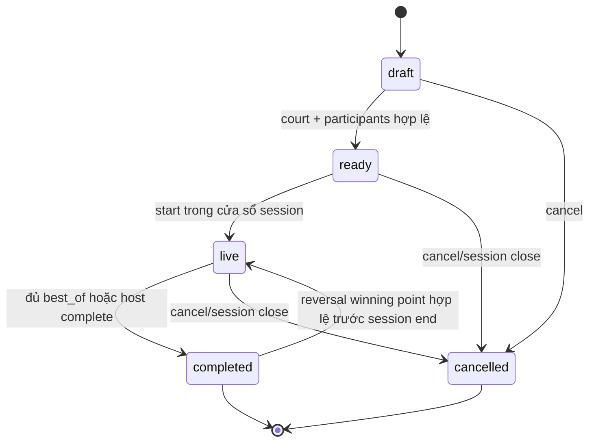

# Feature: Session Organize (Match & Court Orchestration) — Product/UX Spec

> **Delivery:** Sau Session CRUD + Sync; **post-P4** (owner accept-in-principle 2026-07-18, DD-61..64). Exact canonical phase TBD.
> **Track:** 🎾 In-session Organize
> **Version:** 0.6 · 2026-08-10
> **Status:** ✅ Accept-in-principle (owner 2026-07-18, DD-61..64) — build **post-P4**, phased. Vẫn **chưa phải build contract**: schema/migration/service/engine chưa có trong code; không triển khai trước khi có prerequisite. DD-63 `balanced` degrade tới khi có level source per-sport.
> **Implementation:** Not started — build post-P4 · authority: `../standards/BUILD-STATUS.md` (Doc status ≠ Implementation status)  
> **Prerequisites:** SessionService/Session CRUD · DD-41 session gating · DD-42 attendance/reliability · DD-45 waitlist · DD-56 authz action registry · DD-08 taxonomy trình độ
> **Tài liệu liên quan:** `feature_session_management.md` · `../standards/decisions.md` DD-61..64 · `../standards/business-rules.md` · `../BE/feature_session_organize_tech.md`

> **⚠️ Live-repo reality:** Cặp tài liệu này mô tả design đã accepted-in-principle. `packages/db/schema.ts` hiện chỉ có `sessions`/`players` nền tảng; chưa có 5 bảng organize, migration, OrganizeService, assign/scoring engine, SSE topic, hay capability/grant session-scoped. Các choke-point như `removeMemberFromSession` và session close/cancel hook dưới đây là **contract tương lai**, không phải tên hàm đã tồn tại. Owner acceptance đã xong; build vẫn phải đợi Session CRUD/Sync, DD-56 registry/grant storage, slice manifest và migration/service implementation tương ứng.

---

## 1. Mô tả và phạm vi

Session Organize giúp host điều phối một buổi chơi: khai báo sân, tạo trận, xếp người, bắt đầu/kết thúc trận và ghi điểm từng điểm. Chat và web dùng chung domain service; dữ liệu organize nằm trong canonical tenant store và không được project ra marketplace/public.

Model ở v0.4 dùng tên gọi sport-agnostic nhưng **chỉ hỗ trợ contest hai phía**. `team_size` có thể là 1, 2 hoặc N người mỗi phía; `side_count` được lưu để tiến hoá schema nhưng bị khóa bằng `side_count = 2`. N-side cần một DD và scoring/assignment design riêng, không được suy rộng từ contract này.

Scoring có hai mode:

- `none`: chỉ điều phối trận, không ghi điểm.
- `live`: điểm theo set với `target_points > 0`, `best_of` là số lẻ dương và `win_by > 0`.

**Ngoài phạm vi:** booking sân với nhà cung cấp, bracket/tournament nhiều vòng, ELO xuyên buổi, thanh toán theo trận, N-side scoring, privileged correction sau khi session kết thúc, attendance tự động từ lịch sử trận.

### Entry points

| Entry | Route / Surface | Actor | Mô tả |
|-------|----------------|-------|-------|
| Session detail → Organize tab | `/clubs/:id/sessions/:sid/organize` | Host/Scorer | Board: courts + matches + assignments |
| Bot → "/organize" command | Club chat / private thread | Host | Quick court/match/assign qua bot |
| Bot → score command | Club chat / private thread | Scorer | Live point scoring qua bot |
| SSE live board | Real-time subscription | Player (active) | Live score updates |
| Web → Match detail | `/clubs/:id/sessions/:sid/matches/:mid` | Host/Player | Set scores + point ledger |
| Pre-session setup | Session detail → "Chuẩn bị" | Host | Court declaration + match config |

### Bất biến

- Organize là **tenant-private**; không có projector sang `public_sessions` và không phát PII/tiền qua analytics hoặc SSE.
- Participant tham chiếu `players`; không tạo roster song song. Chỉ player `active` cùng tenant/session mới được assign hoặc đọc board.
- Waitlisted, left, nonparticipant và actor tenant khác không được đọc board/SSE, trừ owner/admin hoặc actor có grant session-scoped hợp lệ.
- V0.4 chỉ có hai side (`0`, `1`). Mọi winner/point/slot validation phải theo invariant này.
- Một player không thể ở hai trận `live`; một court không thể có hai trận `live`; một match chỉ có một set `live`.
- Live score là ledger append-only. Undo là event `reversal`; không UPDATE/DELETE event cũ. Normal point chỉ khi match `live`; riêng winning point vừa làm set/match terminal có bounded undo/correction trước session end nếu đó là latest effective point và chưa có dependent action/court reassignment.
- Mọi mutation yêu cầu `commandId`; retry cùng command trả kết quả trước đó, không lặp mutation.
- Chat và web gọi cùng OrganizeService; assign preview là hàm thuần và apply luôn revalidate snapshot dưới lock.
- Mọi mutation kiểm tra cả session lifecycle, capability và optimistic version; routing không thay authz.
- `session.organize` và `session.score` là hai capability độc lập: quyền organize không tự cấp quyền score và owner không cấu hình policy thay thế trong v0.4.
- RLS tenant isolation là lớp nền, không thay thế relation-based access ở service/API/SSE.
- Mọi chuỗi user-facing qua `t(vi, en)`.

### Decision table — session lifecycle

`past` là trạng thái **suy ra từ thời gian**, không phải giá trị của `sessions.status`.

| Operation | Điều kiện được phép | Nếu không đạt |
|---|---|---|
| Đọc board/SSE | Actor có quyền đọc và session tồn tại; dữ liệu đã có vẫn được đọc read-only sau khi đóng/kết thúc | 403/404 theo boundary policy |
| Tạo/sửa sân, tạo/sửa config trận, preview/apply assignment | `status = 'open'` và `now < ends_at`; config trận chỉ sửa khi `draft\|ready` | `SESSION_NOT_ORGANIZABLE`, `SESSION_ENDED`, `SCORING_LOCKED_WHILE_LIVE` hoặc `MATCH_NOT_EDITABLE` |
| Start match, normal point | `status = 'open'`, `starts_at <= now < ends_at`, match `live` | `SESSION_NOT_STARTED`, `SESSION_ENDED`, `SESSION_NOT_ORGANIZABLE` hoặc `MATCH_NOT_LIVE` |
| Reversal/correction latest point | Cùng session window; match `live`, hoặc match/set vừa terminal do chính latest effective point; expected version khớp; chưa có dependent action; court chưa reassigned | `INVALID_REVERSAL`, `CORRECTION_REQUIRES_REVIEW` hoặc `COURT_REASSIGNED` |
| Mutate sau `ends_at`, hoặc khi session `closed/cancelled` | Không hỗ trợ trong v0.4 | Fail closed; privileged correction defer |

---

## 2. Use Cases và Edge Cases

### Use Cases

| ID | Actor | Hành động | Kết quả |
|---|---|---|---|
| ORG-UC-1 | Owner/Admin hoặc co-admin có `session.organize` | Thêm, đổi tên, sắp xếp hoặc đóng sân | `session_courts` cập nhật theo version |
| ORG-UC-2 | Owner/Admin hoặc co-admin có `session.organize` | Tạo trận hai phía hoặc sửa cấu hình `none`/`live` trước start | Match `draft\|ready` cập nhật theo version; live/terminal fail closed |
| ORG-UC-3 | Owner/Admin hoặc co-admin có `session.organize` | Preview xếp ngẫu nhiên | Plan deterministic theo seed; không ghi DB |
| ORG-UC-4 | Owner/Admin hoặc co-admin có `session.organize` | Preview xếp cân bằng | Tối thiểu chênh rating hai phía; thiếu rating thì warning + random |
| ORG-UC-5 | Owner/Admin hoặc co-admin có `session.organize` | Preview xoay tua | Ưu tiên rest-debt và giảm lặp cặp trong session |
| ORG-UC-6 | Owner/Admin hoặc co-admin có `session.organize` | Apply plan hoặc xếp thủ công | Revalidate `basisVersion`, player/court/slot dưới session lock |
| ORG-UC-7 | Owner/Admin hoặc co-admin có `session.organize` | Bắt đầu trận | Match `live`, court bị chiếm, set đầu được mở nếu scoring `live` |
| ORG-UC-8 | Owner/Admin hoặc actor có `session.score` | Ghi một điểm | Append `point`, materialize score, phát safe SSE event |
| ORG-UC-9 | Owner/Admin hoặc actor có `session.score` | Undo điểm vừa ghi, kể cả winning point vừa kết thúc set/trận | Append `reversal`; reducer reopen set/match nếu bounded terminal-correction guards đều xanh |
| ORG-UC-10 | Owner/Admin hoặc actor có `session.score` | Sửa điểm vừa ghi | Một command append `reversal` + optional replacement `point`; reducer reopen hoặc re-complete atomically |
| ORG-UC-11 | System | Hoàn tất set/trận | Áp dụng `target_points`, `win_by`, `best_of`; giải phóng court |
| ORG-UC-12 | Owner/Admin hoặc co-admin có `session.organize` | Huỷ/kết thúc trận hoặc thay người | Row cũ thành `withdrawn`, replacement là stint mới; không xoá ledger/lịch sử |
| ORG-UC-13 | Active player | Xem board và điểm live của session mình tham gia | Read-only, payload tối thiểu và không lộ actor IDs |
| ORG-UC-14 | Chat/Web | Điều phối trên nhiều surface | Cùng command/domain contract, adapter mỏng |

### Edge Cases

| # | Case | Hành vi bắt buộc |
|---|---|---|
| 1 | Session chưa tới `starts_at` mà start/score | Reject `SESSION_NOT_STARTED`; vẫn cho chuẩn bị court/match/plan nếu còn mở và chưa kết thúc |
| 2 | Session `draft/closed/cancelled` | Mutation reject `SESSION_NOT_ORGANIZABLE` |
| 3 | `now >= ends_at` | Mutation reject `SESSION_ENDED`; không có privileged correction bypass |
| 4 | Player left/waitlisted/khác session | Reject `PLAYER_NOT_ACTIVE` hoặc `PLAYER_SESSION_MISMATCH` |
| 5 | Cross-tenant ID spoofing | Same-tenant/session FK + service authz reject; không suy ra resource tồn tại |
| 6 | Hai actor chiếm cùng slot đang active | Session→match lock order; partial unique chỉ trên row `assigned`; loser nhận `SLOT_TAKEN` |
| 7 | Một player ở hai trận live | Unique/live guard trả `PLAYER_ALREADY_ON_COURT` |
| 8 | Hai trận live trên cùng court | Unique partial index trả `COURT_OCCUPIED` |
| 9 | Hai set live trong một match | Unique partial index; transaction sau fail `SET_ALREADY_LIVE` |
| 10 | Hai tap điểm đồng thời | Match lock + sequence unique; không mất hoặc đảo thứ tự |
| 11 | Retry mutation sau timeout | Cùng `commandId` trả prior result; payload khác cùng key reject `IDEMPOTENCY_CONFLICT` |
| 12 | Reversal cross-match/cross-set hoặc đảo lần hai | Composite FK + unique reversal target; reject `INVALID_REVERSAL` |
| 13 | Score vào match không live | Reject `MATCH_NOT_LIVE` |
| 14 | `side` ngoài 0/1 | Reject `INVALID_SIDE` |
| 15 | `best_of` chẵn/không dương hoặc live config thiếu điểm | Reject `INVALID_SCORING_CONFIG` |
| 16 | Balanced thiếu rating | Dùng deterministic random; trả `warnings[] = BALANCED_LEVEL_UNAVAILABLE` |
| 17 | Plan apply trên roster/version đã đổi | Reject `STALE_ASSIGNMENT_PLAN`; client preview lại |
| 18 | Player leave/thay người khi đang live | Future SessionService hook chuyển stint hiện tại thành `withdrawn`; slot được tái sử dụng bởi row replacement mới, giữ row cũ và điểm/trận |
| 19 | Session close/cancel có trận live | Future lifecycle hook cancel ready/live matches; giải phóng court; giữ ledger read-only |
| 20 | SSE đang mở rồi quyền/player/session bị thu hồi | Re-authorize trước mỗi event và heartbeat ≤30s; đóng stream tại lần check fail, hard bound 30s cả khi im lặng |
| 21 | Projector/SSE fail | Không rollback ledger; outbox retry, client reload guarded read model |
| 22 | App cố UPDATE/DELETE score event | DB grant + immutable trigger từ chối |
| 23 | Sửa scoring config sau start/terminal | Match `live` trả `SCORING_LOCKED_WHILE_LIVE`; `completed/cancelled` trả `MATCH_NOT_EDITABLE` |
| 24 | Undo winning point sau khi court đã được gán cho match khác | Reject `COURT_REASSIGNED`; không append reversal hoặc đổi read model |
| 25 | Undo terminal point không còn latest/đã có dependent match action/version stale | Reject `CORRECTION_REQUIRES_REVIEW` hoặc `STALE_VERSION`; không mutation |

---

## 3. Access, Screens và States

### Access matrix

| Actor | Read board/SSE | Organize | Score |
|---|---:|---:|---:|
| TenantOwner/TenantAdmin | ✅ | ✅ | ✅ |
| Co-admin có grant `session.organize` đúng session, chưa hết hạn | ✅ | ✅ | ❌, trừ khi có grant `session.score` riêng |
| Co-admin/Scorer có grant `session.score` đúng session, chưa hết hạn | ✅ | ❌, trừ khi có grant `session.organize` riêng | ✅ |
| `players.status = 'active'` của đúng session | ✅ | ❌ | ❌ |
| Waitlisted/left/nonparticipant/tenant khác | ❌ | ❌ | ❌ |

Mọi grant organize/score là **session-scoped**, có `resource_type='session'`, `resource_id=session_id` và `expires_at <= session.ends_at`. Đây là extension đề xuất của DD-56; không được dùng tenant-wide role để thay thế. `session.organize` không bao hàm `session.score`; actor cần cả hai thì phải có hai grant explicit.

### Screens

> Web organize board (host dashboard). Mobile-first 375px; desktop ≥1024 (split: court list + board).

#### Organize board (host)

**Layout (desktop):**

```
┌──────────────────────────────────────────────────────────┐
│ ← Session            🏸 Cầu lông T5 · Organize         │
├──────────────────────────────────────────────────────────┤
│                                                          │
│  ─── Sân (3) ───                              [+ Sân]   │
│  ┌──────────┐  ┌──────────┐  ┌──────────┐              │
│  │ Sân 1    │  │ Sân 2    │  │ Sân 3    │              │
│  │ 🟢 LIVE  │  │ ⚪ Trống  │  │ 🟢 LIVE  │              │
│  │ A vs B   │  │          │  │ C vs D   │              │
│  │ 15-12    │  │          │  │ 8-11     │              │
│  └──────────┘  └──────────┘  └──────────┘              │
│                                                          │
│  ─── Chưa xếp (4 người) ───                             │
│  [E. Minh] [F. Hoàng] [G. Lan] [H. Tuấn]               │
│                                                          │
│  [Xếp ngẫu nhiên] [Xếp cân bằng] [Xoay tua]            │
│                                                          │
└──────────────────────────────────────────────────────────┘
```

**Component: Court card:**

| Field | Data source | Ghi chú |
|-------|-------------|---------|
| Label | `session_courts.label` | Unique trong session |
| Status | Match status on court | 🟢 LIVE / ⚪ Trống / ✅ Done |
| Teams | `match_participants` side 0 vs 1 | Display names |
| Score | `match_sets` materialized | Current set score |

**Component: Player pool chip:**

| State | Display | Ghi chú |
|-------|---------|---------|
| Unassigned | Blue chip | Available for assignment |
| On court (live) | Green chip + court label | Cannot assign elsewhere |
| Resting | Gray chip + rest count | Rotation priority |

#### Assign preview modal

**Layout:**

```
┌──────────────────────────────────────┐
│ 🎲 Preview — Xếp cân bằng          │
├──────────────────────────────────────┤
│                                      │
│ Sân 1: [E. Minh + F. Hoàng]        │
│     vs [G. Lan + H. Tuấn]          │
│ ⚠️ Thiếu rating cho G. Lan          │
│                                      │
│ Sân 2: [A. Nam + B. Đức]           │
│     vs [C. Thảo + D. Hùng]         │
│                                      │
│ [Apply plan]          [Preview lại] │
└──────────────────────────────────────┘
```

#### Live scoreboard

**Layout:**

```
┌──────────────────────────────────────┐
│ 🏸 Sân 1 — Set 2/3                 │
├──────────────────────────────────────┤
│                                      │
│     E. Minh + F. Hoàng              │
│          ┌─────┐                    │
│          │  15 │  ← tap +1          │
│          └─────┘                    │
│     ─────────────                    │
│          ┌─────┐                    │
│          │  12 │  ← tap +1          │
│          └─────┘                    │
│     G. Lan + H. Tuấn               │
│                                      │
│  Set 1: 21-18 ✅                    │
│  Set 2: 15-12 🔴 live              │
│                                      │
│  [↩ Undo] [⏹ Kết thúc trận]       │
│                                      │
└──────────────────────────────────────┘
```

**Component: Score controls:**

| Action | Who | Condition |
|--------|-----|-----------|
| +1 point | Actor with `session.score` | Match live, session window |
| Undo | Actor with `session.score` | Latest effective point, bounded |
| End match | Actor with `session.organize` | Match live |

#### Match history

```
┌──────────────────────────────────────┐
│ 📋 Lịch sử trận                    │
├──────────────────────────────────────┤
│                                      │
│ Trận 1: E+F vs G+H  21-18, 15-21,  │
│         21-17 → E+F thắng 2-1       │
│ Trận 2: A+B vs C+D  đang chơi...   │
│ Trận 3: draft                        │
│                                      │
└──────────────────────────────────────┘
```

#### Data source mapping

| Component | Data source | Ghi chú |
|-----------|-------------|---------|
| Courts | `session_courts` per session | Label unique |
| Matches | `matches` + `match_participants` | Version-locked |
| Score | `score_events` (ledger) → `match_sets` (materialized) | Append-only |
| Assignment | OrganizeService preview/apply | Deterministic seed |
| Live updates | SSE per session | Re-auth per event |

#### State coverage matrix

| Screen | Loading | Ready | Error | Empty |
|--------|---------|-------|-------|-------|
| Organize board | ✅ Skeleton courts | ✅ Courts + matches + pool | ✅ Retry banner | ✅ "Thêm sân để bắt đầu" |
| Assign preview | ✅ "Đang xếp..." | ✅ Plan + warnings | ✅ "Stale — preview lại" | ⚪ N/A |
| Live scoreboard | ✅ Connecting SSE | ✅ Score + controls | ✅ Reconnect + reload | ⚪ N/A (always has match) |
| Match history | ✅ Skeleton list | ✅ Completed/cancelled matches | ✅ "Lỗi tải" | ✅ "Chưa có trận nào" |
| Chat command | — | ✅ Thin adapter response | ✅ Localized error | ⚪ N/A |

### Match state machine



---

## 4. Domain Model

| Entity | Vai trò | Contract chính |
|---|---|---|
| `session_courts` | Sân/làn trong session | Same-tenant/session FK; label unique trong session; một court tối đa một match live |
| `matches` | Contest hai phía | `side_count = 2`; optimistic `version`; config `none`/`live`; status state machine |
| `match_participants` | Stint của player trong match | Same tenant/session với match và player; side 0/1; slot dương; chỉ row `assigned` giữ uniqueness player/slot; `withdrawn` được giữ làm lịch sử và cho phép slot/player tái nhập bằng stint mới |
| `match_sets` | Materialized score của set | Same match/session; một set live/match; score có đúng hai phần tử không âm |
| `score_events` | Ledger điểm | `point` hoặc `reversal`; set bắt buộc; command/seq unique; reversal cùng match/set và chỉ một lần |

`match_sets.scores` là read model có thể rebuild; `score_events` mới là source of truth. DDL, composite keys, lock order và trigger bất biến nằm trong backend spec.

---

## 5. Analytics và Realtime Safety

| Event | Payload tối thiểu, không PII |
|---|---|
| `organize_court_added` | `tenant_id`, `session_id`, `court_count` |
| `organize_match_created` | `tenant_id`, `session_id`, `match_id`, `team_size`, `scoring_mode` |
| `organize_players_assigned` | `tenant_id`, `session_id`, `assign_mode`, `assigned_count`, `fallback_used` |
| `organize_match_started` | `tenant_id`, `session_id`, `match_id` |
| `organize_score_recorded` | `tenant_id`, `session_id`, `match_id`, `set_no`, `side` |
| `organize_score_reversed` | `tenant_id`, `session_id`, `match_id`, `set_no` |
| `organize_match_completed` | `tenant_id`, `session_id`, `match_id`, `sets_played`, `duration_sec` |
| `organize_projection_failed` | `tenant_id`, `session_id`, `match_id`, `error_code` |

SSE topic là `session:<sessionId>:organize`. Gateway authorize khi connect/reconnect, **trước mỗi event** và mỗi heartbeat tối đa 30 giây. Grant/player/session hết hiệu lực thì đóng stream ở lần check kế tiếp; connection registry/revocation signal có thể đóng sớm hơn nhưng không thay hard bound. Event chỉ mang IDs kỹ thuật cần cho guarded reload, sequence/version và score state; không mang `person_id`, `membership_id`, actor ID, contact, payment hoặc venue-private fields.

---

## 6. Acceptance Criteria

- [ ] Lifecycle table được enforce bằng clock-controlled tests trước/đúng/sau `starts_at` và `ends_at`.
- [ ] DDL dùng migration mới, same-tenant/session composite FKs, RLS+grants và immutable ledger trigger.
- [ ] Hai host không thể tạo hai live match trên một court; một match không có hai live set.
- [ ] Chỉ active player đúng session được assign/read; waitlisted/left/nonparticipant/cross-tenant bị chặn.
- [ ] `side_count = 2`; scoring config validation không cho trạng thái nửa vời.
- [ ] Match config chỉ sửa bằng expected match version ở `draft/ready`; live và terminal status bị chặn bằng error code ổn định.
- [ ] Preview thuần; apply revalidate `basisVersion` và snapshot dưới lock.
- [ ] Mọi mutation idempotent bằng `commandId`; duplicate không ghi thêm row/outbox.
- [ ] Point/reversal ledger append-only; cross-match, cross-set và double reversal bị chặn.
- [ ] Winning-point undo/correction chỉ chạy trước session end cho latest effective point, expected version khớp, không dependent action và court chưa reassigned; reducer reopen/re-complete atomically; failure leaves ledger/read model unchanged.
- [ ] Withdraw/substitute giữ row lịch sử; replacement vào lại đúng slot thành công, nhưng hai row `assigned` cùng player hoặc cùng slot bị chặn.
- [ ] Materialized score rebuild khớp ledger sau mọi chuỗi point/reversal/correction.
- [ ] Access matrix dùng action registry và session-scoped organize/score grants độc lập; routing/RLS không bị coi là authz đủ.
- [ ] SSE authorize connect/reconnect/before-event/heartbeat ≤30s; active-stream revocation closes within hard bound và payload không lộ actor/roster/contact/payment/venue.
- [ ] Không có organize projector sang `public_sessions`.
- [ ] Chat/web gọi cùng domain service và mọi label/error đi qua i18n.

---

## 7. Open Questions và Changelog

| ID | Quyết định | Trạng thái |
|---|---|---|
| ORG-OQ-1 | Aggregate court/match/participant hang off `sessions`/`players`, tenant-private | ✅ Accepted-in-principle DD-61; implementation inactive/post-P4 |
| ORG-OQ-2 | Set + point/reversal ledger append-only, SSE theo session topic | ✅ Accepted-in-principle DD-62; implementation inactive/post-P4 |
| ORG-OQ-3 | Four-mode assign engine; balanced fallback khi chưa có source rating đáng tin | ✅ Accepted-in-principle DD-63; 🔗 level-source dependency, implementation inactive |
| ORG-OQ-4 | `session.organize`/`session.score` độc lập, active-player read và mọi grant session-scoped | ✅ Accepted-in-principle DD-64; cần mở rộng DD-56 registry/storage trước build |
| ORG-OQ-5 | Recurring organize template | ⬜ Defer post-MVP |
| ORG-OQ-6 | N-side hoặc tournament/bracket | ⬜ Feature/DD riêng |

| Date | Version | Thay đổi |
|---|---|---|
| 2026-08-10 | v0.6 | **A-grade upgrade:** thêm Entry points table (6 entries); bump version. Không đổi contract/domain model. |
| 2026-07-19 | v0.5a | Metadata sweep (index v2.35): thêm trường **Implementation** đồng bộ BUILD-STATUS (Not started). Không đổi contract. |
| 2026-07-18 | v0.5 | Owner accepted DD-61..64 in principle; close ORG-OQ-1..4 at design level while preserving explicit post-P4/prerequisite/no-runtime boundary. |
| 2026-07-17 | v0.4 | **DD-62/DD-64 closure:** bounded terminal winning-point undo/correction with latest/version/dependency/court guards; active SSE re-auth before event + heartbeat ≤30s. Vẫn là proposal, không claim runtime. |
| 2026-07-17 | v0.3 | Khóa exact authz: `session.organize` không bao hàm `session.score`; mô hình substitution bằng participant stint + partial active uniqueness; đồng bộ version/API acceptance với backend contract. |
| 2026-07-17 | v0.2 | Khóa v0.2 ở two-side; định nghĩa lifecycle theo thời gian, relation-based read/SSE, scorer grant session-scoped, idempotency, point/reversal ledger và trạng thái proposal/phase TBD. Làm rõ live-code prerequisites chưa tồn tại. |
| 2026-07-17 | v0.1 | Draft đầu tiên cho court, match, 4 assign mode và live scoring; DD-61..64 ở trạng thái proposal. |
