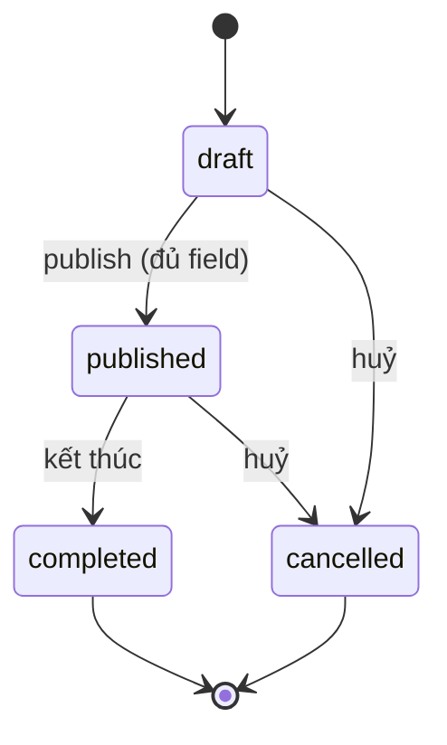

# Feature: Tournament (Giải đấu) — Product/UX Spec

> **Canonical phase:** P4+ (sau session core; DD-82 "sau session core")
> **Track:** 🏆 Session & Competition
> **Version:** 0.1 · 2026-07-21
> **Status:** Draft *(chưa qua readiness gate — KHÔNG phải Reviewed contract; DD-82 mới ở mức "chốt hướng")*
> **Implementation:** Not started
> **Prerequisites:** Session core (Session Management) ổn định; DD-12 guarded public read model; DD-83 slug registry
> **Tài liệu liên quan:** `../standards/decisions.md` **DD-82** (aggregate độc lập) · DD-83 (URL/slug) · DD-73/DD-75 (share/guarded view) · DD-12 (public read model) · DD-06 (location granularity) · DD-41 (retire `session_type='tournament'`) · HR2 (tiền/PII không public) · `../BE/feature_tournament_tech.md`

---

## Changelog

| Date | Version | Thay đổi |
|---|---|---|
| 2026-07-21 | v0.1 | Khởi tạo từ DD-82 (owner chốt hướng 2026-07-21): tournament = aggregate độc lập, v1 gọn (info + đăng ký + `public_tournaments` URL share); bracket/standings/entry-fee = slice sau. Draft, chưa readiness gate. |

---

## 1. Mô tả

**Tournament (Giải đấu)** là một **aggregate độc lập** cho phép host/CLB tạo và công bố một giải đấu thể thao phong trào, nhận đăng ký người tham gia, và chia sẻ trang giải đấu qua URL công khai. Đây **không phải** một biến thể của `sessions` — giải đấu có vòng đời, người tham gia và mô hình dữ liệu riêng, nên nó **không gom vào `sessions`/`players`** (DD-82).

Phiên bản **v1 cố tình gọn**: chỉ gồm (1) thông tin giải đấu, (2) đăng ký tham gia, (3) trang public để share. **Bracket (sơ đồ nhánh), standings (bảng xếp hạng), và entry-fee (phí tham gia + đối soát tiền) là slice sau**, không thuộc v1.

**Nguyên tắc thiết kế:**

- **Aggregate độc lập** — bảng canonical riêng (`tournaments`, `tournament_registrations`), không tái dùng `sessions`/`players` (vì `players.session_id` là FK cứng tới session).
- **Tiền/PII không ra public** (HR2) — trang public đọc qua read model field-whitelist (`public_tournaments`), không chứa roster đầy đủ, SĐT, email, tiền.
- **v1 không đụng tiền** — đăng ký v1 **không tạo charge**; entry-fee (mô hình tiền riêng) để slice sau, giữ đường tiền sạch.
- **Tenant-scoped + RLS fail-closed** — canonical `tournaments`/`tournament_registrations` đi qua `tenantRepo` choke-point như mọi bảng nội bộ.
- **i18n bắt buộc** — mọi chuỗi user-facing qua `t(vi, en)`.

### Bất biến

- **BI-TRN-1:** `tournaments` và `tournament_registrations` **luôn** tenant-scoped, `tenant_id NOT NULL`, ENABLE + FORCE RLS. Không đọc trực tiếp ngoài `tenantRepo`.
- **BI-TRN-2:** `public_tournaments` **chỉ** chứa field-whitelist (môn, thời gian, khu vực, tên CLB/host hiển thị, số slot, trạng thái đăng ký). **Không bao giờ** serialize `tenant_id`, roster đầy đủ, PII (SĐT/email), hay dữ liệu tiền.
- **BI-TRN-3:** v1 đăng ký **không** tạo `charges`/nghĩa vụ tiền. Entry-fee deferred.
- **BI-TRN-4:** Tournament **không** tái dùng `sessions`/`players`; không có FK từ `tournaments` tới `sessions`.
- **BI-TRN-5:** URL public = `/tournament/<slug>` với **opaque slug** (DD-83), đọc qua guarded view (DD-12), rename → tombstone link cũ.
- **BI-TRN-6:** Địa điểm public theo DD-06 — chỉ `area` ra public; venue cụ thể chỉ lộ cho người **đã đăng ký** (`registration.status='registered'`, gate theo outcome như DD-06 gate `players.status='active'`), không phải mọi user authenticated.
- **BI-TRN-7:** Ai được đăng ký do host cấu hình per-giải qua `registration_policy` (TRN-OQ-1, owner 2026-07-21): `members_only` (chỉ member cùng tenant) · `approval` (bất kỳ ai, host duyệt — dùng trạng thái `pending`) · `anyone` (bất kỳ user Plexco tự đăng ký thẳng `registered`). Mọi chế độ vẫn qua RLS + authz per-resource; chế độ `approval`/`anyone` cho phép `person_id` không thuộc tenant nhưng **không** cấp quyền đọc dữ liệu tenant khác.

---

## 2. Use Cases + Edge Cases

### Use Cases

| ID | Actor | Hành động | Kết quả |
|---|---|---|---|
| TRN-UC-1 | Host | Tạo giải đấu (tên, môn, thời gian, khu vực, mô tả, slot tối đa) | `tournaments` row `status='draft'`, tenant-scoped |
| TRN-UC-2 | Host | Publish giải đấu | `status='published'`, projector ghi `public_tournaments`, cấp slug `/tournament/<slug>` |
| TRN-UC-3 | Host | Sửa thông tin giải đấu (khi chưa bắt đầu) | Cập nhật canonical + re-project public read model; version tăng |
| TRN-UC-4 | Host | Mở/đóng đăng ký | `registration_status ∈ {open, closed}`; public card phản ánh |
| TRN-UC-5 | Player (authenticated) | Đăng ký tham gia giải đấu đang mở | Theo `registration_policy`: `members_only`/`anyone` → `status='registered'` (đếm slot); `approval` → `status='pending'` (chờ duyệt) |
| TRN-UC-5b | Host | Cấu hình `registration_policy` (members_only/approval/anyone) | Cập nhật canonical; player-facing đăng ký rẽ nhánh theo policy |
| TRN-UC-5c | Host | Duyệt/từ chối đăng ký `pending` (chế độ approval) | `pending → registered` (đếm slot) hoặc `pending → rejected` |
| TRN-UC-6 | Player | Rút đăng ký | `status='withdrawn'`; slot mở lại |
| TRN-UC-7 | Guest/khách (chưa đăng nhập) | Mở link `/tournament/<slug>` | Xem trang public (whitelist field), CTA đăng ký → yêu cầu auth |
| TRN-UC-8 | Host | Đóng/kết thúc giải đấu | `status='completed'`; đăng ký khoá; card public chuyển trạng thái |
| TRN-UC-9 | Host | Huỷ giải đấu | `status='cancelled'`; public card gỡ/đánh dấu huỷ; đăng ký vô hiệu |
| TRN-UC-10 | Host | Xem danh sách người đã đăng ký (host-facing) | Roster đăng ký đầy đủ qua RLS (không ra public) |
| TRN-UC-11 | Player | Xem giải đấu mình đã đăng ký (person-self) | Danh sách đăng ký của chính mình |

> Cover: happy path (tạo/publish/đăng ký), alternative (guest xem public), mutation (sửa/mở-đóng đăng ký), cleanup (huỷ/kết thúc/rút), cross-actor (host vs player vs guest).

### Edge Cases

| # | Category | Case | Hành vi bắt buộc |
|---|----------|------|-------------------|
| 1 | Security | Guest gọi API canonical `tournaments` trực tiếp | Fail-closed qua RLS; chỉ đọc được qua `public_tournaments`. Ref: HR1/HR2 |
| 2 | Security | `tenant_id` bị yêu cầu serialize ra public | Cấm tuyệt đối; `public_tournaments.tenant_id` chỉ internal routing. Ref: BI-TRN-2 |
| 3 | Data | Publish khi thiếu field bắt buộc (môn/thời gian/khu vực) | Chặn publish, trả lỗi validation; không tạo public row |
| 4 | Data | Đăng ký vượt `slots_max` | Từ chối đăng ký thứ N+1 (hoặc waitlist ở slice sau); v1 = từ chối, trả `TOURNAMENT_FULL` |
| 5 | Concurrency | Hai player đăng ký đồng thời ở slot cuối | Đếm slot dưới lock; chỉ một thành công, người kia `TOURNAMENT_FULL` |
| 6 | Concurrency | Host đóng đăng ký đúng lúc player bấm đăng ký | Re-check `registration_status` trong transaction; đóng thắng → `REGISTRATION_CLOSED` |
| 7 | UX | Đăng ký trùng (cùng person đăng ký 2 lần) | Idempotent: unique (tournament, person); lần 2 trả trạng thái hiện tại, không tạo row mới |
| 8 | Data | Rút đăng ký rồi đăng ký lại | Cho phép; re-activate hoặc append theo lifecycle; không double-count slot |
| 9 | Privacy | Venue cụ thể của giải | Public chỉ `area` (DD-06); venue chỉ lộ cho người đã đăng ký (`registration.status='registered'`), không phải mọi authenticated. Ref: BI-TRN-6 |
| 10 | Cross-Feature | Slug đổi tên | Link cũ tombstone (DD-83), không vỡ URL đã share |
| 11 | Data | Trẻ vị thành niên đăng ký | Theo child-safety posture (DD-84); không lộ PII minor ra public |
| 12 | Cross-Feature | DD-41 `session_type='tournament'` cũ | Không còn hợp lệ — coordinate DD-41 để bỏ giá trị; xem BE §2 |

---

## 3. Screens & States

> Web tournament area + bot announcements. Mobile-first 375px; desktop ≥1024.

### Web — Tournament bracket

**Layout:**

```
┌──────────────────────────────────────────────────────────┐
│ ← CLB              🏆 Giải đấu mùa hè 2026             │
├──────────────────────────────────────────────────────────┤
│                                                          │
│  📅 01/08 — 15/08  👥 16 đội  🏸 Cầu lông              │
│  Trạng thái: 🟢 Đang diễn ra                             │
│                                                          │
│  ─── Bảng đấu (Vòng 1/4) ───                            │
│  ┌──────────┐     ┌──────────┐                           │
│  │ Đội A ✅  │──┐  │          │                           │
│  └──────────┘  ├──│ Đội A    │                           │
│  ┌──────────┐  │  │          │                           │
│  │ Đội B     │──┘  └──────────┘                           │
│  └──────────┘                                             │
│                                                          │
│  [Đăng ký] [Xem lịch thi đấu] [Kết quả]                │
│                                                          │
└──────────────────────────────────────────────────────────┘
```

### Web — Tournament registration

**Layout:**

```
┌──────────────────────────────────────┐
│ ← Giải đấu      📝 Đăng ký         │
├──────────────────────────────────────┤
│                                      │
│ Tên đội *         [                ] │
│ Thành viên *      [+ Thêm thành viên]│
│ Trình độ          [Trung bình ▼]    │
│                                      │
│ 💰 Phí tham gia: 200,000₫ / đội    │
│                                      │
│      [═══ Đăng ký ═══]              │
│                                      │
└──────────────────────────────────────┘
```

### Data source mapping

| Component | Data source | Ghi chú |
|-----------|-------------|---------|
| Tournament info | `tournaments` per tenant | Phase-gated |
| Bracket | `tournament_matches` | Tree structure |
| Registration | `tournament_teams` + `tournament_team_members` | |
| Results | `tournament_matches.result` | |

### State coverage matrix

| Screen | Loading | Ready | Error | Empty |
|--------|---------|-------|-------|-------|
| Bracket | ✅ Skeleton tree | ✅ Match tree + results | ✅ "Lỗi tải" | ✅ "Chưa có trận đấu" |
| Registration | — | ✅ Team form + fee | ✅ "Hết chỗ" / validation | ⚪ N/A |
| Results | ✅ Skeleton | ✅ Match results list | ✅ "Lỗi" | ✅ "Chưa có kết quả" |
---

## 4. Domain Model

| Entity | Vai trò | Key constraints |
|--------|---------|-----------------|
| `tournaments` | Canonical giải đấu (tenant-private) | `tenant_id NOT NULL` FK; `sport_id` FK; `status ∈ {draft,published,completed,cancelled}`; `registration_status ∈ {closed,open}`; **`registration_policy ∈ {members_only,approval,anyone}`** (host config, TRN-OQ-1); `starts_at < ends_at`; `slots_max NULL|>0`; RLS |
| `tournament_registrations` | Đăng ký tham gia (tenant-private) | `tenant_id NOT NULL` FK; `tournament_id` FK; `person_id` FK; `status ∈ {pending,registered,withdrawn,rejected}` (`pending` chỉ khi policy=`approval`); partial `UNIQUE(tournament_id, person_id) WHERE status IN (pending,registered)`; RLS |
| `public_tournaments` | Read model public (field-whitelist) | `id = tournaments.id`; `tenant_id` internal-only (never serialized); no money/PII/roster; projector-owned; `expires_at` |

> Section này là shared ground truth — BE tech §2 extends với DDL/indexes/migration. Người tham gia dùng `person_id` (global) qua `tenantRepo`; **không** tái dùng `players` (BI-TRN-4).

### State machine (tournament.status)



`registration_status` (`open`/`closed`) là trục độc lập, chỉ có ý nghĩa khi `status='published'`.

---

## 5. Analytics Events

| Event | Khi nào | Payload tối thiểu (no PII) |
|-------|---------|-------------------|
| `tournament_create_success` | Host tạo giải | tournament_id, sport_key |
| `tournament_publish_success` | Host publish | tournament_id |
| `tournament_register_success` | Player đăng ký thành công | tournament_id |
| `tournament_register_rejected` | Đăng ký bị từ chối | tournament_id, reason (`full`/`closed`) |
| `tournament_withdraw_success` | Player rút đăng ký | tournament_id |
| `tournament_public_view` | Mở trang public | slug (opaque), no person ref |

> Naming: `{feature}_{action}_{result}`. Không PII trong payload.

---

## 6. Acceptance Criteria

**Functional**

- [ ] Host tạo/sửa/publish/huỷ/kết thúc giải đấu; player đăng ký/rút.
- [ ] Publish chặn khi thiếu field bắt buộc.
- [ ] Đăng ký idempotent theo `(tournament_id, person_id)`.
- [ ] Đóng đăng ký / full chặn đăng ký mới với đúng error code.

**States**

- [ ] Mọi screen dữ liệu động có đủ Loading/Ready/Error/Empty (hoặc N/A + lý do).
- [ ] Trang public trả 404 cho slug không tồn tại/tombstoned.

**UI-UX**

- [ ] Mọi chuỗi qua `t(vi, en)`; không hardcode một ngôn ngữ.
- [ ] Public card chỉ hiển thị field whitelist; venue chỉ hiện sau đăng ký.

**Testing**

- [ ] Test bất biến: `public_tournaments` không chứa tiền/PII/`tenant_id` serialized; canonical cô lập cross-tenant.
- [ ] Test concurrency slot cuối; test đăng ký trùng idempotent.

---

## 7. Open Questions / Changelog

### Open Questions

| ID | Quyết định | Trạng thái |
|---|---|---|
| TRN-OQ-1 | Ai được đăng ký? | ✅ Chốt (owner 2026-07-21): **host config `registration_policy`** 3 chế độ `members_only` / `approval` / `anyone` |
| TRN-OQ-2 | Waitlist khi full: v1 từ chối (`TOURNAMENT_FULL`) hay waitlist như DD-45? Default v1 = từ chối; waitlist = slice sau | ⬜ Chưa chốt |
| TRN-OQ-3 | Entry-fee (phí tham gia) + đối soát: mô hình tiền riêng, **deferred slice sau** — reuse `charges`/reconcile hay bảng riêng? | ⬜ Chưa chốt (out of v1) |
| TRN-OQ-4 | Bracket + standings: cấu trúc nhánh/vòng, live score — **slice sau**, có thể tái dùng pattern DD-61/62 (Session Organize) | ⬜ Chưa chốt (out of v1) |
| TRN-OQ-5 | Retire `session_type='tournament'` sequencing với DD-41 | ✅ Chốt (owner 2026-07-21): **nhánh (a)** — DD-41 không bao giờ thêm `'tournament'` khi migrate; không backfill; tournament slice độc lập không đụng `sessions` |

### Changelog

Xem bảng Changelog ở đầu file.
