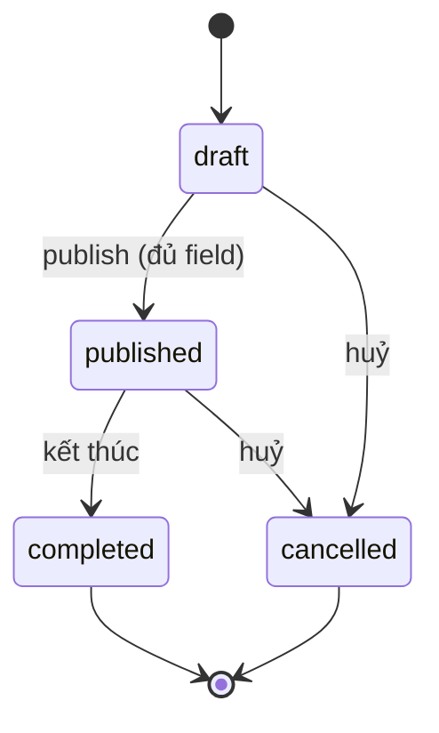
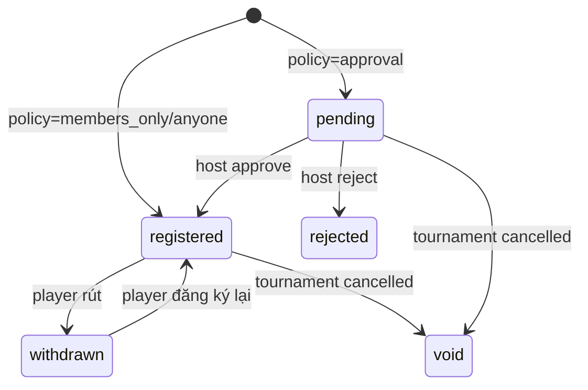

# Feature: Tournament (Giải đấu) — Product/UX Spec

> **Canonical phase:** P4+ (sau session core; DD-82 "sau session core")
> **Track:** 🏆 Session & Competition
> **Version:** 0.2 · 2026-08-10
> **Status:** Draft *(chưa qua readiness gate — KHÔNG phải Reviewed contract; DD-82 mới ở mức "chốt hướng")*
> **Implementation:** Not started · authority: `../standards/BUILD-STATUS.md`
> **Prerequisites:** Session core (Session Management) ổn định; DD-12 guarded public read model; DD-83 slug registry
> **Tài liệu liên quan:** `../product/BRD.md` · `../standards/decisions.md` **DD-82** (aggregate độc lập) · DD-83 (URL/slug) · DD-73/DD-75 (share/guarded view) · DD-12 (public read model) · DD-06 (location granularity) · DD-41 (retire `session_type='tournament'`) · HR2 (tiền/PII không public) · `../BE/feature_tournament_tech.md`

---

## 1. Mô tả

**Tournament (Giải đấu)** là một **aggregate độc lập** cho phép host/CLB tạo và công bố giải đấu thể thao phong trào, nhận đăng ký người tham gia, và chia sẻ trang giải đấu qua URL công khai. Đây **không phải** một biến thể của `sessions` — giải đấu có vòng đời, người tham gia và mô hình dữ liệu riêng, nên nó **không gom vào `sessions`/`players`** (DD-82).

**v1 scope (gọn):** chỉ gồm (1) thông tin giải đấu, (2) đăng ký tham gia, (3) trang public để share. **Bracket (sơ đồ nhánh), standings (bảng xếp hạng), entry-fee (phí tham gia + đối soát tiền), và live score là slice sau.**

### Entry points

| Entry | Route | Mô tả |
|-------|-------|-------|
| Club tab → sub-tab hoặc CTA | `/clubs/:tenantId/tournaments` | Host/admin xem danh sách giải CLB |
| Marketplace → giải đấu | `/discover/tournaments` (future) | Player tìm giải mở |
| Public URL share | `/tournament/<slug>` | Guest/player xem trang public |
| Deep link từ notification/chat | → tournament detail | Navigate trực tiếp |

### Bất biến

- **BI-TRN-1:** `tournaments` và `tournament_registrations` **luôn** tenant-scoped, `tenant_id NOT NULL`, ENABLE + FORCE RLS. Không đọc trực tiếp ngoài `tenantRepo`.
- **BI-TRN-2:** `public_tournaments` **chỉ** chứa field-whitelist (môn, thời gian, khu vực, tên CLB/host hiển thị, số slot, trạng thái đăng ký). **Không bao giờ** serialize `tenant_id`, roster đầy đủ, PII (SĐT/email), hay dữ liệu tiền.
- **BI-TRN-3:** v1 đăng ký **không** tạo `charges`/nghĩa vụ tiền. Entry-fee deferred.
- **BI-TRN-4:** Tournament **không** tái dùng `sessions`/`players`; không có FK từ `tournaments` tới `sessions`.
- **BI-TRN-5:** URL public = `/tournament/<slug>` với **opaque slug** (DD-83), đọc qua guarded view (DD-12), rename → tombstone link cũ.
- **BI-TRN-6:** Địa điểm public theo DD-06 — chỉ `area` ra public; venue cụ thể chỉ lộ cho người **đã đăng ký** (`registration.status='registered'`).
- **BI-TRN-7:** Ai được đăng ký do host config per-giải qua `registration_policy`: `members_only` | `approval` | `anyone`.

---

## 2. Use Cases + Edge Cases

### Use Cases

| ID | Actor | Hành động | Kết quả |
|---|---|---|---|
| TRN-UC-1 | Host | Tạo giải đấu (tên, môn, thời gian, khu vực, mô tả, slot tối đa) | `tournaments` row `status='draft'`, tenant-scoped |
| TRN-UC-2 | Host | Publish giải đấu | `status='published'`, projector ghi `public_tournaments`, cấp slug `/tournament/<slug>` |
| TRN-UC-3 | Host | Sửa thông tin giải đấu (khi chưa bắt đầu) | Cập nhật canonical + re-project public read model; version tăng |
| TRN-UC-4 | Host | Mở/đóng đăng ký | `registration_status ∈ {open, closed}`; public card phản ánh |
| TRN-UC-5 | Player (authenticated) | Đăng ký tham gia giải đấu đang mở | Theo `registration_policy`: `members_only`/`anyone` → `status='registered'`; `approval` → `status='pending'` |
| TRN-UC-5b | Host | Cấu hình `registration_policy` (members_only/approval/anyone) | Cập nhật canonical; player-facing đăng ký rẽ nhánh theo policy |
| TRN-UC-5c | Host | Duyệt/từ chối đăng ký `pending` (chế độ approval) | `pending → registered` (đếm slot) hoặc `pending → rejected` |
| TRN-UC-6 | Player | Rút đăng ký | `status='withdrawn'`; slot mở lại |
| TRN-UC-7 | Guest (chưa đăng nhập) | Mở link `/tournament/<slug>` | Xem trang public (whitelist field), CTA đăng ký → yêu cầu auth |
| TRN-UC-8 | Host | Đóng/kết thúc giải đấu | `status='completed'`; đăng ký khoá; card public chuyển trạng thái |
| TRN-UC-9 | Host | Huỷ giải đấu | `status='cancelled'`; public card gỡ/đánh dấu huỷ; đăng ký vô hiệu |
| TRN-UC-10 | Host | Xem danh sách người đã đăng ký (host-facing) | Roster đăng ký đầy đủ qua RLS (không ra public) |
| TRN-UC-11 | Player | Xem giải đấu mình đã đăng ký (person-self) | Danh sách giải đấu trong "Giải của tôi" |
| TRN-UC-12 | Host | Share link giải đấu | Copy public URL `/tournament/<slug>` → share qua chat/social |
| TRN-UC-13 | Player | Pull-to-refresh danh sách giải | Refresh registration status + slot count |

### Edge Cases

| # | Category | Case | Hành vi bắt buộc |
|---|----------|------|-------------------|
| 1 | Security | Guest gọi API canonical `tournaments` trực tiếp | Fail-closed qua RLS; chỉ đọc qua `public_tournaments`. Ref: HR1/HR2 |
| 2 | Security | `tenant_id` bị yêu cầu serialize ra public | ❌ NEVER; `public_tournaments.tenant_id` chỉ internal routing. Ref: BI-TRN-2 |
| 3 | Data | Publish khi thiếu field bắt buộc (môn/thời gian/khu vực) | Chặn publish, trả lỗi validation; không tạo public row |
| 4 | Data | Đăng ký vượt `slots_max` | Từ chối; v1 = `TOURNAMENT_FULL`; waitlist ở slice sau |
| 5 | Concurrency | Hai player đăng ký đồng thời ở slot cuối | Đếm slot dưới lock; chỉ một thành công, người kia `TOURNAMENT_FULL` |
| 6 | Concurrency | Host đóng đăng ký đúng lúc player bấm đăng ký | Re-check `registration_status` trong transaction; đóng thắng → `REGISTRATION_CLOSED` |
| 7 | UX | Đăng ký trùng (cùng person đăng ký 2 lần) | Idempotent: unique (tournament, person); lần 2 trả trạng thái hiện tại |
| 8 | Data | Rút đăng ký rồi đăng ký lại | Cho phép; re-activate; không double-count slot |
| 9 | Privacy | Venue cụ thể của giải | Public chỉ `area` (DD-06); venue chỉ cho `status='registered'`. Ref: BI-TRN-6 |
| 10 | Cross-Feature | Slug đổi tên | Link cũ tombstone (DD-83), không vỡ URL đã share |
| 11 | Data | Trẻ vị thành niên đăng ký | Theo child-safety posture (DD-84); không lộ PII minor ra public |
| 12 | Cross-Feature | DD-41 `session_type='tournament'` cũ | Coordinate DD-41 để bỏ giá trị; xem BE §2 |
| 13 | Security | Non-member đăng ký khi policy=`members_only` | ❌ Reject — check membership trước insert; `NOT_A_MEMBER` |
| 14 | UX | Host approve khi slot đã full | Reject approve; `TOURNAMENT_FULL`; pending giữ nguyên cho host xem xét |
| 15 | Data | Huỷ giải khi có registrations `registered` | Tất cả `registered` → `void` (terminal); thông báo participants; slot freeze |
| 16 | Concurrency | Host approve + player withdraw cùng lúc | Transaction; nếu withdraw trước → approve no-op; nếu approve trước → withdraw vẫn OK |
| 17 | UX | Tournament hết hạn đăng ký (auto-close) | System job check `registration_close_at`; auto `registration_status='closed'` + SSE |
| 18 | Security | Member CLB A cố đăng ký giải CLB B (policy=`members_only`) | Tenant isolation — membership check đúng `tournament.tenant_id` |

### Flow: Registration lifecycle

```
Player mở trang giải (public hoặc internal)
    │
    ▼
Kiểm tra registration_status == 'open'?
    ├── closed → hiện "Đăng ký đã đóng"
    │
    ▼ (open)
Kiểm tra slots_max (NULL = unlimited)
    ├── full → hiện "Hết chỗ" (TOURNAMENT_FULL)
    │
    ▼ (có slot)
Kiểm tra registration_policy
    │
    ├── members_only → check membership
    │   ├── YES → status='registered' ✅
    │   └── NO → "Chỉ thành viên CLB" ❌
    │
    ├── approval → status='pending' (chờ host)
    │   └── Host duyệt → registered | rejected
    │
    └── anyone → status='registered' ✅
```

---

## 3. Screens & States

> v1: info + registration + public share. Bracket/standings/score = slice sau. Mobile-first 375px; desktop ≥1024.

### 3.1 Tournament List (trong Club context)

**Purpose:** Danh sách giải đấu của CLB — host quản lý, member xem.

**Layout (mobile 375px):**

```
┌──────────────────────────────────────┐
│ ← CLB Cầu lông BT   🏆 Giải đấu   │
├──────────────────────────────────────┤
│                                      │
│ ┌────────────────────────────────┐   │
│ │ 🏆 Giải Cầu lông Mùa hè 2026 │   │
│ │ 📅 01/08 — 15/08              │   │
│ │ 👥 12/16 đã đăng ký           │   │  slot progress
│ │ 🟢 Đang mở đăng ký            │   │  status badge
│ └────────────────────────────────┘   │
│                                      │
│ ┌────────────────────────────────┐   │
│ │ 🏆 Giải Giao hữu Q7          │   │
│ │ 📅 20/09 — 22/09              │   │
│ │ 👥 0/8 đã đăng ký             │   │
│ │ 📝 Nháp                        │   │  draft (host only)
│ └────────────────────────────────┘   │
│                                      │
│ (Host/Admin only)                    │
│       [+ Tạo giải đấu mới]          │
│                                      │
└──────────────────────────────────────┘
```

**Component: Tournament card**

| Field | Data source | Ghi chú |
|-------|-------------|---------|
| Title | `tournaments.title` | Truncate nếu >60 chars |
| Date range | `tournaments.starts_at` / `ends_at` | DD/MM format, i18n |
| Slot progress | `registered_count` / `slots_max` | Progress bar visual; NULL max → "Không giới hạn" |
| Status badge | `tournaments.status` + `registration_status` | 🟢 Đang mở · 🔴 Đã đóng · 📝 Nháp · ✅ Hoàn thành · ❌ Đã huỷ |
| Sport icon | `tournaments.sport_key` | Emoji set |

**4 States:**

| State | Nội dung |
|-------|----------|
| Loading | Skeleton (3 tournament card skeletons) |
| Ready | Tournament cards sorted by `starts_at` DESC |
| Error | Toast "Không tải được danh sách giải" + retry |
| Empty | Icon 🏆 + "Chưa có giải đấu nào" + (host: "Tạo giải đấu đầu tiên") |

---

### 3.2 Tournament Detail (internal — host/member view)

**Purpose:** Chi tiết giải đấu — host quản lý, member xem info + đăng ký.

**Layout (mobile 375px):**

```
┌──────────────────────────────────────┐
│ ← Giải đấu   🏆 Giải Mùa hè 2026  │
│                      [🔗 Share]      │  share public link
├──────────────────────────────────────┤
│ ┌────────────────────────────────┐   │
│ │  [Banner/Hero Image]           │   │
│ │  🏸 Cầu lông · Quận Bình Thạnh│   │
│ │  📅 01/08 — 15/08/2026        │   │
│ │  🟢 Đang mở đăng ký           │   │
│ └────────────────────────────────┘   │
│                                      │
│ Thông tin                            │
│ ┌────────────────────────────────┐   │
│ │ Mô tả    Giải cầu lông giao   │   │
│ │          hữu mùa hè cho mọi   │   │
│ │          trình độ...           │   │
│ │ Địa điểm Sân BT, Q.Bình Thạnh│   │  ← chỉ hiện nếu registered
│ │ Slots    12/16 đã đăng ký     │   │
│ │ Policy   🌐 Ai cũng đăng ký   │   │
│ └────────────────────────────────┘   │
│                                      │
│ Người đăng ký (12)                   │  ← host: full list; member: count
│ ┌────────────────────────────────┐   │
│ │ 👤 Minh Hoàng      ✅ Đã ĐK   │   │
│ │ 👤 Anh T           ✅ Đã ĐK   │   │
│ │ 👤 Hùng Nguyễn     ⏳ Chờ duyệt│   │  (approval mode)
│ │ ...                            │   │
│ └────────────────────────────────┘   │
│                                      │
│ ┌────────────────────────────────┐   │
│ │  (Player — chưa đăng ký)      │   │
│ │  [══ Đăng ký tham gia ══]     │   │  CTA
│ │                                │   │
│ │  (Player — đã đăng ký)        │   │
│ │  ✅ Đã đăng ký · [Rút ĐK]    │   │
│ │                                │   │
│ │  (Host)                        │   │
│ │  [⚙️ Sửa] [📋 Đóng ĐK] [🗑]  │   │  host actions
│ └────────────────────────────────┘   │
│                                      │
└──────────────────────────────────────┘
```

**Component: Registration row (host view)**

| Field | Data source | Ghi chú |
|-------|-------------|---------|
| Avatar + name | `persons` via `tournament_registrations.person_id` | |
| Status badge | `tournament_registrations.status` | ✅ registered · ⏳ pending · ❌ rejected · ↩️ withdrawn |
| Action (approval) | Host: ✅ Duyệt / ❌ Từ chối | Chỉ khi policy=`approval` + status=`pending` |
| Registered at | `tournament_registrations.registered_at` | Relative time |

**4 States:**

| State | Nội dung |
|-------|----------|
| Loading | Skeleton (hero + info fields + 3 registration rows) |
| Ready | Full tournament detail + registration list/CTA |
| Error | Toast "Không tải được chi tiết giải" + retry |
| Empty | N/A — luôn có tournament data nếu đã navigate tới |

---

### 3.3 Public Tournament Page (`/tournament/<slug>`)

**Purpose:** Trang public share — không cần đăng nhập để xem.

**Layout (mobile 375px):**

```
┌──────────────────────────────────────┐
│        🏆 Plexco Tournament         │  branded header
├──────────────────────────────────────┤
│ ┌────────────────────────────────┐   │
│ │  [Banner Image]                │   │
│ │                                │   │
│ │  Giải Cầu lông Mùa hè 2026   │   │
│ │  🏸 Cầu lông                  │   │
│ │  📅 01/08 — 15/08/2026        │   │
│ │  📍 Quận Bình Thạnh, TP.HCM  │   │  area only (DD-06)
│ │  👥 12/16 chỗ                 │   │
│ │  Tổ chức bởi: CLB Cầu lông BT│   │
│ └────────────────────────────────┘   │
│                                      │
│ Mô tả                               │
│ ┌────────────────────────────────┐   │
│ │ Giải cầu lông giao hữu mùa   │   │
│ │ hè dành cho mọi trình độ.     │   │
│ │ Đơn nam/nữ, đôi nam/nữ.      │   │
│ └────────────────────────────────┘   │
│                                      │
│ ┌────────────────────────────────┐   │
│ │  [══ Đăng ký ngay ══]         │   │  → auth gate nếu chưa login
│ └────────────────────────────────┘   │
│                                      │
│ Không hiển thị: venue cụ thể,       │  privacy note
│ danh sách đăng ký, PII              │
│                                      │
└──────────────────────────────────────┘
```

**Public field whitelist (BI-TRN-2):**

| Field | Source | Public? |
|-------|--------|---------|
| Title | `public_tournaments.title` | ✅ |
| Sport | `public_tournaments.sport_key` | ✅ |
| Date range | `public_tournaments.starts_at/ends_at` | ✅ |
| Area | `public_tournaments.area` | ✅ |
| Venue | `tournaments.venue` | ❌ — chỉ registered |
| Slot count | `public_tournaments.slots_max` | ✅ |
| Registered count | `public_tournaments.registered_count` | ✅ |
| Registration status | `public_tournaments.registration_status` | ✅ |
| Host/CLB name | `public_tournaments.host_display_name` | ✅ |
| Description | `public_tournaments.description` | ✅ |
| Roster/PII | — | ❌ NEVER |
| tenant_id | — | ❌ NEVER serialized |

**4 States:**

| State | Nội dung |
|-------|----------|
| Loading | Skeleton (banner + info card) |
| Ready | Public info + registration CTA |
| Error | "Không tải được trang giải đấu" + retry |
| Empty | 404 — slug không tồn tại hoặc tombstoned |

---

### 3.4 Tournament Create/Edit Form (Host only)

**Purpose:** Host tạo hoặc sửa giải đấu.

**Layout (mobile 375px):**

```
┌──────────────────────────────────────┐
│ ← Giải đấu     📝 Tạo giải mới     │
├──────────────────────────────────────┤
│                                      │
│ Tên giải *       [                 ] │
│ Môn *            [🏸 Cầu lông  ▼]  │
│ Mô tả           [                 ] │
│                  [                 ] │
│ Bắt đầu *       [📅 01/08/2026   ] │
│ Kết thúc *       [📅 15/08/2026   ] │
│ Khu vực *        [Q. Bình Thạnh ▼] │
│ Địa điểm         [Sân BT          ] │
│ Slot tối đa      [16] (0=không giới │
│                       hạn)           │
│ Policy ĐK *     [🌐 Ai cũng ĐK ▼] │
│   ○ Chỉ thành viên CLB              │
│   ○ Cần host duyệt                  │
│   ● Ai cũng đăng ký được            │
│                                      │
│      [══ Lưu nháp ══]               │
│      [══ Publish giải ══]            │
│                                      │
└──────────────────────────────────────┘
```

**Field specification:**

| Field | Type | Required? | Default | Validation |
|-------|------|-----------|---------|------------|
| Tên giải | text | ✅ Required | — | 3–120 chars |
| Môn | select | ✅ Required | — | From sport registry |
| Mô tả | textarea | Optional | — | Max 2000 chars |
| Bắt đầu | date picker | ✅ Required | — | Must be future |
| Kết thúc | date picker | ✅ Required | — | Must be ≥ starts_at |
| Khu vực | select | ✅ Required | — | From area registry |
| Địa điểm | text | Optional | — | Max 200 chars |
| Slot tối đa | number | Optional | NULL (unlimited) | 0 = unlimited, >0 = limit |
| Registration policy | select | ✅ Required | `anyone` | `members_only` / `approval` / `anyone` |

**4 States:**

| State | Nội dung |
|-------|----------|
| Loading | Skeleton form |
| Ready | Form filled (edit) hoặc empty (create) |
| Error | Inline validation errors per field + toast cho save failure |
| Empty | N/A — form luôn có content |

---

### State coverage matrix

| Screen | Loading | Ready | Error | Empty |
|--------|---------|-------|-------|-------|
| Tournament List | ✅ 3 card skeletons | ✅ Cards sorted by date | ✅ Toast + retry | ✅ Icon + "Chưa có giải" + CTA |
| Tournament Detail | ✅ Skeleton hero + rows | ✅ Full detail + registrations | ✅ Toast + retry | N/A (always has data) |
| Public Page | ✅ Skeleton banner | ✅ Public info + CTA | ✅ Toast + retry | ✅ 404 for invalid slug |
| Create/Edit Form | ✅ Skeleton form | ✅ Form with values | ✅ Inline errors | N/A (form always has content) |

---

## 4. Domain Model

| Entity | Bảng | Key constraints |
|--------|------|-----------------|
| `tournaments` | Canonical giải đấu (tenant-private) | `tenant_id NOT NULL` FK; `sport_key`; `status ∈ {draft,published,completed,cancelled}`; `registration_status ∈ {closed,open}`; `registration_policy ∈ {members_only,approval,anyone}`; `starts_at < ends_at`; `slots_max NULL|>0`; RLS |
| `tournament_registrations` | Đăng ký tham gia (tenant-private) | `tenant_id NOT NULL` FK; `tournament_id` FK; `person_id` FK; `status ∈ {pending,registered,withdrawn,rejected,void}`; partial UNIQUE; RLS |
| `public_tournaments` | Read model public (field-whitelist) | `id = tournaments.id`; projector-owned; never serialize `tenant_id`/PII/money |

> Shared ground truth — BE tech §2 extends với DDL.

### State machine (tournament.status)



### State machine (registration.status)



### Permission matrix

| Action | Host/Admin | Member | Non-member | Guest |
|--------|-----------|--------|-----------|-------|
| Tạo giải | ✅ | ❌ | ❌ | ❌ |
| Publish | ✅ | ❌ | ❌ | ❌ |
| Sửa giải | ✅ | ❌ | ❌ | ❌ |
| Mở/đóng ĐK | ✅ | ❌ | ❌ | ❌ |
| Duyệt ĐK | ✅ | ❌ | ❌ | ❌ |
| Huỷ giải | ✅ | ❌ | ❌ | ❌ |
| Xem roster ĐK | ✅ (full) | ❌ | ❌ | ❌ |
| Đăng ký | ✅ | ✅ (per policy) | ✅ (per policy) | ❌ (auth gate) |
| Rút ĐK | ✅ (own) | ✅ (own) | ✅ (own) | ❌ |
| Xem public page | ✅ | ✅ | ✅ | ✅ |
| Xem venue | ✅ | ✅ (if registered) | ✅ (if registered) | ❌ |

---

## 5. Analytics Events

| Event | Trigger | Properties |
|-------|---------|------------|
| `tournament_created` | Host tạo giải | `tournament_id`, `sport_key`, `registration_policy` |
| `tournament_published` | Host publish | `tournament_id`, `slots_max` |
| `tournament_edited` | Host sửa thông tin | `tournament_id`, `changed_fields[]` |
| `tournament_registration_opened` | Mở đăng ký | `tournament_id` |
| `tournament_registration_closed` | Đóng đăng ký | `tournament_id`, `registered_count` |
| `tournament_register_success` | Player đăng ký thành công | `tournament_id`, `policy`, `result_status` |
| `tournament_register_rejected` | Đăng ký bị từ chối | `tournament_id`, `reason` (`full`/`closed`/`not_member`) |
| `tournament_approved` | Host duyệt pending | `tournament_id`, `registration_id` |
| `tournament_withdraw` | Player rút ĐK | `tournament_id` |
| `tournament_completed` | Kết thúc giải | `tournament_id`, `final_registered_count` |
| `tournament_cancelled` | Huỷ giải | `tournament_id`, `registered_at_cancel` |
| `tournament_public_viewed` | Mở trang public | `slug` (opaque), no person ref |
| `tournament_shared` | Copy link share | `tournament_id`, `share_method` |

---

## 6. Acceptance Criteria

### Functional

- [ ] Host tạo/sửa/publish/huỷ/kết thúc giải đấu
- [ ] Publish chặn khi thiếu field bắt buộc
- [ ] 3 registration policies: `members_only` / `approval` / `anyone`
- [ ] Approval flow: pending → approved/rejected bởi host
- [ ] Đăng ký idempotent theo `(tournament_id, person_id)`
- [ ] Slot counting chính xác; full → `TOURNAMENT_FULL`
- [ ] Rút đăng ký + đăng ký lại hoạt động đúng
- [ ] Huỷ giải → tất cả registrations → `void`
- [ ] Public page chỉ hiển thị whitelist fields
- [ ] Venue chỉ hiện cho người đã registered
- [ ] Slug tombstone khi đổi tên (DD-83)
- [ ] `tenant_id` không bao giờ serialize ra public response

### States

- [ ] 4 states cho mọi screen (Tournament list, Detail, Public, Form)
- [ ] Empty state cho Tournament list: icon + "Chưa có giải" + CTA (host)
- [ ] 404 cho slug không tồn tại/tombstoned
- [ ] Auth gate cho CTA đăng ký khi chưa đăng nhập

### UI

- [ ] Mọi chuỗi qua `t(vi, en)`; không hardcode ngôn ngữ
- [ ] Status badges đúng màu: 🟢 open · 🔴 closed · 📝 draft · ✅ completed · ❌ cancelled
- [ ] Slot progress bar visual
- [ ] Responsive: 375px / 768px / 1440px
- [ ] Touch targets ≥ 44px
- [ ] Dark mode

### Analytics

- [ ] 13 events track đầy đủ (create → share)
- [ ] Public view event không chứa person ref

---

## 7. Open Questions / Changelog

### Open Questions

| ID | Quyết định | Trạng thái |
|---|---|---|
| TRN-OQ-1 | Ai được đăng ký? | ✅ Chốt: **host config `registration_policy`** 3 chế độ |
| TRN-OQ-2 | Waitlist khi full: v1 từ chối; waitlist = slice sau | ⬜ Chưa chốt |
| TRN-OQ-3 | Entry-fee (phí tham gia) + đối soát: deferred v2 | ⬜ Chưa chốt (out of v1) |
| TRN-OQ-4 | Bracket + standings + live score: deferred v2 | ⬜ Chưa chốt (out of v1) |
| TRN-OQ-5 | Retire `session_type='tournament'` | ✅ Chốt: DD-41 không thêm `'tournament'` |
| TRN-OQ-6 | Tournament entry point: tab riêng hay sub-feature trong Club? | ✅ Chốt: feature riêng, route `/tournaments` (DD-82) |

### Changelog

| Date | Version | Thay đổi |
|---|---|---|
| 2026-08-10 | v0.2 | **A-grade upgrade:** Thêm entry points table, 4 screens đầy đủ (Tournament List, Detail, Public Page, Create/Edit Form) với component specs + field specifications + ASCII layouts. Thêm flow diagram (registration lifecycle), state machine cho registration.status, permission matrix, 15→18 edge cases (approval flow, auto-close, concurrent approve+withdraw, cross-tenant isolation), 6→13 analytics events, restructure AC thành Functional/States/UI/Analytics sub-sections. v1 scope không đổi. |
| 2026-07-21 | v0.1 | Khởi tạo từ DD-82 (owner chốt hướng 2026-07-21): tournament = aggregate độc lập, v1 gọn (info + đăng ký + `public_tournaments` URL share); bracket/standings/entry-fee = slice sau. |
