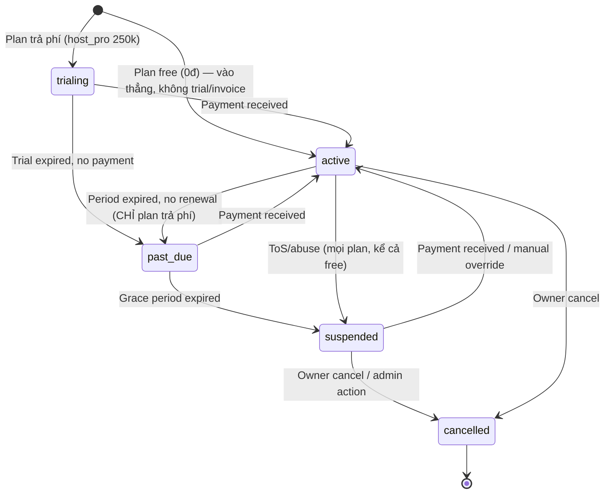

# Feature: Host Billing & Tenant Lifecycle — Product/UX Spec

> **Canonical phase:** P5  
> **Track:** 💳 Host Billing  
> **Version:** 2.2 · 2026-06-20
> **Status:** Reviewed  
> **Prerequisites:** P2 tenant/authz · P3 durable payment ingestion · P3 notifications  
> **Tài liệu liên quan:** `../product/BRD.md` FR-9/BR-11 · `../product/PRD.md` FLOW 11 · BRD OD-3 · `BE/feature_billing_lifecycle_tech.md`

---

## 1. Mô tả

Quản lý **host subscription**: trial, invoice, payment, renewal, past-due, suspension, reactivation — mà KHÔNG mix platform revenue với player payment ledger.

### Bất biến

- Billing transactions/invoices **tách biệt hoàn toàn** khỏi player bank transactions/allocations.
- Period extension dựa trên invoice/plan policy — KHÔNG double-extend on duplicate webhook.
- Grace days/price/tier versioned — KHÔNG retroactive mutation.
- Suspension gating centralized by action class — safety/ingestion/read-only paths remain.
- Entitlement gate theo **capability flags** (config-driven), không hard-code theo tenant/plan_key.

### Pricing tiers (DD-29 — thay DD-03)

| Plan key | Giá / tháng / CLB | Gồm |
|---|---:|---|
| `free` | **0đ** | Web app + **kết nối 3 bot** (Telegram/Zalo/Messenger*) + quản kèo/roster + **đối soát CK cơ bản (cập nhật thủ công)** + nhắc thủ công |
| `host_pro` | **250.000đ** | Toàn bộ free + **đối soát CK tự động & báo thu phí** + **nhắc nợ tự động** + **Trợ lý AI + KB** + CRM dashboard |

*Messenger chỉ hiệu lực khi kênh GA (DD-09/P4.8). Danh sách cờ tính năng chi tiết ở **Capability registry** (`BE/feature_billing_lifecycle_tech.md §4b`) — free/pro **config-driven** (đổi bằng `plans.entitlements`, không sửa code).

---

## 2. Use Cases + Edge Cases

### Use Cases

| ID | Actor | Hành động | Kết quả |
|---|---|---|---|
| BIL-UC-1 | System | Tenant creation (plan trả phí) | Start trial with explicit dates/plan version |
| BIL-UC-1b | System | Tenant creation (plan `free`) | Vào thẳng `active` vô thời hạn — **không** trial, **không** invoice, **không** past_due/suspended vì non-payment |
| BIL-UC-2 | System | Issue invoice | Invoice code + payment instructions → platform account |
| BIL-UC-3 | System | Platform billing webhook | Match invoice idempotently → extend period exactly once |
| BIL-UC-4 | System | Daily lifecycle job | Transition due tenants + send owner notices |
| BIL-UC-5 | Host | View billing page | Plan, trial/period/grace, invoices, payment status |
| BIL-UC-6 | System | Suspend tenant | Block admin mutations/integration changes |
| BIL-UC-7 | System | Suspended tenant CK ingestion | Still durable-ingest player CK — safety path |
| BIL-UC-8 | Host | Pay overdue invoice | Reactivate + resume paused jobs safely |
| BIL-UC-9 | Platform Admin | Manual override (temporary) | Privileged, temporary, audited |
| BIL-UC-10 | Host | Cancel subscription | Cancellation policy + data retention |

### Edge Cases

| # | Category | Case | Hành vi bắt buộc |
|---|----------|------|-------------------|
| 1 | Data Integrity | Billing tx mixed with player allocation | ❌ NEVER — separate ledgers |
| 2 | Concurrency | Duplicate billing webhook | Idempotent — extend period once only |
| 3 | Financial | Partial/overpayment | Billing credit / manual review — KHÔNG allocate to player charges |
| 4 | Data Integrity | Retroactive price/tier mutation | ❌ NEVER — versioned, immutable |
| 5 | Data Integrity | Clock/timezone billing date | UTC billing dates — no timezone ambiguity |
| 6 | Security | Suspended tenant push new public sessions | ❌ Block — existing sessions expire naturally only |
| 7 | Security | Suspended tenant player CK arrives | ✅ Still ingest — safety/ingestion paths remain |
| 8 | Cross-Feature | Owner lost access | Support/audit policy required |
| 9 | Financial | Refund/chargeback | Support policy — manual review |
| 10 | Data Integrity | Fair-use limit exceeded | Degrade expensive optional services — KHÔNG block payment ingestion/security |
| 11 | Security | Manual override abuse | Privileged, temporary, audited — auto-expire |
| 12 | Data Integrity | Paid plan trial → active transition with no payment | Require payment — no automatic active without billing event |
| 12b | Data Integrity | `free` (0đ) chạy qua trial→past_due→suspended | ❌ NEVER — free vào thẳng `active` vô thời hạn; daily lifecycle job **bỏ qua** plan 0đ ở nhánh past_due; không sinh invoice. Vẫn suspend được vì ToS/abuse (đường khác, không phải non-payment) |
| 12c | Entitlement | Đổi `free` ↔ plan trả phí | Lên paid: tạo subscription period + invoice từ thời điểm đổi (không retroactive). Về free: hạ entitlement cuối kỳ đã trả, set `active` (free), dừng sinh invoice |
| 13 | Entitlement | Host dùng kênh vượt plan | Block channel setup/use; show upgrade CTA; không ảnh hưởng player CK ingest |
| 14 | Entitlement | Đổi capability free↔pro (config `entitlements`) | Áp theo policy versioned; audit; không retroactive invoice mutation |

---

## 3. Screens & States

| Surface | Screen | Loading | Ready | Error | Empty |
|---------|--------|---------|-------|-------|-------|
| Web | Billing overview | Skeleton | Plan name, trial/period dates, grace days, status badge | Error banner | N/A (always has plan info) |
| Web | Invoice list | Skeleton table | Invoice rows: code, amount, status, date | Error banner | "Chưa có hoá đơn" |
| Web | Payment instructions | — | QR + bank info + invoice code | — | N/A |
| Web | Subscription status badges | — | ✅ Active / ⚠️ Expiring / 🔴 Past Due / ⛔ Suspended | — | N/A |
| Web | Reactivation | — | "Thanh toán để kích hoạt lại" + payment CTA | "Lỗi — liên hệ support" | N/A |
| TG Bot | Owner notice | — | "⚠️ [Club] sắp hết hạn / đã bị tạm ngưng" | — | N/A |

---

## 4. Domain Model

| Entity | Vai trò | Key constraints |
|--------|---------|-----------------|
| `subscriptions` | Plan/tier per tenant | `tenant_id` FK, `plan_key`, `plan_version`, `status` enum, `period_start/end` |
| `invoices` | Billing obligations | `UNIQUE(invoice_code)`, `tenant_id`, `amount`, `status` |
| `billing_transactions` | Platform payment records | Separate from `webhook_transactions` (player) |
| `billing_credits` | Overpayment/refund credits | `tenant_id`, `amount`, `reason` |

### Lifecycle State Machine

> **`free` (0đ):** vào thẳng `active` và ở đó vô thời hạn. Daily lifecycle job **bỏ qua plan 0đ** ở nhánh `period expired → past_due` và **không sinh invoice**. Free chỉ rời `active` khi (a) owner đổi lên plan trả phí, (b) owner cancel, hoặc (c) suspend do ToS/abuse — **không bao giờ** vì non-payment. Nhánh `trialing/past_due/suspended-vì-non-payment` chỉ áp dụng cho plan trả phí.

---

## 5. Analytics Events

| Event | Khi nào | Payload tối thiểu |
|-------|---------|-------------------|
| `billing_lifecycle_transition` | Status change | `tenant_id`, `from_status`, `to_status` |
| `billing_invoice_issued` | Invoice created | `tenant_id`, `invoice_code`, `amount` |
| `billing_invoice_paid` | Payment matched | `tenant_id`, `invoice_code` |
| `billing_reactivation` | Suspended → active | `tenant_id`, `method` (payment/manual) |
| `billing_manual_override` | Admin override | `tenant_id`, `admin_id` (opaque), `reason` |
| `billing_churn` | Cancellation | `tenant_id`, `tenure_days` |

> Không log bank content, account numbers trong analytics.

---

## 6. Acceptance Criteria

- [ ] Lifecycle transitions and grace dates deterministic/idempotent
- [ ] Billing ledger isolated from player ledger
- [ ] Duplicate payment KHÔNG extend twice
- [ ] Suspended action matrix matches BRD — preserves player CK ingest
- [ ] Public sessions expire naturally — KHÔNG newly published while suspended
- [ ] Reactivation resumes operations/jobs without replay duplication
- [ ] Owner notices/corrections best-effort and audited
- [ ] Plan/version/fair-use behavior tests pass
- [ ] Entitlement gate đúng theo capability flags (free vs host_pro) — config-driven
- [ ] `free` ở `active` vô thời hạn — không sinh invoice, không bao giờ past_due/suspended vì non-payment
- [ ] Paid invoice amount lấy từ immutable plan version, không hard-code

---

## 7. Open Questions / Changelog

### Open Questions

| ID | Quyết định | Trạng thái |
|---|---|---|
| BIL-OQ-1 | Pricing tiers (BRD OD-3/DD-03) | ✅ Chốt 4 tier; còn trial/grace timing |
| BIL-OQ-2 | Cancellation/refund/credit policy + manual-override SLA | ⬜ Chưa chốt |

### Changelog

| Date | Version | Thay đổi |
|---|---|---|
| 2026-07-05 | v2.3 | **DD-29 pricing pivot:** bảng tier → `free` (0đ, web+3 bot+reconcile thủ công) / `host_pro` (250k, +auto reconcile/notify +nhắc nợ tự động +AI+CRM). Entitlement gate theo **capability flags config-driven** (registry ở BE §4b). Đổi edge #14, checklist, SM. Rename plan_key cũ `free_web`→`free`. |
| 2026-06-20 | v2.2 | Fix: `free` (0đ) vào thẳng `active` vô thời hạn — không trial/invoice/past_due/suspended vì non-payment (SM + UC-1b + edge 12b/12c); chỉ suspend free vì ToS/abuse |
| 2026-06-20 | v2.1 | Chốt pricing tiers DD-03 (free/79k/159k/199k), thêm entitlement gate và plan_key |
| 2026-06-18 | v1.0 | Initial spec (English format) |
| 2026-06-19 | v2.0 | Chuẩn hoá Vietnamese numbered, thêm 10 use cases, 12 edge cases, lifecycle state machine, billing screens |
