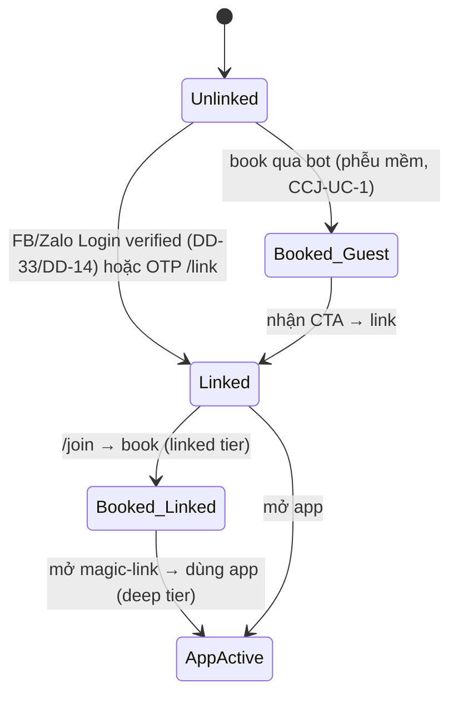

# Feature: Channel-first Booking Funnel — Product/UX Spec

> **Canonical phase:** P4.3 / P4.7 + Messenger P4.8 (đề xuất — sau khi DD-32 ✅; Messenger giữ đúng P4.8/post-MVP theo DD-09)
> **Track:** 🎣 Growth / Channel Acquisition
> **Version:** 0.1 · 2026-07-06
> **Status:** 🟡 Draft (proposal-stage — phụ thuộc **DD-32**; provider login **DD-33** Facebook + **DD-14** Zalo)
> **Prerequisites:** P3.5 identity (`feature_identity`) · P4.3 cross-club join (`feature_cross_club_join`) · P4.7 Zalo channel (`feature_zalo_channel`) · P4.8 Messenger (`channels/messenger/messenger-channel-design`) · P4 web-auth (`feature_web_auth_onboarding`)
> **Tài liệu liên quan:** `../standards/decisions.md` **DD-32** (nguồn quyết định) · **DD-33** (Facebook Login) · **DD-14** (Zalo Login) · DD-13 (Google/email — KHÔNG bao Facebook) · DD-29 (acquisition-first pricing) · `../00-start-here/identity-model.md` §7 (provider/channel phase matrix) · `BE/feature_channel_booking_funnel_tech.md` (chưa viết — chờ chốt phễu)

---

## 1. Mô tả

**Mục tiêu (owner 2026-07-06):** Một **phễu tăng trưởng channel-first** để tăng user cho Plexco. Ý đồ theo 3 bước:

1. **Link** — user liên kết Plexco account với tài khoản Facebook và Zalo của họ (qua Facebook Login — DD-33 · Zalo Login — DD-14).
2. **Hook** — nhờ đã link, user **đặt slot cho session Plexco ngay trong Messenger/Zalo**, ở đúng nơi họ đã có mặt hằng ngày (giá trị tức thì, không phải cài app trước).
3. **Deepen** — muốn làm nhiều hành động hơn, theo dõi chỉ số, phân tích chuyên sâu → **lên app Plexco** (lớp engagement sâu).

Đây **KHÔNG** phải cổng chống gian lận. Link account là **cửa vào phễu**, đổi lại giá trị (book-in-chat), rồi app là lớp giữ chân. Feature này **tái dùng** common join service (CCJ), identity/`channel_identities`/`accounts`, channel adapter Zalo/Messenger — **không dựng luồng book song song**.

> **Ràng buộc quy trình:** DD-32 đang 🟡. Doc này ở Status **Draft**; **KHÔNG** sửa thân spec Reviewed (`feature_cross_club_join`, `feature_zalo_channel`, `feature_identity`) cho tới khi DD-32 ✅. Khi ✅ → promote Draft này + viết `BE/..._tech.md` + áp propagation checklist (§7).

### Bất biến

- **Book qua bot chạy trên common join service (CCJ)** — KHÔNG tạo đường đặt slot song song. Capacity vẫn checked-under-lock tại final join (CCJ bất biến).
- **Tenant vẫn resolved từ webhook token/bot binding** — KHÔNG BAO GIỜ từ message content (ZAL/MSG bất biến).
- **"Linked account" = `channel_identities.person_id` trùng `accounts.person_id` có `account_identities` verified.** Link không bao giờ auto bằng tên; chỉ verified signal (social login / OTP `/link`) — giữ DD-01/HR4.
- **Money/PII không rò qua kênh:** venue ẩn cho tới khi join thành công (DD-06); không expose nợ/roster người khác (HR2). Book-in-chat không nới các bất biến này.
- **Phễu MỀM (khuyến nghị DD-32):** guest-join thuần vẫn hoạt động; link chỉ **mở thêm** giá trị, không thu hẹp đường guest — trừ khi founder chốt phễu cứng (B/C).

---

## 2. Use Cases + Edge Cases

### Use Cases

| ID | Actor | Hành động | Kết quả |
|---|---|---|---|
| CBF-UC-1 | Player | Nhận link CTA trong Messenger/Zalo → link Plexco account với FB/Zalo | `accounts` bound tới cùng `person` của channel identity; đủ điều kiện book-in-chat "linked tier" |
| CBF-UC-2 | Player (linked) | DM `/join` → chọn số → book slot | CCJ open/approved join; guest/active membership; charge tạo; venue reveal |
| CBF-UC-3 | Player (chưa link, phễu mềm) | DM `/join` → book | Guest-join thuần (CCJ-UC-1) vẫn thành công; sau đó bot hiện **CTA link account** |
| CBF-UC-4 | System | Sau book guest lần đầu | Gửi CTA "Link Plexco để xem lịch sử xuyên club + nhắc kèo + mở app" |
| CBF-UC-5 | Player (linked) | Yêu cầu "xem chi tiết / chỉ số" | Bot phát **magic-link** mở app Plexco (deep tier) — không trả full analytics trong chat |
| CBF-UC-6 | Player | Link qua FB Login (Messenger) | `account_identities(platform='facebook')` verified; bind account↔person (DD-33) |
| CBF-UC-7 | Player | Link qua Zalo Login | `account_identities(platform='zalo')` verified; bind (DD-14) |
| CBF-UC-8 | Player | Login social chưa khả dụng → fallback OTP `/link` | `link_codes` OTP confirm → coi như linked-lite (định nghĩa "linked" theo DD-32) |
| CBF-UC-9 | Player (linked ở kênh A) | Book ở kênh B cùng person | Không cần link lại nếu channel identity đã cùng person (tùy DD-15 `from.id` cross-bot) |
| CBF-UC-10 | Player | Rời slot đã book qua bot | CCJ leave policy (unpaid free slot / paid refund policy) — audit trail |
| CBF-UC-11 | System | Đo phễu | Emit funnel events (link_started/linked/book_in_chat/app_opened) để đo conversion |
| CBF-UC-12 | Player (linked) | Book session có tiền | Charge + `/pay` QR trong chat; đối soát theo `feature_payment_reconcile` (không đổi) |

### Edge Cases

| # | Category | Case | Hành vi bắt buộc |
|---|----------|------|-------------------|
| 1 | Security | Message content khai person/account ID để "đã link" | ❌ Reject — linked-state chỉ từ `accounts`/`account_identities` verified, không từ message |
| 2 | Security | FB/Zalo Login callback bị giả/replay | Reject — state token single-use/TTL/origin-bound (theo web-auth SI-1, DD-31) |
| 3 | Security | Link gắn nhầm person (2 người, 1 máy) | Verified social identity hoặc OTP single-use; conflict → pause, không auto-merge (ID edge) |
| 4 | Data Integrity | Book khi capacity đầy | CCJ lock — first-commit-wins, người sau nhận "full" (CCJ edge #1) |
| 5 | Data Integrity | Stale numbered list khi book | Reject — "Danh sách đã thay đổi, gõ /join" (ZAL edge #2) |
| 6 | UX/Growth | User bỏ ngang bước link | Phễu mềm: vẫn cho guest-book; không loop ép link (bounded CTA, không spam) |
| 7 | Security | CTA link chứa URL lạ | Chỉ phát domain Plexco đã whitelisted; magic-link hash-only/TTL/single-use |
| 8 | Cross-Feature | Đã link FB nhưng chưa link Zalo (hoặc ngược lại) | Book được ở kênh đã link; kênh chưa link → guest hoặc CTA link riêng kênh đó |
| 9 | Security | Book session có tiền khi chỉ linked-lite (OTP) | Theo DD-32 định nghĩa "linked"; nếu founder yêu cầu web-auth đầy đủ cho money-session → gate (C) |
| 10 | Privacy | Bot lộ chỉ số/nợ trong chat | ❌ NEVER — deep analytics chỉ trên app; chat chỉ book/nhắc/xác nhận (HR2) |
| 11 | Resilience | FB/Zalo Login provider outage | Degrade: fallback OTP `/link`; guest-book vẫn chạy; không corrupt state |
| 12 | Data Integrity | Account merge sau khi đã link 2 kênh | Common identity/merge service reconcile; magic-link/link cũ invalidate (ID/PVW edge) |
| 13 | Cross-Feature | Player bị ban ở club | Reject book bất kể linked (CCJ edge #12) |
| 14 | Concurrency | Link + book gần như đồng thời | Idempotent theo person/session; một active membership/person/tenant (CCJ edge #4) |

---

## 3. Screens & States

| Surface | Loading | Ready | Error | Empty |
|---------|---------|-------|-------|-------|
| Messenger/Zalo — CTA link | — | "🔗 Link Plexco để đặt sân ngay trong chat + mở app xem chi tiết" | "Lỗi tạo link — thử lại" | N/A |
| FB/Zalo Login (web popup) | "Đang xác minh..." | "✅ Đã liên kết tài khoản Plexco" | "Không liên kết được — thử lại/đổi cách" | N/A |
| Bot `/join` → book (linked) | "Đang xử lý..." | "✅ Đã đặt [session]! Địa chỉ: [venue]" | "❌ Hết chỗ / Số không hợp lệ / Hết hạn" | "Chưa có buổi chơi nào mở" |
| Bot — post-guest-book CTA | — | "Đã đặt! 🔗 Link Plexco để nhắc kèo + xem lịch sử" | — | N/A |
| Bot — deep action → app | — | "🔗 Mở app xem chi tiết: [magic-link] (hết hạn 5 phút)" | "Lỗi tạo link" | N/A |

---

## 4. Domain Model

Feature **tái dùng** bảng canonical hiện có — **không đề xuất bảng book song song**. Bảng liên quan:

| Entity | Vai trò trong phễu | Key constraints (canonical — `packages/db/schema.ts`) |
|--------|---------|-----------------|
| `persons` | Anchor người thật (§P6) | GLOBAL protected; merge theo verified signal |
| `channel_identities` | Zalo/Messenger/TG identity của user | `UNIQUE(platform, platform_user_lookup_hash)`, FK `person_id` |
| `accounts` | Plexco web-auth account | FK `person_id` — "linked" = account.person_id == channel_identity.person_id |
| `account_identities` | Binding social login (FB/Zalo/Google/TG) | `UNIQUE(platform, platform_user_hash)`, `verified_at` — **đường tạo linked-state** |
| `link_codes` | OTP `/link` (fallback khi social login chưa bật) | hash-only, TTL, single-use, `action='merge_identity'` |
| `memberships` | Guest/active membership tạo khi book | `UNIQUE(tenant_id, person_id)` active/guest; `status ∈ active|guest|left|merged` |
| `charges` | Nghĩa vụ tiền khi book session có phí | `session_id, person_id, amount, status` (CCJ/payment) |
| `magic_links` | Cầu chat → app (deep tier) | `UNIQUE(hash)`, `person_id`, `channel`, TTL, single-use |

> **Không có DDL mới bắt buộc** cho phễu mềm (A-nhẹ). Nếu founder chốt cần **đo "linked-before-book"** hoặc **gate cứng (B/C)**, có thể cần: cột trạng thái phễu / bảng `funnel_events` (analytics) — **quyết định ở BE tech doc sau khi DD-32 ✅**. Mọi bảng mới (nếu có) phải tenant-private + RLS fail-closed (HR1).

### State machine — trạng thái phễu của một channel user

---

## 5. Analytics Events

| Event | Khi nào | Payload tối thiểu (no PII) |
|-------|---------|-------------------|
| `funnel_link_started` | User bấm CTA link | `platform` (facebook/zalo), `source` (post_book/onboarding) |
| `funnel_link_completed` | Account↔person bound verified | `platform`, `method` (social/otp) |
| `funnel_book_in_chat` | Book thành công qua bot | `tenant_id` (opaque), `linked` (bool), `join_type` (open/approved) |
| `funnel_book_guest_cta_shown` | CTA link sau guest-book | `tenant_id` (opaque) |
| `funnel_app_opened_from_chat` | Magic-link mở app | `channel`, `source` (deep_action) |
| `funnel_link_abandoned` | Bỏ giữa chừng bước link | `platform`, `step` |

> Không log message content, raw platform UID, phone, token. Naming: `funnel_{action}_{result}`. Reuse `join_*` events của CCJ cho phần join lõi — event ở đây chỉ đo **lớp phễu**.

---

## 6. Acceptance Criteria

- [ ] Book qua bot chạy trên **common join service** — không đường song song; capacity lock giữ nguyên.
- [ ] "Linked" xác định **chỉ** từ `accounts`/`account_identities` verified (hoặc `/link` OTP theo định nghĩa DD-32) — không từ message content.
- [ ] Phễu mềm: guest-book vẫn thành công khi chưa link; CTA link hiện sau book, **bounded** (không spam/loop).
- [ ] Deep analytics/chỉ số **không** trả trong chat — chỉ magic-link mở app.
- [ ] FB/Zalo Login callback fail-closed (state token single-use/TTL/origin-bound — align SI-1/DD-31); fallback OTP khi provider outage.
- [ ] Venue/nợ/roster privacy giữ nguyên (DD-06/HR2) — book-in-chat không nới.
- [ ] Funnel events phát đủ để đo conversion link→book→app; không chứa PII.
- [ ] Không sửa spec Reviewed nào cho tới khi DD-32 ✅ (chỉ Draft + con trỏ).

---

## 7. Open Questions / Changelog

### Open Questions

| ID | Quyết định | Trạng thái |
|---|---|---|
| CBF-OQ-1 | Phễu **cứng hay mềm** (B/C gate vs A-nhẹ khuyến nghị) — quyết định ở **DD-32** | ⬜ Chờ founder |
| CBF-OQ-2 | Định nghĩa "linked": chỉ OTP `/link` đã confirm hay cần web-auth account đầy đủ | ⬜ Chờ founder (DD-32) |
| CBF-OQ-3 | Session **có tiền** có yêu cầu linked chặt hơn session free không (gate C) | ⬜ Chờ founder |
| CBF-OQ-4 | Thứ tự bật FB/Zalo Login social (DD-33 Facebook / DD-14 Zalo) — chặn đường link tự nhiên | 🔗 Phụ thuộc DD-33/DD-14 |
| CBF-OQ-5 | `from.id` Zalo có ổn định cross-bot không (ảnh hưởng CBF-UC-9 số lần link) | 🔗 Phụ thuộc DD-15 |

### Propagation checklist (chỉ áp dụng **khi DD-32 ✅** — hiện giữ nguyên spec Reviewed)

- `feature_cross_club_join(.md/_tech)`: thêm nhánh "linked-tier" trên CCJ join (không bỏ guest path nếu phễu mềm); acceptance test guest-vẫn-book.
- `feature_zalo_channel` + `channels/messenger/messenger-channel-design`: thêm CTA link + post-book CTA + magic-link deep-action; giữ tenant-from-webhook.
- `feature_identity`: định nghĩa "linked-enough-to-book"; đường tạo `account_identities(facebook/zalo)`; tương tác `/link` OTP.
- `feature_web_auth_onboarding`: thêm provider `facebook` (DD-33) / `zalo` (DD-14) + SI-1 state-token cho callback (DD-31).
- `docs/features/README.md`: thêm dòng Post-MVP (đã thêm — Draft).
- Viết `BE/feature_channel_booking_funnel_tech.md` (schema delta nếu cần đo phễu/gate cứng, API, test).

### Changelog

| Date | Version | Thay đổi |
|---|---|---|
| 2026-07-06 | v0.1 | Khởi tạo Draft từ **DD-32** (phễu channel-first: link FB/Zalo → book-in-chat → app). 12 use case, 14 edge case, state machine phễu, funnel events, propagation checklist. Giữ Draft tới khi DD-32 ✅. |
| 2026-07-06 | v0.2 | Ref fixes: provider login trỏ **DD-33** (Facebook) + **DD-14** (Zalo) thay DD-13/14; cross-ref `identity-model §6` → **§7** (provider matrix); canonical phase thêm **Messenger P4.8** (giữ DD-09). |
