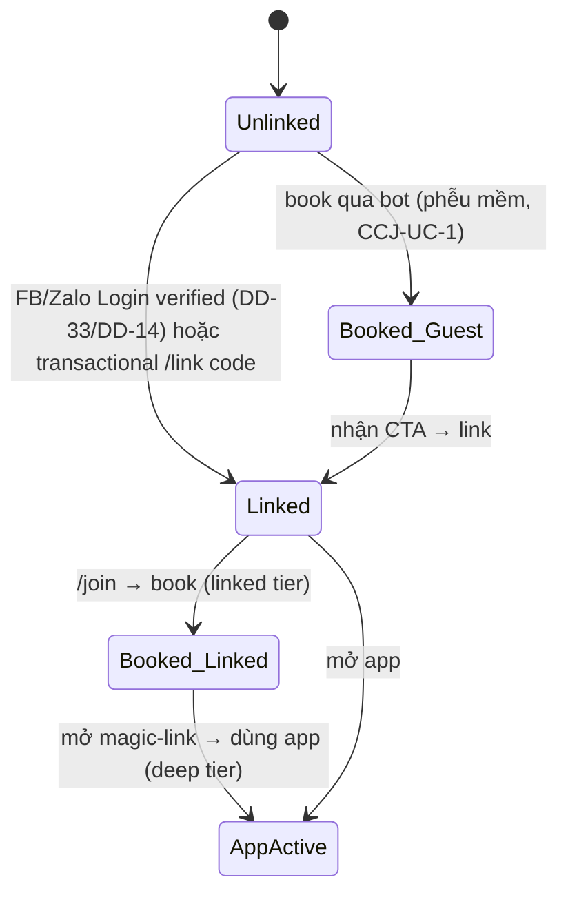

# Feature: Channel-first Booking Funnel — Product/UX Spec

> **Canonical phase:** P4.3 / P4.7 + Messenger **P2.5** (**DD-32 ✅ Option A; Messenger là kênh phase-1 P2.5 — DD-37 thay DD-09**)
> **Track:** 🎣 Growth / Channel Acquisition
> **Version:** 0.8a · 2026-07-19
> **Status:** ✅ DD-32 Option A, reconciled to decisions v1.67. Guest vẫn book kèo có phí. Waitlisted không tạo new obligation; refunded rejoin append chỉ khi active, full thì defer. Transactional `link_code` chỉ tạo linked-lite; debt-bearing claim vẫn cần DD-50 proof.
> **Implementation:** Not started · authority: `../standards/BUILD-STATUS.md` (Doc status ≠ Implementation status)  
> **Prerequisites:** P3.5 identity (`feature_identity`) · P4.3 cross-club join (`feature_cross_club_join`) · P4.7 Zalo channel (`feature_zalo_channel`) · **P2.5 Messenger** (`channels/messenger/messenger-channel-design` — phase-1, DD-37) · P4 web-auth (`feature_web_auth_onboarding`)
> **Tài liệu liên quan:** `../standards/decisions.md` **DD-32** (nguồn quyết định) · **DD-45/DD-49** (waitlist/rejoin money split) · **DD-33** (Facebook Login) · **DD-14** (Zalo Login) · DD-13 (Google/email — KHÔNG bao Facebook) · DD-29 (acquisition-first pricing) · `../standards/business-rules.md` BL-DSC-3/BL-SES-9/10 · `../00-start-here/identity-model.md` §7 (provider/channel phase matrix) · `BE/feature_channel_booking_funnel_tech.md` (chưa viết — viết cùng build slice)

---

## 1. Mô tả

**Mục tiêu (owner 2026-07-06):** Một **phễu tăng trưởng channel-first** để tăng user cho Plexco. Ý đồ theo 3 bước:

1. **Link** — user liên kết Plexco account với tài khoản Facebook và Zalo của họ (qua Facebook Login — DD-33 · Zalo Login — DD-14).
2. **Hook** — nhờ đã link, user **đặt slot cho session Plexco ngay trong Messenger/Zalo**, ở đúng nơi họ đã có mặt hằng ngày (giá trị tức thì, không phải cài app trước).
3. **Deepen** — muốn làm nhiều hành động hơn, theo dõi chỉ số, phân tích chuyên sâu → **lên app Plexco** (lớp engagement sâu).

Đây **KHÔNG** phải cổng chống gian lận. Link account là **cửa vào phễu**, đổi lại giá trị (book-in-chat), rồi app là lớp giữ chân. Feature này **tái dùng** common join service (CCJ), identity/`channel_identities`/`accounts`, channel adapter Zalo/Messenger — **không dựng luồng book song song**.

> **Ràng buộc quy trình:** DD-32 đã ✅ Option A. Doc vẫn **Draft** vì chưa có BE companion/chưa build; khi mở build slice phải viết `BE/..._tech.md` và áp propagation checklist (§7). Không được biến Option A thành linked gate trên guest path.

### Bất biến

- **Book qua bot chạy trên common join service (CCJ)** — KHÔNG tạo đường đặt slot song song. Capacity vẫn checked-under-lock tại final join (CCJ bất biến).
- **Endpoint luôn resolve từ webhook token/Page/bot binding**; endpoint chỉ cho ingress/default context. Target-tenant eligibility authorize riêng — KHÔNG BAO GIỜ từ message content (DD-66/67).
- **Ba mức identity:** guest = channel identity chưa link; linked-lite = transactional one-time `/link` code confirmed đủ cho hook; web-auth = `accounts` + verified `account_identities` cho app/deep actions. Claim/merge membership có tiền vẫn theo DD-50 evidence matrix; linked-state riêng lẻ không tự cấp quyền claim.
- **Money/PII không rò qua kênh:** venue ẩn cho tới khi player active; approved/waitlisted vẫn ẩn (DD-06). Không expose nợ/roster người khác (HR2).
- **Phễu MỀM (DD-32 Option A đã chốt):** guest-join thuần vẫn hoạt động, kể cả paid session; link chỉ **mở thêm** giá trị, không thu hẹp đường guest. B/C là phương án đã loại và chỉ sống lại khi DD-32 được reopen.

---

## 2. Use Cases + Edge Cases

### Use Cases

| ID | Actor | Hành động | Kết quả |
|---|---|---|---|
| CBF-UC-1 | Player | Nhận link CTA trong Messenger/Zalo → link Plexco account với FB/Zalo | `accounts` bound tới cùng `person` của channel identity; đủ điều kiện book-in-chat "linked tier" |
| CBF-UC-2 | Player (linked) | DM `/join` → chọn số → book slot | Active→charge/venue; full→waitlisted/no new obligation/venue. DD-49 refunded lifecycle only when active |
| CBF-UC-3 | Player (chưa link, phễu mềm) | DM `/join` → book | Guest-join vẫn active hoặc waitlisted theo capacity; first-entry theo no-charge→charge timing DD-45, existing `left` theo DD-49; sau outcome bot hiện **CTA link account** |
| CBF-UC-4 | System | Sau book guest lần đầu | Gửi CTA "Link Plexco để xem lịch sử xuyên club + nhắc kèo + mở app" |
| CBF-UC-5 | Player (linked) | Yêu cầu "xem chi tiết / chỉ số" | Bot phát **magic-link** mở app Plexco (deep tier) — không trả full analytics trong chat |
| CBF-UC-6 | Player | Link qua FB Login (Messenger) | `account_identities(platform='facebook')` verified; bind account↔person (DD-33) |
| CBF-UC-7 | Player | Link qua Zalo Login | `account_identities(platform='zalo')` verified; bind (DD-14) |
| CBF-UC-8 | Player | Login social chưa khả dụng → fallback `/link` | Transactional one-time `link_code` confirmed → linked-lite theo DD-32 |
| CBF-UC-9 | Player (linked ở kênh A) | Book ở kênh B cùng person | Không cần link lại nếu channel identity đã cùng person (tùy DD-15 `from.id` cross-bot) |
| CBF-UC-10 | Player | Rời slot đã book qua bot | CCJ leave policy (unpaid free slot / paid refund policy) — audit trail |
| CBF-UC-11 | System | Đo phễu | Emit funnel events (link_started/linked/book_in_chat/app_opened) để đo conversion |
| CBF-UC-12 | Player (linked) | Book session có tiền | First-entry active→charge+QR; full→waitlisted/no charge/QR. DD-49 not-refunded may carry history; refunded full defers lifecycle |

### Edge Cases

| # | Category | Case | Hành vi bắt buộc |
|---|----------|------|-------------------|
| 1 | Security | Message content khai person/account ID để "đã link" | ❌ Reject — linked-state chỉ từ verified account identity hoặc transactional one-time `/link` code đã consume; không từ ID/text tự khai |
| 2 | Security | FB/Zalo Login callback bị giả/replay | Reject — state token single-use/TTL/origin-bound (theo web-auth SI-1, DD-31) |
| 3 | Security | Link gắn nhầm person (2 người, 1 máy) | Verified account identity hoặc transactional `link_code`; conflict → pause, không auto-merge |
| 4 | Data Integrity | Book khi capacity đầy | CCJ lock — vào `waitlisted` với position dương; không venue. First-entry không charge; DD-49 rejoin chưa-refund giữ history, refunded defer lifecycle mới tới activation |
| 5 | Data Integrity | Stale numbered list khi book | Reject — "Danh sách đã thay đổi, gõ /join" (ZAL edge #2) |
| 6 | UX/Growth | User bỏ ngang bước link | Phễu mềm: vẫn cho guest-book; không loop ép link (bounded CTA, không spam) |
| 7 | Security | CTA link chứa URL lạ | Chỉ phát domain Plexco đã whitelisted; magic-link hash-only/TTL/single-use |
| 8 | Cross-Feature | Đã link FB nhưng chưa link Zalo (hoặc ngược lại) | Book được ở kênh đã link; kênh chưa link → guest hoặc CTA link riêng kênh đó |
| 9 | Security | Book session có tiền khi chỉ linked-lite | **DD-32 = A:** guest/linked-lite được book paid session; first-entry active tạo charge, full waitlisted/no-charge. DD-49 rejoin active carry-or-append; full carry-history-or-defer-refunded. Linked-lite không tự claim membership có tiền. |
| 10 | Privacy | Bot lộ chỉ số/nợ trong chat | ❌ NEVER — deep analytics chỉ trên app; chat chỉ book/nhắc/xác nhận (HR2) |
| 11 | Resilience | FB/Zalo Login provider outage | Degrade: fallback transactional one-time `/link` code; guest-book vẫn chạy; không corrupt state |
| 12 | Data Integrity | Account merge sau khi đã link 2 kênh | Common identity/merge service reconcile; magic-link/link cũ invalidate (ID/PVW edge) |
| 13 | Cross-Feature | Player bị ban ở club | Reject book bất kể linked (CCJ edge #12) |
| 14 | Concurrency | Link + book gần như đồng thời | Idempotent theo person/session; một active membership/person/tenant (CCJ edge #4) |

---

## 3. Screens & States

| Surface | Loading | Ready | Error | Empty |
|---------|---------|-------|-------|-------|
| Messenger/Zalo — CTA link | — | "🔗 Link Plexco để đặt sân ngay trong chat + mở app xem chi tiết" | "Lỗi tạo link — thử lại" | N/A |
| FB/Zalo Login (web popup) | "Đang xác minh..." | "✅ Đã liên kết tài khoản Plexco" | "Không liên kết được — thử lại/đổi cách" | N/A |
| Bot `/join` → book (linked) | "Đang xử lý..." | Active: "✅ Đã đặt [session]! [venue]"; waitlisted: "⏳ Vị trí N" (không venue/QR) | "Số không hợp lệ / Hết hạn / cần host review" | "Chưa có buổi chơi nào mở" |
| Bot — post-guest-book CTA | — | "Đã đặt! 🔗 Link Plexco để nhắc kèo + xem lịch sử" | — | N/A |
| Bot — deep action → app | — | "🔗 Mở app xem chi tiết: [magic-link] (hết hạn 5 phút)" | "Lỗi tạo link" | N/A |

---

## 4. Domain Model

Feature **tái dùng** bảng canonical hiện có — **không đề xuất bảng book song song**. Bảng liên quan:

| Entity | Vai trò trong phễu | Key constraints (canonical — `packages/db/schema.ts`) |
|--------|---------|-----------------|
| `persons` | Anchor người thật (§P6) | GLOBAL protected; merge theo verified signal |
| `channel_identities` | Endpoint-scoped Zalo/Messenger identity; `telegram` chỉ legacy tenant #1 | `UNIQUE(platform, provider_scope_lookup_hash, platform_user_lookup_hash)`, FK `person_id`; Messenger scope Page, Zalo scope bot/OA |
| `accounts` | Plexco web-auth account | FK `person_id` — "linked" = account.person_id == channel_identity.person_id |
| `account_identities` | Binding web/social login (Google/email/Facebook/Zalo; không Telegram — DD-37) | `UNIQUE(platform, platform_user_hash)`, `verified_at` — **đường tạo linked-state** |
| `link_codes` | Transactional `/link` fallback khi social login chưa bật | Canonical DD-50/Identity contract: keyed lookup + slow verify hash; exactly-one authenticated issuer (`source_channel_identity_id` XOR `source_account_id`); `source_person_id` re-derived at consume; TTL + `max_attempts` + `locked_until` + `revoked_at` + `consumed_at`; `action='merge_identity'` |
| `memberships` | Guest/active membership tạo khi book | `UNIQUE(tenant_id, person_id)` active/guest; `status ∈ active\|guest\|left\|merged` |
| `charges` | Nghĩa vụ tiền khi player active ở session có phí | UNIQUE per player/session; waitlisted creates no new obligation; refunded rejoin appends lifecycle only at activation |
| `magic_links` | Cầu chat → app (deep tier) | `UNIQUE(hash)`, `person_id`, `channel`, TTL, single-use |

> **Không có DDL mới bắt buộc** cho phễu mềm (A-nhẹ). Analytics có thể đi qua event pipeline hiện hữu; nếu build slice cần persistence riêng để đo `linked-before-book`, BE tech doc phải pin schema, retention và privacy. **Không** thêm linked booking gate; B/C chỉ được sống lại khi DD-32 được reopen. Mọi bảng tenant-scoped mới (nếu có) phải RLS fail-closed (HR1).

### State machine — trạng thái phễu của một channel user

---

## 5. Analytics Events

| Event | Khi nào | Payload tối thiểu (no PII) |
|-------|---------|-------------------|
| `funnel_link_started` | User bấm CTA link | `platform` (facebook/zalo), `source` (post_book/onboarding) |
| `funnel_link_completed` | Account↔person bound verified | `platform`, `method` (social/otp) |
| `funnel_book_in_chat` | Book thành công qua bot | `tenant_id` (opaque), `linked` (bool), `join_type` (open/approved), `outcome` (active/waitlisted) |
| `funnel_book_guest_cta_shown` | CTA link sau guest-book | `tenant_id` (opaque) |
| `funnel_app_opened_from_chat` | Magic-link mở app | `channel`, `source` (deep_action) |
| `funnel_link_abandoned` | Bỏ giữa chừng bước link | `platform`, `step` |

> Không log message content, raw platform UID, phone, token. Naming: `funnel_{action}_{result}`. Reuse `join_*` events của CCJ cho phần join lõi — event ở đây chỉ đo **lớp phễu**.

---

## 6. Acceptance Criteria

- [ ] Book qua bot chạy trên **common join service** — không đường song song; capacity lock giữ nguyên.
- [ ] "Linked" xác định chỉ từ verified account identity hoặc consumed transactional `/link` code — không từ message content.
- [ ] `/link` consume locks the row, rejects consumed/revoked/expired/locked/max-attempt states before mutation, re-resolves the exact issuer→current Person, and atomically increments a failed attempt or consumes once; this Draft cannot define a reduced link-code lifecycle in its future BE companion.
- [ ] Phễu mềm: guest-book vẫn thành công khi chưa link; CTA link hiện sau book, **bounded** (không spam/loop).
- [ ] Deep analytics/chỉ số **không** trả trong chat — chỉ magic-link mở app.
- [ ] FB/Zalo Login callback fail-closed (state token single-use/TTL/origin-bound — align SI-1/DD-31); fallback transactional `/link` code khi provider outage.
- [ ] Venue/nợ/roster privacy giữ nguyên (DD-06/HR2) — book-in-chat không nới.
- [ ] Capacity full trả waitlisted position, no venue/QR/new obligation. DD-49 rejoin promotion re-derives; carry-over hoặc append refunded lifecycle at activation; unknown→review.
- [ ] Funnel events phát đủ để đo conversion link→book→app; không chứa PII.
- [ ] Khi build, propagate đúng checklist §7 vào các spec/service liên quan; không thêm linked gate vào guest path.

---

## 7. Open Questions / Changelog

### Open Questions

| ID | Quyết định | Trạng thái |
|---|---|---|
| CBF-OQ-1 | Phễu cứng hay mềm | ✅ **A — mềm** (DD-32): guest vẫn book free/paid; link chỉ mở giá trị + CTA |
| CBF-OQ-2 | Định nghĩa "linked" | ✅ Ba mức: guest · linked-lite one-time `link_code` · web-auth; claim/merge tiền defer DD-50 identity policy |
| CBF-OQ-3 | Session có tiền có yêu cầu web-auth không | ✅ Không dưới A; bắt web-auth cho paid booking = C, phải reopen DD-32 |
| CBF-OQ-4 | Thứ tự bật FB/Zalo Login social (DD-33 Facebook / DD-14 Zalo) — chặn đường link tự nhiên | 🔗 Phụ thuộc DD-33/DD-14 |
| CBF-OQ-5 | `from.id` Zalo có ổn định cross-bot không (ảnh hưởng CBF-UC-9 số lần link) | 🔗 Phụ thuộc DD-15 |

### Propagation checklist (áp dụng khi mở build slice; DD-32 đã ✅)

- `feature_cross_club_join(.md/_tech)`: giữ nguyên guest path; acceptance test guest-vẫn-book free/paid phải cover first-entry active→exactly-one-charge, first-entry full→waitlisted/no-charge, DD-49 rejoin active→carry/append và full→carry-history/defer-refunded; không tạo linked-tier gate.
- `feature_zalo_channel` + `channels/messenger/messenger-channel-design`: thêm CTA link + post-book CTA + magic-link deep-action; giữ tenant-from-webhook.
- `feature_identity(.md/_tech)`: pin guest/linked-lite/web-auth; đường tạo `account_identities(facebook/zalo)`; transactional `/link` contract; claim/merge tiền giữ DD-50 evidence matrix.
- `feature_web_auth_onboarding`: thêm provider `facebook` (DD-33) / `zalo` (DD-14) + SI-1 state-token cho callback (DD-31).
- `docs/features/README.md`: giữ row coverage phase-1 (đã thêm — product-only Draft).
- Viết `BE/feature_channel_booking_funnel_tech.md` (schema delta nếu cần đo phễu/link, API, test; **không** dựng gate cứng nếu chưa reopen DD-32).

### Changelog

| Date | Version | Thay đổi |
|---|---|---|
| 2026-07-19 | v0.8a | Metadata sweep (index v2.35): thêm trường **Implementation** đồng bộ BUILD-STATUS (Not started). Không đổi contract. |
| 2026-07-19 | v0.8 | **DD-49 timing mirror:** booking remains soft funnel; rejoin active→carry/append, full→carry-history/defer-refunded. Authority → decisions v1.67; no runtime. |
| 2026-07-19 | v0.7 | **DD-45×DD-49 integrity:** waitlisted means no new obligation; refunded rejoin appends lifecycle at activation only. Unknown disposition remains fail-closed. Authority → decisions v1.67. |
| 2026-07-17 | v0.6 | **DD-50 mirror closure:** `/link` now delegates the complete XOR issuer, terminal lifecycle, current-Person recheck and atomic attempt/consume contract to Identity; prevents the future BE companion from rebuilding a reduced link-code table. |
| 2026-07-17 | v0.5 | Authority → decisions v1.45. Channel identity key generalized theo provider endpoint cho Messenger + Zalo; endpoint/default context tách khỏi target-tenant eligibility. Draft/build status không đổi. |
| 2026-07-15 | v0.4 | **DD-45 + DD-37 propagation:** book outcome active-vs-waitlisted; full không còn error, không charge/venue/QR; analytics thêm outcome. Provider matrix chỉ Google/email/Facebook/Zalo + channel Zalo/Messenger; Telegram legacy-only. |
| 2026-07-15 | v0.3 | **DD-32 ✅ Option A:** đóng OQ-1..3; guest vẫn book free/paid; ba mức guest/linked-lite/web-auth; claim/merge money-bearing membership defer identity evidence/confirmation/audit; build checklist giữ CCJ guest path và thêm CTA ở channel specs. |
| 2026-07-06 | v0.1 | Khởi tạo Draft từ **DD-32** (phễu channel-first: link FB/Zalo → book-in-chat → app). 12 use case, 14 edge case, state machine phễu, funnel events, propagation checklist. Giữ Draft tới khi DD-32 ✅. |
| 2026-07-06 | v0.2 | Ref fixes: provider login trỏ **DD-33** (Facebook) + **DD-14** (Zalo) thay DD-13/14; cross-ref `identity-model §6` → **§7** (provider matrix); canonical phase thêm **Messenger P4.8** (giữ DD-09). |
