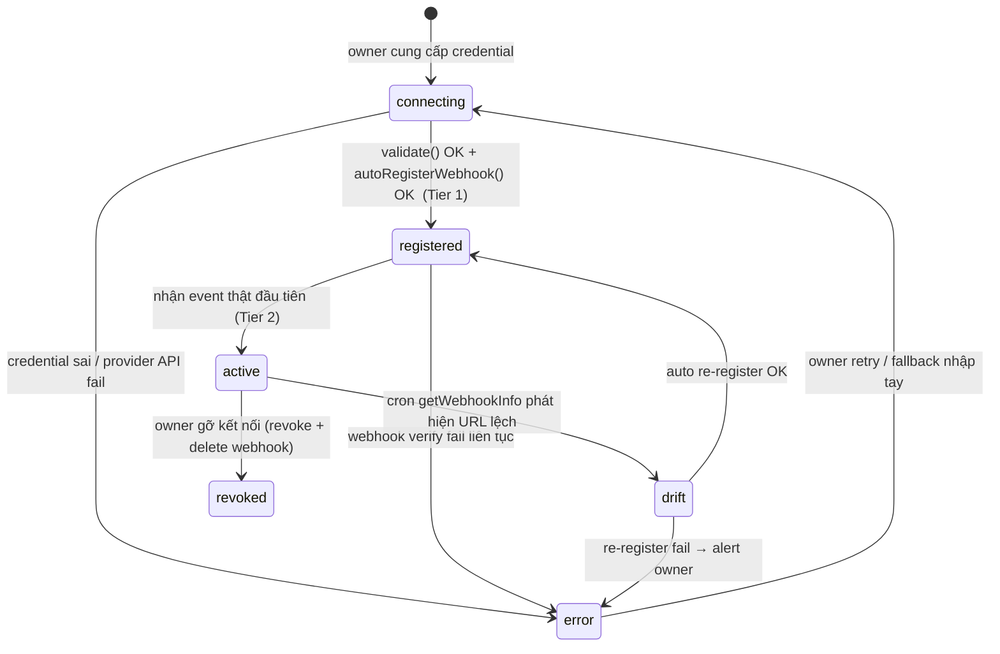
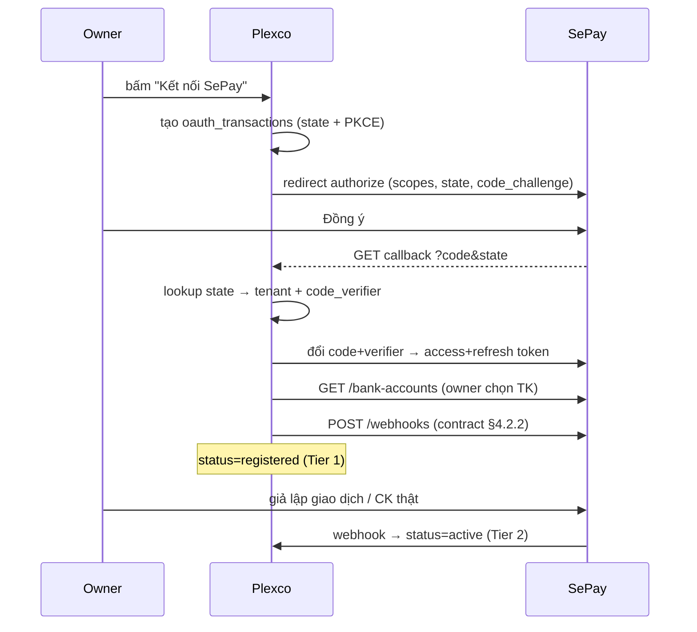

# Feature: Connector Onboarding (Zalo · SePay · ApiPay) — Auto-Register Upgrade

> **Canonical phase:** P3 (payment ingest) · P4 (web onboarding) · P4.7 (Zalo) — *cross-cutting upgrade*
> **Track:** 🔌 Connector / Onboarding
> **Version:** 0.5 · 2026-07-10
> **Status:** Draft (provider-contract reviewed)
> **Prerequisites:** P3 webhook ingest stable · P4 onboarding wizard scaffold
> **Tài liệu liên quan:** `feature_web_auth_onboarding.md` (nâng cấp step bank/zalo/messenger) · `feature_zalo_channel.md` · `feature_player_messenger.md` · `feature_payment_reconcile.md` · `../channels/zalo/README.md` §6–7 · `../standards/decisions.md` DD-37/DD-33 · `../product/TDD.md` · `../standards/business-rules.md` BL-PAY-6, BL-SEC-1/2, BL-TEN-1, BL-ID-6, BL-SEC-5 · `../research/player-side-saas-AUDIT.md` §B2

> **Cập nhật v3.4 (DD-37, 2026-07-10):** kênh phase-1 = **Zalo + Facebook Messenger** + web (**Telegram loại khỏi phạm vi**). Doc này giữ nguyên connector **Zalo · SePay · ApiPay**. **Facebook Messenger** onboarding = FB Login + chọn **Page per-club** (App Review, DD-33) — chi tiết ở `feature_player_messenger.md` + `feature_web_auth_onboarding.md`.

---

## 0. TL;DR — vấn đề & đề xuất

**Vấn đề (hiện trạng spec):** Cả ba connector đều bắt **chủ CLB (non-tech)** tự tay làm bước khó nhất:

| Connector | Owner đang phải làm tay (theo spec hiện tại) |
|---|---|
| Zalo | Tạo bot → dán token → **tự vào Zalo platform dán webhook URL** `{api_base}/webhook/zalo/{token}` (`channels/zalo/README.md` §6) |
| SePay | Nhập credential → **tự vào SePay dashboard tạo webhook** trỏ về Plexco (`feature_web_auth_onboarding` step bank) |
| ApiPay | Nhập credential → **tự vào ApiPay dashboard tạo webhook** |

Bước "copy URL → mò vào dashboard bên thứ ba → dán đúng chỗ → set trigger/secret" là điểm rơi onboarding lớn nhất cho non-tech user, và cũng là nguồn lỗi "webhook drift".

**Đề xuất:** Đảo nguyên tắc — **owner chỉ đưa thứ bí mật của họ; Plexco tự đăng ký webhook bằng API**. Mức độ chắc chắn (kiểm chứng dashboard/docs thật ngày 2026-06-20):

- **SePay** — ✅ *verified*. Có **OAuth2** (scopes `bank-account:read`, `transaction:read`, `webhook:write`) + `POST /api/v1/webhooks` (contract đầy đủ — §4.2) + `GET /api/v1/transactions` + **giả lập giao dịch** → "Kết nối SePay" 1 nút, không dán token.
- **ApiPay** — ✅ *verified*. `GET /v2/client/banks` (liệt kê TK đã liên kết) + `POST /v1/client/webhooks` (trả về `id` + `secret`) → dán 2 key, tự đăng ký webhook.
- **Zalo** — 🟡 *candidate, blocked by sandbox confirmation (CO-OQ-1)*. Pattern token + `getMe`/`setWebhook` xuất hiện trong các SDK Zalo Bot cộng đồng, **nhưng chưa kiểm chứng endpoint/tham số chính thức** trên tier Zalo Bot mà CLB dùng. **Không** đưa vào triển khai cho tới khi confirm sandbox; trước đó giữ luồng nhập tay hiện có.

**Kết quả:** 3 flow rối → 1 pattern "Kết nối" thống nhất, kết thúc bằng tín hiệu xanh "đã nhận giao dịch/tin nhắn thử". Bỏ bước dán webhook URL ở 2 connector đã verified; Zalo theo sau khi gỡ block.

### Quan hệ với spec hiện tại

Đây là **bản nâng cấp**, không thay thế:

- `feature_web_auth_onboarding.md` — step `bank_connect`/`bank_verify` và `zalo_optional`: từ "manual portal config" → **auto-register + verify-by-event**.
- `channels/zalo/README.md` §6 — giữ manual webhook cho tới khi gỡ CO-OQ-1; sau đó mới chuyển sang **Plexco gọi `setWebhook`**. §7 drift từ "alert" → **auto re-register** khi API chính thức được xác nhận.
- `feature_payment_reconcile.md` — phần ingest giữ nguyên; chỉ thay đường *thiết lập* webhook.

### Nguồn kiểm chứng provider (snapshot 2026-06-20)

| Provider | Nguồn chính | Đã chốt trong spec | Còn phải sandbox |
|---|---|---|---|
| SePay | `https://docs.sepay.vn/oauth2/api-webhooks.html`, `https://docs.sepay.vn/oauth2/api-tai-khoan-ngan-hang.html`, `https://docs.sepay.vn/oauth2/api-giao-dich.html` | scopes `bank-account:read`, `transaction:read`, `webhook:write`; `GET /api/v1/bank-accounts`; `POST /api/v1/webhooks`; `GET /api/v1/transactions` | header/body inbound thực tế khi `authen_type=Api_Key` (CO-OQ-7) |
| ApiPay | `https://docs.apipay.vn/vi/api/authentication`, `https://docs.apipay.vn/vi/api/banks`, `https://docs.apipay.vn/vi/api/webhooks` | `Authorization: Bearer base64(accessKey:secretKey)`; banks `/v2/client/banks`; webhooks `/v1/client/webhooks`; `ApiPay-Signature` HMAC raw body | test với key sandbox để xác nhận status/error mapping |
| Zalo | `channels/zalo/README.md` + SDK/community references | tenant routing + secret verify pattern | endpoint/tham số chính thức `getMe`/`setWebhook`/`getWebhookInfo` trên tier CLB (CO-OQ-1) |

---

## 1. Mô tả

Cung cấp một trải nghiệm "Kết nối" (Connect) thống nhất cho 3 connector, sao cho chủ CLB chỉ phải cung cấp credential thuộc về họ (bot token / OAuth consent / API key), còn việc đăng ký webhook về Plexco và xác minh hoạt động do hệ thống tự làm.

### Bất biến

- **B1 — Routing theo opaque token, KHÔNG theo nội dung payload.** Tenant luôn suy ra từ `:token` trong path → `*.webhook_token → tenant_id`, rồi mới verify `account_fingerprint`/account khớp. Ref: **BL-PAY-6**, **BL-ID-6**.
- **B2 — Secret at-rest qua KMS, write-only.** Mọi token/secret (`bot_token_enc`, `webhook_secret_enc`, OAuth tokens, PKCE verifier) mã hoá envelope (AES-GCM); không log; không trả lại sau khi lưu; có reset path. Ref: **BL-SEC-1**.
- **B3 — Verify webhook timing-safe trên RAW body.** Sai chữ ký → 401, không persist payload nghiệp vụ, security log không chứa secret. HMAC tính trên **raw request body**, không phải JSON đã parse lại. Ref: **BL-SEC-2**, AUDIT B-webhook.
- **B4 — RLS fail-closed.** Mọi bảng tenant-scoped ENABLE + FORCE RLS theo `app.tenant_id`. Riêng `oauth_transactions` là bảng bootstrap trước-tenant cho OAuth callback, không đọc trực tiếp qua tenant RLS; chỉ truy cập qua SECURITY DEFINER function lookup-by-state single-use. Ref: **BL-TEN-1**.
- **B5 — Tự động hoá KHÔNG nới lỏng bảo mật.** Auto-register chỉ chạy trong context tenant đã auth (TenantOwner), idempotent, chịu rate limit **BL-SEC-5**.
- **B6 — Auto-register là tiện ích, không phải điểm chết.** Provider API fail → **fallback** về nhập tay (giữ luồng cũ) để onboarding không bị chặn cứng.

---

## 2. Nguyên tắc thiết kế chung — "Connect" pattern

### 2.1 Credential-minimization

Owner chỉ đưa đúng **một thứ chỉ họ mới có**; mọi thao tác cấu hình webhook là việc của Plexco:

| Connector | Owner đưa gì | Plexco tự làm | Bước tay còn lại (không bỏ được) |
|---|---|---|---|
| SePay ✅ | OAuth2 consent (nút "Đồng ý") | `GET /api/v1/bank-accounts` → `POST /api/v1/webhooks` *hoặc* poll `/transactions` | — (chỉ bấm Đồng ý) |
| ApiPay ✅ | accessKey + secretKey | `GET /v2/client/banks` → `POST /v1/client/webhooks` | Copy 2 key từ ApiPay → Plexco |
| Zalo 🟡 | Bot token (per-CLB) | `getMe` → `setWebhook` → store enc *(sau khi gỡ CO-OQ-1)* | Tạo bot trong Zalo Bot Creator |

> Zalo còn 1 bước tạo bot vì Zalo **không** có API tạo bot (owner tự tạo trong Zalo Bot Creator). SePay là "rảnh tay" nhất nhờ OAuth2.

### 2.2 Capability-driven UI

Một interface chung, UI render theo `auth_mode` của provider — thêm provider mới = khai báo capability, không viết lại màn hình.

```typescript
type AuthMode =
  | { kind: "oauth2"; scopes: string[] }                      // SePay
  | { kind: "api_key"; fields: ["accessKey", "secretKey"] }   // ApiPay
  | { kind: "bot_token" };                                     // Zalo

interface ConnectorProvider {
  id: "zalo" | "sepay" | "apipay";
  auth: AuthMode;
  validate(creds: Credentials): Promise<ProviderIdentity>;      // getMe / OAuth /me / banks
  autoRegisterWebhook(ctx: TenantCtx, creds): Promise<WebhookHandle>;
  verify: { kind: "wait_inbound" } | { kind: "wait_transaction" } | { kind: "simulate" };
}
```

### 2.3 Verify 2 tầng (chốt: kết hợp register-OK + event thật)

```
Tier 1 — "Đã kết nối"  := validate() OK  &&  autoRegisterWebhook() OK   (wiring kỹ thuật xong)
Tier 2 — "Đã xác minh" := nhận event thật đầu tiên qua webhook          (chứng minh end-to-end)
```

- **Tier 1** = trạng thái `registered`. UI hiện "✅ Đã kết nối — đang chờ tín hiệu thử".
- **Tier 2** = trạng thái `active`. Đạt khi: Zalo = owner DM bot 1 tin · SePay/ApiPay = 1 giao dịch thật **hoặc** SePay "giả lập giao dịch" (không cần tiền thật).

---

## 3. Domain Model (delta lên schema hiện tại)

### 3.1 Vocabulary trạng thái (canonical — dùng CHUNG cho cả 3 bảng)

Một enum duy nhất, khớp đúng state machine ở §3.3:

| status | Ý nghĩa |
|---|---|
| `connecting` | Đã nhận credential, đang validate / đăng ký webhook |
| `registered` | **Tier 1** — credential OK + webhook đã đăng ký (Zalo `setWebhook`/SePay/ApiPay) hoặc OAuth đã linked |
| `active` | **Tier 2** — đã nhận event thật đầu tiên |
| `drift` | Webhook URL bị lệch (cron phát hiện) |
| `error` | Lỗi credential / đăng ký / refresh token |
| `revoked` | Owner gỡ kết nối |

> Áp dụng cho `zalo_bots.status`, `bank_accounts.webhook_status`, `provider_connections.status`. `provider_connections.status` do **connector lifecycle service** ghi: connect/retry/revoke/OAuth-refresh có thể set trực tiếp ở mức provider; còn sau mỗi thay đổi `bank_accounts.webhook_status`, service recompute rollup theo §3.1.1. Không để UI/job con ghi đè trực tiếp ngoài service này.

#### 3.1.1 Ownership & rollup của `provider_connections.status`

- **Nguồn ghi duy nhất:** connector lifecycle service. API handler, webhook handler, refresh job và drift job đều gọi service này, không update raw table trực tiếp.
- **Direct provider events:** owner connect/retry → `connecting`; credential/OAuth refresh fail → `error`; owner revoke → `revoked`.
- **Child rollup:** sau mỗi thay đổi `bank_accounts.webhook_status`, recompute cho connection tương ứng: `drift` nếu có TK drift; `error` nếu tất cả TK selected đều error/revoked hoặc provider credential lỗi; `connecting` nếu chưa có TK registered/active hoặc còn TK selected đang pending kích hoạt; `active` nếu có ít nhất 1 TK active và không có drift/error/connecting blocking; `registered` nếu đã đăng ký webhook nhưng chưa có event thật.
- **Audit:** mọi transition ghi `actor`, `source` (`connect_flow|webhook|drift_job|refresh_job|revoke`) và `reason_code`.

### 3.2 DDL delta

```sql
-- (NEW) Credential mức "kết nối" cho SePay (OAuth) / ApiPay (API key).
-- Tách khỏi bank_accounts vì 1 kết nối có thể quản nhiều TK ngân hàng.
CREATE TABLE provider_connections (
  id                uuid PRIMARY KEY DEFAULT gen_random_uuid(),
  tenant_id         uuid NOT NULL REFERENCES tenants(id),
  provider          text NOT NULL CHECK (provider IN ('sepay','apipay')),
  auth_mode         text NOT NULL CHECK (auth_mode IN ('oauth2','api_key')),
  -- OAuth (SePay)
  access_token_enc  bytea,
  refresh_token_enc bytea,
  scope             text,
  token_expires_at  timestamptz,
  -- API key (ApiPay)
  api_access_key_enc bytea,
  api_secret_key_enc bytea,
  status            text NOT NULL DEFAULT 'connecting'
                    CHECK (status IN ('connecting','registered','active','drift','error','revoked')),
  last_error_code   text,
  created_at        timestamptz NOT NULL DEFAULT now(),
  UNIQUE (tenant_id, provider)
);
-- ENABLE + FORCE RLS theo app.tenant_id (BL-TEN-1).

-- (NEW) Giao dịch OAuth ngắn hạn cho SePay — PKCE + state, KHÔNG dựa cookie (xem §4.2.3)
CREATE TABLE oauth_transactions (
  state             text PRIMARY KEY,              -- random, đối chiếu ở callback
  tenant_id         uuid NOT NULL REFERENCES tenants(id),
  provider          text NOT NULL CHECK (provider IN ('sepay')),
  code_verifier_enc bytea NOT NULL,                -- PKCE verifier, KMS enc
  redirect_uri      text NOT NULL,
  created_by        uuid NOT NULL,                 -- owner person id
  created_at        timestamptz NOT NULL DEFAULT now(),
  expires_at        timestamptz NOT NULL           -- ví dụ 10 phút
);

-- OAuth bootstrap table: KHÔNG đặt dưới tenant-RLS thường theo app.tenant_id.
-- Direct SELECT/UPDATE/DELETE từ role app bị REVOKE; callback chỉ dùng
-- SECURITY DEFINER function consume_oauth_transaction(state) để lookup-by-state
-- (state random ≥128-bit, TTL 10', SELECT FOR UPDATE, DELETE trong cùng txn).

-- (ALTER) bank_accounts: liên kết về connection + metadata auto-register
ALTER TABLE bank_accounts
  ADD COLUMN provider_connection_id uuid REFERENCES provider_connections(id),
  ADD COLUMN provider_webhook_id    text,        -- SePay webhook id / ApiPay wh_xxx
  ADD COLUMN provider_bank_ref      text,        -- SePay bank_account_id / ApiPay bankPublicId
  ADD COLUMN auto_registered        boolean NOT NULL DEFAULT false,
  ADD COLUMN webhook_status         text NOT NULL DEFAULT 'connecting'
             CHECK (webhook_status IN ('connecting','registered','active','drift','error','revoked')),
  ADD COLUMN last_register_at       timestamptz;

-- Backfill TK đang chạy webhook thủ công trước khi auto-register tồn tại.
UPDATE bank_accounts
SET webhook_status = CASE WHEN active THEN 'active' ELSE 'revoked' END,
    auto_registered = false
WHERE provider_connection_id IS NULL
  AND webhook_token IS NOT NULL
  AND webhook_secret_enc IS NOT NULL;

-- (ALTER + MIGRATION) zalo_bots: đổi CHECK status cũ (active|inactive|drift) sang vocabulary chung.
ALTER TABLE zalo_bots
  ADD COLUMN auto_registered  boolean NOT NULL DEFAULT false,
  ADD COLUMN rotation_pending boolean NOT NULL DEFAULT false,
  ADD COLUMN last_setwebhook_at timestamptz;

-- map giá trị cũ -> mới trước khi đổi constraint
UPDATE zalo_bots SET status = CASE
  WHEN status = 'active'   THEN 'active'      -- đã nhận event -> Tier 2
  WHEN status = 'inactive' THEN 'revoked'
  WHEN status = 'drift'    THEN 'drift'
  ELSE status END;

ALTER TABLE zalo_bots DROP CONSTRAINT IF EXISTS zalo_bots_status_check;
ALTER TABLE zalo_bots ADD CONSTRAINT zalo_bots_status_check
  CHECK (status IN ('connecting','registered','active','drift','error','revoked'));
```

### 3.3 State machine (per connection — đúng từ vựng §3.1)



---

## 4. Per-provider flow

### 4.1 Zalo — BYO per-club bot (DM-only) — 🟡 CANDIDATE, BLOCKED by CO-OQ-1

> **Trạng thái:** chưa triển khai. Cần **confirm sandbox** endpoint/tham số `getMe`/`setWebhook`/`getWebhookInfo` của Zalo Bot API trên tier CLB dùng (CO-OQ-1). Đến khi đó giữ luồng "owner dán webhook URL" hiện có. Phần dưới là **thiết kế dự kiến** nếu pattern được xác nhận.

**Owner làm:** Tạo bot trong Zalo Bot Creator → copy token → dán vào Plexco. (1 lần / CLB.)

**Plexco làm (DỰ KIẾN, sau khi gỡ block):**

```typescript
async function connectZalo(ctx: TenantCtx, botToken: string) {
  const me = await zalo.getMe(botToken);              // ⚠️ endpoint cần confirm (CO-OQ-1)
  const webhookToken = randomOpaque();                // route key, KHÔNG phải bot token
  const secret = randomSecret();
  await db.zaloBots.upsert(ctx, {
    botTokenEnc: kms.enc(botToken), webhookToken, secret: kms.enc(secret),
    status: "connecting",
  });
  await zalo.setWebhook(botToken, {                    // ⚠️ AUTO — owner KHÔNG đụng
    url: `${API_BASE_URL}/webhook/zalo/${webhookToken}`,
    secret_token: secret,                             // verify X-Bot-Api-Secret-Token timing-safe (raw)
  });
  await db.zaloBots.update(ctx, { status: "registered", autoRegistered: true,
                                  lastSetwebhookAt: now() });   // Tier 1
  return { state: "registered", bot: me, verifyHint: "Nhắn 1 tin cho bot để xác minh" };
}
```

- **Tier 2 trigger:** event `user_send_text`/`follow` đầu tiên (`bot-zalo` §6.1) → `status='active'` + `channel_reachability.can_dm=true`.
- **Drift (nâng cấp §7):** cron `security/webhook-drift` gọi `getWebhookInfo` → URL lệch → **tự `setWebhook` lại**; chỉ alert nếu re-register fail.
- **Fallback:** nếu CO-OQ-1 cho kết quả "không có API set webhook" → giữ nguyên luồng owner dán URL (đã spec) + drift detection alert-only.

### 4.2 SePay — OAuth2 (ưu tiên) / API token (fallback) — ✅ verified

**Base URL:** `https://my.sepay.vn/api/v1` · **Scopes:** `transaction:read`, `webhook:write`, `bank-account:read`.



#### 4.2.1 Lưu trữ

`provider_connections` (auth_mode=`oauth2`, access/refresh enc, scope, `token_expires_at`). Mỗi TK owner chọn → 1 `bank_accounts` row (`provider_connection_id`, `webhook_token`, `provider_webhook_id`, `provider_bank_ref` = SePay `bank_account_id`, `auto_registered=true`).

#### 4.2.2 Contract `POST /api/v1/webhooks` (đầy đủ — sửa theo góp ý)

`bank_account_id` lấy từ `GET /api/v1/bank-accounts`. Plexco set `authen_type=Api_Key` để SePay tự xác thực với receiver của ta (api_key = secret ta sinh, lưu enc, verify timing-safe ở §5).

| Field | Kiểu | Bắt buộc | Giá trị Plexco dùng |
|---|---|---|---|
| `bank_account_id` | integer | ✓ | id TK từ `GET /api/v1/bank-accounts` |
| `name` | string | ✓ | `"Plexco — {club_slug}"` |
| `event_type` | string | ✓ | `In_only` (chỉ tiền vào) — hoặc `All` |
| `authen_type` | string | ✓ | `Api_Key` |
| `webhook_url` | string | ✓ | `{API_BASE_URL}/webhook/sepay/{webhook_token}` |
| `is_verify_payment` | integer | ✓ | `0` (Plexco tự match P3 theo name+amount+date) |
| `api_key` | string | ✓ (khi `Api_Key`) | secret sinh ngẫu nhiên → `webhook_secret_enc` |
| `request_content_type` | string | ✓ (khi `Api_Key`) | `Json` |
| `skip_if_no_code` | integer | tùy chọn | `0` (nhận hết, không cần pay-code ở P3) |
| `active` | integer | tùy chọn | `1` |
| `only_va` | integer | tùy chọn | `0` (đặt `1` nếu dùng VA → kèm `bank_sub_account_ids` lấy từ `GET /api/v1/bank-accounts/{id}/sub-accounts`) |
| `retry_conditions` | object | tùy chọn | `{ "non_2xx_status_code": 1 }` |

```jsonc
// POST /api/v1/webhooks  (Authorization: Bearer <access_token>)
{
  "bank_account_id": 19,
  "name": "Plexco — bestminton-club",
  "event_type": "In_only",
  "authen_type": "Api_Key",
  "webhook_url": "https://api.plexco.app/webhook/sepay/{webhook_token}",
  "is_verify_payment": 0,
  "skip_if_no_code": 0,
  "active": 1,
  "api_key": "<secret-sinh-ngau-nhien>",
  "request_content_type": "Json"
}
// → { "message": "Thêm WebHooks thành công", "id": 23 }   // lưu id vào provider_webhook_id
```

> Quản lý vòng đời: `GET/PATCH/DELETE /api/v1/webhooks/{id}` (scopes `webhook:read|write|delete`). Mã lỗi SePay: 400 `validation_error`, 401 `unauthorized`, 403 `forbidden`, 404 `not_found`.

#### 4.2.3 OAuth state/PKCE & cookie (sửa theo góp ý)

- Callback `?code&state` là **top-level navigation từ SePay** → cookie session `sameSite=strict` **không** được gửi kèm. Vì vậy callback **không dựa cookie**.
- `*/oauth/start` (auth = TenantOwner, có cookie + CSRF) sinh `state` ngẫu nhiên + PKCE `code_verifier`/`code_challenge`, lưu `oauth_transactions` (TTL ~10 phút) qua `create_oauth_transaction(...)`, rồi redirect.
- `*/oauth/callback` gọi SECURITY DEFINER `consume_oauth_transaction(state)` trước khi có `app.tenant_id`, lấy `tenant_id` + `code_verifier`, đổi token bằng `authorization_code` + verifier; function đã xóa `state` trong cùng transaction (single-use). Sau đó backend `SET LOCAL app.tenant_id` cho phần ghi tenant-scoped, **rotate/khôi phục session** rồi mới về wizard.
- Direct query vào `oauth_transactions` từ runtime app bị cấm; state không đoán được, TTL 10 phút, single-use.

#### 4.2.4 Thay thế webhook bằng poll (tùy chọn)

Có `GET /api/v1/transactions` → TK nào không set được webhook có thể **poll** (pg-boss cron) ra cùng `bank_transactions` ingest. Verify Tier 2 ưu tiên **"giả lập giao dịch"** của SePay.

**Fallback:** chưa kịp đăng ký OAuth partner (CO-OQ-2) → owner dán **API token** có `webhook:write` → vẫn `POST /api/v1/webhooks`. Cuối cùng mới tới luồng dán URL tay (B6).

### 4.3 ApiPay — API key + auto-register — ✅ verified

**Base URL:** `https://app.apipay.vn` · **Auth:** `Authorization: Bearer base64(accessKey:secretKey)` · **Banks:** `/v2/client/banks` · **Webhooks:** `/v1/client/webhooks`.

**Owner làm:** ApiPay dashboard → *Tích hợp → API Keys* → copy `accessKey` + `secretKey` → dán vào Plexco. (TK ngân hàng phải đã được liên kết trong ApiPay — xem lưu ý trạng thái bên dưới.)

```typescript
async function connectApiPay(ctx: TenantCtx, accessKey: string, secretKey: string) {
  const conn = await db.providerConnections.upsert(ctx, {
    provider: "apipay", authMode: "api_key",
    apiAccessKeyEnc: kms.enc(accessKey), apiSecretKeyEnc: kms.enc(secretKey),
    status: "connecting",
  });

  // 1. validate + liệt kê TK ĐÃ LIÊN KẾT (v2)
  const res = await apipay.get("/v2/client/banks", { accessKey, secretKey });
  const banks = res.message; // [{ id, publicId, status, manualActivationPending, ... }]

  // 2. chỉ đăng ký webhook cho TK dùng được
  for (const bank of selected) {
    if (bank.status !== "ACTIVE" || bank.manualActivationPending) {
      // PENDING / chờ OTP / chờ kích hoạt thủ công (≤24h cho TK doanh nghiệp MBB/OCB/VIB/BIDV/ICB)
      markPendingActivation(ctx, bank);              // hiển thị "đang chờ ApiPay kích hoạt"
      continue;
    }
    const webhookToken = randomOpaque();
    const wh = await apipay.post("/v1/client/webhooks", { accessKey, secretKey }, {
      webhookUrl: `${API_BASE_URL}/webhook/apipay/${webhookToken}`,
      bankPublicId: bank.publicId,
      type: "ALL",                                   // IN/OUT legacy (deprecated 6/2026)
    });                                              // → { id: "wh_..", secret: ".." }
    await db.bankAccounts.insert(ctx, {
      provider: "apipay", providerConnectionId: conn.id, webhookToken,
      providerWebhookId: wh.id, providerBankRef: bank.publicId,
      webhookSecretEnc: kms.enc(wh.secret),          // verify ApiPay-Signature HMAC-SHA256 trên RAW body
      autoRegistered: true, webhookStatus: "registered",
    });
  }
}
```

- **Trạng thái TK (ApiPay):** `ACTIVE` (dùng được) · `INACTIVE` (đã tắt) · `PENDING` (chờ OTP hoặc kích hoạt thủ công). `manualActivationPending=true` trong lúc ApiPay xử lý. → Plexco chỉ register webhook cho `ACTIVE && !manualActivationPending`; còn lại hiển thị "đang chờ kích hoạt" và re-check sau (cron).
- **Nếu owner chưa liên kết TK nào trong ApiPay:** dùng `GET /v2/client/banks/available` để hiện bộ chọn, hướng dẫn liên kết (`POST /v2/client/banks` có thể yêu cầu OTP). Việc liên kết bank là luồng của ApiPay, Plexco chỉ điều hướng — *không* nhập hộ thông tin ngân hàng (tránh đụng PII tài chính).
- **Verify (Tier 2):** `transaction.in` đầu tiên qua webhook → `webhook_status='active'`.
- **Vòng đời:** `PATCH /v1/client/webhooks/:id`, `DELETE /v1/client/webhooks/:id`, `GET /v1/client/webhooks/:id/history`.

### 4.3b — ApiPay ENTERPRISE auto-provision (DD-30) — ✅ CHỐT (Phase-1 PRIMARY; DD-30 ✅ · DD-02)

Để **launch nhanh** (host phổ thông ngại tự lấy API key), platform giữ **1 credential ApiPay enterprise** và **tự động provision** per-host thay cho luồng BYO §4.3:

- **Onboarding host:** platform (dùng enterprise credential) gọi ApiPay đăng ký **per-host** bank-account + webhook `/webhook/apipay/{webhookToken}` — **không** bắt host nhập `accessKey/secretKey`.
- **Money-custody KHÔNG đổi:** tiền vẫn về **tài khoản ngân hàng RIÊNG của host**; Plexco **không** thu hộ → giữ invariant `feature_payment_reconcile` + 5 HARD RULES ("platform không giữ tiền player"). Routing tenant vẫn `:token → bank_accounts.webhook_token → tenant_id` (**BL-PAY-6**); verify `ApiPay-Signature` HMAC per-host **không đổi**.
- **BYO (§4.3) giữ làm fallback** khi host muốn tự quản key, hoặc enterprise không phủ ngân hàng của họ.
- **Bảo mật:** enterprise credential = tài sản **KMS cấp platform** (không per-tenant); **lộ = ảnh hưởng nhiều tenant** → cần rotation + audit riêng + rate-limit provisioning. Thêm `provider_connections.auth_mode='enterprise'` (giá trị mới) phân biệt với `api_key`.
- **Ràng buộc ngoài (CO-OQ mới):** điều khoản enterprise ApiPay (giới hạn số account/webhook, phí, SLA) — xác nhận trước khi bật production.

> Nguồn **DD-30** (`../../standards/decisions.md`). Provider vẫn `apipay`; chỉ khác **ai cấp credential** (platform-enterprise vs host-BYO) và **ai bấm provision** (auto vs host). KHÔNG đụng ledger/reconcile core.

---

## 5. Webhook receiver (thống nhất)

| Method | Path | Verify chữ ký (timing-safe trên RAW body, BL-SEC-2) |
|---|---|---|
| POST | `/webhook/zalo/:token` | header `X-Bot-Api-Secret-Token` == `zalo_bots.secret` |
| POST | `/webhook/sepay/:token` | header API-key do SePay gửi khi `authen_type=Api_Key` == `webhook_secret` (dự kiến `Apikey`, confirm CO-OQ-7) |
| POST | `/webhook/apipay/:token` | `ApiPay-Signature` == HMAC-SHA256(**rawBody**, `webhook_secret`) |

### 5.1 Raw-body requirement (sửa theo góp ý)

Chữ ký HMAC **phải** tính trên **bytes thô của request**, không phải JSON đã parse → stringify lại (re-serialize đổi thứ tự key/spacing làm sai chữ ký). Contract handler (Next.js Route Handler hoặc adapter HTTP tương đương):

```typescript
// Đọc raw bytes MỘT LẦN trước khi JSON.parse; không gọi request.json() trước.
const rawBody = Buffer.from(await request.arrayBuffer());

function verifyApipay(request: Request, rawBody: Buffer): boolean {
  const sig = request.headers.get("ApiPay-Signature") ?? "";
  const expected = crypto.createHmac("sha256", secret)
                         .update(rawBody)                // RAW, không JSON.stringify(parsedBody)
                         .digest("hex");
  const actualBytes = Buffer.from(sig, "hex");
  const expectedBytes = Buffer.from(expected, "hex");
  return actualBytes.length === expectedBytes.length
    && crypto.timingSafeEqual(actualBytes, expectedBytes);
}
```

### 5.2 Pipeline (giữ ingest hiện có — TDD §3.6)

```
1. :token → (zalo_bots | bank_accounts).webhook_token → tenant_id      (B1)
2. timing-safe verify trên RAW body; fail → 401, không persist          (B3)
3. verify account_fingerprint khớp payload (token A + account B → 409)   (BL-PAY-6)
4. BEGIN; SET LOCAL app.tenant_id;
   INSERT bank_transactions ... ON CONFLICT (tenant_id,provider,external_id) DO NOTHING
   enqueue pg-boss 'reconcile' cùng transaction; COMMIT
5. nếu là event ĐẦU TIÊN của connection → flip Tier 2:
     zalo_bots.status='active' · bank_accounts.webhook_status='active'
     emit analytics connector_verified
6. return 200 (cả first-time lẫn duplicate)
```

---

## 6. Screens & States (nâng cấp wizard onboarding)

| Surface | Loading | Ready | Error | Empty |
|---|---|---|---|---|
| SePay connect | redirect OAuth | "Kết nối SePay" → chọn TK → `registered` → `active` (giả lập GD) | OAuth từ chối / token hết hạn → kết nối lại | chưa kết nối: CTA + giải thích |
| ApiPay connect | spinner `GET /v2/client/banks` | form 2 key → chọn TK (lọc ACTIVE) → `registered` → `active` | key sai (401) / tạo webhook fail → chỉ chỗ lấy key; TK `PENDING` → "đang chờ kích hoạt" | chưa có TK ACTIVE: hướng dẫn liên kết bank trong ApiPay |
| Zalo connect 🟡 | (blocked) | *thiết kế dự kiến* — ô dán token → `registered` → `active` | token sai / setWebhook fail → fallback dán URL | chưa kết nối: CTA "Kết nối Zalo" |

> Mọi màn có trạng thái "đang chờ tín hiệu thử" (registered→active) với CTA rõ ("Nhắn cho bot" / "Giả lập giao dịch" / "CK thử").

---

## 7. API Contract (endpoint nội bộ Plexco — nâng cấp `/api/onboarding/*`)

| Method | Path | Auth | Mô tả |
|---|---|---|---|
| POST | `/api/onboarding/sepay/oauth/start` | TenantOwner (cookie+CSRF) | Tạo `oauth_transactions` (state+PKCE) → trả authorize URL |
| GET  | `/api/onboarding/sepay/oauth/callback` | **state-bound (PKCE), KHÔNG cookie** | `consume_oauth_transaction(state)` SECURITY DEFINER → đổi token → list bank-accounts → rotate session |
| POST | `/api/onboarding/sepay/webhooks/register` | TenantOwner | `POST /api/v1/webhooks` cho TK đã chọn (contract §4.2.2) |
| POST | `/api/onboarding/apipay/connect` | TenantOwner | Nhận accessKey+secretKey → `GET /v2/client/banks` |
| POST | `/api/onboarding/apipay/webhooks/register` | TenantOwner | `POST /v1/client/webhooks` cho TK `ACTIVE` đã chọn |
| POST | `/api/onboarding/zalo/connect` 🟡 | TenantOwner | *(blocked CO-OQ-1)* token → `getMe` → `setWebhook` |
| GET  | `/api/onboarding/connectors/status` | TenantOwner | Trạng thái từng connector theo vocabulary §3.1 |

### Rate limits (BL-SEC-5)

| Endpoint | Limit |
|---|---|
| `*/connect`, `*/webhooks/register` (gọi provider API) | 5 / 10 phút / tenant |
| OAuth start/callback | 10 / phút / IP |
| `POST /webhook/{provider}/:token` | Không áp app-level user limit; edge per-token/IP burst cap + body-size cap theo `deployment-infra.md §6` (sized ≥100/s/token target) |

### Error codes (tiếng Việt, không lộ secret)

| Code | Error Code | Message | Trigger |
|---|---|---|---|
| 401 | `APIPAY_KEY_INVALID` | "accessKey/secretKey không đúng" | `GET /v2/client/banks` 401 |
| 409 | `APIPAY_BANK_NOT_ACTIVE` | "Tài khoản chưa kích hoạt, vui lòng đợi" | bank `PENDING`/`manualActivationPending` |
| 502 | `PROVIDER_WEBHOOK_REGISTER_FAILED` | "Đăng ký webhook thất bại" | provider API lỗi → fallback |
| 401 | `SEPAY_OAUTH_DENIED` | "Bạn chưa cấp quyền cho Plexco" | OAuth deny/timeout |
| 400 | `OAUTH_STATE_INVALID` | "Phiên kết nối hết hạn, thử lại" | `state` không khớp/đã dùng/hết hạn |
| 400 | `ZALO_TOKEN_INVALID` 🟡 | "Token bot không hợp lệ" | `getMe` fail |
| 409 | `BANK_ALREADY_BOUND` | "TK ngân hàng đã gắn ở CLB khác" | fingerprint trùng tenant khác |

### Idempotency

| Endpoint | Idempotent? | Key |
|---|---|---|
| `*/webhooks/register` | ✅ | `(tenant_id, provider, provider_bank_ref)` — đã có webhook thì reuse |
| `zalo/connect` | ✅ | `(tenant_id)` — `zalo_bots` UNIQUE(tenant) |
| `oauth/callback` | ✅ | `state` dùng 1 lần |

---

## 8. Edge Cases (Backend)

| # | Category | Case | Xử lý |
|---|---|---|---|
| 1 | Provider-failure | `setWebhook`/`POST /webhooks` timeout | `status=error`, giữ credential, cho retry; vẫn fail → fallback dán URL (B6) |
| 2 | Security | Webhook đến trước khi `registered` xong | Vẫn verify chữ ký + token; hợp lệ → flip `active` luôn |
| 3 | Security | Token A + account B trong payload | 409/401, không route theo nội dung (BL-PAY-6) |
| 4 | Security | HMAC tính trên JSON re-serialize | **Dùng raw body** (§5.1); test bằng payload có unicode/space lạ |
| 5 | Concurrency | 2 lần bấm "Kết nối" đồng thời | UNIQUE(tenant,provider) + upsert idempotent; 1 webhook |
| 6 | Data integrity | Provider tạo webhook OK nhưng DB commit fail | Lưu `provider_webhook_id` trong cùng transaction; lệch → reconcile job `DELETE` webhook mồ côi |
| 7 | Concurrency | Duplicate transaction đồng thời | `UNIQUE(tenant,provider,external_id)` DO NOTHING |
| 8 | Drift | Owner tự đổi webhook URL ở dashboard | cron phát hiện → auto re-register (Zalo `setWebhook`, ApiPay `PATCH`) |
| 9 | Token lifecycle | SePay refresh token hết hạn | `status=error` + nhắc kết nối lại; không ảnh hưởng TK khác |
| 10 | Data integrity (ApiPay) | TK `PENDING`/`manualActivationPending` | Không register; hiển thị "chờ kích hoạt"; cron re-check; register khi `ACTIVE` |
| 11 | Security (OAuth) | `state` giả/replay ở callback | `OAUTH_STATE_INVALID`; state dùng 1 lần, TTL 10', không có state → từ chối |
| 12 | Cross-feature | Gỡ connector | revoke OAuth / `DELETE /webhooks/:id` + set `revoked`; giữ lịch sử `bank_transactions` |
| 13 | Security | Secret rò trong log | Redact mọi tầng; chỉ lưu `last_error_code` (BL-SEC-1) |
| 14 | Abuse | Spam `*/connect` dò key | Rate limit BL-SEC-5 5/10min/tenant |
| 15 | Data integrity | ApiPay trả secret mới khi rotate | Cập nhật `webhook_secret_enc` atomic; verify dùng secret hiện hành |

---

## 9. Analytics Events

| Event | Khi nào | Payload (no PII) |
|---|---|---|
| `connector_connect_started` | bấm Kết nối | provider, tenant_id |
| `connector_registered` | Tier 1 (`registered`) | provider, auto_registered, duration_ms |
| `connector_verified` | Tier 2 (`active`) | provider, time_to_verify_ms |
| `connector_register_failed` | provider API fail | provider, error_code |
| `connector_drift_repaired` | auto re-register OK | provider |

---

## 10. Acceptance Criteria

- [ ] Chủ CLB kết nối SePay chỉ bằng OAuth consent (không dán token); webhook tạo tự động theo contract §4.2.2.
- [ ] Chủ CLB kết nối ApiPay chỉ bằng dán 2 key + chọn TK `ACTIVE`; webhook tạo tự động; TK `PENDING` hiển thị đúng.
- [ ] Luồng chính SePay/ApiPay không bắt owner dán webhook URL; manual URL chỉ còn là fallback khi provider API fail hoặc Zalo chưa gỡ CO-OQ-1.
- [ ] Mỗi connector hiện trạng thái theo vocabulary §3.1 (`registered` → `active`) và xác minh được bằng event/giả lập.
- [ ] Verify webhook timing-safe **trên raw body**; routing theo token (BL-PAY-6); RLS fail-closed (BL-TEN-1).
- [ ] OAuth callback không phụ thuộc cookie; chống replay bằng state 1 lần + PKCE.
- [ ] Provider API fail có fallback, không chặn cứng onboarding (B6).

---

## 11. Rollout Plan (work-backwards, phân pha)

> Đích: owner thấy chip xanh "Đã xác minh" mà không đụng webhook URL. Đi ngược:

1. **M1 — Webhook receiver + verify 2 tầng + raw-body HMAC** trên route đã có; flip `active` khi nhận event đầu.
2. **M2 — ApiPay auto-register** (`api_key`): rủi ro thấp nhất, contract rõ. Giao trước. Gồm xử lý trạng thái bank `PENDING`.
3. **M3 — SePay OAuth2**: cần đăng ký partner lấy `client_id/secret` (CO-OQ-2) + state/PKCE; fallback token mode kèm; tùy chọn poll `/transactions`.
4. **M4 — Zalo auto `setWebhook`** — *chỉ bắt đầu sau khi gỡ CO-OQ-1 (sandbox confirm)*; kèm drift auto re-register.
5. **M5 — Dọn fallback & telemetry**: đo `time_to_verify`, tỉ lệ auto-register; ẩn dần luồng nhập tay.

### Metrics

Tỉ lệ kết nối không-chạm-webhook, `time_to_verify_ms` trung vị, tỉ lệ `connector_register_failed`, số lần drift auto-repair.

---

## 12. Open Questions

| ID | Quyết định | Trạng thái |
|---|---|---|
| CO-OQ-1 | **(P0 blocker Zalo)** Zalo Bot API có `setWebhook`/`getWebhookInfo` chính thức trên tier CLB dùng? endpoint/tham số/secret header — confirm qua sandbox | ⬜ Chưa chốt |
| CO-OQ-2 | Đăng ký Plexco làm SePay OAuth2 partner (`client_id`/`client_secret`, redirect URI) | ⬜ Chưa chốt |
| CO-OQ-3 | SePay: webhook (`webhook:write`) hay poll `/transactions`, hay hybrid theo TK | ⬜ Chưa chốt |
| CO-OQ-4 | Giữ luồng "dán webhook URL tay" làm fallback chính thức hay chỉ cứu hộ | ⬜ Chưa chốt |
| CO-OQ-5 | Verify Tier 2 SePay: ưu tiên "giả lập giao dịch" hay CK thật số nhỏ | ⬜ Chưa chốt |
| CO-OQ-6 | SePay `is_verify_payment`/`skip_if_no_code` | ✅ Chốt (DD-02): **`skip_if_no_code=0`** (giữ tx không-code cho name-fallback), `is_verify_payment=0` (Plexco tự match qua resolver core). Options này chỉ thuộc **SePay adapter**, không vào core contract. |
| CO-OQ-7 | SePay inbound webhook khi `authen_type=Api_Key`: header chính xác (`Apikey`/khác), payload body, retry semantics — confirm bằng sandbox | ⬜ Chưa chốt |

---

## 13. Changelog

| Date | Version | Thay đổi |
|---|---|---|
| 2026-07-10 | v0.5 | **DD-37:** note kênh phase-1 = Zalo + Messenger + web (Telegram loại). Messenger onboarding (FB Login + Page per-club, DD-33) trỏ `feature_player_messenger.md`; connector Zalo/SePay/ApiPay không đổi. Bỏ ẩn dụ "như Telegram". |
| 2026-06-20 | v0.4 | Fix review: dùng `rotation_pending` thay lifecycle status ngoài enum; `oauth_transactions` dùng SECURITY DEFINER lookup-by-state thay vì tenant RLS; backfill `bank_accounts.webhook_status`; định nghĩa owner/rollup của `provider_connections.status`; đồng bộ edge webhook limit |
| 2026-06-20 | v0.3 | Thêm bảng nguồn kiểm chứng provider, làm rõ Zalo vẫn manual đến khi gỡ CO-OQ-1, sửa endpoint UI ApiPay thành `/v2/client/banks`, làm rõ acceptance cho fallback manual, thêm CO-OQ-7 cho SePay inbound webhook sandbox. Patch nit: bổ sung scope `bank-account:read` ở TL;DR cho khớp §2.1/§4.2, ghi nguồn `bank_sub_account_ids` = `/bank-accounts/{id}/sub-accounts` (verified docs). |
| 2026-06-20 | v0.2 | **Sửa theo review:** (1) Zalo hạ xuống *candidate, blocked CO-OQ-1*, nhất quán đầu↔cuối file. (2) SePay `POST /api/v1/webhooks` viết lại contract đầy đủ (`bank_account_id`, `name`, `event_type`, `authen_type`, `is_verify_payment`, `api_key`, `request_content_type`...). (3) ApiPay banks → `/v2/client/banks` + xử lý `ACTIVE/INACTIVE/PENDING`/`manualActivationPending`. (4) Thống nhất vocabulary trạng thái + migration đổi CHECK `zalo_bots`. (5) SePay OAuth state/PKCE + `oauth_transactions`, callback không dựa cookie. (6) Verify HMAC trên raw body. |
| 2026-06-20 | v0.1 | Bản plan đầu: auto-register webhook 3 connector, verify 2 tầng, delta schema, rollout 5 mốc. |
