# Feature: Cross-club Join & Approval — Product/UX Spec

> **Canonical phase:** P4.3  
> **Track:** 🤝 Cross-club Join  
> **Version:** 2.5 · 2026-07-16
> **Status:** Reviewed  
> **Prerequisites:** P4.3 discovery · P3.5 identity · P2 session/slot transaction · P4 sync/notifications  
> **Tài liệu liên quan:** `../product/BRD.md` FR-3.2 · `../product/PRD.md` FLOW 13 · BRD OD-5/OD-6 · `BE/feature_cross_club_join_tech.md`

---

## 1. Mô tả

Cho player chưa phải member có thể **join public session trực tiếp** (open policy) hoặc **request host approval**, tạo guest membership an toàn; nếu session full thì vào waitlist và chỉ reveal exact venue sau khi active.

### Bất biến

- Public session ID route internally nhưng **KHÔNG grant** tenant data permission.
- Player identity phải verified đủ để own person-self records — không accept arbitrary person ID.
- Capacity checked **under lock** tại final join/approval — browse slot là advisory.
- Open join và approval cùng dùng một capacity outcome: còn slot → active+charge+venue; full → waitlisted, không charge/venue.
- Paid player leave/cancel theo financial/refund policy — KHÔNG silent allocation deletion.
- Player `left` rejoin theo DD-49: chạy lại eligibility/ban/capacity; chưa refund thì carry-over obligation/allocation, đã refund thì correction core append obligation lifecycle mới. Chưa chứng minh được disposition → `REJOIN_REQUIRES_REVIEW` fail-closed.

---

## 2. Use Cases + Edge Cases

### Use Cases

| ID | Actor | Hành động | Kết quả |
|---|---|---|---|
| CCJ-UC-1 | Player | Open join (open policy) | Auth → recheck public/open/capacity → create guest membership → còn slot: active+charge+venue; full: waitlisted, no charge/venue |
| CCJ-UC-2 | Player | Request approval (approval policy) | Create pending request → notify host |
| CCJ-UC-3 | Host | Approve request | Recheck capacity → còn slot: active+charge+venue; full: approved+waitlisted, no charge/venue → notify player |
| CCJ-UC-4 | Host | Reject request | Player notified — area only visible |
| CCJ-UC-5 | System | Request expired (TTL) | Auto-reject — notify player |
| CCJ-UC-6 | Player | Cancel pending request | Request cancelled; không đổi capacity vì pending chưa giữ slot/player |
| CCJ-UC-7 | Player | Leave after open join (unpaid) | Slot freed per session policy |
| CCJ-UC-8 | Player | Leave after paid join | Financial/refund policy applied — audit trail |
| CCJ-UC-9 | Host | Approve after capacity full | Request → `approved`; player → `waitlisted` có position, không charge/venue; notify player |
| CCJ-UC-10 | Host | Approve after request expired | Safe conflict — "Yêu cầu đã hết hạn" |

### Edge Cases

| # | Category | Case | Hành vi bắt buộc |
|---|----------|------|-------------------|
| 1 | Concurrency | 2 players join last slot đồng thời | Lock — first active+charge; second waitlisted với position dương, không charge/venue |
| 2 | Security | Public session ID grant tenant access | ❌ NEVER — routing only, no data permission |
| 3 | Security | Arbitrary person ID in join request | Reject — verified identity required |
| 4 | Data Integrity | Duplicate join/request (same person/session) | Existing active/waitlisted trả current outcome idempotently; không duplicate player/charge/request |
| 5 | Data Integrity | Host approve after request expired/full | Expired → safe conflict; full → approved+waitlisted dưới lock |
| 6 | Security | Guest membership read tenant operational data | ❌ NEVER — person-self only (own roster, own charges) |
| 7 | Security | Venue visible before join/approval | ❌ NEVER — area only for rejected/pending |
| 8 | Financial | Paid player leave/cancel | Financial/refund policy — no silent allocation deletion |
| 9 | Security | Rate-limit join/request/cancel abuse | Block after threshold — tenant ban auditable |
| 10 | Data Integrity | Suspended tenant new stale offers | Existing public sessions OK per billing rule — no new offer extension |
| 11 | Cross-Feature | Player already member of this club | Use existing membership — no duplicate guest |
| 12 | Cross-Feature | Player banned from this club | Reject join — "Bạn không thể tham gia club này" |
| 13 | Financial | Player đã `left` tự join/request lại | Rejoin bình thường theo DD-49; carry-over nếu chưa refund, lifecycle mới nếu refunded; không duplicate charge. Unknown/unimplemented disposition → `REJOIN_REQUIRES_REVIEW`, không mutation |
| 14 | Financial/Resilience | Không suy được giá khi active join/approve hoặc waitlist promotion | Direct join/approve fail-closed, không player/charge/venue; promotion giữ candidate waitlisted + audit/retry, không rollback leave/capacity opener và xét candidate kế; không fallback giá |

---

## 3. Screens & States

| Surface | Screen | Loading | Ready | Error | Empty |
|---------|--------|---------|-------|-------|-------|
| Web | Join CTA (public detail) | "Đang xử lý..." | Còn slot: "✅ Đã tham gia! [Venue]"; full: "⏳ Bạn đang ở vị trí N" (area only) | "❌ Cần đăng nhập" / "Cần host kiểm tra trạng thái tiền" khi disposition không chứng minh được | N/A |
| Web | Pending approval | — | "⏳ Đang chờ host duyệt" + Cancel CTA | "❌ Yêu cầu hết hạn" | N/A |
| Web | Rejected | — | "❌ Host từ chối — [reason nếu có]" | — | N/A |
| Web | Closed | — | "Buổi chơi đã đóng" | — | N/A |
| Web | Rate-limited | — | "Quá nhiều yêu cầu — thử lại sau" | — | N/A |
| Messenger Bot | Host approval queue | "📋 Danh sách chờ duyệt" | Quick-reply: Approve/Reject per player (Zalo: number-reply) | "Không có yêu cầu nào" | "Không có yêu cầu" |
| Zalo/Messenger Bot | Player join confirm | — | Active: "✅ Đã join [session]. [venue]"; waitlisted: "⏳ Vị trí N" (không venue) | Rejoin cần host review | N/A |

---

## 4. Domain Model

| Entity | Vai trò | Key constraints |
|--------|---------|-----------------|
| `join_requests` | Pending approval tracking | `UNIQUE(person_id, session_id)` active, `status` enum, `expires_at` |
| `players` | Player in session/waitlist | `UNIQUE(tenant_id, session_id, membership_id)`, `status ∈ active\|left\|waitlisted`; waitlisted có position dương; direct/approved origin thuộc command/audit event, không phải cột `source` |
| `memberships` | Guest membership created on join | `UNIQUE(person_id, tenant_id)`, `role=guest` |
| `charges` | Payment obligation tạo khi player lần đầu active | UNIQUE `(tenant_id,session_id,player_id)`; waitlisted không có charge; row/ledger giữ lại sau `left` |

### Join Request State Machine

```mermaid
stateDiagram-v2
    [*] --> pending
    pending --> approved: Host approve (active nếu còn slot; waitlisted nếu full)
    pending --> rejected: Host reject
    pending --> expired: TTL hết
    pending --> cancelled: Player cancel
    approved --> [*]
    rejected --> [*]
    expired --> [*]
    cancelled --> [*]
```

---

## 5. Analytics Events

| Event | Khi nào | Payload tối thiểu |
|-------|---------|-------------------|
| `join_attempted` | Player click Join | `session_id` (opaque), `join_policy`, `source` (web/bot) |
| `join_succeeded` | Join/approval thành công | `session_id` (opaque), `join_type` (open/approved) |
| `join_rejected` | Host reject hoặc auto-expire | `session_id` (opaque), `reason` (rejected/expired) |
| `join_waitlisted` | Open join/approval khi full | `session_id` (opaque), `join_type`, `waitlist_position` |
| `approval_latency` | Time from request to decision | `session_id` (opaque), `latency_seconds` |
| `join_leave` | Player leave after join | `session_id` (opaque), `had_payment` |

> Opaque IDs only. Không log tên, profile, PII.

---

## 6. Acceptance Criteria

- [ ] Non-member open join còn slot tạo guest membership+active player+charge atomically; full tạo waitlisted player, không charge/venue
- [ ] Approval request lifecycle (pending/approved/rejected/expired/cancelled) work
- [ ] Concurrent final-slot joins KHÔNG over-fill (lock test)
- [ ] Duplicate requests/commands idempotent
- [ ] Venue ẩn cho đến join/approval thành công
- [ ] Guest KHÔNG read tenant-private data
- [ ] Leave/cancel with financial history follows ledger policy
- [ ] Host approval requires correct tenant role
- [ ] Abuse/rate-limit/audit tests pass
- [ ] Approval full → approved+waitlisted; existing `left` rejoin theo DD-49 carry-over/refunded decision table; unknown/unimplemented disposition → `REJOIN_REQUIRES_REVIEW` và ledger unchanged
- [ ] DD-39 derivation fail: direct active join/approve không tạo player/charge/venue; promotion giữ waitlisted/no-charge/no-venue + audit/retry, không rollback opener, không fallback giá

---

## 7. Open Questions / Changelog

### Open Questions

| ID | Quyết định | Trạng thái |
|---|---|---|
| CCJ-OQ-1 | BRD OD-5: default open vs approval policy | ✅ Chốt (DD-05/DD-45): **per-session, default `open`**; approval → `join_requests(pending)` (KHÔNG player/charge) → approve re-check DD-41 dưới tenant RLS; còn slot tạo active+charge, full tạo waitlisted không charge/venue. `../standards/decisions.md` |
| CCJ-OQ-2 | Guest → full membership transition + club ban policy | ✅ **Chốt DD-52 + DD-56 (2026-07-16)** — host invite/approve **và** player-request+host-approve coexist (auto-upgrade defer); manual safety ban = **TenantOwner + co-admin** (DD-56 amend), reason+evidence bắt buộc, `expires_at` hoặc permanent, **không auto-evict** (waitlisted giữ queue + skip theo DD-45); storage tách khỏi reliability-ban DD-42; mọi join path qua một `evaluateJoinRestriction()` core. Schema/command propagate lúc build |

### Changelog

| Date | Version | Thay đổi |
|---|---|---|
| 2026-07-16 | v2.5 | **DD-49 full propagation:** invariants/edge/UI/AC đổi blanket left-rejoin reject thành normal rejoin với carry-over/refunded disposition; unknown state mới cần review. Không duplicate `charges` row. Authority: decisions v1.37. |
| 2026-07-15 | v2.3 | **DD-39×DD-45 failure contract:** direct active join/approve aborts fail-closed on amount derivation failure; promotion keeps candidate waitlisted/no-charge/no-venue, audits/retries without rolling back opener, then continues queue. |
| 2026-07-15 | v2.2 | **DD-45 propagation:** open/approval full→waitlisted (no charge/venue), concurrent last-slot loser waitlisted, `left` self-rejoin fail-closed `REJOIN_REQUIRES_REVIEW`; sync UX/events/AC. |
| 2026-06-18 | v1.0 | Initial spec (English format) |
| 2026-06-19 | v2.0 | Chuẩn hoá Vietnamese numbered, thêm 10 use cases, 12 edge cases, join request state machine, screen states |
| 2026-07-13 | v2.1 | Reconcile canonical roster/ledger vocabulary: `players` keyed by membership; `charges` linked by `player_id`/`membership_id`; origin direct/approved stays in command/audit contract. |
| 2026-07-16 | v2.4 | **Propagation (light) DD-52/56:** CCJ-OQ-2 ✅ (guest→full invite+request coexist; manual ban TenantOwner+co-admin, không auto-evict, tách DD-42; `evaluateJoinRestriction()` core). Schema/command defer build slice. Authority: decisions v1.36. |
