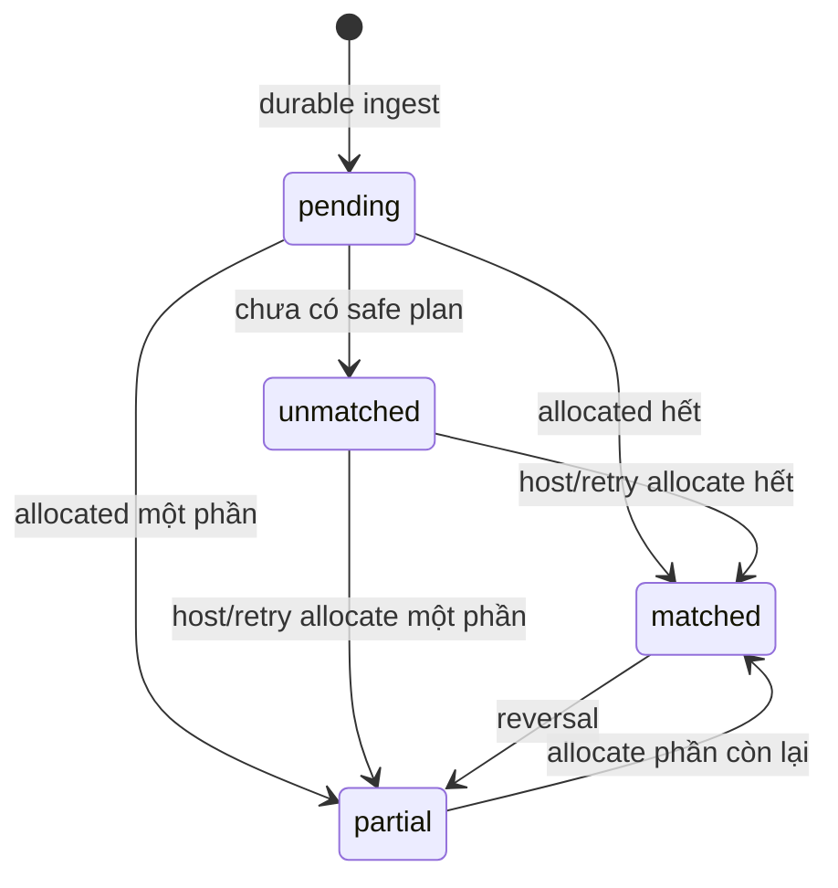

# Feature: Payment Reconciliation — Product/UX Spec

> **Canonical phase:** P3
> **Track:** 💰 Payment Reconciliation
> **Version:** 1.10 · 2026-07-28
> **Status:** Reviewed; mirror DD-32/DD-91 `DECISION_FINAL` + regional research boundary. Primary plan v1.8 đã `PLAN_READY` tại `90d292d`; B1/runtime slices vẫn cần strict `CODE_READY`
> **Implementation:** In progress — core matching/payments-logic + ledger integrity migrations `0019`/`0020` đã có; wiring webhook→settle→notify, `remainingAmount`, `getSelfPaymentStatus` và chat `/pay` chưa · authority: `../standards/BUILD-STATUS.md` (Doc status ≠ Implementation status)
> **Prerequisites:** P0–P1 foundation + P2 tenant routing
> **Tài liệu liên quan:** `../product/BRD.md` FR-5 · `../product/PRD.md` FLOW 6/9 + §4.1 · `../product/TDD.md` §3.2/3.6/3.7 · `../standards/decisions.md` DD-25/DD-32/DD-40/DD-91 · **DD-97** (statement/export — composition consumer trên ledger này, surface riêng) · **DD-98** (negative scope: NP-1 custom split · NP-4 auto-archive) · `../standards/business-rules.md` BL-PAY/BL-CBF · `feature_channel_booking_funnel.md` · `BE/feature_channel_booking_funnel_tech.md` · `../research/player-side-saas-reconciliation.md` · `../research/auto-debt-reconciliation-regional-availability-2026-07-27.md`

> **Cập nhật v3.4 (DD-40, 2026-07-10):** **Mark-paid thủ công (tiền mặt/CK, tap/multi-select) mặc định MỌI tier** (kể cả `free`) — áp DD-25 (human-initiated money mutation cần preview+confirm). **Đối soát CK tự động** (webhook match) là tính năng **`host_pro`**.

> **DD-91 + regional boundary (target, chưa runtime):** `payment_reconcile_auto` là commercial entitlement, không phải bằng chứng availability. Current provider/schema authority chỉ có `sepay|apipay` cho rail Việt Nam và webhook→settle→notify chưa build, nên auto-reconcile chưa enabled ở cả Việt Nam; ngoài Việt Nam vẫn dùng mark-paid thủ công cho tới khi provider/bank/market/currency/consent gate và decision riêng đóng. Person-self payment status có một owner `getSelfPaymentStatus`; exact chat `/pay` chỉ là requester-only adapter vào cùng truth, không phải matcher/ledger writer mới.

---

## 1. Mục tiêu và nguyên tắc

Nhận & đối soát tiền sân của từng CLB. **Mọi tier**: host **đánh dấu đã trả thủ công** (tiền mặt/CK) bằng tap/multi-select. **`host_pro`**: thêm **tự động nhận chuyển khoản** qua webhook, lưu bền vững, đối chiếu với các khoản phải thu và cho host xử lý phần chưa khớp. Platform không giữ tiền player; ledger chỉ phản ánh giao dịch và phân bổ.

### Bất biến

- Không ACK provider trước khi raw transaction + durable reconcile job đã commit.
- Không mất hoặc double-count giao dịch.
- Không tự đoán người nhận khi tên/số tiền nhập nhằng.
- Tổng allocation hiệu lực không vượt tiền giao dịch hoặc số tiền charge còn thiếu.
- Giao dịch và allocation đã audit không bị sửa/xóa; điều chỉnh bằng reversal.
- Mọi dữ liệu ledger tenant-scoped + RLS.
- Mọi consumer person-self đọc cùng canonical `getSelfPaymentStatus`; chỉ proven `known_zero` mới hiển thị 0. Home, web, chat và notification không tự tính lại balance.
- Payment proof cho booking channel phải là `bank_transactions` đã durable-ingest và được exact-match theo payment reference; QR hoặc nút “Tôi đã thanh toán” không phải settlement proof.

---

## 2. Use Cases

| ID | Actor | Hành động | Kết quả |
|---|---|---|---|
| PAY-UC-1 | SePay/ApiPay | Gửi webhook hợp lệ | `bank_transaction` + reconcile job commit rồi ACK |
| PAY-UC-2 | System | Nhận webhook duplicate | Trả 200 idempotently; không tạo transaction/job thứ hai |
| PAY-UC-3 | System | Match tên + amount + ngày rõ ràng | Tạo allocation vào charge phù hợp |
| PAY-UC-4 | System | Hai charge đồng giá cùng người/ngày | FIFO oldest-first, không vượt số tiền phủ |
| PAY-UC-5 | System | Nhận pay code sau khi P4 rollout | Deterministic match; P3 không phụ thuộc memo chỉ-có-code |
| PAY-UC-6 | Host | Mở `/unmatched` | Xem transaction còn `unallocated_amount` + lý do |
| PAY-UC-7 | Host | Gán một CK cho nhiều người/charge | Tạo nhiều manual allocations; tổng không vượt CK |
| PAY-UC-8 | Host (mọi tier) | Ghi nhận tiền mặt `/cash` | Tạo settlement allocation nguồn `cash`; không giả lập bank webhook |
| PAY-UC-9 | Host | Hoàn tác gán nhầm | Tạo reversal tham chiếu allocation gốc + audit |
| PAY-UC-10 | System (`host_pro`) | Retry unmatched | Idempotent worker thử lại transaction còn dư |
| PAY-UC-11 | System | Charge được phủ đủ | Chuyển `paid`, phát `payment.settled` outbox event |
| PAY-UC-12 | System | Charge chỉ được phủ một phần | Chuyển `partial`, chưa gửi thông báo “đã trả đủ” |
| PAY-UC-13 | Host | Đổi STK primary | Tạo `pending_change` 24h; QR vẫn dùng STK cũ; notify tất cả kênh đã link |
| PAY-UC-14 | Host | Cancel pending STK change | Huỷ pending; giữ STK hiện tại |
| PAY-UC-15 | Host (mọi tier) | **Mark-paid thủ công multi-select** — chọn 1 hoặc nhiều player (tap/multi-select), đánh dấu **tiền mặt** (`cash`) hoặc **CK** (khớp một `bank_transaction` đã ingest → `manual`) | Preview danh sách + tổng tiền → **confirm** (DD-25) → **INSERT `payment_allocations`** cho từng player (tiền mặt → `source='cash'`, không bank txn; CK khớp `bank_transactions` → `source='manual'`) + cập nhật `charges.amount_allocated`/`status`; audit; idempotent |
| PAY-UC-16 | Host | Bỏ chọn / sửa trước confirm | Preview cập nhật real-time; chỉ ghi ledger sau khi confirm |
| PAY-UC-17 | Player | Gõ exact `/pay` ở club chat/private Club Bot/human DM | Target DD-91: command được intercept trước message/Assistant, resolve own authorized club one/many/none rồi trả requester-only current status từ `getSelfPaymentStatus`; không ghi chat/ledger |
| PAY-UC-18 | Player chưa link Account | Chọn “Thanh toán & giữ chỗ” ở bước xác nhận booking channel | Chỉ khi provider/market capability được chứng minh: tạo payment hold 15 phút; verified full settlement gọi shared booking finalizer để tạo player + charge + allocation atomically. Không full settlement thì không active |

---

## 3. Matching và allocation flow

```text
Webhook
  → verify token/secret/account
  → DB transaction:
       insert bank_transaction (idempotency key)
       enqueue reconcile job/outbox
    COMMIT
  → ACK 200

Worker reconcile(tenant_id, bank_transaction_id)
  → SET LOCAL app.tenant_id
  → pay_code enabled + present? deterministic candidate
  → otherwise name + amount + date candidates
  → exactly one safe allocation plan? lock transaction + charges, allocate
  → ambiguous/partial remainder? keep unallocated, expose /unmatched
  → emit payment.allocated / payment.settled
```

**Không auto-split theo `fee × N` nếu chưa xác định được danh tính.** Một CK trả nhiều người phải có pay code xác định hoặc host gán tay.

### 3.1 Mark-paid thủ công (mọi tier — DD-40)

Không phụ thuộc webhook. Áp dụng cho **cả `free`**:

```text
Host mở roster/danh sách nợ (bot Zalo / Messenger / web)
  → tap chọn 1 hoặc NHIỀU player (multi-select)
  → chọn nguồn: tiền mặt (cash) | CK (khớp một bank_transaction đã ingest → manual)
  → PREVIEW: danh sách player + charge + tổng tiền  (DD-25 — human-initiated money mutation)
  → CONFIRM
  → cho từng player: INSERT payment_allocations
       tiền mặt → source=cash, bank_transaction_id NULL, created_by=host
       CK       → source=manual, khớp một bank_transactions row
     + cập nhật charges.amount_allocated/status; actor=host, audit
     idempotent theo (charge, actor, intent); charge → paid/partial
  → phát payment.settled → xác nhận tự động tới player (feature_notifications_reminders FR-6.2)
```

- **Mark-paid CK thủ công** ≠ auto-reconcile: CK đã ingest → host gán allocation `source='manual'`. Host attest CK **chưa có** `bank_transaction` cần B1 enum migration/source riêng + actor/evidence reference; **cấm synthetic bank transaction**, cấm map sang `cash|manual`, cấm đoán số tiền. Trước khi B1 land, boundary reject fail-closed.
- **Auto-reconcile CK (webhook match tên+tiền+ngày, `/unmatched`)** cần tier **`host_pro`** (capability `payment_reconcile_auto`) **và** availability gate riêng (provider/bank/market/currency/consent). Flag entitlement không đủ để enable. Free và mọi market chưa có provider path = `payment_mark_manual`.
- Charge của mỗi lượt chơi suy theo giá kèo; nếu kèo đặt giá nam/nữ → xem **DD-39 (✅ Chốt)** / `feature_user_settings` (suy `amount_due` theo `person.gender`; decrypt lỗi → fail-closed).

---

### 3.2 Person-self payment truth (DD-91 target)

- Canonical fields đã có: `charges.amount_due` + `charges.amount_allocated`.
- Target primitive duy nhất: `remainingAmount(amountDue, amountAllocated) = max(0, amountDue - amountAllocated)`. `effectiveFee` giữ `fee=NULL→NULL`, sau đó mới delegate; không consumer tự copy formula.
- `getSelfPaymentStatus` thuộc Player View person-self service và validate authz/integrity/dependency trước khi trả `known_amount|known_zero|unknown`.
- `/api/me/charges`, Home composition, exact requester-only `/pay` và authenticated notification detail dùng cùng service/projection. `/pay` trả synchronous authenticated `private, no-store`, không result row/ref/SSE/outbox/push/history và không chạy LLM.
- Đây là contract docs theo DD-91; `remainingAmount`, service và adapters chưa tồn tại trong runtime, còn phụ thuộc plan/slice readiness riêng.

---

### 3.3 Channel booking pay-now boundary (DD-32 target)

- Booking funnel sở hữu intent/hold/finalizer; Payment Reconciliation chỉ sở hữu durable bank truth và allocation.
- Payment reference của booking intent là deterministic, exact và tenant/connector/currency scoped. Giao dịch mang reference này được dành riêng cho funnel finalizer, không đi qua generic name/date/amount matcher.
- Provider ingest phải commit `bank_transactions` + durable job trước ACK. Sau khi ingest transaction kết thúc, job riêng mới gọi funnel finalizer; không giữ bank-row lock rồi gọi ngược vào Session/Join.
- Exact hoặc overpayment đủ phủ toàn bộ quote có thể confirm; finalizer allocate đúng `amount_due`, phần dư giữ unmatched. Underpayment, late payment, wrong reference/currency/account hoặc provider evidence không chắc chắn đều không tạo active player.
- Host manual mark-paid/screenshot không được dùng làm instant proof để bypass first-time Account link. Khi pay-now capability unavailable/unknown, bot chỉ offer link Account hoặc tiếp tục trên web.

---

## 4. Edge Cases

| # | Case | Hành vi bắt buộc |
|---|---|---|
| 1 | Provider authentication sai | 401 trước parse/persist: SePay production requires `X-SePay-Signature: sha256=<hex>` over `{X-SePay-Timestamp}.{raw_body}`, timestamp ±300s, constant-time; HMAC failure never downgrades to API key. Explicit SePay fallback accepts only `Authorization: Apikey <key>`. ApiPay separately verifies `ApiPay-Signature = HMAC-SHA256(raw_body, per-webhook secret)`. Không log secret/raw body. |
| 2 | Token tenant A + account tenant B | 409/401; không route bằng nội dung CK |
| 3 | Provider thiếu external ID | Synthetic hash ổn định từ provider/account/amount/time/content |
| 4 | Duplicate đồng thời | UNIQUE `(tenant, provider, external_id)`; một durable job |
| 5 | Process chết sau ACK | Job đã durable; retry tiếp tục từ `pending/unmatched` |
| 6 | CK thiếu/rỗng nội dung | Giữ `unmatched`; không đoán theo amount đơn thuần |
| 7 | Tên fuzzy có nhiều candidate ngang nhau | Manual review; threshold không hard-code khi chưa calibration |
| 8 | Trả thiếu | Allocation phần chắc chắn; charge `partial`; không notify paid |
| 9 | Trả dư | Charge tối đa amount due; phần dư giữ ở `unallocated_amount` |
| 10 | Một CK trả nhiều người | Host tạo nhiều allocations hoặc deterministic pay-code plan |
| 11 | Webhook và `/cash` cùng lúc | Lock charge; tổng hiệu lực không vượt amount due |
| 12 | Auto-match và host gán tay cùng lúc | Lock bank transaction + charges; loser reload state/no-op |
| 13 | Gán nhầm đã notify | Reversal + audit + correction event; không sửa row cũ |
| 14 | Tenant suspended | Durable-ingest ON; auto-settle/auto-notify OFF theo DD-51/PAY-OQ-2; không mất CK |
| 15 | Session bị hủy/player paid rời | Host-cancel refund toàn bộ; player-leave theo policy CLB + refund request; refund ngoài Plexco, log opaque reference; ledger append-only |
| 16 | Amount ≤ 0 | Reject validation; log metadata tối thiểu |
| 17 | Attacker chiếm account host → đổi STK | Đổi STK primary → `pending_change` 24h. Hệ thống vẫn dùng STK cũ cho QR. Thông báo đổi gửi MỌI kênh đã link (Zalo/Messenger/email/web). Rate-limit: max 2 lần/30 ngày. Ref: AUDIT G1, BL-PAY-10 |
| 18 | Mark-paid multi-select: 1 player trong batch đã paid | Skip player đó (idempotent), preview cảnh báo; các player còn lại vẫn ghi bình thường |
| 19 | Double-tap "Confirm" mark-paid | Idempotent theo `(charge, actor, intent)` — không tạo allocation trùng, không over-pay |
| 20 | Host Pro có entitlement nhưng provider/bank/market chưa available | Auto-reconcile absent/fail-closed; không auto-match từ feed không đủ bằng chứng; mark-paid thủ công vẫn dùng được |
| 21 | Person-self ledger/authz/dependency không chứng minh được | `unknown` + generic retry; không biến null/error thành 0 hoặc “đã trả” |
| 22 | Human-DM `/pay` không có tenant context | Không suy tenant từ peer; 0 club generic, 1 auto-select, nhiều club dùng opaque requester-bound picker; peer/shared history nhận zero artifact |
| 23 | Booking pay-now trả thiếu | Không tạo player/charge/allocation; hold giữ tới TTL rồi manual review, v1 không tự cộng nhiều lần top-up |
| 24 | Booking pay-now trả dư | Tạo player + charge + allocation đúng amount due; phần dư của bank transaction vẫn unmatched |
| 25 | Payment ingest sau hold expiry/booking đã đóng | Không revive booking; giữ evidence và đưa manual review/refund-or-credit flow |
| 26 | Screenshot hoặc host manual mark-paid cho intent chưa link | Không được coi là proof để instant-confirm; yêu cầu exact provider evidence hoặc link Account |

---

## 5. Domain Model

| Entity | Vai trò | Key constraints |
|---|---|---|
| `charges` | Khoản phải thu của một player-session | UNIQUE `(tenant_id, session_id, player_id)`; status open/partial/paid/void |
| `bank_transactions` | Giao dịch CK gốc, immutable | UNIQUE `(tenant_id, provider, external_id)` |
| `payment_allocations` | Ledger phân bổ/reversal | Signed amount; optional bank transaction cho cash/waiver; immutable |
| `bank_accounts` | Tài khoản nhận + webhook credentials per tenant | UNIQUE webhook token; secret encrypted |
| `outbox_events` | Phát thay đổi ledger | Cùng transaction với allocation/status change |

### Ledger rules

- Bank allocation (auto-reconcile, `host_pro`): `bank_transaction_id` bắt buộc; source `auto|manual`.
- Mark-paid thủ công (mọi tier): tiền mặt → `cash`; CK đã ingest → `manual` + real `bank_transactions`. CK chưa ingest chỉ được ghi sau B1 dedicated source migration (`bank_transaction_id=NULL`, actor + opaque evidence bắt buộc); trước đó reject. **Không synthetic bank transaction** và không map sai `cash|manual`.
- Waiver: không có bank transaction; source `waiver`, actor admin bắt buộc.
- Reversal: amount âm, `reverses_allocation_id` bắt buộc; không reversal quá phần còn hiệu lực.
- DD-49 correction: price/obligation delta là append-only signed obligation entry trong canonical charge aggregate; allocation reversal chỉ đảo tiền đã nhận. Một helper tính effective due/balance cho mọi consumer. Tên bảng/API chờ design-probe live UNIQUE charge/player/session; không giả định row charge thứ hai.
- DD-91 read boundary: canonical helper/service nói trên là owner của person-self projection; Chat/Home/Notification không thêm snapshot/formula money riêng.
- Charge paid khi effective allocations = `amount_due`; partial khi nằm giữa 0 và amount due.
- `unallocated_amount` chỉ áp dụng bank transaction và được cập nhật dưới lock hoặc tính từ ledger.

### State machines



Charge: `open → partial → paid`; reversal có thể đưa `paid → partial/open`; cancellation có thể đưa sang `void` theo policy.

---

## 6. Screens và states

| Surface | Loading | Ready | Error | Empty |
|---|---|---|---|---|
| `/unmatched` (Zalo/web, `host_pro`) | Đang tải | CK còn dư + candidate + assign CTA | Retry, không mất selection | Không có CK chưa khớp |
| Mark-paid thủ công (mọi tier) | Validating | Roster + multi-select player + chọn tiền mặt (`cash`) / CK (`manual` khớp bank txn) → **Preview** (tổng tiền) → **Confirm** (DD-25) | Conflict → reload latest ledger; player đã paid → skip | Không có charge phù hợp |
| Manual allocation | Validating | Chọn một/nhiều charges + tổng allocated/remaining | Conflict → reload latest ledger | Không có charge phù hợp |
| Cash confirmation | Validating permission | Amount + player/session + confirm | Duplicate/conflict notice | N/A |
| Web ledger P4 | Skeleton | Transaction, allocations, charge status, audit | Retry banner | Chưa có giao dịch |
| In-app Chat exact `/pay` (target) | "Đang kiểm tra..." | Requester-only `known_amount`/`known_zero` từ canonical person-self service | Generic retry trên `unknown` | Chỉ hiện "không còn khoản phải trả" khi proven `known_zero` |

P2/P3 bắt buộc host flow qua **bot Zalo + web** (mark-paid thủ công mọi tier). Auto-reconcile webhook (`host_pro`) ở P3. Web ledger và realtime projection ở P4; notification đa kênh đầy đủ ở P4.5–P4.7 (Zalo/Messenger). *(Telegram đã loại — DD-37.)*

---

## 7. Analytics và audit

| Event | Khi nào | Payload tối thiểu |
|---|---|---|
| `payment_webhook_ingested` | Durable commit | tenant, provider, transaction_id, amount_bucket |
| `payment_reconcile_completed` | Worker terminal attempt | transaction_id, result, match_method, duration_ms |
| `payment_allocation_created` | Auto/manual/cash allocation | allocation_id, source, actor_type, amount |
| `payment_allocation_reversed` | Reversal | allocation_id, reversal_id, actor_id, reason_code |
| `payment_charge_settled` | Charge paid | charge_id, settlement_sources |

Không log raw bank content, account number, display name, secret hoặc provider payload vào analytics.

---

## 8. Acceptance Criteria

- [ ] Mark-paid thủ công (mọi tier): multi-select player → preview + confirm (DD-25) → INSERT `payment_allocations` (tiền mặt `source='cash'`; CK khớp `bank_transactions` `source='manual'`) + cập nhật `charges` + audit; idempotent; không tạo bank transaction giả; enum `source` không có `bank_transfer`.
- [ ] Auto-reconcile CK (webhook match) gated `host_pro` (`payment_reconcile_auto`); free chỉ có `payment_mark_manual`.
- [ ] `payment_reconcile_auto` entitlement và availability được kiểm riêng; current `sepay|apipay` path chỉ phục vụ rail Việt Nam, thiếu provider/bank/market/currency/consent thì auto absent nhưng manual vẫn hoạt động.
- [ ] Verify webhook timing-safe và route bằng trusted token + account.
- [ ] Raw `bank_transaction` + durable job commit trước ACK.
- [ ] Duplicate/retry/crash không tạo giao dịch hoặc allocation trùng.
- [ ] Name/date/amount match chỉ auto khi có một safe plan.
- [ ] P3 hoạt động với memo name-based; pay code được phase-gate tới P4 rollout.
- [ ] FIFO đúng khi cùng player có nhiều charge đồng giá.
- [ ] Partial/overpay cập nhật đúng charge và unallocated remainder.
- [ ] Một CK có thể manual-allocate cho nhiều người mà không vượt funds.
- [ ] `/cash` tạo settlement source cash có actor/audit, không tạo bank transaction giả.
- [ ] Reversal immutable và khôi phục đúng effective balances.
- [ ] Concurrent webhook/cash/manual assignment không over-allocate.
- [ ] Suspended tenant vẫn durable-ingest CK.
- [ ] `/unmatched` hiển thị mọi transaction còn dư + reason.
- [ ] `payment.settled` chỉ phát khi charge được phủ đủ.
- [ ] Tenant A/B ledger isolation tests xanh.
- [ ] Đổi STK primary → pending 24h; QR vẫn dùng STK cũ; notify tất cả kênh.
- [ ] Rate-limit đổi STK: max 2 lần/30 ngày.
- [ ] `/api/me/charges`, Home, exact requester-only `/pay` và authenticated notification detail dùng cùng `getSelfPaymentStatus`; không consumer re-derive balance, không null/error→0.
- [ ] Human-DM `/pay` không suy tenant từ peer, peer/shared history nhận zero artifact; command result không tạo ledger/chat mutation.
- [ ] Booking pay-now chỉ xuất hiện khi entitlement + provider/bank/market/currency/consent availability đều proven; unknown/false offer link/web, không nhận screenshot/manual attest làm proof.
- [ ] Exact/overpayment trước expiry gọi một atomic funnel finalizer; exact tạo một booking/charge/allocation, overpay giữ remainder unmatched, underpay/late/wrong-reference không active.
- [ ] Giao dịch mang exact channel-booking reference không được generic matcher claim; duplicate/retry chỉ có một terminal booking và allocation.

---

## 9. Open Decisions và changelog

| ID | Quyết định | Trạng thái |
|---|---|---|
| BRD OD-2 / DD-02 | Pay-code prefix/format + resolver/allocation invariant | ✅ Chốt 13/07/2026; P3 name-based vẫn không phụ thuộc rollout pay_code P4 |
| PAY-OQ-1 | Retry cadence/backoff unmatched | Chốt trong backend spec |
| PAY-OQ-2 | Suspended tenant pause reconcile hay vẫn reconcile | ✅ **Chốt DD-51/B10:** ingest ON; auto-settle/auto-notify OFF fail-closed. Enable lại cần decision + telemetry/evidence mới |
| PAY-OQ-3 | Refund/void policy khi hủy session | ✅ **Chốt DD-49/v1.37:** host cancel đã thu → hoàn toàn bộ; player leave paid → policy CLB + refund request; refund ngoài + opaque reference. Obligation adjustment và allocation reversal là hai ledger entry khác nghĩa; storage chờ design-probe, không duplicate/mutate charge |

## Changelog

| Date | Version | Thay đổi |
|---|---|---|
| 2026-07-28 | v1.10 | Reconcile immutable authority `90d292d` and primary plan v1.8 `PLAN_READY`; retain B1/per-slice `CODE_READY`, regional availability and no-runtime boundaries. |
| 2026-07-28 | v1.9 | Mirror DD-32 Option D: unlinked paid-session booking có 15-minute pay-now hold khi capability proven; only durable exact full settlement gọi shared finalizer. Pin exact/over/under/late behavior, reserve booking references khỏi generic matcher và cấm screenshot/manual attest bypass Account link. No runtime claim. |
| 2026-07-27 | v1.8 | Sync local DD-91 `DECISION_FINAL` nhưng primary-surface plan vẫn `NOT_PLAN_READY`: pin one-payment-truth, fail-closed `known_zero|known_amount|unknown` và exact requester-only `/pay` target/no-LLM/no-persistence. Tách commercial entitlement `payment_reconcile_auto` khỏi provider/bank/market/currency/consent availability; current authority chỉ `sepay|apipay` cho rail Việt Nam, auto runtime chưa build, manual mark-paid vẫn global. Ghi live ledger-integrity migrations `0019`/`0020`; không claim webhook/service/chat implementation. |
| 2026-07-19 | v1.7a | Metadata sweep (index v2.35): thêm trường **Implementation** đồng bộ BUILD-STATUS (In progress). Không đổi contract. |
| 2026-07-17 | v1.7 | **Durable-ingest auth closure:** pin exact SePay timestamp/raw-body HMAC format, freshness and no-downgrade plus exact API-key fallback; keep ApiPay raw-body verifier as a separate provider contract. |
| 2026-07-16 | v1.6 | **Full money propagation:** DD-49 append-only obligation-vs-allocation semantics + refund request contract; PAY-OQ-2 closed ingest-ON/automation-OFF for suspended. B1 chooses dedicated source migration and explicitly forbids synthetic bank transactions. Authority: decisions v1.37. |
| 2026-07-10 | v1.4 | **Review fixes: money vocab → canonical ledger.** Mark-paid = INSERT `payment_allocations` + cập nhật `charges` (KHÔNG có bảng `payment`): tiền mặt → `source='cash'`; CK khớp một `bank_transactions` → `source='manual'`. Bỏ `source='bank_transfer'` (không có trong enum canonical `auto/manual/cash/waiver/reversal`). Host tự xác nhận "đã CK" nhưng chưa có `bank_transaction` = impl còn mở (synthetic manual bank_txn / enum migration). Cập nhật UC-15, §3.1, ledger rules, screens, acceptance. |
| 2026-07-10 | v1.3 | **DD-40:** thêm **mark-paid thủ công mọi tier** (tap/multi-select, preview+confirm DD-25) — §1, §3.1, UC-15/16, edge #18/19, ledger rules, screens, acceptance. Auto-reconcile CK = `host_pro`. Kênh host flow: Zalo+web (bỏ Telegram, DD-37). One-line pointer giá theo giới tính → DD-39. |
| 2026-06-19 | v1.2 | Thêm Changelog heading, verified format compliance |
| 2026-06-19 | v1.2 | Fold AUDIT G1: STK change 24h confirmation delay (UC-13/14, edge case #17, acceptance criteria) |
| 2026-06-18 | v1.1 | Durable ingest; charge/transaction/allocation ledger; partial/overpay/multi-person/cash/reversal; canonical phase |
| 2026-06-18 | v1.0 | Initial legacy payment spec |
| 2026-07-16 | v1.5 | **Propagation (light) DD-49:** PAY-OQ-3 ✅; body/schema được full-propagate ở v1.6. |
