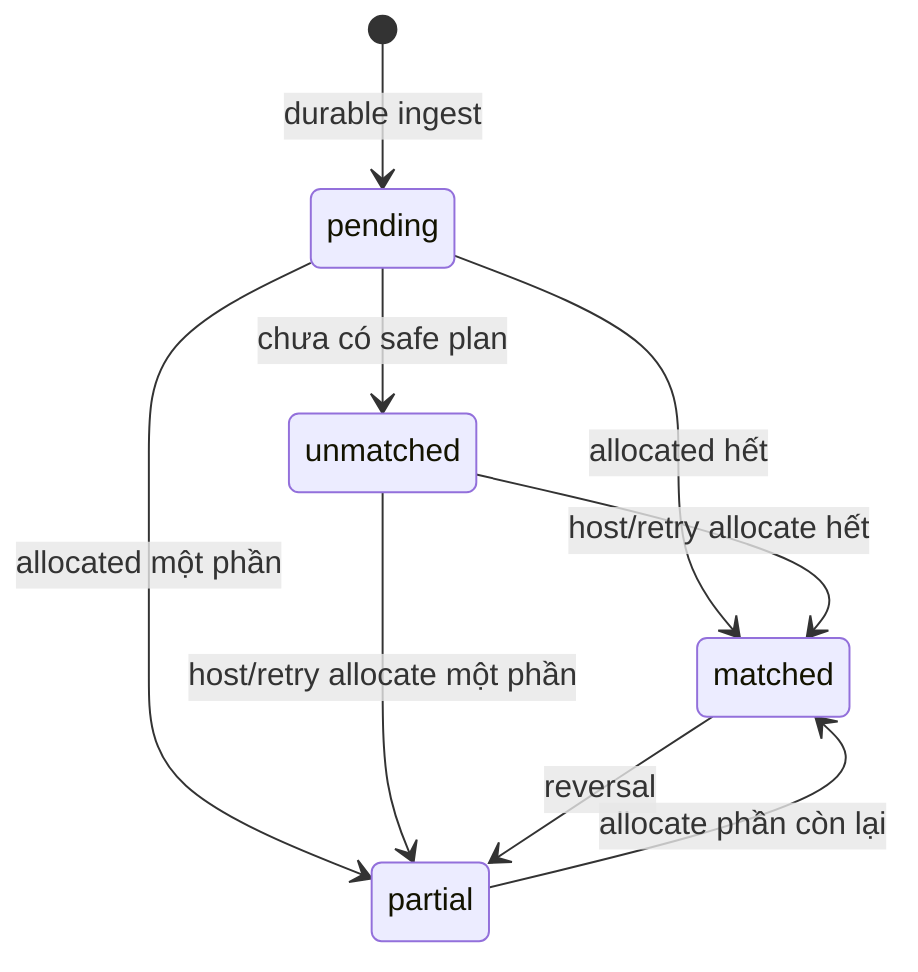

# Feature: Payment Reconciliation — Product/UX Spec

> **Canonical phase:** P3  
> **Track:** 💰 Payment Reconciliation  
> **Version:** 1.2 · 2026-06-19  
> **Status:** Reviewed against BRD v3.1 / PRD v2.1 / TDD v2.1  
> **Prerequisites:** P0–P1 foundation + P2 tenant routing  
> **Tài liệu liên quan:** `../core/BRD.md` FR-5 · `../core/PRD.md` FLOW 6/9 + §4.1 · `../core/TDD.md` §3.2/3.6/3.7 · `../standards/business-rules.md` BL-PAY · `../appendices/player-side-saas-reconciliation.md`

---

## 1. Mục tiêu và nguyên tắc

Tự động nhận chuyển khoản của từng CLB, lưu bền vững, đối chiếu với các khoản phải thu và cho host xử lý phần chưa khớp. Platform không giữ tiền player; ledger chỉ phản ánh giao dịch và phân bổ.

### Bất biến

- Không ACK provider trước khi raw transaction + durable reconcile job đã commit.
- Không mất hoặc double-count giao dịch.
- Không tự đoán người nhận khi tên/số tiền nhập nhằng.
- Tổng allocation hiệu lực không vượt tiền giao dịch hoặc số tiền charge còn thiếu.
- Giao dịch và allocation đã audit không bị sửa/xóa; điều chỉnh bằng reversal.
- Mọi dữ liệu ledger tenant-scoped + RLS.

---

## 2. Use Cases

| ID | Actor | Hành động | Kết quả |
|---|---|---|---|
| PAY-UC-1 | SePay/ApiPay | Gửi webhook hợp lệ | `bank_transaction` + reconcile job commit rồi ACK |
| PAY-UC-2 | System | Nhận webhook duplicate | Trả 200 idempotently; không tạo transaction/job thứ hai |
| PAY-UC-3 | System | Match tên + amount + ngày rõ ràng | Tạo allocation vào charge phù hợp |
| PAY-UC-4 | System | Hai charge đồng giá cùng người/ngày | FIFO oldest-first, không vượt số tiền phủ |
| PAY-UC-5 | System | Nhận pay code sau khi P4 rollout | Deterministic match; P3 không phụ thuộc memo chỉ-có-code |
| PAY-UC-6 | Host | Mở `/unmatched` | Xem transaction còn `unallocated_amount` + lý do |
| PAY-UC-7 | Host | Gán một CK cho nhiều người/charge | Tạo nhiều manual allocations; tổng không vượt CK |
| PAY-UC-8 | Host | Ghi nhận tiền mặt `/cash` | Tạo settlement allocation nguồn `cash`; không giả lập bank webhook |
| PAY-UC-9 | Host | Hoàn tác gán nhầm | Tạo reversal tham chiếu allocation gốc + audit |
| PAY-UC-10 | System | Retry unmatched | Idempotent worker thử lại transaction còn dư |
| PAY-UC-11 | System | Charge được phủ đủ | Chuyển `paid`, phát `payment.settled` outbox event |
| PAY-UC-12 | System | Charge chỉ được phủ một phần | Chuyển `partial`, chưa gửi thông báo “đã trả đủ” |
| PAY-UC-13 | Host | Đổi STK primary | Tạo `pending_change` 24h; QR vẫn dùng STK cũ; notify tất cả kênh đã link |
| PAY-UC-14 | Host | Cancel pending STK change | Huỷ pending; giữ STK hiện tại |

---

## 3. Matching và allocation flow

```text
Webhook
  → verify token/secret/account
  → DB transaction:
       insert bank_transaction (idempotency key)
       enqueue reconcile job/outbox
    COMMIT
  → ACK 200

Worker reconcile(tenant_id, bank_transaction_id)
  → SET LOCAL app.tenant_id
  → pay_code enabled + present? deterministic candidate
  → otherwise name + amount + date candidates
  → exactly one safe allocation plan? lock transaction + charges, allocate
  → ambiguous/partial remainder? keep unallocated, expose /unmatched
  → emit payment.allocated / payment.settled
```

**Không auto-split theo `fee × N` nếu chưa xác định được danh tính.** Một CK trả nhiều người phải có pay code xác định hoặc host gán tay.

---

## 4. Edge Cases

| # | Case | Hành vi bắt buộc |
|---|---|---|
| 1 | Secret/HMAC sai | 401; không persist payload nghiệp vụ; security log không chứa secret |
| 2 | Token tenant A + account tenant B | 409/401; không route bằng nội dung CK |
| 3 | Provider thiếu external ID | Synthetic hash ổn định từ provider/account/amount/time/content |
| 4 | Duplicate đồng thời | UNIQUE `(tenant, provider, external_id)`; một durable job |
| 5 | Process chết sau ACK | Job đã durable; retry tiếp tục từ `pending/unmatched` |
| 6 | CK thiếu/rỗng nội dung | Giữ `unmatched`; không đoán theo amount đơn thuần |
| 7 | Tên fuzzy có nhiều candidate ngang nhau | Manual review; threshold không hard-code khi chưa calibration |
| 8 | Trả thiếu | Allocation phần chắc chắn; charge `partial`; không notify paid |
| 9 | Trả dư | Charge tối đa amount due; phần dư giữ ở `unallocated_amount` |
| 10 | Một CK trả nhiều người | Host tạo nhiều allocations hoặc deterministic pay-code plan |
| 11 | Webhook và `/cash` cùng lúc | Lock charge; tổng hiệu lực không vượt amount due |
| 12 | Auto-match và host gán tay cùng lúc | Lock bank transaction + charges; loser reload state/no-op |
| 13 | Gán nhầm đã notify | Reversal + audit + correction event; không sửa row cũ |
| 14 | Tenant suspended | Vẫn durable-ingest; reconcile có thể pause theo lifecycle policy; không mất CK |
| 15 | Session bị hủy sau khi paid | Charge void/refund-needed theo policy; platform không tự hoàn tiền |
| 16 | Amount ≤ 0 | Reject validation; log metadata tối thiểu |
| 17 | Attacker chiếm account host → đổi STK | Đổi STK primary → `pending_change` 24h. Hệ thống vẫn dùng STK cũ cho QR. Thông báo đổi gửi MỌI kênh đã link (TG/Zalo/email/web). Rate-limit: max 2 lần/30 ngày. Ref: AUDIT G1, BL-PAY-10 |

---

## 5. Domain Model

| Entity | Vai trò | Key constraints |
|---|---|---|
| `charges` | Khoản phải thu của một player-session | UNIQUE `(tenant_id, session_id, player_id)`; status open/partial/paid/void |
| `bank_transactions` | Giao dịch CK gốc, immutable | UNIQUE `(tenant_id, provider, external_id)` |
| `payment_allocations` | Ledger phân bổ/reversal | Signed amount; optional bank transaction cho cash/waiver; immutable |
| `bank_accounts` | Tài khoản nhận + webhook credentials per tenant | UNIQUE webhook token; secret encrypted |
| `outbox_events` | Phát thay đổi ledger | Cùng transaction với allocation/status change |

### Ledger rules

- Bank allocation: `bank_transaction_id` bắt buộc; source `auto|manual`.
- Cash/waiver: không có bank transaction; source `cash|waiver`, actor admin bắt buộc.
- Reversal: amount âm, `reverses_allocation_id` bắt buộc; không reversal quá phần còn hiệu lực.
- Charge paid khi effective allocations = `amount_due`; partial khi nằm giữa 0 và amount due.
- `unallocated_amount` chỉ áp dụng bank transaction và được cập nhật dưới lock hoặc tính từ ledger.

### State machines



Charge: `open → partial → paid`; reversal có thể đưa `paid → partial/open`; cancellation có thể đưa sang `void` theo policy.

---

## 6. Screens và states

| Surface | Loading | Ready | Error | Empty |
|---|---|---|---|---|
| `/unmatched` TG | Đang tải | CK còn dư + candidate + assign CTA | Retry, không mất selection | Không có CK chưa khớp |
| Manual allocation | Validating | Chọn một/nhiều charges + tổng allocated/remaining | Conflict → reload latest ledger | Không có charge phù hợp |
| Cash confirmation | Validating permission | Amount + player/session + confirm | Duplicate/conflict notice | N/A |
| Web ledger P4 | Skeleton | Transaction, allocations, charge status, audit | Retry banner | Chưa có giao dịch |

P3 bắt buộc Telegram host flow. Web ledger và realtime projection là integration ở P4; notification đa kênh đầy đủ ở P4.5–P4.7.

---

## 7. Analytics và audit

| Event | Khi nào | Payload tối thiểu |
|---|---|---|
| `payment_webhook_ingested` | Durable commit | tenant, provider, transaction_id, amount_bucket |
| `payment_reconcile_completed` | Worker terminal attempt | transaction_id, result, match_method, duration_ms |
| `payment_allocation_created` | Auto/manual/cash allocation | allocation_id, source, actor_type, amount |
| `payment_allocation_reversed` | Reversal | allocation_id, reversal_id, actor_id, reason_code |
| `payment_charge_settled` | Charge paid | charge_id, settlement_sources |

Không log raw bank content, account number, display name, secret hoặc provider payload vào analytics.

---

## 8. Acceptance Criteria

- [ ] Verify webhook timing-safe và route bằng trusted token + account.
- [ ] Raw `bank_transaction` + durable job commit trước ACK.
- [ ] Duplicate/retry/crash không tạo giao dịch hoặc allocation trùng.
- [ ] Name/date/amount match chỉ auto khi có một safe plan.
- [ ] P3 hoạt động với memo name-based; pay code được phase-gate tới P4 rollout.
- [ ] FIFO đúng khi cùng player có nhiều charge đồng giá.
- [ ] Partial/overpay cập nhật đúng charge và unallocated remainder.
- [ ] Một CK có thể manual-allocate cho nhiều người mà không vượt funds.
- [ ] `/cash` tạo settlement source cash có actor/audit, không tạo bank transaction giả.
- [ ] Reversal immutable và khôi phục đúng effective balances.
- [ ] Concurrent webhook/cash/manual assignment không over-allocate.
- [ ] Suspended tenant vẫn durable-ingest CK.
- [ ] `/unmatched` hiển thị mọi transaction còn dư + reason.
- [ ] `payment.settled` chỉ phát khi charge được phủ đủ.
- [ ] Tenant A/B ledger isolation tests xanh.
- [ ] Đổi STK primary → pending 24h; QR vẫn dùng STK cũ; notify tất cả kênh.
- [ ] Rate-limit đổi STK: max 2 lần/30 ngày.

---

## 9. Open Decisions và changelog

| ID | Quyết định | Trạng thái |
|---|---|---|
| BRD OD-2 | Pay-code prefix/format | Chờ chốt; không block P3 name-based |
| PAY-OQ-1 | Retry cadence/backoff unmatched | Chốt trong backend spec |
| PAY-OQ-2 | Suspended tenant pause reconcile hay vẫn reconcile | Cần lifecycle decision trước P5; ingest luôn bật |
| PAY-OQ-3 | Refund/void policy khi hủy session | Cần business rule riêng |

| Date | Version | Thay đổi |
|---|---|---|
| 2026-06-19 | v1.2 | Fold AUDIT G1: STK change 24h confirmation delay (UC-13/14, edge case #17, acceptance criteria) |
| 2026-06-18 | v1.1 | Durable ingest; charge/transaction/allocation ledger; partial/overpay/multi-person/cash/reversal; canonical phase |
| 2026-06-18 | v1.0 | Initial legacy payment spec |
