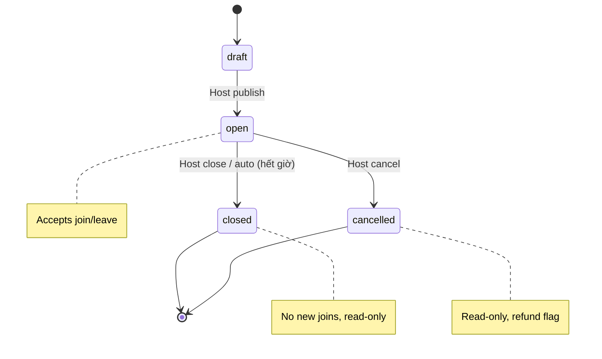

# Feature: Session Management — Product/UX Spec

> **Canonical phase:** P2 (chat CRUD) · P4 (web parity)  
> **Track:** 📋 Session CRUD  
> **Version:** 2.12a · 2026-07-19
> **Status:** Reviewed  
> **Implementation:** Not started — waitlist `0014` mới ở nhánh feature, chưa merge · authority: `../standards/BUILD-STATUS.md` (Doc status ≠ Implementation status)  
> **Prerequisites:** P0–P1 foundation stable · P2 tenant routing/authz  
> **Tài liệu liên quan:** `../product/BRD.md` FR-2 · `../product/PRD.md` FLOW 2/13 · `../product/TDD.md` §3.2/3.8 · `../standards/decisions.md` **DD-39/DD-45/DD-49** · DD-37/DD-65..68 · `../standards/business-rules.md` BL-SES-9/10 · `BE/feature_session_management_tech.md`

> **Cập nhật v3.4 (DD-37, 2026-07-10):** kênh phase-1 = **Zalo + Messenger** + web (bỏ Telegram). **Giá theo giới tính** (giá nam/nữ) nay **✅ phase-1** — xem **DD-39 (✅ Chốt)** / `feature_user_settings.md`; schema giới tính sống ở `feature_user_settings`, KHÔNG thêm vào doc này (chỉ pointer).

---

## 1. Mô tả

Cho phép host (TenantAdmin) tạo, sửa, thông báo, đóng và huỷ **session thể thao đa môn** — với time, venue, price, capacity, visibility và join policy nhất quán. P2 deliver qua **Zalo + Messenger admin commands**; trên Messenger host dùng được **central Plexco Page hoặc optional Page riêng của club** với chức năng cơ bản tương đương. P4 bổ sung web parity và event projections.

**Ngoài phạm vi:** Đặt sân (court booking), chấm điểm theo môn (sport-specific scoring) — **được theo dõi riêng ở `feature_session_organize.md` + `BE/feature_session_organize_tech.md` (DD-61..64 ✅ accept-in-principle, build post-P4)**; pointer only, không thêm scope organize vào body Reviewed này.

### Bất biến

- Chat và web gọi **cùng domain service** — không duplicate logic.
- Session luôn gắn `tenant_id` — RLS choke-point.
- Capacity không bao giờ bị vượt (concurrent join/capacity change lock session).
- Giá thay đổi sau khi đã charge → bắt buộc preview + explicit policy.
- Venue chi tiết (tên, SĐT, bản đồ) chỉ hiện khi canonical player outcome là `active`; pending và approved-but-waitlisted chỉ thấy area/position.
- Messenger `/newsession` dùng một durable wizard owner ở pre-dispatch boundary; mỗi bước/final confirm re-check `session.manage`, tenant context và snapshot. Central/tenant Page chỉ là adapter/context surface, không chứa business rule riêng.

---

## 2. Use Cases + Edge Cases

### Use Cases

| ID | Actor | Hành động | Kết quả |
|---|---|---|---|
| SES-UC-1 | Host | Tạo session one-off | Session open (private/public) với validated fields |
| SES-UC-2 | Host | Tạo recurring template | Instances tương lai generated idempotently theo tenant timezone |
| SES-UC-3 | Host | Announce lên linked group | Một canonical announcement reference lưu DB |
| SES-UC-4 | Host | Sửa time/price/capacity/visibility | Command writes canonical state + outbox event |
| SES-UC-5 | Host | Đóng session | Không nhận join mới; public projection removed |
| SES-UC-6 | Host | Huỷ session | Roster/paid impact hiện preview; refund-needed policy applied |
| SES-UC-7 | Host (Web) | Sửa session qua web P4 | Cùng service/validation như chat |
| SES-UC-8 | Player | Join session public | Request → auto-approve hoặc host-approve tuỳ policy; first-entry khi full thì cả hai path vào `waitlisted`, không tạo charge/venue |
| SES-UC-9 | Player | Leave session trước giờ chơi | Player → `left`, opener atomically xét queue. First-activation derive giá rồi tạo đúng một charge; DD-49 rejoin re-derive live disposition, carry-over hoặc append refunded lifecycle chỉ khi activation, không duplicate charge row. First derivation failure lazy-creates one root promotion-retry job + candidate event. Job CAS/lease tối đa 3 claimed attempts/backoff; mỗi completed sweep re-enter current order, thử mỗi candidate một lần và re-check DD-41/DD-42/DD-52. Expired final claim hoặc completed attempt 3→resolve-or-owner-review/DLQ. |
| SES-UC-10 | System | Auto-close session hết giờ | Status → closed, projection removed |
| SES-UC-11 | Host (Messenger central/tenant Page) | Chạy `/newsession` | Role-aware tenant picker nếu cần → wizard → preview → confirm → đúng một shared `CreateSession` command |

### Edge Cases

| # | Category | Case | Hành vi bắt buộc |
|---|----------|------|-------------------|
| 1 | Data Integrity | `ends_at` ≤ `starts_at` | Reject — end phải sau start. Ref: BL-DATA-1 |
| 2 | Data Integrity | Sport key không tồn tại trong taxonomy | Reject — chỉ accept từ active sport taxonomy |
| 3 | Concurrency | Giảm `slots_max` xuống dưới active roster | Reject `CAPACITY_BELOW_ROSTER`; không kick/evict hay mutation ngầm |
| 4 | Concurrency | 2 first-entry players join đồng thời, chỉ còn 1 slot | Transaction lock — first-commit-wins; second vào `waitlisted` với position dương, không tạo charge/venue |
| 5 | Financial | Price change sau khi đã có charges | Preview bắt buộc: existing charges giữ nguyên HOẶC adjustment entries — KHÔNG silent mutation |
| 6 | Security | Venue details leak trước active outcome | Chỉ hiện area/queue position. Chi tiết chỉ sau khi `players.status='active'`; approved-but-waitlisted vẫn ẩn |
| 7 | Data Integrity | Visibility public thiếu discovery fields | Reject — required fields: sport, area, starts_at, slots_max |
| 8 | Data Integrity | Visibility private → remove projection | Immediate remove từ public search |
| 9 | Data Integrity | Recurrence qua DST boundary | Handle deterministically — dùng IANA timezone + occurrence idempotency key |
| 10 | Resilience | Announcement gửi group fail | KHÔNG rollback canonical write — projector retries/reprojects |
| 11 | Security | Mutation on closed/cancelled/past session | Reject mọi mutation — trừ privileged correction với audit trail |
| 12 | Security | Non-admin cố sửa session | 403 — routing ≠ authz. Ref: tenant_routing_authz |
| 13 | Financial | Player đã `left` tự join lại cùng session | Re-derive DD-49 dưới lock. Active: chưa-refund carry-over, refunded append lifecycle idempotent. Full: waitlisted; chưa-refund giữ aggregate lịch sử, refunded không new lifecycle tới promotion. Unknown→`REJOIN_REQUIRES_REVIEW`, không mutation |
| 14 | Financial/Resilience | First active join hoặc first-activation promotion không suy được amount | Direct active join aborts. Promotion giữ waitlisted/no-charge/venue; first failure lazy-creates one root retry job + candidate event and commits. Retry one-owner CAS/lease, max 3 claimed attempts/backoff; completed sweep dùng current-order selector, mỗi candidate tối đa một lần; sibling events không fork budget. Closed/started/full resolves; expired final claim hoặc completed attempt 3→resolve-or-review/DLQ; không fallback |
| 15 | Security/State | Messenger wizard stale/expired/context-switch/non-admin | Clear/deny fail-closed; final confirm không tạo partial/duplicate session |

---

## 3. Screens & States

| Surface | Screen | Loading | Ready | Error | Empty |
|---------|--------|---------|-------|-------|-------|
| Bot (Zalo/Messenger) | `/newsession` wizard | Typing indicator | Step-by-step input (sport → time → venue → price → capacity → visibility) | Inline error per field ("Giờ kết thúc phải sau giờ bắt đầu") | N/A (wizard luôn có content) |
| Bot (Zalo/Messenger) | Session detail (`/status`) | "Đang tải..." message | Roster + payment status + session info | "Không tìm thấy session" | N/A |
| Bot (Zalo/Messenger) | Session cancel confirm | — | Preview: roster count, paid amount, refund responsibility | — | N/A |
| Web P4 | Session list | Skeleton rows | Table/card list sortable by date | Error banner + retry | "Chưa có buổi chơi nào" + CTA "Tạo buổi mới" |
| Web P4 | Session create/edit form | Skeleton form | Full form with validation | Inline errors per field | N/A |
| Web P4 | Session detail | Skeleton cards | Roster + QR + payments + timeline | Error banner | N/A |

---

## 4. Domain Model

| Entity | Vai trò | Key constraints |
|--------|---------|-----------------|
| `sessions` | Buổi chơi chính | `tenant_id` FK, `sport_id` FK, `starts_at/ends_at` timestamptz, `slots_max` nullable/positive, `visibility` enum (private/public), `status` enum |
| `players` | Player tham gia/waitlist | `UNIQUE(tenant_id, session_id, membership_id)`, `status ∈ active\|left\|waitlisted`; waitlisted có position dương |
| `session_surface_refs` | Reference message/session trên từng surface | `tenant_id`, `session_id`, `platform`, `target`, `external_ref`; unique `(session_id, platform, target)` |
| `session_recurrence_rules` + `session_occurrences` | Template lặp + occurrence idempotent | `rrule`, IANA `timezone`, `last_generated_at`; unique `(recurrence_rule_id, local_occurrence_key)` |

### State Machine

---

## 5. Analytics Events

| Event | Khi nào | Payload tối thiểu |
|-------|---------|-------------------|
| `session_created` | Host tạo session thành công | `tenant_id`, `session_id`, `sport_id`, `visibility`, `source` (chat/web) |
| `session_updated` | Host sửa bất kỳ field | `tenant_id`, `session_id`, `fields_changed[]`, `source` |
| `session_announced` | Announcement gửi thành công | `tenant_id`, `session_id`, `channel` |
| `session_closed` | Session đóng (manual/auto) | `tenant_id`, `session_id`, `close_reason` (manual/auto) |
| `session_cancelled` | Host huỷ | `tenant_id`, `session_id`, `roster_count`, `has_paid` |
| `session_projection_failed` | Projector fail | `tenant_id`, `session_id`, `error_code` |

> Không bao giờ log roster names, venue details, contact info trong analytics.

---

## 6. Acceptance Criteria

- [ ] Chat và web gọi cùng domain service — không duplicate logic
- [ ] Host tạo session cơ bản thành công trên cả central Page và tenant Page; club không Page không bị buộc sang web
- [ ] Messenger role/tenant picker + wizard cancel/expiry/context-switch/replay/non-admin tests pass; duplicate confirm chỉ tạo một session
- [ ] Timezone, sport, price, capacity, visibility và join-policy validations pass
- [ ] Concurrent capacity/join operations không thể over-fill (lock test)
- [ ] Waitlisted không chiếm capacity, không lộ venue và không tạo charge/new-obligation. Promotion first-activation tạo đúng một charge; DD-49 rejoin re-derive rồi carry-over hoặc append refunded lifecycle tại activation, không duplicate charge row
- [ ] Active leave/capacity increase fill toàn bộ slot available; finite→unlimited fill mọi eligible; decrease dưới active roster reject
- [ ] Existing `active|waitlisted` trả current outcome; existing `left` re-derive live DD-49 disposition. Refunded+full không append lifecycle tới activation; unknown/unimplemented → fail-closed
- [ ] Derivation failure: first failure lazy-creates one root `promotion_retry_id` per failing capacity opener + exactly-one candidate event bound entry/root origin. Retry job one-owner CAS/lease with atomic max-3 claimed-attempt count; each completed current-order sweep tries each candidate at most once and re-checks DD-41/DD-42/`evaluateJoinRestriction()` DD-52. Sibling/duplicate events cannot fork job/budget. Expired `claimed` at count 3 is finalized under `session→job`: resolve if retry no longer applies, else terminal+review/DLQ; no stuck job/fourth attempt/fallback
- [ ] Price/cancel changes khi đã có charge → bắt buộc explicit impact handling
- [ ] Public/private/closed projection behavior correct (projector test)
- [ ] Recurring generation idempotent và timezone-safe (DST test)
- [ ] Announcement reproject works sau provider failure
- [ ] Chỉ TenantAdmin mutate sessions — non-admin nhận 403

---

## 7. Open Questions / Changelog

### Open Questions

| ID | Quyết định | Trạng thái |
|---|---|---|
| SES-OQ-1 | Behavior khi host change price mà đã có charges | ✅ **Chốt DD-49; timing closure v1.58, current authority v1.69** — chưa refund carry-over; refunded chỉ append lifecycle khi outcome active. Full→waitlisted defer lifecycle/nợ mới tới promotion. Không mặc định row `charges` thứ hai; storage/API chờ design-probe. |
| SES-OQ-2 | Recurrence editing: sửa 1 occurrence hay this-and-future? | ⬜ Chưa chốt |
| SES-OQ-3 | Waitlist + auto-promote | ✅ **Chốt DD-45/DD-49; lifecycle v1.58 + retry/lock/liveness closure v1.62/v1.65/v1.67/v1.68 (current authority v1.69)** — schema land tại `1a6ac38` trên `feat/session-waitlist-expand` (current HEAD `aa8afae`; latest commit comment/format-only), chưa merge `main`/`origin/main`@`22c23aa`. Behavior chưa build; chờ DD-39/41/42/52, DD-49 correction core, SessionService, queue-entry-version, tenant-private root store + narrow scheduler/CAS worker + expired-final finalizer, candidate audit consumer, root-keyed owner digest và DLQ |
| SES-OQ-4 | Field mô tả session + gating (title/notes/`session_type`/byoe/cost_shared + gating level-rank/gender/age) | ✅ **Chốt DD-41** — enforce ở shared `evaluateSessionEligibility`←`addMemberToSession`, self-attested, 9 exact codes; body/schema propagate lúc build → `../dd-41-session-fields-gating-analysis.md` |
| SES-OQ-5 | No-show/attendance/reliability + policy deprioritize/ban | ✅ **Chốt DD-42** — per-tenant (attendance trên `players`, reliability trên `memberships`, RLS, không public); build P4+ → `../dd-42-reliability-analysis.md` |
| SES-OQ-6 | Nhãn thành viên + audience targeting khi announce | ✅ **Chốt DD-43** — `membership_tags` per-tenant chỉ cho notification audience; join eligibility vẫn DD-41; public không lộ tag; build P4+ → `../dd-43-membership-tags-analysis.md` |
| SES-OQ-7 | Invite-link token cho kèo private | ✅ **Chốt DD-44/DD-52** — `session_invite_tokens` entropy≥128-bit/hash/bound; current active/waitlisted/pending or exact replay resolves before `max_uses`/DD-41/DD-42/DD-52 and does not consume again. Only a new absent/left transition increments use; token không hạ visibility → `../dd-44-invite-token-analysis.md` |

### Changelog

| Date | Version | Thay đổi |
|---|---|---|
| 2026-07-19 | v2.12a | Metadata sweep (index v2.35): thêm trường **Implementation** đồng bộ BUILD-STATUS (Not started). Không đổi contract. |
| 2026-07-19 | v2.12 | **DD-44/45 restriction + claimed-attempt closure:** invite current/replay no-extra-use; waitlist root lazy on first failure, max 3 claimed attempts, expired-final resolve-or-terminal, tenant-private narrow claim and one owner digest/root. Behavior remains unbuilt. |
| 2026-07-19 | v2.11 | **DD-45 retry-owner/queue/restriction closure:** one root promotion job owns max-3 full sweeps; candidate events are sibling alert/audit refs, not budgets. Each sweep re-enters current order, tries each candidate once and re-checks DD-41/DD-42/DD-52; pin reorder/ban/N×N-budget regressions. Behavior remains unbuilt. |
| 2026-07-19 | v2.10 | **DD-45 retry closure:** bind failure event to queue-entry version + origin command; require CAS/lease max-3 claim state, consume-time revalidation, crash recovery and terminal review/DLQ. SES-OQ-3 points to `aa8afae` while preserving schema provenance `1a6ac38`; behavior remains unbuilt. |
| 2026-07-19 | v2.9c | **DD-45×DD-49 integrity:** venue active-only; refunded rejoin waitlisted không new lifecycle; promotion re-derive rồi append only at activation. Failure retry one origin event + max 3/backoff/no recursion/exhausted review-DLQ. SES-OQ-3 cites schema `1a6ac38`, current HEAD `bb47c15`, main `22c23aa`; behavior vẫn chưa build. |
| 2026-07-19 | v2.9b | **DD-45 schema landed on branch:** SES-OQ-3 tách schema vs behavior — migration `0014_players_waitlist` đã commit trên `feat/session-waitlist-expand`, chưa merge main (status domain + `waitlist_position` + state-shape/positive CHECK + `idx_players_waitlist_order`, 21 DDL invariant test gồm app-role RLS/grant). Auto-promote vẫn **chưa build**. |
| 2026-07-17 | v2.9a | §1 Ngoài phạm vi: thêm **pointer** court booking + scoring → `feature_session_organize` (DD-61..64 🟡 proposal, post-phase-1). Pointer-only, không thêm scope organize vào body Reviewed (cùng pattern one-line pointer DD-39 ở v2.1). |
| 2026-07-17 | v2.9 | **DD-65..68:** host create-session parity trên central+optional tenant Page; durable pre-dispatch wizard, protected tenant context, final AuthZ/snapshot re-check và idempotent shared command acceptance. |
| 2026-07-16 | v2.8 | **Full DD-49 propagation:** body/edge/AC thay left-rejoin reject mặc định bằng normal rejoin + carry-over/refunded disposition; giữ `REJOIN_REQUIRES_REVIEW` chỉ cho unknown/unimplemented correction state. Price change dùng signed obligation adjustment contract, không giả định delta/new `charges` row. Authority: decisions v1.37. |
| 2026-07-15 | v2.6 | **DD-39×DD-45 failure contract:** promotion derive amount trước mutation; derivation fail giữ waitlisted/no-charge/no-venue, audit+retry/owner-alert, không rollback leave/capacity opener và tiếp tục candidate kế. |
| 2026-07-15 | v2.5 | **Propagation (light):** neo DD-41 (session fields+gating), DD-42 (attendance/reliability), DD-43 (membership_tags audience), DD-44 (invite token) vào Open Questions với pointer file phân tích. Decision-level đã ✅; body/schema/migration propagate lúc build slice (không đổi Reviewed body). |
| 2026-07-15 | v2.4 | **DD-45 closure:** pin open/approval full→waitlisted và `left` self-rejoin fail-closed `REJOIN_REQUIRES_REVIEW`; không reuse/duplicate charge khi refund/void policy còn mở. |
| 2026-07-15 | v2.3 | **DD-45 ✅:** pin waitlist state-shape/positive position, total order, atomic charge-on-promote, fill-available/unlimited capacity boundaries, skip-on-ineligible và giữ `CAPACITY_BELOW_ROSTER`; code/migration vẫn pending. |
| 2026-06-18 | v1.0 | Initial spec (English format) |
| 2026-06-19 | v2.0 | Chuẩn hoá Vietnamese numbered format, thêm 10 use cases, 12 edge cases, state machine, screen states chi tiết |
| 2026-07-10 | v2.1 | **DD-37:** kênh phase-1 = Zalo + Messenger (bỏ Telegram); screens "TG Bot" → "Bot (Zalo/Messenger)". Thêm **one-line pointer giá theo giới tính → DD-39 (proposal) / feature_user_settings** (không thêm schema giới tính vào body Reviewed). |
| 2026-07-13 | v2.2 | Reconcile canonical schema vocabulary: `players`, `session_surface_refs`, `session_recurrence_rules/session_occurrences`. SES-UC-9 chỉ giải phóng slot; waitlist auto-promote deferred tới khi DD-45 được chốt + migration. |
| 2026-07-16 | v2.7 | **Propagation (light) DD-49:** SES-OQ-1 ✅ (đổi giá host-choice delta/grandfather; rejoin carry-over thay left-rejoin fail-closed DD-45). Body/schema từng defer build slice; được full-propagate ở v2.8. |
