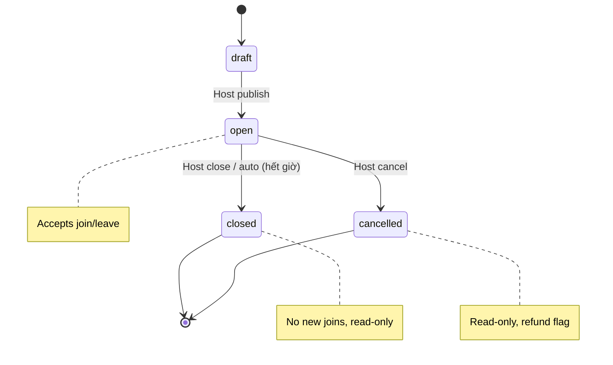

# Feature: Session Management — Product/UX Spec

> **Canonical phase:** P2 (chat CRUD) · P4 (web parity)  
> **Track:** 📋 Session CRUD  
> **Version:** 2.0 · 2026-06-19  
> **Status:** Reviewed  
> **Prerequisites:** P0–P1 foundation stable · P2 tenant routing/authz  
> **Tài liệu liên quan:** `../product/BRD.md` FR-2 · `../product/PRD.md` FLOW 2 · `../product/TDD.md` §3.2/3.8 · `BE/feature_session_management_tech.md`

---

## 1. Mô tả

Cho phép host (TenantAdmin) tạo, sửa, thông báo, đóng và huỷ **session thể thao đa môn** — với time, venue, price, capacity, visibility và join policy nhất quán. P2 deliver qua Telegram/admin commands; P4 bổ sung web parity và event projections.

**Ngoài phạm vi:** Đặt sân (court booking), chấm điểm theo môn (sport-specific scoring).

### Bất biến

- Chat và web gọi **cùng domain service** — không duplicate logic.
- Session luôn gắn `tenant_id` — RLS choke-point.
- Capacity không bao giờ bị vượt (concurrent join/capacity change lock session).
- Giá thay đổi sau khi đã charge → bắt buộc preview + explicit policy.
- Venue chi tiết (tên, SĐT, bản đồ) chỉ hiện sau join/approval — area là public whitelist.

---

## 2. Use Cases + Edge Cases

### Use Cases

| ID | Actor | Hành động | Kết quả |
|---|---|---|---|
| SES-UC-1 | Host | Tạo session one-off | Session open (private/public) với validated fields |
| SES-UC-2 | Host | Tạo recurring template | Instances tương lai generated idempotently theo tenant timezone |
| SES-UC-3 | Host | Announce lên linked group | Một canonical announcement reference lưu DB |
| SES-UC-4 | Host | Sửa time/price/capacity/visibility | Command writes canonical state + outbox event |
| SES-UC-5 | Host | Đóng session | Không nhận join mới; public projection removed |
| SES-UC-6 | Host | Huỷ session | Roster/paid impact hiện preview; refund-needed policy applied |
| SES-UC-7 | Host (Web) | Sửa session qua web P4 | Cùng service/validation như chat |
| SES-UC-8 | Player | Join session public | Request → auto-approve hoặc host-approve tuỳ policy |
| SES-UC-9 | Player | Leave session trước giờ chơi | Slot freed, waitlist (nếu có) auto-promote |
| SES-UC-10 | System | Auto-close session hết giờ | Status → closed, projection removed |

### Edge Cases

| # | Category | Case | Hành vi bắt buộc |
|---|----------|------|-------------------|
| 1 | Data Integrity | `ends_at` ≤ `starts_at` | Reject — end phải sau start. Ref: BL-DATA-1 |
| 2 | Data Integrity | Sport key không tồn tại trong taxonomy | Reject — chỉ accept từ active sport taxonomy |
| 3 | Concurrency | Giảm `slots_max` xuống dưới confirmed roster | Require explicit resolution (kick ai?). Không silent truncate |
| 4 | Concurrency | 2 players join đồng thời, chỉ còn 1 slot | Transaction lock — first-commit-wins, second nhận "full" |
| 5 | Financial | Price change sau khi đã có charges | Preview bắt buộc: existing charges giữ nguyên HOẶC adjustment entries — KHÔNG silent mutation |
| 6 | Security | Venue details leak trước join | Chỉ hiện area (quận/khu vực). Chi tiết sau join/approval |
| 7 | Data Integrity | Visibility public thiếu discovery fields | Reject — required fields: sport, area, starts_at, slots_max |
| 8 | Data Integrity | Visibility private → remove projection | Immediate remove từ public search |
| 9 | Data Integrity | Recurrence qua DST boundary | Handle deterministically — dùng IANA timezone + occurrence idempotency key |
| 10 | Resilience | Announcement gửi group fail | KHÔNG rollback canonical write — projector retries/reprojects |
| 11 | Security | Mutation on closed/cancelled/past session | Reject mọi mutation — trừ privileged correction với audit trail |
| 12 | Security | Non-admin cố sửa session | 403 — routing ≠ authz. Ref: tenant_routing_authz |

---

## 3. Screens & States

| Surface | Screen | Loading | Ready | Error | Empty |
|---------|--------|---------|-------|-------|-------|
| TG Bot | `/newsession` wizard | Typing indicator | Step-by-step input (sport → time → venue → price → capacity → visibility) | Inline error per field ("Giờ kết thúc phải sau giờ bắt đầu") | N/A (wizard luôn có content) |
| TG Bot | Session detail (`/status`) | "Đang tải..." message | Roster + payment status + session info | "Không tìm thấy session" | N/A |
| TG Bot | Session cancel confirm | — | Preview: roster count, paid amount, refund responsibility | — | N/A |
| Web P4 | Session list | Skeleton rows | Table/card list sortable by date | Error banner + retry | "Chưa có buổi chơi nào" + CTA "Tạo buổi mới" |
| Web P4 | Session create/edit form | Skeleton form | Full form with validation | Inline errors per field | N/A |
| Web P4 | Session detail | Skeleton cards | Roster + QR + payments + timeline | Error banner | N/A |

---

## 4. Domain Model

| Entity | Vai trò | Key constraints |
|--------|---------|-----------------|
| `sessions` | Buổi chơi chính | `tenant_id` FK, `sport_id` FK, `starts_at/ends_at` timestamptz, `slots_max` nullable/positive, `visibility` enum (private/public), `status` enum |
| `session_roster` | Player tham gia | `UNIQUE(session_id, person_id)`, `join_status` enum |
| `session_announcements` | Message đã gửi lên group | `session_id` FK, `channel`, `external_msg_id` |
| `session_recurrence` | Template lặp lại | `rrule` text, `timezone` IANA, `last_generated_at` |

### State Machine

---

## 5. Analytics Events

| Event | Khi nào | Payload tối thiểu |
|-------|---------|-------------------|
| `session_created` | Host tạo session thành công | `tenant_id`, `session_id`, `sport_id`, `visibility`, `source` (chat/web) |
| `session_updated` | Host sửa bất kỳ field | `tenant_id`, `session_id`, `fields_changed[]`, `source` |
| `session_announced` | Announcement gửi thành công | `tenant_id`, `session_id`, `channel` |
| `session_closed` | Session đóng (manual/auto) | `tenant_id`, `session_id`, `close_reason` (manual/auto) |
| `session_cancelled` | Host huỷ | `tenant_id`, `session_id`, `roster_count`, `has_paid` |
| `session_projection_failed` | Projector fail | `tenant_id`, `session_id`, `error_code` |

> Không bao giờ log roster names, venue details, contact info trong analytics.

---

## 6. Acceptance Criteria

- [ ] Chat và web gọi cùng domain service — không duplicate logic
- [ ] Timezone, sport, price, capacity, visibility và join-policy validations pass
- [ ] Concurrent capacity/join operations không thể over-fill (lock test)
- [ ] Price/cancel changes khi đã có charge → bắt buộc explicit impact handling
- [ ] Public/private/closed projection behavior correct (projector test)
- [ ] Recurring generation idempotent và timezone-safe (DST test)
- [ ] Announcement reproject works sau provider failure
- [ ] Chỉ TenantAdmin mutate sessions — non-admin nhận 403

---

## 7. Open Questions / Changelog

### Open Questions

| ID | Quyết định | Trạng thái |
|---|---|---|
| SES-OQ-1 | Behavior khi host change price mà đã có charges: giữ nguyên existing hay tạo adjustment? | ⬜ Chưa chốt |
| SES-OQ-2 | Recurrence editing: sửa 1 occurrence hay this-and-future? | ⬜ Chưa chốt |

### Changelog

| Date | Version | Thay đổi |
|---|---|---|
| 2026-06-18 | v1.0 | Initial spec (English format) |
| 2026-06-19 | v2.0 | Chuẩn hoá Vietnamese numbered format, thêm 10 use cases, 12 edge cases, state machine, screen states chi tiết |
