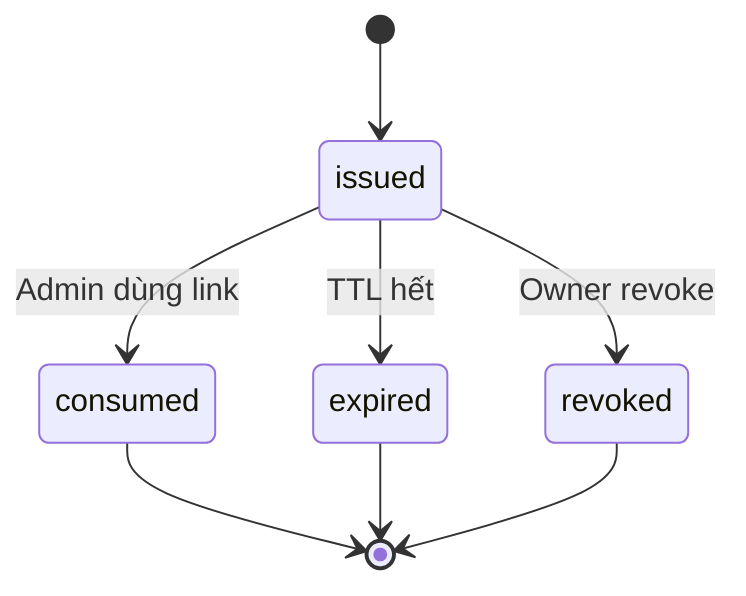

# Feature: Tenant Routing & Admin Authorization — Product/UX Spec

> **Canonical phase:** P2
> **Track:** 🔐 Routing & AuthZ
> **Version:** 2.6a · 2026-07-19
> **Status:** Reviewed · reconciled to TDD v3.1 / decisions v1.45
> **Implementation:** Not started · authority: `../standards/BUILD-STATUS.md` (Doc status ≠ Implementation status)  
> **Prerequisites:** P0–P1 foundation stable
> **Tài liệu liên quan:** `../product/BRD.md` BR-1/BR-3/BR-12 · `../product/PRD.md` §2 + §4.2/4.3 · `../product/TDD.md` §3.3–3.5 · `../standards/decisions.md` DD-27/DD-56/**DD-65..68** · `BE/feature_tenant_routing_authz_tech.md`

> **Authority DD-15/DD-65..68 v1.45 (2026-07-17):** Messenger = central Plexco Page + optional tenant Page. Channel identity/reachability scoped theo Page/bot/OA endpoint cho Messenger + Zalo; endpoint/default context **không tự cấp tenant**. Target tenant/resource chỉ từ protected server-side context/action resolver và eligibility check. Routing không lấy authority từ message body.

---

## 1. Mô tả

Route mọi Zalo/Messenger/admin interaction tới **đúng tenant/resource** rồi authorize action độc lập. P2 cover Zalo bot-token per-club, Messenger hybrid endpoint + server-side context/action resolver, admin link, host/player DM context và TenantAdmin roles.

### Bất biến

- Routing **KHÔNG BAO GIỜ** resolve tenant authority từ message text, pay code, username hay client-supplied tenant ID. Zalo token/Messenger Page pin endpoint và có thể default ingress context; target đến từ opaque action/protected public ref/server picker rồi authorize eligibility riêng.
- Routing **KHÔNG BAO GIỜ** grant authorization — đây là 2 bước tách biệt (**DD-27 channel-aware authz**: quyền theo person, tách khỏi kênh).
- Link code phải high-entropy, short-lived, single-use, bound to tenant/role.
- Fail-closed: nếu không resolve được tenant → reject, không guess.
- Authorization dùng **một registry action→capability canonical**, không rải `role === ...` trong adapter/API/UI. Co-admin preset least-privilege và sensitive grants tuân exact DD-56 matrix; grant thiếu/hết hạn → deny.

---

## 2. Use Cases + Edge Cases

### Use Cases

| ID | Actor | Hành động | Kết quả |
|---|---|---|---|
| RTE-UC-1 | Owner | Mở one-time admin link + kết nối kênh | TenantAdmin + Zalo binding; Messenger Page riêng chỉ tạo khi owner opt-in, central Page không cần club onboarding |
| RTE-UC-2 | System | Zalo/Messenger message/callback arrives | Token/Page → provider endpoint + scoped identity; protected action/context → target tenant/resource; eligibility authorize riêng |
| RTE-UC-3 | Admin | DM arrives | Bound admin context hoặc explicit tenant picker |
| RTE-UC-4 | Player | Mở `club_<slug>` deep link | Sticky context only — KHÔNG grant membership/admin |
| RTE-UC-5 | Player | Thuộc nhiều clubs, DM bot | Valid sticky context hoặc picker nếu ambiguous |
| RTE-UC-6 | Non-admin | Chạy admin command | 403/channel denial — no mutation |
| RTE-UC-7 | System | Tenant bị suspended | Admin mutation blocked; ingestion/safety paths vẫn hoạt động |
| RTE-UC-8 | Owner | Rebind kênh sang tenant mới | Require owner confirmation + audit trail |
| RTE-UC-9 | Admin | Tài khoản kênh (Zalo/Facebook) bị mất | Support runbook — owner recovery path |
| RTE-UC-10 | System | Rate limit link attempts | Block sau N attempts/window — fail closed |
| RTE-UC-11 | Owner | Cấp capability nhạy cảm cho co-admin | Explicit grant có actor/reason/expiry/audit; không thể grant `role.manage` |
| RTE-UC-12 | Co-admin | Manual ban hoặc mark-paid | Chỉ qua `member.ban` / `money.mark_paid`; mark-paid vẫn preview+confirm+audit DD-25 |
| RTE-UC-13 | Host/player | Dùng central hoặc tenant Page | Role-aware menu; một eligible tenant auto-select, nhiều tenant hiện bounded picker |
| RTE-UC-14 | Player | Join cross-club từ tenant Page | Opaque session action resolve target tenant; source Page tenant chỉ audit metadata, không grant quyền |

### Edge Cases

| # | Category | Case | Hành vi bắt buộc |
|---|----------|------|-------------------|
| 1 | Security | Resolve tenant từ message text | ❌ NEVER — trusted binding/action/context resolver only; Page ID không tự cấp target tenant cho central/cross-club |
| 2 | Security | Link code reuse | ❌ Single-use — consumed/expired/revoked. Ref: BL-SEC-2 |
| 3 | Security | Link code brute force | Rate-limit per IP/actor. Ref: BL-SEC-5 |
| 4 | Concurrency | Callback Page tenant ≠ target session tenant | Valid cross-club opaque action được resolve theo target; raw/mismatch/stale token bị reject. Source Page không grant authority |
| 5 | Data Integrity | Sticky context stale (membership/link đã xoá) | Invalidate — fail closed. Không dùng stale context |
| 6 | Data Integrity | Đổi Page / thay bot-token | Require explicit rebind với audit trail |
| 7 | Data Integrity | 1 kênh (bot/Page) bound 2 tenants | ❌ Không cho phép — rebind require owner confirmation |
| 8 | Security | Display name/username kênh thay đổi | Không ảnh hưởng auth — dùng stable ID (Zalo user id / Messenger PSID page-scoped) |
| 9 | Security | Bot-token/Page token leak | Blast radius theo endpoint (Zalo club, Messenger central/tenant); rotation/runbook/audit, global registry không blanket grant |
| 10 | Security | Admin command from non-admin | 403 — routing thành công ≠ có quyền (DD-27) |
| 11 | Security | Suspended tenant admin cố mutate | Block mutation — chỉ cho read + system safety paths |
| 12 | Cross-Feature | Routing thành công nhưng authz fail | Trả lỗi authz, KHÔNG expose tenant info trong error message |
| 13 | Security | Co-admin gọi correction/refund/waiver/void/bank/secret/billing không có grant | Deny từ registry; không được suy quyền từ nhãn admin/co-admin |
| 14 | Security | Sensitive grant hết hạn/thiếu reason/audit hoặc actor cố grant `role.manage` | Deny fail-closed; owner-only role management không delegable |
| 15 | Security | Co-admin cố remove/demote owner/admin hoặc gọi DD-51/DD-53 global action | Deny; global override/split/relink chỉ PlatformAdmin theo dedicated path |

---

## 3. Screens & States

| Surface | Screen | Loading | Ready | Error | Empty |
|---------|--------|---------|-------|-------|-------|
| Bot (Zalo/Messenger) | Admin link onboarding | "Đang tạo liên kết..." | Link code + hướng dẫn kết nối bot/Page | "Không thể tạo link — thử lại" | N/A |
| Bot (Zalo/Messenger) | Channel linked confirmation | — | "✅ Kênh đã liên kết với [club name]" | "Kênh này đã liên kết club khác" | N/A |
| Bot (Zalo/Messenger) | Tenant picker (multi-club DM) | — | Số-reply (Zalo) / quick-reply (Messenger): list clubs | "Không tìm thấy clubs" | N/A |
| Bot (Zalo/Messenger) | Unauthorized denial | — | "⛔ Bạn không có quyền admin" | — | N/A |
| Bot (Zalo/Messenger) | Suspended tenant | — | "⚠️ Club đang tạm ngưng — liên hệ support" | — | N/A |
| Web P4 | Admin settings / link management | Skeleton | Link list + issue new link CTA | Error banner | "Chưa có kênh nào liên kết" + CTA |

---

## 4. Domain Model

| Entity | Vai trò | Key constraints |
|--------|---------|-----------------|
| `zalo_bots` | Binding Zalo bot-token per-club → tenant | `UNIQUE(webhook_token)`, `tenant_id` FK, secret enc |
| Messenger Page registry | Central + optional tenant Page (DD-65) | Page ID → endpoint; scope/nullable tenant CHECK + partial uniques; global-protected narrow resolver |
| Messenger server context/action | Target tenant/resource authority (DD-66/68) | Opaque actor+Page-bound token, TTL, target, snapshot/version; raw IDs have no authority |
| `tenant_link_codes` | One-time tenant-admin onboarding codes | hash-only lookup, `expires_at`, `consumed_at`, `revoked_at`, attempts, `tenant_id` FK, `intended_role`; distinct from identity `link_codes` DD-50 |
| `memberships` | Person ↔ Tenant relationship | `UNIQUE(person_id, tenant_id)`, `role` enum |
| Capability registry (canonical contract) | Exact action → capability mapping | Một source dùng chung cho API/UI/adapters; unknown action/capability deny |
| Sensitive capability grant (proposal) | Delegation owner → co-admin | Tenant+actor+capability+reason+expiry+granted_by+audit; không hỗ trợ `role.manage`; expired/revoked deny |

### DD-56 capability matrix

| Action class | Co-admin default | Explicit owner grant | Owner / global rule |
|---|:---:|:---:|---|
| Session/content management | ✅ | N/A | Owner ✅ |
| Routine member management + manual ban | ✅ | N/A | Requires `member.manage_routine` / `member.ban` |
| Money read + manual mark-paid | ✅ | N/A | `money.mark_paid` vẫn DD-25 preview+confirm+audit |
| Money correction/refund/waiver/void | ❌ | ✅ có expiry/audit | Owner default ✅ |
| Bank account / connector secret / tenant billing | ❌ | ✅ có expiry/audit | Owner default ✅ |
| Role management | ❌ | ❌ không delegable | Owner-only; co-admin không remove/demote owner/admin |
| DD-51 billing override / DD-53 split-relink | ❌ | ❌ | PlatformAdmin-only |

### Link State Machine



### Routing Resolution Order (TDD §3.4)

```text
1. Zalo message → webhook_token → bot/OA endpoint + scoped identity + optional ingress tenant
   Messenger msg → Page ID → endpoint(scope, default_tenant?) + Page-scoped identity
2. Opaque action/public ref → protected target tenant/resource; else role/membership context →
   - 1 tenant → auto-select
   - N tenants → bounded server-side picker
3. Validate membership/capability + action TTL/snapshot/version at consume
4. Cross-club target may differ from source tenant Page; source remains audit-only
5. Fallback → fail closed/re-pick (403), never guess
```

> Telegram `chat_id` routing đã loại (DD-37). Messenger + Zalo tuân DD-15/DD-67: identity unique ba phần, reachability gắn `channel_identity_id`; không thu gọn thành tenant-level state.

---

## 5. Analytics Events

| Event | Khi nào | Payload tối thiểu |
|-------|---------|-------------------|
| `tenant_link_issued` | Owner tạo admin link | `tenant_id`, `link_type`, `intended_role` |
| `tenant_chat_linked` | Kênh kết nối thành công | `tenant_id`, `channel` (zalo/messenger) |
| `tenant_chat_rebound` | Kênh rebind sang tenant khác | `tenant_id` (new), `old_tenant_id` (opaque) |
| `admin_command_denied` | Non-admin cố chạy admin command | `tenant_id`, `actor_id` (opaque), `reason_code` |
| `player_context_selected` | Player chọn club trong DM picker | `tenant_id`, `person_id` (opaque) |
| `routing_failed` | Không resolve được tenant | `channel`, `reason_code` |

> Không bao giờ log bot tokens, link codes, message content trong analytics.

---

## 6. Acceptance Criteria

- [ ] Zalo/Messenger/admin/player DM routing theo TDD precedence, fail closed; central + tenant Page matrix đều pass
- [ ] Routing KHÔNG BAO GIỜ grant authorization — 2 bước tách biệt (DD-27)
- [ ] Non-admin không thể execute bất kỳ admin mutation
- [ ] Link/rebind: TTL, single-use, rate-limited, audited
- [ ] Callback không thể cross channel/tenant/session boundaries
- [ ] Valid cross-club opaque action resolve đúng target tenant; raw/wrong/stale/replayed action không mutate
- [ ] Multi-club DM picker và stale-context invalidation hoạt động
- [ ] Suspended behavior khớp billing contract
- [ ] Tenant A/B routing/authz isolation tests pass
- [ ] One canonical action→capability registry drives API/UI/adapters; unknown action and missing/expired grants deny
- [ ] Every DD-56 sensitive action has allow-with-valid-grant and deny-without/expired-grant tests
- [ ] `role.manage`, DD-51 override and DD-53 split/relink cannot be delegated to co-admin

---

## 7. Open Questions / Changelog

### Open Questions

| ID | Quyết định | Trạng thái |
|---|---|---|
| RTE-OQ-1 | Co-admin permission granularity | ✅ **Chốt DD-56 (2026-07-16)** — exact matrix ở §4: default routine session/content/member/ban/money-read/mark-paid; correction/refund/waiver/void/bank/secret/billing chỉ qua explicit expiring audited grant; `role.manage` không delegable; DD-51/DD-53 PlatformAdmin-only. Implement = một capability registry, không blanket role inheritance |
| RTE-OQ-2 | Owner recovery path khi mất tài khoản provider (Google/Facebook/Zalo) | ✅ **Chốt DD-53 (2026-07-16)** — strong proof (verified email/recovery artifact), không recover bằng tên/raw social ID; freeze/split authority = PlatformAdmin + 2-approval; runbook + drill evidence trước production |

### Changelog

| Date | Version | Thay đổi |
|---|---|---|
| 2026-07-19 | v2.6a | Metadata sweep (index v2.35): thêm trường **Implementation** đồng bộ BUILD-STATUS (Not started). Không đổi contract. |
| 2026-07-17 | v2.6 | **decisions v1.45:** generalized provider-endpoint identity/reachability cho Messenger + Zalo; endpoint/default context tách khỏi target-tenant eligibility. |
| 2026-07-17 | v2.5 | **Model naming closure:** Product now uses canonical `tenant_link_codes` + `consumed_at`/revoke/attempt lifecycle; explicitly distinct from identity merge `link_codes`. BE legacy DDL marked reference-only. |
| 2026-07-17 | v2.4 | **DD-65..68:** Messenger hybrid endpoint/default-context model, protected target resolver, central multi-club picker và cross-club opaque action; Page không còn đồng nghĩa tenant. |
| 2026-06-18 | v1.0 | Initial spec (English format) |
| 2026-06-19 | v2.0 | Chuẩn hoá Vietnamese numbered format, thêm 10 use cases, 12 edge cases, link state machine, routing resolution order, screen states, analytics payload |
| 2026-07-10 | v2.1 | **DD-37:** bỏ Telegram (`chat_id` routing + shared bot); channel routing = **Zalo bot-token per-club** (`webhook_token → tenant`) + **Messenger Page per-club** (Page ID → tenant, PSID page-scoped). Giữ **DD-27 channel-aware authz**. Cập nhật §1, UC, edge (#1/4/6/7/8/9), screens, domain model (`telegram_links` → `zalo_bots` + Messenger Page), routing order, analytics. |
| 2026-07-16 | v2.2 | **Propagation (light) DD-53/56:** RTE-OQ-1 ✅ (co-admin = admin trừ role mgmt, được ban; capability registry), RTE-OQ-2 ✅ (recovery strong proof + PlatformAdmin authority). Registry/runbook defer build slice. Authority: decisions v1.36. |
| 2026-07-16 | v2.3 | **Full propagation DD-56 (closure v1.37; current decisions v1.39):** replace blanket co-admin inheritance with exact capability matrix, explicit expiring/audited sensitive grants, non-delegable role/global actions, and fail-closed acceptance cases. |
