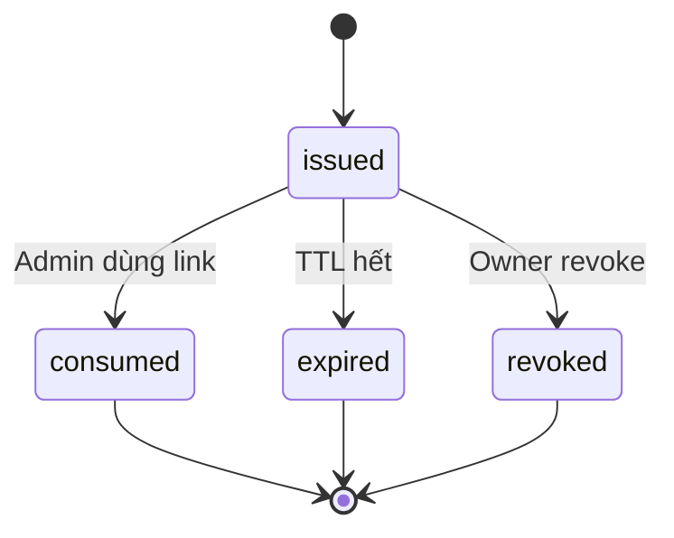

# Feature: Tenant Routing & Admin Authorization — Product/UX Spec

> **Canonical phase:** P2
> **Track:** 🔐 Routing & AuthZ
> **Version:** 2.1 · 2026-07-10
> **Status:** Reviewed
> **Prerequisites:** P0–P1 foundation stable
> **Tài liệu liên quan:** `../product/BRD.md` BR-1/BR-3/BR-12 · `../product/PRD.md` §2 + §4.2/4.3 · `../product/TDD.md` §3.3–3.5 · `../standards/decisions.md` DD-37/DD-27 · `BE/feature_tenant_routing_authz_tech.md`

> **Cập nhật v3.4 (DD-37, 2026-07-10):** bỏ **Telegram** (shared bot + `chat_id` routing). Kênh phase-1 = **Zalo (bot-token per-club)** + **Facebook Messenger (Page per-club)** + web. Routing vẫn **suy từ kênh, KHÔNG từ nội dung** (NFR-S3). Giữ **DD-27 channel-aware authz**.

---

## 1. Mô tả

Route mọi Zalo/Messenger/admin interaction tới **đúng tenant** từ trusted channel bindings, sau đó authorize admin commands **độc lập** với routing. P2 cover: **Zalo bot-token per-club** + **Messenger Page per-club**, admin link, player DM context, TenantAdmin roles. *(Telegram shared-bot + `chat_id` routing đã loại — DD-37.)*

### Bất biến

- Routing **KHÔNG BAO GIỜ** resolve tenant từ message text, pay code, username hay client-supplied tenant ID. Tenant suy từ **credential kênh**: Zalo `webhook_token` per-club / Messenger Page ID.
- Routing **KHÔNG BAO GIỜ** grant authorization — đây là 2 bước tách biệt (**DD-27 channel-aware authz**: quyền theo person, tách khỏi kênh).
- Link code phải high-entropy, short-lived, single-use, bound to tenant/role.
- Fail-closed: nếu không resolve được tenant → reject, không guess.

---

## 2. Use Cases + Edge Cases

### Use Cases

| ID | Actor | Hành động | Kết quả |
|---|---|---|---|
| RTE-UC-1 | Owner | Mở one-time admin link + kết nối kênh (Zalo bot-token / Messenger Page) | TenantAdmin + channel binding (`zalo_bots` / Messenger Page) created atomically |
| RTE-UC-2 | System | Zalo/Messenger message/callback arrives | Zalo `webhook_token → tenant` · Messenger Page ID `→ tenant`; session thuộc cùng tenant |
| RTE-UC-3 | Admin | DM arrives | Bound admin context hoặc explicit tenant picker |
| RTE-UC-4 | Player | Mở `club_<slug>` deep link | Sticky context only — KHÔNG grant membership/admin |
| RTE-UC-5 | Player | Thuộc nhiều clubs, DM bot | Valid sticky context hoặc picker nếu ambiguous |
| RTE-UC-6 | Non-admin | Chạy admin command | 403/channel denial — no mutation |
| RTE-UC-7 | System | Tenant bị suspended | Admin mutation blocked; ingestion/safety paths vẫn hoạt động |
| RTE-UC-8 | Owner | Rebind kênh sang tenant mới | Require owner confirmation + audit trail |
| RTE-UC-9 | Admin | Tài khoản kênh (Zalo/Facebook) bị mất | Support runbook — owner recovery path |
| RTE-UC-10 | System | Rate limit link attempts | Block sau N attempts/window — fail closed |

### Edge Cases

| # | Category | Case | Hành vi bắt buộc |
|---|----------|------|-------------------|
| 1 | Security | Resolve tenant từ message text | ❌ NEVER — chỉ dùng trusted bindings (Zalo `webhook_token` / Messenger Page ID, link code) |
| 2 | Security | Link code reuse | ❌ Single-use — consumed/expired/revoked. Ref: BL-SEC-2 |
| 3 | Security | Link code brute force | Rate-limit per IP/actor. Ref: BL-SEC-5 |
| 4 | Concurrency | Callback: channel binding ≠ session tenant | Reject — validate channel binding, callback session tenant, actor riêng biệt |
| 5 | Data Integrity | Sticky context stale (membership/link đã xoá) | Invalidate — fail closed. Không dùng stale context |
| 6 | Data Integrity | Đổi Page / thay bot-token | Require explicit rebind với audit trail |
| 7 | Data Integrity | 1 kênh (bot/Page) bound 2 tenants | ❌ Không cho phép — rebind require owner confirmation |
| 8 | Security | Display name/username kênh thay đổi | Không ảnh hưởng auth — dùng stable ID (Zalo user id / Messenger PSID page-scoped) |
| 9 | Security | Bot-token/Page token leak | Blast radius **per-club** (Zalo bot-token/Messenger Page per-CLB) — secret rotation/runbook required |
| 10 | Security | Admin command from non-admin | 403 — routing thành công ≠ có quyền (DD-27) |
| 11 | Security | Suspended tenant admin cố mutate | Block mutation — chỉ cho read + system safety paths |
| 12 | Cross-Feature | Routing thành công nhưng authz fail | Trả lỗi authz, KHÔNG expose tenant info trong error message |

---

## 3. Screens & States

| Surface | Screen | Loading | Ready | Error | Empty |
|---------|--------|---------|-------|-------|-------|
| Bot (Zalo/Messenger) | Admin link onboarding | "Đang tạo liên kết..." | Link code + hướng dẫn kết nối bot/Page | "Không thể tạo link — thử lại" | N/A |
| Bot (Zalo/Messenger) | Channel linked confirmation | — | "✅ Kênh đã liên kết với [club name]" | "Kênh này đã liên kết club khác" | N/A |
| Bot (Zalo/Messenger) | Tenant picker (multi-club DM) | — | Số-reply (Zalo) / quick-reply (Messenger): list clubs | "Không tìm thấy clubs" | N/A |
| Bot (Zalo/Messenger) | Unauthorized denial | — | "⛔ Bạn không có quyền admin" | — | N/A |
| Bot (Zalo/Messenger) | Suspended tenant | — | "⚠️ Club đang tạm ngưng — liên hệ support" | — | N/A |
| Web P4 | Admin settings / link management | Skeleton | Link list + issue new link CTA | Error banner | "Chưa có kênh nào liên kết" + CTA |

---

## 4. Domain Model

| Entity | Vai trò | Key constraints |
|--------|---------|-----------------|
| `zalo_bots` | Binding Zalo bot-token per-club → tenant | `UNIQUE(webhook_token)`, `tenant_id` FK, secret enc |
| Messenger Page binding | Binding Facebook Page per-club → tenant (DD-33/DD-37, proposal-level) | Page ID → tenant; PSID page-scoped. Canonical → decisions.md + `packages/db/schema.ts` |
| `admin_links` | One-time link codes | `code` unique, `expires_at`, `used_at`, `tenant_id` FK, `intended_role` |
| `memberships` | Person ↔ Tenant relationship | `UNIQUE(person_id, tenant_id)`, `role` enum |

### Link State Machine



### Routing Resolution Order (TDD §3.4)

```text
1. Zalo message   → webhook_token (per-club) → zalo_bots → tenant_id
   Messenger msg   → Page ID (recipient.id)   → messenger page binding → tenant_id
2. Admin DM → person_id → memberships (role=admin) →
   - 1 tenant → auto-select
   - N tenants → picker
3. Player DM → sticky context → validate membership still active
4. Deep link → slug → tenant_id (sticky, no admin grant)
5. Fallback → fail closed (403)
```

> Telegram `chat_id` routing đã loại (DD-37). Zalo: DM number-reply (không inline button, GROUP Beta). Messenger: Page-per-club, cửa sổ 24h.

---

## 5. Analytics Events

| Event | Khi nào | Payload tối thiểu |
|-------|---------|-------------------|
| `tenant_link_issued` | Owner tạo admin link | `tenant_id`, `link_type`, `intended_role` |
| `tenant_chat_linked` | Kênh kết nối thành công | `tenant_id`, `channel` (zalo/messenger) |
| `tenant_chat_rebound` | Kênh rebind sang tenant khác | `tenant_id` (new), `old_tenant_id` (opaque) |
| `admin_command_denied` | Non-admin cố chạy admin command | `tenant_id`, `actor_id` (opaque), `reason_code` |
| `player_context_selected` | Player chọn club trong DM picker | `tenant_id`, `person_id` (opaque) |
| `routing_failed` | Không resolve được tenant | `channel`, `reason_code` |

> Không bao giờ log bot tokens, link codes, message content trong analytics.

---

## 6. Acceptance Criteria

- [ ] Zalo/Messenger/admin/player DM routing theo TDD precedence, fail closed (Zalo `webhook_token` / Messenger Page ID)
- [ ] Routing KHÔNG BAO GIỜ grant authorization — 2 bước tách biệt (DD-27)
- [ ] Non-admin không thể execute bất kỳ admin mutation
- [ ] Link/rebind: TTL, single-use, rate-limited, audited
- [ ] Callback không thể cross channel/tenant/session boundaries
- [ ] Multi-club DM picker và stale-context invalidation hoạt động
- [ ] Suspended behavior khớp billing contract
- [ ] Tenant A/B routing/authz isolation tests pass

---

## 7. Open Questions / Changelog

### Open Questions

| ID | Quyết định | Trạng thái |
|---|---|---|
| RTE-OQ-1 | Co-admin permission granularity — finalize trước P2 UI polish | ⬜ Chưa chốt |
| RTE-OQ-2 | Owner recovery path khi mất tài khoản provider (Google/Facebook/Zalo — Telegram đã loại DD-37) — support runbook | 🔴 Founder + security — gom vào founder brief Item 9; fail-closed, không recover bằng tên/raw social ID |

### Changelog

| Date | Version | Thay đổi |
|---|---|---|
| 2026-06-18 | v1.0 | Initial spec (English format) |
| 2026-06-19 | v2.0 | Chuẩn hoá Vietnamese numbered format, thêm 10 use cases, 12 edge cases, link state machine, routing resolution order, screen states, analytics payload |
| 2026-07-10 | v2.1 | **DD-37:** bỏ Telegram (`chat_id` routing + shared bot); channel routing = **Zalo bot-token per-club** (`webhook_token → tenant`) + **Messenger Page per-club** (Page ID → tenant, PSID page-scoped). Giữ **DD-27 channel-aware authz**. Cập nhật §1, UC, edge (#1/4/6/7/8/9), screens, domain model (`telegram_links` → `zalo_bots` + Messenger Page), routing order, analytics. |
