# Feature: Web Authentication & Tenant Onboarding — Product/UX Spec

> **Canonical phase:** P4  
> **Track:** 🌐 Web Auth & Onboarding  
> **Version:** 2.10b · 2026-07-23
> **Status:** Reviewed  
> **Implementation:** In progress — Onboarding v3 Telegram-era merged (`5b1193b`); Google auth lane DD-80 (migrations `0015`–`0018`) đã merge nhưng ⛔ **CHƯA enable** (thiếu đo Safari macOS+iOS cho M3 → `GOOGLE_OAUTH_*` giữ rỗng); email/password order-4 bundle (route/UI/provider send) chưa build, flag OFF · authority: `../standards/BUILD-STATUS.md` (Doc status ≠ Implementation status)
> **Prerequisites:** P0–P1 foundation · P2 routing/authz · P3 ledger/provider model  
> **Tài liệu liên quan:** `../product/BRD.md` FR-1 · `../product/PRD.md` FLOW 1 · `../standards/decisions.md` DD-13/DD-30/DD-33/DD-50/**DD-65** · `BE/feature_web_auth_onboarding_tech.md` · `feature_connector_onboarding.md`

> **Cập nhật 18/07:** bỏ Telegram Login; baseline auth = Google OAuth + email/password. **Facebook Login / Messenger link** = DD-33 ✅, nhưng exact external approval evidence là enablement gate; chưa pass thì capability OFF + transactional one-time `link_code` fallback.
>
> **Cross-site auth correction (18/07):** session cookie vẫn `SameSite=Strict`. Google/Facebook callback dùng dedicated short-lived browser-binding cookie `SameSite=Lax` + one-time OAuth transaction vì redirect là cross-site GET; callback không dùng same-origin header check. Email verify/reset dùng non-mutating landing GET → explicit same-origin POST, nên link scanner không consume token và registration-key cookie `Strict` vẫn dùng được.

---

## 1. Mô tả

Cho host mới authenticate, tạo tenant và connect integrations. Readiness matrix đã pin: **required per tenant** = club config (hoặc personal-tenant auto-provision DD-46) + bank verified + first session created; **optional/non-blocking** = Zalo bot và tenant Messenger Page. Bank step mặc định dùng **ApiPay enterprise auto-provision** (DD-30, không nhập platform key); ApiPay BYO key chỉ là fallback do owner chọn. **Messenger central Page** là release gate cấp platform, không phải step per tenant (DD-65).

### Bất biến

- Google OIDC **PHẢI** verify chữ ký bằng provider key, exact `iss`/`aud`, `state`/`nonce`/PKCE, `exp`/`iat` và `email_verified === true`; không trust returned fields alone.
- Facebook Login chỉ bật cho non-test user khi exact App Review/Business Verification/permission evidence đã được ghi nhận; code exchange + subject verification chạy server-side. Subject web-auth là stable app-scoped subject của đúng Meta App, **không phải** Messenger Page-scoped PSID và không auto-link với PSID.
- Email/password chỉ được bật khi có **đủ lifecycle**: password hash mạnh; verify-email token hash-only, TTL ngắn, single-use; forgot/reset enumeration-safe; reset thành công revoke mọi web session bị ảnh hưởng. Thiếu bất kỳ phần nào → email auth **OFF**, không ship partial lifecycle (DD-50).
- Session cookies: `secure`, `httpOnly`, `sameSite=strict`, CSRF protection, rotation sau privilege change. Pre-auth cookie tách theo transport: OAuth binding = short-lived/path-scoped `Lax`; email-login/registration binding = path-scoped `Strict`; không cookie nào thay session.
- Tenant creation/bind dùng **idempotency keys** — refresh/back KHÔNG duplicate.
- Secrets: write-only, KMS encrypted, masked after save, rotatable.
- Owner KHÔNG thể accidentally bind group/account đã thuộc tenant khác.

### 1.1 Surface entry points (web-first vs bot-first)

Connector connect (bank/Zalo) **chỉ chạy trên web** — không dán secret/OAuth trong khung chat (token lưu lại lịch sử chat = lộ, vi phạm BL-SEC-1; OAuth cần browser). Hai điểm vào, dùng chung endpoint `/api/onboarding/*`:

- **Web-first:** host đăng nhập plexco.app → chạy wizard; Page riêng Messenger có thể skip vì central Page đã dùng được.
- **Bot-first:** host mở bot CLB qua **Zalo** hoặc **Facebook Messenger**; phần không nhạy cảm (tên CLB, môn, giá, session đầu) hỏi ngay trong chat; bank selection/OAuth/BYO credential và token kênh đều đi qua **magic-link 1 lần** → host hoàn tất trên web → quay lại bot.

> **Zalo** = BYO Bot Token per-CLB. **Messenger** = một platform App + central Page; optional tenant Page qua FB Login → chọn Page. Central Page readiness do platform ops sở hữu, không lặp trong từng tenant wizard.

> **Auth phase-1 (DD-13/DD-33):** Google OAuth + email-password là baseline; Facebook Login đã accepted nhưng fail-closed OFF cho non-test users tới khi external evidence active. Target providers là `{google,email,facebook,zalo}` nhưng live DB chưa có platform CHECK; `persons` vẫn là anchor và Zalo Login vẫn gated DD-14. Chi tiết: decisions DD-13/14/33 + identity-model §7.

---

## 2. Use Cases + Edge Cases

### Use Cases

| ID | Actor | Hành động | Kết quả |
|---|---|---|---|
| WAO-UC-1 | New Host | Authenticate (Google OAuth / email-password) | Session created, CSRF token issued |
| WAO-UC-2 | New Host | Tạo Account + Tenant | Idempotent create; assign owner role |
| WAO-UC-3 | Host | Configure club: name, timezone, locale, sport, price, visibility/join defaults | Saved, validation per field |
| WAO-UC-4 | Host | Connect bank provider (ApiPay enterprise primary / SePay OAuth; ApiPay BYO explicit fallback) | ApiPay primary chỉ chọn/xác nhận TK host rồi enterprise provision; không nhập platform key. Plexco tự đăng ký webhook → verify 2 tầng. Ref: `feature_connector_onboarding.md` §4.2–4.3 |
| WAO-UC-5 | Host | Optional link Facebook Page riêng | Tenant Page endpoint active; central Page vẫn fallback; Page-scoped identity/reachability. Ref DD-65..67 |
| WAO-UC-6 | Host | Connect Zalo bot (BYO token) — phase-1 | 🟡 Dự kiến auto `setWebhook` (blocked CO-OQ-1); tới khi đó dán URL thủ công |
| WAO-UC-7 | Host | Create first session + optional publish | Session live, ready to receive players |
| WAO-UC-8 | Host | Resume incomplete onboarding | Each step has verified/not-configured/error state |
| WAO-UC-9 | Host | Rotate bank credentials | Old masked, new saved encrypted |
| WAO-UC-10 | Host | Xem readiness checklist | Summary: ✅/❌ per step, proceed/block |
| WAO-UC-11 | New Host | Verify email sau self-register | Token hợp lệ được consume đúng một lần; account mới được phép login |
| WAO-UC-12 | Host | Forgot/reset password | Luôn trả response enumeration-safe; token hash-only + TTL + single-use; reset xong revoke toàn bộ web sessions của account |
| WAO-UC-13 | Host | Revoke all sessions | Mọi session hiện hành của account bị revoke atomically; thiết bị phải login lại |
| WAO-UC-14 | Host/Player | Đăng nhập hoặc link Plexco account bằng Facebook khi provider gate đã active | Tạo/lookup verified `account_identities(platform='facebook')`; không auto-link Messenger PSID; nếu gate chưa active thì dùng transactional one-time `link_code` |

### Edge Cases

| # | Category | Case | Hành vi bắt buộc |
|---|----------|------|-------------------|
| 1 | Security | Google signature/issuer/audience/state/nonce/PKCE/time claim sai hoặc email chưa verified | Reject auth — "Xác thực không hợp lệ"; không tạo session |
| 2 | Security | OAuth state replay / stale nonce (replay attack) | Reject — state + nonce single-use + timestamp check. Ref: BL-SEC-1 |
| 3 | Concurrency | Refresh/back during tenant create | Idempotency key → return existing tenant |
| 4 | Security | Secret exposed in URL/log | ❌ NEVER — write-only, KMS, masked display |
| 5 | Data Integrity | Bind group đã thuộc tenant khác | Conflict error — "Nhóm này đã liên kết club khác" |
| 6 | Data Integrity | Bind bank account đã thuộc tenant khác | Conflict — show which tenant owns it (masked) |
| 7 | Security | Bank/webhook verify expose account/secret | ❌ NEVER — verify via server-side call only |
| 8 | Resilience | Zalo/Messenger connect fail | Non-blocking — web-first DoD. Show "thử lại sau"; Messenger degrade nếu App Review chậm |
| 9 | Security | Session cookie theft (XSS) | `httpOnly` + `sameSite=strict` + rotation. Ref: BL-SEC-3 |
| 10 | Data Integrity | Onboarding partially complete → resume | Each step independent, verified state persisted |
| 11 | Security | CSRF on state-changing requests | Token verified per request — reject without valid CSRF |
| 12 | Security | Privilege escalation during onboarding | Session rotation after each privilege-granting step |
| 13 | Security | Verify/reset token bị replay, quá hạn hoặc đã consume | Reject generic; token không được hồi sinh hay consume lần hai |
| 14 | Privacy | Forgot-password với email không tồn tại | Response/status/timing cùng class với email tồn tại; không lộ account existence |
| 15 | Security | Reset password thành công nhưng session cũ còn sống | ❌ NEVER — revoke-all phải commit cùng credential change hoặc fail toàn bộ |
| 16 | Security | Email auth mới có register/login nhưng thiếu verify/reset/revoke-all | Fail-closed feature flag OFF; Google vẫn hoạt động độc lập |
| 17 | External/Security | Facebook provider chưa có exact review/verification/permission evidence hoặc provider verification fail | Capability OFF/ẩn CTA cho non-test user; không tạo identity/session; hiển thị fallback transactional one-time `link_code` |
| 18 | Identity | Facebook Login subject trùng tên/email với Messenger PSID profile | Không auto-link; chỉ link qua verified account identity hoặc consume transactional one-time `link_code` |
| 19 | Security/Browser | Google/Facebook redirect về từ provider nhưng callback đòi cookie `Strict` hoặc same-origin `Origin/Referer` | ❌ NEVER — dùng one-time OAuth transaction + dedicated Lax binding cookie; session cookie vẫn Strict |
| 20 | Security/Browser | Email scanner/prefetch mở verify/reset link hoặc user mở verify link ở browser khác | GET không mutation/consume; explicit same-origin POST mới act; verify thiếu matching registration cookie chỉ handoff/re-register |

---

## 3. Screens & States

| Surface | Screen | Loading | Ready | Error | Empty |
|---------|--------|---------|-------|-------|-------|
| Web | Login page | — | Google + email/password; Facebook CTA chỉ hiện khi provider external gate active; "Quên mật khẩu" | "Xác thực thất bại" + retry hoặc `link_code` fallback | N/A |
| Web | Verify email / reset password | Validating token | Generic success + login CTA | Generic invalid/expired message + safe retry | N/A |
| Web | Onboarding wizard — Step 1: Club config | Skeleton form | Form: name, timezone, sport, price, visibility | Inline errors per field | Default values pre-filled |
| Web | Onboarding wizard — Step 2: Bank connect | Skeleton | **ApiPay primary:** "Thiết lập tài khoản nhận tiền" → chọn/xác nhận TK host → enterprise provision → chip `registered → active`; SePay OAuth là lựa chọn provider khác; "Dùng ApiPay key riêng" là CTA phụ mở BYO form | Enterprise unsupported/unavailable → mời BYO; provision fail → retry idempotent; không tự downgrade. BYO key/PENDING có lỗi riêng | Chưa chọn bank: giải thích tiền về TK riêng của host; BYO không hiện như đường mặc định |
| Web | Onboarding wizard — Step 3: Zalo bot | Skeleton | Dán bot token → auto `setWebhook` (🟡 blocked CO-OQ-1) → verify | "Kết nối thất bại" + retry | N/A |
| Web | Optional Messenger Page | Skeleton | “Dùng Plexco central Page” (default) hoặc FB Login → chọn Page riêng → active | Lỗi Page riêng → tiếp tục central Page | Central selected |
| Web | Onboarding wizard — Step 5: First session | Session form | Create + optional publish | Inline validation | N/A |
| Web | Readiness checklist | — | ✅/❌ per step + "Bắt đầu" CTA | — | N/A |

---

## 4. Domain Model

| Entity | Vai trò | Key constraints |
|--------|---------|-----------------|
| `persons` | Global identity (anchor) | Identity qua `account_identities`/`channel_identities`, KHÔNG root table `users`; phone dormant phase-1, không phải login/merge proof |
| `account_identities` | Web-auth provider per person (DD-13/DD-33) | Target `platform ∈ {google,email,facebook,zalo}`; live DB hiện là unrestricted `text` và chưa có platform CHECK. Migration phải audit/backfill legacy rows rồi thêm validation self-contained; `platform_user_hash` keyed-HMAC, domain/provider-separated; password → bảng credential riêng |
| Email credential (logical contract) | Password hash + verification state per email identity | Storage/constraints chốt ở B0 design-probe; không lưu plaintext, unverified không login |
| Email verify/reset token (logical contract) | Một lần, TTL ngắn, purpose-bound | Chỉ lưu token hash; consume atomically; reset revoke-all sessions trong cùng transaction boundary |
| `tenants` | Club/org hoặc personal tenant target | Live club tenant: `UNIQUE(slug)`, ownership qua membership/admin (không có universal owner FK). DD-46 target adds `kind`; `owner_person_id` required/unique only iff `kind='personal'`, NULL for club |
| `memberships` | Person ↔ Tenant | `UNIQUE(person_id, tenant_id)`, `role` enum |
| `bank_accounts` | Per-host payment-provider binding | `tenant_id` FK, bank/webhook thuộc đúng host; ApiPay enterprise row không chứa platform credential; BYO secret fields encrypted; `verified_at` |
| `zalo_bots` | Zalo channel binding (BYO token per-CLB) | `webhook_token`, `tenant_id` FK, secret enc |
| Messenger Page registry | Central + optional tenant Page | DD-65 global-protected registry; live schema cần migration; PSID/reachability Page-scoped |
| `onboarding_state` | Progress tracking per tenant | `tenant_id` FK, step statuses JSON |

### Onboarding State Machine

```mermaid
stateDiagram-v2
    [*] --> auth
    auth --> club_config: Google/email/Facebook verified
    club_config --> bank_connect: Club saved
    bank_connect --> zalo_link: Bank verified
    zalo_link --> messenger_link: linked / skipped / retry later
    messenger_link --> first_session: central default / tenant Page linked / skip
    first_session --> complete: Session created
    complete --> [*]
    note right of zalo_link: optional per tenant; does not gate readiness
    note right of messenger_link: optional tenant Page; central readiness là platform release gate
```

> SM trên là cấp **wizard step**. Mỗi connector còn có SM riêng `connecting → registered → active → drift/error/revoked` (verify 2 tầng) — xem `feature_connector_onboarding.md` §3.3.

---

## 5. Analytics Events

| Event | Khi nào | Payload tối thiểu |
|-------|---------|-------------------|
| `onboarding_started` | Host bắt đầu wizard | `person_id` (opaque), `auth_method` |
| `tenant_created` | Tenant created thành công | `tenant_id`, `sport_default` |
| `integration_connected` | Bank/Zalo/Messenger verified | `tenant_id`, `integration_type`, `provider` |
| `integration_failed` | Verify thất bại | `tenant_id`, `integration_type`, `error_class` |
| `first_session_created` | Host tạo session đầu tiên | `tenant_id`, `visibility` |
| `first_session_published` | Session published public | `tenant_id` |
| `onboarding_completed` | Tất cả required steps ✅ | `tenant_id`, `duration_seconds` |

> Không log credentials, PII, tokens trong analytics.

---

## 6. Acceptance Criteria

- [ ] Unknown host completes tenant → first session không cần env/manual DB work
- [ ] Google signature + exact issuer/audience + state/nonce/PKCE + exp/iat + `email_verified=true` tests pass
- [ ] Google/Facebook callback cross-site GET pass bằng one-time state + path-scoped Lax binding; missing/wrong/replayed binding fail; callback không dùng `sameOriginRequest()`; session cookie sau login vẫn Strict
- [ ] Email verify/forgot/reset/revoke-all contract pass; token replay/expiry/enumeration-safe/old-session tests pass
- [ ] Verify/reset landing GET không mutation/consume dưới link scanner; explicit same-origin POST mới act; verify wrong-browser/missing Strict registration key fail closed
- [ ] Email auth remains disabled until the whole lifecycle is deployable and verified end-to-end
- [ ] Facebook code exchange/subject verification is server-side; raw code/access token never logged/persisted; lookup hash write/read parity passes
- [ ] Facebook Login subject and Messenger Page-scoped PSID cannot auto-link; transactional one-time `link_code` is the only fallback link path
- [ ] Facebook CTA/capability for non-test users remains OFF until exact external approval evidence is recorded; unavailable provider degrades without a broken CTA
- [ ] Duplicate submissions KHÔNG duplicate tenant/provider/link (idempotency)
- [ ] Secrets encrypted, masked, not logged, rotatable
- [ ] ApiPay bank step mặc định gọi enterprise `/api/onboarding/apipay/provision` với opaque bank-selection ref + idempotency key; không thu/hiện platform credential; retry không tạo bank/webhook trùng
- [ ] ApiPay enterprise unsupported/unavailable chỉ hiện CTA BYO fallback; không tự chuyển auth mode hoặc gọi BYO endpoint
- [ ] Club không Page hoàn tất onboarding + tạo session qua central; optional Page ownership/conflict/fallback work
- [ ] Readiness is true only after club-or-personal space + verified bank + first session; Zalo and tenant Page may be skipped/error without changing readiness; central Page availability is checked at platform release level
- [ ] Zalo + Messenger là kênh phase-1 trong wizard; Telegram absent (DD-37)
- [ ] Resume/retry và partial onboarding states work
- [ ] Tenant owner authorization enforced after every step

---

## 7. Open Questions / Changelog

### Open Questions

| ID | Quyết định | Trạng thái |
|---|---|---|
| WAO-OQ-1 | Web stack | ✅ Next.js App Router, standalone/container (DD-10) |
| WAO-OQ-2 | Minimum required steps trước khi mark onboarding complete | ✅ **Chốt contract:** club config hoặc DD-46 personal provision + bank `verified` + first session. Zalo + tenant Messenger Page optional/non-blocking; central Messenger availability is a platform release gate, not tenant state. |
| WAO-OQ-3 | DD-33 Facebook Login/Messenger link | ✅ Design phase-1 đã chốt; App Review/Business Verification/permission evidence là external enablement gate. Chưa pass → capability OFF + transactional one-time `link_code` fallback. |
| WAO-OQ-4 | Skip Club / personal meet: đường tạo không-gian-cá-nhân | ✅ **Chốt DD-46** — auto-provision personal tenant (tái dùng `provisionTenant` core, wrapper `getOrCreatePersonalTenant`, free plan, bỏ bước "đặt tên club", owner=self); propagate lúc build → `../dd-46-skip-club-analysis.md` |
| WAO-OQ-5 | Email credential lifecycle + phase-1 không thu SĐT | ✅ **Chốt DD-50 (2026-07-16)** — contract đầy đủ đã pin: verify email, forgot/reset enumeration-safe, token hash-only/TTL/single-use, reset revoke-all sessions; khoá mạnh claim = verified email + `link_code` (phone dormant). B0 (`../pre-code-open-items-2026-07-16.md`) **đã có design-probe: `../b0-auth-credential-lifecycle-design-probe.md` (2026-07-18)** — mutation paths + storage/DDL đã map, gồm account-wide revoke primitive, multi-attempt verify-first registration, cross-site OAuth transaction/Lax binding, non-mutating email-link landing, outbox→pg-boss delivery và login finalizer. **Current-state (cập nhật 2026-07-23):** storage/adapter đã build & merge — auth DD-80 lane `0015`–`0018` trên `main` (`0015` revoke-core · `0016` email-token storage CODE DARK · `0017` Google OIDC adapter · `0018` d1b completion-hop); Google ⛔ chưa enable (chờ đo Safari/iOS M3). **Còn mở:** email **order-4 bundle** (route/UI/provider send) chưa build, provider fail-closed OFF (gate `C7`) |

### Changelog

| Date | Version | Thay đổi |
|---|---|---|
| 2026-07-23 | v2.10b | **Reconcile Implementation current-state (mirror của BE tech spec):** header "Google/email DD-37 chưa code" → Google auth lane DD-80 `0015`–`0018` **đã merge nhưng ⛔ CHƯA enable** (chờ đo Safari/iOS M3, `GOOGLE_OAUTH_*` rỗng); email order-4 bundle (route/UI/send) chưa build, flag OFF. WAO-OQ-5 (§7 Open Questions) reframe: "chưa author slice S4 / chờ owner duyệt" → D0/D1 storage+adapter (`0015`–`0018`) đã merge, chỉ còn email order-4/gate `C7` mở. Đồng bộ với `BE/feature_web_auth_onboarding_tech.md` v2.12. Không đổi contract/UX. |
| 2026-07-19 | v2.10a | Metadata sweep (index v2.35): thêm trường **Implementation** đồng bộ BUILD-STATUS (In progress). Không đổi contract. |
| 2026-07-18 | v2.10 | **Cross-site auth correction:** tách OAuth redirect khỏi live Telegram same-origin primitive bằng one-time transaction + path-scoped Lax binding cookie; email verify/reset dùng non-mutating landing GET → explicit same-origin POST; thêm link-scanner/wrong-browser tests; session cookie giữ Strict. |
| 2026-07-18 | v2.9 | **DD-33 propagation:** pin Facebook Login server-side exchange + app-scoped subject, external enablement gate, fail-closed CTA/capability, PSID separation và one-time `link_code` fallback; ghi đúng live schema chưa có platform CHECK. |
| 2026-07-17 | v2.8 | **DD-30 enterprise-first propagation:** make ApiPay enterprise provisioning the default bank screen/use case; demote accessKey/secretKey to an explicit owner-selected fallback; pin idempotent retry, secret-free UI and no-silent-downgrade acceptance. |
| 2026-07-17 | v2.7 | **Readiness/live-schema closure:** close WAO-OQ-2 with required club-or-personal + bank + first-session matrix; Zalo/tenant Page optional; clarify live club ownership vs DD-46 conditional personal `owner_person_id`. |
| 2026-07-17 | v2.6 | **DD-65..67:** central Page là platform default; tenant Page onboarding optional, không block readiness/first session; Page-scoped identity/reachability + fallback. |
| 2026-06-18 | v1.0 | Initial spec (English format) |
| 2026-06-19 | v2.0 | Chuẩn hoá Vietnamese numbered, thêm 10 use cases, 12 edge cases, onboarding wizard screen states, state machine |
| 2026-06-20 | v2.1 | Cross-link `feature_connector_onboarding.md`: bank/Zalo connect chuyển sang auto-register + verify 2 tầng; thêm §1.1 surface entry points (web-first vs bot-first, deep-link handoff); cập nhật UC-4/UC-6 + screen states |
| 2026-07-15 | v2.3 | **Propagation (light):** thêm WAO-OQ-4 (DD-46 personal tenant auto-provision) với pointer; auto-provision path/schema propagate lúc build slice. Analytics integration provider được reconcile Bank/Zalo/Messenger theo DD-37. |
| 2026-07-16 | v2.4 | **Propagation (light) DD-50:** thêm WAO-OQ-5 (email verify bắt buộc; không thu SĐT; khoá mạnh = verified email + link_code; credential lifecycle → B0). Authority: decisions v1.36. |
| 2026-07-16 | v2.5 | **Full propagation DD-50 (decisions v1.37):** pin Google OIDC claim matrix; email verify/forgot/reset/revoke-all lifecycle; hash-only single-use tokens; enumeration-safe responses; partial email auth fail-closed OFF. Domain storage/DDL vẫn phải qua B0 design-probe. |
| 2026-07-10 | v2.2 | **DD-13 + DD-37:** bỏ **Telegram Login** adapter; auth phase-1 = **Google OAuth + email/password** (`account_identities.platform ∈ {google,email,facebook,zalo}`). Kênh onboarding phase-1 = **Zalo + Facebook Messenger** (drop TG bind step, thêm Messenger Page step). **Facebook Login/link** = DD-33 (🟡 phase-1). Cập nhật §1/§1.1, UC-1/5/6, edge #1/2/8, screens, domain model, state machine, acceptance. |
