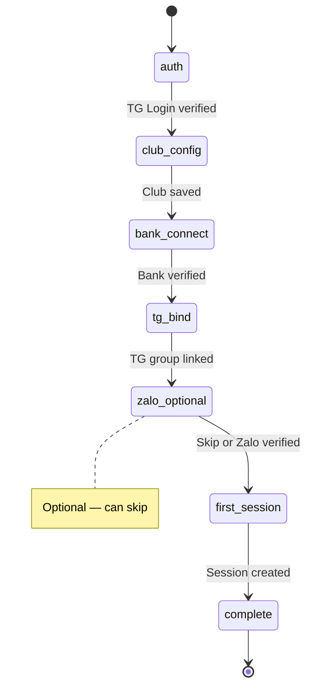

# Feature: Web Authentication & Tenant Onboarding — Product/UX Spec

> **Canonical phase:** P4  
> **Track:** 🌐 Web Auth & Onboarding  
> **Version:** 2.1 · 2026-06-20
> **Status:** Reviewed  
> **Prerequisites:** P0–P1 foundation · P2 routing/authz · P3 ledger/provider model  
> **Tài liệu liên quan:** `../core/BRD.md` FR-1 · `../core/PRD.md` FLOW 1 · BRD OD-10 · `BE/feature_web_auth_onboarding_tech.md` · `feature_connector_onboarding.md` (auto-register webhook + verify 2 tầng)

---

## 1. Mô tả

Cho host mới **authenticate trên web, tạo tenant và connect integrations MVP** mà không cần platform intervention. Wizard bao gồm: club config → TG group/admin binding → SePay/ApiPay bank account → optional Zalo bot token. Messenger excluded đến P4.8. Bank/Zalo connect dùng **auto-register webhook** (owner KHÔNG dán webhook URL) theo `feature_connector_onboarding.md`.

### Bất biến

- TG Login signature, auth date, nonce **PHẢI verify** — không trust returned fields alone.
- Session cookies: `secure`, `httpOnly`, `sameSite=strict`, CSRF protection, rotation sau privilege change.
- Tenant creation/bind dùng **idempotency keys** — refresh/back KHÔNG duplicate.
- Secrets: write-only, KMS encrypted, masked after save, rotatable.
- Owner KHÔNG thể accidentally bind group/account đã thuộc tenant khác.

### 1.1 Surface entry points (web-first vs bot-first)

Connector connect (bank/Zalo) **chỉ chạy trên web** — không dán secret/OAuth trong khung chat (token lưu lại lịch sử chat = lộ, vi phạm BL-SEC-1; OAuth cần browser). Hai điểm vào, dùng chung endpoint `/api/onboarding/*`:

- **Web-first:** host đăng nhập plexco.app → chạy trọn wizard (gồm bank/Zalo) tại chỗ.
- **Bot-first:** host `/start` `@PlexcoBot`; phần không nhạy cảm (tên CLB, môn, giá, session đầu) hỏi ngay trong chat; phần nhạy cảm (SePay/ApiPay/Zalo) bot gửi **magic-link 1 lần** → host hoàn tất trên web → quay lại bot.

> Telegram là **shared bot** (`@PlexcoBot`) → bind bằng cách thêm bot vào group, **không** dán token. Chỉ **Zalo** BYO token per-CLB (🟡 blocked CO-OQ-1). Chi tiết auto-register + verify 2 tầng (`registered → active`): `feature_connector_onboarding.md`.

---

## 2. Use Cases + Edge Cases

### Use Cases

| ID | Actor | Hành động | Kết quả |
|---|---|---|---|
| WAO-UC-1 | New Host | Authenticate (TG Login / web-account fallback) | Session created, CSRF token issued |
| WAO-UC-2 | New Host | Tạo Account + Tenant | Idempotent create; assign owner role |
| WAO-UC-3 | Host | Configure club: name, timezone, locale, sport, price, visibility/join defaults | Saved, validation per field |
| WAO-UC-4 | Host | Connect bank provider (SePay OAuth / ApiPay key) | Plexco **tự đăng ký webhook** (không dán URL) → verify 2 tầng. Ref: `feature_connector_onboarding.md` §4.2–4.3 |
| WAO-UC-5 | Host | Generate TG bind link + confirm group binding | TenantAdmin + TelegramLink created |
| WAO-UC-6 | Host | Optional: connect Zalo bot (BYO token) | 🟡 Dự kiến auto `setWebhook` (blocked CO-OQ-1); tới khi đó dán URL thủ công |
| WAO-UC-7 | Host | Create first session + optional publish | Session live, ready to receive players |
| WAO-UC-8 | Host | Resume incomplete onboarding | Each step has verified/not-configured/error state |
| WAO-UC-9 | Host | Rotate bank credentials | Old masked, new saved encrypted |
| WAO-UC-10 | Host | Xem readiness checklist | Summary: ✅/❌ per step, proceed/block |

### Edge Cases

| # | Category | Case | Hành vi bắt buộc |
|---|----------|------|-------------------|
| 1 | Security | TG Login signature invalid | Reject auth — "Xác thực không hợp lệ" |
| 2 | Security | Auth date stale (replay attack) | Reject — nonce + timestamp check. Ref: BL-SEC-1 |
| 3 | Concurrency | Refresh/back during tenant create | Idempotency key → return existing tenant |
| 4 | Security | Secret exposed in URL/log | ❌ NEVER — write-only, KMS, masked display |
| 5 | Data Integrity | Bind group đã thuộc tenant khác | Conflict error — "Nhóm này đã liên kết club khác" |
| 6 | Data Integrity | Bind bank account đã thuộc tenant khác | Conflict — show which tenant owns it (masked) |
| 7 | Security | Bank/webhook verify expose account/secret | ❌ NEVER — verify via server-side call only |
| 8 | Resilience | Zalo connect fail | Non-blocking — TG-first DoD. Show "optional, thử lại sau" |
| 9 | Security | Session cookie theft (XSS) | `httpOnly` + `sameSite=strict` + rotation. Ref: BL-SEC-3 |
| 10 | Data Integrity | Onboarding partially complete → resume | Each step independent, verified state persisted |
| 11 | Security | CSRF on state-changing requests | Token verified per request — reject without valid CSRF |
| 12 | Security | Privilege escalation during onboarding | Session rotation after each privilege-granting step |

---

## 3. Screens & States

| Surface | Screen | Loading | Ready | Error | Empty |
|---------|--------|---------|-------|-------|-------|
| Web | Login page | — | TG Login button + (OD-10) web fallback | "Xác thực thất bại" + retry | N/A |
| Web | Onboarding wizard — Step 1: Club config | Skeleton form | Form: name, timezone, sport, price, visibility | Inline errors per field | Default values pre-filled |
| Web | Onboarding wizard — Step 2: Bank connect | Skeleton | SePay: nút "Kết nối" (OAuth) · ApiPay: dán accessKey/secretKey → chọn TK ACTIVE; auto-register webhook; chip `registered → active` | "Kết nối thất bại" + retry | N/A |
| Web | Onboarding wizard — Step 3: TG bind | Skeleton | Link code display + QR + instructions | "Không tạo được link" + retry | N/A |
| Web | Onboarding wizard — Step 4: Zalo (optional) | Skeleton | Dán bot token → auto `setWebhook` (🟡 blocked CO-OQ-1) → verify | "Kết nối thất bại — bỏ qua được" | N/A |
| Web | Onboarding wizard — Step 5: First session | Session form | Create + optional publish | Inline validation | N/A |
| Web | Readiness checklist | — | ✅/❌ per step + "Bắt đầu" CTA | — | N/A |

---

## 4. Domain Model

| Entity | Vai trò | Key constraints |
|--------|---------|-----------------|
| `persons` | Global identity | `UNIQUE(telegram_user_id)`, `UNIQUE(phone)` |
| `tenants` | Club/org | `UNIQUE(slug)`, `owner_person_id` FK |
| `memberships` | Person ↔ Tenant | `UNIQUE(person_id, tenant_id)`, `role` enum |
| `bank_accounts` | Payment provider credentials | `tenant_id` FK, encrypted fields, `verified_at` |
| `telegram_links` | Group binding | `UNIQUE(chat_id)`, `tenant_id` FK |
| `onboarding_state` | Progress tracking per tenant | `tenant_id` FK, step statuses JSON |

### Onboarding State Machine

> SM trên là cấp **wizard step**. Mỗi connector còn có SM riêng `connecting → registered → active → drift/error/revoked` (verify 2 tầng) — xem `feature_connector_onboarding.md` §3.3.

---

## 5. Analytics Events

| Event | Khi nào | Payload tối thiểu |
|-------|---------|-------------------|
| `onboarding_started` | Host bắt đầu wizard | `person_id` (opaque), `auth_method` |
| `tenant_created` | Tenant created thành công | `tenant_id`, `sport_default` |
| `integration_connected` | Bank/TG/Zalo verified | `tenant_id`, `integration_type`, `provider` |
| `integration_failed` | Verify thất bại | `tenant_id`, `integration_type`, `error_class` |
| `first_session_created` | Host tạo session đầu tiên | `tenant_id`, `visibility` |
| `first_session_published` | Session published public | `tenant_id` |
| `onboarding_completed` | Tất cả required steps ✅ | `tenant_id`, `duration_seconds` |

> Không log credentials, PII, tokens trong analytics.

---

## 6. Acceptance Criteria

- [ ] Unknown host completes tenant → first session không cần env/manual DB work
- [ ] Auth signature/nonce/session/CSRF tests pass
- [ ] Duplicate submissions KHÔNG duplicate tenant/provider/link (idempotency)
- [ ] Secrets encrypted, masked, not logged, rotatable
- [ ] TG/bank ownership verification + conflict handling work
- [ ] Zalo optional; Messenger absent from MVP wizard
- [ ] Resume/retry và partial onboarding states work
- [ ] Tenant owner authorization enforced after every step

---

## 7. Open Questions / Changelog

### Open Questions

| ID | Quyết định | Trạng thái |
|---|---|---|
| WAO-OQ-1 | BRD OD-10: web stack + fallback web-account auth method | ⬜ Chưa chốt |
| WAO-OQ-2 | Minimum required steps trước khi mark onboarding complete | ⬜ Chưa chốt |

### Changelog

| Date | Version | Thay đổi |
|---|---|---|
| 2026-06-18 | v1.0 | Initial spec (English format) |
| 2026-06-19 | v2.0 | Chuẩn hoá Vietnamese numbered, thêm 10 use cases, 12 edge cases, onboarding wizard screen states, state machine |
| 2026-06-20 | v2.1 | Cross-link `feature_connector_onboarding.md`: bank/Zalo connect chuyển sang auto-register + verify 2 tầng; thêm §1.1 surface entry points (web-first vs bot-first, deep-link handoff); cập nhật UC-4/UC-6 + screen states |
