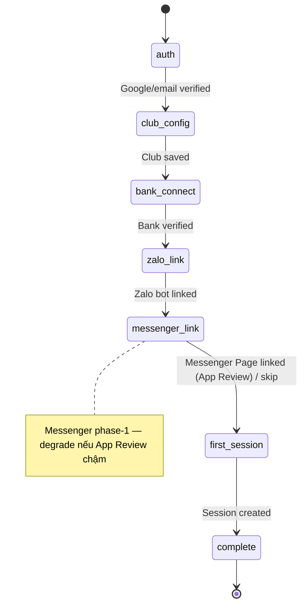

# Feature: Web Authentication & Tenant Onboarding — Product/UX Spec

> **Canonical phase:** P4  
> **Track:** 🌐 Web Auth & Onboarding  
> **Version:** 2.3 · 2026-07-15
> **Status:** Reviewed  
> **Prerequisites:** P0–P1 foundation · P2 routing/authz · P3 ledger/provider model  
> **Tài liệu liên quan:** `../product/BRD.md` FR-1 · `../product/PRD.md` FLOW 1 · BRD OD-11 · `../standards/decisions.md` DD-13/DD-33/DD-37 · `BE/feature_web_auth_onboarding_tech.md` · `feature_connector_onboarding.md` (auto-register webhook + verify 2 tầng)

> **Cập nhật v3.4 (DD-37 + DD-13, 2026-07-10):** bỏ **Telegram Login**; auth phase-1 = **Google OAuth + email/password** (DD-13 ✅). Kênh onboarding phase-1 = **Zalo + Facebook Messenger** (Telegram loại khỏi phạm vi). **Facebook Login / Messenger link** = DD-33 (🟡 phase-1, phụ thuộc App Review).

---

## 1. Mô tả

Cho host mới **authenticate trên web, tạo tenant và connect integrations MVP** mà không cần platform intervention. Auth phase-1 = **Google OAuth + email/password self-register** (DD-13). Wizard bao gồm: club config → SePay/ApiPay bank account → **link Zalo (dán Bot Token)** → **link Facebook Messenger (FB Login + chọn Page)**. **Telegram đã loại khỏi phạm vi (DD-37)**; Messenger nay là kênh phase-1 (P2.5). Bank/Zalo connect dùng **auto-register webhook** (owner KHÔNG dán webhook URL) theo `feature_connector_onboarding.md`.

### Bất biến

- Google OAuth **state/nonce/PKCE** + email-password (hash mạnh Argon2/bcrypt, KHÔNG log plaintext) **PHẢI verify** — không trust returned fields alone. *(TG Login adapter đã bỏ — DD-13/DD-37.)*
- Session cookies: `secure`, `httpOnly`, `sameSite=strict`, CSRF protection, rotation sau privilege change.
- Tenant creation/bind dùng **idempotency keys** — refresh/back KHÔNG duplicate.
- Secrets: write-only, KMS encrypted, masked after save, rotatable.
- Owner KHÔNG thể accidentally bind group/account đã thuộc tenant khác.

### 1.1 Surface entry points (web-first vs bot-first)

Connector connect (bank/Zalo) **chỉ chạy trên web** — không dán secret/OAuth trong khung chat (token lưu lại lịch sử chat = lộ, vi phạm BL-SEC-1; OAuth cần browser). Hai điểm vào, dùng chung endpoint `/api/onboarding/*`:

- **Web-first:** host đăng nhập plexco.app (Google/email) → chạy trọn wizard (gồm bank/Zalo/Messenger) tại chỗ.
- **Bot-first:** host mở bot CLB qua **Zalo** hoặc **Facebook Messenger**; phần không nhạy cảm (tên CLB, môn, giá, session đầu) hỏi ngay trong chat; phần nhạy cảm (SePay/ApiPay/token kênh) bot gửi **magic-link 1 lần** → host hoàn tất trên web → quay lại bot.

> **Zalo** = BYO Bot Token per-CLB (dán token; 🟡 auto-`setWebhook` blocked CO-OQ-1). **Facebook Messenger** = 1 App platform + **Page per-club** (FB Login → chọn Page → App Review). *(Telegram shared-bot đã loại khỏi phạm vi — DD-37.)* Chi tiết auto-register + verify 2 tầng (`registered → active`): `feature_connector_onboarding.md`.

> **Auth phase-1 (DD-13 ✅):** `account_identities.platform ∈ {google, email, facebook, zalo}`. **Google OAuth + email-password self-register** là đường auth chính (login "bật ngay được" cho acquisition) — thêm qua `account_identities.platform` + adapter (password → bảng credential riêng, migration mới), **không** tạo root table `users`; `persons` vẫn là anchor. **DD-33** = **Facebook Login** (🟡 phase-1, đường link cho Messenger + phễu channel-first DD-32; phụ thuộc FB App Review). **DD-14** = **Zalo Login** (⬜ gating OA). Chi tiết & ràng buộc: `docs/standards/decisions.md` DD-13/DD-14/DD-33, `docs/00-start-here/identity-model.md §7` (provider/channel phase matrix).

---

## 2. Use Cases + Edge Cases

### Use Cases

| ID | Actor | Hành động | Kết quả |
|---|---|---|---|
| WAO-UC-1 | New Host | Authenticate (Google OAuth / email-password) | Session created, CSRF token issued |
| WAO-UC-2 | New Host | Tạo Account + Tenant | Idempotent create; assign owner role |
| WAO-UC-3 | Host | Configure club: name, timezone, locale, sport, price, visibility/join defaults | Saved, validation per field |
| WAO-UC-4 | Host | Connect bank provider (SePay OAuth / ApiPay key) | Plexco **tự đăng ký webhook** (không dán URL) → verify 2 tầng. Ref: `feature_connector_onboarding.md` §4.2–4.3 |
| WAO-UC-5 | Host | Link Facebook Messenger (FB Login + chọn Page) | Page bound to tenant; PSID routing per-Page. Ref: DD-33/DD-37 (🟡 App Review) |
| WAO-UC-6 | Host | Connect Zalo bot (BYO token) — phase-1 | 🟡 Dự kiến auto `setWebhook` (blocked CO-OQ-1); tới khi đó dán URL thủ công |
| WAO-UC-7 | Host | Create first session + optional publish | Session live, ready to receive players |
| WAO-UC-8 | Host | Resume incomplete onboarding | Each step has verified/not-configured/error state |
| WAO-UC-9 | Host | Rotate bank credentials | Old masked, new saved encrypted |
| WAO-UC-10 | Host | Xem readiness checklist | Summary: ✅/❌ per step, proceed/block |

### Edge Cases

| # | Category | Case | Hành vi bắt buộc |
|---|----------|------|-------------------|
| 1 | Security | Google OAuth state/nonce invalid hoặc email-password sai | Reject auth — "Xác thực không hợp lệ" |
| 2 | Security | OAuth state replay / stale nonce (replay attack) | Reject — state + nonce single-use + timestamp check. Ref: BL-SEC-1 |
| 3 | Concurrency | Refresh/back during tenant create | Idempotency key → return existing tenant |
| 4 | Security | Secret exposed in URL/log | ❌ NEVER — write-only, KMS, masked display |
| 5 | Data Integrity | Bind group đã thuộc tenant khác | Conflict error — "Nhóm này đã liên kết club khác" |
| 6 | Data Integrity | Bind bank account đã thuộc tenant khác | Conflict — show which tenant owns it (masked) |
| 7 | Security | Bank/webhook verify expose account/secret | ❌ NEVER — verify via server-side call only |
| 8 | Resilience | Zalo/Messenger connect fail | Non-blocking — web-first DoD. Show "thử lại sau"; Messenger degrade nếu App Review chậm |
| 9 | Security | Session cookie theft (XSS) | `httpOnly` + `sameSite=strict` + rotation. Ref: BL-SEC-3 |
| 10 | Data Integrity | Onboarding partially complete → resume | Each step independent, verified state persisted |
| 11 | Security | CSRF on state-changing requests | Token verified per request — reject without valid CSRF |
| 12 | Security | Privilege escalation during onboarding | Session rotation after each privilege-granting step |

---

## 3. Screens & States

| Surface | Screen | Loading | Ready | Error | Empty |
|---------|--------|---------|-------|-------|-------|
| Web | Login page | — | Google Login button + email/password form | "Xác thực thất bại" + retry | N/A |
| Web | Onboarding wizard — Step 1: Club config | Skeleton form | Form: name, timezone, sport, price, visibility | Inline errors per field | Default values pre-filled |
| Web | Onboarding wizard — Step 2: Bank connect | Skeleton | SePay: nút "Kết nối" (OAuth) · ApiPay: dán accessKey/secretKey → chọn TK ACTIVE; auto-register webhook; chip `registered → active` | "Kết nối thất bại" + retry | N/A |
| Web | Onboarding wizard — Step 3: Zalo bot | Skeleton | Dán bot token → auto `setWebhook` (🟡 blocked CO-OQ-1) → verify | "Kết nối thất bại" + retry | N/A |
| Web | Onboarding wizard — Step 4: Facebook Messenger | Skeleton | FB Login → chọn Page → App Review → chip `registered → active` | "App Review chưa duyệt — degrade web+Zalo" | N/A |
| Web | Onboarding wizard — Step 5: First session | Session form | Create + optional publish | Inline validation | N/A |
| Web | Readiness checklist | — | ✅/❌ per step + "Bắt đầu" CTA | — | N/A |

---

## 4. Domain Model

| Entity | Vai trò | Key constraints |
|--------|---------|-----------------|
| `persons` | Global identity (anchor) | `UNIQUE(phone)`; identity qua `account_identities`/`channel_identities`, KHÔNG root table `users` |
| `account_identities` | Web-auth provider per person (DD-13) | `platform ∈ {google,email,facebook,zalo}`; `platform_user_hash` keyed-HMAC (SI-2); password → bảng credential riêng |
| `tenants` | Club/org | `UNIQUE(slug)`, `owner_person_id` FK |
| `memberships` | Person ↔ Tenant | `UNIQUE(person_id, tenant_id)`, `role` enum |
| `bank_accounts` | Payment provider credentials | `tenant_id` FK, encrypted fields, `verified_at` |
| `zalo_bots` | Zalo channel binding (BYO token per-CLB) | `webhook_token`, `tenant_id` FK, secret enc |
| Messenger Page binding | Facebook Page per-club (DD-33/DD-37, proposal-level) | Page-per-club routing; PSID page-scoped. Canonical schema → decisions.md + `packages/db/schema.ts` |
| `onboarding_state` | Progress tracking per tenant | `tenant_id` FK, step statuses JSON |

### Onboarding State Machine

> SM trên là cấp **wizard step**. Mỗi connector còn có SM riêng `connecting → registered → active → drift/error/revoked` (verify 2 tầng) — xem `feature_connector_onboarding.md` §3.3.

---

## 5. Analytics Events

| Event | Khi nào | Payload tối thiểu |
|-------|---------|-------------------|
| `onboarding_started` | Host bắt đầu wizard | `person_id` (opaque), `auth_method` |
| `tenant_created` | Tenant created thành công | `tenant_id`, `sport_default` |
| `integration_connected` | Bank/Zalo/Messenger verified | `tenant_id`, `integration_type`, `provider` |
| `integration_failed` | Verify thất bại | `tenant_id`, `integration_type`, `error_class` |
| `first_session_created` | Host tạo session đầu tiên | `tenant_id`, `visibility` |
| `first_session_published` | Session published public | `tenant_id` |
| `onboarding_completed` | Tất cả required steps ✅ | `tenant_id`, `duration_seconds` |

> Không log credentials, PII, tokens trong analytics.

---

## 6. Acceptance Criteria

- [ ] Unknown host completes tenant → first session không cần env/manual DB work
- [ ] Google OAuth state/nonce + email-password + session/CSRF tests pass
- [ ] Duplicate submissions KHÔNG duplicate tenant/provider/link (idempotency)
- [ ] Secrets encrypted, masked, not logged, rotatable
- [ ] Messenger Page / Zalo / bank ownership verification + conflict handling work
- [ ] Zalo + Messenger là kênh phase-1 trong wizard; Telegram absent (DD-37)
- [ ] Resume/retry và partial onboarding states work
- [ ] Tenant owner authorization enforced after every step

---

## 7. Open Questions / Changelog

### Open Questions

| ID | Quyết định | Trạng thái |
|---|---|---|
| WAO-OQ-1 | Web stack | ✅ Next.js App Router, standalone/container (DD-10) |
| WAO-OQ-2 | Minimum required steps trước khi mark onboarding complete | ⬜ Chưa chốt |
| WAO-OQ-3 | DD-33: Facebook Login / Messenger link phụ thuộc App Review — degrade path nếu chậm | 🟡 phase-1 |
| WAO-OQ-4 | Skip Club / personal meet: đường tạo không-gian-cá-nhân | ✅ **Chốt DD-46** — auto-provision personal tenant (tái dùng `provisionTenant` core, wrapper `getOrCreatePersonalTenant`, free plan, bỏ bước "đặt tên club", owner=self); propagate lúc build → `../dd-46-skip-club-analysis.md` |

### Changelog

| Date | Version | Thay đổi |
|---|---|---|
| 2026-06-18 | v1.0 | Initial spec (English format) |
| 2026-06-19 | v2.0 | Chuẩn hoá Vietnamese numbered, thêm 10 use cases, 12 edge cases, onboarding wizard screen states, state machine |
| 2026-06-20 | v2.1 | Cross-link `feature_connector_onboarding.md`: bank/Zalo connect chuyển sang auto-register + verify 2 tầng; thêm §1.1 surface entry points (web-first vs bot-first, deep-link handoff); cập nhật UC-4/UC-6 + screen states |
| 2026-07-15 | v2.3 | **Propagation (light):** thêm WAO-OQ-4 (DD-46 personal tenant auto-provision) với pointer; auto-provision path/schema propagate lúc build slice. Analytics integration provider được reconcile Bank/Zalo/Messenger theo DD-37. |
| 2026-07-10 | v2.2 | **DD-13 + DD-37:** bỏ **Telegram Login** adapter; auth phase-1 = **Google OAuth + email/password** (`account_identities.platform ∈ {google,email,facebook,zalo}`). Kênh onboarding phase-1 = **Zalo + Facebook Messenger** (drop TG bind step, thêm Messenger Page step). **Facebook Login/link** = DD-33 (🟡 phase-1). Cập nhật §1/§1.1, UC-1/5/6, edge #1/2/8, screens, domain model, state machine, acceptance. |
