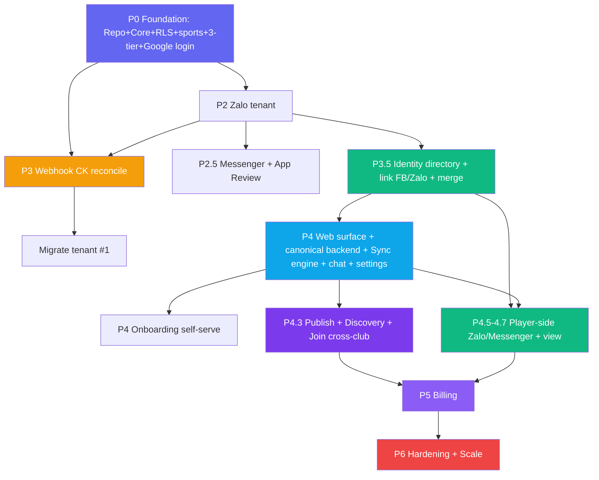

# 🗺️ ROADMAP — Plexco

**Phiên bản:** v3.3e
**Ngày tạo:** 16/06/2026 · **Cập nhật:** 19/07/2026
**Căn cứ:** `BRD.md` v3.9f · `PRD.md` v2.8e · `TDD.md` v3.1 · `../strategy/saas-implementation-plan.md` · `../research/player-side-saas-AUDIT.md` · `../channels/messenger/messenger-channel-design.md` · `../standards/decisions.md` **v1.74** · `../dd-69-app-native-analysis.md`

> ROADMAP là nguồn sự thật cho **delivery order + dev progress**. Product scope thuộc BRD; behavior thuộc PRD; implementation contract thuộc TDD.

> **v3.4 channel pivot (DD-37):** bỏ Telegram; kênh phase-1 = **web + Zalo + Facebook Messenger**. Messenger nâng từ post-MVP (P4.8) lên **phase-1 (P2.5, phụ thuộc App Review)**. Thêm **Google login** (P0–P1), **chat in-app** + **cài đặt hồ sơ/giá theo giới tính** (P4, DD-38/DD-39 ✅ scope-committed phase-1; schema chờ migration), **mark-paid thủ công tiền mặt/CK** (P2).

> **Decision reconcile 15/07/2026:** DD-32 và DD-45 đã chốt; DD-47/48 chốt framework. Đây là delivery contract cho các slice tương lai, **không phải bằng chứng code/migration đã land**.
>
> **Cập nhật 17/07/2026 (decisions v1.45):** DD-65..68 chốt Messenger hybrid; DD-67 generalized provider-endpoint identity/reachability cho Messenger + Zalo. Feature-doc closure đã pin SePay HMAC, DM safety/block source, Assistant DLP và Session Organize v0.4 correction/SSE; runtime/migration chưa build. DD-57..64 vẫn proposal ngoài timeline. B0/B1/B2/B3/external/legal gates không đổi.
>
> **Cập nhật 18/07/2026 (founder batch, decisions v1.47):** DD-69 **định hướng app-first accepted** — phase-1 target = PWA (S9/S20 chưa live); phase-2 native ngoài committed timeline (build TBD). RN+Expo chỉ là recommendation sau spike; trước khi schedule native phải qua client-contract, API/auth/push/offline/store gates (DD-69 analysis). **DD-61..64 Session Organize accept-in-principle** (build post-P4). DD-33 Facebook Login phase-1 ✅; DD-60 API-reference convention ✅.

> **Đánh số phase:** toàn bộ tài liệu dùng duy nhất **canonical P-number**. Các tên Foundation/Tenant Engine/... chỉ là delivery-group label, không tạo một hệ số thứ hai.

## Canonical Delivery Groups

| Delivery group | Canonical | Nội dung |
|---|---|---|
| **Foundation** | **P0–P1** | Repo + core + Postgres/RLS + schema đa môn + 3 tầng hiển thị + test cô lập + **Google login / tài khoản web** |
| **Tenant Engine** | **P2–P3** | Zalo tenant + **Messenger hybrid shared surface (P2.5)** + mark-paid + durable webhook/ledger + dogfood |
| **Identity** | **P3.5** | Person/ChannelIdentity/Reachability/Membership + **link Facebook/Zalo** + merge an toàn |
| **Web + Sync + Marketplace** | **P4–P4.3** | Web surface + canonical backend + sync engine + onboarding + **chat in-app + cài đặt hồ sơ/giá theo giới tính** + discovery/join |
| **Player-side channels** | **P4.5–P4.7** | Join Zalo/Messenger + nhắc/xác nhận + player view |
| **Billing** | **P5** | Subscription host + vòng đời tenant |
| **Harden & Scale** | **P6** | Pen-test, load test, observability, ToS/Privacy |
| **Session Organize** *(accept-in-principle)* | **Post-P4 · TBD** | ✅ DD-61–64 (owner 18/07) — sân + trận 2 phía + assign 4-mode + live score; tenant-private, không public; build sau Session CRUD+Sync. DD-63 `balanced` degrade tới khi có level source |
| **App Native** *(direction ✅ · build TBD)* | **Phase-2 · TBD** | ✅ DD-69 direction accepted (owner 18/07); RN+Expo recommendation sau spike; reuse chỉ client-safe TS contracts/format + canonical API, không import server i18n/money core. Native build chưa lên lịch/chưa chốt nền tảng |

---

## Positioning

> **Plexco — platform quản lý & khám phá hoạt động thể thao đa môn, cho cả host lẫn player. Phase-1 gặp người dùng trong Zalo/Facebook Messenger và web.**

Ba giá trị cốt lõi: **Quản lý kèo & tiền (host)** + **Khám phá & join kèo (player, đa môn, cross-club)** + **Đồng bộ liền mạch đa kênh ⇄ web**. Bổ sung cho nhóm chat sẵn có — **không thay thế**, **không bắt cài app cho player**.

> **Định hướng app-native (DD-69 ✅ accepted):** Plexco là app-first — **phase-1 target = web app PWA** (installable/offline; S9/S20 planned, chưa live), **phase-2 = app native**. Chat vẫn là acquisition 0-install; native cho retention. Owner đã accept **định hướng**; native **build** chưa vào timeline committed — chờ các gate client-contract, `/api/v1`, bearer/iOS login, dedicated device push, privacy-safe payload, offline read-only và store review.

---

## Context & Chiến lược

### GTM: tích hợp platform có sẵn user (0-install) + web hub

| Nhóm chat (giữ nguyên) | Plexco (bổ sung) |
|---|---|
| Chat, hẹn giờ, bàn kèo | Tạo/quản kèo (đa môn), roster, track ai trả/chưa |
| Kênh thông báo tự nhiên | Đối soát CK tự động, nhắc/xác nhận tự động |
| Group Zalo / Facebook Messenger sẵn có | Bot DM (Zalo) / Page bot (Messenger) |
| (không có) | **Web app**: dashboard host, **marketplace tìm kèo**, player view, **chat in-app** — sync 2 chiều với mọi kênh |

→ Host không phải kéo người chơi sang app mới; player join từ kênh quen (Zalo/Messenger), đồng thời **khám phá kèo mới** trên web.

### Vòng tăng trưởng 2 phía (network effect)

```text
Host publish kèo  ──▶  Marketplace nhiều kèo/đa môn  ──▶  Player tìm & join
      ▲                                                          │
      └──────── player mới kéo theo nhu cầu  ◀───────────────────┘
1 host mới = ~20–40 player tự vào hệ thống; player discovery = kênh acquisition phía cầu.
```

### Bootstrap (Day-1)

| Metric | Giá trị |
|---|---|
| Tenant #1 | CLB của founder (migrate data từ bot single-club đang chạy; go-forward vận hành trên Zalo/Messenger/web) |
| Môn khởi điểm | Cầu lông (beachhead) → mở pickleball/tennis khi có cầu |
| Buổi/tuần · Day-1 players | ~2 buổi · ~50 unique |

### Target Personas

| Persona | Mô tả | Pain point |
|---|---|---|
| **P1 Host** (Nam, 30t) | Tổ chức cầu lông hàng tuần, 15–30 người | Soi sao kê CK thủ công, đòi nợ lắt nhắt, dữ liệu phân mảnh |
| **P3 Player member** (Huy, 25t) | Chơi 2–3 buổi/tuần, nhiều CLB | Không rõ nợ buổi nào, CK rồi mà chưa được xác nhận |
| **P4 Player discovery** (Lan, 28t) | Muốn chơi thêm môn/CLB mới | Không biết quanh mình có kèo nào mở, môn mình thích, còn slot |

### Team

| Role | Focus |
|---|---|
| **Solo Dev** | Full-stack (TypeScript: Next.js + HTTP channel adapters + Drizzle/Postgres + SSE) |
| **AI Assistant** | Co-pilot: code, design docs, review |
| **Founder** | PM + QA + dogfood (tenant #1) + acquire host & seed marketplace |

### Khác biệt nền tảng (vs app-based)
Plexco xây **repo riêng**; lift logic thuần (matching, payments-logic, dates, format, sports) từ bot single-club sang `packages/core`; viết lại tầng data trên **Postgres + RLS**, thêm **public read model** + **sync engine**. Bot cũ (Telegram, lịch sử) **đóng băng, vẫn chạy** làm reference + migrate data thành tenant #1 khi cutover; go-forward CLB vận hành trên Zalo/Messenger/web.

---

## 7 Feature Tracks

| # | Track | Mô tả ngắn | Phase |
|---|---|---|---|
| 🏢 | **Multi-tenant Core + 3-tier** | repo choke-point + Postgres RLS + public read model + routing tenant theo kênh + **đa môn** + **Google login** | P0–P1 |
| 💰 | **Payment Reconciliation** | **mark-paid thủ công (mọi tier)** + durable webhook → transaction → allocation → charge/debt → /unmatched (auto = `host_pro`) | P2/P3 |
| 🆔 | **Identity & Merge** | Person/ChannelIdentity/Membership, claim an toàn, **link Facebook/Zalo**, merge xuyên kênh | P3.5 |
| 🌐 | **Web app + Sync engine** | web surface + canonical backend + command/outbox/projection + realtime + **chat in-app + cài đặt hồ sơ/giá theo giới tính** (DD-38/DD-39 ✅) | P4 |
| 🔎 | **Marketplace Discovery** | publish kèo → public projection → tìm kèo → join cross-club | P4.3 |
| 🎯 | **Player-side channels** | join Zalo/Messenger, nhắc, xác nhận | P4.5–P4.7 |
| 🔒 | **Security & Ops** | KMS, audit, token-drift, **bất biến public**, load/pen-test, sync-lag | xuyên suốt → P6 |

---

## Canonical Delivery Timeline

```text
 P0–P1          P2–P3                 P3.5        P4–P4.3                P4.5–P4.7       P5       P6
 ─────────      ───────────────        ─────       ─────────────          ──────────      ─────    ─────
 Foundation  →  Tenant Engine       →  Identity →  Web+Sync+Marketplace → Player channels → Billing → Harden
 RLS+sports     Zalo tenant + ledger   merge       canonical backend      Zalo/Messenger   sub      pen/load
 3-tier+Google  + Messenger(P2.5,AR)   + FB/Zalo   + chat + settings       + player view              +public
                + mark-paid thủ công   link        + discover/join

 Dogfood #1 ─────▶ seed marketplace ─────▶ external clubs ─────▶ thu phí ─────▶ scale
```

---

## 📊 Dev Progress Overview

```text
Core Planning & Docs       ████████████████████ 100%  ✅ BRD, PRD, TDD, ROADMAP + appendices
Feature Specs              ███████████████████░  coverage cao  21 cặp hiện có + 1 product-only Draft (22 Product/System + 21 BE); Session Organize accept-in-principle (post-P4), không phải delivery readiness
P0–P1: Foundation         ███████████████░░░░░  75%  🚧 core+DB/RLS+migrations 0000–0013 merged; Auth v3 (Telegram-era) merged; Google/email provider (DD-37) chưa code
P2–P3: Tenant Engine      ░░░░░░░░░░░░░░░░░░░░   0%  ⬜ Not Started
P3.5: Identity            ░░░░░░░░░░░░░░░░░░░░   0%  ⬜ Not Started
P4–P4.3: Web+Sync+Market  ░░░░░░░░░░░░░░░░░░░░   0%  ⬜ Not Started
P4.5–P4.7: Player channels░░░░░░░░░░░░░░░░░░░░   0%  ⬜ Not Started
P5: Billing               ░░░░░░░░░░░░░░░░░░░░   0%  ⬜ Not Started
P6: Harden                ░░░░░░░░░░░░░░░░░░░░   0%  ⬜ Not Started
────────────────────────────────────────────────────────────
TỔNG (code)                ████░░░░░░░░░░░░░░░░  ~20%  🚧 foundation + Auth v3 (Telegram-era) land trên main@1eb6f60; feature layer chưa build
```

> **Trạng thái:** Core docs sync theo v3.4 channel pivot; on-disk feature coverage = **21 cặp + 1 product-only Draft**. Session Organize là cặp Draft thứ 21, DD-61..64 ✅ accept-in-principle (owner 18/07, build post-P4), chưa nằm trong committed delivery timeline. **Foundation + Auth Onboarding v3 (Telegram-era) đã land trên `main@1eb6f60`** (migrations `0000–0013`, có web tests); DD-37 supersede provider → Google/email chưa implement; feature layer nghiệp vụ chưa build.

### Module Progress

| # | Module | Track | Phase | Docs | Code | Status |
|---|---|---|---|---|---|---|
| 1 | Monorepo + lift `core` (+ `sports`) | 🏢 | P0 | ✅ | ✅ | ✅ (S1/S2 merged) |
| 2 | Postgres + Drizzle + RLS + **public read model skeleton** | 🏢 | P0 | ✅ | ✅ | ✅ (S3 merged, migrations 0000–0013) |
| 3 | Tenant schema (đa môn, session.visibility/slot/join_policy) + repo choke-point | 🏢 | P0–P1 | ✅ | ✅ | ✅ (S3 merged) |
| 3b | **Google login / tài khoản web (email)** (DD-13) | 🏢 | P0–P1 | 🟡 | 🟡 | 🟡 (Auth v3 Telegram-era merged; provider→Google/email DD-37 chưa code) |
| 4 | **Chat-channel tenant middleware** (Zalo P2 → Messenger P2.5) | 🏢 | P2/P2.5 | ✅ | ⬜ | ⬜ |
| 4b | **Mark-paid thủ công (tiền mặt/CK, tap/multi-select)** (DD-40) | 💰 | P2 | ✅ | ⬜ | ⬜ |
| 5 | Durable webhook + ledger/allocation + /unmatched (auto = `host_pro`) | 💰 | P3 | ✅ | ⬜ | ⬜ |
| 17 | **Messenger central+optional Page; host/player shared core; 24h/App Review** | 🏢🎯 | **P2.5** | ✅ Reviewed contract | ⬜ | ⬜ |
| 6 | Migrate data bot cũ → tenant #1 | 🏢 | P3 | ✅ covered | ⬜ | ⬜ |
| 7 | Identity directory + merge (**link Facebook/Zalo**) | 🆔 | P3.5 | ✅ | ⬜ | ⬜ |
| 8 | **Web app surface + canonical backend** | 🌐 | P4 | ✅ drafted | ⬜ | ⬜ |
| 9 | **Sync engine** (command/outbox/projection + realtime) | 🌐 | P4 | ✅ drafted | ⬜ | ⬜ |
| 10 | Onboarding self-serve; Messenger central default + optional Page riêng | 🌐 | P4 | ✅ drafted | ⬜ | ⬜ |
| 10b | **Chat in-app** (club-wide + 1-1) (DD-38 ✅) | 🌐 | P4 | 🟡 draft | ⬜ | ⬜ |
| 10c | **Cài đặt hồ sơ + giá theo giới tính** (DD-39 ✅) | 🌐 | P4 | 🟡 draft | ⬜ | ⬜ |
| 11 | **Publish kèo → public_sessions projection** | 🔎 | P4.3 | ✅ drafted | ⬜ | ⬜ |
| 12 | **Discovery / tìm kèo** | 🔎 | P4.3 | ✅ drafted | ⬜ | ⬜ |
| 13 | **Join cross-club** | 🔎 | P4.3 | ✅ drafted | ⬜ | ⬜ |
| 14 | Player join Messenger (quick-reply; base enablement P2.5) | 🎯 | P4.5 | 🟡 draft | ⬜ | ⬜ |
| 15 | Player join Zalo (number-reply) | 🎯 | P4.7 | ✅ drafted | ⬜ | ⬜ |
| 16 | Reminder + notifyPlayersPaid (+ sync) — web + Zalo chính, Messenger 24h | 🎯 | P4.5–P4.7 | ✅ drafted | ⬜ | ⬜ |
| 18 | Billing + lifecycle | 💰 | P5 | ✅ drafted | ⬜ | ⬜ |
| 19 | Hardening (pen/load/obs + **public pen-test**) | 🔒 | P6 | ✅ drafted | ⬜ | ⬜ |

> Module 17 (Messenger) **phase-1** nhưng chặn bởi **App Review Meta** — nộp sớm; degrade sang web + Zalo nếu App Review chậm (BRD OD-9/DD-37 · `../channels/messenger/messenger-channel-design.md`).
>
> **Module 3b (auth):** bản **Auth Onboarding v3 (Telegram-era) đã merge** (`5b1193b`, `main@1eb6f60`) + web tests, nhưng **DD-37 supersede provider** → phải thay bằng **Google/email** — đã spec, **chưa implement**. Vì vậy 3b để **🟡** (một phần) cho tới khi provider replacement land.

---

## P0–P1: FOUNDATION — Repo, Core, RLS, đa môn, 3 tầng, Google login

> **Mục tiêu:** nền multi-tenant an toàn + chiều đa môn + khung 3 tầng hiển thị + **auth web (Google + email)**, trước khi có feature.
> **Status:** 🟡 Partially complete — monorepo/core/Postgres/RLS/schema + Auth v3 Telegram-era đã merge; Google/email provider replacement còn pending.

| Item | Mô tả | Prio |
|---|---|---|
| Monorepo pnpm | `packages/core` + `apps/bot` + `apps/web` | P0 |
| Lift `core` | matching, payments-logic, dates, format, i18n, **sports** + test xanh | P0 |
| Postgres + Drizzle | thay `node:sqlite` | P0 |
| Schema tenant đa môn | mọi bảng `tenant_id`; `sports`; `sessions.{sport_id,visibility,slots_max,area,venue,skill_level,join_policy}` | P0 |
| **RLS** | ENABLE+FORCE, role `app NOBYPASSRLS`, fail-closed | P0 |
| **Public read model skeleton** | bảng `public_sessions` + field whitelist (chưa cần projector đầy đủ) | P0 |
| Repo choke-point | `tenantRepo(tenantId)` + `withTenant` (`SET LOCAL`) | P0 |
| **Google login / tài khoản web** | Google OAuth + email/password; `account_identities.platform ∈ {google,email,facebook,zalo}` (DD-13); SI-2 keyed-hash áp cho `google.sub`/email | P1 |
| **Test bất biến** | cô lập tenant A/B + **public chỉ field whitelist** | P0 |

**DoD:** `drizzle push` lên Postgres sạch, RLS bật, đăng nhập Google/email tạo được tenant, test cô lập + test bất biến public xanh trong CI.

---

## P2–P3: TENANT ENGINE — Owner-side đa tenant + mark-paid + đối soát CK

> **Mục tiêu:** Zalo bot-per-club + Messenger hybrid phục vụ host/player; club không Page vẫn vận hành qua central; mark-paid/CK đúng tenant. Dogfood tenant #1.
> **Status:** ⬜ Not Started

### R1 — Zalo biết tenant
Webhook `/webhook/zalo/:token` (bot-per-club) · tenant middleware (`webhook_token→tenant`, `ctx.repo`) · authz 2 lớp (`TenantAdmin` theo `from.id`) · lệnh host đa-tenant (`/newsession` đa môn, `/announce`, `/config`, `/cash`) · **mark-paid thủ công (tiền mặt/CK, tap/multi-select — DD-40)** · cron đa-tenant + throttler.

### R1.5 — Kênh Facebook Messenger (P2.5, App Review)
Một Meta App + central Page + optional tenant Page · migration global-protected registry/Page identity/reachability/action state · endpoint/default resolver · role-aware host `/newsession` wizard + player local/global discover/join qua shared Session/Join/AuthZ core · opaque paginated actions · one-route delivery · App Review/24h fail-closed.

### R2 — Webhook CK biết tenant + payment ledger (`host_pro`)
`/webhook/sepay/:token` (route token + verify TK + timing-safe) · transaction lưu `bank_transactions` + enqueue trước ACK · matching đa-tenant · `charges` + `payment_allocations` hỗ trợ partial/multi-person/overpay/reversal · FIFO + BL-2 · `/unmatched` + retry cron. **Auto-reconcile là tier `host_pro`; free dùng mark-paid thủ công.**

### R3 — Migrate tenant #1
Script SQLite→Postgres (tenant "Bestminton" + BankAccount + copy data, gắn **sport=cầu lông**) · cutover (đối chiếu số dòng → link Zalo/Messenger → go-forward vận hành trên Zalo/Messenger/web). *(Bot Telegram cũ đóng băng làm reference lịch sử.)*

**🎯 Milestone:** 2 tenant (một có Page riêng, một không) dùng central; host tạo và player join đúng tenant trên central/tenant Page; no cross-tenant/double-send; Zalo/payment dogfood vẫn đúng.

### KPI P2–P3
% CK auto-match (name-based, `host_pro`) ≥ 70% · sự cố cross-tenant = 0.

---

## P3.5: IDENTITY — Gộp đúng 1 người xuyên kênh

> **Mục tiêu:** Person toàn cục + **link Facebook/Zalo vào Person đăng nhập Google** + merge an toàn (nền cho player-side & player view & discovery join).
> **Status:** ⬜ Not Started

Person/ChannelIdentity/Reachability (C1) · Membership (refactor members, UNIQUE per tenant) · **link Facebook + Zalo** vào cùng Person · claim-có-tiền cần verified account email hoặc transactional one-time `link_code` (**DD-50: không thu SĐT phase-1, phone dormant**) · conflict-safe merge plan, không rewrite ledger (DD-53).

**🎯 Milestone:** 1 người qua Facebook + Zalo cùng CLB = 1 nợ; merge có audit, không vỡ UNIQUE.

---

## P4–P4.3: WEB + SYNC + MARKETPLACE — Canonical backend & 2 phía

> **Mục tiêu:** PostgreSQL/domain model làm canonical store; web và chat là surfaces đồng bộ; host onboard self-serve; **chat in-app + cài đặt hồ sơ/giá theo giới tính**; player **khám phá & join kèo cross-club**.
> **Prerequisite:** P2–P3.5 stable.
> **Status:** ⬜ Not Started

### R4 — Web app + Sync engine
| Feature | Mô tả | Prio |
|---|---|---|
| Web surface + canonical backend | host dashboard/player view; mọi ghi qua domain services vào PostgreSQL | P0 |
| Command bus + outbox | mọi action (mọi surface) → command → ghi + outbox event (cùng tx) | P0 |
| Projectors | Zalo · Messenger one-route tenant→central · realtime web · public_sessions | P0 |
| Idempotent + re-project | `commandId`/`event.id`; dựng lại surface khi lệch | P0 |
| **Chat in-app** (DD-38 ✅) | chat toàn CLB (RLS) + 1-1 (person-self); chỉ Plexco, **không bridge** kênh ngoài; SSE (schema `chat_*` chờ migration) | P1 |
| **Cài đặt hồ sơ + giá theo giới tính** (DD-39 ✅) | gender/dob/name/username/language; giá nam/nữ, suy charge theo `person.gender`; PII không lộ public (cột `person.gender` chờ migration) | P1 |

### R5 — Onboarding self-serve
Web signup → tenant/config/bank/Zalo. Messenger central sẵn; Page riêng optional FB Login/chọn Page, lỗi/revoke không block central fallback.

### R6 — Marketplace discovery (2 phía)
| Feature | Mô tả | Prio |
|---|---|---|
| Publish kèo | `visibility=public` → projector đẩy field-whitelist vào `public_sessions` | P0 |
| Discovery API/UI | lọc môn/khu vực/ngày/giờ/trình độ/giá/slot; cross-tenant, no-RLS, no tiền/PII/giới tính | P0 |
| Join cross-club | open → join ngay; approval → `join_requests` host duyệt; check slot | P0 |
| Bất biến public | test CI: field whitelist; private không lộ; join không trả tiền/PII/giới tính | P0 |

**🎯 Milestone (DoD):** host tạo kèo trên web → hiện ở Zalo/Messenger **và** marketplace ≤ vài giây; player lạ tìm kèo theo môn/khu vực và **join được**; chat in-app hoạt động; không lộ tiền/PII/giới tính ra public.

### KPI P4–P4.3
% player join qua discovery (CLB chưa từng tham gia) ≥ ngưỡng · số kèo publish/tuần tăng · sync-lag p95 ≤ 3 giây, p99 ≤ 10 giây · lộ tiền/PII/giới tính ra public = 0.

---

## P4.5–P4.7: PLAYER-SIDE CHANNELS — Join & nhắc/xác nhận đa kênh

> **Mục tiêu:** player join mượt từ chính kênh chat (Messenger → Zalo) + được nhắc/xác nhận tự động.
> **Status:** ⬜ Not Started

Messenger base P2.5 + player action UX P4.5 · player view P4.6 · Zalo P4.7. Messenger reachability theo Page endpoint; reminder/notify one-route tenant Page→central, web+Zalo primary fallback.

**🎯 Milestone:** player join Zalo/Messenger, CK → tự xác nhận, chưa trả → tự nhắc; mọi thứ sync lên web.

### KPI P4.5–P4.7
% player tự join ≥ 60% · nhắc → thanh toán ≥ 40% · merge sai ~0.

---

## P5: BILLING

> **Mục tiêu:** thu phí thuê bao host bền vững.
> **Status:** ⬜ Not Started

`subscription_invoices` (tách khỏi ledger player) · thu qua CK match `invoiceCode` → gia hạn · vòng đời **plan trả phí** trial→active→past_due→suspended · **`free` (0đ) vào thẳng `active` vô thời hạn — không trial/invoice, không past_due/suspended vì non-payment** (DD-29, BL-BIL-1) · suspended: chặn lệnh quản trị, **vẫn lưu CK player; kèo public hiện có chỉ sống tới khi đóng/hết giờ** · fair-use LLM/STT.

**🎯 Milestone:** (plan trả phí) hết trial bị chặn lệnh nhưng CK player vẫn lưu & kèo public vẫn hiện; CK đúng mã tự kích hoạt lại. `free` chạy bình thường không bị chặn vì non-payment.

### KPI P5
Trial → trả phí ≥ ngưỡng · MRR tăng, churn thấp.

---

## P6: HARDENING & SCALE

> **Status:** ⬜ Not Started

Pen-test cô lập **+ pen-test public layer** (thử rò tiền/PII/giới tính qua discovery) · load test >1k tenant + burst webhook + discovery + sync-lag (≤ vài giây p95) · observability (log `tenant_id`, metrics sync-lag, error tracking) · token-drift detection · secret KMS + scrub log · ToS/Privacy (tài chính + vị trí + hồ sơ cá nhân) · backup/restore drill.

### KPI P6
Đường rò rỉ cross-tenant = 0 · đường lộ tiền/PII/giới tính ra public = 0 · load p95 đạt mục tiêu.

---

## Dependency Map



**Legend:** 🟣 Foundation | 🟠 Tenant Engine | 🟢 Identity/Player | 🔵 Web+Sync | 🟪 Marketplace/Billing | 🔴 Harden

---

## Monetization Alignment

Host trả thuê bao theo **DD-29** (Phase-1 pivot, thay DD-03 4-tier): **`free` 0đ** (web + **kết nối Zalo + Messenger** + quản kèo/roster + **giá theo giới tính** + **mark-paid thủ công (tiền mặt/CK, tap/multi-select — DD-40)** + nhắc thủ công + **chat cơ bản in-app**) và **`host_pro` 250k** (thêm đối soát CK **tự động** & báo thu + **nhắc nợ tự động** + **Trợ lý AI + KB** + CRM dashboard). Tính năng free/pro theo **capability flags config-driven** (registry ở `../features/BE/feature_billing_lifecycle_tech.md §4b`).

| | Trial | Active | Suspended |
|---|---|---|---|
| Tạo/quản kèo, mark-paid thủ công, nhắc, xác nhận, player view, chat in-app | ✅ | ✅ | ❌ lệnh quản trị |
| Nhận & lưu CK player | ✅ | ✅ | ✅ (vẫn lưu) |
| **Kèo public trên marketplace** | ✅ | ✅ | 🟡 read-only: hiện có sống tới khi đóng/hết giờ; KHÔNG tạo mới/gia hạn |
| Nối APIpay/SePay · Zalo bot (BYO) · Messenger central + optional Page riêng (App Review) | ✅ | ✅ | ✅ / — |
| Đối soát CK tự động + nhắc tự động (`host_pro`) | ✅ | ✅ | ❌ |
| LLM/STT (platform trả, trần fair-use) | ✅ | ✅ | — |

> **`free` (0đ):** luôn ở cột **Active** vô thời hạn — không có cột Trial/Suspended-vì-non-payment (chỉ rơi vào Suspended nếu vi phạm ToS/abuse). Cột Trial/Suspended ở trên chỉ áp dụng cho plan trả phí.

> Dòng tương lai (ngoài MVP): player-side premium (lọc/nhắc kèo nâng cao), promote kèo trên marketplace, managed Zalo/Messenger bot, add-on ngoài tier host hiện tại.

---

## Risk Analysis

| # | Risk | Impact | Likelihood | Mitigation |
|---|---|---|---|---|
| 1 | **Rò rỉ cross-tenant** (tiền/chat) | 🔴 Critical | Thấp | Repo choke-point + RLS fail-closed + test bất biến CI |
| 2 | **Lộ tiền/PII/giới tính ra public marketplace** | 🔴 Critical | Medium | Public projection field-whitelist; tiền/PII không vào read model; test bất biến public; rate-limit |
| 3 | **Sync lệch trạng thái kênh ↔ web** | 🔴 Critical | Medium | Canonical store + event re-projection; idempotent command/event; metrics sync-lag |
| 4 | Gán nhầm nợ / chiếm định danh | 🔴 Critical | Medium | Claim-có-tiền cần khoá mạnh; merge chỉ verified (AUDIT C2/C5) |
| 5 | Webhook race / double-count | 🟠 High | Medium | Idempotent UNIQUE + lưu raw trước ack |
| 6 | **Marketplace cold-start** (ít kèo/player) | 🟠 High | Medium | Beachhead community host hiện có; seed tenant #1; khuyến khích publish; 1 môn trước |
| 7 | Lạm dụng marketplace/chat (spam join/scrape/spam chat) | 🟡 Medium | Medium | Rate-limit + approval mode + area-level geo + abuse controls |
| 8 | Token Zalo/Page lộ | 🟠 High | Thấp | KMS + scrub log + getWebhookInfo-drift + rotation (AUDIT §B2) |
| 9 | **Messenger App Review trượt/chậm → kẹt kênh phase-1** | 🟠 High | Medium | Nộp App Review sớm; degrade sang web + Zalo; Messenger không phải kênh nhắc-nợ chính |
| 10 | Zalo GROUP Beta / Messenger policy đổi (24h/outside-window eligibility) | 🟡 Medium | Medium | Bám DM Zalo + web; Messenger join+xác nhận trong 24h; hỏi cap/giá trước scale |
| 11 | Solo dev ship chậm | 🟡 Medium | Medium | 7 phase nhỏ, mỗi phase ship được; AI co-pilot |
| 12 | Host không trả phí | 🟡 Medium | Medium | Soft-launch free validate (sau P4.3); giá thấp; trích quỹ nhóm |

---

## Critical Path

```text
Foundation(RLS+sports+3-tier+Google) → Zalo-tenant → CK-reconcile → migrate #1 → Identity
   → Web+Sync(+chat+settings) → Onboarding+Marketplace(discover/join) → Player-side → Billing → Harden
   ⬜            ⬜             ⬜            ⬜           ⬜
   → ⬜          ⬜                          ⬜            ⬜         ⬜
```

**Bottleneck hiện tại:** Foundation + Auth v3 (Telegram-era) đã land trên **`main@1eb6f60`** (migrations `0000–0013`); node kế tiếp = **author/review launcher-ready slice rồi thay provider auth Telegram-era → Google/email (DD-13/DD-37)**; sau đó mở feature layer (session → reconcile → sync).

---

## Next Actions (Priority Order)

1. ✅ ~~BRD / PRD / TDD core review~~ — đã sync v3.4 channel pivot (bỏ Telegram; Zalo + Messenger + Google login); **DD-38/39 ✅ committed**
2. 🔴 Đóng các gate còn lại: ~~lifecycle grace/trial timing~~ ✅ **DD-51**; **DD-04 đã chốt**, còn egress-IP/provider verification + infra build/restore/failover/load drill; **legal A3** (PII retention — luật sư VN, chặn go-live); Zalo external spikes **DD-14/15**; **DD-33 đã chốt nhưng exact Meta evidence cho messaging và Facebook Login/account-link vẫn pending** (không coi một approval tự bao nhóm kia); Club Assistant go-live **DD-18** và chi tiết P7 **DD-34/35/36**. Schema/code/infra vẫn land theo build slice. Checklist: `../pre-code-open-items-2026-07-16.md`.
3. 🔴 Review/sign-off feature specs của phase sắp build; chuyển acceptance criteria thành issue checklist
4. ✅ ~~Setup monorepo (pnpm: core/bot/web) + Postgres docker~~ — đã merge (S1)
5. ✅ ~~Lift `core` + `sports` + test xanh~~ — đã merge (S2)
6. 🟡 Schema tenant đa môn + ledger + RLS/worker contract + public_sessions skeleton + repo choke-point + **test bất biến** — **đã merge** (S3, migrations `0000–0013`); **còn lại: thay provider auth Telegram-era → Google/email (DD-37, chưa code)**
7. 🔴 Zalo tenant middleware + mark-paid thủ công + lệnh host + Messenger (P2.5, App Review) + webhook reconcile + migrate tenant #1
8. 🟡 Identity → Web/Sync/Onboarding (+ chat + settings) → Marketplace/Join → Player channels → Billing → Harden
   - **Mới (DD-73..78 ✅ chốt 19/07 tại decisions v1.60, sequencing corrected v1.64):** trong khối *Marketplace/Join* bổ sung **(8a) immediate-deny path cho public read model** — `public_projection_fences` + guarded view + narrow raise/CAS-clear + `public_projection_version` + grant migration đưa consumer khỏi base table. **Đây là nợ của DD-12, không phải chi phí của share**: hiện kèo chuyển private/cancel phải chờ projector async mới hết lộ. Sau (8a) mới tới **(8b) DD-73** = route `/s/<id>` + OG card + funnel telemetry; (8b) còn chặn thêm bởi **DD-41 projection migration** (whitelist BL-DSC-1 chưa có trong `public_sessions`).
   - **Sequencing không vòng lặp:** DD-74/75 chưa vào hàng đợi ngay; sau dependency kỹ thuật + reprioritization bằng telemetry DD-73, chúng tạo activity baseline. **Chỉ DD-76/77** (feed/kudos) bị hard-gate bởi baseline/liquidity + ngưỡng owner. DD-78 không có queue riêng: ảnh session đi cùng (8b), ảnh activity đi cùng DD-75.

---

## North Star Metric

> **Số kèo "hoàn tất vòng" mỗi tuần** = kèo được tạo → có player join (gồm **join qua discovery**) → đối soát/xác nhận. Đo cả 2 phía: host vận hành thật + player (kể cả mới) join thật, đa môn, đa kênh (Zalo/Messenger/web).

---

## Changelog

| Date | Version | Thay đổi |
|---|---|---|
| 19/07/2026 | v3.3e | Authority pointer refresh v1.67→v1.74 (+BRD v3.9f/PRD v2.8e): v1.68–v1.74 BE-contract closure no-runtime; không đổi delivery order/canonical phase. Đồng bộ footer. |
| 19/07/2026 | v3.3d | **Correct DD-73..78 sequencing theo decisions v1.64; current authority v1.65:** DD-74/75 tạo baseline nên không thể nằm sau gate dùng chính baseline đó; chỉ DD-76/77 hard-gated. DD-78 đi cùng consumer. Đồng bộ authority/footer version; không đổi canonical phase hay runtime readiness. |
| 19/07/2026 | v3.3c | **DD-73..78 ✅ chốt (decisions v1.60):** Next Actions §8 thêm **(8a)** immediate-deny path cho public read model — `public_projection_fences` + guarded view + narrow functions + `public_projection_version` + grant migration, **thuộc DD-12** (nợ sẵn có của read model, không phải chi phí share) — rồi **(8b)** DD-73 route/OG/telemetry, còn chặn bởi DD-41 projection migration. Sequencing wording của entry này được corrected ở v3.3d. Không đổi canonical phase. |
| 18/07/2026 | v3.3b | **Founder batch (decisions v1.47):** DD-69 định hướng accepted (App Native delivery group "proposal"→"direction ✅ · build TBD"; positioning/note cập nhật); **thêm Session Organize delivery group (post-P4, DD-61..64 accept-in-principle)**; DD-33/60 ✅. Delivery order/code readiness không đổi; native + Session Organize build chưa committed. |
| 18/07/2026 | v3.3a | **DD-69 proposal + review closure:** Positioning + Delivery Groups thêm phase-2 native; phase-1 PWA là target chưa live; RN+Expo chỉ recommendation sau spike. Pin pre-schedule gates: client-safe contracts, `/api/v1`, bearer + iOS login compliance, dedicated device push + privacy-safe payload, offline read-only và store review. Delivery order/code readiness không đổi; native chưa committed. |
| 17/07/2026 | v3.3 | Authority → BRD v3.9b/PRD v2.8/TDD v3.1/decisions v1.45; mirror feature-doc closure nhưng không đổi delivery order, code readiness hoặc proposal status DD-61..64. |
| 17/07/2026 | v3.2 | **DD-65..68:** R1.5 hybrid central+optional tenant Page, host/player shared core, migration/actions/reachability, one-route delivery và milestone 2 tenant có/không Page; runtime pending. |
| 17/07/2026 | v3.1 | Authority → BRD v3.9 / PRD v2.7 / TDD v2.9 / decisions v1.44. Session Organize v0.3/DD-61..64 vẫn proposal, không chèn canonical timeline và không đổi implementation readiness. |
| 17/07/2026 | v3.0 | Authority → TDD v2.7 / decisions v1.42. Doc coverage → **22 Product/System + 21 BE = 21 cặp + 1 product-only**. Session Organize v0.2/DD-61..64 vẫn proposal: không chèn canonical timeline/module, delivery đề xuất sau Session CRUD + Sync, earliest after P4, phase TBD. |
| 15/07/2026 | v2.7 | **Decision reconcile + review fixes:** căn cứ trỏ decisions.md v1.32; thêm cụm session-model DD-06/08/41–46; sửa delivery phase Messenger base **M17/P2.5** + player P4.5, Zalo P4.7; M4 là shared chat-channel middleware Zalo→Messenger; Next Actions chỉ giữ DD thật sự open/gated. Schema/migration land cùng build slice. |
| 16/07/2026 | v2.8 | Đóng DD-04 ở roadmap: DO co-location đã chốt; Next Actions chỉ còn egress-IP verification, infra build và drill. Cập nhật authority lên decisions v1.34. |
| 16/07/2026 | v2.9 | **Founder batch DD-49..56 (decisions v1.36):** căn cứ → BRD v3.7 / PRD v2.5 / TDD v2.6; Next Actions gỡ "lifecycle grace/trial timing" (✅ DD-51), thêm legal A3 + note DD-33 hai nhóm permission; không còn founder decision chặn S4→S8. |
| 13/07/2026 | v2.5 | Reconcile live repo: DD-10 Next.js + DD-12 `public_sessions` projector đã chốt; P0–P1 = partially complete; feature coverage = 21 Product/20 BE (20 cặp + funnel product-only); auth provider swap chưa launcher-ready. |
| 10/07/2026 | v2.4 (review fixes) | **Build-status → reality:** Dev Progress + Module Progress + Next Actions + bottleneck — foundation (S1–S3, migrations `0000–0013`) + Auth v3 (Telegram-era) đã land trên `main@1eb6f60`; DD-37 supersede provider → Google/email chưa implement (bỏ "code chưa bắt đầu"/0%). **DD-38/39 ✅ scope-committed phase-1** (feature tracks/module/R4 — schema chờ migration). |
| 10/07/2026 | v2.4 | **v3.4 channel pivot: drop Telegram, Messenger + Zalo phase-1 + Google login/chat/gender-pricing/manual mark-paid — DD-37/13/33/38/39/40.** Delivery groups + timeline + module progress + phase sections + dependency map + critical path đổi Telegram→Zalo; Messenger nâng P4.8→**P2.5 (phase-1, App Review)**; thêm Google login (P0–P1), chat in-app + cài đặt hồ sơ/giá theo giới tính (P4, DD-38/DD-39 🟡), mark-paid thủ công (P2, DD-40); nhắc web+Zalo chính / Messenger best-effort 24h; Monetization Alignment + Risk cập nhật. |
| 20/06/2026 | v2.2 | P5 + Monetization Alignment: làm rõ `free_web` (0đ) vào thẳng active vô thời hạn, không trial/past_due/suspended vì non-payment (DD-03, BL-BIL-1). |
| 05/07/2026 | v2.3 | **DD-29 pricing pivot** (thay DD-03): `free` (web + 3 bot + đối soát thủ công) / `host_pro` 250k (auto reconcile/nhắc + AI + CRM), capability flags config-driven; **DD-30** APIpay enterprise auto-provision (money-custody không đổi). |
| 18/06/2026 | v2.1 | Dùng duy nhất canonical phase; thêm durable webhook + payment ledger/allocation; canonical store = PostgreSQL/domain model; Messenger tách post-MVP. |
| 18/06/2026 | v2.0 | **Reposition** → platform thể thao đa môn 2 phía. Re-sequence 7 phase (thêm **Phase 3 Web+Sync+Marketplace** = P4+P4.3, tách Identity thành Phase 2, Player-side thành Phase 4). Thêm track 🌐 Web+Sync & 🔎 Marketplace; module 8–13 mới; KPI/risk/North Star theo marketplace + sync + public layer. |
| 18/06/2026 | v1.1 | Đổi tên → **Plexco**; bảng Phase Mapping; link Messenger doc. |
| 16/06/2026 | v1.0 | Bản đầu — 6 phases, 6 feature tracks, dependency map, risk từ AUDIT. |

---

*ROADMAP v3.3e — canonical phase duy nhất; authority qua decisions v1.74; implementation pending; PostgreSQL/domain model là nguồn sự thật.*
