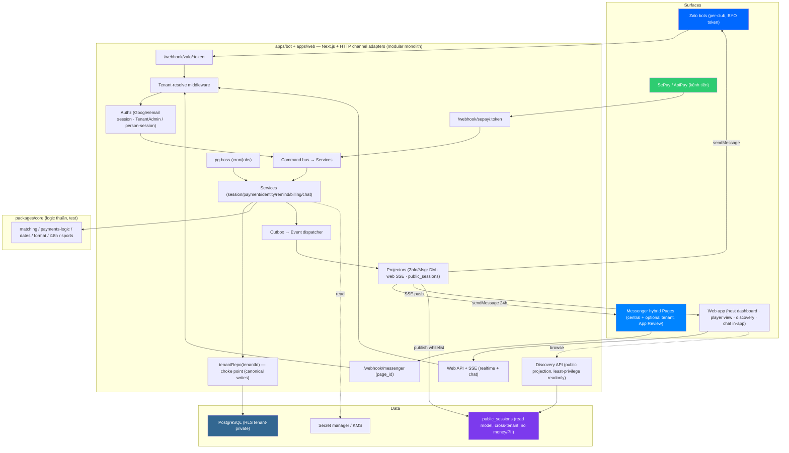

# Technical Design Document (TDD) — Plexco
## Platform thể thao đa môn (host + player) — multi-tenant, marketplace discovery, sync đa surface, Zalo + Facebook Messenger + Web app *(Telegram đã loại khỏi phạm vi — DD-37)*

**Phiên bản:** 3.1c — *25/07: current authority pointer refresh tới decisions v2.04 WIP; pointer-only, không đổi phase/runtime.* Trước đó v3.1b reconcile public-projection timing §3.8/§3.9 (project-on-publish, open-only).
**Ngày tạo:** 16/06/2026 · **Cập nhật tham chiếu:** 25/07/2026
**Tài liệu tham chiếu:**
- `BRD.md` v3.9i — yêu cầu nghiệp vụ
- `PRD.md` v2.8h — user flows + edge cases
- `../strategy/saas-implementation-plan.md` — kiến trúc multi-tenant
- `../research/player-side-saas-reconciliation.md` — identity/kênh/matching
- `../research/player-side-saas-AUDIT.md` — threat model & must-fix (C1–C7, B1–B6, §B2, + threat model public discovery)
- `../channels/messenger/messenger-channel-design.md` — kênh Messenger (**phase-1, P2.5**): hybrid endpoint + protected routing/action contract
- `../standards/decisions.md` **v2.04 WIP** — canonical current decision log; status đọc theo từng DD; `DECISION_FINAL` không phải runtime/readiness.

> [!IMPORTANT]
> **Scope:** TDD cover tới **P6** ở mức thiết kế. BRD là nguồn sự thật cho product scope; PRD cho behavior; TDD là implementation contract; ROADMAP cho thứ tự/progress. Security constraints nghiêm ngặt hơn giữa BRD và AUDIT luôn thắng.
> **Khác bot single-club hiện tại:** Plexco là **repo riêng**, lift logic thuần (matching, payments-logic, dates, format) sang `packages/core`; viết lại tầng data trên Postgres + RLS.
> **Bốn bất biến lõi:** (1) tiền/roster không rò cross-tenant; (2) tiền/PII không lọt public discovery; (3) allocation không làm mất/đếm quá tiền; (4) PostgreSQL/domain model là nguồn sự thật, surface chỉ là projection.

---

## 1. Overview

### 1.1 Mục đích
Platform **2 phía, đa môn**: **host** tạo & quản lý kèo, thu & đối soát tiền sân, quản club — qua Zalo/Facebook Messenger và web; **player** khám phá kèo xuyên CLB/môn & join, theo dõi kèo/nợ của mình. **PostgreSQL + domain model = canonical store**; web và kênh chat là surface, đồng bộ qua **sync engine**. **Telegram đã loại khỏi phạm vi (DD-37); Messenger là kênh phase-1 (P2.5, phụ thuộc App Review).** Mỗi CLB là 1 **tenant** cô lập tuyệt đối ở tầng tiền/roster/chat; **public discovery** là lớp đọc cross-tenant field-whitelist.

### 1.2 Phạm vi theo phase

| Scope | Pha | Ghi chú |
|---|---|---|
| **Nền tenant + Postgres/RLS + schema đa môn + 3 tầng hiển thị + Google login** | P0–P1 | repo choke-point + RLS fail-closed + `sports` + public read model skeleton + Google OAuth/email (DD-13) |
| **Zalo biết tenant** | P2 | bot-per-club, middleware resolve tenant theo `webhook_token`, mark-paid thủ công (DD-40), cron đa-tenant |
| **Facebook Messenger** (kênh phase-1) | P2.5 | central Page + optional tenant Page; shared host/player; protected routing/actions; 24h/App Review |
| **Webhook CK biết tenant** (module tiền, auto = `host_pro`) | P3 | `/webhook/sepay/:token`, dedupe, FIFO settle |
| **Identity directory** | P3.5 | Person/ChannelIdentity/Reachability/Membership + link Facebook/Zalo + merge |
| **Web app + canonical backend + Sync engine + chat in-app + cài đặt hồ sơ** | P4 | command/event + outbox + projection ra surfaces + web realtime; onboarding; chat (DD-38 ✅) + giá theo giới tính (DD-39 ✅) |
| **Marketplace discovery** | P4.3 | publish kèo → public projection; tìm kèo (lọc môn/khu vực/giờ); join cross-club + approval |
| **Player-side Zalo/Messenger + view** | P4.5–4.7 | Zalo number-reply, Messenger quick-reply, my-clubs |
| **Billing** | P5 | subscription_invoices, vòng đời tenant |
| **Hardening** | P6 | pen-test isolation **+ public layer**, load test, observability sync-lag |

### 1.3 Ngoài phạm vi
Trong **canonical phase-1 delivery scope**, matchmaking/xếp sân/scoring/trận đấu vẫn ngoài phạm vi, cùng với venue booking nhà cung cấp · gamification/ELO · app native · **Telegram và nền tảng chat khác ngoài Zalo/Messenger** · bridge chat in-app ra group ngoài. Session Organize được theo dõi riêng ở DD-61..64 + cặp spec v0.4 — **post-phase-1, accept-in-principle (owner 18/07)** (delivery sau Session CRUD + Sync, build **post-P4**; canonical phase TBD); sự tồn tại của spec không phải delivery commitment. Multi-sport phase-1 chỉ là chiều phân loại/lọc, không kèm luật từng môn.

---

## 2. Requirements

### 2.1 Functional (theo module — chi tiết PRD)

| # | FR | Persona | Mô tả | Pha | Prio |
|---|---|---|---|---|---|
| FR-0 | Multi-sport | System | `sports` + `sessions.sport_id`; lọc/hiển thị theo môn | P1 | P0 |
| FR-1 | Onboarding tenant | P1 | Google/email → tenant → SePay → Zalo; Messenger central có sẵn, optional link tenant Page; config | P4 | P0 |
| FR-2 | Session CRUD (chat + web) | P1 | tạo/đóng kèo: môn/giá (một mức hoặc **giá nam/nữ**, DD-39 ✅)/giờ/khu vực/slot/trình độ/visibility/join_policy; auto/`/announce`; sửa trên web | P2/P4 | P0 |
| FR-3 | Shared Messenger | Host/player | role-aware menu; host create wizard; player local/global join qua opaque action; central+tenant Page parity | P2/P2.5/P4.5 | P0 |
| FR-4 | Join Zalo | P3 | `/join` + number-reply (bot-per-club DM) | P4.7 | P0 |
| FR-5 | Identity resolve | System | (platform,uid)→ChannelIdentity→Person→Membership(∩tenant); `platform ∈ {zalo,messenger}` (chat), account ∈ {google,email,facebook,zalo} | P3.5 | P0 |
| FR-6 | Claim/merge | System | claim-có-tiền cần khoá mạnh — **verified email hoặc link_code deterministic (DD-50; phase-1 không thu SĐT, phone dormant)**; **link Facebook/Zalo vào Person**; reconcile trùng | P3.5 | P0 |
| FR-7 | Webhook reconcile (auto = `host_pro`) | System | durable ingest → match (pay_code→tên/amount/ngày) → allocate transaction vào charges | P3 | P0 |
| **FR-7b** | **Mark-paid thủ công (mọi tier, DD-40)** | P1 | tiền mặt=`cash`; CK đã ingest=`manual` + exact bank txn; CK host-attested chưa ingest chỉ qua dedicated source migration + actor/evidence, trước đó reject; cấm synthetic bank txn; preview+confirm (DD-25) | P2 | P0 |
| FR-8 | Payment ledger / BL-2 | System | charge (suy giá theo giới tính member nếu đặt giá nam/nữ) + bank transaction + allocation; hỗ trợ partial/multi-person; không phân bổ quá số tiền CK | P3 | P0 |
| FR-9 | /unmatched | P1 | gán tay + retry cron | P3 | P0 |
| FR-10 | Reminder | System | manual (mọi tier) → auto cron (`host_pro`) qua **web push + Zalo DM** (chính); Messenger best-effort trong cửa sổ 24h; theo Reachability | P2/P3 | P0 |
| FR-11 | notifyPlayersPaid | System | xác nhận đa-kênh sau mọi markPaid (thủ công + auto) + sync web | P4.5 | P0 |
| FR-12 | Player view (person-self) | P3/P4 | clubs/kèo/nợ của tôi, person-authorized; web + bot | P4.6 | P1 |
| FR-13 | Billing | System | subscription_invoices, trial→active→past_due→suspended (plan trả phí `host_pro`); `free` 0đ vào thẳng `active`, không invoice/past_due; entitlement = capability flags config-driven (DD-29 thay DD-03, BL-BIL-1) | P5 | P0 |
| **FR-14** | **Sync engine** | System | canonical store + command/event + **outbox** → projection ra Zalo/Messenger/web/public; idempotent; re-project khi lệch | P4 | P0 |
| **FR-15** | **Web app (surface)** | P1/P3/P4 | host dashboard (kèo/roster/doanh thu), player view, discovery UI, chat in-app (DD-38 ✅), cài đặt hồ sơ (DD-39 ✅); mọi ghi đi qua canonical backend | P4 | P0 |
| **FR-16** | **Publish kèo → public projection** | P1 | host publish kèo đã set `visibility=public` (`draft`→`open`) → đẩy field-whitelist vào `public_sessions` (read model); `draft` chưa chiếu dù đã set public | P4.3 | P0 |
| **FR-17** | **Discovery / tìm kèo** | P3/P4 | API/UI lọc môn/khu vực/ngày/giờ/trình độ/giá/slot; cross-tenant read model, KHÔNG RLS, KHÔNG tiền/PII/giới tính | P4.3 | P0 |
| **FR-18** | **Join cross-club** | P3/P4 | join kèo của CLB chưa là member → tạo membership guest; `join_policy=approval` → `join_requests` host duyệt | P4.3 | P0 |
| **FR-19** | **Chat in-app (DD-38 ✅, scope-committed phase-1)** | P3/P4 | chat toàn CLB (tenant, RLS) + 1-1 (person-self); chỉ Plexco, **không bridge** kênh ngoài; SSE; schema `chat_*` **chờ migration** (chưa vào canonical `schema.ts`; xem `../standards/decisions.md` DD-38 + doc Draft) | P4 | P1 |
| **FR-20** | **Cài đặt hồ sơ + giá theo giới tính (DD-39 ✅, scope-committed phase-1)** | P1/P3 | gender/dob/name/username/language; giá nam/nữ suy charge theo `person.gender`; PII consent, không lộ public; cột `person.gender/dob/...` **chờ migration** (xem DD-39 + doc Draft) | P4 | P1 |

### 2.2 Non-Functional (đo được)

| # | NFR | Yêu cầu | Metric |
|---|---|---|---|
| NFR-1 | **Cô lập tenant** | Repo scoped + RLS fail-closed + FORCE + role `NOBYPASSRLS` | 0 rò rỉ cross-tenant; test bất biến xanh |
| NFR-1b | **Public layer an toàn** | `public_sessions` read model chỉ field whitelist; tiền/PII/roster KHÔNG vào | 0 lộ tiền/PII ra public; test bất biến public xanh |
| NFR-1c | **Sync nhất quán** | canonical store + outbox + projection idempotent | sync-lag p95 ≤ 3s, p99 ≤ 10s; re-project hết lệch; 0 multi-master conflict |
| NFR-2 | **Latency reconcile** | webhook → markPaid → notify | ≤ 5s P99 |
| NFR-3 | **Concurrency** | webhook + cron + lệnh đồng thời | ≥1k tenant; slot/payment allocation không race |
| NFR-4 | **Idempotency** | webhook trùng | `UNIQUE(tenant,provider,external_id)` skip |
| NFR-5 | **Data safety** | không mất CK | transaction lưu raw + enqueue trước ack; audit allocation; retry tới terminal |
| NFR-6 | **Secret** | token/secret | KMS at-rest, không log, timing-safe verify, reset path |
| NFR-7 | **Rate-limit** | Zalo/Messenger outbound | throttler + jitter cron |
| NFR-8 | **API error** | luôn JSON `{error,message,code,statusCode}` | — |
| NFR-9 | **Privacy** | PII (SĐT/email) | consent, AES at-rest, soft-delete, không vào URL/log |
| NFR-10 | **Availability** | API uptime | ≥ 99.5% |

---

## 3. Technical Design

### 3.1 System Architecture



**Pattern:** Modular monolith. **PostgreSQL + domain model = canonical store**. Mọi surface (chat/web/webhook) gửi **command** → `CMD` bus → `Services` → ghi qua `tenantRepo` (choke-point, RLS). Mỗi thay đổi ghi kèm **outbox** event trong cùng transaction; dispatcher đẩy projectors ra surfaces (Zalo/Messenger/web) + cập nhật `public_sessions`. **Đọc** chia 3 đường: tenant-private (RLS), person-self (person-authorized), public discovery (`DISC` → `public_sessions`, không RLS, field whitelist). API stateless để scale ngang; pg-boss dùng cùng Postgres nhưng chạy bằng worker role tách biệt (§3.4).

### 3.2 Data Model

**Ba vùng (= 3 tầng hiển thị):**
1. **GLOBAL protected directory**: `persons`, `channel_identities`, `channel_reachability`, `player_chat_context`, `sports`. Các bảng identity/reachability có provider identity/policy metadata, không cấp quyền trực tiếp cho API role; chỉ narrow identity/delivery service được truy cập và mọi cross-person access phải audit.
2. **TENANT-scoped** (RLS fail-closed): `sessions`, `players`, `memberships`, `charges`, `bank_transactions`, `payment_allocations`, `join_requests`, `outbox_events`, billing… — tiền/roster/nội bộ.
3. **PUBLIC read model** (cross-tenant, **không** RLS, field whitelist): `public_sessions` — projection của kèo đã publish, phục vụ marketplace. **Không** chứa tiền/PII/roster.

```mermaid
erDiagram
    PERSON ||--o{ CHANNEL_IDENTITY : has
    PERSON ||--o{ MEMBERSHIP : "is, per tenant"
    CHANNEL_IDENTITY ||--|| CHANNEL_REACHABILITY : reachable

    TENANT ||--o{ MEMBERSHIP : contains
    TENANT ||--o{ SESSION : has
    SPORT ||--o{ SESSION : categorizes
    SESSION ||--o| PUBLIC_SESSION : "projected if public"
    SESSION ||--o{ JOIN_REQUEST : "approval-mode"
    TENANT ||--o{ OUTBOX_EVENT : emits
    TENANT ||--o{ PROCESSED_COMMAND : deduplicates
    TENANT ||--o{ CHARGE : bills
    TENANT ||--o{ BANK_TRANSACTION : receives
    TENANT ||--o{ TELEGRAM_LINK : routes
    TENANT ||--o{ TENANT_ADMIN : authorizes
    TENANT ||--o{ ZALO_BOT : "channel (BYO)"
    TENANT ||--o{ BANK_ACCOUNT : receives
    TENANT ||--o| SUBSCRIPTION : billed
    TENANT ||--o{ SUBSCRIPTION_INVOICE : invoices

    MEMBERSHIP ||--o{ PLAYER : "joins session"
    SESSION ||--o{ PLAYER : roster
    PLAYER ||--o{ CHARGE : owes
    BANK_TRANSACTION ||--o{ PAYMENT_ALLOCATION : funds
    CHARGE ||--o{ PAYMENT_ALLOCATION : receives
    OUTBOX_EVENT ||--o{ PROJECTOR_DELIVERY : tracks

    PERSON {
        uuid id PK
        varchar display_name
        varchar phone "nullable, dormant phase-1"
    }
    CHANNEL_IDENTITY {
        uuid id PK
        uuid person_id FK
        enum platform "zalo|messenger"
        varchar provider_scope_lookup_hash "HMAC Page/bot/OA scope"
        varchar platform_user_lookup_hash "HMAC PSID/from.id"
        bytea platform_user_id_enc "optional encrypted raw id"
        unique endpoint_user "platform,scope_hash,user_hash"
    }
    CHANNEL_REACHABILITY {
        uuid channel_identity_id PK,FK
        bool can_dm
        timestamptz last_inbound_at
        timestamptz window_expires_at
        jsonb provider_policy_metadata
    }
    TENANT {
        uuid id PK
        varchar name
        varchar slug UK
        enum status "trialing|active|past_due|suspended|cancelled"
        varchar locale
        varchar timezone
    }
    MEMBERSHIP {
        uuid id PK "= member_id cũ"
        uuid tenant_id FK
        uuid person_id FK
        varchar display_name
        varchar pay_code "UNIQUE(tenant,pay_code)"
    }
    SESSION {
        uuid id PK
        uuid tenant_id FK
        uuid sport_id FK
        timestamptz starts_at
        timestamptz ends_at
        varchar timezone "IANA"
        int price
        int slots_max "nullable"
        varchar area "khu vực (public)"
        varchar venue "địa điểm chi tiết (private tới khi player active)"
        varchar skill_level "nullable"
        enum visibility "private|public"
        enum join_policy "open|approval"
        enum status "draft|open|closed|cancelled"
        varchar tg_announce_chat_id
        bigint tg_announce_message_id
    }
    SPORT {
        uuid id PK
        varchar key "badminton|pickleball|tennis|..."
        varchar name
        bool active
    }
    PUBLIC_SESSION {
        uuid session_id PK "= sessions.id"
        uuid tenant_id "chỉ để join-routing, KHÔNG lộ tiền"
        varchar sport_key
        timestamptz starts_at
        timestamptz ends_at
        varchar area
        varchar skill_level
        int price
        int slots_open
        varchar host_display_name
        varchar club_display_name
        enum join_policy
    }
    JOIN_REQUEST {
        uuid id PK
        uuid tenant_id FK
        uuid session_id FK
        uuid person_id
        enum status "pending|approved|rejected|expired"
        timestamptz expires_at
    }
    OUTBOX_EVENT {
        uuid id PK
        uuid tenant_id FK
        varchar type "session.created|player.joined|payment.allocated|payment.settled|..."
        jsonb payload
        timestamptz dispatched_at "nullable"
    }
    PROCESSED_COMMAND {
        uuid tenant_id FK
        uuid command_id
        varchar command_type
        varchar result_hash
        timestamptz created_at "UNIQUE(tenant,command_id)"
    }
    PROJECTOR_DELIVERY {
        uuid event_id FK
        varchar projector
        enum status "pending|delivered|failed"
        int attempts
        timestamptz delivered_at "UNIQUE(event,projector)"
    }
    PLAYER {
        uuid id PK
        uuid tenant_id FK
        uuid session_id FK
        uuid membership_id FK
        timestamptz last_reminded_at
    }
    CHARGE {
        uuid id PK
        uuid tenant_id FK
        uuid session_id FK
        uuid player_id FK
        uuid membership_id FK
        int amount_due
        int amount_allocated
        enum status "open|partial|paid|void"
    }
    BANK_TRANSACTION {
        uuid id PK
        uuid tenant_id FK
        enum provider "sepay|apipay"
        varchar external_id "UNIQUE(tenant,provider,external_id)"
        int amount
        int unallocated_amount
        varchar account_number
        timestamptz occurred_at
        text content
        jsonb raw_payload
        enum reconcile_status "pending|matched|partial|unmatched|ignored"
        timestamptz received_at
    }
    PAYMENT_ALLOCATION {
        uuid id PK
        uuid tenant_id FK
        uuid bank_transaction_id FK "nullable for cash/waiver and migrated attested source; auto/manual require real bank txn"
        uuid charge_id FK
        int amount "signed; reversal âm"
        varchar source "auto|manual|cash|waiver|reversal (DD-40: cash=tiền mặt; CK thủ công khớp bank txn = manual)"
        uuid reverses_allocation_id "nullable"
        uuid created_by "nullable for system"
        timestamptz created_at
    }
    TELEGRAM_LINK {
        uuid tenant_id FK
        varchar chat_id
        enum kind "group|admin"
    }
    TENANT_ADMIN {
        uuid tenant_id FK
        varchar telegram_user_id
        enum role "owner|admin"
    }
    ZALO_BOT {
        uuid id PK
        uuid tenant_id FK
        varchar bot_token_enc
        varchar webhook_token UK
    }
    BANK_ACCOUNT {
        uuid id PK
        uuid tenant_id FK
        varchar account_number
        varchar webhook_token UK
        varchar webhook_secret_enc
    }
    SUBSCRIPTION_INVOICE {
        uuid id PK
        uuid tenant_id FK
        varchar invoice_code UK
        int amount_due
        int amount_paid
        enum status
    }
    SUBSCRIPTION {
        uuid id PK
        uuid tenant_id FK "UNIQUE"
        enum status "trialing|active|past_due|suspended|cancelled"
        timestamptz trial_ends_at
        timestamptz current_period_end
    }
```



#### Bảng tổng hợp

| # | Table | Vùng | RLS | Pha |
|---|---|---|---|---|
| 0 | `sports` | GLOBAL | ❌ (lookup) | P1 |
| 1 | `persons` | GLOBAL | ❌ (directory) | P3.5 |
| 2 | `channel_identities` | GLOBAL | ❌ | P3.5 |
| 3 | `channel_reachability` | GLOBAL protected, exact endpoint identity | narrow service; no blanket grant | P3.5 |
| 4 | `player_chat_context` | GLOBAL | ❌ | P4.5 |
| 5 | `tenants` | — | n/a | P1 |
| 6 | `accounts` / `memberships(admin)` | — | scoped | P4 |
| 7 | `memberships` | TENANT | ✅ | P3.5 |
| 8 | `sessions` | TENANT | ✅ | P1 |
| 9 | `players` | TENANT | ✅ | P1 |
| 10 | `charges` | TENANT | ✅ | P1/P3 |
| 11 | `aliases` | TENANT | ✅ | P1 |
| 12 | `telegram_links` | TENANT | ✅ | *(legacy — chỉ tenant #1 migration; Telegram đã loại khỏi phạm vi, DD-37)* |
| 13 | `tenant_admins` | TENANT | ✅ | P2 |
| 14 | `zalo_bots` | TENANT | ✅ | P2 |
| 15 | `bank_accounts` | TENANT | ✅ | P3 |
| 16 | `bank_transactions` + `payment_allocations` | TENANT | ✅ | P2/P3 (allocation `source ∈ auto/manual/cash/waiver/reversal`) |
| 17 | `settings` | TENANT `(tenant_id,key)` | ✅ | P1 |
| 18 | `subscriptions` | TENANT | ✅ | P5 |
| 19 | `subscription_invoices` | TENANT | ✅ | P5 |
| 20 | `messenger_pages` hybrid registry | GLOBAL protected | narrow resolver; no blanket grant | **P2.5 (DD-65; migration mới từ live tenant-only schema)** |
| 20a | Provider-endpoint channel identity/reachability + Messenger action state | GLOBAL protected + endpoint/target-tenant refs | narrow service + exact relation checks | P2.5/P3.5 (DD-15/67/68) |
| 21 | `join_requests` | TENANT | ✅ | P4.3 (approval-mode join cross-club) |
| 22 | `outbox_events` | TENANT | ✅ | P4 (sync engine — outbox pattern) |
| 23 | **`public_sessions`** | **PUBLIC** | ❌ **(cross-tenant read model, field whitelist)** | P4.3 |
| 24 | `processed_commands` | TENANT | ✅ | P4 (command dedupe) |
| 25 | `projector_deliveries` | WORKER | narrow privileged access | P4 (projector inbox/delivery ledger) |
| 26 | `chat_*` (`chat_channels`/`chat_messages`/`chat_members`) — **scope-committed phase-1 (DD-38 ✅)** | TENANT (club-chat) / person-self (1-1) | ✅ | P4 — schema **chờ migration** (chưa vào canonical), xem doc Draft `../features/feature_inapp_chat.md` |
| 27 | hồ sơ người dùng (`person.gender/dob/username/language`) — **scope-committed phase-1 (DD-39 ✅)** | GLOBAL (PII, consent) | protected | P4 — cột **chờ migration**, xem doc Draft `../features/feature_user_settings.md` |

> **Provider endpoint DD-15/DD-65..68:** live `messenger_pages.tenant_id NOT NULL UNIQUE` và `channel_reachability(person,tenant,platform)` chưa biểu diễn đúng endpoint-scoped identity/reachability. Migration mới phải có Messenger `scope=central|tenant`, nullable tenant với CHECK/partial uniques; `channel_identities` thêm hai keyed HMAC domain-separated (`provider_scope_lookup_hash`, `platform_user_lookup_hash`) unique theo ba cột `(platform, provider_scope_lookup_hash, platform_user_lookup_hash)`; Messenger scope = Page, Zalo scope = bot/OA cho tới khi DD-15 chứng minh rộng hơn; reachability gắn `channel_identity_id`. Hybrid Messenger registry cùng global identity/reachability/link-code tables là global-protected và chỉ đi qua narrow resolver. `zalo_bots` **vẫn tenant-private** theo table #14: ENABLE + FORCE RLS, exact `SET LOCAL app.tenant_id`, secret access hẹp/redacted; resolver phải validate đúng bot/OA row + tenant thay vì reclassify bảng thành global/no-grant. Live `zalo_bots.secret text` là legacy drift với NFR-6/BL-SEC-1: cùng forward migration phải KMS-backfill sang `webhook_secret_enc` hoặc disable connector, rồi drop plaintext và cấm dual-read trước khi bật runtime. Không sửa migration đã apply.

> **Account identities (auth, DD-13/DD-33):** target providers = `{google,email,facebook,zalo}` nhưng live `platform` hiện là unrestricted `text`, chưa có CHECK. SI-2 dùng domain/provider-separated keyed HMAC cho `google.sub`, normalized email và verified Facebook app-scoped subject; Messenger Page-scoped PSID ở channel layer và không auto-link. Migration phải audit legacy rows rồi thêm validation self-contained; không drop constraint giả định. Chat/gender schema (`chat_*`, hồ sơ gender/dob) vẫn chờ migration.

**UNIQUE/FK quan trọng:** Channel identity unique theo `(platform, provider_scope_lookup_hash, platform_user_lookup_hash)`; endpoint binding lưu Page/bot/OA registry relation; reachability unique theo `channel_identity_id`; one active central Messenger Page + one active Page/tenant; endpoint action one-time/replay fence. Tenant data: `memberships (tenant_id, person_id)` · `players (tenant_id, session_id, membership_id)` · `session_surface_refs (tenant_id,session_id)` và `players` phải có composite same-tenant FKs tới sessions/memberships · charges/bank/processed-command/projector uniques như live contracts.

**Ledger invariants (DB constraint/transaction test):** `amount_due ≥ 0`; auto/manual bank allocation dương và bắt buộc exact `bank_transaction_id`; tiền mặt `cash` và `waiver` không có bank transaction nhưng bắt buộc actor, preview+confirm DD-25 và idempotency. Host-attested CK chưa ingest chỉ được dùng dedicated source sau B1 migration với `bank_transaction_id=NULL`, actor + opaque evidence; trước migration reject, không synthetic bank transaction hoặc `cash|manual` fallback. Reversal âm và tham chiếu allocation gốc. Tổng allocation hiệu lực của một bank transaction nằm trong `[0, bank_transactions.amount]`; tổng vào charge nằm trong `[0, amount_due]`; charge chỉ `paid` khi được phủ đủ. `amount_allocated` do một helper canonical/locked writer sở hữu; không sửa/xoá fact đã audit.

### 3.3 Routing & Tenant Resolution (lõi multi-tenant)

```
INBOUND → resolve trusted endpoint/context (không từ nội dung):
  • Zalo              : webhook_token → bot/OA endpoint
                         + HMAC(scope domain,bot/OA id) + HMAC(user domain,from.id)
                         → default ingress tenant; eligibility tenant kiểm tra riêng
  • Messenger (P2.5)  : page_id → endpoint(scope, optional default tenant)
                         + HMAC(scope domain,page_id) + HMAC(user domain,PSID) identity
                         + opaque action/protected ref/eligible-role picker → target tenant/resource
  • Web (host/admin)  : session Google/email + tenant đang chọn → AUTHZ(TenantAdmin) → tenant
  • SePay/ApiPay      : webhook_token + verify account_number → bank_accounts → tenant
  • (legacy) Telegram : chat_id → telegram_links → tenant #1 migration only (DD-37: out of scope)

THEN identity:
  (platform, HMAC(provider endpoint), HMAC(provider user id)) → channel_identity → person
  → membership = (person ∩ tenant) qua tenantRepo  [RLS]

ĐƯỜNG ĐỌC KHÔNG GẮN 1 TENANT:
  • Discovery (public)  : KHÔNG resolve tenant — đọc public_sessions cross-tenant,
                          field whitelist, KHÔNG RLS, KHÔNG tiền/PII. Rate-limit + phân trang.
  • Person-self (my…)   : person_id từ phiên verify → memberships WHERE person_id=…,
                          ngoài RLS per-tenant, field whitelist (AUDIT C6).
  • Join cross-club     : protected public ref/opaque action → session → tenant →
                          join_policy=open ⇒ tạo membership guest; =approval ⇒ join_requests.
```

Middleware kênh chat (Zalo/Messenger, rút gọn):

```ts
bot.use(async (ctx, next) => {
  // Zalo: webhook_token trong path → zalo_bots → tenant (bot-per-club)
  // Messenger: page_id → endpoint; target từ opaque action/ref/picker, không client body
  const resolved = await resolveTrustedContext(ctx);
  if (!resolved) return renderContextPickerOrDeny(ctx);
  ctx.actor = resolved.actor; ctx.target = resolved.target; await next();
});
// lớp 2: exact action→capability registry; re-check tại mutation/consume
// Web admin: phiên Google/email → AUTHZ(TenantAdmin)
```

**Messenger pre-dispatch interaction:** một interceptor duy nhất check/consume/clear wizard/action state trước handler branches. State chứa actor+Page, target tenant/resource, kind/step/draft, TTL, version/snapshot và commandId. `/newsession` preview không mutate; confirm re-authorize `session.manage` rồi gọi cùng SessionService với web/Zalo. Choice list tối đa 8 business items/page + Prev/Next/Cancel; payload opaque, raw ID không có authority.

### 3.4 Repository choke-point + RLS

```ts
// 1 nơi DUY NHẤT chèn tenant_id; handler nhận ctx.repo, không tự viết WHERE.
export function tenantRepo(tenantId: string) {
  return {
    getOpenSessions: () => withTenant(tenantId, tx =>
      tx.select().from(sessions).where(eq(sessions.status, "open"))),
    createCharge: (p) => withTenant(tenantId, tx => tx.insert(charges).values({ ...p, tenantId })),
    allocateTransaction: (a) => withTenant(tenantId, tx => allocateWithLedgerInvariants(tx, { ...a, tenantId })),
    // ... port toàn bộ API db.ts cũ, đều khép kín tenantId
  };
}
async function withTenant(tenantId, fn) {
  return dbq.transaction(async (tx) => {
    await tx.execute(sql`SET LOCAL app.tenant_id = ${tenantId}`); // RLS context, hết tx tự xoá
    return fn(tx);
  });
}
```

```sql
CREATE ROLE app LOGIN NOSUPERUSER NOBYPASSRLS;            -- app KHÔNG bypass RLS
ALTER TABLE sessions ENABLE ROW LEVEL SECURITY;
ALTER TABLE sessions FORCE  ROW LEVEL SECURITY;           -- chặn cả owner bảng
CREATE POLICY tenant_isolation ON sessions
  USING (tenant_id = current_setting('app.tenant_id', true)::uuid);  -- missing → NULL → 0 dòng (fail-closed)
-- lặp cho MỌI bảng tenant-scoped
```

**Worker/RLS contract (bắt buộc):** API role `app` không bao giờ quét cross-tenant. Scheduler/dispatcher dùng role riêng `app_worker` chỉ được gọi các stored function hẹp (`claim_outbox_batch`, `list_due_tenant_jobs`) hoặc đọc bảng queue cần thiết; role này không được trả dữ liệu nghiệp vụ ra HTTP. Mỗi job nhận `tenant_id`, mở transaction, `SET LOCAL app.tenant_id`, rồi gọi cùng service/repository như request thường. Claim job dùng `FOR UPDATE SKIP LOCKED`; mọi privileged cross-tenant call ghi audit (`job_id`, `tenant_id`, actor=`system`, reason). Không cấp `BYPASSRLS` chung cho application process.

**Identity/person-self contract:** `persons`, `channel_identities` và endpoint reachability là global nhưng protected. API role không có `SELECT` trực tiếp; identity service expose query hẹp theo `person_id` đã xác thực. Identity lookup luôn gồm platform + provider endpoint scope + provider user id; Messenger scope = Page, Zalo scope = bot/OA tới khi DD-15 chứng minh rộng hơn. Reachability/window gắn `channel_identity_id`; target-tenant eligibility được service kiểm tra riêng, không suy từ endpoint. SSE topic `tenant:<id>` yêu cầu TenantAdmin; `person:<id>` phải trùng person trong session/magic-link. Subscription trái phép trả 403 và được audit.

### 3.5 API / Interface

**Convention (DD-60):** success `{data,error:null,meta:{requestId}}`; failure `{data:null,error:{code,message,statusCode},meta:{requestId}}` (JSON, không HTML — NFR-8). Auth legend: ⬜ public read/auth entry · ✅ Account/Person · 🔑 exact capability/resource · 🔒 provider-authenticated webhook. Auth web: Google/email baseline; Facebook state/callback chỉ active sau external evidence (DD-33).

**Webhook (system):**

| Method | Endpoint | Auth | Mô tả |
|---|---|---|---|
| POST | `/webhook/sepay/:token` | 🔒 `HMAC_SHA256`: `X-SePay-Timestamp` + `X-SePay-Signature: sha256=<hex>` over `{timestamp}.{raw_body}`, ±300s, timing-safe; token chỉ route account | nhận CK → lưu raw → reconcile |
| POST | `/webhook/zalo/:token` | 🔒 `X-Bot-Api-Secret-Token` (timing-safe) | update Zalo (bot-per-club) → resolve tenant |
| POST | `/webhook/messenger` | 🔒 `X-Hub-Signature-256` (app secret, timing-safe) | endpoint/identity/action resolve → AuthZ → shared domain command |

**Auth (web):** ⬜ `/api/auth/google/{state,callback}` · ⬜ `/api/auth/email/{register,verify,login,forgot,reset}` · ⬜ `/api/auth/facebook/{state,callback}` (DD-33, gated) · ✅ account-self link/revoke routes. Facebook callback exchanges code server-side, verifies configured-App app-scoped subject, never auto-links Messenger PSID; DD-14 Zalo remains gated.

**Web onboarding (P1/owner):** `POST /tenants` · `POST /tenants/:id/bank` · `POST /tenants/:id/zalo-bot` · `POST /tenants/:id/messenger-page` (FB Login + chọn Page) · `PATCH /tenants/:id/config` · billing: `GET /billing`.

**Host quản lý kèo (tenant-scoped, RLS):** `POST /tenants/:id/sessions` (môn/giá — một mức hoặc giá nam/nữ DD-39/khu vực/slot/visibility/join_policy) · `PATCH /sessions/:id` · `GET /tenants/:id/sessions` · `POST /sessions/:id/mark-paid` (tap/multi-select membership → allocation `source ∈ cash|manual` — DD-40, preview+confirm) · `GET /tenants/:id/join-requests` + `POST /join-requests/:id/approve|reject`.

**Discovery (PUBLIC — không RLS, field whitelist):** `GET /discover?sport=&area=&date=&skill=&price_max=` → `public_sessions` · `GET /discover/sessions/:id` (public detail) · `POST /sessions/:id/join` (open → join; approval → `join_requests`).

**Person-self:** `GET /me/clubs` · `GET /me/sessions` · `GET /me/debts` · `PATCH /me/profile` (gender/dob/name/username/language — DD-39 ✅, cột chờ migration) (person-authorized, field whitelist).

**Home hub (DD-79 ✅, S9 — composition-only):** `GET /api/me/home` thuộc surface `/api/me*` person-self (§3.4) — aggregate DTO compose từ player_view allowlist + public read model + notification §A + `onboarding_steps`; per-section degradation (section lỗi → null + reason, không fail aggregate); **KHÔNG bảng/migration mới** — cần cột mới = vi phạm DD-79, quay lại DD. Nav shell PWA = client registry config-driven (5 slot; Feed gated DD-76; 💬 chat ở header dùng routes DD-38 bên dưới). Chi tiết: `../features/BE/feature_home_tech.md` v0.1.

**Chat in-app (DD-38/55 ✅, scope-committed phase-1; schema chờ migration):** `GET/POST /tenants/:id/chat` (club-wide, tenant RLS) · `GET/POST /me/chat/:peerPersonId` (1-1, person-self); realtime qua SSE. DM request/create/send/read đều gọi cùng `assertDmAllowed`/DB equivalent; `create_dm` không được bootstrap quanh gate. User Settings/social tái dùng canonical `chat_blocks`, không tạo block store thứ hai.

**Club Assistant (P7 proposal):** ingest phải extract nội dung trước, chạy content-DLP **trước** chunk/embed/provider call, quarantine tài liệu bị chặn và không để chunk/index của source cũ lọt retrieval. Retrieval chỉ lấy active source/document; output guard chặn secret/PII trước khi trả user. DD-18 provider/privacy/ToS vẫn chặn GO-LIVE, không chặn interface-swappable build.

**Realtime:** `GET /sse?topics=tenant:<id>,person:<id>` (SSE; OD-7).

**Session Organize (DD-61..64 ✅ accept-in-principle, build post-P4):** mutation score/correction dùng command idempotency; terminal winning point chỉ sửa qua reversal + replacement trước session end, khi còn là latest effective point, chưa có dependent action và court chưa reassigned. Active SSE re-authorize trước mỗi event và heartbeat ≤30s; fail/expired relation thì đóng stream. Đây là accept-in-principle post-P4 (build chưa land), không phải runtime contract đã land.

**Bot commands** = interface người chơi/owner (xem PRD §2 command map).

### 3.6 Logic Flows

**Reconcile CK (P3 — killer flow):**

```mermaid
sequenceDiagram
    participant SePay
    participant API
    participant Repo as tenantRepo
    participant Queue as pg-boss/outbox
    participant Worker
    participant Match as matching(core)
    SePay->>API: POST /webhook/sepay/:token {external_id, amount, content, account}
    API->>API: route token → account; verify timestamp ±300s + HMAC(timestamp.raw_body) timing-safe
    API->>Repo: BEGIN; INSERT bank_transaction (idempotent)
    API->>Queue: enqueue reconcile trong cùng DB transaction
    Repo-->>API: COMMIT
    API-->>SePay: 200 {success:true}
    Queue->>Worker: reconcile(tenant_id, bank_transaction_id)
    Worker->>Match: pay_code? → else tên+amount+ngày (tenant-scoped)
    alt match
        Match->>Repo: INSERT payment_allocations (FIFO, không vượt transaction/charge)
        Repo->>Queue: INSERT outbox payment.allocated/payment.settled
    else no match
        Match->>Repo: set reconcile_status=unmatched (retry cron 1h)
    end
```

ACK chỉ xảy ra sau khi raw transaction và durable job đã commit. Duplicate external ID trả 200 với transaction hiện có và không enqueue trùng. Nếu worker chết sau ACK, pg-boss retry idempotently; trạng thái `pending/unmatched` còn tồn tại để sweeper phục hồi.

**Identity merge (P3.5):** transactional one-time `link_code` hoặc verified account email → conflict/evidence matrix → explicit confirmation → merge plan + audit. Trùng membership cùng tenant phải preserve/re-parent references theo DD-50/53; **không cộng/rewrite ledger bằng công thức ad hoc**.

**Reminder cron:** web+Zalo chính; Messenger best-effort. Dispatcher đọc reachability theo exact `channel_identity_id`, kiểm tra tenant eligibility riêng, rồi chọn reachable tenant endpoint → reachable central/shared endpoint → fallback web/kênh khác; dedup bằng logical notification key, không fan-out nhiều endpoint.

### 3.7 Background Jobs (pg-boss)

| Queue | Job | Lịch | Mô tả |
|---|---|---|---|
| `reconcile` | `match` | on webhook | match bank transaction → payment allocations |
| `reconcile` | `retry-unmatched` | EVERY_HOUR | thử khớp lại unmatched |
| `remind` | `send` | due/cron | nhắc unpaid theo tenant (auto = `host_pro`; web + Zalo chính, Messenger best-effort 24h) |
| `billing` | `lifecycle` | DAILY | trial remind D-2; unpaid trial end→`free` ngay; active invoice overdue→past_due→7d grace→suspended; bỏ qua `free` price=0 (DD-51) |
| `security` | `webhook-drift` | HOURLY | `getWebhookInfo` Zalo / Messenger Page subscription, lệch URL → alert/auto-reset (AUDIT §B2) |
| `session` | `transition` | EVERY_MIN | auto-close buổi quá giờ + hạ kèo khỏi public khi đóng/quá giờ |
| `sync` | `dispatch-outbox` | on insert / EVERY_SEC | đẩy `outbox_events` chưa `dispatched_at` → projectors (idempotent) |
| `sync` | `reproject` | on demand / retry | dựng lại message/UI/`public_sessions` khi phát hiện lệch |

### 3.8 Sync Engine (canonical store ⇄ surfaces) — *(P4)*

**Nguyên tắc:** **một nguồn sự thật** = canonical store (Postgres). Zalo/Messenger/web là surface phase-1 (Telegram đã loại, DD-37). Không multi-master → không cần conflict-resolution phức tạp.

```
1) WRITE (mọi surface):  surface action  → normalize → Command(commandId)
                         → CMD bus → Service → tenantRepo (RLS) ghi
                         → cùng transaction: INSERT outbox_events  ← outbox pattern
2) DISPATCH:             dispatch-outbox job đọc event chưa gửi → Projectors (fan-out)
3) PROJECT (ra surfaces):
     • Zalo     : sendMessage DM theo exact bot/OA-scoped channel identity/reachability; authorize target tenant riêng
     • Messenger: chọn đúng một reachable endpoint (tenant Page → central), ngoài window dồn web + Zalo
     • Web      : push SSE theo kênh (tenant:<id> / person:<id>) — gồm chat in-app
     • Public   : upsert/delete public_sessions (nếu kèo public VÀ open — draft chưa chiếu dù đã set public, xem §3.9)
```

- **Idempotency:** `commandId` có UNIQUE/dedup record (chống double-apply lệnh) + projector inbox/delivery record UNIQUE `(projector,event_id)`. `dispatched_at` chỉ biểu thị dispatcher đã claim/gửi, **không đủ một mình** để chống double-project. Zalo/Messenger không có inline button → roster hiển thị chính ở web + message số/quick-reply, re-project từ canonical thay vì spam message mới.
- **Ordering:** xử lý outbox theo thứ tự per-tenant (hoặc per-session) để roster không "nhảy lùi".
- **Re-projection (chữa lệch):** state surface là *derived*; khi nghi lệch (msg cũ, SSE rớt) → `reproject` dựng lại từ canonical. Surface **không bao giờ** là nơi giữ sự thật.
- **Web realtime:** transport theo OD-7; baseline SSE theo topic `tenant:<id>` và `person:<id>`, bắt buộc authz như §3.4; fallback polling.
- **Phân biệt với module tiền:** webhook CK durable-ingest → worker tạo allocations → phát `payment.allocated`/`payment.settled` → projector chạy `notifyPlayersPaid` + realtime web.

### 3.9 Discovery / Public layer (marketplace) — *(P4.3)*

**Tách hẳn khỏi RLS** — đây là đường đọc cross-tenant **có chủ đích**, nên rủi ro nằm ở *rò rỉ field*, không ở isolation.

- **Publish:** session đồng thời `sessions.visibility='public'` **VÀ** `sessions.status='open'` (Host publish `draft`→`open` — `feature_session_management` §4) → projector upsert `public_sessions` **chỉ field whitelist**: `sport_key, starts_at, area, skill_level, price, slots_open, host_display_name, club_display_name, join_policy`. **KHÔNG** roster, **KHÔNG** STK/PII, **KHÔNG** danh sách người trả/chưa trả. Kèo `draft` **chưa** được chiếu dù đã set `visibility=public` — đây là điều kiện cần, không đủ. Đóng/huỷ/quá giờ → xoá khỏi `public_sessions`.
- **Đọc (Discovery API):** `GET /discover?sport=&area=&date=&skill=&price_max=` → query **`public_sessions`** (read model), **không** `SET LOCAL app.tenant_id`, **không** đụng bảng tiền. Rate-limit + phân trang chống enumeration/scrape (NFR-S2).
- **Vị trí (privacy, OD-6):** public chỉ hiện **`area`**; **`venue`** chi tiết chỉ lộ khi canonical player outcome là `active`; approved-but-waitlisted vẫn ẩn.
- **Join từ marketplace:** `POST /sessions/:id/join` → route `session_id → tenant` → resolve trusted Person rồi **lookup-only** processed command + existing membership/player/pending request. Current `active|waitlisted|pending` trả current outcome, không write/alert mới. Chỉ absent/`left` mới re-check DD-41/DD-42/DD-52 dưới session lock; sau guard, `open` mới create/reuse guest membership + `addMemberToSession`, còn `approval` mới create `join_requests(pending)`. Còn slot→`active` (+ canonical financial path, venue visible); full→`waitlisted` (no new charge/obligation/venue), kể cả approval.
- **Bất biến public (test CI):** mọi field trong `public_sessions` ∈ whitelist; thử join/đọc không bao giờ trả tiền/PII/roster người khác.

---

## 4. Security

- **Cô lập (NFR-1):** repo choke-point + RLS (ENABLE+FORCE, role `NOBYPASSRLS`, fail-closed). Path **privileged cross-tenant** (merge Person, player-view, discovery) chạy ngoài RLS qua service có audit (AUDIT C4/C6).
- **Worker cross-tenant:** scheduler/dispatcher chỉ dùng narrow DB functions; business job luôn quay lại tenant context (`SET LOCAL`) trước khi đọc/ghi. Không dùng một API role `BYPASSRLS` toàn năng.
- **Public layer (NFR-1b):** `public_sessions` chỉ chứa field whitelist; **tiền/PII/roster không bao giờ ghi vào**. Discovery API không lộ `venue`/SĐT trước active outcome; approval→waitlisted vẫn ẩn. Bất biến public test trong CI.
- **Sync (NFR-1c):** command/outbox idempotent (`commandId`/`event.id`); canonical store là nơi duy nhất giữ sự thật; surface re-project được — không có ghi 2 chiều multi-master để lệch tiền.
- **Tenant từ kênh, không từ nội dung** (chống spoof) — §3.3.
- **Webhook:** timing-safe verify ×3 (SePay `HMAC_SHA256` timestamp + raw body, reject >300s / Zalo `X-Bot-Api-Secret-Token` / Messenger `X-Hub-Signature-256`); lưu raw trước ack; không log secret. Không downgrade SePay production webhook sang `Api_Key`; exact `Authorization: Apikey <key>` chỉ là bounded fallback cho connector không hỗ trợ HMAC.
- **Secret:** `bot_token_enc`, Page access token, SePay HMAC secret, Google OAuth client secret → KMS/envelope AES-GCM; che UI; reset path. Meta App Secret là deployment-level secret, không lặp trong Page registry. Token Zalo/Page lộ → blast-radius messaging endpoint liên quan (không chạm tiền/DB/club khác) + `getWebhookInfo`/Page-subscription drift detection (AUDIT §B2).
- **Authz:** endpoint/context routing tách exact action authorization. Messenger Page/source tenant không grant quyền; host mutation cần capability, player join vẫn qua eligibility/join core.
- **Chat in-app (DD-38/55 ✅):** club-chat scoped `tenant_id` + RLS; 1-1 person-self path; **không bridge** ra kênh ngoài. Canonical safety primitive enforce block/report/per-sender+per-target rate-limit tại request/create/send/read; blocked pair không bootstrap thread, read hoặc deliver. `chat_blocks` là source duy nhất cho chat + social/settings.
- **Identity:** claim-có-tiền cần verified account email hoặc transactional one-time `link_code`; name/alias/owner/CK evidence không tự bypass proof (DD-50).
- **PII:** SĐT/email consent + AES at-rest + soft-delete + không vào URL/log.
- **Realtime/auth:** mọi SSE subscription authorize theo tenant admin hoặc chính person; chống topic guessing, CSRF/session fixation và reconnect token reuse.

---

## 5. Error Handling

`{ error:true, message, code, statusCode }`.

| Module | Code | HTTP | Mô tả |
|---|---|---|---|
| Tenant | `TENANT_NOT_LINKED` | 404 | chat chưa nối tenant |
| Tenant | `TENANT_SUSPENDED` | 403 | quá hạn billing (vẫn lưu CK player) |
| Authz | `NOT_TENANT_ADMIN` | 403 | non-admin chạy lệnh admin |
| Webhook | `INVALID_WEBHOOK_SECRET` | 401 | timing-safe fail |
| Webhook | `ACCOUNT_MISMATCH` | 409 | số TK không khớp |
| Payment | `DUPLICATE_TXN` | 200 | trùng external_id → skip (idempotent) |
| Payment | `UNMATCHED` | — | bank transaction còn tiền chưa allocation, vào `/unmatched` |
| Payment | `ALLOCATION_EXCEEDS_FUNDS` | 409 | tổng allocation vượt số tiền CK hoặc số tiền charge còn thiếu |
| Identity | `CLAIM_REQUIRES_STRONG_KEY` | 409 | claim membership-có-tiền theo tên bị chặn |
| Identity | `MERGE_CONFLICT_SAME_TENANT` | 409 | 2 membership cùng tenant → cần reconcile |
| Identity | `LINK_CODE_INVALID` | 400 | `link_code` sai/hết hạn/sai purpose/đã consume; message generic |
| Discovery | `SESSION_NOT_PUBLIC` | 404 | kèo không publish / đã hạ khỏi marketplace |
| Join | `JOIN_REQUIRES_APPROVAL` | 202 | đã tạo `join_requests` chờ host duyệt |
| Join | `REJOIN_REQUIRES_REVIEW` | 409 | **DD-49 (16/07) thu hẹp:** rejoin = join logic thường + carry-over paid charge chưa refund; error này CHỈ còn cho case không chứng minh được charge/ledger state |
| Sync | `STALE_COMMAND` | 409 | command trùng/đã áp (idempotent) → bỏ qua |

---

## 6. Testing Plan

### 6.1 Unit (core thuần — lift + test xanh trước)
matching (pay_code/tên/amount/ngày, FIFO 2-buổi-identical), ledger allocation (partial/overpay/multi-person/reversal, BL-2), **mark-paid thủ công (cash tiền mặt / manual CK khớp bank txn, idempotent) — DD-40**, identity-resolve, Zalo number-reply parse / Messenger quick-reply parse, dedupe external_id, transactional link-code consume.

### 6.2 Integration (Postgres)
- **Bất biến cô lập (CI bắt buộc):** tenant A/B — repo B không thấy session A; raw query quên `SET LOCAL` → 0 dòng (fail-closed).
- **Bất biến public (CI bắt buộc):** mọi field `public_sessions` ∈ whitelist; discovery/join không bao giờ trả tiền/PII/roster người khác; kèo private không xuất hiện trong discovery.
- **Sync (CI):** tạo kèo trên web → outbox phát event → projector gửi Zalo/Messenger + upsert public_sessions + SSE; áp lại cùng command/event → **không** double; re-project dựng đúng từ canonical.
- **Worker/RLS (CI):** API role không scan được cross-tenant; worker claim đúng batch nhưng từng job chỉ thấy tenant được `SET LOCAL`; privileged call có audit.
- **Ledger (CI):** một CK phân bổ nhiều charge/người; partial không mark paid; over-allocation bị chặn; `cash` yêu cầu actor và không tạo bank transaction giả; CK đã ingest dùng `manual` + exact txn; CK chưa ingest reject trước B1 và sau B1 dùng dedicated source + NULL txn + actor/evidence; duplicate/retry/reversal giữ đúng tổng.
- **Chat (CI, DD-38 ✅):** club-chat không rò cross-tenant; 1-1 chỉ 2 person đọc được; không xuất hiện ở kênh ngoài.
- E2E đa surface: central+tenant Page, 2 tenant (một không Page), host/player/dual-role/multi-club; host create parity; local+cross-club join; wrong/stale/replayed action, final-slot race, provider-fail-after-commit, 24h closed và one-route delivery đều đúng.
- E2E tiền: join → **mark-paid thủ công** hoặc CK (curl SePay) → notify + SSE; webhook trùng → idempotent 1 lần.
- Merge: 2 Person có membership cùng tenant → reconcile gộp nợ.
- Suspended tenant: chặn lệnh quản trị nhưng vẫn durable-ingest CK; kèo public hiện có tự hạ khi đóng/hết giờ và không tạo/gia hạn mới.
- Routing: 2 token khác nhau → 2 club; sai token/secret/account → từ chối.

### 6.3 Load
webhook burst (≤5s P99), cron 1k tenant (throttler), join đồng thời (race).

---

## 7. Deployment & Infra

| Env | DB | Queue | Monitoring | Payment |
|---|---|---|---|---|
| dev | Postgres local (docker) | pg-boss local | verbose | mock |
| staging | Postgres managed | pg-boss | Sentry | sandbox |
| prod | Postgres managed (HA, PITR) | pg-boss | Sentry + metrics (log gắn `tenant_id`) | live |

Monorepo pnpm: `packages/core` (logic thuần + test, gồm `sports`) · `apps/bot` (HTTP channel adapters + cron + projectors) · `apps/web` (Next.js App Router: host dashboard, player view, discovery UI, API routes + realtime). **PostgreSQL/domain services là canonical**, không phải UI app. Bỏ volume SQLite. **DD-04 ✅ (2026-07-16) — (c) co-locate DigitalOcean:** compute = **DO App Platform** (thay Fly), DB = **DO Managed PG HA-standby cùng VPC private**, Singapore. Fly = fallback (a); pre-build gate = egress-IP verify (§7.1). Chi tiết `../dd-04-hosting-final-decision.md`.

---

## 8. Migration Plan

```
# P0–P1
drizzle: 01_tenants_rls → 02_sessions_players_charges(tenant_id) → 03_settings
# P3.5
04_identity_directory (persons, channel_identities, reachability, player_chat_context)
05_memberships (refactor members → membership(person_id))
# P2 / P2.5 / P3 / P5
06_bank_accounts_transactions_allocations · 07_zalo_bots · 07b_messenger_pages(live tenant-only) · next_messenger_hybrid_registry_identity_actions · 08_subscription_invoices
# P4
09_processed_commands_outbox_projector_deliveries · 10_public_sessions_projection · 11_chat (DD-38 ✅, migration còn chờ) · 12_person_profile_gender (DD-39 ✅, migration còn chờ)
```

**Migrate club hiện tại → tenant #1:** script đọc `data/bot.db` (SQLite của bot Telegram cũ — bằng chứng lịch sử) → tạo tenant "Bestminton" + Account owner (Google/email) + BankAccount → copy sessions/players/members/aliases gắn `tenant_id` → mỗi player-session tạo `charge`. Payment có giao dịch gốc thì import real `bank_transaction` + allocation; record thiếu bằng chứng gốc **không** tạo synthetic bank transaction — chỉ import sau khi dedicated legacy/attested allocation source được pin qua B1, với `bank_transaction_id=NULL`, actor/migration batch + opaque legacy evidence; chưa có contract thì halt/manual review. Đối chiếu tổng charge/allocated/unallocated và roster trước cutover; go-forward link Zalo + Messenger.

---

## 9. Dependencies

| Package/Service | Mục đích |
|---|---|
| HTTP clients/adapters cho Zalo Bot API + Messenger Send/Webhook | kênh phase-1; không phụ thuộc grammY/Telegram |
| `drizzle-orm` + `pg` | ORM + Postgres |
| `pg-boss` | queue/cron trên Postgres |
| `express` | HTTP + webhook endpoints |
| throttler (rate-limit) | rate-limit outbound Zalo/Messenger |
| VietQR lib (`img.vietqr.io`) | QR P4 |
| Next.js App Router (standalone/container) | web (DD-10 ✅) |
| KMS / secret manager | mã hoá token/secret |
| Google Identity (OAuth) | đăng nhập Google + định danh (DD-13) |
| SePay / ApiPay | đối soát CK |
| Zalo Bot Platform | kênh Zalo (bot-per-club) |
| Meta Messenger Platform | kênh Messenger (**phase-1, P2.5**) — Graph API gửi tin, webhook `page_id`, cửa sổ 24h, App Review |

---

## 10. Risk Registry (kỹ thuật)

> Chi tiết threat model: `../research/player-side-saas-AUDIT.md`. Đây là các rủi ro phá vỡ hệ thống tài chính/đa-tenant.

### 10.1 Cô lập cross-tenant (nghiêm trọng nhất)
RLS sai/quên scope → CLB thấy tiền CLB khác. **Mitigation:** repo choke-point (hàm global không tồn tại → quên scope = không compile) + RLS ENABLE+FORCE+`NOBYPASSRLS`+fail-closed + **test bất biến CI**.

### 10.2 Identity — gán nhầm tiền / merge conflict (AUDIT C1/C2/C4/C5)
- Reachability sai tầng → gửi sai Page/bot/OA hoặc double-send → Messenger + Zalo bắt buộc provider-endpoint identity, reachability theo `channel_identity_id`, tenant eligibility riêng và one-route dedup.
- Claim membership-có-tiền theo tên → chiếm nợ → **cấm auto, cần khoá mạnh**.
- Merge 2 Person có membership cùng tenant → vỡ `UNIQUE` → **reconcile gộp 1 membership**.
- Membership trùng do race → **cờ nghi-trùng + tool owner merge**.

### 10.3 Webhook concurrency & idempotency (AUDIT)
2 webhook cùng `external_id` → double-count → `UNIQUE(tenant,provider,external_id)` + `ON CONFLICT DO NOTHING` + check `matched=false`. Thiếu id → synthetic sha256. Lưu raw **trước** ack; return 200 cả khi trùng.

### 10.4 Token Zalo lộ (AUDIT §B2)
Mạo danh bot (QR giả) / cướp webhook (MITM+DoS). **Mitigation:** KMS + không log + **`getWebhookInfo`-drift detection** + rotation/re-paste. Blast-radius gói trong messaging 1 club.

### 10.5 Scope drift theo pha
P3 phát hành memo **name-based**; matcher có thể chuẩn bị nhánh `pay_code` nullable nhưng chưa phụ thuộc vào nó. `pay_code`/VietQR chỉ được phát cho player từ P4; không dùng memo chỉ-có-code trước khi rollout + migration + test nhánh này hoàn tất.

---

## 11. Open Questions

> ⭐ **Nguồn canonical:** xem current `../standards/decisions.md` v2.04 WIP; đọc status theo từng DD và không suy runtime/readiness từ decision. Bảng dưới giữ để tra nhanh.

| # | Question | Status |
|---|---|---|
| 1 | Web stack = Next.js App Router, standalone/container; không Vercel | ✅ (→ DD-10) |
| 2 | Postgres host — HA+PITR+Singapore ✅; ✅ **(c) co-locate DigitalOcean** (App Platform + Managed PG, VPC private); Fly = fallback; egress-IP gate | ✅ (→ DD-04) |
| 3 | `pay_code` contract: suffix trần 4 ký tự + prefix namespace; resolver own/foreign/none; allocation invariant | ✅ chốt (→ DD-02) |
| 4 | Con số trial/past_due/suspended | ✅ **chốt DD-51 (16/07):** trial 14 ngày (remind 2d, hết → khoá ngay); invoice grace 7 ngày; refund window 7 ngày từ khi thanh toán; override PlatformAdmin 7d/ticket/audit |
| 5 | Zalo Premium (khi owner >3 CLB/tài khoản) + add-on managed | hỏi Zalo (DD-11) |
| 6 | Thu SĐT verified làm khoá merge | 🔄 **DD-50 (16/07):** phase-1 KHÔNG thu SĐT; khoá mạnh = verified email + link_code; phone dormant |
| 7 | Web realtime: SSE + fan-out `LISTEN/NOTIFY` (dùng chung sync + chat) | ✅ chốt (→ DD-07) |
| 8 | Join cross-club mặc định: open vs approval | ✅ per-kèo, mặc định open; approval re-check trong tx (→ DD-05) |
| 9 | Độ chi tiết vị trí public: area vs venue | ✅ public area-only; venue chỉ cho active player (→ DD-06) |
| 10 | Public read model = bảng `public_sessions` cập nhật qua projector | ✅ (→ DD-12; bảng đã có, projector implementation pending) |
| 11 | Danh sách môn khởi điểm + taxonomy trình độ | ✅ 7 môn seed extensible + level rank 5 bậc (→ DD-08) |
| 12 | Chat in-app schema (`chat_*`) | ✅ DD-38 scope-committed phase-1; schema chờ migration; tái dùng SSE (DD-07), RLS tenant + person-self |
| 13 | Giá theo giới tính (giá nam/nữ; `person.gender`) | ✅ DD-39 scope-committed phase-1; cột chờ migration; PII consent, không lộ public |
| 14 | Meta external approval evidence (Messenger + Facebook Login) | External enablement/GA gate DD-33/DD-37; capability chưa pass phải OFF, degrade web + Zalo và transactional one-time `link_code` |

---

## Tham chiếu

| # | Tài liệu | Vai trò |
|---|---|---|
| 1 | `BRD.md` | Yêu cầu nghiệp vụ |
| 2 | `PRD.md` | User flows + edge cases |
| 3 | `../strategy/saas-implementation-plan.md` | Kiến trúc multi-tenant |
| 4 | `../research/player-side-saas-reconciliation.md` | Identity/kênh/matching |
| 5 | `../research/player-side-saas-AUDIT.md` | Threat model & must-fix (+ public discovery) |
| 6 | `../channels/messenger/messenger-channel-design.md` | Kênh Messenger (phase-1, P2.5) |
| 7 | `../standards/decisions.md` | Decision log v2.04 WIP/current authority; status theo từng DD, accepted/final không đồng nghĩa runtime đã land |

---

*TDD v3.1c (current authority refresh 25/07) — implementation contract cho platform đa môn + marketplace + sync engine; current authority decisions v2.04 WIP, runtime/migration còn pending.*

---

## Changelog

| Ngày | Version | Thay đổi |
|------|---------|----------|
| 25/07/2026 | v3.1c | **Authority pointer reconcile:** BRD/PRD/TDD cùng trỏ current decisions v2.04 WIP và nhắc đọc status theo từng DD; pointer-only, không đổi implementation body/phase/runtime. |
| 24/07/2026 | v3.1b | **Reconcile public-projection timing (`docs-prd-flow2-publish-projection-reconcile`, hard dependency of the ratified publish contract):** §3.8 sync-fan-out pseudocode + §3.9 "Publish" bullet reworded to require `visibility='public'` **VÀ** `status='open'` (Host publish `draft`→`open`) before the projector upserts `public_sessions`; a `draft` session is never projected. Khớp `feature_session_management_tech.md` §4 bước 7 + `feature_marketplace_discovery(.md/_tech.md)` cùng timing. Codex round-02 [P2]: §3.2 ER diagram `SESSION.status` enum thiếu `draft` (chỉ `open|closed|cancelled`) trong khi §3.8/3.9 vừa dùng `draft` làm trạng thái thật — pin lại đúng 4 giá trị `draft|open|closed|cancelled` khớp live schema/`feature_session_management_tech.md` §2 DDL. Codex round-04 [P1]: FR-16 (§2 Functional Requirements) vẫn nói "host set visibility=public → đẩy field-whitelist", cùng mirror-authority gap như §3.9 trước khi sửa — reworded để yêu cầu publish (`draft`→`open`) trước khi chiếu. Prose only; dated changelog giữ verbatim; không resolve OQ nào khác. |
| 19/07/2026 | v3.1 (authority refresh v1.74) | Pointer refresh decisions v1.67→v1.74 + BRD v3.9f/PRD v2.8e: v1.68–v1.74 BE-contract closure no-runtime. Không đổi implementation body/phase/runtime. |
| 19/07/2026 | v3.1 (authority refresh) | Current decisions v1.65/BRD v3.9e/PRD v2.8d; DD-73..78 sequencing correction ở v1.64. DD-74/75 tạo baseline; chỉ DD-76/77 evidence-gated; DD-78 đi cùng consumer. Không đổi implementation body/runtime. |
| 18/07/2026 | v3.1 | Amendment authority v1.47: DD-33/DD-60 accepted; DD-57..59 deferred; DD-61..64 accepted-in-principle post-P4; DD-69 accepted direction. Preserve prior feature closure and explicit runtime/migration-pending boundary. |
| 17/07/2026 | v3.0 | Authority → decisions v1.45. Generalize DD-67 từ Page-only thành provider-endpoint identity/reachability cho Messenger + Zalo: uniqueness ba phần, reachability gắn `channel_identity_id`, endpoint và target-tenant eligibility tách rời. Không claim runtime/migration đã land. |
| 17/07/2026 | v2.9 (review fix) | Đóng drift hiện hành: authority pointer tới DD-68/v1.44; tách Zalo tenant reachability khỏi Messenger Page-endpoint reachability theo DD-65..67. Không đổi phase/scope/runtime readiness. |
| 17/07/2026 | v2.9 | Authority → BRD v3.9 / PRD v2.7 / decisions v1.44. Mirror Session Organize v0.3 contract hardening; giữ ngoài canonical phase-1 và chưa claim implementation. |
| 17/07/2026 | v2.8 | **DD-65..68:** Messenger central+optional tenant Page, endpoint/default split, protected target resolver, Page-scoped identity/reachability, durable pre-dispatch wizard/actions, same-tenant FK prerequisite, one-route delivery và hybrid E2E gate. Live schema/runtime flagged pending. |
| 17/07/2026 | v2.7 | Authority → decisions v1.42/DD-64. Làm rõ matchmaking/court/scoring vẫn ngoài canonical phase-1; Session Organize v0.2 (DD-61..64) là post-phase-1 proposal, proposed delivery sau Session CRUD + Sync, earliest after P4, canonical phase TBD. Không thêm FR/phase commitment. |
| 15/07/2026 | v2.4 | **Propagation (light):** mở rộng tham chiếu decisions.md sang cụm session-model + social (DD-06/08/41/42/43/44/46/47/48). Contract build P2–P4+, giữ 4 bất biến (tenant isolation/không lộ tiền-PII-tag public/ledger đúng/domain-model là nguồn sự thật). Schema/DDL + implementation contract chi tiết viết cùng build slice (không đổi §3 canonical schema body ở pass này). |
| 16/07/2026 | v2.5 | **DD-04 ✅ Accepted:** Postgres host = **(c) co-locate DigitalOcean** (App Platform + Managed PG VPC private); runtime summary + Q2 → (c). Fly = fallback; egress-IP gate; full DO App Spec = infra slice. Record `../dd-04-hosting-final-decision.md`. |
| 16/07/2026 | v2.6 | **Founder batch DD-49..56 (decisions v1.36):** FR-6 merge = verified email + link_code (DD-50, bỏ SĐT phase-1); §11 Q4 ✅ DD-51 (trial/grace/refund), Q6 🔄 DD-50; `REJOIN_REQUIRES_REVIEW` thu hẹp theo DD-49 (rejoin thường + carry-over). Correction/DM/co-admin contract ở feature specs + DD-49/55/56; schema/DDL defer build slice. |
| 15/07/2026 | v2.3 | **DD-45:** retire `SESSION_FULL` cho joinable session; full→waitlisted/no-charge/no-venue, approval full cùng outcome; add `REJOIN_REQUIRES_REVIEW` fail-closed money guard. |
| 10/07/2026 | v2.2 (review fixes) | **Money vocab → canonical ledger:** FR-7b + ER diagram + bảng tổng hợp + ledger invariants + API + testing — mark-paid = INSERT `payment_allocations` (cash/manual) + cập nhật `charges`; bỏ bảng `payment` & source `bank_transfer` (enum canonical `auto/manual/cash/waiver/reversal`); CK host tự xác nhận chưa có bank_txn = impl còn mở. **DD-38/39 ✅ scope-committed phase-1** (FR-19/20, bảng §3.2 row 26/27, §3.5, §8, open questions) — schema `chat_*`/`person.gender` chờ migration (không claim done). Đồng bộ `decisions.md` v1.16. |
| 16/06/2026 | v2.0 | Initial TDD — canonical store, multi-tenant, RLS, sync engine |
| 18/06/2026 | v2.1 | Chuẩn hoá ledger, durable webhook, discovery schema |
| 19/06/2026 | v2.1 | Thêm Changelog table |
| 10/07/2026 | v2.2 | **v3.4 channel pivot: drop Telegram, Messenger + Zalo phase-1 + Google login/chat/gender-pricing/manual mark-paid — DD-37/13/33/38/39/40.** §1 scope + phase table (Messenger P4.8→P2.5); §2 FR table (FR-1 Google auth, FR-3 Messenger join, FR-7b mark-paid thủ công DD-40, FR-19 chat 🟡, FR-20 gender 🟡); §3.1 architecture (bỏ Telegram surface/webhook, thêm Messenger); §3.2 data model (platform enum zalo\|messenger + account google/email/facebook/zalo; `telegram_links` legacy; `messenger_pages` phase-1; chat/gender proposal); §3.3 routing (bỏ Telegram, Zalo webhook_token/Messenger page_id); §3.5 API (Google auth, mark-paid, chat, profile endpoints); §3.6–3.8 reminder/jobs/sync (web+Zalo chính, Messenger 24h); §4 security; §6 testing; §8 migration; §9 deps (Google Identity, Messenger phase-1). Chat/gender schema chỉ ở mức proposal (DD-38/DD-39) — không đụng canonical `packages/db/schema.ts`. |
