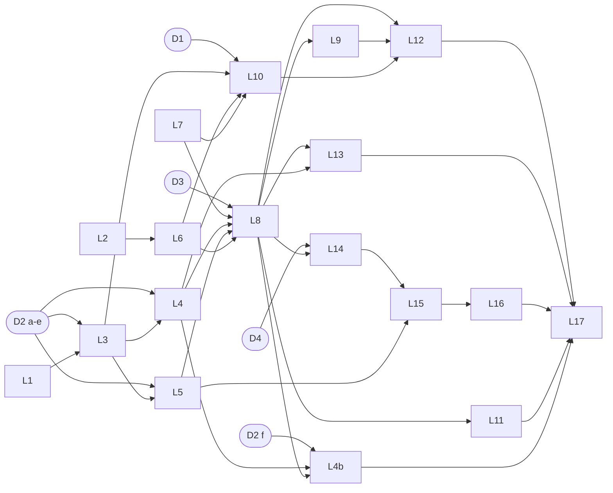

# Web MVP Phase 3: kế hoạch M6 · M9 · M10 (local-only), chờ owner duyệt

<!-- review-readiness: enforce -->

> Tài liệu cho owner đọc để quyết, không phải prompt. Prompt lane cho agent: `docs/autopilot-templates/web-mvp-phase3-2026-10-16-RUN.md`.
> Docs-only: không code, không test, không migration. Plan này **không authorize coding**; mỗi lane vẫn cần verdict `CODE_READY` riêng ở step 0 của session.
> Ngày 2026-10-16 · baseline `origin/main` `3546f6b49bc32e82dbe12e5da636c62206c63b2e` (= merge #51; trước đó #57 đã gộp).

## 1. Tóm tắt

- Phase 3 làm ba milestone còn lại sau DD-132: **M6** sync live + public/private, **M9** phía player + discovery + giá theo giới tính, **M10** chat trong app. Local-only; M7/M8/M11/M12/M13 đã gỡ; M9 chỉ phụ thuộc M6.
- 19 lane (L0-L17 + L4b), 11 session (P3-S1..S11), tổng **129 worker-round**, không hứa lịch. Mỗi lane = một branch + một worktree + một writer = một PR; không stacked PR.
- 5 quyết định chờ owner (D1-D5 = DD-133..DD-137, 🟡). Chưa ký thì chỉ lane phụ thuộc bị AWAIT; lane khác chạy tiếp.
- Bước P0 (bật lịch outbox, nối bot token Zalo thật, nhắn người dùng thật) chỉ owner làm; không lane nào làm.
- **Đề xuất: duyệt kế hoạch như đã viết và ký D1–D5 theo đề xuất.**
- **Điều kiện resume (nhị phân):** owner merge PR `docs/mvp-phase3-plan` HOẶC viết "Phase 3 plan approved" (kèm override D1–D5 nếu có); khi đó P3-S1 bắt đầu và lane L0 ghi D1–D5 là đã ký.

## 2. Phạm vi và baseline (đo tại `3546f6b`)

- **Trong phạm vi:** M6, M9, M10 và các lane tiền đề (L0 docs, L1 flake, L2 text safety). **Ngoài:** PR #50 (M5, chỉ owner, đóng băng), ngân hàng, billing/`host_pro`, nhắc tự động, DO, secret/Google OAuth, M7/M8/M11-M13 (`docs/standards/decisions.md:1742-1772`; `:1772` M9 chỉ phụ thuộc M6).
- **Chưa có default:** Tier C #6 + Occupancy authority (`decisions.md:1934-1936`). Announce route bị hoãn tới khi lịch bật (`decisions.md:753-758`).
- **Outbox:** consumer duy nhất là stub: `apps/bot/src/dispatcher.ts:32-33,77`. Cờ lịch mặc định OFF, worker từ chối khi deliverer là stub: `apps/bot/src/worker.ts:80-96,138-142`. Cron pg-boss tối thiểu 1 phút: `apps/bot/src/queues.ts:42-47`.
- **Zalo:** `/join` `/leave` `/pay` còn "coming soon": `apps/web/lib/zalo/commands.ts:20`. Giải mã secret connector chỉ có ở web: `apps/web/lib/connector-secrets.ts:89`.
- **Occupancy:** `packages/db/src/session-service.ts:2664` (active + guest notes) và bản SQL thứ hai `packages/db/src/session-read.ts:211`; `public_sessions` không role nào ghi được (`packages/db/migrations/0033_public_projection_fences.sql:237-238`). Phân tích: `docs/research/occupancy-authority-2026-10-16.md`.
- **Text session:** `session-service.ts:107-108` chỉ chặn NUL; luật ký tự ẩn đã có ở `packages/db/src/me-settings.ts:32` (`HIDDEN_CHAR`). **Giá giới tính:** 0 match `gender_enc|price_male|price_female` trong `packages/` và `apps/`; chỉ có comment `roster-service.ts:27`.
- **Chat:** bảng đã có (`packages/db/schema.ts:920` `chat_channels`, `:971` `chat_messages`, `:1043` `chat_members`); cờ DM safety đều mặc định `false` (`schema.ts:856-870`). **Migration:** 56 file, tail `0055_me_settings_definers.sql`.
- **Môi trường/flake:** `packages/db/src/test-harness.ts:88-91` (`app_worker` = `plexco_test_worker`) đụng `apps/bot/src/dispatcher.test.ts:25` (`..._jrd`); `apps/web/e2e/pwa.spec.ts:39` flake. Golden path: `apps/web/e2e/golden-path.spec.ts`, `docs/runbooks/local-mvp-smoke.md`.
- Số dòng của `decisions.md` ở trên đo tại `3546f6b`; PR này chèn thêm dòng nên sẽ lệch sau khi merge.

## 3. Bảng lane (khớp F2)

| Lane | Milestone | Mục tiêu | Risk | Writer / reviewer (+ security) | Migration | Phụ thuộc | Session |
|---|---|---|---|---|---|---|---|
| L0 `p3-docs-decisions-sync` | tất cả | ghi D1-D5 đã ký, sửa drift spec, làm mới ledger | P2 | sonnet-high / sonnet-high | không | owner ký D1-D5 | S1 |
| L1 `p3-ci-flake-hardening` | infra | bỏ flake suite (password clash, 57P01, pwa) | P2 | opus-max / opus-max | không | không | S1 |
| L2 `p3-session-text-control-chars` | tiền đề M9 | chặn ký tự điều khiển/bidi ở text session | P2 | sonnet-high / opus-max | không | không | S1 |
| L3 `p3-m6-outbox-delivery-core` | M6 | projector registry, bounded retry + DLQ, NOTIFY wake-up | P1 | opus-max / opus-max + security | có | L1; D2 | S2 |
| L4 `p3-m6-zalo-outbound` | M6 | projector `zalo_dm` đúng ma trận D2 | P1 | opus-max / opus-max + security | có thể | L3; D2 (a-e) | S3 |
| L4b `p3-m6-announce-route` | M6 | route announce + guard runtime | P1 | opus-max / opus-max + security | không | L4, L8; D2 (f) | S5 |
| L5 `p3-m6-web-live-sync` | M6 | projector `web_realtime` + SSE host | P1 | opus-max / opus-max + security | không | L3; D2 (c) | S3 |
| L6 `p3-m6-visibility-toggle` | M6 | toggle public/private + fence | P1 | opus-max / opus-max | không | L2 | S2 |
| L7 `p3-m9-occupancy-helper` | M9 | một helper `getSessionOccupancy` (giai đoạn 1) | P1 | opus-max / opus-max | không | không | S3 |
| L8 `p3-m9-join-core` | M9 | self-join, duyệt, rời, waitlist FIFO, cross-club | P1 | opus-max / opus-max + security | có thể | L7, M6 xong; D3 | S4 |
| L9 `p3-m9-me-reads` | M9 | đọc xuyên CLB theo người (definer) | P1 | opus-max / opus-max + security | có | L8; D3 | S5 |
| L10 `p3-m9-public-projector-discovery` | M9 | writer `public_sessions`, `session_occupancy(uuid)`, discovery | P1 | opus-max / opus-max + security | có | L3, L6, L7; D1 | S6 |
| L11 `p3-m9-gender-pricing` | M9 | giá theo giới tính (DD-39) | P1 | opus-max / opus-max + security | có | L8 | S7 |
| L12 `p3-m9-player-web` | M9 | trang player, inbox host | P2 | sonnet-high / opus-high | không | L8, L9, L10; D3, D1 | S8 |
| L13 `p3-m9-zalo-player-commands` | M9 | Zalo `/join` `/leave` `/pay` | P1 | opus-max / opus-max + security | không | L8, L4; D3 | S8 |
| L14 `p3-m10-chat-core` | M10 | chat command core qua `chat_definer` | P1 | opus-max / opus-max + security | có | L8; D4 | S9 |
| L15 `p3-m10-chat-api-live` | M10 | route chat + live (SSE của L5) | P1 | opus-max / opus-max + security | không | L14, L5; D4 | S10 |
| L16 `p3-m10-chat-web` | M10 | UI chat | P2 | sonnet-high / opus-high | không | L15; D4 | S11 |
| L17 `p3-closeout` | tất cả | ledger, handoff-3, backlog flips, golden path | P2 | sonnet-high / sonnet-high | không | mọi lane khác | S11 |

Lane có migration chạy tuần tự, mỗi PR một migration (số kế tiếp đo tại base của lane, không ghi cứng). Tại một session song song chỉ một lane được sửa `session-service.ts` (cũng `roster-service.ts`, `session-form.tsx`).

## 4. Đồ thị phụ thuộc



ASCII (dự phòng; `<-` = phụ thuộc, `[Dn]` = chờ owner ký):

```text
L0  <- [D1-D5]            L1  <- (none)             L2  <- (none)             L7  <- (none)
L3  <- L1 [D2]            L4  <- L3 [D2 a-e]        L5  <- L3 [D2 c]          L6  <- L2
L4b <- L4, L8 [D2 f]      L8  <- L7, L4, L5, L6 [D3]  (M6 code-complete = L3..L6)
L9  <- L8 [D3]            L10 <- L3, L6, L7 [D1]    L11 <- L8
L12 <- L8, L9, L10 [D3, D1]   L13 <- L8, L4 [D3]    L14 <- L8 [D4]
L15 <- L14, L5 [D4]       L16 <- L15 [D4]           L17 <- every other lane (L16 last)
```

## 5. Checklist quyết định của owner (D1-D5)

Mỗi hàng: một đề xuất, điều kiện resume nhị phân. "Ký" = owner merge PR này hoặc viết "Phase 3 plan approved" (kèm override), rồi L0 ghi DD tương ứng ✅ trên `origin/main`.

| # | Câu hỏi | Đề xuất | Lý do ngắn | Lane bị chặn | Resume (nhị phân) | DD |
|---|---|---|---|---|---|---|
| D1 | Occupancy authority: ký dòng authority và ủy quyền hàm SQL `session_occupancy(uuid)` trong migration projector? | Có, cả hai vế: một helper; `slots_open` là số public duy nhất; hàm SQL nằm trong migration của L10 | một công thức, không lộ số hold; `app_worker` chỉ đọc được qua hàm SQL | L10 (L12 qua L10), phần occupancy của L0; L7 KHÔNG chờ | (a) ký ⇔ DD-133 ✅ nhận (a); (b) ký ⇔ cùng dòng ghi (b) | DD-133 |
| D2 | M6: bound retry, DLQ, ma trận giao, ingress đồng bộ, cờ lịch, route announce | (a) 8 lần giao rồi DLQ; (b) replay chỉ owner; (c) ma trận hẹp; (d) nhận ingress đồng bộ của #47; (e) cờ OFF; (f) announce ở L4b kèm guard | bound hữu hạn, không spam Zalo, không `announced:true` giả | L3, L4, L5 (a-e); L4b (f) | mỗi vế ký ⇔ DD-134 ✅; không ký (f) ⇒ L4b chờ owner báo đã bật lịch | DD-134 |
| D3 | M9: join và tiền khi không có ngân hàng | Join bằng tài khoản; charge ngay hoặc waitlist; rời chỉ khi tiền ròng = 0; Zalo `/pay` chỉ khoản của mình | dùng lại logic host-add, không đường tiền mới | L8, L9, L13; hiển thị tiền ở L12 | ký ⇔ DD-135 ✅ | DD-135 |
| D4 | M10: cắt phạm vi chat | Chỉ kênh CLB; không DM, media, reaction, search, digest | đủ cho chat trong app, không vendor lưu trữ, không thông báo tự động | L14, L15, L16 | ký ⇔ DD-136 ✅ | DD-136 |
| D5 | Cổng thoát đợt A và phong bì Phase 3 | CI main xanh tại `3546f6b` + golden path local; chỉ local; P0 chỉ owner; merge clerk sau mỗi session; #50 chỉ owner | đo lại được bằng lệnh; giống cách phase 2 chạy | khởi động P3-S2 và mọi merge round | ký ⇔ DD-137 ✅ | DD-137 |

Văn bản đầy đủ: `docs/standards/decisions.md` DD-133..DD-137. Mặc định lane tự áp khi thiếu số liệu (mã lỗi chưa ghim, rate limit) ghi "default applied, pending owner sign-off", không tự coi là quyết định.

## 6. Sizing (worker-round)

Một worker-round = một lần chạy worker: readiness, viết, review, security, fix, kiểm cascade, fix sau trần vòng.
- **Theo lane:** L0 5 · L1 6 · L2 4 · L3 9 · L4 8 · L4b 4 · L5 8 · L6 4 · L7 6 · L8 10 · L9 8 · L10 10 · L11 9 · L12 6 · L13 8 · L14 9 · L15 7 · L16 5 · L17 3 = **129**.
- **Theo session:** S1 15 · S2 13 · S3 22 · S4 10 · S5 12 · S6 10 · S7 9 · S8 14 · S9 9 · S10 7 · S11 8 = 129.
- **Giả định:** L2 và L6 nhỏ vì luật ký tự ẩn (`me-settings.ts:32`) và select visibility + `MISSING_DISCOVERY_FIELDS` + fence đã có (W1 đo). Không tính: 1-2 lượt orchestrator mỗi session (CONTINUE khi tới khoảng 20 kết quả worker), khoảng 10-11 lượt merge clerk, rerun flake, chờ giới hạn usage, thời gian owner ký. **Không hứa lịch.**

## 7. Bảng session (một orchestrator mỗi session, merge round sau mỗi session)

| Session | Lane | Phụ thuộc | Worker-round | Cổng sau merge round |
|---|---|---|---|---|
| P3-S1 | L0, L1, L2 | plan được duyệt; L0 cần D1-D5 | 15 | CI main xanh; L1 có N lần chạy song song không flake |
| P3-S2 | L3, L6 | S1; D2 (a,b,e); D5 | 13 | cờ lịch vẫn false; runbook enable/rollback có mặt |
| P3-S3 | L4, L5, L7 | S2; D2 (c) | 22 | golden path local M6; danh sách P0 của owner |
| P3-S4 | L8 | S3; D3 | 10 | test concurrency không oversell |
| P3-S5 | L9, L4b | S4; D3; L4b cần D2 (f) | 12 | migration chỉ ở L9 |
| P3-S6 | L10 | S5; D1 | 10 | whitelist `public_sessions` xanh |
| P3-S7 | L11 | S6; L8 | 9 | gender không lộ ra public |
| P3-S8 | L12, L13 | S7; D3, D1 | 14 | golden path local M9 |
| P3-S9 | L14 | S8; D4; `pnpm db:bootstrap` | 9 | migration chat tuần tự |
| P3-S10 | L15 | S9; L5; D4 | 7 | authorize từng route và từng event |
| P3-S11 | L16, L17 | S10; D4 | 8 | golden path local M10 + closeout (merge cuối) |

Step 0 mỗi session: reviewer readiness (cùng model/effort với reviewer code của lane) ghi `docs/sessions/web-mvp-phase3-readiness-<slug>.md` (`<!-- review-readiness: code-ready -->`, TARGET_FILES chỉ file tồn tại) làm commit đầu của branch lane; `NOT_CODE_READY` ⇒ chỉ lane đó AWAIT. Review: Claude độc lập tối đa 3 vòng (DD-122 D4, không Codex).

## 8. Bước P0 chỉ owner làm

1. Duyệt plan và ký D1-D5 (merge PR này hoặc viết "Phase 3 plan approved"). Merge PR của lane có thể làm bất cứ lúc nào; PR #50 chỉ owner.
2. Bật `OUTBOX_DISPATCH_SCHEDULE_ENABLED` (sau khi L3, L4, L5 đã merge; runbook enable/rollback do L3 viết). Nếu không ký D2 (f), báo owner đã bật lịch để L4b chạy.
3. Nối bot token Zalo thật (bằng chứng giao hàng live của L4). 4. Nhắn người dùng thật. Không agent nào làm các bước này.

## 9. Rủi ro

1. **Môi trường dùng chung:** một Postgres + một cổng e2e ⇒ một khoá, không chạy song song hai suite DB/migration/e2e; flake ở mục 2 làm chậm mọi lane. Giảm: L1 chạy trước, rerun một lần, lần đỏ thứ hai là thật.
2. **Đường găng dài:** 7 lane migration tuần tự, không stacked PR ⇒ 11 session nối tiếp. Giảm: lane không migration chạy song song trong session.
3. **Sync p95 ≤ 3 s:** cron pg-boss tối thiểu 1 phút (`queues.ts:42-47`). Giảm: NOTIFY wake-up ở L3; báo số đo thật kèm tải, không hứa số.
4. **Không có bằng chứng giao Zalo live** khi chưa có token thật (P0). L4 chỉ chứng minh với stub ghi hợp đồng; cấm tuyên bố đã giao live.
5. **Occupancy chưa ký** chặn discovery công khai (L10); giai đoạn 1 (L7) vẫn chạy.
6. **Oversell khi join song song:** bot thanh toán dùng insert-rồi-đếm (an toàn nhờ SQLite một writer). Giảm: khoá hàng session trước khi đếm + test concurrency ở L7, L8.
7. **Khoá mã hoá giới tính (L11):** nguồn khoá local chưa được quyết rõ; DD-132 cấm cấp secret mới ⇒ dùng lại envelope hiện có với nhãn HKDF khác; giải mã lỗi ⇒ fail-closed, không charge.
8. **Review không có Codex:** dựa vào reviewer Claude độc lập tối đa 3 vòng; fix sau vòng cuối ghi rõ "không review lại" (tiền lệ DD-130).

## 10. Readiness verdict (canonical)

Closure matrix (gate §8, 12 hàng; `CODE_READY` cần 12/12 PASS nên plan này chưa đạt):

| # | Gate | Bằng chứng | Kết quả |
|---|---|---|---|
| 1 | Pin authority theo SHA | `3546f6b49bc32e82dbe12e5da636c62206c63b2e` + TARGET_FILES chính xác | PASS |
| 2 | Quyết định trong scope đã chốt | D1-D5 mới là 🟡 DD-133..DD-137 | FAIL |
| 3 | Scope IN/OUT và owner rõ | mục 2, mục 3 | PASS |
| 4 | Dependency phân loại đủ | mục 3-4 (khớp F2) | PASS |
| 5 | Live schema/code khớp doc | mục 2 (đo tại `3546f6b`); từng lane đo lại ở step 0 | PASS |
| 6 | Contract data/API/state/auth đủ | prompt lane ở F2; mã lỗi/field chưa ghim ghi UNPINNED | PARTIAL |
| 7 | Fail-closed/idempotency/order | decision table trong prompt lane, kiểm lại ở step 0 | PARTIAL |
| 8 | Open question trong scope = 0 | còn 5 (D1-D5) | FAIL |
| 9 | Acceptance matrix có expected result | tests + lệnh nghiệm thu nằm trong prompt lane (F2); plan chưa có ma trận tổng | FAIL |
| 10 | Migration/security/rollback pin | lane migration nêu rõ; số migration đo tại base lane | PARTIAL |
| 11 | First slice có hard dependency merged | L1, L2, L7 là root; L0 chỉ chờ chữ ký D1-D5 | PASS |
| 12 | Implementation handoff sẵn sàng | không authorize worktree; verdict `CODE_READY` từng lane ở step 0 | FAIL |

```text
REVIEW_POLICY_VERSION: 1.3
REVIEW_VERDICT: NOT_PLAN_READY
REVIEWED_AT: 2026-10-16
AUTHORITY_SHA: 3546f6b49bc32e82dbe12e5da636c62206c63b2e
BASE_BRANCH: main
TARGET_FILES:
  - docs/sessions/web-mvp-phase3-plan.md
  - docs/autopilot-templates/web-mvp-phase3-2026-10-16-RUN.md
  - docs/research/occupancy-authority-2026-10-16.md
  - docs/standards/decisions.md
SLICE: web-mvp-phase3-plan
IN_SCOPE: kế hoạch docs-only cho M6, M9, M10 local-only: 19 lane, 11 session, 5 quyết định owner (D1-D5), sizing, bước P0 của owner
OUT_OF_SCOPE: code, test, migration, sửa spec Reviewed, PR #50 (M5), ngân hàng, billing, nhắc tự động, deploy DO, M7/M8/M11-M13, mọi bước P0
G1_DECISION: FAIL
G2_SPEC: PARTIAL
G3_DEPENDENCY: PASS
G4_TEST: PARTIAL
G5_SCOPE: PASS
G6_EXTERNAL: ENABLEMENT_ONLY:OUTBOX_DISPATCH_SCHEDULE_ENABLED,zalo_bot_token_real,real_user_messaging
HARD_DEPENDENCIES: none for plan authorization; owner approval and D1-D5 are the blockers below
PRIOR_SLICES: Web MVP phase 2 (M0, M1, M2a-M2c, M3, M4) merged at 3546f6b; M5 (PR #50) frozen owner-only
OPEN_QUESTIONS_IN_SCOPE: 5
ENABLEMENT_ONLY_GATES: OUTBOX_DISPATCH_SCHEDULE_ENABLED, zalo_bot_token_real, real_user_messaging
LIVE_REPO_VERIFICATION: PASS
CONTRACT_MATRIX: PARTIAL
CLOSURE_MATRIX: PARTIAL
ACCEPTANCE_MATRIX: FAIL
SECURITY_AND_MIGRATION_GATE: PARTIAL
IMPLEMENTATION_ARTIFACTS: NOT_REQUIRED_FOR_PLAN_READY
FIRST_IMPLEMENTATION_STEP: BLOCKED until B1 resolves; then P3-S1 step 0 (per-lane readiness for L0, L1, L2)
REMAINING_BLOCKERS:
  - blocker: B1 owner approval of this plan
    owner: Ngoc-Anh
    resolution: owner merges PR docs/mvp-phase3-plan into main OR writes "Phase 3 plan approved" (with any D1-D5 overrides)
    next_review_trigger: merge commit of docs/mvp-phase3-plan on origin/main, or the owner message "Phase 3 plan approved"
  - blocker: B2 D1 occupancy authority (DD-133) unsigned
    owner: Ngoc-Anh
    resolution: DD-133 is ✅ on origin/main (authority row adopted and the stage-2 session_occupancy(uuid) function authorized), or owner override recorded
    next_review_trigger: decisions.md on origin/main shows DD-133 ✅
  - blocker: B3 D2 M6 delivery policy (DD-134) unsigned
    owner: Ngoc-Anh
    resolution: DD-134 is ✅ on origin/main (a-f, or an override per part)
    next_review_trigger: decisions.md on origin/main shows DD-134 ✅
  - blocker: B4 D3 M9 join and money without a bank (DD-135) unsigned
    owner: Ngoc-Anh
    resolution: DD-135 is ✅ on origin/main, or owner override recorded
    next_review_trigger: decisions.md on origin/main shows DD-135 ✅
  - blocker: B5 D4 M10 chat MVP cut (DD-136) unsigned
    owner: Ngoc-Anh
    resolution: DD-136 is ✅ on origin/main, or owner override recorded
    next_review_trigger: decisions.md on origin/main shows DD-136 ✅
  - blocker: B6 D5 wave-A exit gate and Phase 3 envelope (DD-137) unsigned
    owner: Ngoc-Anh
    resolution: DD-137 is ✅ on origin/main, or owner override recorded
    next_review_trigger: decisions.md on origin/main shows DD-137 ✅
NEXT_REVIEW_TRIGGER: merge commit of docs/mvp-phase3-plan on origin/main (or the owner message "Phase 3 plan approved"); then P3-S1 step 0 writes the per-lane CODE_READY or NOT_CODE_READY verdicts
```
