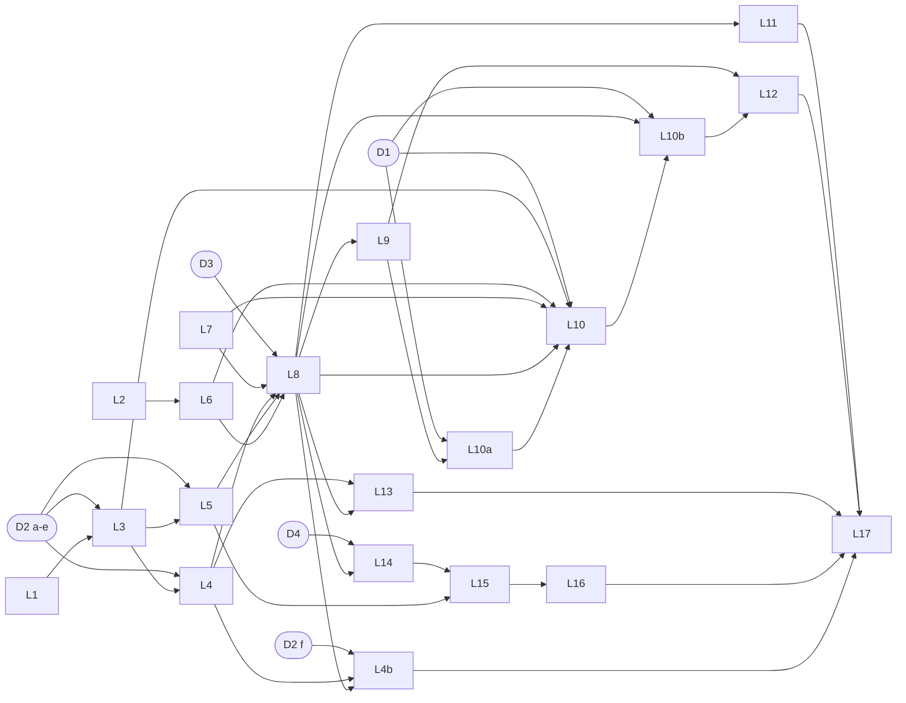

# Web MVP Phase 3: kế hoạch M6 · M9 · M10 (local-only), chờ owner duyệt

<!-- review-readiness: enforce -->

> Tài liệu cho owner đọc để quyết, không phải prompt. Prompt lane cho agent: `docs/autopilot-templates/web-mvp-phase3-2026-10-16-RUN.md`.
> Docs-only: không code, không test, không migration. Plan này **không authorize coding**; mỗi lane vẫn cần verdict `CODE_READY` riêng ở step 0 của session.
> Ngày 2026-10-16 · baseline `origin/main` `3546f6b49bc32e82dbe12e5da636c62206c63b2e` (= merge #51; trước đó #57 đã gộp).

## 1. Tóm tắt

- Phase 3 làm ba milestone còn lại sau DD-132: **M6** sync live + public/private, **M9** phía player + discovery + giá theo giới tính, **M10** chat trong app. Local-only; M7/M8/M11/M12/M13 đã gỡ; M9 chỉ phụ thuộc M6.
- 21 lane (L0-L17 + L4b, L10a, L10b), 13 session (P3-S1..S13), tổng **143 worker-round**, không hứa lịch. Mỗi lane = một branch + một worktree + một writer = một PR (tối đa một migration); không stacked PR.
- 5 quyết định chờ owner (D1-D5 = DD-133..DD-137, 🟡); D1 là epic public read model (DD-114 D3). Chưa ký thì chỉ lane phụ thuộc bị AWAIT; ký từng phần được.
- Bước P0 (bật lịch outbox, nối bot token Zalo thật, nhắn người dùng thật) chỉ owner làm; không lane nào làm.
- **Đề xuất: duyệt kế hoạch như đã viết và ký D1–D5 theo đề xuất.**
- **Điều kiện resume (nhị phân):** owner merge PR #58 (`docs/mvp-phase3-plan`) HOẶC viết "Phase 3 plan approved" (kèm override D1–D5 nếu có); đó là sự kiện duyệt. P3-S1 bắt đầu và lane L0 ghi D1–D5 là đã ký (không chờ merge của L0).

## 2. Phạm vi và baseline (đo tại `3546f6b`)

- **Trong phạm vi:** M6, M9, M10 và các lane tiền đề (L0 docs, L1 flake, L2 text safety). **Ngoài:** PR #50 (M5, chỉ owner, đóng băng), ngân hàng, billing/`host_pro`, nhắc tự động, DO, secret/Google OAuth, M7/M8/M11-M13 (`docs/standards/decisions.md:1742-1772`; `:1772` M9 chỉ phụ thuộc M6).
- **Chưa có default:** Tier C #6 + Occupancy authority (`decisions.md:1934-1936`). Projector `public_sessions` thuộc epic public read model có 4 tiền đề, AWAIT tới khi epic được authorize (DD-114 D3, `decisions.md:2467-2479`). Announce route bị hoãn tới khi lịch bật (`decisions.md:753-758`).
- **Outbox:** consumer duy nhất là stub: `apps/bot/src/dispatcher.ts:32-33,77`. Cờ lịch mặc định OFF, worker từ chối khi deliverer là stub: `apps/bot/src/worker.ts:80-96,138-142`. Cron pg-boss tối thiểu 1 phút: `apps/bot/src/queues.ts:42-47`.
- **Zalo:** `/join` `/leave` `/pay` còn "coming soon": `apps/web/lib/zalo/commands.ts:20`. Giải mã secret connector chỉ có ở web: `apps/web/lib/connector-secrets.ts:89`.
- **Occupancy:** `packages/db/src/session-service.ts:2664` (active + guest notes) và bản SQL thứ hai `packages/db/src/session-read.ts:211`; `public_sessions` không role nào ghi được: `app` bị thu INSERT/UPDATE/DELETE (`packages/db/migrations/0036_revoke_app_dml_public_sessions.sql:36`) và SELECT (`0033_public_projection_fences.sql:237-238`). Phân tích: `docs/research/occupancy-authority-2026-10-16.md`.
- **Text session:** `session-service.ts:107-108` chỉ chặn NUL; luật ký tự ẩn đã có ở `packages/db/src/me-settings.ts:32` (`HIDDEN_CHAR`). **Giá giới tính:** 0 match `gender_enc|price_male|price_female` trong `packages/` và `apps/`; chỉ có comment `roster-service.ts:27`.
- **Chat:** bảng đã có (`packages/db/schema.ts:920` `chat_channels`, `:971` `chat_messages`, `:1043` `chat_members`); cờ DM safety đều mặc định `false` (`schema.ts:856-870`). **Migration:** 56 file, tail `0055_me_settings_definers.sql`.
- **Môi trường/flake:** `packages/db/src/test-harness.ts:88-91` (`app_worker` = `plexco_test_worker`) đụng `apps/bot/src/dispatcher.test.ts:25` (`..._jrd`); `apps/web/e2e/pwa.spec.ts:39` flake. Golden path: `apps/web/e2e/golden-path.spec.ts`, `docs/runbooks/local-mvp-smoke.md`.
- Số dòng của `decisions.md` ở trên đo tại `3546f6b`; PR này chèn thêm dòng nên sẽ lệch sau khi merge.

## 3. Bảng lane (khớp F2)

| Lane | Milestone | Mục tiêu | Risk | Writer / reviewer (+ security) | Migration | Phụ thuộc | Session |
|---|---|---|---|---|---|---|---|
| L0 `p3-docs-decisions-sync` | tất cả | ghi D1-D5 đã ký, sửa drift spec, làm mới ledger | P2 | sonnet-high / sonnet-high | không | sự kiện duyệt của owner | S1 |
| L1 `p3-ci-flake-hardening` | infra | bỏ flake suite (password clash, 57P01, pwa) | P2 | opus-max / opus-max | không | không | S1 |
| L2 `p3-session-text-control-chars` | tiền đề M9 | chặn ký tự điều khiển/bidi ở text session | P2 | sonnet-high / opus-max | không | không | S1 |
| L3 `p3-m6-outbox-delivery-core` | M6 | projector registry, bounded retry + DLQ, NOTIFY wake-up | P1 | opus-max / opus-max + security | có | L1; D2 | S2 |
| L6 `p3-m6-visibility-toggle` | M6 | toggle public/private + fence | P1 | opus-max / opus-max | không | L2 | S2 |
| L4 `p3-m6-zalo-outbound` | M6 | projector `zalo_dm` đúng ma trận D2 | P1 | opus-max / opus-max + security | có thể | L3; D2 (a-e) | S3 |
| L5 `p3-m6-web-live-sync` | M6 | projector `web_realtime` + SSE host | P1 | opus-max / opus-max + security | không | L3; D2 (c) | S3 |
| L7 `p3-m9-occupancy-helper` | M9 | một helper `getSessionOccupancy` (giai đoạn 1) | P1 | opus-max / opus-max | không | không | S3 |
| L8 `p3-m9-join-core` | M9 | self-join, duyệt, rời, waitlist FIFO, cross-club; route host xem yêu cầu join; outbox event cho mỗi thay đổi roster | P1 | opus-max / opus-max + security | có thể | L7, M6 xong; D3 | S4 |
| L9 `p3-m9-me-reads` | M9 | đọc xuyên CLB theo người (definer) | P1 | opus-max / opus-max + security | có | L8; D3 | S5 |
| L4b `p3-m6-announce-route` | M6 | route announce (kênh zalo); guard = sự thật DB (heartbeat worker + `projector_is_enabled('zalo_dm')`) | P1 | opus-max / opus-max + security | không | L4 (chạy sau L8: chung file); D2 (f) | S5 |
| L10a `p3-m9-public-alias-moderation` | M9 | alias CLB công khai + duyệt owner-only; outbox event khi alias đổi | P1 | opus-max / opus-max + security | có | L9 (migration tuần tự); D1 (d) | S6 |
| L10 `p3-m9-public-projector` | M9 | consumer + MỘT migration (BE): writer `public_sessions`, cột DD-41, registry slug, `session_occupancy(uuid)`, thay view `public_session_share_v` | P1 | opus-max / opus-max + security | có | L3, L6, L7, L8, L10a; D1 (a-c, e) | S7 |
| L10b `p3-m9-discovery-read` | M9 | discovery list + chi tiết opaque slug + join-by-slug + rate limit | P1 | opus-max / opus-max + security | không | L10, L8; D1 (a, e) | S8 |
| L11 `p3-m9-gender-pricing` | M9 | giá theo giới tính (DD-39), gồm derivation lúc nâng waitlist | P1 | opus-max / opus-max + security | có | L8 | S9 |
| L12 `p3-m9-player-web` | M9 | trang player, inbox host (discovery cần L10b) | P2 | sonnet-high / opus-max | không | L8, L9, L10b; D3 (D1 cho discovery) | S10 |
| L13 `p3-m9-zalo-player-commands` | M9 | Zalo `/join` `/leave` `/pay` | P1 | opus-max / opus-max + security | không | L8, L4; D3 | S10 |
| L14 `p3-m10-chat-core` | M10 | chat command core qua `chat_definer` | P1 | opus-max / opus-max + security | có | L8; D4 | S11 |
| L15 `p3-m10-chat-api-live` | M10 | route chat + live (SSE của L5) | P1 | opus-max / opus-max + security | không | L14, L5; D4 | S12 |
| L16 `p3-m10-chat-web` | M10 | UI chat | P2 | sonnet-high / opus-high | không | L15; D4 | S13 |
| L17 `p3-closeout` | tất cả | ledger, handoff-3, backlog flips, golden path; gom mọi default đã áp vào MỘT mục `decisions.md` | P2 | sonnet-high / sonnet-high | không | mọi lane khác | S13 |

Mỗi lane tối đa một migration; lane có migration chạy tuần tự (số kế tiếp đo tại base của lane, không ghi cứng). Tại một session song song chỉ một lane được sửa `session-service.ts` (cũng `roster-service.ts`, `session-form.tsx`). Orchestrator chạy opus/max (owner override 2026-10-14 15:32); merge clerk và summariser sonnet-high; không bao giờ dùng `fable`. Mỗi lane ghim default đã áp trong readiness file step 0 và PR body; L17 gom vào MỘT mục `decisions.md`, lane khác không sửa `decisions.md` (L0 chỉ ghi chữ ký). Trong P3-S4 chỉ L8 sửa `session-service.ts`.

## 4. Đồ thị phụ thuộc



ASCII (dự phòng; `<-` = phụ thuộc, `[Dn]` = chờ owner ký):

```text
L0  <- [owner approval]   L1  <- (none)             L2  <- (none)             L7  <- (none)
L3  <- L1 [D2]            L4  <- L3 [D2 a-e]        L5  <- L3 [D2 c]          L6  <- L2
L8  <- L7, L4, L5, L6 [D3]  (M6 code-complete = L3..L6)    L9 <- L8 [D3]    L11 <- L8
L4b <- L4 [D2 f]  (chạy sau L8: chung api-contract.ts, session-command-route.ts)
L10a <- L9 [D1 d]   L10 <- L3, L6, L7, L8, L10a [D1 a-c, e]   L10b <- L10, L8 [D1 a, e]
L12 <- L8, L9, L10b [D3, D1 cho discovery]   L13 <- L8, L4 [D3]    L14 <- L8 [D4]
L15 <- L14, L5 [D4]       L16 <- L15 [D4]           L17 <- every other lane (L16 last)
```

## 5. Checklist quyết định của owner (D1-D5)

"Ký" = sự kiện duyệt của owner: owner merge PR #58, hoặc viết "Phase 3 plan approved" kèm override; L0 rồi ghi DD tương ứng ✅ (không vòng chờ vào merge của L0). Ký từng phần được (ví dụ "D2 signed except (f)"); D1 có thể "declined". Văn bản đầy đủ: `decisions.md` DD-133..DD-137. Mặc định lane tự áp khi thiếu số liệu (mã lỗi chưa ghim, rate limit) ghi trong readiness file step 0 và PR body là "default applied, pending owner sign-off"; L17 gom vào MỘT mục `decisions.md`; không tự coi là quyết định.

| # | Câu hỏi | Đề xuất | Lý do ngắn | Amend / authorize | Lane bị chặn | Resume (nhị phân) | DD |
|---|---|---|---|---|---|---|---|
| D1 | Public read model epic (DD-114 D3): authorize trong Phase 3, và cách làm | Có, gói a-e: (a) occupancy authority, `slots_open` là số public duy nhất; (b) hàm SQL `session_occupancy(uuid)`; (c) cột DD-41 + (e) registry share-link opaque slug (DD-83/DD-75, không sửa DD-83) trong MỘT migration L10 thay `public_session_share_v` (không `host_display_name`, lọc sống theo alias đang được duyệt, thu hồi fail-closed); (d) alias CLB được moderate (L10a, duyệt owner-only qua script có audit) | DD-114 D3 đòi 4 tiền đề trước khi chạm giá trị projection; một công thức, không lộ số hold hay tên host | amend BL-DSC-1 (tên host và `confirmed_count` rời whitelist; danh sách sync của L0 gồm BL-DSC-1) và DD-32 (`decisions.md:464`, `:467` tại `3546f6b`); authorize epic DD-114 D3 | L10a, L10, L10b, discovery của L12, occupancy/BL-DSC-1 của L0; L7 KHÔNG chờ | ký ⇔ sự kiện duyệt ghi nhận a-e; "D1 declined" ⇒ public read model rời Phase 3 (M9 chỉ join, cross-club, me-reads, giá, Zalo) | DD-133 |
| D2 | M6: bound retry, DLQ, ma trận giao, ingress đồng bộ, cờ lịch, route announce | (a) 8 lần giao, lần 8 lỗi ⇒ DLQ, 7 khoảng chờ 15 s × 2^(n−1) = 1905 s (≈32 phút), không trần; (b) replay chỉ owner; (c) ma trận hẹp; (d) nhận ingress đồng bộ của #47; (e) cờ OFF; (f) announce ở L4b, guard theo heartbeat worker còn mới báo `schedule_enabled` VÀ `projector_is_enabled('zalo_dm')`, không theo env tiến trình | bound hữu hạn, không spam Zalo, không `announced:true` giả | (d) amend OD-2 ack-rồi-xử-lý-async; (f) amend hoãn (b) ngày 2026-08-26 (`decisions.md:753-758` tại `3546f6b`); mã từ chối đề xuất `ANNOUNCE_DELIVERY_DISABLED` (409, UNPINNED) | L3, L4, L5 (a-e); L4b (f) | mỗi vế ký ⇔ sự kiện duyệt; không ký (f) ⇒ L4b chờ owner báo đã bật lịch | DD-134 |
| D3 | M9: join và tiền khi không có ngân hàng | Join bằng tài khoản; charge ngay hoặc waitlist; rời chỉ khi tiền ròng = 0; Zalo `/pay` chỉ khoản của mình | dùng lại logic host-add, không đường tiền mới | không sửa DD nào; áp DD-05, DD-39, DD-132 | L8, L9, L13; hiển thị tiền ở L12 | ký ⇔ sự kiện duyệt | DD-135 |
| D4 | M10: cắt phạm vi chat | Chỉ kênh CLB; không DM, media, reaction, search, digest | đủ cho chat trong app, không vendor lưu trữ, không thông báo tự động | không sửa DD nào; thu hẹp phần xây của DD-86, DD-91..95 | L14, L15, L16 | ký ⇔ sự kiện duyệt | DD-136 |
| D5 | Cổng thoát đợt A và phong bì Phase 3 | CI main xanh tại `3546f6b` (CI run 38794722311: `verify` + `e2e-web` success) + golden path local; chỉ local; P0 chỉ owner; merge clerk sau mỗi session; #50 chỉ owner | đo lại được bằng lệnh; giống cách phase 2 chạy | điền cổng đợt A mà DD-132 để mở; không đổi chữ DD-132 | mọi merge round của clerk (chưa ký ⇒ owner tự merge) | ký ⇔ sự kiện duyệt | DD-137 |

## 6. Sizing (worker-round)

Một worker-round = một lần chạy worker: readiness, viết, review, security, fix, kiểm cascade, fix sau trần vòng.
- **Theo lane:** L0 5 · L1 6 · L2 4 · L3 9 · L4 8 · L4b 4 · L5 8 · L6 4 · L7 6 · L8 10 · L9 8 · L10a 8 · L10 9 · L10b 7 · L11 9 · L12 6 · L13 8 · L14 9 · L15 7 · L16 5 · L17 3 = **143**.
- **Theo session:** S1 15 · S2 13 · S3 22 · S4 10 · S5 12 · S6 8 · S7 9 · S8 7 · S9 9 · S10 14 · S11 9 · S12 7 · S13 8 = 143.
- **Giả định:** L2 và L6 nhỏ vì luật ký tự ẩn (`me-settings.ts:32`) và select visibility + `MISSING_DISCOVERY_FIELDS` + fence đã có (W1 đo). Không tính: 1-2 lượt orchestrator mỗi session (CONTINUE khi tới khoảng 20 kết quả worker), 13 merge round (merge clerk), rerun flake, chờ giới hạn usage, thời gian owner ký. D1 bị từ chối thì L10a, L10, L10b rời kế hoạch (-24 worker-round). **Không hứa lịch.**

## 7. Bảng session (một orchestrator opus/max mỗi session, 13 merge round: một sau mỗi session)

| Session | Lane | Phụ thuộc | Worker-round | Cổng sau merge round |
|---|---|---|---|---|
| P3-S1 | L0, L1, L2 | sự kiện duyệt của owner | 15 | CI main xanh; L1 có N lần chạy song song không flake (trong một cửa sổ khoá DB/e2e độc quyền) |
| P3-S2 | L3, L6 | S1; D2 (a, b, e); D5 | 13 | cờ lịch vẫn false; runbook enable/rollback có mặt |
| P3-S3 | L4, L5, L7 | S2; D2 (c) | 22 | golden path local M6; danh sách P0 của owner |
| P3-S4 | L8 | S3; D3 | 10 | test concurrency không oversell; mỗi thay đổi roster có một outbox event |
| P3-S5 | L9, L4b | S4; D3; L4b cần D2 (f) | 12 | migration chỉ ở L9 |
| P3-S6 | L10a | S5; D1 (d) | 8 | alias: không role app/app_worker/readonly duyệt được; sửa alias ⇒ pending |
| P3-S7 | L10 | S6; L8; D1 (a-c, e) | 9 | whitelist `public_sessions` xanh; view thay mới; `session_occupancy` có test |
| P3-S8 | L10b | S7; L8; D1 (a, e) | 7 | L10b sở hữu `index.ts` và `api-contract.ts`; view mới chỉ whitelist, không tên host |
| P3-S9 | L11 | S8 (hoặc bỏ qua nếu D1 declined); L8 | 9 | decrypt-fail không tạo charge; whitelist không lộ gender |
| P3-S10 | L12, L13 | S9; D3 (D1 cho discovery) | 14 | golden path local M9 |
| P3-S11 | L14 | S10; D4; `pnpm db:bootstrap` | 9 | migration chat tuần tự |
| P3-S12 | L15 | S11; L5; D4 | 7 | authorize từng route và từng event |
| P3-S13 | L16, L17 | S12; D4 | 8 | golden path local M10 + closeout (merge round cuối, L17 merge cuối) |

Step 0 mỗi session: reviewer readiness (cùng model/effort với reviewer code của lane) re-verify live truth tại base. `CODE_READY` ⇒ ghi `docs/sessions/web-mvp-phase3-readiness-<slug>.md` (`<!-- review-readiness: code-ready -->`, TARGET_FILES chỉ file tồn tại), chạy `pnpm review:check:changed` TRƯỚC khi commit (nó diff với HEAD) và `pnpm review:check` sau, làm commit đầu của branch lane. `NOT_CODE_READY` ⇒ không commit gì; khối verdict vào báo cáo session như mục AWAIT (blocker, owner, resolution nhị phân), lane không bắt đầu. Review: Claude độc lập tối đa 3 vòng (DD-122 D4, không Codex).

## 8. Bước P0 chỉ owner làm

1. Duyệt plan và ký D1-D5 (merge PR #58 hoặc viết "Phase 3 plan approved"). Merge PR của lane có thể làm bất cứ lúc nào; PR #50 chỉ owner.
2. Bật `OUTBOX_DISPATCH_SCHEDULE_ENABLED` (sau khi L3, L4, L5 đã merge; runbook enable/rollback do L3 viết). Nếu không ký D2 (f), báo owner đã bật lịch để L4b chạy. Agent chỉ bật vòng dispatch trong tiến trình test hoặc môi trường scratch local (đo p95, golden path); mặc định commit và `.env.example` giữ `false`.
3. Nối bot token Zalo thật (bằng chứng giao hàng live của L4). 4. Nhắn người dùng thật. Không agent nào làm các bước này.

## 9. Rủi ro

1. **Môi trường dùng chung:** một Postgres + một cổng e2e ⇒ một khoá, không chạy song song hai suite DB/migration/e2e; flake ở mục 2 làm chậm mọi lane. Giảm: L1 chạy trước, rerun một lần, lần đỏ thứ hai là thật.
2. **Đường găng dài:** tối đa 8 lane migration tuần tự (L3, L4, L8, L9, L10a, L10, L11, L14), không stacked PR ⇒ 13 session nối tiếp. Giảm: lane không migration chạy song song trong session.
3. **Sync p95 ≤ 3 s:** cron pg-boss tối thiểu 1 phút (`queues.ts:42-47`). Giảm: NOTIFY wake-up ở L3; báo số đo thật kèm tải, không hứa số.
4. **Không có bằng chứng giao Zalo live** khi chưa có token thật (P0). L4 chỉ chứng minh với stub ghi hợp đồng; cấm tuyên bố đã giao live.
5. **Epic public read model chưa ký (D1)** chặn discovery công khai (L10a, L10, L10b); L7 vẫn chạy, và nếu D1 bị từ chối thì M9 vẫn ship join, cross-club, me-reads, giá, Zalo.
6. **Oversell khi join song song:** bot thanh toán dùng insert-rồi-đếm (an toàn nhờ SQLite một writer). Giảm: khoá hàng session trước khi đếm + test concurrency ở L7, L8.
7. **Khoá mã hoá giới tính (L11):** nguồn khoá local chưa được quyết rõ; DD-132 cấm cấp secret mới ⇒ dùng lại envelope hiện có với nhãn HKDF khác; giải mã lỗi ⇒ fail-closed, không charge.
8. **Review không có Codex:** dựa vào reviewer Claude độc lập tối đa 3 vòng; fix sau vòng cuối ghi rõ "không review lại" (tiền lệ DD-130).

## 10. Readiness verdict (canonical)

Closure matrix (gate §8, 12 hàng; `CODE_READY` cần 12/12 PASS nên plan này chưa đạt):

| # | Gate | Bằng chứng | Kết quả |
|---|---|---|---|
| 1 | Pin authority theo SHA | `3546f6b49bc32e82dbe12e5da636c62206c63b2e` + TARGET_FILES chính xác | PASS |
| 2 | Quyết định trong scope đã chốt | D1-D5 mới là 🟡 DD-133..DD-137 | FAIL |
| 3 | Scope IN/OUT và owner rõ | mục 2, mục 3 | PASS |
| 4 | Dependency phân loại đủ | mục 3-4 (21 lane, khớp F2) | PASS |
| 5 | Live schema/code khớp doc | mục 2 (đo tại `3546f6b`); từng lane đo lại ở step 0 | PASS |
| 6 | Contract data/API/state/auth đủ | prompt lane ở F2; mã lỗi/field chưa ghim ghi UNPINNED | PARTIAL |
| 7 | Fail-closed/idempotency/order | decision table trong prompt lane, kiểm lại ở step 0 | PARTIAL |
| 8 | Open question trong scope = 0 | còn 5 (D1-D5) | FAIL |
| 9 | Acceptance matrix có expected result | tests + lệnh nghiệm thu nằm trong prompt lane (F2); plan chưa có ma trận tổng | FAIL |
| 10 | Migration/security/rollback pin | lane migration nêu rõ; số migration đo tại base lane | PARTIAL |
| 11 | First slice có hard dependency merged | L1, L2, L7 là root; L0 chỉ chờ chữ ký D1-D5 | PASS |
| 12 | Implementation handoff sẵn sàng | không authorize worktree; verdict `CODE_READY` từng lane ở step 0 | FAIL |

```text
REVIEW_POLICY_VERSION: 1.3
REVIEW_VERDICT: NOT_PLAN_READY
REVIEWED_AT: 2026-10-16
AUTHORITY_SHA: 3546f6b49bc32e82dbe12e5da636c62206c63b2e
BASE_BRANCH: main
TARGET_FILES:
  - docs/sessions/web-mvp-phase3-plan.md
  - docs/autopilot-templates/web-mvp-phase3-2026-10-16-RUN.md
  - docs/research/occupancy-authority-2026-10-16.md
  - docs/standards/decisions.md
  - docs/autopilot-backlog.md
  - docs/autopilot-templates/web-mvp-2026-10-12-RUN.md
SLICE: web-mvp-phase3-plan
IN_SCOPE: kế hoạch docs-only cho M6, M9, M10 local-only: 21 lane, 13 session, 5 quyết định owner (D1-D5), sizing 143 worker-round, bước P0 của owner
OUT_OF_SCOPE: code, test, migration, sửa spec Reviewed, PR #50 (M5), ngân hàng, billing, nhắc tự động, deploy DO, M7/M8/M11-M13, mọi bước P0
G1_DECISION: FAIL
G2_SPEC: PARTIAL
G3_DEPENDENCY: PASS
G4_TEST: PARTIAL
G5_SCOPE: PASS
G6_EXTERNAL: ENABLEMENT_ONLY:OUTBOX_DISPATCH_SCHEDULE_ENABLED,zalo_bot_token_real,real_user_messaging
HARD_DEPENDENCIES: none for plan authorization; owner approval and D1-D5 are the blockers below
PRIOR_SLICES: Web MVP phase 2 (M0, M1, M2a-M2c, M3, M4) merged at 3546f6b; M5 (PR #50) frozen owner-only
OPEN_QUESTIONS_IN_SCOPE: 5
ENABLEMENT_ONLY_GATES: OUTBOX_DISPATCH_SCHEDULE_ENABLED, zalo_bot_token_real, real_user_messaging
LIVE_REPO_VERIFICATION: PASS
CONTRACT_MATRIX: PARTIAL
CLOSURE_MATRIX: PARTIAL
ACCEPTANCE_MATRIX: FAIL
SECURITY_AND_MIGRATION_GATE: PARTIAL
IMPLEMENTATION_ARTIFACTS: NOT_REQUIRED_FOR_PLAN_READY
FIRST_IMPLEMENTATION_STEP: BLOCKED until B1 resolves; then P3-S1 step 0 (per-lane readiness for L0, L1, L2)
REMAINING_BLOCKERS:
  - blocker: B1 owner approval of this plan
    owner: Ngoc-Anh
    resolution: owner merges PR #58 (docs/mvp-phase3-plan) into main OR writes "Phase 3 plan approved" (with any D1-D5 overrides)
    next_review_trigger: merge commit of PR #58 on origin/main, or the owner message "Phase 3 plan approved"
  - blocker: B2 D1 public read model epic, DD-114 D3 (DD-133) unsigned
    owner: Ngoc-Anh
    resolution: owner approval event records DD-133 parts (a)-(e) as signed (L0 then writes DD-133 ✅), or the owner writes "D1 declined" (L10a, L10, L10b leave Phase 3)
    next_review_trigger: decisions.md on origin/main shows DD-133 ✅ or the owner message "D1 declined"
  - blocker: B3 D2 M6 delivery policy (DD-134) unsigned
    owner: Ngoc-Anh
    resolution: owner approval event records DD-134 as signed (partial signing allowed, e.g. "D2 signed except (f)"); L0 then writes DD-134 ✅
    next_review_trigger: decisions.md on origin/main shows DD-134 ✅
  - blocker: B4 D3 M9 join and money without a bank (DD-135) unsigned
    owner: Ngoc-Anh
    resolution: owner approval event records DD-135 as signed (or an override); L0 then writes DD-135 ✅
    next_review_trigger: decisions.md on origin/main shows DD-135 ✅
  - blocker: B5 D4 M10 chat MVP cut (DD-136) unsigned
    owner: Ngoc-Anh
    resolution: owner approval event records DD-136 as signed (or an override); L0 then writes DD-136 ✅
    next_review_trigger: decisions.md on origin/main shows DD-136 ✅
  - blocker: B6 D5 wave-A exit gate and Phase 3 envelope (DD-137) unsigned
    owner: Ngoc-Anh
    resolution: owner approval event records DD-137 as signed (or an override); L0 then writes DD-137 ✅
    next_review_trigger: decisions.md on origin/main shows DD-137 ✅
NEXT_REVIEW_TRIGGER: merge commit of PR #58 on origin/main (or the owner message "Phase 3 plan approved"); then P3-S1 step 0 writes the per-lane CODE_READY or NOT_CODE_READY verdicts
```
