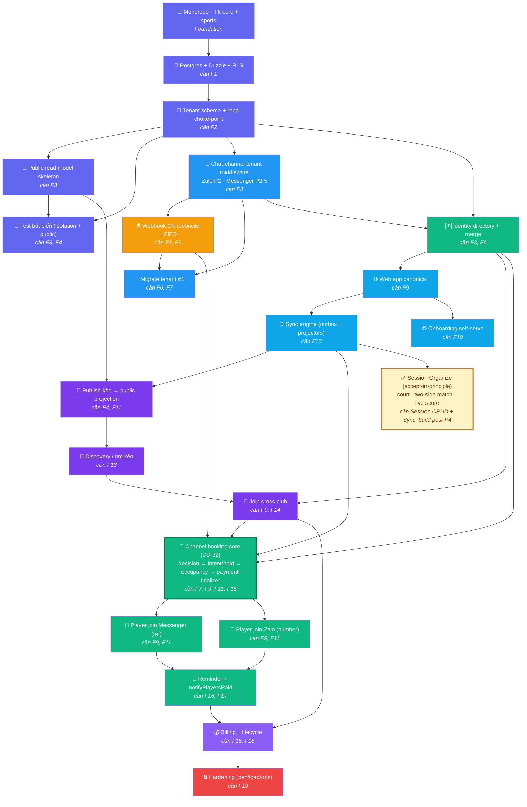

# Feature Dependency Graph — Plexco

> Thứ tự phát triển features cho Plexco platform. Căn cứ `../product/ROADMAP.md` v3.4l + `../product/TDD.md` v3.1h + `decisions.md` v2.11 current mirror.
> v1.15 · 2026-07-28. Dependency graph vẫn là product order; DD-32 adds one shared booking core before both channel adapters. Node Session Organize v0.5 remains dependency-only.

## Current delivery overlay — không thay graph authority

| Mechanism | Trạng thái tại `main@784bc8d` | Ranh giới |
|---|---|---|
| DB/foundation | `0000`–`0024` merged; `0019`–`0021` tenant-integrity, `0024` Session public-capacity CHECK | `0024` không tạo SessionService/route/projector |
| Shared job mechanics | `0022` lease/audit + `0023` ack, worker preflight, dispatcher và flagged scheduler đã merge | Schedule mặc định OFF; dispatcher placeholder fail-closed; chưa producer, real projector, controlled replay hay sub-minute drain |
| F11 Sync engine | Outbox/job substrate có một phần | Chưa có business producer→projector→surface E2E, nên F11 vẫn chưa `IMPLEMENTED` |
| F22 Channel booking core | Product + BE companion Reviewed in working tree | No intent/hold/occupancy/finalizer runtime; readiness is owned by its implementation plan |
| In-app Chat target | DD-86/DD-91..95 `DECISION_FINAL`; DD-88 broader proposal; Chat là primary daily player surface, Zalo/Messenger acquisition/fallback | Chat/Assistant/Notification contracts Reviewed; primary plan v1.8 `PLAN_READY` at `90d292d`; `chat_*` runtime absent and every slice still requires strict `CODE_READY` |

Mọi slice tiếp theo vẫn phải re-pin live base và qua readiness gate riêng; bảng này chỉ reconcile trạng thái
triển khai gần đây.

---

## In-app Chat primary-surface ownership DAG — target, chưa runtime

> Graph này đóng **một owner cho mỗi state/writer** trong bounded mechanism slices `1–47`. Đây là catalog gồm DB/core/worker/client mechanisms, không phải tất cả đều là “core” và số ID không phải execution order. Mechanism slices không ngầm sở hữu HTTP hoặc UI: delivery đi tiếp qua thin API adapters `A1–A21`, rồi tracked-design FE slices `F0–F15`. Node trong graph là target contract, không phải runtime/readiness proof; current verdict chỉ đọc ở primary plan §13.

```mermaid
graph TD
    PACK["Immutable owner-final authority pack"]

    subgraph CHAT["Chat core"]
      DP["1 chat-definer-role-provisioning"]
      SAFETY["2 chat-dm-safety-authority-core"]
      ROOT["3 dd38-dd86-chat-schema-core"]
      CAP["4 tenant-capability-authority-core<br/>registry + grants + append-only grant audit"]
      LIFE["5 chat-club-channel-lifecycle-core"]
      MOD["6 chat-club-moderation-core<br/>lands dark"]
      SHARED["7 chat-shared-message-command-core"]
      DM["8 chat-dm-lifecycle-command-core"]
      TARGET["9 chat-authorized-member-target-read-core"]
      RT["10 chat-realtime-unread-core"]
      MEDIA_UP["11 chat-media-upload-scan-core"]
      MEDIA_READ["12 chat-media-attachment-read-lifecycle"]
      REACT["13 chat-message-reaction-core"]
      EDIT["14 chat-author-edit-delete-revision-core"]
      SEARCH["15 chat-authorized-search-core"]
    end

    subgraph COMMANDS["Player-self and requester-only commands"]
      REMAIN["16 core-payment-remaining-primitive"]
      SELF_PAY["17 player-self-charge-read-core"]
      SELF_PROFILE["18 player-self-profile-clubs-read-core"]
      SELF_SESSION["19 player-self-sessions-waitlist-read-core"]
      DISCOVERY["20 marketplace-discovery-navigation-read"]
      SELF_NAME["21 identity-self-name-navigation-flow"]
      REGISTRY["22 chat-slash-command-registry-core"]
      RESPONSE["23 chat-requester-only-sync-response"]
      PAY_ADAPTER["24 chat-pay-command-adapter"]
      NAV_ADAPTER["25 chat-profile-navigation-command-adapters"]
      SESSION_ADAPTER["26 chat-session-command-adapters"]
    end

    subgraph ASSISTANT["Club Assistant and KB"]
      KB_STORE["27 assistant-kb-storage-authority-core<br/>storage + bounded config"]
      KB_TEXT["28 assistant-kb-text-ingest-core"]
      KB_URL["29 assistant-kb-url-ingest-adapter"]
      KB_FILE["30 assistant-kb-file-ingest-adapter"]
      KB_INDEX["31 assistant-kb-index-activation-worker<br/>generation CAS"]
      KB_RETRIEVE["32 assistant-kb-retrieval-core"]
      ASK["33 assistant-bot-ask-worker"]
      MENTION["34 assistant-chat-mention-adapter"]
      PRIVATE_BOT["35 assistant-private-thread-surface"]
    end

    DESIGN["F0 chat-design-authority-handoff"]

    subgraph DELIVERY["Web Push, Chat notification and payment lifecycle"]
      ROUTE["36 notification-route-integrity-core"]
      SUB["37 notification-web-push-subscription-authority-core"]
      PROVIDER["38 notification-web-push-provider-attempt-core"]
      PWA["39 pwa-installable-shell-core"]
      REG_CLIENT["40 web-push-registration-client"]
      DISPLAY["41 web-push-display-telemetry-client"]
      CHAT_NOTIFY["42 chat-unread-notification-core"]
      PAYMENT_INTENT["43 notification-payment-lifecycle-intent-core"]
      REMINDER["44 notification-payment-reminder-producer"]
      SETTLED["45 notification-payment-settled-correction-projector"]
      INBOX["46 notification-inbox-payment-detail"]
      PAYMENT_PUSH["47 notification-web-push-payment-adapter"]
    end

    PACK --> DP --> SAFETY --> ROOT --> CAP --> LIFE --> TARGET --> MOD --> SHARED
    SAFETY --> DM
    ROOT --> DM
    SHARED --> DM
    SHARED --> RT
    DM --> RT
    SHARED --> MEDIA_UP
    DM --> MEDIA_UP
    MEDIA_UP --> MEDIA_READ
    SHARED --> MEDIA_READ
    DM --> MEDIA_READ
    SHARED --> REACT
    SHARED --> EDIT
    ROOT --> SEARCH
    MOD --> SEARCH
    SHARED --> SEARCH
    EDIT --> SEARCH

    PACK --> REMAIN --> SELF_PAY
    PACK --> SELF_PROFILE
    PACK --> SELF_SESSION
    PACK --> DISCOVERY
    PACK --> SELF_NAME
    PACK --> REGISTRY --> RESPONSE
    SELF_PAY --> PAY_ADAPTER
    REGISTRY --> PAY_ADAPTER
    RESPONSE --> PAY_ADAPTER
    SELF_PROFILE --> NAV_ADAPTER
    DISCOVERY --> NAV_ADAPTER
    SELF_NAME --> NAV_ADAPTER
    REGISTRY --> NAV_ADAPTER
    RESPONSE --> NAV_ADAPTER
    SELF_SESSION --> SESSION_ADAPTER
    REGISTRY --> SESSION_ADAPTER
    RESPONSE --> SESSION_ADAPTER

    PACK --> KB_STORE --> KB_TEXT
    KB_TEXT --> KB_URL
    KB_TEXT --> KB_FILE
    KB_TEXT --> KB_INDEX --> KB_RETRIEVE --> ASK
    KB_URL -. optional source adapter .-> KB_INDEX
    KB_FILE -. optional source adapter .-> KB_INDEX
    SHARED --> MENTION
    TARGET --> MENTION
    ASK --> MENTION
    REGISTRY --> PRIVATE_BOT
    RESPONSE --> PRIVATE_BOT
    PAY_ADAPTER --> PRIVATE_BOT
    NAV_ADAPTER --> PRIVATE_BOT
    SESSION_ADAPTER --> PRIVATE_BOT
    ASK --> PRIVATE_BOT

    PACK --> ROUTE --> SUB --> PROVIDER
    DESIGN --> PWA
    SUB --> REG_CLIENT
    PWA --> REG_CLIENT
    PROVIDER --> DISPLAY
    PWA --> DISPLAY
    REG_CLIENT --> DISPLAY
    RT --> CHAT_NOTIFY
    ROUTE --> CHAT_NOTIFY
    SUB --> CHAT_NOTIFY
    PROVIDER --> CHAT_NOTIFY
    DISPLAY --> CHAT_NOTIFY
    PACK --> PAYMENT_INTENT
    PAYMENT_INTENT --> REMINDER
    PAYMENT_INTENT --> SETTLED
    SELF_PAY --> INBOX
    REMINDER --> INBOX
    SETTLED --> INBOX
    PROVIDER --> PAYMENT_PUSH
    DISPLAY --> PAYMENT_PUSH
    PAYMENT_INTENT --> PAYMENT_PUSH
    REMINDER --> PAYMENT_PUSH
    SETTLED --> PAYMENT_PUSH
    INBOX --> PAYMENT_PUSH

    style PACK fill:#dcfce7,color:#166534,stroke:#16a34a
    style DP fill:#fef3c7,color:#78350f,stroke:#d97706,stroke-width:3px
    style DESIGN fill:#e0f2fe,color:#075985,stroke:#0284c7
```



### Mechanism ownership boundaries

| Owner node | Sở hữu duy nhất | Không được sở hữu |
|---|---|---|
| `chat-definer-role-provisioning → chat-dm-safety-authority-core → dd38-dd86-chat-schema-core → tenant-capability-authority-core` | Một **serialized DB lane**. Capability core owns closed DD-56 registry, identical `admin|co_admin` preset, tenant/person resolver, expiring/revocable grant-read storage, append-only grant audit and fail-closed `authorize` | Concurrent worktrees trên migration tail/schema/catalog tests; Chat-local registry; feature mutation; sensitive grant UI/workflow |
| `chat-club-channel-lifecycle-core → chat-authorized-member-target-read-core → chat-club-moderation-core → chat-shared-message-command-core → chat-dm-lifecycle-command-core` | Lifecycle trước; safe-target DTO/resolver land kế tiếp; moderation storage/writers/audit land dark; shared core sau đó owns send/history/mark-read + atomic reply/mention; DM lifecycle cuối cùng consumes the same resolver | Stable catalog ID không phải execution order; shared/DM không tạo target resolver, mute storage hoặc HTTP route |
| `chat-authorized-member-target-read-core` | Current-channel active-human target DTO plus canonical consume-time resolver: short-lived requester+channel-bound opaque ref + safe label for mention/mute/start-DM | Global people search, fuzzy lookup, persistent target directory, raw UUID authority, contact/gender/debt/PII; every consumer re-authorizes membership/tenant/block/capability at consume time |
| `chat-media-upload-scan-core → chat-media-attachment-read-lifecycle` | Upload/scan state trước; ready-only attach, signed read and delete/orphan lifecycle sau | Một `chat-media-core` gộp storage/worker/read/delete |
| `chat-slash-command-registry-core → chat-requester-only-sync-response → domain adapters` | Grammar/catalog; private no-store transport; then thin `/pay`, navigation and session adapters | Bundled dispatcher/domain logic in registry; persisted result/ref; route-local business formula |
| `assistant-kb-storage-authority-core → … → assistant-bot-ask-worker` | Storage/config → text/adapters → generation-CAS index → retrieval → answer worker | Mixed-generation activation, ledger/PII context, Chat projection before worker result |
| `notification-route-integrity-core → … → web-push-display-telemetry-client` | DD-67 route integrity, protected subscription, provider attempt, installable shell, registration and display/telemetry each have one owner | A generic “Web Push substrate” mega-slice or business content inside provider/client payload |
| `chat-unread-notification-core` | DD-94 preference, highest-unread coalescing, mark-read cancellation and send-time re-authorization over the full DD-67→DD-72 chain | Provider attempt/subscription/client state, parallel unread counter, durable item/content snapshot |
| `notification-payment-lifecycle-intent-core → reminder/settled-correction → Inbox/detail → payment push` | One source-versioned lifecycle, real producers, durable Inbox/detail and thin generic push adapter | Push-before-Inbox, amount snapshot, second provider/subscription/telemetry implementation |

### Thin API adapter workstream

Mechanism slices `1–47` own no HTTP route. Each adapter below authenticates the session/app role, performs exact action authorization and validation, maps bounded DTO/errors/cache headers, and delegates to one mechanism owner.

| API slice | Hard dependency | Boundary |
|---|---|---|
| `A1 chat-channel-list-create-update-api` | 5 | List/create/rename only |
| `A2 chat-channel-default-archive-api` | 5 | Default/archive receipts |
| `A3 chat-history-send-read-api` | 7/9/10 | History/send/mark-read; no DM create or slash persistence |
| `A4 chat-dm-list-create-api` | 8 | DM list/create/reuse |
| `A5 chat-dm-block-report-api` | 8 | Block/unblock/report; no club moderation |
| `A6 chat-current-member-target-api` | 8/9/A4 | Opaque current-channel targets + start-DM delegation; no global/raw-ID/PII lookup |
| `A7 chat-reaction-api` | 13 | Exact desired-state reaction |
| `A8 chat-author-edit-delete-api` | 14 | Own edit/delete only |
| `A9 chat-authorized-search-api` | 15 | Live-readable current-visible search |
| `A10 chat-media-upload-status-api` | 11 | Upload intent/status |
| `A11 chat-media-attachment-read-delete-api` | 12 | Ready attach/signed read/delete |
| `A12 chat-club-moderation-api` | 6/9 | Club hide/restore/timed mute |
| `A13 chat-slash-execute-private-picker-api` | 22–26 | Exact command + private picker; no result ref |
| `A14 assistant-private-thread-ask-api` | 33–35 | Private bot list/ask and mention status |
| `A15 assistant-kb-text-url-config-api` | 27–29/33 | FAQ/paste/URL/config/aggregate analytics |
| `A16 assistant-kb-file-status-api` | 27/30/31 | Private file/status/quarantine |
| `A17 chat-notification-preference-api` | 42 | Chat preference only |
| `A18 notification-inbox-payment-detail-api` | 46 | Authenticated payment Inbox/detail |
| `A19 web-push-subscription-device-telemetry-api` | 37/41 | Protected device/telemetry boundary |
| `A20 marketplace-discovery-navigation-api` | 20 | Guarded public discovery navigation |
| `A21 identity-self-name-navigation-api` | 21 | Authenticated self-name/settings navigation |

### Tracked-design FE workstream

`F0 chat-design-authority-handoff` is the hard prerequisite for all production FE. The following owners use real `A*` contracts and must cover loading/ready/empty/error, auth loss, responsive PWA and accessibility:

| FE slice | Primary dependency |
|---|---|
| `F1 chat-fe-channel-list-shell` | F0 + A1/A2/A4/A14 |
| `F2 chat-fe-safe-member-target-picker` | F0/F1 + 9/A6 |
| `F3 chat-fe-thread-history-realtime` | F0/F1 + 7/10/A3 |
| `F4 chat-fe-text-composer-send` | F0/F2/F3 + 7/9/22/A3/A6 |
| `F5 chat-fe-requester-command-overlay` | F0/F4 + 22–26/A13 |
| `F6 chat-fe-private-bot-mention` | F0/F3/F5 + 33–35/A14 |
| `F7 chat-fe-message-interactions` | F0/F3 + 13/14/A7/A8 |
| `F8 chat-fe-authorized-search` | F0/F3 + 15/A9 |
| `F9 chat-fe-media-lifecycle` | F0/F3/F4 + 11/12/A10/A11 |
| `F10 chat-fe-safety-moderation` | F0/F2/F3 + 6/8/9/A5/A6/A12 |
| `F11 notification-fe-inbox-payment-detail` | F0 + 17/41/43–47/A18/A19 |
| `F12 assistant-fe-kb-source-manager` | F0 + 27–31/A15/A16 |
| `F13 assistant-fe-config-tone-analytics` | F0 + 27/33/A15 |
| `F14 chat-fe-notification-preferences` | F0 + 42/A17 |
| `F15 web-push-fe-contextual-onboarding-devices` | F0 + 37/39/40/41/A19 |

**Dependency classification:** catalog IDs are stable identifiers, not execution order. The DD-56 semantics are independently reusable, but actual worktrees `1→2→3→4` serialize because they share the migration tail, schema mirror, DB catalog tests and schema/authz invariants; the next Chat chain is `5→9→6→7→8`, so no moderator/shared/DM consumer invents a target lookup before the opaque safe-target resolver exists. Slice 19 may be authored as a read-only query over merged `players/memberships/sessions`; enabling `/sessions|/waitlist` still requires strict current-authority Session CRUD/join-leave/waitlist producer packets and production-shaped data E2E. Chat digest requires realtime plus the full DD-67→DD-72 chain; payment push requires its durable Inbox/detail and real reminder/settlement/correction producers. DD-18/provider privacy, Web Push consent/device evidence and DD-94 timing remain enablement-only. Current readiness, blocker and next trigger stay canonical only in primary plan §13; DD-88 is not on the critical path.

---

## Dependency Flow



**Color convention:**
- 🟣 Tím đậm — Foundation (P0–P1)
- 🟠 Cam — Payment module (P3)
- 🔵 Xanh dương — Tenant Engine (P2–P3)
- 🟢 Xanh lá — Identity (P3.5) + Player chat channels (Zalo P2 · Messenger P2.5 — Telegram bỏ, DD-37)
- 🔵 Xanh trời — Web + Sync (P4)
- 🟣 Tím nhạt — Marketplace (P4.3) + Billing (P5)
- 🔴 Đỏ — Hardening (P6)

---

## Dependency Matrix

| # | Feature | Phụ thuộc | Phase | Track | Ghi chú |
|---|---------|-----------|-------|-------|---------|
| 1 | Monorepo + lift `core` + `sports` | — (foundation) | P0 | 🏢 | Mọi feature phụ thuộc |
| 2 | Postgres + Drizzle + RLS | F1 | P0 | 🏢 | |
| 3 | Tenant schema + repo choke-point | F2 | P0–P1 | 🏢 | |
| 4 | Public read model skeleton | F3 | P0–P1 | 🏢 | `public_sessions` whitelist |
| 5 | Test bất biến (isolation + public) | F3, F4 | P0–P1 | 🏢 | CI gate |
| 6 | Chat-channel tenant middleware | F3 | P2 (Zalo) → P2.5 (Messenger) | 🏢 | Zalo + Messenger; Telegram bỏ (DD-37) |
| 7 | Webhook CK reconcile + FIFO | F3, F6 | P3 | 💰 | Module tiền killer |
| 8 | Migrate tenant #1 | F6, F7 | P3 | 🏢 | Dogfood |
| 9 | Identity directory + merge | F3, F6 | P3.5 | 🆔 | Person/ChannelIdentity |
| 10 | Web app canonical | F9 | P4 | 🌐 | Dashboard + player view |
| 11 | Sync engine (outbox/projectors) | F10 | P4 | 🌐 | 2-chiều mọi kênh |
| 12 | Onboarding self-serve | F10 | P4 | 🌐 | Google/email + SePay + Zalo + Messenger wizard |
| 13 | Publish kèo → public projection | F4, F11 | P4.3 | 🔎 | |
| 14 | Discovery / tìm kèo | F13 | P4.3 | 🔎 | Marketplace |
| 15 | Join cross-club | F9, F14 | P4.3 | 🔎 | open/approval |
| 16 | Player join Messenger (thin port) | F22 | P2.5/P4.5 | 🎯 | Meta App Review is enablement-only |
| 17 | Player join Zalo (thin port) | F22 | P4.7 | 🎯 | |
| 18 | Reminder + notifyPlayersPaid | F16, F17 | P4.5–P4.7 | 🎯 | |
| 19 | Billing + lifecycle | F15, F18 | P5 | 💰 | Subscription host |
| 20 | Hardening (pen/load/obs) | F19 | P6 | 🔒 | |
| 21 | Session Organize | Session CRUD prerequisite + F11 Sync | post-P4 / phase TBD | 🎾 | DD-61..64 accepted-in-principle; build chưa scheduled, no runtime |
| 22 | Channel booking core (DD-32) | F7, F9, F11, F15 | P2.5/P4.3/P4.7 | 🎯 | One decision core + tenant intent/hold + occupancy + verified-payment finalizer; no adapter business logic |

---

## Parallel Development

| Song song được | Điều kiện |
|---|---|
| F4 (public skeleton) + F5 (test) + F6 (chat-channel middleware) | Cả 3 chỉ phụ thuộc F3 |
| F10 (web) + F8 (migrate) | F10 phụ thuộc F9, F8 phụ thuộc F7 — khác nhánh |
| F12 (onboarding) + F13 (publish) | Cả 2 phụ thuộc F10/F11 |
| F16 (Messenger port) + F17 (Zalo port) | Chỉ sau F22; có thể song song khi adapters không share core files |

---

## Phase Breakdown

### Phase 0: "Foundation" (P0–P1)
```
F1 → F2 → F3 → F4
                ↗    → F5 (test)
```
> **Goal:** Nền multi-tenant an toàn + chiều đa môn + khung 3 tầng hiển thị.

### Phase 1: "Tenant Engine" (P2–P3)
```
F3 → F6 → F7 → F8 (dogfood)
```
> **Goal:** chat-channel middleware (Zalo/Messenger) phục vụ nhiều CLB; CK tự đối soát đúng tenant. Telegram bỏ (DD-37).

### Phase 2: "Identity" (P3.5)
```
F9 (cần F3, F6)
```
> **Goal:** Person toàn cục + merge an toàn.

### Phase 3: "Web + Sync + Marketplace" (P4 + P4.3)
```
F9 → F10 → F11 → F13 → F14 → F15
                → F12
```
> **Goal:** Web canonical + sync 2 chiều + marketplace discovery.

### Phase 4: "Player-side" (chat channels: Zalo P2 · Messenger P2.5 — DD-37)
```
F7 + F9 + F11 + F15 → F22 → F16 + F17 → F18
```
> **Goal:** Player join từ kênh chat (Zalo/Messenger) + nhắc/xác nhận tự động (nhắc = web + Zalo; Messenger 24h best-effort).

### Phase 5–6: "Billing + Harden"
```
F19 → F20
```
> **Goal:** Thu phí + pen-test + scale.

---

## Quy tắc

1. **Không skip dependency** — F7 cần F6, phải dev F6 xong trước.
2. **Test bất biến (F5)** — CI gate bắt buộc trước mọi feature sau F3.
3. **Cross-cutting** (security, i18n, observability) — build dần, không đợi cuối.
4. **Check graph trước mỗi sprint** — pick features đúng thứ tự.

---

## Changelog

| Ngày | Version | Thay đổi |
|------|---------|----------|
| 28/07/2026 | v1.15 | Re-pin current overlay to `main@784bc8d`, decisions v2.11 and primary plan v1.8 `PLAN_READY` at `90d292d`; retain per-slice `CODE_READY` and no-runtime boundaries. |
| 28/07/2026 | v1.14 | Reconcile canonical primary-surface mechanism graph `1–47` plus separate API `A1–A21` and tracked-design FE `F0–F15`. Pin actual serialized DB worktrees `1→2→3→4`, then execution `5→9→6→7→8`; add current-channel opaque safe-target/consume-time resolver, split media, registry→private-response→domain adapters, KB generation-CAS chain, full DD-67→DD-72 Web Push chain, and payment intent→producers→Inbox/detail→push. Catalog IDs are not execution order; no runtime/code authorization. |
| 28/07/2026 | v1.13 | Reconcile DD-56/DD-86/DD-91..95 owner-final: add the missing cross-feature `tenant-capability-authority-core` branch before every Chat capability consumer; DD-95 storage/writers land dark before shared send; reply/mention stay atomic in shared while reaction/edit/search use separate canonical mechanism IDs; DD-93/DD-94/Assistant nodes now use the same IDs as plan and BE. DD-88 leaves critical path. Current readiness is referenced only from primary plan §13. No runtime/code authorization. |
| 28/07/2026 | v1.12 | Append F22 DD-32 shared channel-booking core and make Messenger/Zalo thin ports depend on it; pin F7/F9/F11/F15 prerequisites and no-runtime boundary. No existing node renumbered. |
| 28/07/2026 | v1.11 | Reconcile `decisions.md` v2.10 local WIP: DD-86/DD-88/DD-91 decision-final, Chat v1 no edit/search/digest and runtime absent. Keep one-owner root/post-root DAG for safety, schema, shared message, DM/channel lifecycle, exact lowercase slash, moderation and Assistant; record Assistant/safety/provisioning/authority/slice-budget blockers. Không đổi product-order F1–F21 và không authorize code. |
| 27/07/2026 | v1.10 | Refresh references tới ROADMAP 3.4h/TDD 3.1d/decisions current; thêm delivery overlay cho `0019`–`0024`, shared job mechanics disabled/placeholder, Session invariant và DD-91 WIP. Product dependency graph không đổi và không được đọc thành code authorization. |
| 19/07/2026 | v1.9c | Authority → decisions v1.67. **Sửa framing v1.64 sequencing:** (8a) fence/guarded-view thuộc DD-12/marketplace → (8b) DD-73 acquisition (chặn thêm bởi DD-41 projection migration) → **DD-74/75 activity baseline (KHÔNG bị social evidence gate chặn)** → **chỉ DD-76/77 hard-gated bởi liquidity**; DD-78 đi cùng consumer. Bỏ framing cũ "DD-74..78 sau evidence gate" (vòng lặp: gate cần baseline DD-74/75). |
| 19/07/2026 | v1.9b | Authority → decisions v1.60; DD-73..78 ✅ chốt nhưng **chưa đổi thứ tự dependency**: (8a) fence/guarded-view nằm trong DD-12/marketplace, (8b) DD-73 sau đó. ~~DD-74..78 sau evidence gate~~ *(superseded v1.9c: chỉ DD-76/77 gated).* |
| 19/07/2026 | v1.9a | Current references → ROADMAP v3.3b/TDD v3.1/decisions v1.59; dependency graph/critical path không đổi. |
| 18/07/2026 | v1.9 | Authority → ROADMAP v3.3b/decisions v1.47; add missing F21 matrix row, pin external Session CRUD prerequisite + F11 Sync, and retain post-P4/no-runtime boundary. |
| 18/07/2026 | v1.8 | Authority → ROADMAP v3.3a/TDD v3.1/decisions v1.46. DD-69 vẫn phase-2 proposal chưa có lịch; dependency graph và critical path không đổi. |
| 17/07/2026 | v1.7 | Authority → ROADMAP v3.3/TDD v3.1/decisions v1.45; F21 trỏ Session Organize v0.4. Feature-doc closure không đổi dependency graph hoặc proposal phase. |
| 17/07/2026 | v1.6 | Authority → ROADMAP v3.2/TDD v3.0/decisions v1.45. Endpoint-scoped identity/reachability contract updated; graph order unchanged. |
| 17/07/2026 | v1.5 | Authority → ROADMAP v3.2/TDD v2.9/decisions v1.44. F21 trỏ Session Organize v0.3; dependency/phase proposal không đổi. |
| 17/07/2026 | v1.4 | Authority → ROADMAP v3.0/TDD v2.7/decisions v1.42. Thêm F21 Session Organize như proposal dependency-only sau tenant/session foundation + Sync; phase TBD, không chèn critical path/timeline trước owner accept DD-61..64. |
| 15/07/2026 | v1.3 | Reconcile F12 onboarding theo DD-37/DD-13: Google/email + SePay + Zalo + Messenger; bỏ TG khỏi ghi chú hiện hành. |
| 10/07/2026 | v1.2 | **DD-37:** F6 "TG tenant middleware" → "Chat-channel tenant middleware" (Zalo P2 · Messenger P2.5); F16 "Player join TG" → "Player join Messenger"; matrix/parallel/phase refs bỏ Telegram. Căn cứ ROADMAP v2.4 + TDD v2.2. Arrows/invariants giữ nguyên. |
| 19/06/2026 | — | Thêm Changelog table |
| 18/06/2026 | v1.0 | Feature dependency graph Mermaid |
