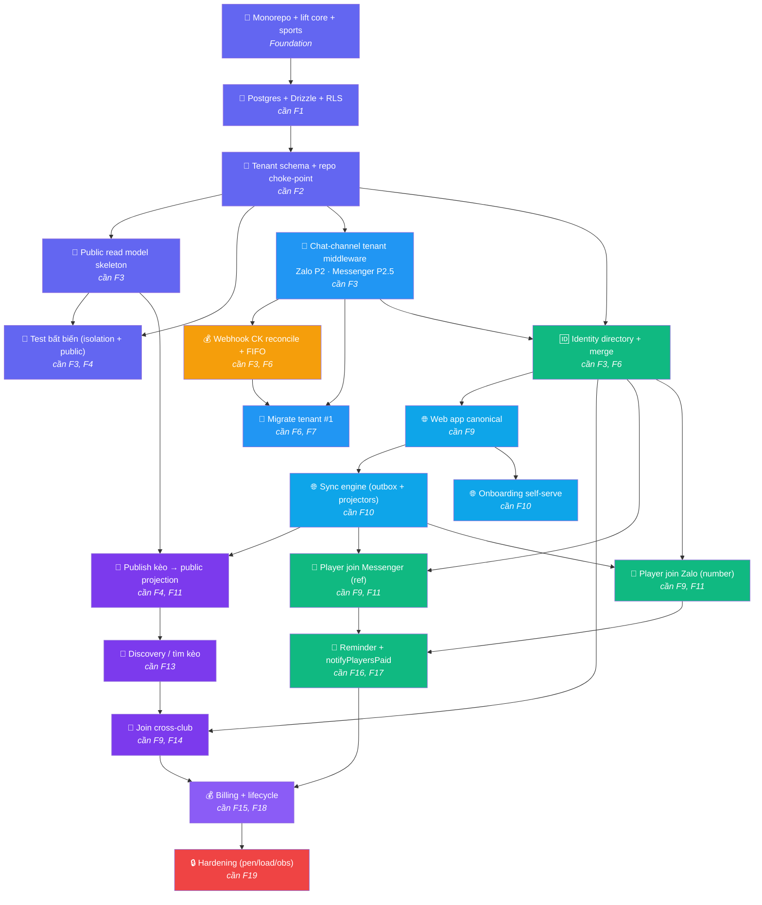

# Feature Dependency Graph — Plexco

> Thứ tự phát triển features cho Plexco platform. Căn cứ `ROADMAP.md` v2.7 + `TDD.md` v2.4.
> v1.3 · 2026-07-15 (DD-37: kênh chat = Zalo + Messenger, bỏ Telegram)

---

## Dependency Flow



**Color convention:**
- 🟣 Tím đậm — Foundation (P0–P1)
- 🟠 Cam — Payment module (P3)
- 🔵 Xanh dương — Tenant Engine (P2–P3)
- 🟢 Xanh lá — Identity (P3.5) + Player chat channels (Zalo P2 · Messenger P2.5 — Telegram bỏ, DD-37)
- 🔵 Xanh trời — Web + Sync (P4)
- 🟣 Tím nhạt — Marketplace (P4.3) + Billing (P5)
- 🔴 Đỏ — Hardening (P6)

---

## Dependency Matrix

| # | Feature | Phụ thuộc | Phase | Track | Ghi chú |
|---|---------|-----------|-------|-------|---------|
| 1 | Monorepo + lift `core` + `sports` | — (foundation) | P0 | 🏢 | Mọi feature phụ thuộc |
| 2 | Postgres + Drizzle + RLS | F1 | P0 | 🏢 | |
| 3 | Tenant schema + repo choke-point | F2 | P0–P1 | 🏢 | |
| 4 | Public read model skeleton | F3 | P0–P1 | 🏢 | `public_sessions` whitelist |
| 5 | Test bất biến (isolation + public) | F3, F4 | P0–P1 | 🏢 | CI gate |
| 6 | Chat-channel tenant middleware | F3 | P2 (Zalo) → P2.5 (Messenger) | 🏢 | Zalo + Messenger; Telegram bỏ (DD-37) |
| 7 | Webhook CK reconcile + FIFO | F3, F6 | P3 | 💰 | Module tiền killer |
| 8 | Migrate tenant #1 | F6, F7 | P3 | 🏢 | Dogfood |
| 9 | Identity directory + merge | F3, F6 | P3.5 | 🆔 | Person/ChannelIdentity |
| 10 | Web app canonical | F9 | P4 | 🌐 | Dashboard + player view |
| 11 | Sync engine (outbox/projectors) | F10 | P4 | 🌐 | 2-chiều mọi kênh |
| 12 | Onboarding self-serve | F10 | P4 | 🌐 | Google/email + SePay + Zalo + Messenger wizard |
| 13 | Publish kèo → public projection | F4, F11 | P4.3 | 🔎 | |
| 14 | Discovery / tìm kèo | F13 | P4.3 | 🔎 | Marketplace |
| 15 | Join cross-club | F9, F14 | P4.3 | 🔎 | open/approval |
| 16 | Player join Messenger (ref) | F9, F11 | P2.5 | 🎯 | Meta App Review (DD-37) |
| 17 | Player join Zalo (number) | F9, F11 | P2 | 🎯 | |
| 18 | Reminder + notifyPlayersPaid | F16, F17 | P4.5–P4.7 | 🎯 | |
| 19 | Billing + lifecycle | F15, F18 | P5 | 💰 | Subscription host |
| 20 | Hardening (pen/load/obs) | F19 | P6 | 🔒 | |

---

## Parallel Development

| Song song được | Điều kiện |
|---|---|
| F4 (public skeleton) + F5 (test) + F6 (chat-channel middleware) | Cả 3 chỉ phụ thuộc F3 |
| F10 (web) + F8 (migrate) | F10 phụ thuộc F9, F8 phụ thuộc F7 — khác nhánh |
| F12 (onboarding) + F13 (publish) | Cả 2 phụ thuộc F10/F11 |
| F16 (join Messenger) + F17 (join Zalo) | Cả 2 phụ thuộc F9 + F11 |

---

## Phase Breakdown

### Phase 0: "Foundation" (P0–P1)
```
F1 → F2 → F3 → F4
                ↗    → F5 (test)
```
> **Goal:** Nền multi-tenant an toàn + chiều đa môn + khung 3 tầng hiển thị.

### Phase 1: "Tenant Engine" (P2–P3)
```
F3 → F6 → F7 → F8 (dogfood)
```
> **Goal:** chat-channel middleware (Zalo/Messenger) phục vụ nhiều CLB; CK tự đối soát đúng tenant. Telegram bỏ (DD-37).

### Phase 2: "Identity" (P3.5)
```
F9 (cần F3, F6)
```
> **Goal:** Person toàn cục + merge an toàn.

### Phase 3: "Web + Sync + Marketplace" (P4 + P4.3)
```
F9 → F10 → F11 → F13 → F14 → F15
                → F12
```
> **Goal:** Web canonical + sync 2 chiều + marketplace discovery.

### Phase 4: "Player-side" (chat channels: Zalo P2 · Messenger P2.5 — DD-37)
```
F16 + F17 → F18
```
> **Goal:** Player join từ kênh chat (Zalo/Messenger) + nhắc/xác nhận tự động (nhắc = web + Zalo; Messenger 24h best-effort).

### Phase 5–6: "Billing + Harden"
```
F19 → F20
```
> **Goal:** Thu phí + pen-test + scale.

---

## Quy tắc

1. **Không skip dependency** — F7 cần F6, phải dev F6 xong trước.
2. **Test bất biến (F5)** — CI gate bắt buộc trước mọi feature sau F3.
3. **Cross-cutting** (security, i18n, observability) — build dần, không đợi cuối.
4. **Check graph trước mỗi sprint** — pick features đúng thứ tự.

---

## Changelog

| Ngày | Version | Thay đổi |
|------|---------|----------|
| 15/07/2026 | v1.3 | Reconcile F12 onboarding theo DD-37/DD-13: Google/email + SePay + Zalo + Messenger; bỏ TG khỏi ghi chú hiện hành. |
| 10/07/2026 | v1.2 | **DD-37:** F6 "TG tenant middleware" → "Chat-channel tenant middleware" (Zalo P2 · Messenger P2.5); F16 "Player join TG" → "Player join Messenger"; matrix/parallel/phase refs bỏ Telegram. Căn cứ ROADMAP v2.4 + TDD v2.2. Arrows/invariants giữ nguyên. |
| 19/06/2026 | — | Thêm Changelog table |
| 18/06/2026 | v1.0 | Feature dependency graph Mermaid |
