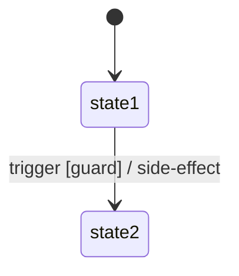

# Feature: {Tên tính năng} — Backend Tech Spec

> **Canonical phase:** Px  
> **Version:** x.y · YYYY-MM-DD  
> **Status:** Draft | Reviewed | Approved *(Reviewed ≡ Approved — đã qua review gate + DD)*  
> **Implementation:** Not started | In progress | Implemented | Verified — đồng bộ `../standards/BUILD-STATUS.md`; **Doc status ≠ Implementation status.**  
> **Product spec:** `../FE/feature_{name}.md` vX.Y  
> **References:** `../../standards/decisions.md` DD-xx · `../../standards/business-rules.md` BL-xxx · `../../standards/api-reference-convention.md` (DD-60 envelope)

> **Gate 3 chiều (trước khi Reviewed):** mọi claim kỹ thuật phải khớp cả ba: (a) bảng/claim trong spec ↔ (b) code snippet ↔ (c) live code/schema trên `main`. Sửa 1 → re-check 2 còn lại.

---

## 1. Tổng quan triển khai

{Mô tả flow dữ liệu end-to-end. Service/module mới hay reuse? Constraint quan trọng.}

```text
{Input} → {Process/Pipeline} → {Output} → {Side effects (SSE/webhook/cron)}
```

**Module structure:**

```text
apps/api/src/{feature}/
├── {feature}.module.ts      ← NestJS module (imports)
├── {feature}.controller.ts  ← REST endpoints
└── {feature}.service.ts     ← Business logic
```

> Registered in `AppModule.imports`.

{Design decisions quan trọng — VD: composition-only, read-only, hoặc owns state.}

### Entry points

> **Bắt buộc** (mọi spec — xem `../features/README.md` Document Convention). Mọi caller vào feature —
> route, worker/job (pg-boss), projector, webhook, slash command. Ánh xạ 1-1 với §3 API Contract và
> outbox consumers.

| Entry | Caller | Mô tả |
|-------|--------|-------|
| `POST /api/{resource}` | {Actor (web/Messenger)} | {Command / handler} |
| `{job}` (pg-boss) | System | {Scheduled/queued work} |
| Projectors ({channels}) | Outbox consumer | {Render canonical changes} |

---

## 2. Database Schema + Edge Cases (BE)

### Schema

**{Feature có bảng riêng? Hay read-only từ bảng sẵn có?}**

<!-- OPTION A: Feature có bảng riêng -->
```sql
CREATE TABLE {table_name} (
  id uuid PRIMARY KEY DEFAULT gen_random_uuid(),
  tenant_id uuid NOT NULL REFERENCES tenants(id),
  -- {columns}
  status text NOT NULL DEFAULT '{default}' CHECK (status IN ('{status1}', '{status2}')),
  created_at timestamptz NOT NULL DEFAULT now(),
  updated_at timestamptz NOT NULL DEFAULT now(),
  UNIQUE ({unique_constraint})
);

-- RLS
ALTER TABLE {table_name} ENABLE ROW LEVEL SECURITY;
ALTER TABLE {table_name} FORCE ROW LEVEL SECURITY;
```

<!-- OPTION B: Read-only — không bảng mới -->

| Nguồn | Qua contract | Ghi chú |
|-------|--------------|---------| 
| {table/service} | {Contract/query layer} | {Ownership note} |

### Indexes

```sql
CREATE INDEX idx_{table}_{column} ON {table_name}({column});
-- {Giải thích lý do index}
```

### Query Patterns

> Mỗi query pattern quan trọng PHẢI có SQL mẫu.

| Query | Table(s) | Filters | Usage |
|-------|----------|---------|-------|
| {queryName} | {table} | `{WHERE clause}` | {Mục đích} |

```sql
-- {queryName}
SELECT {columns}
FROM {table}
WHERE {conditions}
ORDER BY {sort}
LIMIT {limit};
```

> ⚠️ **KHÔNG** `FOR UPDATE` với `GROUP BY`/aggregate. Pattern đúng: lock parent row trước, rồi count riêng.

### Migration & Rollback

- **Migration:** `packages/db/migrations/{NNNN}_{name}.sql` — **monotonic, file mới** (không sửa migration đã apply); chứa ENABLE + FORCE RLS, policies, grants theo grant matrix. **Đối chiếu live schema/migrations trước khi viết.**
- **Rollback:**

| Bước | Hành động | An toàn? |
|------|-----------|----------|
| 1 | {Disable routes/cron liên quan} | {✅/⚠️} |
| 2 | {DROP TABLE / revert cột} | {✅ pre-GA / ⚠️ mất dữ liệu gì} |

### Edge Cases (Backend)

| # | Category | Case | Xử lý |
|---|----------|------|-------|
| 1 | Security | {VD: User truy cập data người khác} | {Solution — JWT guard, RLS} |
| 2 | Concurrency | {VD: Race condition trên cùng resource} | {Solution — transaction/lock} |
| 3 | Data Integrity | {VD: FK bị null do delete} | {Solution — ON DELETE behavior} |
| 4 | Data Integrity | {VD: Duplicate entries} | {Solution — dedup pattern} |
| 5 | Performance | {VD: N+1 query} | {Solution — batch/join} |
| 6 | Cross-Feature | {VD: Upstream entity thay đổi giữa request} | {Solution — eventual consistency / lock} |
| 7 | Infra | {VD: External service timeout} | {Solution — per-section degradation} |

> Minimum 12 edge cases, 4+ categories: Security, Concurrency, Data Integrity, Cross-Feature, Infra, Performance.

---

## 3. API Contract

### Endpoints

| Method | Path | Auth | Mô tả |
|--------|------|------|-------|
| {GET/POST} | /api/{resource} | {Auth level} | {Description} |

> Envelope chuẩn DD-60 (`{data, error, meta.requestId}`).

### Request/Response Examples

**{METHOD} `/api/{resource}`** — `200` (happy path):

```json
{
  "data": { "{key}": "{value}" },
  "error": null,
  "meta": { "requestId": "req_..." }
}
```

**{METHOD} `/api/{resource}`** — `200` (partial degradation — nếu aggregate):

```json
{
  "data": { "{section}": null, "{section}Reason": "UNAVAILABLE", "{other_section}": ["..."] },
  "error": null,
  "meta": { "requestId": "req_..." }
}
```

**Error** — `4xx`:

```json
{
  "data": null,
  "error": { "code": "{ERROR_CODE}", "message": "{Message tiếng Việt}", "statusCode": 400 },
  "meta": { "requestId": "req_..." }
}
```

### Idempotency

| Endpoint | Idempotent? | Key |
|----------|-------------|-----|
| {endpoint} | ✅/❌ | `{key / strategy}` |

### Rate Limits

| Endpoint | Limit | Scope |
|----------|-------|-------|
| {endpoint} | {N}/min | per {user/IP/tenant} |

### Error Codes

| Code | Error Code | Message | Trigger |
|------|-----------|---------|---------| 
| 400 | `{FEATURE}_{ENTITY}_{ERROR}` | {Message tiếng Việt, user-friendly} | {When} |
| 401 | `AUTH_REQUIRED` | Cần đăng nhập | No valid session |
| 429 | `RATE_LIMITED` | Quá nhiều yêu cầu | Rate limit exceeded |

> Mỗi validation rule trong DDL CHECK / service logic → PHẢI có error code tương ứng. Message tiếng Việt, cụ thể.

### Form Field Specs (nếu có form tạo/sửa)

| Field | Type | Required? | Default | Validation / Khi NULL |
|-------|------|-----------|---------|----------------------|
| {field} | {type} | ✅/Optional | {default} | {rules + NULL behavior} |

---

## 4. Chi tiết triển khai

### Composition / Business Logic

```text
1. {Step 1 — VD: resolve identity}           # {note}
2. parallel (per-section timeout ~2s):
   a. {query/compute A}                      # {ownership note}
   b. {query/compute B}                      # {ownership note}
   c. {query/compute C}                      # {note}
3. {compose/aggregate DTO}
4. {side effects — SSE/webhook/cron}
```

**Key logic details:**

**`{serviceName}.{methodName}(params)`:**
1. {Step 1}
2. {Step 2}
3. {Step 3 — edge case handling}

> Ghi rõ: N+1 query risks, dedup strategy, sort logic, parallel vs sequential.

**N+1 / Performance notes:**

```
{Mô tả N+1 risk nếu có}
- Giải pháp: {batch query / join / WHERE IN}
- Khi nào optimize: {threshold — VD: limit > 10 hoặc p95 > 200ms}
```

### State Machine (nếu có)

> Ref product spec §4. Implementation details — trigger, guard, side-effect per transition.



> Diagram PHẢI match DDL CHECK constraint. Terminal states ghi `(terminal)`.

### Scenarios by Status (nếu có)

| # | Scenario | Actor | Trigger | Kết quả |
|---|----------|-------|---------|---------| 
| {ST}-1 | {Scenario} | {Actor: User/Admin/System} | {Trigger} | {Result + status change} |

> Minimum 3 scenarios/status, tổng ≥20/feature. Cover: happy path, edge cases, admin actions, system auto-actions.

### Timeout/Expiry Spec (nếu có)

| Variant | Giá trị | Behavior khi timeout | Configurable? |
|---------|---------|---------------------|---------------|
| {variant} | {value cụ thể} | {auto-action + notification} | {min/max/default nếu admin thay đổi được} |

### Caching Strategy

| Data | Cache? | TTL | Invalidation | Lý do |
|------|--------|-----|-------------|-------|
| {data} | ✅/❌ | {ttl} | {trigger} | {Rationale — tại sao cache/không cache} |

> **Money operations:** KHÔNG cache entitlement/authorization — query DB trực tiếp mỗi lần.

### Security Checklist

> Đối chiếu auth-security-invariant-table + AUDIT nếu có.

| Mục | Trả lời trong spec |
|-----|---------------------|
| Authorization/ownership per-resource | {ai đọc/sửa được — RLS + service check} |
| Injection/validation | {input validate/sanitize, param binding} |
| Secret & log redaction | {secret nào đi qua flow; log gì bị cấm} |
| Webhook signature + replay | {HMAC, timestamp ±s} (nếu có webhook) |
| Idempotency | {ref §3 Idempotency} |
| Data retention/xoá | {row nào xoá được, giữ bao lâu, ai xoá} |

---

## 5. Testing Plan

### Unit Tests

| # | Test | Input | Expected |
|---|------|-------|----------|
| 1 | {Happy path — main flow} | {Input} | {Expected output} |
| 2 | {Auth — no session} | Unauthenticated | 401 |
| 3 | {Validation — invalid input} | {Bad input} | {Error code} |
| 4 | {Edge case — empty data} | {Empty state} | {Correct empty response} |
| 5 | {Edge case — boundary value} | {Boundary} | {Correct handling} |
| 6 | {Concurrency — race condition} | {Concurrent ops} | {Lock/dedup strategy works} |
| 7 | {Security — access control} | {Other user's data} | {Rejected / own data only} |

> Minimum 20 unit tests: happy path, validation errors, edge cases, rate limits, idempotent ops, security — **floor, không phải target**. High-risk (money/auth/PII): decision-table coverage + abuse/concurrency cases bắt buộc.

### Integration Tests

| # | Test | Setup | Expected |
|---|------|-------|----------|
| 1 | {Full flow E2E} | {Setup scenario} | {Expected end state} |
| 2 | {Cross-service consistency} | {Upstream change → query} | {Reflects latest state} |
| 3 | {Auth guard} | {No JWT} | 401 |
| 4 | {Data isolation} | {2 users, seed chéo} | {A không thấy B} |

> Minimum 4 integration tests cho multi-step flows.

---

## 6. Rollout Plan + Changelog

### Rollout

1. {Pre-requisite — VD: dependency service phải stable trước}
2. {Migration — apply in staging}
3. {Feature flag — gate route}
4. {Internal test — verify fixtures}
5. {GA — bật cho users}

### Metrics

- {Key metric 1 — VD: endpoint p95 latency}
- {Key metric 2 — VD: per-section failure rate}
- {Key metric 3 — VD: error rate by code}

### Phase 2+ Enhancement Path (nếu có)

| Enhancement | Mô tả | Khi nào |
|-------------|-------|---------|
| {Enhancement 1} | {Description} | {Phase/trigger} |

### Changelog

| Date | Version | Thay đổi |
|---|---|---|
| YYYY-MM-DD | vx.y | {Category: summary. Counts: N tables, N queries, N edge cases, N tests.} |
