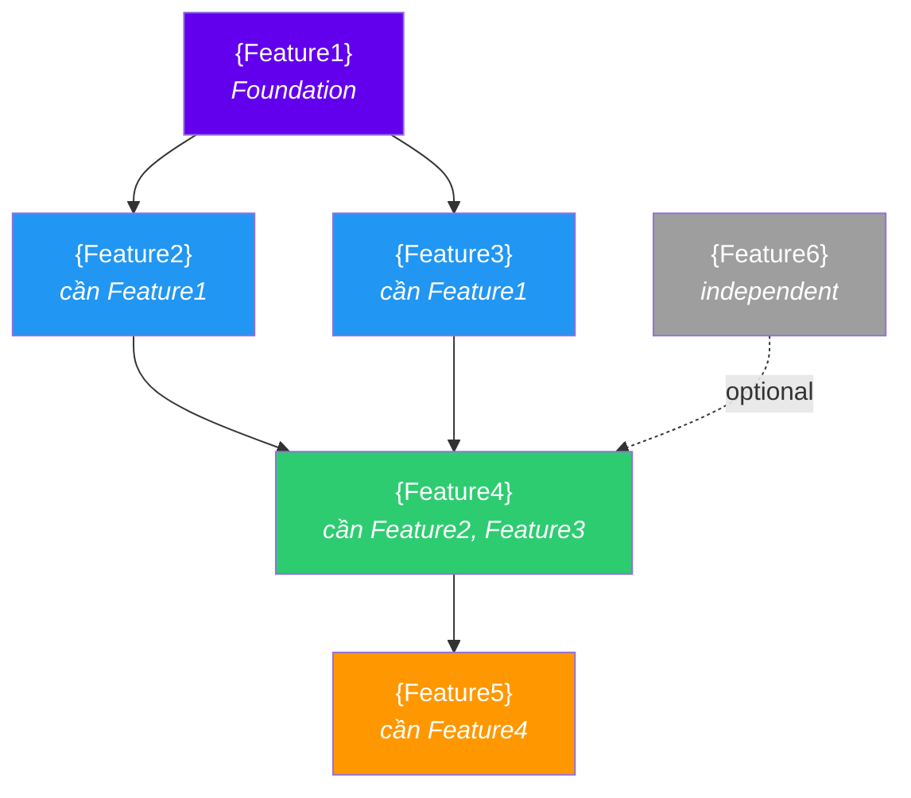

# Feature Dependency Graph — Template

> Template để lập thứ tự phát triển features cho bất kỳ project nào.
> Copy file này, thay {placeholders}, vẽ dependency graph theo project cụ thể.

---

## Cách dùng

1. **Liệt kê features** từ BRD / PRD
2. **Xác định dependency** — feature nào cần feature nào xong trước
3. **Vẽ graph** bằng Mermaid (syntax bên dưới)
4. **Chia phases** theo roadmap / business priority
5. **Xác định parallel tracks** — features nào dev song song được

---

## Template: Dependency Flow

> Thay {FeatureN} bằng tên feature thật. Thêm/bớt nodes tùy project.

> **Color convention (gợi ý):**
> - 🟣 Tím — Foundation
> - 🔵 Xanh — Core features
> - 🟢 Xanh lá — Revenue / monetization
> - 🟠 Cam — Engagement / growth
> - ⚪ Xám — Independent / cross-cutting

---

## Template: Dependency Matrix

| # | Feature | Phụ thuộc | Phase | Ghi chú |
|---|---------|-----------|-------|---------|
| 1 | {Feature1} | — (foundation) | Phase 1 | Mọi feature khác phụ thuộc |
| 2 | {Feature2} | Feature1 | Phase 1 | |
| 3 | {Feature3} | Feature1 | Phase 1 | |
| 4 | {Feature4} | Feature2, Feature3 | Phase 1 | |
| 5 | {Feature5} | Feature4 | Phase 2 | |
| 6 | {Feature6} | — (independent) | Phase 2–3 | Dev bất kỳ lúc nào |

---

## Template: Parallel Development

| Song song được | Điều kiện |
|---|---|
| Feature2 + Feature3 | Cả 2 chỉ phụ thuộc Feature1, không phụ thuộc nhau |
| {FeatureA} + {FeatureB} | {Điều kiện} |

---

## Quy tắc chung

1. **Không skip dependency** — nếu Feature4 cần Feature2, phải dev Feature2 xong trước.
2. **Cross-cutting features** (notification, analytics, logging) — build dần theo từng feature, không đợi cuối.
3. **Independent features** — dev bất kỳ lúc nào khi có resource.
4. **Check graph trước mỗi sprint** — pick features đúng thứ tự.
5. **Copy `feature-checklist.md`** cho mỗi feature được chọn.
