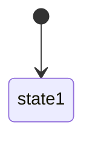

# Feature: {Tên tính năng} — Product/UX Spec

> **Canonical phase:** Px  
> **Track:** {emoji} {Track name}  
> **Version:** x.y · YYYY-MM-DD  
> **Status:** Draft | Reviewed | Approved  
> **Prerequisites:** Px–Py stable  
> **Tài liệu liên quan:** `../product/BRD.md` FR-x · `../product/PRD.md` §x · `../standards/business-rules.md` BL-xxx · `BE/feature_{name}_tech.md`

---

## 1. Mô tả

{Mục tiêu feature. Giải quyết pain-point gì cho ai. Invariants/bất biến.}

### Bất biến

- {Constraint cứng không bao giờ vi phạm}

---

## 2. Use Cases + Edge Cases

### Use Cases

| ID | Actor | Hành động | Kết quả |
|---|---|---|---|
| {FT}-UC-1 | {Actor} | {Action} | {Result} |

> Minimum 8 use cases, cover: happy path, alternative, mutation, cleanup, cross-actor.

### Edge Cases

| # | Category | Case | Hành vi bắt buộc |
|---|----------|------|-------------------|
| 1 | {Security/Data/Concurrency/UX} | {Case} | {Required behavior}. Ref: {BL/AUDIT} |

> Minimum 10 edge cases, 4+ categories.

---

## 3. Screens & States

| Surface | Loading | Ready | Error | Empty |
|---------|---------|-------|-------|-------|
| {Screen/route} | {Skeleton/spinner} | {Main state} | {Error handling} | {Empty state} |

> Mỗi screen cover đủ 4 states. Nếu Empty = N/A → ghi rõ.

---

## 4. Domain Model

| Entity | Vai trò | Key constraints |
|--------|---------|-----------------|
| {table} | {role} | {UNIQUE, CHECK, FK} |

> Section này là shared ground truth — BE tech doc §2 extends nó với DDL/indexes.

### State machines (nếu có)

---

## 5. Analytics Events

| Event | Khi nào | Payload tối thiểu |
|-------|---------|-------------------|
| `{feature}_{action}_{result}` | {Trigger} | {Fields — no PII} |

> Naming convention: `{feature}_{action}_{result}`.

---

## 6. Acceptance Criteria

- [ ] {Criterion — testable, measurable}

---

## 7. Open Questions / Changelog

### Open Questions

| ID | Quyết định | Trạng thái |
|---|---|---|
| {FT}-OQ-1 | {Question} | ⬜ Chưa chốt / ✅ Đã chốt |

### Changelog

| Date | Version | Thay đổi |
|---|---|---|
| YYYY-MM-DD | vx.y | {What changed} |
