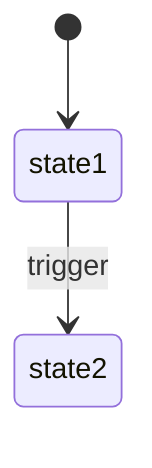

# Feature: {Tên tính năng} — Product/UX Spec

> **Canonical phase:** Px  
> **Track:** {emoji} {Track name}  
> **Version:** x.y · YYYY-MM-DD  
> **Status:** Draft | Reviewed | Approved *(Reviewed ≡ Approved — đã qua review gate + DD)*  
> **Implementation:** Not started | In progress | Implemented | Verified — đồng bộ `../../standards/BUILD-STATUS.md`; **Doc status ≠ Implementation status.**  
> **Prerequisites:** Px–Py stable  
> **Tài liệu liên quan:** `../../product/BRD.md` FR-x · `../../standards/decisions.md` DD-xx · `../BE/feature_{name}_tech.md`

---

## 1. Mô tả

{Mục tiêu feature. Giải quyết pain-point gì cho ai. 2-3 câu ngắn gọn.}

**{Feature} là {vai trò trong hệ thống}:** {mô tả ngắn — feature này own gì, consume gì, KHÔNG làm gì.}

### Entry points

> **Bắt buộc** (mọi spec — xem `../features/README.md` Document Convention). Liệt kê đủ mọi đường vào
> feature — route, tab, deep link, bot command, notification, chat link — để reviewer thấy đủ surface
> trước khi đọc Screens. Đừng bỏ sót bot/notification nếu feature có.

| Entry | Route / Surface | Actor | Mô tả |
|-------|----------------|-------|-------|
| {VD: Home tab → hero card} | `/` → tap hero | {Player} | {Điều hướng tới đâu} |
| {VD: Bot command} | `/command` (Zalo/Messenger) | {Actor} | {Hành động} |
| {VD: Deep link} | `/path/:id` | {Any (auth-gated)} | {Direct navigate to detail} |
| {VD: Notification tap} | Push/Inbox → deep link | {Actor} | {Navigate tới đâu} |

### Bất biến

- {Constraint cứng không bao giờ vi phạm — security/data boundary}
- {Data source constraint — feature lấy data từ đâu, KHÔNG tự tạo data từ đâu}
- {Display constraint — i18n, money formatting, etc.}

---

## 2. Use Cases + Edge Cases

### Use Cases

| ID | Actor | Hành động | Kết quả |
|---|---|---|---|
| {FT}-UC-1 | {Actor} | {Action} | {Result — mô tả rõ navigation/state change} |
| {FT}-UC-2 | {Actor} | {Action} | {Result} |
| {FT}-UC-3 | {Actor} | {Action} | {Result} |

> Minimum 8 use cases, cover: happy path, alternative, mutation, cleanup, cross-actor.
> Mỗi use case có nhiều actors → ghi rõ actor + result khác nhau (VD: UC-4 Player, UC-4b Host).

### Edge Cases

| # | Category | Case | Hành vi bắt buộc |
|---|----------|------|-------------------|
| 1 | Security | {VD: Client gửi ID giả} | ❌ {Required behavior} |
| 2 | Data | {VD: Dữ liệu rỗng/null} | {Required behavior} |
| 3 | Cross-Feature | {VD: Entity bị thay đổi khi đang xem} | {Required behavior} |
| 4 | Network | {VD: Mất kết nối} | {Required behavior} |
| 5 | Concurrency | {VD: 2 users thao tác cùng lúc} | {Required behavior} |
| 6 | Money/Data | {VD: Dữ liệu tài chính unavailable} | {Required behavior — fail-safe} |

> Minimum 10 edge cases, 4+ categories. Feature money/auth/PII: bắt buộc decision table cho mọi nhánh tiền/quyền + abuse cases.

---

## 3. Screens & States

> Coverage matrix `state × role`: screen dữ liệu động → đủ 4-5 states; dark theo token. Mobile-first 375px; desktop ≥1024 note layout differences nếu có.

### {ScreenName}

**Purpose:** {1 dòng — screen này dùng để làm gì.}

**Layout (mobile, tham chiếu — số đo chốt ở design file):**

```
┌──────────────────────────────────────┐
│ [Header component]            💬 🔔  │  {height}px
│ ┌──────────────┐  ┌───────────────┐ │
│ │ {Component A} │  │ {Component B} │ │  {height}px  ← {component description}
│ │ {data}        │  │ {data}        │ │
│ └──────────────┘  └───────────────┘ │
│ ┌──────────────────────────────────┐ │
│ │ {Main content area}              │ │  {height}px
│ │ {content description}            │ │
│ └──────────────────────────────────┘ │
│ {Section title}              Xem → │
│ · {list item 1}                      │  {description}
│ · {list item 2}                      │
├──────────────────────────────────────┤  {height}px
│  {nav tab 1}  {nav tab 2}  ...      │
└──────────────────────────────────────┘
```

**Component spec tables:**

> Liệt kê TỪNG component có logic/state riêng. Mỗi component cần: mapping table, data source, conditional behavior.

**{Component A} — {mô tả ngắn}:**

| Variant | Hiển thị | Data source | Tap action |
|---------|----------|-------------|------------|
| {VD: State 1} | {Visual} | {API field / computed} | {→ route} |
| {VD: State 2} | {Visual} | {API field} | {→ route} |

**{Component B} — {mô tả ngắn}:**

| Điều kiện | Hiển thị |
|-----------|----------|
| {Condition 1} | {Visual output} |
| {Condition 2} | {Visual output} |

**Selection / Priority logic (nếu component có adaptive/dynamic behavior):**

| Scenario | Slot 1 | Slot 2 |
|----------|--------|--------|
| {Condition A} | {Component variant} | {Component variant} |
| {Condition B} | {Component variant} | {Component variant} |

**Data source mapping:**

| Component | Data source | Ghi chú |
|-----------|-------------|---------|
| {Component A} | {API field / canonical contract} | {ownership note} |
| {Component B} | {API field} | {derivation note nếu computed} |

**{Logic name} (VD: Streak, countdown, selection):**

```
{Pseudocode hoặc mô tả logic ngắn gọn}
VD:
streak = 0
for each day from today backward:
  if user has session → streak++
  else → break
Display: "🔥 {streak}-day streak"
Zero: chip ẩn (fallback sang chip tiếp theo trong priority)
```

**4-5 States:**

| State | Nội dung |
|-------|----------|
| Loading | Skeleton shimmer giữ đúng layout: {liệt kê cụ thể từng skeleton block} |
| Ready | Full layout — {mô tả ngắn} |
| Error | {Toast/banner pattern} + retry; {data handling — cached hay clear?} |
| Empty | {Empty state cụ thể: components nào hiện, CTA nào, route nào} |
| {Variant} | {VD: Onboarding — mô tả biến thể nếu có} |

**{State} layout:**

> Vẽ ASCII layout cho MỖI state khác Ready (Empty, Onboarding, Loading). Ready đã có layout chính ở trên.

```
┌──────────────────────────────────────┐
│ {ASCII layout cho state này}          │
│ {Ghi chú bên phải mỗi vùng}          │
└──────────────────────────────────────┘
```

**{Variant} checklist/logic (nếu có multi-step state):**

| Step | Label | Trigger hoàn thành | Tap action |
|------|-------|-------------------|------------|
| 1 | {Step name} | {Condition} | {→ route / disabled} |
| 2 | {Step name} | {Condition} | {→ route} |

Auto-dismiss: {điều kiện chuyển state}.

**Navigation / Shell (nếu feature là container/dashboard):**

| Slot | Tab | Route/đích | Phase |
|------|-----|-----------|----|
| 1 | {icon} {Label} | {Route description} | ✅/⛔ |

---

## 4. Domain Model

> Section này là **shared ground truth** — BE tech doc §2 extends nó với DDL/indexes/queries.

**{Mô tả ngắn: feature có bảng riêng không, hay read-only từ contract sẵn có?}**

| Nguồn / Entity | Dữ liệu trên feature | Contract / Key constraints |
|----------------|----------------------|---------------------------|
| {table/service} | {What data} | {Contract ref / FK / constraint} |

### State machines (nếu có)



---

## 5. Analytics Events

| Event | Khi nào | Payload tối thiểu |
|-------|---------|-------------------|
| `{feature}_viewed` | Mở {feature} | `state` (ready/empty/error/...) |
| `{feature}_{component}_tapped` | Tap {component} | `{context_field}` |
| `{feature}_{action}_completed` | Hoàn thành {action} | — |

> Naming: `{feature}_{action}` hoặc `{feature}_{component}_{action}`.
> **Opaque IDs only — không PII trong analytics payload.**

---

## 6. Acceptance Criteria

> Tách thành sub-sections để dễ track. Mỗi criterion testable + measurable.

### Functional

- [ ] {Core functionality criterion — data correctness}
- [ ] {Component behavior criterion — conditional rendering}
- [ ] {Navigation criterion — tap → correct route}
- [ ] {Real-time / refresh criterion}

### States

- [ ] Loading: {skeleton shimmer cụ thể — liệt kê từng block}
- [ ] Ready: {full data hiển thị chính xác}
- [ ] Error: {pattern + retry behavior}
- [ ] Empty: {components hiện + CTA}
- [ ] {Variant}: {state-specific behavior}

### UI/UX

- [ ] Mọi string `t(vi,en)`; touch target ≥ 44px
- [ ] {Color / token usage criterion}
- [ ] {Dark mode criterion}
- [ ] {Responsive criterion — nếu không phải mobile-only}

### Analytics

- [ ] Mọi event trong §5 fire đúng trigger + payload
- [ ] Opaque IDs only — không PII trong analytics payload

---

## 7. Open Questions / Changelog

### Open Questions

| ID | Quyết định | Trạng thái |
|---|---|---|
| {FT}-OQ-1 | {Question / Decision needed} | ⬜ Chưa chốt / 🟡 Direction ✅ mechanism 🟡 / ✅ Đã chốt {DD ref} |

### Changelog

| Date | Version | Thay đổi |
|---|---|---|
| YYYY-MM-DD | vx.y | {What changed — structural, not cosmetic} |
