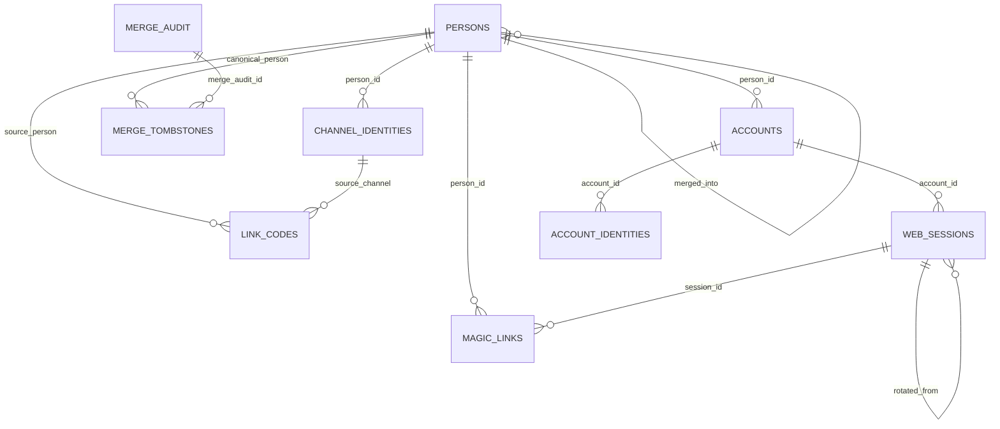
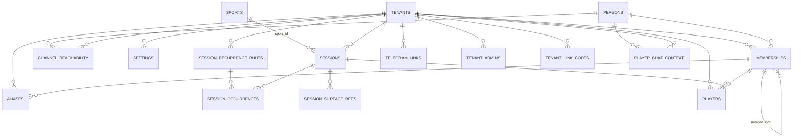
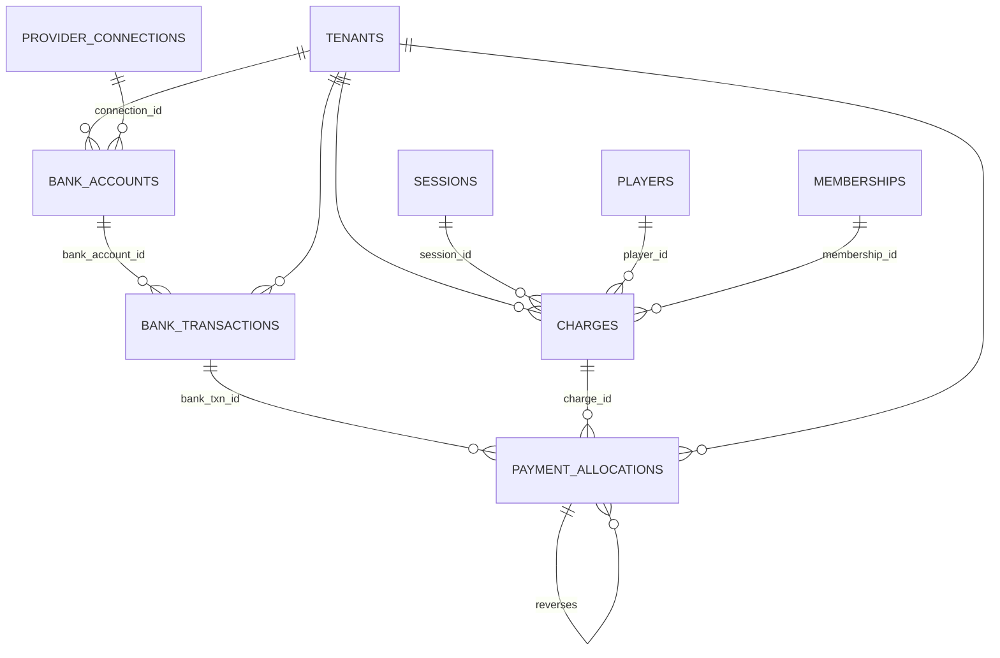
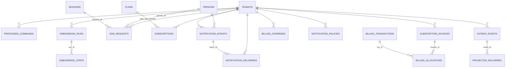

# Plexco — Sơ đồ quan hệ DB (ERD)

Sinh trực tiếp từ các FK trong `packages/db/migrations/*.sql` — **51 bảng, 75 quan hệ**.
Ký hiệu: `A ||--o{ B` = một dòng A có nhiều dòng B (B tham chiếu A); nhãn là cột FK.

> Mẹo xem: file `.md` này render Mermaid ngay trong Cowork. Để xem tương tác (kéo/zoom),
> dùng `db.dbml` ở cuối → dán vào https://dbdiagram.io, hoặc chạy **Drizzle Studio**
> (`npx drizzle-kit studio`) / **DBeaver** trên DB thật.

---

## 1. Toàn bộ quan hệ (full)

```mermaid
erDiagram
  PERSONS ||--o{ PERSONS : "merged_into"
  PERSONS ||--o{ CHANNEL_IDENTITIES : "person_id"
  PERSONS ||--o{ LINK_CODES : "source_person"
  CHANNEL_IDENTITIES ||--o{ LINK_CODES : "source_channel"
  PERSONS ||--o{ MERGE_TOMBSTONES : "canonical_person"
  MERGE_AUDIT ||--o{ MERGE_TOMBSTONES : "merge_audit_id"
  PERSONS ||--o{ ACCOUNTS : "person_id"
  ACCOUNTS ||--o{ WEB_SESSIONS : "account_id"
  WEB_SESSIONS ||--o{ WEB_SESSIONS : "rotated_from"
  ACCOUNTS ||--o{ ACCOUNT_IDENTITIES : "account_id"
  PERSONS ||--o{ MAGIC_LINKS : "person_id"
  WEB_SESSIONS ||--o{ MAGIC_LINKS : "session_id"
  TENANTS ||--o{ MEMBERSHIPS : "tenant_id"
  PERSONS ||--o{ MEMBERSHIPS : "person_id"
  MEMBERSHIPS ||--o{ MEMBERSHIPS : "merged_into"
  TENANTS ||--o{ ALIASES : "tenant_id"
  MEMBERSHIPS ||--o{ ALIASES : "membership_id"
  PERSONS ||--o{ CHANNEL_REACHABILITY : "person_id"
  TENANTS ||--o{ CHANNEL_REACHABILITY : "tenant_id"
  TENANTS ||--o{ SETTINGS : "tenant_id"
  TENANTS ||--o{ SESSIONS : "tenant_id"
  SPORTS ||--o{ SESSIONS : "sport_id"
  TENANTS ||--o{ SESSION_RECURRENCE_RULES : "tenant_id"
  SESSION_RECURRENCE_RULES ||--o{ SESSION_OCCURRENCES : "rule_id"
  SESSIONS ||--o{ SESSION_OCCURRENCES : "session_id"
  TENANTS ||--o{ SESSION_SURFACE_REFS : "tenant_id"
  SESSIONS ||--o{ SESSION_SURFACE_REFS : "session_id"
  TENANTS ||--o{ PLAYERS : "tenant_id"
  SESSIONS ||--o{ PLAYERS : "session_id"
  MEMBERSHIPS ||--o{ PLAYERS : "membership_id"
  TENANTS ||--o{ TELEGRAM_LINKS : "tenant_id"
  PERSONS ||--o{ TELEGRAM_LINKS : "linked_by"
  TENANTS ||--o{ TENANT_ADMINS : "tenant_id"
  TENANTS ||--o{ TENANT_LINK_CODES : "tenant_id"
  PERSONS ||--o{ PLAYER_CHAT_CONTEXT : "person_id"
  TENANTS ||--o{ PLAYER_CHAT_CONTEXT : "tenant_id"
  TENANTS ||--o{ BANK_ACCOUNTS : "tenant_id"
  PROVIDER_CONNECTIONS ||--o{ BANK_ACCOUNTS : "connection_id"
  TENANTS ||--o{ CHARGES : "tenant_id"
  SESSIONS ||--o{ CHARGES : "session_id"
  PLAYERS ||--o{ CHARGES : "player_id"
  MEMBERSHIPS ||--o{ CHARGES : "membership_id"
  TENANTS ||--o{ BANK_TRANSACTIONS : "tenant_id"
  BANK_ACCOUNTS ||--o{ BANK_TRANSACTIONS : "bank_account_id"
  TENANTS ||--o{ PAYMENT_ALLOCATIONS : "tenant_id"
  BANK_TRANSACTIONS ||--o{ PAYMENT_ALLOCATIONS : "bank_txn_id"
  CHARGES ||--o{ PAYMENT_ALLOCATIONS : "charge_id"
  PAYMENT_ALLOCATIONS ||--o{ PAYMENT_ALLOCATIONS : "reverses"
  TENANTS ||--o{ PROVIDER_CONNECTIONS : "tenant_id"
  TENANTS ||--o{ OAUTH_TRANSACTIONS : "tenant_id"
  TENANTS ||--o{ ZALO_BOTS : "tenant_id"
  PERSONS ||--o{ ZALO_REPLY_CONTEXTS : "person_id"
  TENANTS ||--o{ ZALO_REPLY_CONTEXTS : "tenant_id"
  ZALO_BOTS ||--o{ ZALO_REPLY_CONTEXTS : "bot_id"
  TENANTS ||--o{ MESSENGER_PAGES : "tenant_id"
  TENANTS ||--o{ PROCESSED_COMMANDS : "tenant_id"
  TENANTS ||--o{ OUTBOX_EVENTS : "tenant_id"
  OUTBOX_EVENTS ||--o{ PROJECTOR_DELIVERIES : "event_id"
  TENANTS ||--o{ JOIN_REQUESTS : "tenant_id"
  SESSIONS ||--o{ JOIN_REQUESTS : "session_id"
  PERSONS ||--o{ JOIN_REQUESTS : "person_id / decided_by"
  TENANTS ||--o{ SUBSCRIPTIONS : "tenant_id"
  PLANS ||--o{ SUBSCRIPTIONS : "plan_key+version"
  TENANTS ||--o{ SUBSCRIPTION_INVOICES : "tenant_id"
  BILLING_TRANSACTIONS ||--o{ BILLING_ALLOCATIONS : "transaction_id"
  SUBSCRIPTION_INVOICES ||--o{ BILLING_ALLOCATIONS : "invoice_id"
  TENANTS ||--o{ BILLING_OVERRIDES : "tenant_id"
  TENANTS ||--o{ NOTIFICATION_POLICIES : "tenant_id"
  TENANTS ||--o{ NOTIFICATION_INTENTS : "tenant_id"
  PERSONS ||--o{ NOTIFICATION_INTENTS : "person_id"
  TENANTS ||--o{ NOTIFICATION_DELIVERIES : "tenant_id"
  NOTIFICATION_INTENTS ||--o{ NOTIFICATION_DELIVERIES : "intent_id"
  TENANTS ||--o{ ONBOARDING_RUNS : "tenant_id"
  ONBOARDING_RUNS ||--o{ ONBOARDING_STEPS : "run_id"
  PUBLIC_SESSIONS }o..o{ SESSIONS : "projection (no FK)"
  SURFACE_REFS }o..o{ OUTBOX_EVENTS : "by aggregate_id (no FK)"
```



> `PUBLIC_SESSIONS` và `SURFACE_REFS` **không có FK** (read-model / khoá theo
> `aggregate_id`) — vẽ bằng nét đứt để thể hiện liên kết logic, không phải ràng buộc DB.

---

## 2. Nhóm Identity & Web Auth (GLOBAL protected)



## 3. Nhóm Tenant Core: sessions / members / players / routing



## 4. Nhóm Payments ledger (append-only)



## 5. Nhóm Sync / Discovery / Billing / Notifications



---

## Cách xem tương tác (ngoài file này)

| Cách | Lệnh / link | Ghi chú |
|---|---|---|
| **dbdiagram.io** | dán `db.dbml` (cùng thư mục) | kéo-thả, zoom, export PNG/PDF — trực quan nhất |
| **Drizzle Studio** | `npx drizzle-kit studio` | đọc `schema.ts`, xem bảng + dữ liệu live |
| **DBeaver / pgAdmin** | kết nối DB đã migrate | ER Diagram tự sinh từ FK thật |
| **Mermaid Live** | https://mermaid.live | dán block ở mục 1 để export SVG |
```
